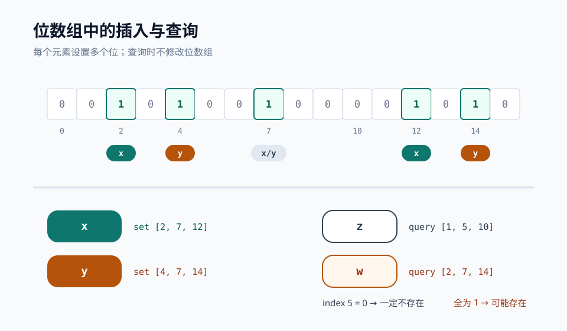
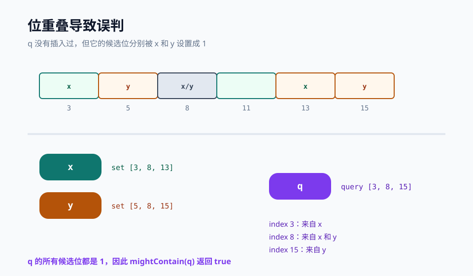

# Bloom Filter：用位数组回答“一定不存在”和“可能存在”

## 一句话理解 Bloom Filter

Bloom Filter（布隆过滤器）是一个空间效率很高的概率型集合。它不能精确列出集合里的所有元素，只能回答成员关系问题：

* 如果说 **不存在**，这个元素一定没有被插入过；
* 如果说 **可能存在**，元素可能真的存在，也可能只是多个已插入元素的位刚好重叠。

它把元素映射到一个位数组中的若干位置，而不是保存元素本身。因此，哪怕集合里有上亿个 key，每个元素占用的空间也可能只有十几 bit。这个特点让 Bloom Filter 常用于缓存穿透防护、爬虫 URL 去重、海量 key 粗筛和存储引擎的磁盘读优化。

<!--more-->

### 基本结构

Bloom Filter 维护两个核心参数：

* `m`：位数组长度；
* `k`：哈希函数个数。

初始时，所有 `m` 个位都设置为 0。插入元素 `x` 时，依次计算：

```text
h1(x), h2(x), ..., hk(x) mod m
```

并把对应的 `k` 个位设置成 1。查询元素 `y` 时，同样计算这 `k` 个位置：

* 只要有一个位是 0，说明 `y` 一定没有插入过；
* 如果 `k` 个位都是 1，只能说明 `y` **可能存在**。

下图里，`x` 和 `y` 插入后设置了几处公共位。`z` 的某个候选位仍是 0，所以它一定不存在；`w` 的候选位都被别的元素置成 1，所以查询结果只能是“可能存在”。



伪代码可以写成：

```text
function insert(x):
    for i in 1..k:
        bits[h_i(x) mod m] = 1

function mightContain(x):
    for i in 1..k:
        if bits[h_i(x) mod m] == 0:
            return definitely_absent
    return maybe_present
```

注意，Bloom Filter 的“可能存在”不能继续证明成“一定存在”。如果查询元素的所有候选位都被其他元素设置过，它就会产生误判，也就是 false positive。

### 为什么会误判

误判来自位共享。不同元素的哈希结果可能落在同一个位置；当位数组越来越满，一个未插入元素的 `k` 个候选位恰好都已经被置 1 的概率也会升高。

假设 `x` 和 `y` 已经插入。`q` 从未插入，但它的三个候选位分别被 `x`、`x/y`、`y` 占用：



这不是实现 bug，而是 Bloom Filter 用空间换精确性的固有代价。它只提供单向保证：

```text
false == definitely absent
true  == possibly present
```

### 误判率推导

假设哈希函数足够均匀，任意一个哈希值落到某个位的概率是 `1 / m`。插入一个元素时，某个哈希函数不命中这个位的概率是：

$$
1-\frac{1}{m}
$$

一个元素会尝试 `k` 个位置。插入 `n` 个元素后，某个位仍然为 0 的概率约为：

$$
\left(1-\frac{1}{m}\right)^{kn} \approx e^{-kn/m}
$$

因此某个位为 1 的概率约为：

$$
1-e^{-kn/m}
$$

一个不存在集合中的元素，需要连续 `k` 次都命中值为 1 的位，才会被误判为“可能存在”。误判率是：

$$
p = \left(1-e^{-kn/m}\right)^k
$$

可以看出，`m` 越大，误判率越低；但 `k` 并不是越多越好。哈希函数太多会消耗更多计算时间，也会让位数组更快变满。

### 选择 m 和 k

对误判率求最小值，可以得到理论最优哈希函数个数：

$$
k = \frac{m}{n}\ln 2
$$

其中 `n` 是预期插入元素数量。反过来，给定目标误判率 `p`，可以推导出每个元素大约需要的位数：

$$
\frac{m}{n} = -\frac{\ln p}{(\ln 2)^2}
$$

几个常见目标的估算如下：

| 目标误判率 | 每个元素位数 `m/n` | 理论最优 `k` | 实现中常取 |
| --- | ---: | ---: | ---: |
| 10% | 4.79 | 3.32 | 3 |
| 1% | 9.59 | 6.64 | 7 |
| 0.1% | 14.38 | 9.96 | 10 |

也就是说，如果希望 100 万元素大约有 1% 误判率，通常可以给过滤器约 120 万字节，也就是每个元素不到 10 bit。这比保存完整字符串或对象小得多。

需要注意，公式假设哈希函数独立且均匀。真实实现里的哈希质量、插入数量超出预期、并发写入方式都会影响实际误判率。

### 为什么不能删除

普通 Bloom Filter 不能安全删除元素。如果把某个元素对应的位从 1 改回 0，可能会影响其他元素。

例如 `x` 和 `y` 都映射到第 7 位。删除 `x` 时把第 7 位清成 0，之后查询 `y` 就可能错误地返回“一定不存在”。这会违反 Bloom Filter 最基本的单向保证，也就是引入 false negative。

如果确实需要删除，可以考虑 Counting Bloom Filter。它不用 1 bit 表示一个位置，而是用一个小计数器；插入时递增，删除时递减。代价是空间明显增加，还要处理计数器溢出。

### Guava 示例

Java 里最常用的实现之一是 Guava 的 `BloomFilter`。创建时最好明确预期数量和目标误判率：

```java
import com.google.common.hash.BloomFilter;
import com.google.common.hash.Funnels;

import java.nio.charset.StandardCharsets;

BloomFilter<String> filter = BloomFilter.create(
        Funnels.stringFunnel(StandardCharsets.UTF_8),
        1_000_000L,   // expectedInsertions
        0.01);        // falsePositiveProbability

filter.put("user:1001");
filter.put("user:1002");

boolean mayExist = filter.mightContain("user:1001");
boolean definitelyNotExist = !filter.mightContain("user:9999");
```

`expectedInsertions` 不是硬限制。超过这个数量后过滤器仍能插入，但位数组会越来越满，实际误判率会逐渐偏离创建时指定的目标。因此容量规划要留余量，或者在数量增长不可控时重建更大的过滤器。

### 典型使用场景

**缓存穿透防护**

恶意请求可能携带大量不存在的 key。每次都打到数据库会造成很大压力。可以先查 Bloom Filter：

* 过滤器返回不存在，直接返回业务上的空结果；
* 过滤器返回可能存在，再查缓存和数据库。

**爬虫 URL 去重**

网页 URL 数量可能达到数亿。Bloom Filter 不需要保存完整 URL，只要判断一个 URL 是否大概率已经抓取过，就能显著减少内存占用。

**存储引擎读放大优化**

LSM-Tree、RocksDB、Cassandra、HBase 等系统可以在 SSTable 或 memtable 上建立 Bloom Filter。查询不存在的 key 时，先被过滤器排除，避免读取更多磁盘块。

### 什么时候不适合

Bloom Filter 很省空间，但它不是普通集合的替代品：

* 不能列出所有已插入元素；
* 不能返回元素本身；
* 不能精确删除；
* 结果里有 false positive；
* 容量误估后重建成本较高；
* 哈希函数质量差会明显拉高误判率。

如果你需要精确判断，或者业务无法容忍任何误判，就仍然需要哈希表、有序表或数据库唯一索引。Bloom Filter 更适合挡在最前面，先排除大量一定不存在的请求。

### 和 Cuckoo Filter 的关系

Cuckoo Filter 可以看作另一类近似集合。它保存的是指纹，并通过 bucket 和 slot 组织数据；在许多场景下支持删除，且查询路径也很短。

一个粗略选择是：

* 只需要成员粗筛，空间最小，允许误判：Bloom Filter；
* 需要删除，或希望误判行为更接近 bucket 化哈希：Cuckoo Filter。

两者都不是精确集合。使用前最重要的还是确认业务能否容忍 false positive。

---
## 参考资料

- [Bloom, Space/Time Trade-offs in Hash Coding with Allowable Errors](https://dl.acm.org/doi/10.1145/362686.362692)
- [Wikipedia: Bloom filter](https://en.wikipedia.org/wiki/Bloom_filter)
- [Guava BloomFilter Javadoc](https://guava.dev/releases/snapshot/api/docs/com/google/common/hash/BloomFilter.html)
- [Cao et al., Summary Cache: A Scalable Wide-Area Web Cache Sharing Protocol](http://pages.cs.wisc.edu/~cao/papers/summary-cache/node8.html)

