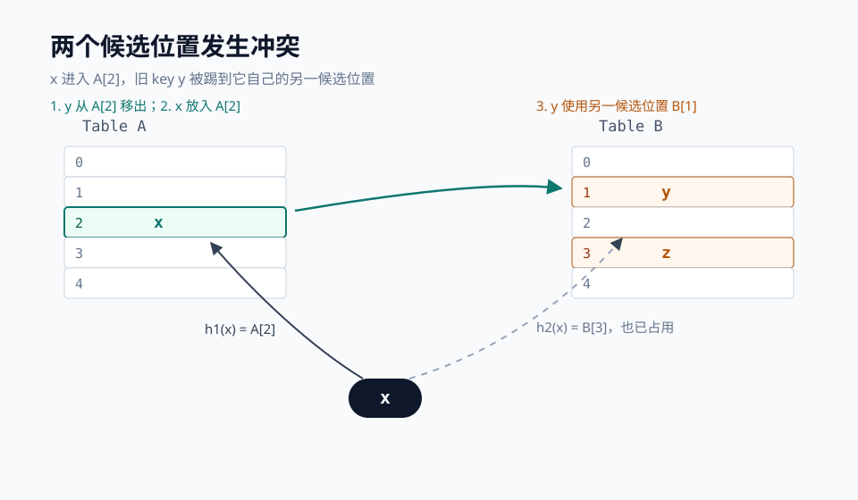
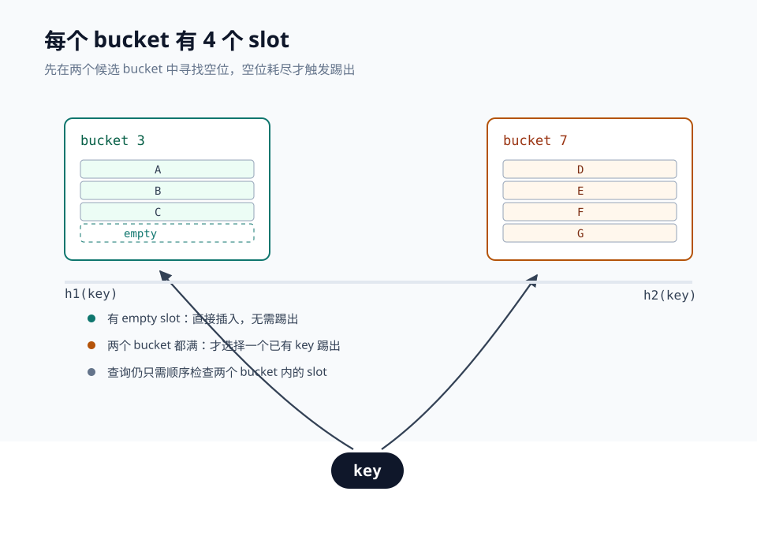

# Cuckoo Hash：用两个位置换一个确定的 O(1) 查询

## 为什么需要 Cuckoo Hash

哈希表最理想的状态是：一个 `key` 经过哈希函数计算后，直接落到一个确定的槽位。但不同 `key` 可能算出同一个位置，线性探测、链地址法等方法会引入探测链或桶内扫描，查询时间也就不再稳定。

Cuckoo Hash（布谷鸟哈希）最早由 Rasmus Pagh 和 Flemming Friche Rodler 提出。它给每个 `key` 安排两个候选位置：只要其中一个为空，就能直接放入；如果两个都被占用，就把已经占据位置的旧 `key` 踢到它的另一个候选位置。这个过程像布谷鸟把别的鸟蛋挤出鸟巢，因此得名。

它的最大特点是查询路径非常确定：计算两个哈希值，检查两个固定位置即可。不需要在冲突链上逐个比较，也不需要探测一段连续区间，因此删除也可以用同样简单的方式完成。

<!--more-->

### 算法描述

假设有两张表 `T1`、`T2`，或者一张逻辑上分成两段的表。`key` 有两个候选位置：

```text
p1 = h1(key) mod n
p2 = h2(key) mod n
```

不同操作的处理方式如下：

* **查询**：同时检查 `T1[p1]` 和 `T2[p2]`。命中其中一个就是存在；两个都不是该 `key`，则不存在。
* **删除**：先按查询方式找到这个 `key`，把对应槽位置空即可。
* **插入**：只要 `p1` 或 `p2` 为空，就把 `key` 放入空位。
* **冲突**：如果两个候选位置都被占用，任选一个位置，把那里的旧 `key` 踢出去，让新 `key` 占据这个位置。
* **搬移**：被踢出的旧 `key` 只能去它自己的另一个候选位置。如果那个位置为空，搬移结束；如果仍被占用，就继续踢出下一个 `key`。
* **重哈希**：当踢出次数超过阈值，说明当前哈希函数与数据产生了难以消解的环状冲突，此时选择新的哈希种子扩容并重建表。

下图展示一次典型的搬移。`x` 的两个候选位置分别是 `A[2]` 和 `B[3]`，两个位置已经被 `y`、`z` 占据。这里选择让 `x` 进入 `A[2]`，于是 `y` 被踢到它的另一个候选位置。



用伪代码描述插入过程：

```text
function insert(key):
    if lookup(key):
        return true

    position = choose(h1(key), h2(key))
    for i in 1..MAX_KICKS:
        if table[position].empty:
            table[position] = key
            return true

        evicted = table[position]
        table[position] = key
        key = evicted

        // 旧 key 只能去它的另一个候选位置
        if position == h1(evicted):
            position = h2(evicted)
        else:
            position = h1(evicted)

    return need_rehash
```

### 查询为什么是 O(1)

普通开放寻址法发生冲突后，可能沿着连续槽位探测若干步；链地址法则可能退化成遍历一条链。Cuckoo Hash 不一样，一个 `key` 的所有可能位置从一开始就被 `h1` 和 `h2` 固定下来：

```text
contains(key):
    return T1[h1(key)] == key || T2[h2(key)] == key
```

无论表中有多少其他 `key`，查询都只需要读两个槽位。代价是插入不再总是“放进去就结束”——它可能触发一次或多次搬移。

### 什么时候需要 Rehash

Cuckoo Hash 的插入可能一直循环：`x` 踢出 `y`，`y` 踢出 `z`，`z` 又踢出 `x`。这说明几个 `key` 的两个候选位置刚好形成了闭环，继续搬移不会成功。

工程上通常设置一个较小的踢出上限。达到上限后有两种常见处理方式：

1. 保持容量不变，更换哈希函数或哈希种子后重新插入；
2. 扩大表容量，并同时更换哈希种子。

对最基本的“两个哈希函数、每个位置只有一个槽位”的版本来说，负载因子保持在 50% 以下时，插入的期望时间复杂度是常数级。换句话说，如果要稳定运行，需要预留接近一半的空槽。

### Bucket 和多路 Slot 优化

预留 50% 空间对内存型结构来说比较浪费。一个常见优化是把每个 bucket 从 1 个 slot 扩展到 4 个 slot：`h1(key)` 和 `h2(key)` 各自定位到一个 bucket，插入时先检查两个 bucket 中的所有空 slot。

这样，一个新 `key` 只有在两个 bucket 的 8 个 slot 都满时才需要踢人；即使踢人，也可以先在同一个 bucket 内找空位缓冲。碰撞被局部化到两个 bucket 中，空间利用率比单 slot 版本高很多。



如果把 bucket 数量进一步增加，成功插入概率还会提高，但每次插入需要检查的位置也变多。因此常见实现会在内存占用、最大负载因子和插入路径长度之间折中。很多内存索引、Cuckoo Filter 和缓存系统都会使用 2 个哈希函数、4 个 slot 的组合。

### 适用场景

Cuckoo Hash 适合读多写少、要求查询延迟稳定、希望删除操作简单的场景，例如内存索引、去重表、网络流表和 Cuckoo Filter。Cuckoo Filter 用 `key` 的指纹替代完整 `key` 存入桶中，可以在支持删除的同时保留类似 Bloom Filter 的空间效率。

如果写入非常频繁，或者负载因子必须逼近上限，就需要更谨慎地处理 rehash、并发搬移和失败重试。Cuckoo Hash 用确定性的查询换来了插入阶段的不确定性，这是使用它时最重要的权衡。


## 参考资料

- [1] [Pagh & Rodler, Cuckoo Hashing](https://www.itu.dk/people/pagh/papers/cuckoo-jour.pdf)
- [2] [Erlingsson et al., A Cool and Practical Alternative to Traditional Hash Tables](https://www.cs.cmu.edu/~dga/15-744/S07/papers/erlingsson06cool.pdf)
- [3] [Fan et al., Cuckoo Filter: Practically Better Than Bloom](https://www.cs.cmu.edu/~dga/papers/cuckoo-conext2014.pdf)
- [4] [Wikipedia: Cuckoo hashing](https://en.wikipedia.org/wiki/Cuckoo_hashing)

