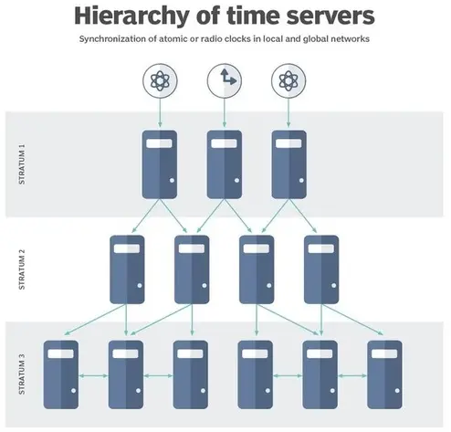
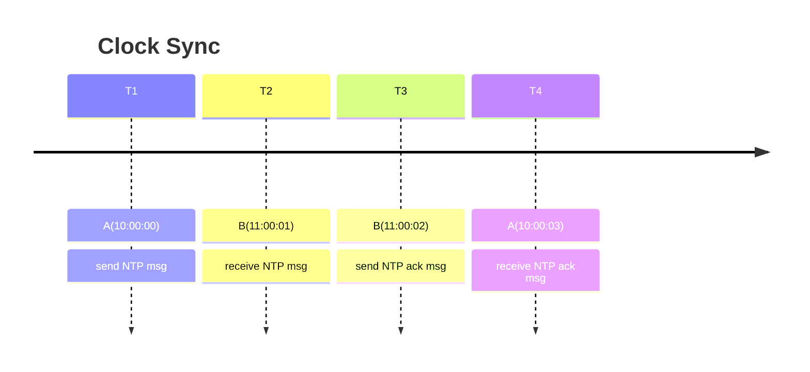

# 时钟回拨

在 Java 编程中，我们偶尔能看到“时钟回拨”的现象:

```java
//now() returns 2019-01-13T22:34:05.681Z
order.setCreationTime(Instant.now());

//... 执行一些其他工作

//now() returns 2019-01-13T22:34:03.123Z
//发现时间比创建时间提前了，仿佛时间被回拨
order.setCancelationTime(Instant.now());
```

<!--more-->

## 为什么会回拨

严格来说，这里说的“回拨”通常不是指 `CLOCK_MONOTONIC` 变小，而是指 Java 中基于 wall time 的时间戳变小。也就是说，程序拿到的 `CLOCK_REALTIME` 被操作系统调整到了更早的时刻。

常见原因有这几类：

- **NTP 校正**: 本地时钟会因为晶振精度、温度、机器运行时间等原因产生漂移。NTP 发现本机时间比上游时间源快，就会把本机时间调后。尤其是 `ntpd` 启动时发现本地时间偏差很大，或者长时间无法找到偏差小于 128 毫秒的可用样本时，可能会直接步进调整，而不是缓慢追赶，这时就能观察到明显的回拨。
- **人工调整或平台同步**: 系统管理员手动修改系统时间，云平台、容器宿主机、虚拟化管理程序或配置管理系统重新设置时间，都会影响客户机内看到的 wall time。
- **RTC 或启动初始化问题**: 主板上的实时时钟电池电量不足、RTC 漂移、硬件故障，或者系统启动早期先读取了一个不准的硬件时间，随后又被校正，也可能让时间看起来向后跳。
- **虚拟化和快照恢复**: 虚拟机暂停、迁移、恢复快照后，如果宿主机重新同步客户机时钟，客户机内的 wall time 也可能被调整。

所以，时钟回拨并不神秘。业务代码依赖的是会被外部调整的 wall time，而 NTP、管理员、云平台或底层硬件都可能成为调整它的来源。

## 时钟类型

操作系统中的时钟分为两种: 

- CLOCK_MONOTONIC: 指单调时钟。它的起点由具体实现决定，常见语义是“系统启动后经过的时间”，不表示 Unix epoch 时间。更改系统时间不会让它倒退；在支持的平台上，它适合用来计算程序内部的耗时。
- CLOCK_REALTIME: 指现实世界时间，也被称为挂钟时间(wall time)。它相对于 1970-01-01 计时，受系统时间调整影响。wall time 不保证单调递增，因为 NTP、系统管理员、云平台或虚拟化管理程序都可能把它调前或调后。

## Java中的时间

- `System.currentTimeMillis()` 是基于系统时间的wall time。不保证单调的增加。在时钟调整（例如通过 NTP）的情况下，它可能会以任何一种方式（向前或向后）变化。
- `System.nanoTime()` 是单调的，当且仅当[底层平台支持CLOCK_MONOTONIC](https://bugs.java.com/bugdatabase/view_bug?bug_id=6458294)时。


## NTP

NTP，英文全称：Network Time Protocol，中文全名网络时间协议，是一种用于在计算机网络中同步设备时钟的协议。

它的主要目标是确保网络中的各个设备都具有一致的时间参考，以便它们可以协同工作，进行时间戳记录、数据同步和各种计算任务。不过要注意：NTP 协议主要负责交换时间信息，真正把本地时钟调准，还需要客户端完成样本过滤、参数估计和时钟控制。


### 层级结构

层级（Stratum）在网络时间协议（NTP）中是用来表示时钟源的分级系统。NTP的分级结构确保了高精度的时间同步，因为它允许网络中的设备根据它们与更高级别的时钟源的接近程度来选择时间源。这有助于确保即使在互联网这样复杂的网络环境中，时间同步也可以保持在可接受的范围内。

NTP使用分层的时间源系统，每个层次都称为"层"，顶层的参考时钟被分配编号0。每个层的服务器与下一层的服务器同步，这种分层结构有助于防止层次结构中的循环依赖。



层级编号表示与参考时钟的距离，而不一定代表质量或可靠性。较高层的时间源通常质量更高。NTP数据包中的层字段设置为0表示未指定层级。

- Stratum 0: 这是最高的层级，通常由地球上的主要时间源提供，例如全球定位系统（GPS）卫星，原子钟等。Stratum 0时钟源被认为是最准确和最可信赖的。NTP服务器无法被分配到Stratum 0。
- Stratum 1: 这一层级包括直接与Stratum 0时钟源连接的NTP服务器。通常，这些NTP服务器是高精度的，例如使用GPS信号或原子钟，以获得准确的时间。Stratum 1服务器也称为主服务器，它们提供时间信息给下级的Stratum。
- Stratum 2: Stratum 2包括那些与Stratum 1服务器同步的NTP服务器。这些服务器依赖于Stratum 1服务器提供的时间信息，但它们仍然可以提供相对高精度的时间。Stratum 2服务器通常用于局域网或其他小规模网络中。
- Stratum 3: Stratum 3包括与Stratum 2服务器同步的NTP客户端。这些客户端通过网络连接到Stratum 2服务器，以获得时间同步。Stratum 3服务器通常用于更大规模的网络。

NTP的层级结构可以继续下去，一直到Stratum 15或16，这些层级通常表示未同步的设备或系统。随着层级的下降，时间同步的准确性会降低，因为每一级都会在上级的基础上添加一些网络延迟。

在同一Stratum内的时间服务器之间，它们可以通过点对点通信来协商时间，以确保它们的时钟保持一致。

> 层级上限为15，层级 16 用于表示设备未同步。每台计算机上的NTP算法使用贝尔曼-福特最短路径生成树，以最小化所有客户端到第 1 层服务器的累积往返延迟。除了层级，NTP还使用参考标识符来标识每个服务器的同步源。这有助于确定每个服务器的同步路径。

**分层结构确保了时间同步的可靠性，因为在发生故障或问题时，系统可以切换到更高层次的时间服务器，以保持时间准确性**。

### 时钟同步流程

系统时钟的同步流程如下所示：



1. RouterA 发送一个 NTP 报文给 RouterB，该报文中带有它离开 RouterA 时的时间戳10:00:00（T1）。
2. 此 NTP 报文到达 RouterB 时， RouterB 加上到达时间戳 11:00:01（T2）。
3. 此 NTP 报文离开 RouterB 时， RouterB 再加上离开时间戳 11:00:02（T3）。
4. RouterA 接收到该响应报文时，加上新的时间戳 10:00:03（T4）。至此， RouterA 获得了足够信息来计算以下两个重要参数:
    - NTP 报文来回一个周期的时延：`Delay= (T4-T1)-(T3–T2)`。
    - RouterA 相对 RouterB 的时间差：`Offset= ((T2-T1)+(T3–T4))/2`(前提是两个方向的时延相等)。
5. RouterA 根据计算得到 Delay 为 2 秒， Offset 为 1 小时。客户端不会把一次原始 offset 无脑写入系统时钟，而是先过滤异常样本，再估计本地时钟的偏移和频率漂移，最后通过内核接口调整系统时钟。

时间同步不是一次性事件，而是持续进行的。客户端会按自适应的 poll interval 周期性地与 NTP 服务器交换报文；`ntpd` 常见的轮询间隔在 64 秒到 1024 秒之间，稳定后间隔可能继续拉长。这样既能跟踪晶振漂移，也能避免网络瞬时抖动影响时钟。

### NTP 是否必然导致时钟回拨

并不绝对。是否回拨，取决于客户端算法、当前偏差大小，以及允许 step 还是只允许 slew。通常情况下，`ntpd` 会通过 slew 小步调整时钟，使时间尺度连续。在极端网络拥塞条件下，往返延迟抖动可以超过 3 秒，同步距离（等于往返延迟的一半加误差预算项）可以变得非常大。`ntpd` 算法丢弃超过 128 毫秒的样本偏移，除非没有小于 128 毫秒的可用样本间隔超过 900 秒。之后的第一个样本，无论偏移多少，都可能将时钟步进到指定时间。

由于这种行为，一旦设置了时钟，即使在网络路径拥塞和抖动的极端情况下，时钟也很少偏离超过 128 毫秒。有时，特别是当 `ntpd` 首次启动时，错误可能会超过 128 毫秒。如果本地时钟相对于服务器时间过快，这有时会导致时钟向后设置。

在某些应用程序中，这种行为可能是不可接受的。如果命令行中包含 `-x` 选项，时钟将永远不会 step，只会使用 slew 校正。在决定使用 `-x` 之前，应该仔细评估影响：经典 NTP 的 slew correction rate 通常被限制在 500 PPM 左右，因此本地时钟可能需要很长时间才能收敛到可接受的偏移。在此期间，本地时钟会与网络时间不一致，系统不能用于需要正确同步时间的分布式应用。

## 时钟估计与控制

四时间戳解决了“如何测量 offset”，但还没有解决两个更难的问题：

1. 网络样本有噪声，如何估计真实偏移和晶振漂移？
2. 得到估计值后，如何在不制造回拨的情况下调整时钟？

这一节先建立通用概念：offset、frequency error、PLL/FLL 和 step/slew。下一节再介绍 Chrony 如何在工程实现中处理噪声样本。

### Offset 与频率偏差

先看一次简单测量。假设本机时间大于服务器时间表示本机偏快：

```text
服务器时间：10:00:00.000000
本机时间：  10:00:00.010000
Offset = +10ms
```

这说明本机当前快了 10 毫秒。但如果 60 秒后再测一次，本机从快 10ms 变成快 13ms：

```text
t = 0s    Offset = +10ms
t = 60s   Offset = +13ms

frequency_error = (13ms - 10ms) / 60s
                = 0.05ms/s
                = 50 PPM
```

也就是说，本机时间每真实经过 1 秒，会多走约 50 微秒。前者叫 **offset**，后者叫 **frequency error**。时间同步需要同时处理这两个量：offset 是“现在差多少”，frequency error 是“本地晶振以后会以多快的速度继续差下去”。

### PLL 与 FLL

**PLL（Phase Locked Loop，锁相环）** 关注相位误差。可以把本地时钟想成一个不断向前走的进程，PLL 根据当前 offset 反向调整频率：

```text
offset = 本机时间 - 服务器时间

correction = Kp * offset + Ki * ∫offset dt
offset > 0 时，correction 会降低本地时钟频率
offset < 0 时，correction 会提高本地时钟频率
```

其中比例项像方向盘，立刻响应当前偏差；积分项负责消除长期存在的固定偏差。假设连续测量结果是本机快 10ms、11ms、11.5ms、11.6ms，PLL 通常不会直接把时钟改到服务器时间，而是逐渐把本地频率调慢，让误差收敛到接近 0。这种不改变时间前进方向的调整就是 **slew**。

**FLL（Frequency Locked Loop，锁频环）** 则更关注频率误差。它用两次 offset 的变化率估计本机晶振快慢：

```text
10:00  本机快 20ms
12:00  本机快 80ms

frequency_error = (80ms - 20ms) / 7200s
                = 8.33 PPM
```

PLL 和 FLL 不是完全对立的两种方案。`ntpd` 会在不同网络条件和轮询周期下混合使用两者的思想：短周期时更关注相位锁定，长周期时更关注频率锁定。最终它们通过 `adjtimex()`、`ntp_adjtime()` 这类内核接口影响系统时钟。

### Step 与 Slew

调整 wall time 时有两种基本方式：

- **Step**: 直接把系统时间设置到目标值。收敛快，但可能让时间前进或后退，因此可能造成回拨。
- **Slew**: 改变时钟前进速度，让本机稍快或稍慢地追赶参考时间。时间轴看起来连续，更适合运行中的业务，但大偏差需要更长时间收敛。

所以，时间同步系统的设计核心不是简单地“发现误差就改时间”，而是在**精度、收敛速度、连续性和业务安全之间取平衡**。

## Chrony

Chrony 不是一种新的时间协议，而是 NTP 的一个现代实现。它主要包含两个程序：

- `chronyd`: 后台守护进程，负责和 NTP 服务器通信，并根据测量结果调整系统时钟。
- `chronyc`: 命令行管理工具，用来查看同步状态、修改配置、检查来源质量和频率偏差。

常见状态可以用下面这些命令观察：

```bash
chronyc tracking      # 查看系统时钟当前同步状态
chronyc sources -v    # 查看 NTP 来源和选中状态
chronyc sourcestats   # 查看每个来源的频率估计和稳定性
```

### 回归和统计估计

PLL/FLL 回答了“怎么控制时钟”，但还有一个前置问题：单次 NTP offset 未必可信。

例如真实 offset 是本机快 10ms：

```text
第 1 次请求很快返回：测得 offset = 10.2ms
第 2 次请求被网络拥塞拖慢：测得 offset = 180ms
```

第二个样本显然会被网络延迟污染。如果直接把它交给反馈控制器，时钟就会被网络抖动带偏。Chrony 会保存多个样本，并做类似线性回归的拟合：

```text
offset(t) = a + b * t
```

其中：

- `a` 表示当前时间偏移；
- `b` 表示本地时钟频率偏差；
- 残差用来评估样本噪声和估计置信度。

假设连续样本如下：

| t (s) | offset (ms) |
| ---: | ---: |
| 0 | 10.2 |
| 60 | 12.7 |
| 120 | 16.0 |
| 180 | 18.7 |
| 240 | 21.9 |

这些点接近一条直线，斜率约为 `0.049ms/s`，也就是约 `49 PPM`。于是客户端可以判断：本机当前大约快 10ms，晶振大约快 49 PPM。之后它再决定是先 slew、等待更多样本，还是丢弃明显异常的来源。

实际实现还会做更多工程处理：来源选择、异常样本剔除、多来源加权、误差预算计算和置信区间估计。`chronyc sourcestats` 里的 `Frequency` 和 `Skew`，本质上就是对本地晶振漂移和估计不确定度的展示。

### 从统计估计到时钟调整

有了上一节的回归估计，Chrony 仍然需要在运行中持续维护三类核心信息：

- **时间偏移(offset)**: 本地时钟和上游时间源相差多少。
- **频率偏差(frequency error)**: 本地晶振每秒快或慢多少，通常用 PPM 表示。
- **估计误差(skew)**: 当前频率估计的不确定程度。

得到这些参数后，Chrony 通常优先通过调整内核时钟频率让时间缓慢追赶或变慢，也就是 slew，而不是直接步进。对较大的偏差，它也可以按配置执行 step，例如只在启动后的前几次更新里允许大偏差步进，或者超过某个阈值时步进。这样既能处理刚开机时明显不准的时钟，也能减少运行中发生时钟回拨的概率。

Chrony 还会把频率估计保存到 drift 文件中。系统重启或短暂断网后，它可以根据历史估计继续补偿本地晶振漂移，而不是从零开始重新学习。可以用下面这样的状态观察它的效果：

```text
System time     : 0.000012 seconds fast of NTP time
Last offset     : 0.000009 seconds
RMS offset      : 0.000014 seconds
Frequency       : 18.254 ppm fast
Residual freq   : +0.002 ppm
Skew            : 0.081 ppm
```

这些字段分别反映当前相位误差、最近测量误差、长期频率估计、剩余频率误差和估计不稳定度。它们比单纯的“本地时间和服务器差多少”更能说明同步质量。

### Chrony 和 ntpd 的对比

| 对比项 | ntpd | Chrony |
| --- | --- | --- |
| 定位 | 经典 NTP 参考实现 | 现代 NTP 实现，也是 RHEL、SUSE 等发行版的常见默认选择 |
| 测量与估计 | 以 PLL/FLL loop filter 为核心，逐步把本地时钟锁定上游 | 更强调多样本回归、来源选择和误差统计 |
| 网络适应性 | 在持续可用、网络稳定的场景表现成熟 | 对断续连接、网络拥塞、延迟抖动、高延迟变化更有针对性 |
| 启动收敛 | 较保守。常见行为是偏差小于 128 毫秒时缓慢 slew，长时间没有可用的小偏差样本后才可能 step | 收敛更快，可以通过 `makestep` 控制哪些偏差允许步进 |
| 断网后表现 | 没有可用上游时通常无法继续修正，主要依赖已有状态 | 可配合 drift 文件和 offline/online 模式，在断续网络中更稳 |
| 管理方式 | `ntpq` 等工具 | `chronyc tracking`、`chronyc sources`、`chronyc sourcestats` |

一个容易混淆的地方是：`ntpd` 和 `chronyd` 都是 NTP 协议的实现，它们之间通常可以互相作为服务端和客户端同步。区别不在协议本身，而在估计算法、时钟调整策略和工程场景。

### Chrony 的优势

- **启动后更快进入稳定状态**: 频率和偏移可以并行估计，比传统的保守反馈模型更容易快速收敛。
- **更适合虚拟机和云环境**: 虚拟机时钟可能因为 CPU 调度、暂停、迁移、宿主机负载而出现不规则漂移，Chrony 对这种噪声更友好。
- **适合断续连接**: 笔记本、容器宿主机、边缘节点或内网机器不一定一直能访问上游 NTP，Chrony 可以在短暂离线时继续使用频率估计。
- **调整策略更可控**: `makestep`、`maxchange`、`maxslewrate` 等配置可以明确“什么时候允许步进、什么偏差必须丢弃、最大追赶速度是多少”。
- **可观测性好**: `chronyc` 能直接看到当前误差、频率偏差、估计误差和每个上游来源的状态，排查时钟问题更方便。

当然，Chrony 不是在所有存量环境中都能直接替换 `ntpd`。有些设备、安全基线或老系统仍然依赖 `ntpd`，升级前需要确认配置兼容性和运维约束。但在现代 Linux 服务器和云环境中，如果目标是降低时钟漂移影响、加快收敛并减少意外回拨，Chrony 通常是更值得优先考虑的选择。

## 参考

- [1] [stackoverflow. is there any consistent monotonic clock implementation in java](https://stackoverflow.com/questions/34778744/is-there-any-consistent-monotonic-clock-implementation-in-java)
- [2] [ntpd - 网络时间协议 （NTP） 守护程序](https://doc.ntp.org/documentation/4.1.0/ntpd/)
- [3] [chrony documentation](https://chrony-project.org/documentation.html)
- [4] [Linux `adjtimex` manual](https://man7.org/linux/man-pages/man2/adjtimex.2.html)

