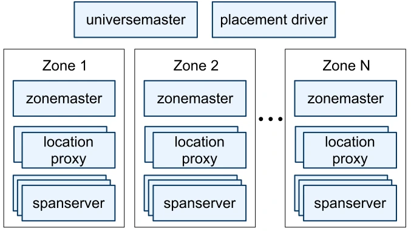
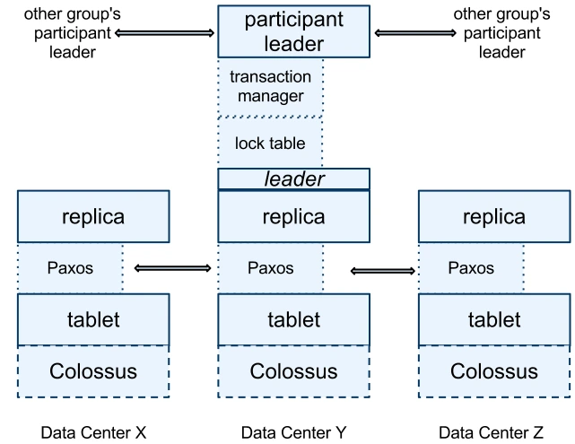
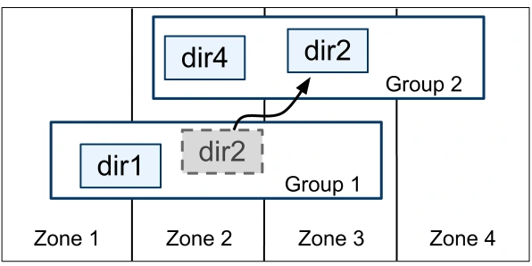
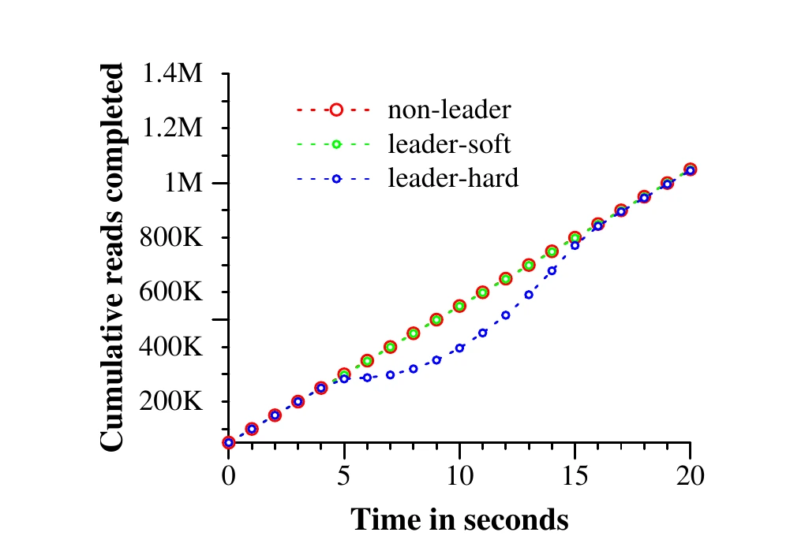

# Spanner：Google 的全球分布式数据库


本篇是论文 [Spanner: Google's Globally-Distributed Database](https://static.googleusercontent.com/media/research.google.com/en//archive/spanner-osdi2012.pdf) 的中文翻译，尽量保持原文的章节顺序与表述。

<!--more-->
## 摘要

Spanner 是 Google 的可扩展、多版本、全球分布式且同步复制的数据库。它是第一个在全球规模上分发数据并支持外部一致分布式事务的系统。本文描述 Spanner 的结构、功能集、各种设计决策背后的基本原理，以及一个暴露时钟不确定性的新颖时间 API。这个 API 及其实现对于支持外部一致性和多种强大功能至关重要：在过去时间点的非阻塞读取、无锁只读事务，以及横跨整个 Spanner 的原子模式变更。

## 引言

Spanner 是一个可扩展的全球分布式数据库，由 Google 设计、构建并部署。在最高的抽象层次上，它是一个把数据分片到遍布世界各地的数据中心中许多组 Paxos [<sup>21</sup>](#refer-anchor-21) 状态机上的数据库。复制用于实现全局可用性和地理局部性；客户端会在副本之间自动故障转移。随着数据量或服务器数量变化，Spanner 会自动在机器之间重新分片数据，并且它会自动在机器之间（甚至跨数据中心）迁移数据，以平衡负载并响应故障。Spanner 的设计目标是可以扩展到数百个数据中心中的数百万台机器和数万亿行数据库记录。

应用程序可以把 Spanner 用于高可用性，即便面对广域自然灾害，也可以通过在大陆内部甚至在各大洲之间复制数据来实现。我们的第一个客户是 F1 [<sup>35</sup>](#refer-anchor-35)，即 Google 广告后端的一次重写。F1 使用分布在美国各地的五个副本。大多数其他应用可能会把数据复制到同一地理区域内 3 到 5 个具有相对独立故障模式的数据中心。也就是说，大多数应用会选择较低的延迟而不是更高的可用性，只要它们能挺过 1 或 2 个数据中心的故障。

Spanner 的主要焦点是管理跨数据中心复制的数据，但我们也在分布式系统基础设施之上设计和实现重要的数据库功能上花费了大量时间。尽管许多项目已经乐于使用 Bigtable [<sup>9</sup>](#refer-anchor-9)，我们也持续收到用户对 Bigtable 的抱怨：对于某些类型的应用来说，它可能难以使用；这些应用拥有复杂且不断演化的模式，或者希望在广域复制存在的情况下获得强一致性。（其他作者也提出过类似说法 [<sup>37</sup>](#refer-anchor-37)。）Google 的许多应用因为 Megastore [<sup>5</sup>](#refer-anchor-5) 的半关系数据模型和对同步复制的支持而选择使用它，尽管它的写吞吐量相对较差。因此，Spanner 已经从一个类似 Bigtable 的带版本键值存储，演化成一个带时间维度的多版本数据库。数据存储在模式化的半关系表中；数据是带版本的，每个版本都会自动打上其提交时间作为时间戳；旧版本数据受可配置的垃圾回收策略约束；并且应用程序可以在旧时间戳上读取数据。Spanner 支持通用事务，并提供一种基于 SQL 的查询语言。

作为一个全球分布式数据库，Spanner 提供了几个很有意思的功能。第一，数据的复制配置可以由应用程序在细粒度上动态控制。应用程序可以指定约束，来控制哪些数据中心包含哪些数据、数据离其用户有多远（以控制读延迟）、副本彼此之间有多远（以控制写延迟），以及维护多少个副本（以控制持久性、可用性和读取性能）。系统还可以动态、透明地在数据中心之间移动数据，以平衡数据中心之间的资源使用。第二，Spanner 有两个在分布式数据库中很难实现的功能：它提供外部一致 [<sup>16</sup>](#refer-anchor-16) 的读写，以及在一个时间戳上横跨整个数据库的全局一致读取。这些功能使 Spanner 能够支持一致备份、一致的 MapReduce 执行 [<sup>12</sup>](#refer-anchor-12) 和原子模式更新，而且全部都能在全球规模上进行，甚至在仍有事务持续执行的情况下也是如此。

这些功能得以实现，是因为 Spanner 会给事务分配全局有意义的提交时间戳，即使事务本身可能是分布式的。这些时间戳反映序列化顺序。此外，这个序列化顺序满足外部一致性（或者等价地说，线性一致性 [<sup>20</sup>](#refer-anchor-20)）：如果一个事务 T1 在另一个事务 T2 开始之前提交，那么 T1 的提交时间戳小于 T2 的。Spanner 是第一个在全球规模上提供这种保证的系统。

这些属性的关键推动因素是一个新的 TrueTime API 及其实现。该 API 直接暴露时钟不确定性，而 Spanner 时间戳上的保证依赖于该实现提供的边界。如果不确定性很大，Spanner 会放慢速度，等待这段不确定性过去。Google 的集群管理软件提供了 TrueTime API 的一个实现。该实现通过使用多个现代时钟参考源（GPS 和原子钟）来把不确定性保持在很小的水平（通常小于 10ms）。

第 2 节描述 Spanner 实现的结构、功能集，以及进入这些设计的工程决策。第 3 节描述我们新的 TrueTime API，并概述其实现。第 4 节描述 Spanner 如何使用 TrueTime 来实现外部一致分布式事务、无锁只读事务和原子模式更新。第 5 节给出 Spanner 性能和 TrueTime 行为的一些基准测试，并讨论 F1 的经验。第 6、7 和 8 节描述相关工作和未来工作，并总结我们的结论。

## 实现

本节描述 Spanner 实现的结构及其背后的基本原理。接着，它描述 directory 抽象；该抽象用于管理复制和局部性，并且是数据移动的单位。最后，它描述我们的数据模型，解释为什么 Spanner 看起来像一个关系数据库而不是键值存储，以及应用程序如何控制数据局部性。

一个 Spanner 部署称为一个 universe。鉴于 Spanner 在全球范围内管理数据，正在运行的 universe 只会有少数几个。我们目前运行一个 test/playground universe、一个 development/production universe，以及一个 production-only universe。

Spanner 被组织为一组 zone，每个 zone 大致对应 Bigtable 服务器 [<sup>9</sup>](#refer-anchor-9) 的一个部署。zone 是管理部署的单位。zone 的集合也是数据可以复制到的位置的集合。随着新数据中心投入使用和旧数据中心关闭，zone 可以在运行中的系统中加入或移除。zone 也是物理隔离的单位：例如，如果一个数据中心中不同应用程序的数据必须被划分到同一数据中心的不同服务器集合上，那么一个数据中心中可能有一个或多个 zone。

图 1 展示了一个 Spanner universe 中的服务器。一个 zone 有一个 zonemaster 以及一百到几千个 spanserver。前者把数据分配给 spanserver；后者向客户端提供数据。每个 zone 的 location proxy 供客户端用来定位被分配来为其数据服务的 spanserver。universe master 和 placement driver 目前都是单例。universe master 主要是一个控制台，显示所有 zone 的状态信息，用于交互式调试。placement driver 在分钟量级的时间尺度上处理数据跨 zone 的自动移动。placement driver 周期性地与 spanserver 通信，以找到需要移动的数据：或是为了满足更新后的复制约束，或是为了平衡负载。由于篇幅原因，我们只会较为详细地描述 spanserver。



*图 1：Spanner 服务器组织。*

### Spanserver 软件栈

本节聚焦 spanserver 的实现，用来说明复制和分布式事务是如何叠加到我们基于 Bigtable 的实现上的。软件栈如图 2 所示。在最底层，每个 spanserver 负责 100 到 1000 个称为 tablet 的数据结构实例。tablet 类似于 Bigtable 的 tablet 抽象，因为它实现了如下映射的一个 bag：

```text
(key:string, timestamp:int64) → string
```

与 Bigtable 不同的是，Spanner 会给数据分配时间戳；这是 Spanner 更像多版本数据库而不只是键值存储的一个重要方面。一个 tablet 的状态存储在一组类似 B-tree 的文件和一个 write-ahead log 中，所有这些都位于称为 Colossus 的分布式文件系统（Google File System [<sup>15</sup>](#refer-anchor-15) 的后继者）上。

为了支持复制，每个 spanserver 在每个 tablet 之上实现单个 Paxos 状态机。（Spanner 的早期版本支持每个 tablet 多个 Paxos 状态机，这允许更灵活的复制配置。那种设计的复杂性使我们放弃了它。）每个状态机把其元数据和日志存储在对应的 tablet 中。我们的 Paxos 实现支持长期存在的 leader 以及基于时间的 leader 租约，租约长度默认为 10 秒。当前 Spanner 实现会把每个 Paxos 写记录两次：一次记录在 tablet 的日志中，一次记录在 Paxos 日志中。这个选择是出于一时方便，我们最终可能会改进它。我们的 Paxos 实现是流水线化的，以便在 WAN 延迟存在的情况下提高 Spanner 的吞吐量；但写由 Paxos 按顺序应用（第 4 节将依赖这一事实）。

Paxos 状态机用于实现一个一致复制的映射 bag。每个副本的键值映射状态存储在其对应的 tablet 中。写必须在 leader 处发起 Paxos 协议；读则可以直接从任何足够新的副本底层的 tablet 访问状态。这组副本合起来称为一个 Paxos group。

在每个作为 leader 的副本上，每个 spanserver 还实现一个 lock table 来进行并发控制。lock table 包含两阶段锁的状态：它把键范围映射到锁状态。（注意，长期存在的 Paxos leader 对于高效管理 lock table 至关重要。）在 Bigtable 和 Spanner 中，我们都为长期存在的事务而设计（例如报告生成，可能需要数分钟量级），这类事务在存在冲突时使用乐观并发控制的效果很差。需要同步的操作（例如事务性读）会在 lock table 中获取锁；其他操作绕过 lock table。

在每个作为 leader 的副本上，每个 spanserver 还实现一个 transaction manager 来支持分布式事务。transaction manager 用于实现一个 participant leader；同一组中的其他副本将被称为 participant slaves。如果一个事务只涉及一个 Paxos group（大多数事务都是这种情况），它可以绕过 transaction manager，因为 lock table 和 Paxos 共同提供了事务性。如果一个事务涉及多个 Paxos group，这些组的 leader 会协调执行两阶段提交。其中一个 participant group 被选为 coordinator：该组的 participant leader 将被称为 coordinator leader，该组的 slaves 将被称为 coordinator slaves。每个 transaction manager 的状态存储在底层的 Paxos group 中（因此也是复制的）。



*图 2：Spanserver 软件栈。*

### Directory 和 Placement

在键值映射 bag 之上，Spanner 实现支持一种称为 directory 的分桶抽象，它是一组共享公共前缀的连续键。（“directory” 这个术语的选择是历史上的偶然；“bucket” 可能是更好的术语。）我们将在 2.3 节解释该前缀的来源。支持 directory 使应用程序能够通过谨慎选择键来控制其数据的局部性。

directory 是数据放置的单位。一个 directory 中的所有数据具有相同的复制配置。当数据在 Paxos group 之间移动时，它是逐个 directory 移动的，如图 3 所示。Spanner 可能会移动一个 directory 来给某个 Paxos group 减负；把经常一起访问的 directory 放入同一组；或者把一个 directory 移动到离其访问者更近的组。directory 可以在客户端操作持续进行时移动。可以预期，移动一个 50MB 的 directory 可以在几秒内完成。

一个 Paxos group 可能包含多个 directory，这意味着 Spanner tablet 与 Bigtable tablet 不同：前者不一定是行空间中单个字典序连续的分区。相反，Spanner tablet 是一个容器，可能封装行空间的多个分区。我们做出这个决定，是为了可以把多个经常一起访问的 directory 放在同一位置。

Movedir 是用于在 Paxos group 之间移动 directory 的后台任务 [<sup>14</sup>](#refer-anchor-14)。Movedir 还用于向 Paxos group 添加或移除副本 [<sup>25</sup>](#refer-anchor-25)，因为 Spanner 尚不支持 in-Paxos 配置变更。Movedir 并没有实现为单个事务，以避免在一次大体积数据移动期间阻塞正在进行的读写。相反，movedir 登记它即将开始移动数据这一事实，然后在后台移动数据。当除了名义上的一小部分数据以外的所有数据都已移动时，它使用一个事务来原子地移动那一小部分数据，并更新两个 Paxos group 的元数据。

directory 也是其地理复制属性（简称 placement）可以由应用程序指定的最小单位。我们放置规范语言的设计分离了管理复制配置的职责。管理员控制两个维度：副本的数量和类型，以及这些副本的地理放置。他们在这些维度上创建一个命名选项菜单（例如，北美，5 路复制，带 1 个 witness）。应用程序通过给每个数据库和/或单个 directory 打上一组这些选项的组合，来控制数据如何复制。例如，一个应用可能把每个最终用户的数据存储在其自己的 directory 中，这可以使用户 A 的数据在欧洲有三个副本，而用户 B 的数据在北美有五个副本。

为了说明上的清晰，我们做了过度简化。实际上，如果一个 directory 增长得太大，Spanner 会把它分片成多个 fragment。fragment 可以由不同的 Paxos group（因此是不同的服务器）提供服务。Movedir 实际上在组之间移动的是 fragment，而不是完整的 directory。



*图 3：Directory 是数据在 Paxos group 之间移动的单位。*

### 数据模型

Spanner 向应用程序暴露以下数据功能：基于模式化半关系表的数据模型、一种查询语言，以及通用事务。朝支持这些功能的方向演进由许多因素驱动。对模式化半关系表和同步复制的支持需求，来自 Megastore [<sup>5</sup>](#refer-anchor-5) 的流行。至少有 300 个 Google 内部应用在使用 Megastore（尽管其性能相对较低），因为其数据模型比 Bigtable 的更容易管理，并且因为它支持跨数据中心的同步复制。（Bigtable 只支持跨数据中心的最终一致复制。）使用 Megastore 的著名 Google 应用包括 Gmail、Picasa、Calendar、Android Market 和 AppEngine。考虑到 Dremel [<sup>28</sup>](#refer-anchor-28) 作为交互式数据分析工具的流行，在 Spanner 中支持类 SQL 查询语言的需求也很明显。最后，Bigtable 缺少跨行事务导致了大量抱怨；Percolator [<sup>32</sup>](#refer-anchor-32) 的部分目的就是解决这一缺陷。一些作者声称，通用两阶段提交因为带来的性能或可用性问题而太昂贵，不值得支持 [<sup>9</sup>](#refer-anchor-9), [<sup>10</sup>](#refer-anchor-10), [<sup>19</sup>](#refer-anchor-19)。我们认为，更好的做法是：当过度使用事务造成性能瓶颈出现时，让应用程序程序员处理这些性能问题，而不是总是围绕缺少事务来写代码。在 Paxos 之上运行两阶段提交可以缓解可用性问题。

应用数据模型分层在实现支持的 directory 分桶键值映射之上。应用程序在一个 universe 中创建一个或多个数据库。每个数据库可以包含无限多个模式化表。表看起来像关系数据库表，有行、列和带版本的值。我们不会详细讨论 Spanner 的查询语言。它看起来像 SQL，外加一些支持 protocol-buffer 值字段的扩展。

Spanner 的数据模型不是纯关系的，因为行必须有名称。更准确地说，每张表都被要求拥有由一个或多个主键列组成的有序集合。这一要求也是 Spanner 仍然像键值存储的地方：主键构成一行的名称，而每张表定义了一个从主键列到非主键列的映射。只有当某行的键定义了某个值（即使是 NULL）时，该行才存在。施加这种结构很有用，因为它让应用程序能够通过选择键来控制数据局部性。

图 4 包含一个 Spanner schema 示例，用于按每个用户、每个相册的方式存储照片元数据。这个 schema 语言类似于 Megastore 的语言，附加的要求是每个 Spanner 数据库必须由客户端划分成一个或多个表层级。客户端应用程序通过 `INTERLEAVE IN` 声明在数据库 schema 中声明这些层级。层级顶部的表是 directory table。directory table 中键为 K 的每一行，加上所有以 K 按字典序开头的后代表中的行，构成一个 directory。`ON DELETE CASCADE` 表示删除 directory table 中的一行会删除所有关联的子行。图中还展示了示例数据库的交错布局：例如，`Albums(2,1)` 表示 Albums 表中用户 id 为 2、相册 id 为 1 的行。这种把表交错成 directory 的方式很重要，因为它允许客户端描述多个表之间存在的局部性关系，而这在一个分片分布式数据库中获得良好性能是必要的。没有它，Spanner 就不会知道最重要的局部性关系。

```sql
CREATE TABLE Users {
  uid INT64 NOT NULL, email STRING
} PRIMARY KEY (uid), DIRECTORY;

CREATE TABLE Albums {
  uid INT64 NOT NULL, aid INT64 NOT NULL,
  name STRING
} PRIMARY KEY (uid, aid),
  INTERLEAVE IN PARENT Users ON DELETE CASCADE;
```


*图 4：用于照片元数据的 Spanner schema 示例，以及 `INTERLEAVE IN` 隐含的交错关系。*


## TrueTime

| 方法 | 返回 |
|---|---|
| `TT.now()` | `TTinterval: [earliest, latest]` |
| `TT.after(t)` | 如果 t 已确定过去，则为 true |
| `TT.before(t)` | 如果 t 确定尚未到来，则为 true |

*表 1：TrueTime API。参数 t 的类型是 `TTstamp`。*

本节描述 TrueTime API 并概述其实现。我们把大多数细节留给另一篇论文：我们的目标是展示拥有这样一个 API 的力量。表 1 列出了该 API 的方法。TrueTime 显式地把时间表示为 `TTinterval`，它是一个带有有界时间不确定性的区间（不像标准时间接口那样不给客户端任何不确定性概念）。`TTinterval` 的端点类型是 `TTstamp`。`TT.now()` 方法返回一个 `TTinterval`，保证其中包含调用 `TT.now()` 期间的绝对时间。时间纪元类似于带闰秒平滑的 UNIX 时间。把瞬时误差界定义为 ε，也就是区间宽度的一半；把平均误差界定义为 ε。`TT.after()` 和 `TT.before()` 方法是围绕 `TT.now()` 的便捷包装。

把事件 e 的绝对时间表示为函数 `tabs(e)`。用更正式的术语说，TrueTime 保证：对于一次调用 `tt = TT.now()`，`tt.earliest ≤ tabs(e_now) ≤ tt.latest`，其中 `e_now` 是该调用事件。

TrueTime 使用的底层时间参考源是 GPS 和原子钟。TrueTime 使用两种形式的时间参考源，因为它们的故障模式不同。GPS 参考源的脆弱点包括天线和接收器故障、本地无线电干扰、相关故障（例如设计缺陷，如错误的闰秒处理和欺骗攻击），以及 GPS 系统中断。原子钟可能以与 GPS 无关的方式发生故障，也可能彼此不相关地发生故障；而且在长时间内，它们会因频率误差而显著漂移。

TrueTime 由每个数据中心的一组 time master 机器和每台机器上的一个 timeslave daemon 实现。大多数 master 拥有带专用天线的 GPS 接收器；这些 master 在物理上是分离的，以降低天线故障、无线电干扰和欺骗攻击的影响。其余 master（我们称之为 Armageddon master）配备原子钟。原子钟并不那么昂贵：一个 Armageddon master 的成本与一个 GPS master 在同一数量级。所有 master 的时间参考源都会定期相互比较。每个 master 还会把其参考源前进时间的速率与其本地时钟交叉校验，并在出现明显偏差时将自身剔除。在同步之间，Armageddon master 会公布一个缓慢增长的时间不确定性，该不确定性来自保守应用的最坏情况时钟漂移。GPS master 公布的不确定性通常接近零。

每个 daemon 都会轮询多种 master [<sup>29</sup>](#refer-anchor-29)，以降低任何一个 master 出错带来的脆弱性。其中有些是从附近数据中心选出的 GPS master；其余的是来自更远数据中心的 GPS master，以及一些 Armageddon master。daemon 应用 Marzullo 算法的一个变体 [<sup>27</sup>](#refer-anchor-27) 来检测并拒绝说谎者，并把本地机器时钟同步到非说谎者。为了防止本地时钟损坏，凡是表现出大于从组件规格和运行环境推导出的最坏情况边界的频率偏移的机器，都会被剔除。

在同步之间，daemon 公布一个缓慢增长的时间不确定性。ε 源自保守应用的最坏情况本地时钟漂移。ε 还取决于 time master 的不确定性和到 time master 的通信延迟。在我们的生产环境中，ε 通常是时间的锯齿状函数，在每个轮询间隔内从大约 1ms 变化到 7ms。因此，大部分时间 ε 是 4ms。daemon 的轮询间隔目前是 30 秒，当前应用的漂移速率设为每秒 200 微秒；这两者一起解释了 0 到 6ms 的锯齿状边界。剩下的 1ms 来自到 time master 的通信延迟。在出现故障时，可能偏离这个锯齿形状。例如，time master 偶尔不可用可能导致整个数据中心的 ε 增加。类似地，过载的机器和网络链路可能导致偶尔的局部 ε 尖峰。

## 并发控制

本节描述如何使用 TrueTime 来保证并发控制相关的正确性属性，以及如何使用这些属性来实现外部一致事务、无锁只读事务和过去时间点的非阻塞读取等功能。例如，这些功能使得 Spanner 能够保证：一个在时间戳 t 执行的整数据库审计读取，将精确看到截至 t 已经提交的每个事务的效果。

往后，区分 Paxos 看到的写（除非上下文清楚，否则我们将其称为 Paxos 写）与 Spanner 客户端写会很重要。例如，两阶段提交会为 prepare 阶段产生一个 Paxos 写，但它没有对应的 Spanner 客户端写。

### 时间戳管理

表 2 列出了 Spanner 支持的操作类型。Spanner 实现支持读写事务、只读事务（预先声明的快照隔离事务）和 snapshot read。独立写被实现为读写事务；非快照独立读被实现为只读事务。两者都会在内部重试（客户端不必自己编写重试循环）。

只读事务是一类具有快照隔离 [<sup>6</sup>](#refer-anchor-6) 性能优势的事务。只读事务必须预先声明为不含任何写；它不是简单地去掉写后的读写事务。只读事务中的读在系统选择的时间戳上执行，并且不加锁，因此进入的写不会被阻塞。只读事务中的读可以在任何足够最新的副本上继续执行（见 4.1.3 节）。

snapshot read 是在过去时间点执行且不加锁的读。客户端既可以为 snapshot read 指定一个时间戳，也可以提供期望时间戳陈旧程度的上界，让 Spanner 选择一个时间戳。无论哪种情况，snapshot read 都会在任何足够最新的副本上继续执行。

对于只读事务和 snapshot read，一旦时间戳已经选定，除非该时间戳处的数据已经被垃圾回收，否则提交是不可避免的。因此，客户端可以避免在重试循环内部缓存结果。当一台服务器故障时，客户端可以在内部把查询继续到另一台服务器，方法是重复时间戳和当前读取位置。

| 操作 | 讨论位置 | 并发控制 | 所需副本 |
|---|---:|---|---|
| 读写事务 | § 4.1.2 | 悲观 | leader |
| 只读事务 | § 4.1.4 | 无锁 | leader 提供时间戳；任何副本读取，但受 § 4.1.3 约束 |
| Snapshot read，客户端提供时间戳 | — | 无锁 | 任何副本，受 § 4.1.3 约束 |
| Snapshot read，客户端提供边界 | § 4.1.3 | 无锁 | 任何副本，受 § 4.1.3 约束 |

*表 2：Spanner 中读写操作的类型，以及它们的比较。*

### Paxos Leader 租约

Spanner 的 Paxos 实现使用定时租约使 leader 长期存在（默认为 10 秒）。potential leader 发送对定时租约投票的请求；在收到法定数量的租约投票后，leader 就知道自己拥有租约。副本会在一次成功写上隐式延长其租约投票；如果这些投票临近过期，leader 会请求租约投票延长。把一个 leader 的租约区间定义为：从它发现自己拥有法定数量的租约投票时开始，到它不再拥有法定数量的租约投票（因为有些投票已过期）时结束。Spanner 依赖以下不相交不变量：对每个 Paxos group 而言，每个 Paxos leader 的租约区间都与任何其他 leader 的租约区间不相交。附录 A 描述这个不变量是如何强制的。

Spanner 实现允许 Paxos leader 通过解除其 slaves 的租约投票来退位。为了保持不相交不变量，Spanner 约束什么时候允许退位。把 `smax` 定义为一个 leader 使用的最大时间戳。后面的章节会描述 `smax` 何时推进。在退位之前，leader 必须等到 `TT.after(smax)` 为真。

### 给 RW 事务分配时间戳

事务性读写使用两阶段锁。因此，可以在所有锁都已获取之后、但任何锁尚未释放之前的任意时间给它们分配时间戳。对于给定事务，Spanner 把 Paxos 分配给表示该事务提交的那个 Paxos 写的时间戳分配给它。

Spanner 依赖以下单调性不变量：在每个 Paxos group 内，Spanner 给 Paxos 写分配的时间戳单调递增，即便跨 leader 也是如此。单个 leader 副本可以轻而易举地按单调递增顺序分配时间戳。通过利用不相交不变量，这个不变量跨 leader 得到强制：leader 必须只在其 leader 租约区间内分配时间戳。注意，每当分配一个时间戳 s 时，`smax` 就推进到 s，以保持不相交性。

Spanner 还强制以下外部一致性不变量：如果事务 T2 的开始发生在事务 T1 的提交之后，那么 T2 的提交时间戳必须大于 T1 的提交时间戳。把事务 Ti 的开始事件和提交事件分别定义为 `e_start_i` 和 `e_commit_i`；把事务 Ti 的提交时间戳定义为 `si`。这个不变量变为 `tabs(e_commit_1) < tabs(e_start_2) ⇒ s1 < s2`。执行事务和分配时间戳的协议遵守两条规则，它们共同保证这个不变量，如下所示。把写事务 Ti 的提交请求到达 coordinator leader 的事件定义为 `e_server_i`。

Start：写事务 Ti 的 coordinator leader 分配一个不小于 `TT.now().latest` 的提交时间戳 `si`，并且 `TT.now().latest` 是在 `e_server_i` 之后计算的。注意，participant leader 在这里并不起作用；4.2.1 节描述它们如何参与下一条规则的实现。

Commit Wait：coordinator leader 确保客户端在 `TT.after(si)` 变为真之前看不到 Ti 提交的任何数据。commit wait 确保 `si` 小于 Ti 的绝对提交时间，也就是 `si < tabs(e_commit_i)`。commit wait 的实现见 4.2.1 节。证明：

```text
s1 < tabs(e_commit_1)              (commit wait)
tabs(e_commit_1) < tabs(e_start_2)  (assumption)
tabs(e_start_2) ≤ tabs(e_server_2)  (causality)
tabs(e_server_2) ≤ s2               (start)
s1 < s2                             (transitivity)
```

### 在某个时间戳上提供读服务

4.1.2 节描述的单调性不变量让 Spanner 能够正确判断一个副本的状态是否足够新到可以满足一次读。每个副本跟踪一个称为 safe time 的值 `tsafe`，它是该副本达到最新状态的最大时间戳。如果 `t <= tsafe`，副本就能满足时间戳 t 处的读。

定义 `tsafe = min(t_Paxos_safe, t_TM_safe)`，其中每个 Paxos 状态机有一个 safe time `t_Paxos_safe`，每个 transaction manager 有一个 safe time `t_TM_safe`。`t_Paxos_safe` 更简单：它是已应用的最高的 Paxos 写的时间戳。因为时间戳单调增加且写按顺序应用，就 Paxos 而言，在 `t_Paxos_safe` 或更低时间戳上的写将不再发生。

如果一个副本上没有 prepared（但尚未提交）的事务，那么该副本上的 `t_TM_safe` 是 ∞；这里的事务是指处于两阶段提交两个阶段之间的事务。（对于一个 participant slave，`t_TM_safe` 实际上指该副本的 leader 的 transaction manager；slave 可以通过 Paxos 写传递的元数据推断 leader 的状态。）如果存在任何这样的事务，那么受这些事务影响的状态是不确定的：participant 副本尚不知道这些事务是否会提交。正如我们在 4.2.1 节讨论的那样，提交协议确保每个 participant 都知道 prepared 事务时间戳的一个下界。事务 Ti 的每个 participant leader（对组 g 而言）为其 prepare record 分配一个 prepare 时间戳 `s_prepare_i,g`。coordinator leader 确保该事务的提交时间戳 `si >= s_prepare_i,g` 对所有 participant group g 成立。因此，对组 g 中的每个副本，对在 g 处 prepared 的所有事务 Ti，`t_TM_safe = min_i(s_prepare_i,g) - 1`，其中最小值取自所有在 g 处 prepared 的事务。

### 给 RO 事务分配时间戳

只读事务分两个阶段执行：分配一个时间戳 `sread` [<sup>8</sup>](#refer-anchor-8)，然后在 `sread` 处把该事务的读作为 snapshot read 执行。这些 snapshot read 可以在任何足够最新的副本上执行。

在事务开始后的任意时间，简单分配 `sread = TT.now().latest` 就能通过与 4.1.2 节中针对写给出的论证相类似的方式保持外部一致性。然而，如果 `tsafe` 尚未充分推进，这样一个时间戳可能要求在 `sread` 处执行数据读时阻塞。（此外，注意选择 `sread` 的值可能也会为了保持不相交性而推进 `smax`。）为降低阻塞的可能性，Spanner 应该分配仍能保持外部一致性的最老时间戳。4.2.2 节解释如何选择这样的时间戳。


### 细节

本节解释前面略去的一些读写事务和只读事务的实际细节，以及用于实现原子模式变更的一种特殊事务类型的实现。然后，它描述对上述基本方案的一些改进。

#### 读写事务

与 Bigtable 一样，一个事务中发生的写在提交之前会缓存在客户端。因此，事务中的读不会看到该事务自己的写的效果。这个设计在 Spanner 中效果很好，因为读会返回所读数据的任何时间戳，而未提交的写还没有分配时间戳。

读写事务中的读使用 wound-wait [<sup>33</sup>](#refer-anchor-33) 来避免死锁。客户端向相应组的 leader 副本发出读请求；该副本获取读锁，然后读取最新数据。只要客户端事务保持打开，它就发送 keepalive 消息，以防止 participant leader 使该事务超时。当客户端完成所有读并缓存了所有写后，它开始两阶段提交。客户端选择一个 coordinator group，并向每个 participant 的 leader 发送 commit 消息，其中带有 coordinator 的身份和所有缓存写。让客户端驱动两阶段提交可以避免在广域链路上把数据发送两次。

一个非 coordinator 的 participant leader 首先获取写锁。然后，它选择一个 prepare 时间戳，该时间戳必须大于它分配给以前任何事务的时间戳（以保持单调性），并通过 Paxos 记录一条 prepare record。随后，每个 participant 把它的 prepare 时间戳通知 coordinator。

coordinator leader 也首先获取写锁，但跳过 prepare 阶段。它在听到所有其他 participant leader 的消息后，为整个事务选择一个时间戳。提交时间戳 s 必须大于或等于所有 prepare 时间戳（以满足 4.1.3 节讨论的约束），大于 coordinator 收到其 commit 消息时的 `TT.now().latest`，并且大于该 leader 分配给以前任何事务的时间戳（同样是为了保持单调性）。然后，coordinator leader 通过 Paxos 记录一条 commit record（如果它在等待其他 participant 时超时，则记录 abort）。

在允许任何 coordinator 副本应用 commit record 之前，coordinator leader 会等待到 `TT.after(s)`，以遵守 4.1.2 节描述的 commit-wait 规则。因为 coordinator leader 是基于 `TT.now().latest` 选择 s 的，现在又等到该时间戳保证已经过去，所以预期等待至少是 2ε。这个等待通常会与 Paxos 通信重叠。commit wait 之后，coordinator 把提交时间戳发送给客户端和所有其他 participant leader。每个 participant leader 通过 Paxos 记录该事务的结果。所有 participants 在同一时间戳应用，然后释放锁。

#### 只读事务

分配时间戳需要在参与读取的所有 Paxos group 之间经过一个协商阶段。因此，Spanner 要求每个只读事务都有一个 scope 表达式；这是一个概括整个事务将读取哪些键的表达式。Spanner 会为独立查询自动推断 scope。

如果 scope 的值由单个 Paxos group 提供服务，那么客户端把只读事务发给该组的 leader。（当前 Spanner 实现只在 Paxos leader 处为只读事务选择时间戳。）该 leader 分配 `sread` 并执行读。对于单站点读，Spanner 通常比 `TT.now().latest` 做得更好。把 `LastTS()` 定义为 Paxos group 最后一次已提交写的时间戳。如果没有 prepared 事务，那么分配 `sread = LastTS()` 显然满足外部一致性：该事务会看到最后一次写的结果，因此会被排在它之后。

如果 scope 的值由多个 Paxos group 提供服务，则有几种选择。最复杂的选项是与所有组的 leader 做一轮通信，基于 `LastTS()` 协商 `sread`。Spanner 目前实现一个更简单的选择。客户端避免协商轮次，只是让其读在 `sread = TT.now().latest` 处执行（这可能会等待 safe time 推进）。事务中的所有读都可以发送到足够最新的副本。

#### Schema 变更事务

TrueTime 使 Spanner 能够支持原子 schema 变更。使用标准事务将不可行，因为参与者数量（一个数据库中的组数量）可能达到数百万。Bigtable 支持一个数据中心内的原子 schema 变更，但其 schema 变更会阻塞所有操作。

Spanner 的 schema 变更事务是标准事务的一个总体上非阻塞的变体。首先，它被显式分配一个未来的时间戳，该时间戳在 prepare 阶段登记。因此，跨越数千台服务器的 schema 变更可以完成，同时对其他并发活动的干扰最小。其次，隐式依赖 schema 的读写会与时间 t 处的任何已登记 schema 变更时间戳同步：如果它们的时间戳在 t 之前，就可以继续；如果它们的时间戳在 t 之后，则必须阻塞在 schema 变更事务之后。没有 TrueTime，定义 schema 变更发生在 t 就会没有意义。

#### 改进

如上文定义的 `t_TM_safe` 有一个弱点：单个 prepared 事务会阻止 `tsafe` 推进。结果是，即便读与该事务不冲突，任何读也无法在更晚的时间戳上发生。这种假冲突可以通过给 `t_TM_safe` 增加一个从键范围到 prepared 事务时间戳的细粒度映射来消除。这些信息可以存储在 lock table 中，因为它已经把键范围映射到锁元数据。当一个读到达时，它只需要针对与其冲突的键范围，检查细粒度 safe time。

如上文定义的 `LastTS()` 有一个类似的弱点：如果一个事务刚刚提交，一个不冲突的只读事务仍然必须被分配一个跟在该事务之后的 `sread`。结果是，读的执行可能被延迟。类似地，通过给 `LastTS()` 增加一个从键范围到提交时间戳的细粒度映射，可以弥补这个弱点，映射同样存在 lock table 中。（我们尚未实现这个优化。）当一个只读事务到达时，它的时间戳可以取 `LastTS()` 对与其冲突的键范围的最大值来分配，除非存在冲突的 prepared 事务（这一点可以从细粒度 safe time 判断）。

如上文定义的 `t_Paxos_safe` 也有一个弱点：在没有 Paxos 写时，它无法推进。也就是说，如果 Paxos group 的最后一次写发生在 t 之前，那么时间戳 t 处的 snapshot read 就无法在该 Paxos group 执行。Spanner 通过利用 leader 租约区间的不相交性来解决这个问题。每个 Paxos leader 通过维护一个阈值来推进 `t_Paxos_safe`，未来写的时间戳将高于该阈值：它维护一个映射 `MinNextTS(n)`，从 Paxos 序列号 n 映射到可以分配给 Paxos 序列号 n + 1 的最小时间戳。当副本已经应用到 n 时，它可以把 `t_Paxos_safe` 推进到 `MinNextTS(n) - 1`。

单个 leader 很容易执行其 `MinNextTS()` 承诺。因为 `MinNextTS()` 承诺的时间戳位于一个 leader 的租约内，不相交不变量跨 leader 强制这些承诺。如果 leader 希望把 `MinNextTS()` 推进到其 leader 租约结束之后，它必须首先延长租约。注意，`smax` 总是推进到 `MinNextTS()` 中的最高值，以保持不相交性。

默认情况下，leader 每 8 秒推进一次 `MinNextTS()` 值。因此，在没有 prepared 事务时，空闲 Paxos group 中的健康 slaves 在最坏情况下也能为早于当前 8 秒以上的时间戳提供读服务。leader 也可以应 slaves 的要求按需推进 `MinNextTS()` 值。


## 评估

我们首先针对复制、事务和可用性测量 Spanner 的性能。随后，我们提供一些 TrueTime 行为数据，并对第一个客户 F1 做一个案例研究。

### 微基准测试

表 3 展示 Spanner 的一些微基准测试。这些测量是在分时共享的机器上进行的：每个 spanserver 运行在一个有 4GB RAM 和 4 个核心（AMD Barcelona 2200MHz）的调度单元上。客户端运行在单独的机器上。每个 zone 包含一个 spanserver。客户端和 zone 被放置在一组网络距离小于 1ms 的数据中心中。（这样的布局应当很常见：大多数应用不需要把所有数据分布到全球。）测试数据库由 50 个 Paxos group 和 2500 个 directory 组成。操作是 4KB 的独立读和独立写。经过 compaction 后，所有读都从内存中提供，因此我们只测量 Spanner 调用栈的开销。此外，我们首先执行了一轮未计入测量的读，以预热所有 location cache。

在延迟实验中，客户端发出的操作足够少，以避免在服务器上排队。从 1 副本实验来看，commit wait 大约是 5ms，Paxos 延迟大约是 9ms。随着副本数量增加，延迟大致保持恒定，而标准差变小，因为 Paxos 在组内的副本上并行执行。随着副本数量增加，达到 quorum 的延迟对某一个 slave 副本变慢变得不那么敏感。

| 副本 | 写延迟 | 只读事务延迟 | snapshot read 延迟 | 写吞吐量 | 只读事务吞吐量 | snapshot read 吞吐量 |
|---:|---:|---:|---:|---:|---:|---:|
| 1D | 9.4±.6 | — | — | 4.0±.3 | — | — |
| 1 | 14.4±1.0 | 1.4±.1 | 1.3±.1 | 4.1±.05 | 10.9±.4 | 13.5±.1 |
| 3 | 13.9±.6 | 1.3±.1 | 1.2±.1 | 2.2±.5 | 13.8±3.2 | 38.5±.3 |
| 5 | 14.4±.4 | 1.4±.05 | 1.3±.04 | 2.8±.3 | 25.3±5.2 | 50.0±1.1 |

延迟单位：ms；吞吐量单位：Kops/sec。1D 表示禁用了 commit wait 的一个副本。

*表 3：操作微基准测试。10 次运行的均值和标准差。*

在吞吐量实验中，客户端发出足够多的操作，以使服务器 CPU 饱和。Snapshot read 可以在任何最新副本上执行，因此其吞吐量几乎随副本数量线性增加。单读只读事务只在 leader 上执行，因为时间戳分配必须发生在 leader 上。只读事务吞吐量随副本数量增加，因为有效 spanserver 的数量增加了：在实验设置中，spanserver 的数量等于副本的数量，并且 leader 随机分布在各个 zone 之间。写吞吐量也从同样的实验人为现象中获益（这解释了从 3 到 5 副本时吞吐量的增加），但随着副本数量增加，这个收益被每次写所执行工作量的线性增加抵消。

表 4 表明两阶段提交可以扩展到合理数量的 participants：它总结了一组跨 3 个 zone、每个 zone 有 25 个 spanserver 进行的实验。扩展到 50 个 participant 在均值和第 99 百分位上都还算合理，延迟在 100 个 participant 时开始明显上升。

| Participants | 均值 | 第 99 百分位 |
|---:|---:|---:|
| 1 | 17.0±1.4 | 75.0±34.9 |
| 2 | 24.5±2.5 | 87.6±35.9 |
| 5 | 31.5±6.2 | 104.5±52.2 |
| 10 | 30.0±3.7 | 95.6±25.4 |
| 25 | 35.5±5.6 | 100.4±42.7 |
| 50 | 42.7±4.1 | 93.7±22.9 |
| 100 | 71.4±7.6 | 131.2±17.6 |
| 200 | 150.5±11.0 | 320.3±35.1 |

延迟单位：ms。

*表 4：两阶段提交的可扩展性。10 次运行的均值和标准差。*

### 可用性

图 5 展示在多个数据中心中运行 Spanner 带来的可用性收益。它展示了三个在数据中心故障下测吞吐量的实验，全部叠加在同一时间尺度上。测试 universe 包含 5 个 zone `Zi`，每个 zone 有 25 个 spanserver。测试数据库被分片为 1250 个 Paxos group，100 个测试客户端以合计每秒 50K 次读的速率持续发出非快照读。所有 leader 都被显式放置在 Z1。每个测试进行到第 5 秒时，一个 zone 中的所有服务器被杀掉：non-leader 杀掉 Z2；leader-hard 杀掉 Z1；leader-soft 也杀掉 Z1，但它会给所有服务器发通知，要求它们先移交 leadership。

杀掉 Z2 对读吞吐量没有影响。杀掉 Z1 并给 leader 足够时间把 leadership 移交到另一个 zone，只会产生轻微影响：吞吐量下降在图中不可见，但大约是 3-4%。另一方面，毫无警告地杀掉 Z1 会产生严重影响：完成率几乎降到 0。不过，随着 leader 被重新选举，系统吞吐量上升到大约每秒 100K 次读，这是我们实验的两个人为现象造成的：系统中存在额外容量，并且 leader 不可用时操作会被排队。结果，系统吞吐量先上升，然后再次稳定在它的稳态速率。

我们还能看到 Paxos leader 租约被设为 10 秒这一事实的影响。当我们杀掉 zone 时，各组的 leader 租约过期时间应当均匀分布在接下来的 10 秒内。每个来自死 leader 的租约过期后不久，就会选出一个新 leader。大约在杀掉时间之后 10 秒，所有组都有 leader，吞吐量也已恢复。更短的租约时间会降低服务器死亡对可用性的影响，但需要更多的租约续期网络流量。我们正在设计和实现一种机制，使 slaves 在 leader 故障时释放 Paxos leader 租约。



*图 5：杀掉服务器对吞吐量的影响。*

### TrueTime

关于 TrueTime 必须回答两个问题：ε 是否真的是时钟不确定性的边界？ε 会变得多差？对于前者，最严重的问题将是本地时钟的漂移大于每秒 200 微秒；那会破坏 TrueTime 做出的假设。我们的机器统计数据显示，坏 CPU 比坏时钟的可能性高 6 倍。也就是说，相对于严重得多的硬件问题，时钟问题极其罕见。因此，我们相信 TrueTime 的实现与 Spanner 依赖的其他任何软件一样值得信任。

图 6 展示了在数千台 spanserver 机器上采集的 TrueTime 数据，这些机器分布在相距最远 2200 km 的数据中心之间。它绘制了在 timeslave daemon 轮询 time master 之后立即采样得到的 ε 的第 90、99 和 99.9 百分位。这种采样省略了本地时钟不确定性导致的 ε 锯齿，因此测量的是 time master 的不确定性（通常为 0）加上到 time master 的通信延迟。


*图 6：TrueTime ε 值的分布，在 timeslave daemon 轮询 time master 之后立即采样。图中绘制第 90、99 和 99.9 百分位。*

数据表明，决定 ε 基础值的这两个因素通常不是问题。然而，可能存在显著的尾延迟问题，导致更高的 ε 值。从 3 月 30 日开始的尾延迟下降，是由于网络改进减少了瞬时网络链路拥塞。4 月 13 日发生的 ε 增加，持续大约一小时，起因是某个数据中心的 2 个 time master 因例行维护而关机。我们会继续调查并消除 TrueTime 尖峰的原因。

### F1

2011 年初，作为 Google 广告后端重写项目 F1 [<sup>35</sup>](#refer-anchor-35) 的一部分，Spanner 开始在生产工作负载下进行实验评估。这个后端最初基于一个以多种方式手工分片的 MySQL 数据库。未压缩数据集有数十 TB；与许多 NoSQL 实例相比这很小，但对于分片 MySQL 来说已经大到足以造成困难。MySQL 分片方案把每个客户和所有相关数据分配给一个固定 shard。这种布局使索引和复杂查询处理能够以每个客户为基础进行，但要求应用程序业务逻辑中了解一些分片信息。随着客户数量及其数据增长，对这个关乎收入的数据库重新分片极其昂贵。上一次重新分片花了超过两年的高强度工作，并且涉及跨几十个团队的协调和测试，以把风险降到最低。这个操作太复杂，无法经常执行：因此，团队不得不通过把一些数据存储在外部 Bigtable 中来限制 MySQL 数据库的增长，但这损害了事务行为和跨所有数据查询的能力。

F1 团队选择使用 Spanner 有几个原因。第一，Spanner 去除了手工重新分片的需求。第二，Spanner 提供同步复制和自动故障转移。使用 MySQL 主从复制时，故障转移很困难，而且存在数据丢失和停机风险。第三，F1 需要强事务语义，这使得使用其他 NoSQL 系统不切实际。应用语义要求跨越任意数据的事务和一致读取。F1 团队还需要在其数据上建立二级索引（因为 Spanner 尚不提供对二级索引的自动支持），而且他们能够使用 Spanner 事务实现自己的一致全局索引。

现在，所有应用写默认通过 F1 发送到 Spanner，而不是发送到基于 MySQL 的应用栈。F1 在美国西海岸有 2 个副本，在东海岸有 3 个。选择这些副本站点，是为了应对可能发生的重大自然灾害导致的中断，也和其前端站点的选择有关。根据他们的经验说法，Spanner 的自动故障转移对他们来说几乎不可见。虽然过去几个月发生过计划外的集群故障，但 F1 团队最多只需要更新其数据库 schema，告诉 Spanner 应优先把 Paxos leader 放在哪里，从而让 leader 保持在他们的前端移动后的附近。

Spanner 的时间戳语义使 F1 能够高效地维护根据数据库状态计算出的内存数据结构。F1 维护所有变更的逻辑历史日志，并在每个事务中把日志写进 Spanner 本身。F1 会在某个时间戳对数据做完整快照来初始化其数据结构，然后读取增量变更来更新它们。

表 5 展示 F1 中每个 directory 的 fragment 数量分布。每个 directory 通常对应 F1 上层应用栈中的一个客户。绝大多数 directory（也就是客户）只包含 1 个 fragment，这意味着对这些客户数据的读写保证只发生在一台服务器上。超过 100 个 fragment 的 directory 全是包含 F1 二级索引的表：向这些表中超过几个 fragment 写入极其不常见。F1 团队只有在把未经调优的批量数据加载作为事务执行时，才见过这种行为。

| # fragments | # directories |
|---:|---:|
| 1 | >100M |
| 2-4 | 341 |
| 5-9 | 5336 |
| 10-14 | 232 |
| 15-99 | 34 |
| 100-500 | 7 |

*表 5：F1 中 directory-fragment 数量的分布。*

表 6 展示从 F1 服务器测量到的 Spanner 操作延迟。在选择 Paxos leader 时，东海岸数据中心的副本获得更高优先级。表中的数据是从位于这些数据中心的 F1 服务器测量得到的。写延迟较大的标准差是由锁冲突造成的相当肥的尾部引起的。读延迟更大的标准差部分源于 Paxos leader 分布在两个数据中心，而其中只有一个数据中心拥有带 SSD 的机器。此外，这次测量包含了系统中来自两个数据中心的每一次读：读取字节数的均值和标准差分别约为 1.6KB 和 119KB。

| 操作 | 均值 | 标准差 | 数量 |
|---|---:|---:|---:|
| 所有读 | 8.7 | 376.4 | 21.5B |
| 单站点提交 | 72.3 | 112.8 | 31.2M |
| 多站点提交 | 103.0 | 52.2 | 32.1M |

延迟单位：ms。

*表 6：F1 感知到的操作延迟，在 24 小时内测量。*

## 相关工作

作为存储服务的跨数据中心一致复制已由 Megastore [<sup>5</sup>](#refer-anchor-5) 和 DynamoDB [<sup>3</sup>](#refer-anchor-3) 提供。DynamoDB 提供键值接口，并且只在区域内复制。Spanner 沿袭 Megastore，提供半关系数据模型，甚至提供类似的 schema 语言。Megastore 达不到高性能。它叠加在 Bigtable 上，而 Bigtable 带来高通信成本。它也不支持长期存在的 leader：多个副本可能发起写。来自不同副本的所有写必然在 Paxos 协议中冲突，即使它们在逻辑上不冲突：一个 Paxos group 的吞吐量会在每秒几次写的水平上崩溃。Spanner 提供更高的性能、通用事务和外部一致性。

Pavlo 等人 [<sup>31</sup>](#refer-anchor-31) 比较了数据库和 MapReduce [<sup>12</sup>](#refer-anchor-12) 的性能。他们指出了探索叠加在分布式键值存储之上的数据库功能的其他几项工作 [<sup>1</sup>](#refer-anchor-1), [<sup>4</sup>](#refer-anchor-4), [<sup>7</sup>](#refer-anchor-7), [<sup>41</sup>](#refer-anchor-41)，以此作为两个世界正在融合的证据。我们同意这个结论，但也表明集成多个层有它的优势：例如，把并发控制与复制集成可以降低 Spanner 中 commit wait 的成本。

把事务叠加到复制存储之上的思想至少可以追溯到 Gifford 的博士论文 [<sup>16</sup>](#refer-anchor-16)。Scatter [<sup>17</sup>](#refer-anchor-17) 是一个较新的基于 DHT 的键值存储，它把事务叠加到一致复制之上。Spanner 关注提供比 Scatter 更高层的接口。Gray 和 Lamport [<sup>18</sup>](#refer-anchor-18) 描述了一种基于 Paxos 的非阻塞提交协议。他们的协议比两阶段提交产生更多消息成本，这会加剧跨广泛分布组的提交成本。Walter [<sup>36</sup>](#refer-anchor-36) 提供一种 snapshot isolation 的变体，它可在数据中心内工作，但不能跨数据中心工作。相比之下，我们的只读事务提供更自然的语义，因为我们对所有操作都支持外部一致性。

近来出现了一批减少或消除锁开销的工作。Calvin [<sup>40</sup>](#refer-anchor-40) 消除并发控制：它预先分配时间戳，然后按时间戳顺序执行事务。H-Store [<sup>39</sup>](#refer-anchor-39) 和 Granola [<sup>11</sup>](#refer-anchor-11) 各自支持自己的事务类型分类，其中一些可以避免加锁。这些系统都没有提供外部一致性。Spanner 通过支持 snapshot isolation 来处理争用问题。

VoltDB [<sup>42</sup>](#refer-anchor-42) 是一个分片内存数据库，支持广域上的主从复制以进行灾难恢复，但不支持更一般的复制配置。它是所谓的 NewSQL 的一个例子，即推动可扩展 SQL 的市场趋势 [<sup>38</sup>](#refer-anchor-38)。许多商业数据库实现过去时间点的读取，例如 MarkLogic [<sup>26</sup>](#refer-anchor-26) 和 Oracle 的 Total Recall [<sup>30</sup>](#refer-anchor-30)。Lomet 和 Li [<sup>24</sup>](#refer-anchor-24) 描述了这种时态数据库的一种实现策略。

Farsite 相对一个受信任的时钟参考源推导了时钟不确定性的边界（比 TrueTime 的边界宽松得多）[<sup>13</sup>](#refer-anchor-13)：Farsite 中的 server lease 以与 Spanner 维护 Paxos lease 相同的方式维护。松散同步的时钟以前也被用于并发控制 [<sup>2</sup>](#refer-anchor-2), [<sup>23</sup>](#refer-anchor-23)。我们已经证明，TrueTime 让人们能够对跨一组 Paxos 状态机的全局时间进行推理。

## 未来工作

过去一年，我们大部分时间都在与 F1 团队合作，把 Google 的广告后端从 MySQL 迁移到 Spanner。我们正在积极改进其监控和支持工具，也在调优其性能。此外，我们一直在改进备份/恢复系统的功能和性能。我们目前正在实现 Spanner schema 语言、二级索引的自动维护，以及基于负载的自动重新分片。更长远地看，我们计划研究几个功能。乐观地并行执行读可能是一个有价值的策略，但初步实验表明正确的实现并不简单。此外，我们计划最终支持直接修改 Paxos 配置 [<sup>22</sup>](#refer-anchor-22), [<sup>34</sup>](#refer-anchor-34)。

鉴于我们期望许多应用把数据复制到彼此相对接近的数据中心，TrueTime 的 ε 可能会明显影响性能。我们没有看到把 ε 降到 1ms 以下的不可逾越的障碍。time master 查询间隔可以缩短，更好的时钟晶振也相对便宜。time master 查询延迟可以通过改进网络技术来降低，甚至可能通过替代的时间分发技术来避免。

最后，还有一些明显的改进领域。虽然 Spanner 在节点数量上是可扩展的，但节点本地数据结构在复杂 SQL 查询上的性能相对较差，因为它们是为简单键值访问而设计的。来自数据库文献的算法和数据结构可以大大提高单节点性能。第二，随着客户端负载变化自动在数据中心之间移动数据一直是我们长期以来的目标；但要让这个目标有效，我们还需要能够以自动化、协调的方式在数据中心之间移动客户端应用进程。移动进程又引出一个更困难的问题：管理数据中心之间的资源获取和分配。

# 结论

概括地说，Spanner 组合并扩展了来自两个研究群体的思想：来自数据库社区，有熟悉的、易用的半关系接口、事务和基于 SQL 的查询语言；来自系统社区，有可扩展性、自动分片、容错、一致复制、外部一致性和广域分布。自 Spanner 诞生以来，我们已经花了超过 5 年迭代到当前的设计和实现。这个漫长迭代阶段的一部分，来自一个缓慢的认识：Spanner 不应只解决全局复制命名空间的问题，还应关注 Bigtable 所缺少的数据库功能。

我们设计中的一个方面尤其突出：Spanner 功能集的关键是 TrueTime。我们已经表明，把时钟不确定性具体化到时间 API 中，使构建具有强得多时间语义的分布式系统成为可能。此外，随着底层系统对时钟不确定性强制执行更紧的边界，更强语义带来的开销会下降。作为一个社区，我们在设计分布式算法时不应再依赖松散同步的时钟和薄弱的时间 API。

## 致谢

许多人帮助改进了这篇论文：我们的 shepherd Jon Howell，他做得远远超出了自己的职责；匿名评审；以及许多 Googler：Atul Adya、Fay Chang、Frank Dabek、Sean Dorward、Bob Gruber、David Held、Nick Kline、Alex Thomson 和 Joel Wein。我们的管理层对我们的工作和发表这篇论文都非常支持：Aristotle Balogh、Bill Coughran、Urs Hölzle、Doron Meyer、Cos Nicolaou、Kathy Polizzi、Sridhar Ramaswany 和 Shivakumar Venkataraman。

我们建立在大表和 Megastore 团队的工作之上。F1 团队，尤其是 Jeff Shute，与我们密切合作开发数据模型，并在追踪性能和正确性 bug 方面给予了巨大帮助。Platforms 团队，尤其是 Luiz Barroso 和 Bob Felderman，帮助 TrueTime 落地。最后，许多 Googler 曾经在我们的团队中：Ken Ashcraft、Paul Cychosz、Krzysztof Ostrowski、Amir Voskoboynik、Matthew Weaver、Theo Vassilakis 和 Eric Veach；或者最近加入了我们的团队：Nathan Bales、Adam Beberg、Vadim Borisov、Ken Chen、Brian Cooper、Cian Cullinan、Robert-Jan Huijsman、Milind Joshi、Andrey Khorlin、Dawid Kuroczko、Laramie Leavitt、Eric Li、Mike Mammarella、Sunil Mushran、Simon Nielsen、Ovidiu Platon、Ananth Shrinivas、Vadim Suvorov 和 Marcel van der Holst。


## 参考文献
<div id="refer-anchor-1"></div>

- [1] Azza Abouzeid et al. “HadoopDB: an architectural hybrid of MapReduce and DBMS technologies for analytical workloads”. Proc. of VLDB. 2009, pp. 922-933.
<div id="refer-anchor-2"></div>

- [2] A. Adya et al. “Efficient optimistic concurrency control using loosely synchronized clocks”. Proc. of SIGMOD. 1995, pp. 23-34.
<div id="refer-anchor-3"></div>

- [3] Amazon. Amazon DynamoDB. 2012.
<div id="refer-anchor-4"></div>

- [4] Michael Armbrust et al. “PIQL: Success-Tolerant Query Processing in the Cloud”. Proc. of VLDB. 2011, pp. 181-192.
<div id="refer-anchor-5"></div>

- [5] Jason Baker et al. “Megastore: Providing Scalable, Highly Available Storage for Interactive Services”. Proc. of CIDR. 2011, pp. 223-234.
<div id="refer-anchor-6"></div>

- [6] Hal Berenson et al. “A critique of ANSI SQL isolation levels”. Proc. of SIGMOD. 1995, pp. 1-10.
<div id="refer-anchor-7"></div>

- [7] Matthias Brantner et al. “Building a database on S3”. Proc. of SIGMOD. 2008, pp. 251-264.
<div id="refer-anchor-8"></div>

- [8] A. Chan and R. Gray. “Implementing Distributed Read-Only Transactions”. IEEE TOSE SE-11.2 (Feb. 1985), pp. 205-212.
<div id="refer-anchor-9"></div>

- [9] Fay Chang et al. “Bigtable: A Distributed Storage System for Structured Data”. ACM TOCS 26.2 (June 2008), 4:1-4:26.
<div id="refer-anchor-10"></div>

- [10] Brian F. Cooper et al. “PNUTS: Yahoo!’s hosted data serving platform”. Proc. of VLDB. 2008, pp. 1277-1288.
<div id="refer-anchor-11"></div>

- [11] James Cowling and Barbara Liskov. “Granola: Low-Overhead Distributed Transaction Coordination”. Proc. of USENIX ATC. 2012, pp. 223-236.
<div id="refer-anchor-12"></div>

- [12] Jeffrey Dean and Sanjay Ghemawat. “MapReduce: a flexible data processing tool”. CACM 53.1 (Jan. 2010), pp. 72-77.
<div id="refer-anchor-13"></div>

- [13] John Douceur and Jon Howell. Scalable Byzantine-Fault-Quantifying Clock Synchronization. Tech. rep. MSR-TR-2003-67. MS Research, 2003.
<div id="refer-anchor-14"></div>

- [14] John R. Douceur and Jon Howell. “Distributed directory service in the Farsite file system”. Proc. of OSDI. 2006, pp. 321-334.
<div id="refer-anchor-15"></div>

- [15] Sanjay Ghemawat, Howard Gobioff, and Shun-Tak Leung. “The Google file system”. Proc. of SOSP. Dec. 2003, pp. 29-43.
<div id="refer-anchor-16"></div>

- [16] David K. Gifford. Information Storage in a Decentralized Computer System. Tech. rep. CSL-81-8. PhD dissertation. Xerox PARC, July 1982.
<div id="refer-anchor-17"></div>

- [17] Lisa Glendenning et al. “Scalable consistency in Scatter”. Proc. of SOSP. 2011.
<div id="refer-anchor-18"></div>

- [18] Jim Gray and Leslie Lamport. “Consensus on transaction commit”. ACM TODS 31.1 (Mar. 2006), pp. 133-160.
<div id="refer-anchor-19"></div>

- [19] Pat Helland. “Life beyond Distributed Transactions: an Apostle’s Opinion”. Proc. of CIDR. 2007, pp. 132-141.
<div id="refer-anchor-20"></div>

- [20] Maurice P. Herlihy and Jeannette M. Wing. “Linearizability: a correctness condition for concurrent objects”. ACM TOPLAS 12.3 (July 1990), pp. 463-492.
<div id="refer-anchor-21"></div>

- [21] Leslie Lamport. “The part-time parliament”. ACM TOCS 16.2 (May 1998), pp. 133-169.
<div id="refer-anchor-22"></div>

- [22] Leslie Lamport, Dahlia Malkhi, and Lidong Zhou. “Reconfiguring a state machine”. SIGACT News 41.1 (Mar. 2010), pp. 63-73.
<div id="refer-anchor-23"></div>

- [23] Barbara Liskov. “Practical uses of synchronized clocks in distributed systems”. Distrib. Comput. 6.4 (July 1993), pp. 211-219.
<div id="refer-anchor-24"></div>

- [24] David B. Lomet and Feifei Li. “Improving Transaction-Time DBMS Performance and Functionality”. Proc. of ICDE (2009), pp. 581-591.
<div id="refer-anchor-25"></div>

- [25] Jacob R. Lorch et al. “The SMART way to migrate replicated stateful services”. Proc. of EuroSys. 2006, pp. 103-115.
<div id="refer-anchor-26"></div>

- [26] MarkLogic. MarkLogic 5 Product Documentation. 2012.
<div id="refer-anchor-27"></div>

- [27] Keith Marzullo and Susan Owicki. “Maintaining the time in a distributed system”. Proc. of PODC. 1983, pp. 295-305.
<div id="refer-anchor-28"></div>

- [28] Sergey Melnik et al. “Dremel: Interactive Analysis of Web-Scale Datasets”. Proc. of VLDB. 2010, pp. 330-339.
<div id="refer-anchor-29"></div>

- [29] D.L. Mills. Time synchronization in DCNET hosts. Internet Project Report IEN-173. COMSAT Laboratories, Feb. 1981.
<div id="refer-anchor-30"></div>

- [30] Oracle. Oracle Total Recall. 2012.
<div id="refer-anchor-31"></div>

- [31] Andrew Pavlo et al. “A comparison of approaches to large-scale data analysis”. Proc. of SIGMOD. 2009, pp. 165-178.
<div id="refer-anchor-32"></div>

- [32] Daniel Peng and Frank Dabek. “Large-scale incremental processing using distributed transactions and notifications”. Proc. of OSDI. 2010, pp. 1-15.
<div id="refer-anchor-33"></div>

- [33] Daniel J. Rosenkrantz, Richard E. Stearns, and Philip M. Lewis II. “System level concurrency control for distributed database systems”. ACM TODS 3.2 (June 1978), pp. 178-198.
<div id="refer-anchor-34"></div>

- [34] Alexander Shraer et al. “Dynamic Reconfiguration of Primary/Backup Clusters”. Proc. of USENIX ATC. 2012, pp. 425-438.
<div id="refer-anchor-35"></div>

- [35] Jeff Shute et al. “F1 — The Fault-Tolerant Distributed RDBMS Supporting Google’s Ad Business”. Proc. of SIGMOD. May 2012, pp. 777-778.
<div id="refer-anchor-36"></div>

- [36] Yair Sovran et al. “Transactional storage for geo-replicated systems”. Proc. of SOSP. 2011, pp. 385-400.
<div id="refer-anchor-37"></div>

- [37] Michael Stonebraker. Why Enterprises Are Uninterested in NoSQL. 2010.
<div id="refer-anchor-38"></div>

- [38] Michael Stonebraker. Six SQL Urban Myths. 2010.
<div id="refer-anchor-39"></div>

- [39] Michael Stonebraker et al. “The end of an architectural era: (it’s time for a complete rewrite)”. Proc. of VLDB. 2007, pp. 1150-1160.
<div id="refer-anchor-40"></div>

- [40] Alexander Thomson et al. “Calvin: Fast Distributed Transactions for Partitioned Database Systems”. Proc. of SIGMOD. 2012, pp. 1-12.
<div id="refer-anchor-41"></div>

- [41] Ashish Thusoo et al. “Hive — A Petabyte Scale Data Warehouse Using Hadoop”. Proc. of ICDE. 2010, pp. 996-1005.
<div id="refer-anchor-42"></div>

- [42] VoltDB. VoltDB Resources. 2012.

