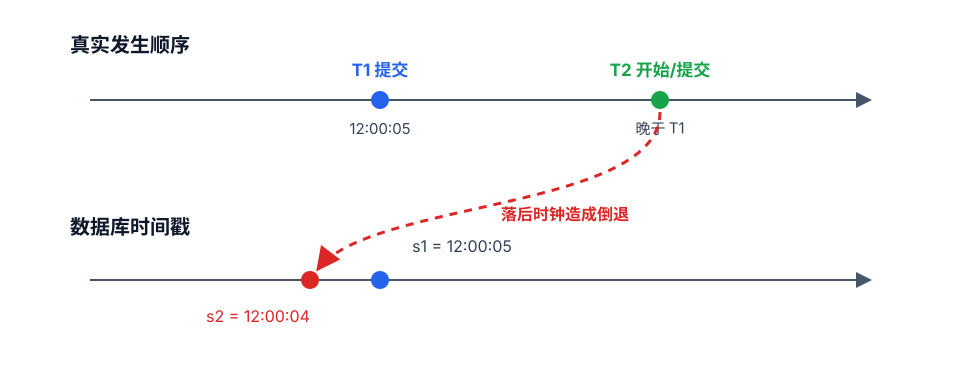
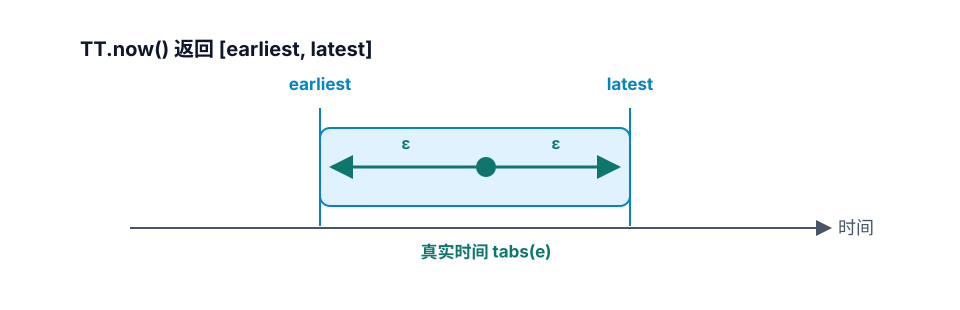
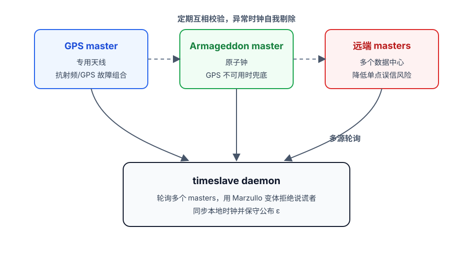
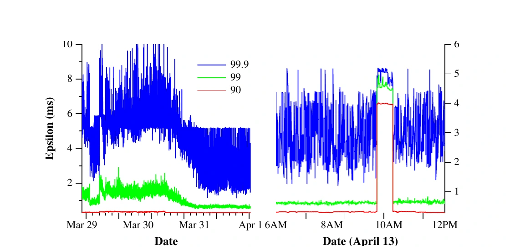
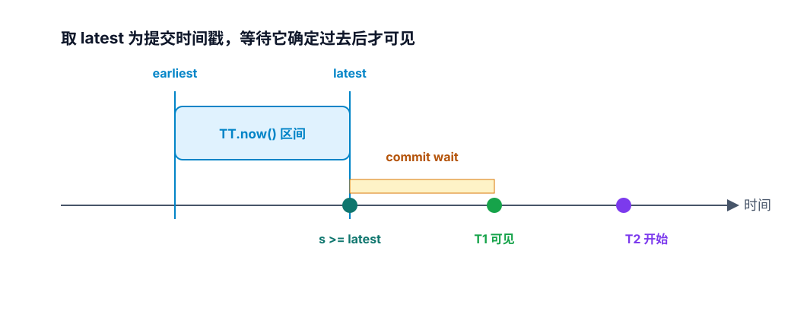

# TrueTime 如何解决时钟回拨


TrueTime 并不是让服务器的墙钟永远不回拨，而是承认“本地时钟可能不准”这个现实：它把一次读取得到的时间表示成一个保证包含真实时间的区间，再让 Spanner 在提交时等待足够长的时间，直到这个时间戳确定已经过去。换句话说，它不是消灭时钟误差，而是把误差变成一个有界的、可推理的 `ε`，然后用少量等待换取跨机器的时间戳单调性。

<!--more-->

## 时钟回拨为什么会破坏分布式事务

单机上解决“时钟回拨”常见的做法是检测到时间倒退后拒绝服务、等待时钟追上，或者改用单调递增计数器。但在全球分布式数据库里，每个节点都有自己的时钟，本地单调计数器无法回答另一个问题：不同节点先后发生的两个事务，谁的全局时间戳更大？

Spanner 希望提供外部一致性：如果客户端观察到事务 T1 已经提交，之后才开始 T2，那么数据库给 T2 的提交时间戳必须大于 T1。Google Cloud Spanner 的文档把这称为 “proper timestamping”：版本时间戳必须与外部可观察的提交顺序一致 [<sup>2</sup>](#refer-anchor-2)。

问题在于，如果 T1 和 T2 由不同节点处理，T2 所在节点的时钟稍微落后，就可能出现下图中的错序。



*图 1：T2 在真实时间上晚于 T1，但落后时钟给它分配了更小的提交时间戳。这时快照读可能先看到 T2 的效果，却看不到更早提交的 T1。对账务系统来说，这就是“先扣款、后看不到入账”的异常。*

## TrueTime 暴露的不是“一个时间”，而是时间区间

TrueTime 的核心 API 很小 [<sup>1</sup>](#refer-anchor-1)：

| 方法 | 返回 |
|---|---|
| `TT.now()` | `TTinterval: [earliest, latest]` |
| `TT.after(t)` | 如果 `t` 已确定过去，返回 true |
| `TT.before(t)` | 如果 `t` 确定尚未到来，返回 true |

`TT.now()` 并不声称返回一个精确的当前时间，而是返回区间 `[earliest, latest]`。如果事件 `e` 发生在这次调用期间，TrueTime 保证：

```text
earliest <= tabs(e) <= latest
```



*图 2：`TT.now()` 返回的 `[earliest, latest]` 保证包住真实时间；区间的半宽就是不确定度 `ε`。*

其中 `tabs(e)` 是事件的真实绝对时间。区间的半宽就是不确定度 `ε`。机器刚完成同步时，`ε` 较小；距离下一次同步越久，本地晶振漂移的累计风险越大，`ε` 会像锯齿一样逐渐增大。Spanner 论文提到，Google 生产环境的 `ε` 通常在 1 到 7ms 之间变化，多数时候约为 4ms [<sup>1</sup>](#refer-anchor-1)。

## TrueTime 如何把 `ε` 做小

TrueTime 不是只依赖一台 NTP 服务器。每个数据中心有若干 time master，主要使用两类时钟源 [<sup>1</sup>](#refer-anchor-1)：

- GPS master：通过专用天线接收 GPS 时间信号；
- Armageddon master：配备原子钟，在 GPS 天线、射频干扰或 GPS 系统不可用时提供补充。



*图 3：TrueTime 用故障模式不同的多个时钟源互相校验，timeslave daemon 再通过多源轮询同步本地时钟。*

这两类时钟源的故障模式不同。GPS 可能受天线故障、无线电干扰、欺骗攻击或系统级中断影响；原子钟则可能因频率误差长期漂移。Google 让多个 master 的时间互相校验，每个 master 也会把自己的时间源和本地时钟交叉检查，发现明显偏离时把自己剔除。

每台机器上的 timeslave daemon 会轮询多个本地和远端 master，用 Marzullo 算法的变体识别并拒绝“说谎者”，再同步本地时钟 [<sup>1</sup>](#refer-anchor-1)。工程上的重点是：`ε` 不是随便拍出来的一个容忍值，而是根据最坏时钟漂移、time master 不确定度和通信延迟推导出来的保守边界。如果机器行为超出边界，它会被剔除，TrueTime 的正确性论证才继续成立。



*图 4：Spanner 论文采集的 TrueTime `ε` 分布。曲线越高，表示对应百分位下的时钟不确定度越大。*

## Commit wait：等待“时间戳确定已经过去”

TrueTime 本身只是时间基础设施。Spanner 用它的方式可以概括为两步：

1. 提交事务时，取一个不小于 `TT.now().latest` 的时间戳 `s`；
2. 在对外可见之前执行 commit wait，直到 `TT.after(s)` 返回 true [<sup>1</sup>](#refer-anchor-1)。



*图 5：Spanner 选择不小于 `TT.now().latest` 的时间戳，等待 `TT.after(s)` 为 true 后才让 T1 对外可见；此后开始的 T2 必然拿到更大的时间戳。*

选择 `latest` 很关键。即使真实当前时间落在区间内的任何位置，`s` 也不小于真实当前时间的上界。再等待 `TT.after(s)` 后，真实时间一定已经越过 `s`。此后开始的 T2 再读取 `TT.now()`，其 `latest` 也必然大于 `s`，因此 T2 的提交时间戳会大于 T1。

这就是 TrueTime 对“时钟回拨”的处理方式：如果本地时钟只是在其不确定度范围内波动，Spanner 宁可推迟提交可见性，也不会让后续事务拿到一个可能早于前序事务的时间戳。等待成本大约与 `2ε` 同一量级；在 `ε` 为毫秒级时，这是用几毫秒延迟换取外部一致性 [<sup>3</sup>](#refer-anchor-3)。

## Leader 切换时的时间戳不倒退

Spanner 还在 Paxos leader 租约上使用同样的思路。每个 leader 会记录自己已使用的最大时间戳 `smax`；如果要退位，必须等到 `TT.after(smax)` 为 true [<sup>1</sup>](#refer-anchor-1)。这样，旧 leader 使用过的时间点确定已经过去，后续 leader 不可能在重叠的租约期内分配更小的时间戳。

这一步把“时间戳顺序”从单个事务扩展到了 Paxos group 的生命周期：leader 可以切换，但时间戳的推进不会因为切换而倒退。

## 为什么它不能简单搬到普通系统

TrueTime 的前提是 `ε` 必须真实有界。Google 靠 GPS、原子钟、多个 time master、受控网络和异常时钟剔除把 `ε` 压到毫秒级；如果某台机器的漂移超过声明边界，系统的正确性论证就会被破坏 [<sup>1</sup>](#refer-anchor-1)。普通系统没有这些硬件和运维条件时，直接模仿 `TT.now()` 很容易变成“看起来有区间，实际上边界不可信”。

更现实的理解是：

- 不需要全局物理时钟的应用，可以继续用逻辑时钟、向量时钟或集中号段；
- 只需要因果顺序、不关心真实时间间隔的场景，逻辑时钟通常更便宜；
- 需要跨地域外部一致性，并且能控制时钟基础设施时，TrueTime 这种“物理时间区间 + 等待”才是有吸引力的方案。

## 小结

TrueTime 解决时钟回拨的思路可以压缩成一句话：**不要假装本地时钟是精确的，把真实时间包进一个有界区间；分配事务时间戳时取区间上界，提交时等待这个时间戳确定过去。**时钟仍然可能不准，但只要误差不超过声明边界，Spanner 就能保证“先完成、后开始”的事务拥有递增时间戳，从而把回拨和漂移隔离在提交可见性之前。

## 参考

<div id="refer-anchor-1"></div>

- [1] J. C. Corbett et al. Spanner: Google’s Globally-Distributed Database. OSDI 2012. [PDF](https://static.googleusercontent.com/media/research.google.com/en//archive/spanner-osdi2012.pdf)

<div id="refer-anchor-2"></div>

- [2] Google Cloud. Spanner: TrueTime and external consistency. [链接](https://docs.cloud.google.com/spanner/docs/true-time-external-consistency)

<div id="refer-anchor-3"></div>

- [3] Kevin Sookocheff. TrueTime. 2021. [链接](https://sookocheff.com/post/time/truetime/)

