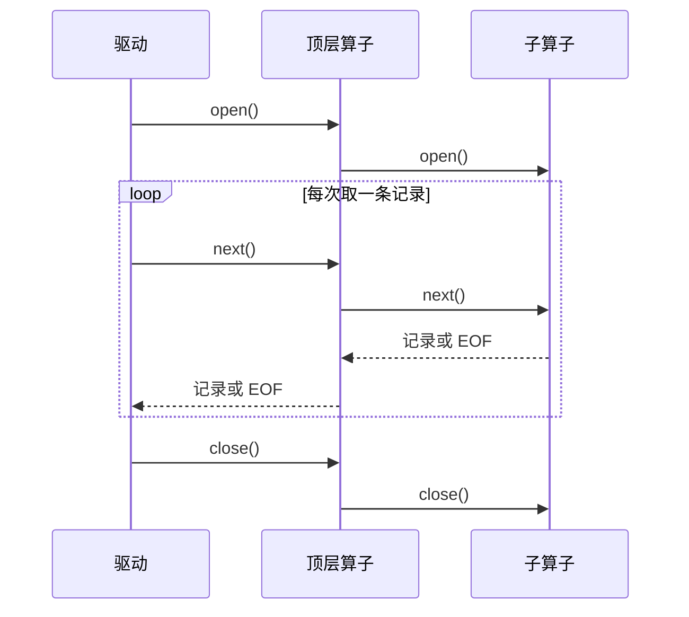
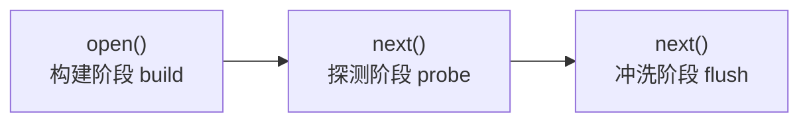
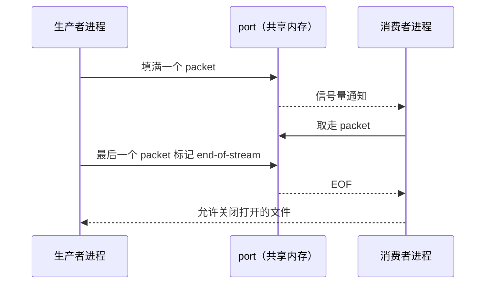

# Volcano：可扩展且并行的查询执行系统


本篇是论文 [Volcano — An Extensible and Parallel Query Evaluation System](https://doi.org/10.1109/69.273032)（Goetz Graefe，*IEEE Transactions on Knowledge and Data Engineering*, Vol. 6, No. 1, pp. 120–135，1994 年 2 月）的中文解读。Volcano 就是今天数据库教材里"火山模型"（Volcano Model）的同名来源。

<!--more-->

| 层次 | 回答的问题 | 本文对应章节 |
|---|---|---|
| **动机** | 可扩展性和并行性，为什么非要放在一起做？ | 第一章 |
| **迭代器模型** | 所有算子凭什么能长得一模一样？ | 第二章 |
| **算子** | 一套接口怎么装下整个关系代数？ | 第三章 |
| **可扩展性** | 新加一个数据类型 / 索引 / 算法，要改多少代码？ | 第四章 |
| **动态计划** | 优化决策能不能推迟到运行时再下？ | 第五章 |
| **exchange** | 不改算子代码，怎么把单进程跑成并行？ | 第六章 |
| **缓冲池** | 并行地读盘，锁怎么设计才不 deadlock？ | 第六章末 |
| **遗产** | 这套东西今天还剩哪些，又丢了哪些？ | 第七章 |

## 一、一个被拆成两半的问题

1990 年代初，数据库执行引擎面对着两个彼此独立、但都很要命的问题。

**第一个问题是扩展**。你想给数据库加一个新的数据类型（比如地理坐标）、一种新的索引结构（比如 R 树）、或者一种新的连接算法（关系除法）。如果这些改动必须伸进执行引擎的核心，那么每加一样东西就要重新调试整个引擎——扩展性就无从谈起。

**第二个问题是并行**。机器从一颗 CPU 变成 64 颗。已经有的一万个算子代码，要重写吗？如果要，这个引擎就永远追不上硬件。

这两件事在过去是分开做的。Volcano 的命题是：**它们不该分开**。

论文摘要给出的自我评价很直白——Volcano 是第一个把可扩展性与并行性真正结合起来的、已经实现的查询执行引擎。

### 1.1 论文列出的设计目标

论文开篇没有急着讲技术，而是先把目标摊开。下面是它的取舍清单：

| 目标 | 具体含义 |
|---|---|
| 模块化、可扩展 | 做的是研究基础设施，不是最终产品 |
| 简单到学生能用 | 允许多个学生项目同时在上面并行做研究 |
| 别简单到脱离现实 | 要贴近商用数据库，否则学生学不到真东西 |
| 不预设数据模型 | 只假设"查询 = 用参数化算子变换 item 集合" |
| 让新手不必碰并行 | 但同时保留做并行实验的可能 |
| 并行与数据操纵正交 | 并行机制独立于算子集合与算子语义 |

注意"不预设数据模型"这一条——它是整个 Volcano 设计的支点，后面会看到 Volcano 为此付出的代价。

论文明确说自己 "provides an infrastructure for experimental research rather than a final research prototype in itself"。今天再看，这句话是准确的：Volcano 从来没有成为商业产品，但它的每一块都活了。

### 1.2 同代系统的困境

论文第二章把 Volcano 放进当时的坐标系里。对比对象主要是四个：

- **WiSS**（Wisconsin Storage System）：记录导向的文件系统，带 heap file、B 树 / 哈希索引、缓冲管理和带谓词的扫描。数据模型绑得比较死。
- **GAMMA**：1986 年的数据流数据库机，运行在 17 台 VAX-11/750 上，用 80 Mb/s 的 token ring 连到主机；8 个 GAMMA 处理器带本地磁盘，负责更新和选择，其余无盘处理器负责连接。
- **EXODUS**：工具箱式的可扩展数据库，组件之间靠生成器拼装。
- **Starburst / Postgres**：独立地发现了 demand-driven 迭代器范式适合可扩展的单进程架构，但没能把可扩展性和并行性结合起来。

GAMMA 的问题在论文里说得很准：

> 该设计在 GAMMA 里工作得非常好，却不适合单进程查询求值——因为多个控制点（也就是多个算子）无法在单个进程内实现，除非诉诸线程这类"伪多进程"机制。

这就是 Volcano 的靶心：**GAMMA 把并行性编进了每个算子，Starburst 把并行性整个留给了未来**。Volcano 想两者都要。

XPRS 与 GAMMA 的差异被论文列成四条，正好是两种设计哲学的逐项对照：

| 维度 | GAMMA | XPRS |
|---|---|---|
| 数据模型 | 纯关系模型 | 可扩展关系模型（Postgres） |
| 并行方式 | 算子内并行（分区数据集） | 灌木式并行（并发执行不同子树） |
| 算法偏好 | 重度依赖哈希 | 以排序为主 |
| 内存假设 | 分布式内存 | 共享内存 |

### 1.3 方法论主轴：机制与策略分离

Volcano 借用的是操作系统领域的经典原则。论文说得很直白：数据库系统设计大多没有利用这个已在操作系统研究中确立的原则。

拆开看：

- **机制**（mechanism）是代码里固定下来的骨架——怎么 pin 一个页、怎么遍历一个哈希桶、怎么在两个进程之间传一批记录；
- **策略**（policy）是运行时可以换掉的决策——换出哪个页、哈希表开多大、走哪条连接路径、这次用哪个计划。

Volcano 的目标是：**机制写死在算子里，策略全部外置**。

这个原则贯穿全文，后面每章都会撞见它的具体形态。缓冲管理器接收上层的 replacement hint（换出提示）来决定换谁；连接算子通过 support function（支持函数）接收哈希表大小的策略；choose-plan 元算子只提供切换机制，选择哪个计划由外部注入的函数决定；exchange 算子把并行度、分区函数、要不要流控全部做成参数。

> **一句话概括**：Volcano 不是一个更快的数据库，它是一台**造数据库的机器**。它的每一个机制都留了插口，让未来的研究者往里塞策略。

## 二、迭代器模型：open、next、close

这一章讲 Volcano 最核心、也最有生命力的一块：**所有算子长得一模一样**。

### 2.1 三个函数和一个状态记录

Volcano 要求每一个关系代数的算子都实现同一套 `open-next-close` 协议。论文的比喻是：迭代器提供了循环里的迭代部分，也就是初始化、递增、循环终止条件和最后的收尾。

论文强调了一个对实现很关键的细节：**算子的状态不许放在静态变量里**。每个算子配一个 state record（状态记录），里面分两块：

```c
/* 每个 Volcano 算子都持有这样一份状态记录 */
typedef struct VolcanoState {
    void *args;    /* 参数：哈希表要开多大、packet 装多少条…… */
    void *state;   /* 状态：哈希表在哪、端口指针是什么…… */
} VolcanoState;
```

`args` 是"这次运行要什么"，`state` 是"这次运行弄出来的东西"。没有静态变量，意味着**同一个算法可以在一次查询里出现多次**——自连接（self-join）就是 R 和 S 各跑一遍同一个算子。

执行流程也因此是递归的：调用最顶层的 `open`，它递归调用所有子算子的 `open`（子算子在这里分配哈希表、建端口）；然后反复调用顶层的 `next`，拉不动了就 `close`，同样递归下去。



这张图是"拉"式（pull）数据流的全部：**上层向下层要数据，下层不主动往上推**。这个方向决定了后面第六章的那个"范式转换"会有多大代价。

### 2.2 支持函数：把数据模型推出引擎

如果算子只有一套空壳，谁来决定"比较两个记录里的哪个字段""怎么给记录算哈希值"？

Volcano 的答案是 **support function**（支持函数）——所有对单个数据项的操作（比较、哈希、谓词求值）都以"函数入口指针 + 一个无类型参数"的形式，从外部传进算子。

论文有一句话说得非常狠：

> 没有支持函数，Volcano 的迭代器就是空算法壳，做不了任何有用的事。

这个拆分把"控制流和集合遍历"（引擎的活）与"记录和对象的解释"（调用方的活）彻底切开了。于是：

- 想支持一个新数据类型，只要给它配上比较函数、哈希函数、投影函数，引擎一行都不用改；
- 想支持一个几何类型，可以把"两个多边形相交"做成支持函数传进去；
- 想支持一个抽象数据类型（ADT），引擎**完全不受影响**——因为 Volcano 根本不给对象提供类型系统。

支持函数的参数有两种用法，很能体现设计者的细致：

| 扫描方式 | 参数是什么 | 典型场景 |
|---|---|---|
| 编译扫描（compiled scan） | 常量，或指向多个常量的指针 | 谓词已编译成机器码 |
| 解释扫描（interpreted scan） | 交给解释器执行的代码 | 通用表达式解释求值 |

论文举例说：如果谓词是"把记录某个字段和一个字符串比较"，那么比较函数作为 predicate function 传进来，要比较的字符串作为 predicate argument 传进来。解释扫描则是把解释器的入口点当作 predicate function，argument 装待解释的代码。两种扫描用**同一套机制**支持。

这里有一个值得警惕的点：**Volcano 不做类型检查**。论文原话是"Volcano 例程假定查询求值计划及其支持函数是正确的；它们的正确性必须在调用 Volcano 之前得到保证"。这句话既是它的设计选择，也是它把"难题"推给上层的宣言。

### 2.3 匿名输入与流

论文把"匿名输入"（anonymous inputs）称为 Volcano 可扩展性的**第二块基石**：一个算子不关心自己的输入来自一棵复杂的查询树，还是一次简单的文件扫描。

它带来的是**流**（stream）这个抽象——任意数量、任意种类的算子都能串起来求值复杂查询。论文认为流加上迭代器控制范式，是单进程查询求值在时间（算子同步开销）和空间（同时驻留内存的记录数）上最有效的执行模型。

### 2.4 Next-Record 与 pin / unfix 协议

`next` 的返回值是状态码加上一个 `Next-Record` 结构，里面装着 RID 和记录在缓冲池中的地址。

缓冲管理器的规矩很明确：

- 每条被 pin 在缓冲里的记录，**在任一时刻只属于一个算子**；
- 算子可以留着它（比如塞进哈希表）、可以 unfix 它（比如谓词不通过）、也可以传给下游；
- 复杂操作（比如连接）产生新记录时，必须先在缓冲里 fix 住输出记录，再传给下游，同时 unfix 它的输入记录。

论文还记录了一次缓冲接口的重新设计带来的收益：**生产侧每个 cluster 只需要两次缓冲调用，与一个 cluster 里装多少条记录无关；消费侧每个 cluster 只需要一次**。这是把"按记录调用"改成"按页调用"的直接结果。

论文也诚实地记下了一个**被讨论但没有实现**的优化：一个 `Next-Record` 只能指向一条记录，而连接要造出完整的新记录，意味着大量的内存到内存拷贝。替代方案是让中间结果由一组 RID-指针对组合而成。论文说得很清楚——这个替代方案**没有被显式实现**，因为 Volcano 已经提供了足够的机制（filter 迭代器可以把记录替换成 RID-指针对，反之亦然）。

这是一个很好的例子：**机制齐备不等于方案现成**。

## 三、算子：把关系代数压进三个盒子

有了统一接口，接下来看 Volcano 提供了哪些算子。论文原型的规模是**约二十来个模块、一万五千行左右 C 代码**。

### 3.1 Filter：一个算子三种身份

Filter 算子同时扮演三个角色，取决于状态记录里配了哪些支持函数：

| 角色 | 支持函数 | 用途 |
|---|---|---|
| predicate | 谓词求值 | 选择，也可以用来做位图过滤（bit vector filtering） |
| transform | 从旧记录造新记录 | 投影、压缩解压、编码转换、把记录流归约成 RID-指针对 |
| apply | 对每条记录调用一次并产生副作用 | 更新、打印 |

由此得出一个容易被忽略的结论：**Volcano 的计划不只是"取数计划"，也是"更新计划"**。

论文在 Filter 一节还留了一条很有分量的设计原则：位图过滤没有做成一个专门的算子，而是一个"如果已有算子能高效组合出这个操作，就不要提供它"的例子。这条规则约束的不只是 Filter，整个算子集的设计都受它影响。

### 3.2 One-to-One Match：一个算子吃掉十种操作

这是全文最值得看的算子。

结论章的原句把它的覆盖范围列全了：

> one-to-one match 算子实现了 join、semi-join、outer join、anti-join、去重、聚合、交、并、差和反差。

也就是说，关系代数里十几个看起来各自不同的操作，在 Volcano 里是**同一个算子的不同参数配置**。

它的实现思路是：**把"匹配上的"和"没匹配上的"这两类分量分开处理**，再按需要把不同分量组合起来。于是：

| 关系操作 | 在 one-to-one match 里的实现方式 |
|---|---|
| Join / Semi-join | 两路输入按属性匹配，输出匹配上的分量 |
| Outer join | 匹配上的 + 两侧未匹配的分别保留 |
| Anti-join | 只输出未匹配的分量 |
| 去重 | 每个匹配组只保留一条 |
| 聚合 | 匹配组内把值聚合进已有元组，而不是插入新元组 |
| 交（intersection） | 两个 union-compatible 关系的交集等价于自然连接，可用 semi-join 实现 |
| 并（union） | union-compatible 关系的并等价于双侧 outer join |
| 差 / 反差 | 集合差，用算法的特定开关设置实现 |
| 笛卡尔积 | 把两侧所有可能的配对都"匹配成功" |

三个阶段干净地映射到迭代器协议上：



build 阶段构建哈希表；probe 阶段逐条探测；**第二个输入耗尽时，算子自动从 probe 切到 flush**，flush 阶段负责输出"没有匹配项也要输出"的那部分（外连接的空侧、聚合的分组）。

聚合的实现细节值得单独拎出来——它和经典 hash join 不一样：

> 对于聚合，不是像经典 hash join 那样把新元组插入哈希表，而是先把输入元组与它预期落入的哈希桶里的元组匹配；找到匹配就把新元组丢弃，或者把它的值聚合进已有元组。

如果这次操作只需要聚合、不需要连接，状态记录里干脆**不设探测输入**，直接跳过 probe 阶段。

论文在自举式设计上有一句很能说明问题的话：早期那个纯内存的 hash 版 one-to-one match 被替换成带溢出管理的新版本时，**其他所有算子和元算子都不需要改动**。

### 3.3 溢出管理：两个阈值把内存策略交给优化器

哈希表装不下内存怎么办？Volcano 的做法不是拍一个固定算法，而是用**两个阈值**把策略参数化。

论文先交代了算法选型的理由：可扩展性和有限系统规模这两个设计目标，导向了只保留两种算法——归并连接和混合哈希连接。

两个阈值的语义差别很关键：

| 阈值 | 触发后发生什么 | 有没有 I/O |
|---|---|---|
| packing threshold（打包阈值） | 元组被**紧密打包**进溢出文件；但这些文件的簇仍然 pin 在缓冲池里 | **没有** |
| spilling threshold（溢出阈值） | 第一个分区文件才被 unfix，簇写盘，内存里的元组数相应减少 | **有** |

也就是说，**打包只是重排，真正的写盘发生在溢出那一刻**。两个阈值之间留出的空间，正是优化器可以调节的余地。

除此之外还有三个设计：

- **哈希表不复制**——哈希表直接指向缓冲池里的记录（"one-to-one match 的 build 输入产出的那些记录"），避免了一次拷贝；
- **溢出桶的空间复用为位向量**——哈希表里对应已溢出桶的那部分空闲空间，被拿来当位图过滤器，减少对溢出文件的 I/O；
- **扇出可计算**——第一步分区的扇出由"可用总内存减去达到打包阈值所需的内存"决定。

论文把优化器该怎么用这些参数讲得很具体：

- 输入小 → 把打包阈值设得很高，高概率全程不复制；
- 输入极大 → 指定溢出避免策略和最大扇出；
- **输入规模无法精确估计 → 按估计的概率分布调阈值**，而不是拍一个定值。

最后这句是精髓：它不要求你事先知道输入有多大，只要求你知道一个分布。

论文还留了一个后门：初始的打包阈值和溢出阈值**都可以设为 0**，此时 one-to-one match 的溢出避免方式与 Grace 数据库机器里的连接算法非常接近。

### 3.4 One-to-Many Match：关系除法

一个 item 对多个 item 的比较，典型例子是**关系除法**（relational division），对应关系演算里的全称量化。Volcano 给了两个版本：基于排序的 native division，和用两个哈希表（一个在 divisor 上、一个在 quotient 上）的 hash-division。两种分区策略——复制定还是复制 divisor——在配套论文 [16] 里有详细分析。

## 四、可扩展性账本

第四章回到论文的核心承诺：**加东西到底要改多少代码**。论文逐项论证，答案是"别的都不用动"。

| 你想加的东西 | 需要做什么 | 执行引擎要改吗 |
|---|---|---|
| 新抽象数据类型（ADT） | 提供合适的支持函数 | 不用，系统完全不受影响 |
| 新对象方法 / 聚合函数 | 提供支持函数并传给查询处理例程 | 不用 |
| 新存取方法（如 R 树） | 定义合适的迭代器 | 不用 |
| 新查询处理算法 | 用迭代器范式写出来 | 不用 |

论文对最后一行的措辞是"它的集成是平凡的"（trivial）。它给的具体证据是：one-to-many match / division 算子加入时，其他算子完全不用改。

关于索引维护，论文的思路也很有意思：如果一个由谓词定义的数据集合需要更新，**实现这个选择的迭代器或查询树可以把自己的数据"喂"给一个维护迭代器**；多个结构一起更新就用嵌套迭代器组合，需要有序时插一个 sort 迭代器进去。

### 4.1 论文承认的局限

这一节值得完整保留，因为它是论文里难得的诚实段落。

> 规则上，通过 next 迭代器过程在算子之间传递的数据项是**记录**。对可扩展或面向对象的数据库系统来说，这会是一个不可接受的问题和限制。Volcano 用的解法是：在装载并 fix 住必要的组件记录、把记录间的指针 swizzle 之后，**只传递根组件**。

紧接着论文自己挡了预期中的反驳：

> 有人可能会说，情况之所以如此，只是因为 Volcano 没有处理可扩展性里那些困难的问题。但这个论证站不住脚。Volcano 只是数据库系统的一个组件，也就是查询执行引擎……Volcano 例程假定查询求值计划及其支持函数是正确的。

这段可以当作**回应"你只是绕开了难题"这一诘问**的范本：先承认边界，再说明边界的合理来源（我只负责执行层，不负责类型系统和目录）。

## 五、choose-plan：把优化决策推迟到运行时

论文第五章讲一个元算子：**choose-plan**。

它要解决的问题是：查询嵌在应用程序里，优化时必须对程序变量的值做假设（所谓 "typical" values），还要假设优化与执行之间数据库不变、优化时能拿到的资源是已知的。这些假设一旦不成立，计划就是次优的。

choose-plan 的机制非常克制：

- `open` 操作决定用几个等价计划中的哪一个，并调用它的 `open`；
- `open` 通过 **support function** 拿到这个决策，并传入 `bindings` 参数；
- `next` 和 `close` 只是转调 open 阶段选定的那个计划。

论文特意澄清：**choose-plan 本身不做决策，它只提供机制；策略是外部用支持函数导入的**。

于是决策就可以取决于：查询变量的 bindings 值、资源与竞争状况（比如处理器和内存的可用性）、用户优先级，或者以上全部。

它有两种用法：

| 放置方式 | 得到的机制 | 论文里的场景 |
|---|---|---|
| 树顶只有一个 choose-plan | 多计划存取模块（multiplan access module） | 谓词里的常量是程序变量 |
| 树里有多个 choose-plan | 动态查询求值计划 | 多个决策点各自独立推迟 |

论文举的具体例子是：谓词里的常量是程序变量时，走索引扫描可能更快，但索引非聚簇、需要取回大量记录时反而更慢。choose-plan 让优化器**同时准备好两种方案**，运行时按实际参数值挑一个。

最关键的一句结论是：

> 由于它与查询处理范式兼容，**它的存在完全不影响其他算子**，而且可以非常灵活地使用。

以及——它不需要"重优化"。论文的原话是，重优化可以避免，用一种叫"动态查询求值计划"的新技术。

> 这就是今天的**参数化查询计划**（PostgreSQL 的 generic plan / custom plan）和**自适应查询执行**的直系祖先。区别在于今天这些系统大多仍然保留了"运行时发现计划很差就重优化"的兜底路径，而 Volcano 的作者当年就认为可以不做。

## 六、exchange：并行化只写在一个算子里

这是全文最硬、也最少被二手资料讲清楚的一章。

### 6.1 算子模型：把并行关进一个盒子

论文先把目标讲清楚。Volcano 被移植到多处理机机器上时，人们希望**已有的全部单进程查询处理代码一行不改**就能用上。

结果是一种非常干净的**自我调度**（self-scheduling）并行处理。论文把它叫做**并行化算子模型**（operator model of parallelizing a query evaluation engine）：

> 在这个模型里，**所有并行问题都局限在一个算子里**，而它用标准的迭代器接口向上和向下提供接口。

这正是"数据操纵与并行正交"的落地方式。论文对比说，GAMMA 是在每个算子自己的进程内控制并行，网络和操作系统负责同步——这让 GAMMA 无法在单进程内高效执行。

### 6.2 垂直并行：从"进程内拉取"到"进程间推给"

实现是这样运转的：

`open-exchange` 在共享内存里创建一个 **port**（端口），然后 **fork** 出一个子进程。子进程是父进程的精确副本。**父进程是消费者，子进程是生产者**。

消费者侧的 exchange 看起来和一个普通迭代器没什么两样，唯一区别是输入通过进程间通信而不是过程调用到达。

传输的最小单位是 **packet**——一个由 `Next-Record` 组成的数组：

- packet 大小是 exchange 状态记录里的一个参数，**可以在 1 到 32000 条记录之间设置**；
- 填满一个 packet 后，它被挂进 port 引出的一条链表，用**信号量**通知消费者有新包；
- packet 里的记录在共享缓冲里是 fixed 的，**必须由消费方 unfix**。

流结束的处理有个容易漏掉的细节：

> 生产者进程里的 exchange 算子在输入耗尽时，把最后一个 packet 标上 **end-of-stream 标签**传给消费者，**然后等待，直到消费者允许关闭所有打开的文件**。这个延迟是必需的，因为在 Volcano 里，虚拟设备上的文件在所有记录从缓冲里 unpin 之前不能被关闭。

接下来是这一章最关键的一次范式转换：

> 除了 exchange 模块，Volcano 的所有模块都基于**需求驱动数据流**（迭代器、惰性求值）；而 exchange 的生产者—消费者关系用的是**数据驱动数据流**（急切求值）。

换句话说，**整个 Volcano 里只有 exchange 一个算子的数据流方向是反的**。论文给了两条理由：

1. 作者打算把 exchange 也用于水平并行，而水平并行用数据驱动更容易实现；
2. 这个方案**消除了请求消息**——虽然用信号量做请求–响应在共享内存机器上大概也能跑，但会引入不必要的控制开销和延迟。



### 6.3 流控：给生产者的油门

如果生产者比消费者快得多，生产者会把缓冲池里很大一部分 pin 住，反过来拖慢整体性能。

论文的解法是**流控**（flow control），一个运行时开关：

- 生产者把新 packet 插入 port 之后，必须**申请流控信号量**；
- 消费者从 port 取走一个 packet 之后，**释放流控信号量**；
- **信号量的初值决定了生产者最多能领先消费者多少个 packet**。

论文对"流控"和"需求驱动"的区分非常精确，这是全文最值得反复读的一段：

> 流控允许同步中出现一些"松弛"，因此实现了**真正重叠的执行**；而需求驱动数据流是一种相当僵硬的请求—交付结构，消费者等待的时候，生产者才去算它的下一个输出。

一句话：**流控不是把需求驱动换个实现，它是给需求驱动加了一段允许的缓冲**。

### 6.4 水平并行：两种切法

| 形式 | 做法 | 典型场景 |
|---|---|---|
| 灌木式并行（bushy parallelism） | 不同 CPU 执行查询树的**不同子树** | 复杂查询天然分成几段 |
| 算子内并行（intra-operator parallelism） | 多个 CPU 执行**同一算子**的不同数据子集 | 单个扫描 / 单个连接太重 |

灌木式并行的实现非常省事：**往查询树里插一两个 exchange 算子**。比如把两个输入排序后做归并连接，只要在 merge-join 前面各插一个 exchange 就完事。

算子内并行的分区方式有两种：存储数据就分成多个文件（最好在不同设备上），中间结果就**在 port 里放多个队列**，每个消费者进程一个。

分区函数同样用支持函数实现，所以可以轻松换成**轮转（round-robin）、键范围（key-range）或哈希分区**。

论文也承认了水平并行的表达力限制：

> 所有文件扫描进程都可以向所有连接进程传输数据；但连接算子之间的数据传输只发生在各自的连接进程内部。这个限制使得"两个连接在不同属性上、且使用基于分区的并行连接方法"的场景不可行。为此，Volcano 的 exchange 算子提供了一个变体，叫 **interchange**。

### 6.5 exchange 的四个变体

**广播 / 复制**。exchange 可以被指定为"把所有记录发给所有消费者"。论文指出这里有个巧妙的省事做法：**不需要复制记录**，因为它们本来就住在共享缓冲池里，只需要多次 pin，让每个消费者都以为自己是唯一的使用者就能各自 unfix。

**Merge network 与 merge 迭代器**。merge 迭代器从 sort 模块派生，用单级归并而非 sort 的级联归并。这里有个关键约束——**merge 迭代器的输入必须按生产者区分**：

> 对连接操作来说，输入记录是从哪儿产生的无关紧要；但对归并操作来说，**区分输入记录的生产者是至关重要的**。

为此 exchange 给 `next-exchange` 加了第三个实参，把需要区分的生产者告诉 merge。支持多级 merge 树，归并路径自动选择，让每一级的负载尽量均匀。

**Striped → Range-partitioned 排序**。原方案把数据随机分区（striped）到多磁盘，每个 CPU 需要**两个进程**（一个扫文件并分区，一个负责排序）。问题很明显：

> 创建并运行比处理器更多的进程，会带来可观的开销，因为这些进程要争抢 CPU，因此需要操作系统的调度。

改成每个 CPU 一个进程（进程数减半），排序结果是**范围分区**的有序分区文件。

**Interchange**。这是最巧妙的一个变体。在它之前，exchange 只能活在算子树的顶端或底端；改动之后，它可以在树的中间。打开时**不 fork 任何进程**，只建立通信端口；`next` 操作向自己的输入树要记录，必要时转给组内其他进程，直到找到属于自己分区的记录。

论文对这个变体的流控描述尤其值得注意：

> 这种工作方式也让**流控变得不必要**。一个进程只有在没有可供消费者使用的输入时才运行生产者（并为其他进程生产输入）。因此，如果生产者有冲垮消费者的危险，**没有任何一个生产者算子会被调度**，消费者就消费已有的记录。

这是现代背压式流处理（reactive streams、Flink 的 credit-based flow control）的早期形态——反压不是设计出来的，而是"没有输入就不干活"这条规则自然涌现的。

### 6.6 两级缓冲锁与重启协议

并行地读盘，锁怎么设计？论文在第六章最后给了一套很干净的方案。

**两级锁结构**：

- 一个**缓冲池锁**——搜索或更新哈希表、桶链时持有，**做 I/O 时绝不持有**，因此永远不会长时间占着；
- 一个**描述符锁**（每个驻留在缓冲里的页或簇一个）——做 I/O 或更新描述符（比如减少它的 fix count）时持有。

**原子 test-and-lock + 重启协议**：

> 如果进程在缓冲里找到了需要的簇，它用一个**原子的 test-and-lock** 操作去锁住对应的描述符。如果这个操作失败，缓冲池锁被释放，操作被延迟并**重启**。有必要**重启包括哈希表查找在内的整个缓冲操作**，因为持有锁的那个进程可能正在替换所请求的簇。

论文随后用死锁四条件做了一次教科书式的分析：

> 死锁的四个条件是**互斥、持有并等待、不可抢占、循环等待**；Volcano 的重启方案**不满足第二个条件**。另一方面，**饥饿在理论上是可能的**，但在缓冲管理器改造基本消除了缓冲争用之后，它已经变得极不可能发生。

"不满足持有并等待"是这段的精髓：拿不到锁时**不持有任何锁整体重做**，所以既不会形成环，也不会形成"别人拿着我要的东西、我还攥着别人要的东西"的局面。

最终的效果是：**整个查询求值是自我调度的**。

## 七、局限与遗产

### 7.1 论文没做的事

论文的结论章没有粉饰。Volcano 是一台**造数据库的机器**，不是一个数据库：

| 没做的 | 原因 / 论文的说法 |
|---|---|
| 用户友好的查询语言、实例类型系统、目录（catalog）、查询优化器 | Volcano 只是执行引擎这一层 |
| 类型检查与类型系统 | 正确性由调用 Volcano 之前的上层保证 |
| 完整记录的传递 | 面向对象场景下不理想，改用"根组件 + swizzle 指针" |
| 少拷贝的组合式中间结果 | 机制齐备，但方案没有显式实现 |
| 分布式内存上的并行 | 当时只支持共享内存 |
| 事务、恢复、多用户、查询间并行 | 列为 future work |
| 错误处理的模块化 | 计划把各模块改成 all-or-nothing 语义 |

关于共享内存这个限制，论文给了一个有趣的方向：构建"**由共享内存计算机组成的网络**"（比如超立方体或 mesh），同时拿到共享内存的快速通信和分布式内存的可扩展性。论文预言，这样就能研究**层次化架构**上的查询处理，以及 CPU、I/O、内存该怎么摆放和利用。

### 7.2 今天在哪

| Volcano 里的机制 | 今天的对应物 |
|---|---|
| 迭代器 `open-next-close` | PostgreSQL 的 `ExecProcNode`、MySQL 8.0 的迭代器执行器、SQL Server 的 Volcano-style 迭代器、CockroachDB / TiDB 的算子树 |
| 支持函数 | 向量化表达式求值、运行时代码生成（JIT） |
| One-to-One Match | 被拆成 Hash Join / Merge Join / Index Nested Loop 三个独立算子 |
| Exchange | TiDB 的 exchange 算子、DuckDB 的 morsel 驱动、PostgreSQL 的 parallel worker |
| Choose-Plan | 参数化查询计划、自适应查询执行 |
| 两级缓冲锁 | PostgreSQL 的 buffer latch、InnoDB 的 latch / mutex 分离 |
| 机制与策略分离 | 几乎所有现代执行引擎的共同语言 |

两个值得单说的：

**为什么今天的系统反而把连接拆成三个算子？** Volcano 那种"一个算子吃掉十种操作"的通用性很优雅，但通用算子意味着每个操作都要付通用性的税——分支判断、参数分发、无法针对具体操作做极限优化。通用性与专用优化之间的取舍，Volcano 当年选了通用，主流系统后来选了专用。

**向量化执行是对 Volcano 的一次局部反叛。** 迭代器模型里每条记录都要穿过一层虚函数调用，分支预测器在这一点上非常难受，缓存也是。DuckDB、ClickHouse、Velox 干脆让算子一次处理一批（一个 vector）而不是一条记录。这个方向在论文外，但它是针对迭代器模型的具体缺陷的。

**SQLite 走的是另一条路。** 它的 VDBE 是字节码虚拟机（栈机），不是迭代器模型——控制流全在编译期就定死了，运行时不再有算子间的虚函数调用。同一时期的三条路线：**编译成字节码**（SQLite）、**迭代器**（PostgreSQL）、**代码生成**（MySQL 8.0 的 JIT、以及 Hyper）。

### 7.3 配套论文

Volcano 的性能实验不在正文里——论文自己说得很清楚：这是一篇总览性论文，配套论文 [16]–[21]、[25]、[26] 才包含实验评估。

正文里唯一的性能锚点是一个转引：**16 个 CPU 上并行排序加速 14.9 倍**，论文把它限定为"共享内存架构在**有限的并行度**下可以给出接近线性的加速"。这个数字出自 Graefe 与 Thakkar 1992 年的调优论文 [18]。

想顺着读下去的几篇：

- Graefe & Ward, *Dynamic Query Evaluation Plans*, SIGMOD 1989——choose-plan 的完整版
- Graefe & Thakkar, *Tuning a Parallel Database Algorithm on a Shared-Memory Multiprocessor*, SPE 1992——14.9 倍加速比的出处
- Graefe & Davison, *Encapsulation of Parallelism and Architecture-Independence in Extensible Database Query Execution*, TSE 1993——并行化算子模型的完整版
- Graefe, *Encapsulation of Parallelism in the Volcano Query Processing System*, SIGMOD 1990
- Graefe, *Relational Division: Four Algorithms and Their Performance*, ICDE 1989——关系除法的四种算法

## 八、总结

> **Volcano 用一套 `open-next-close` 接口统一了所有算子，用支持函数把数据模型推出了引擎，再用 exchange 算子把并行关进了一个盒子里。**

如果只能带走五句话：

1. **可扩展性和并行性不是两件事**。把并行关进一个算子、把策略从机制里抽出来，两者才能同时成立。
2. **机制与策略分离是贯穿全文的主轴**。缓冲替换提示、哈希表大小、计划选择、并行度与分区函数——全都是"机制固定、策略外置"。
3. **支持函数是 Volcano 可扩展性的根**。没有它，迭代器就只是空壳；代价是不做类型检查，正确性责任被推给上层。
4. **exchange 用一次范式转换换来了"不改一行算子代码"**。整个系统里只有它一个是数据驱动的，代价是生产端的推挤。
5. **论文的诚实比论文的结论更值钱**。它承认自己不做类型系统、不做目录、不做优化器、不做分布式内存，然后用一句"我只负责执行层"把边界划清楚。

参考资料：

- 论文 DOI：[10.1109/69.273032](https://doi.org/10.1109/69.273032)
- 期刊页：IEEE Transactions on Knowledge and Data Engineering, Vol. 6, No. 1, pp. 120–135, February 1994
- IEEE Xplore：[document/273032](https://ieeexplore.ieee.org/document/273032/)
- 作者论文列表（DBLP）：[Goetz Graefe](https://dblp.org/pid/g/GoetzGraefe.html)

