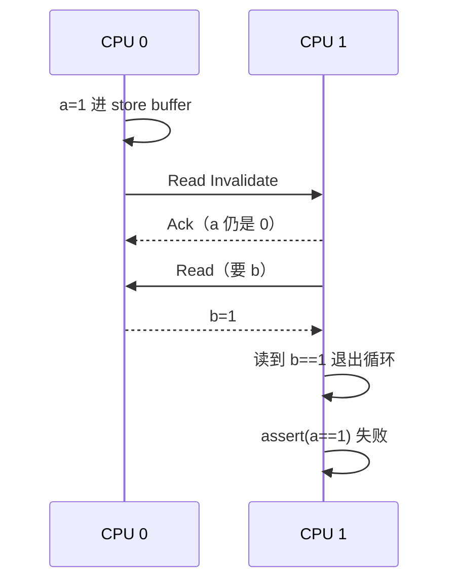
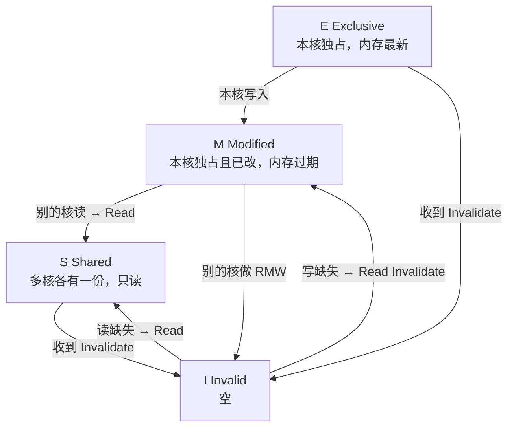
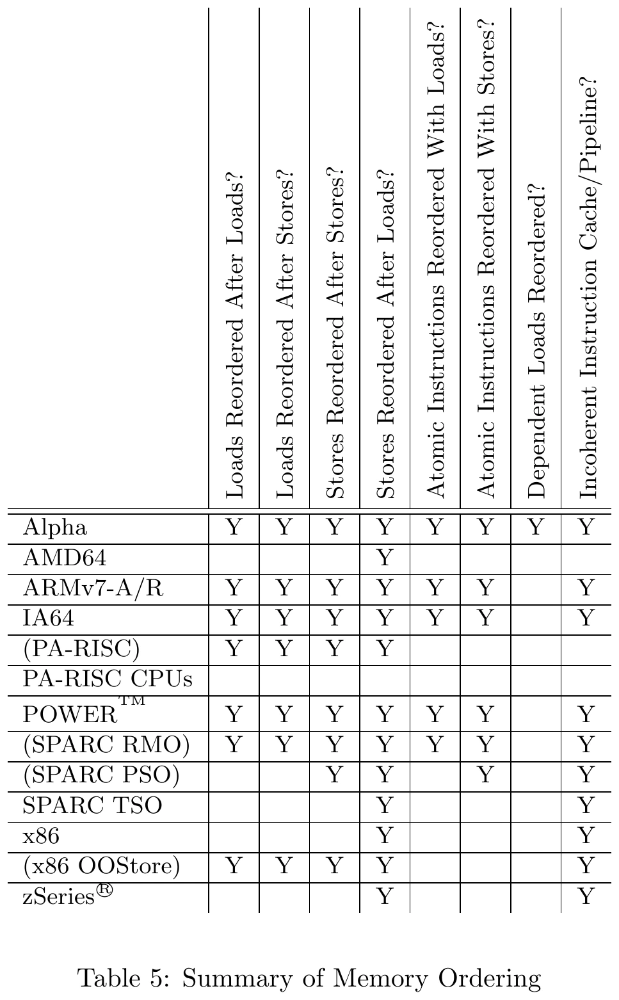

# 内存屏障为什么必须存在：store buffer 与 invalidate queue


<!--more-->

> 原文：Paul E. McKenney. **Memory Barriers: a Hardware View for Software Hackers.** LWN.net, July 23, 2010. IBM Linux Technology Center, Beaverton.（后被收录为作者《Is Parallel Programming Hard, And, If So, What Can You Do About It?》的附录 C）

先看一段 C 代码：

```c
void foo(void)
{
    a = 1;
    smp_mb();
    b = 1;
}

void bar(void)
{
    while (b == 0) continue;
    assert(a == 1);
}
```

`foo` 说："先把 `a` 置 1，再把 `b` 置 1。" `bar` 说："等我看到 `b` 变成 1 了，`a` 一定也已经是 1。"

单核上，这个程序永远不会出错。**双核上，它会出错。**

`bar` 的 `while` 循环一旦读到 `b == 1`，CPU 1 就认定 `foo` 已经跑完了前半段；于是它断言 `a == 1`。但此刻 CPU 0 那个 `a = 1` 可能**还躺在 store buffer 里没出去**——CPU 1 读到的 `a` 还是 0。断言失败。

`smp_mb()` 就是来解决这件事的。但它为什么能解决？屏障在硬件上到底做了什么？

大多数人是**从语言规范**学内存屏障的：JMM 的 happens-before、C11 的 `memory_order_acquire`、Go 的 memory model。规范告诉你"加了这个就安全了"，却不告诉你**为什么需要**——于是屏障变成了一个必须背下来的魔法 API。

这篇论文换了个角度：**从硬件讲起**。McKenney 的结论是，内存屏障不是一个设计出来的抽象，而是两个具体硬件结构的**直接后果**：

- **store buffer**（写缓冲）让 CPU 不必等缓存行到手就能继续往下走，代价是**写与写之间可能乱序**；
- **invalidate queue**（失效队列）让失效请求先应答、后处理，代价是**失效与读之间可能乱序**。

前者造出**写屏障**的必要性，后者造出**读屏障**的必要性，完整的屏障两个都管。你只要看懂这两个队列，屏障的分类、代价、为什么 x86 上的写屏障是空操作，全都有了答案。

| 层次 | 回答的问题 | 核心标识 | 本文对应章节 |
|---|---|---|---|
| 谜题 | 一段看着没问题的代码为什么会挂？ | 消息传递反例 | 第一章 |
| 地基 | 多核怎么保证大家看到同一份数据？ | MESI | 第二章 |
| 源头一 | 写为什么要停顿？store buffer 补了什么？ | store buffer | 第三章 |
| 源头二 | 失效请求为什么还能打败屏障？ | invalidate queue | 第四章 |
| 对应 | 三种屏障各管什么？ | `smp_mb/rmb/wmb` | 第五章 |
| 反例 | 哪些写法看着对、其实是错的？ | 三个例子 | 第六章 |
| 实现 | 各架构的屏障指令长什么样？ | DMB / mf / sync | 第七章 |
| 接口 | Linux 抽象出了什么？ | 五个原语 | 第八章 |
| 至今 | 这一套今天还成立吗？ | C11 / RVWMO | 第九章 |

## 一、谜题：一个断言的失败

### 1.1 失败是怎么发生的

先把上面那个例子拆开看。假设 `a` 所在的缓存行在 CPU 1 手里，`b` 所在的缓存行归 CPU 0。论文给的事件序列是这样的：

1. CPU 0 执行 `a = 1`。这行不在 CPU 0 的缓存里，于是它把新值放进 **store buffer**，同时发出一个 "read invalidate" 消息。
2. CPU 1 执行 `while (b == 0) continue;`，但 `b` 也不在它缓存里，发出一个 "read" 消息。
3. CPU 0 执行 `b = 1`。这行已经在它手里了，直接写进缓存行。
4. CPU 0 收到 "read" 消息，把**已经更新过**的 `b` 所在缓存行发给 CPU 1，自己那份标记为 "shared"。
5. CPU 1 收到缓存行，装进自己的缓存。
6. CPU 1 的 `while` 循环终于看到 `b == 1`，退出循环。
7. CPU 1 执行 `assert(a == 1)`——**它手里的 `a` 还是 0，断言失败**。
8. 这时 CPU 1 才收到 CPU 0 早先发出的 "read invalidate"，把 `a` 所在缓存行作废。**太晚了。**

第 7 步和第 8 步的顺序，就是整篇文章的起点。



### 1.2 但这不是 bug，是规范允许的

值得注意的是：**上面这个执行序列完全合法**。没有任何硬件故障，没有任何数据损坏。CPU 0 严格按程序顺序执行了 `a=1` 和 `b=1`；CPU 1 严格按程序顺序执行了 `while` 和 `assert`。

问题出在**两个 CPU 之间**。CPU 1 看到 `b` 已经更新，却没看到 `a` 已经更新——而按程序顺序，`a=1` 应该更早发生。

这就是"全局内存序"被破坏的样子。用论文的话说：每块 CPU 都保证**自己**看到的访问按程序顺序发生，但**跨 CPU** 的相对顺序没有保证。

### 1.3 屏障在这时出场

```c
void foo(void)
{
    a = 1;
    smp_mb();
    b = 1;
}
```

`smp_mb()` 的作用，按论文的描述是：让 CPU **在把后续的写应用到缓存行之前，先把 store buffer 冲干净**。具体怎么实现有两种可能：

- 直接**停顿**，直到 store buffer 空了再往下走；
- 或者**打标记**——给 store buffer 里已有的条目打上标记，后续的写先放在 store buffer 的无标记条目里，直到所有打了标记的条目都被应用出去。

第二种更常见，代价小得多。序列于是变成：

1. CPU 0 执行 `a = 1`，进 store buffer，发 "read invalidate"。
2. CPU 1 发 "read"（要 `b`）。
3. CPU 0 执行 `smp_mb()`，给 store buffer 里现有的条目（也就是 `a=1`）**打标记**。
4. CPU 0 执行 `b = 1`。因为 store buffer 里有打了标记的条目，`b=1` 不能直接写进缓存行，只能放进 store buffer 的**无标记**条目。
5. CPU 0 把 `b` 的**旧值**（0）发给 CPU 1。

第 5 步是关键：CPU 1 会先读到 `b == 0`，继续转圈，直到 store buffer 排空、`b=1` 真正进了缓存行，CPU 1 才可能看到 `b == 1`。而那时 `a=1` 早就已经出去了。

**`smp_mb()` 就是给 store buffer 里的条目打标记。** 这句话是全文的钥匙，后面所有的分类都从它推出来。

## 二、地基：MESI 与它的消息

要理解 store buffer 和 invalidate queue，得先知道 CPU 之间是怎么保持一致的。

### 2.1 cache line 与"几何"

CPU 之间的数据交换以**固定长度的块**为单位，叫 cache line，论文说"通常是 2 的幂，16 到 256 字节之间"。

论文用一个 16 组 × 2 路（way）的 cache 举例，每组只能放一条 256 字节的缓存行：

```text
                  Way 0              Way 1
    0x0      0x12345000
    0x1      0x12345100
    ...
    0xF                          0x43210E00
```

因为缓存行必须 256 字节对齐，低 8 位恒为 0；哈希函数取地址的中间 4 位作为组号。这种"组数 × 路数"的规模叫 cache 的**几何（geometry）**。

论文顺手提了一句：这套 cache 相当于一个 16 个桶、每桶最多两个元素的软件哈希表，只不过硬件的哈希函数极其简单——"从内存地址里取出四个比特"。

### 2.2 四种 cache miss

论文把 cache miss 分成四类，每一类对应一种完全不同的优化策略：

| miss 类型 | 触发原因 | 能优化吗 |
|---|---|---|
| **startup / warmup** | 某个数据项第一次被访问，不在缓存里 | 不能，只能预热 |
| **capacity** | 缓存装满了，要驱逐一条腾地方 | 能，靠提高局部性 |
| **associativity** | 缓存没满，但目标组的两路都占了 | 能，靠改访问模式 |
| **communication** | 别的 CPU 把这行作废了（它要写） | 不能，是通信的代价 |

第三类值得多说一句：论文举了个例子，程序顺序访问 `0x12345000` 到 `0x12345EFF`，接着访问 `0x12345F00`——它哈希到 0xF 组，两路都空着，放得下；但如果接着访问 `0x1233E00`（哈希到 0xE 组），就得**驱逐**掉已有一条。将来再访问被驱逐的那条，就 miss 了。这就是 associativity miss。

### 2.3 MESI：四个状态

真实的一致性协议动辄几十个状态，论文只用四状态的 **MESI**：

- **M（Modified）**：本 CPU 存过这个数据，内存里的副本已经过期，且**不在任何别的 CPU 缓存里**。这条缓存行"归"本 CPU 所有。
- **E（Exclusive）**：只有本 CPU 有这份数据，**但内存里的也是最新的**。CPU 可以随时写，不用通知别人。
- **S（Shared）**：至少还有一个别的 CPU 缓存里有一份。本 CPU 不能直接写，得先跟别人商量。
- **I（Invalid）**：空的。



从这张图能直接读出 MESI 协议要发的消息：

| 消息 | 含义 |
|---|---|
| **Read** | 请求读某条缓存行（带物理地址） |
| **Read Response** | 回应 Read，数据由内存或某个缓存提供 |
| **Invalidate** | 让别的缓存删掉这条缓存行（带物理地址） |
| **Invalidate Acknowledge** | 收到 Invalidate 的缓存删完之后回应 |
| **Read Invalidate** | Read + Invalidate 的合体：要数据，同时让别人删掉 |
| **Writeback** | 把缓存行连同数据写回内存 |

有个细节值得留意：**"别的核读"这条边是从 M 出发的**。当 CPU 1 想读一个被 CPU 0 独占并修改过的数据时，数据不必从内存取，直接由 CPU 0 提供（Read Response），CPU 0 顺便把状态降级成 S。

## 三、源头一：store buffer

### 3.1 写为什么这么慢

按 MESI，CPU 0 要写一个别人缓存里的数据，必须先把那条缓存行**从别人那儿抢过来**——等对方发回缓存行、收齐一整套 Invalidate Acknowledge，才能动笔。

论文画了一条时间线：CPU 0 发写请求 → 等 CPU 1 把缓存行传过来 → CPU 0 stall（停住）→ 收到确认 → 才能写。

这中间的时间差是"数量级"级别的。论文的脚注说得很直接：从一个 CPU 的缓存把缓存行传到另一个 CPU 的缓存，**通常比执行一条寄存器到寄存器的指令慢几个数量级**。

### 3.2 store buffer：不让 CPU 等

但仔细想想，**这个等待毫无必要**——反正 CPU 0 拿到缓存行也是为了把它整个覆盖掉，别的数据是什么它根本不在乎。

于是硬件加了一层：**在 CPU 和它的缓存之间放一个 store buffer**。

CPU 0 执行写操作时，只需要把新值记进 store buffer，然后**继续执行下一条指令**。等缓存行真的从 CPU 1 传回来了，再把 store buffer 里的值搬进缓存行。

性能问题解决了。但麻烦才刚开始。

### 3.3 麻烦一：store forwarding

第一个麻烦是**自一致性**被破坏。论文的例子：

```c
a = 1;
b = a + 1;
assert(b == 2);
```

`a` 和 `b` 初始都是 0，`a` 的缓存行归 CPU 1，`b` 的归 CPU 0。论文列出的事件序列：

1. CPU 0 开始执行 `a = 1`。
2. CPU 0 查缓存，发现 `a` 不在。
3. CPU 0 发 "read invalidate"，要独占 `a` 所在的缓存行。
4. CPU 0 **把 `a` 的新值记进 store buffer**。
5. CPU 1 收到 "read invalidate"，把缓存行传回去并删除本地副本。
6. CPU 0 开始执行 `b = a + 1`。
7. CPU 0 收到 CPU 1 传来的缓存行——**里面的 `a` 还是 0**。
8. CPU 0 从自己的缓存里读 `a`，读到 0。
9. CPU 0 才把 store buffer 里的条目应用到刚到的缓存行，把 `a` 设成 1。
10. CPU 0 用第 8 步读到的 0 加 1，得出 `b = 0`。
11. `assert(b == 2)` **失败**。

问题的本质：**同一时刻有两份 `a`**——一份在缓存里，一份在 store buffer 里。CPU 0 从缓存读到了旧的那份。

硬件厂商对这件事的解法叫 **store forwarding**：CPU 读数据时，除了查缓存，还要**窥探（snoop）自己的 store buffer**。自己的写直接转发给后续的读，不必绕道缓存。

加上 store forwarding 之后，第 8 步会在 store buffer 里找到 `a = 1`，`b` 就是 2，断言不再失败。

论文对这件事的评价是：破坏"CPU 永远按程序顺序看到自己的操作"这条保证是"**极其反直觉**"的，软件工程师们接受不了，所以硬件厂商才"出于同情"（took pity）实现了 store forwarding。

### 3.4 麻烦二：写屏障登场

第二个麻烦就是第一章那个例子了：写与写之间可能乱序。

store buffer 让 `a = 1` 和 `b = 1` 都先待在 CPU 0 的 store buffer 里。CPU 1 想读 `b` 时，CPU 0 会把缓存行里的**旧值**发过去——因为新的 `b` 还在 store buffer 里没出去。

于是 CPU 1 可能先看到 `b=1`、后看到 `a=1`——顺序反了。

解法就是第一章那个 `smp_mb()`：**给 store buffer 里的条目打标记，让后续的写不能越过它。**

论文在这里点出了屏障的本质：

> 硬件设计师在这里无能为力，因为 CPU 根本不知道哪些变量之间存在关系，更不知道它们会是什么关系。因此硬件设计师提供内存屏障指令，让软件告诉 CPU 这样的关系。

**内存屏障是软件向硬件"补充信息"的唯一手段。** CPU 不知道 `a` 和 `b` 之间有依赖，屏障告诉它："这两个写有顺序关系。"

## 四、源头二：invalidate queue

### 4.1 一个让屏障失效的优化

写屏障解决了写-写乱序。但还有一处漏洞。

考虑硬件的另一个优化：CPU 收到 Invalidate 请求时，**先把它排进 invalidate queue，然后立刻回应**。这样做能最小化做写的 CPU 等待的失效延迟。

论文的问题是：这个优化**会让内存屏障失效**。

还是那个例子，这次 `a` 的缓存行在两个 CPU 里都是 S 状态（只读共享），`b` 归 CPU 0：

1. CPU 0 执行 `a = 1`。这行在 CPU 0 手里是只读的，所以把新值放进 store buffer，发出 **"invalidate"**（不是 "read invalidate"，因为 CPU 0 已经有整行的数据了）。
2. CPU 1 执行 `while (b == 0)`，`b` 不在它缓存里，发出 "read"。
3. CPU 1 收到 "invalidate"，**排进 invalidate queue，立刻回应**。
4. CPU 0 收到回应，于是可以越过 `smp_mb()`，把 `a` 从 store buffer 搬进缓存行。
5. CPU 0 执行 `b = 1`，直接写进缓存行。
6. CPU 0 收到 "read"，把**更新后的** `b` 发给 CPU 1。
7. CPU 1 收到并安装 `b` 的缓存行。
8. CPU 1 看到 `b == 1`，退出循环。
9. CPU 1 执行 `assert(a == 1)`——**它的缓存里 `a` 还是旧值，断言失败**。
10. 尽管断言已经失败，CPU 1 这才处理队列里的 "invalidate"，把 `a` 作废。**太晚了。**

第 9 步和第 10 步的顺序，跟第一章一模一样。

### 4.2 读屏障登场

解法还是屏障，只是这次要加在**读的那一侧**：

```c
void bar(void)
{
    while (b == 0) continue;
    smp_mb();
    assert(a == 1);
}
```

屏障和 invalidate queue 的交互方式是：**执行屏障时，给 invalidate queue 里现有的条目打标记，并强制后续的 load 等到所有被标记的条目都处理完。**

于是第 9 步之前，CPU 1 必须先停下来处理掉队列里的 "invalidate"，把 `a` 作废；然后它的 `assert(a == 1)` 就会去内存里重新取一次 `a`，拿到 1。断言不再失败。

### 4.3 一个容易漏掉的细节

论文在这里埋了一个 **Quick Quiz 8**，答案是：

> CPUs are free to speculatively execute, which can have the effect of executing the assertion before the while loop completes.

**CPU 可以推测执行。** 就算 `while` 循环还没退出，CPU 也可能已经猜着执行了后面的 `assert`。所以"CPU 1 不可能执行 assert 直到 while 循环结束"这个直觉是错的——屏障还得管住推测执行。

这也是为什么很多初学者觉得内存屏障"没法理解"：它管的**不只是你写的代码顺序，还包括硬件对它的猜**。

## 五、三种屏障的分工

到这里，两种硬件结构各造成了一种乱序，屏障也就有了对应的分类。论文的定义非常干净：

> 大致来说，**读内存屏障只标记 invalidate queue，写内存屏障只标记 store buffer**，而一个完整的内存屏障两个都做。

| 原语 | 标记哪个队列 | 约束什么 |
|---|---|---|
| `smp_wmb()` | store buffer | 屏障前的**所有写**都先于屏障后的写被其他 CPU 看到 |
| `smp_rmb()` | invalidate queue | 屏障前的**所有读**都先于屏障后的读被完成 |
| `smp_mb()` | 两个都标记 | 屏障前的**所有访存**都先于屏障后的访存 |

最终版代码：

```c
void foo(void)
{
    a = 1;
    smp_wmb();
    b = 1;
}

void bar(void)
{
    while (b == 0) continue;
    smp_rmb();
    assert(a == 1);
}
```

注意这里的变化：**`foo` 里的 `smp_mb()` 降级成了 `smp_wmb()`，`bar` 里的 `smp_mb()` 降级成了 `smp_rmb()`**。

为什么可以降级？因为第一章的例子里 `foo` 只写不读，`bar` 只读不写；第四章的例子里 `bar` 只读不写、`foo` 的写侧由 `smp_wmb()` 已经管住了。**用更弱的屏障换来更低的代价**——这是屏障调优的核心思路，论文在第七章会具体展开。

论文对此的评价很克制：

> 有些计算机有更多种类的内存屏障，但理解这三个变体，就能对内存屏障有个不错的入门。

## 六、朴素但错误的屏障用法

### 6.1 一个"最敌对"的假想架构

论文接着讲了一个更要紧的话题：**那些看着对、其实会错**的屏障用法。

作者没有去挑某家硬件的刺，而是**虚构了一台最不利于内存排序的机器**。它满足五条约束：

1. 每个 CPU 总是按程序顺序感知**自己**的访存；
2. CPU 只在两个操作访问**不同地址**时才可能重排；
3. 某 CPU 的读屏障之前的所有读，都被所有 CPU 感知为先于屏障之后的读；
4. 某 CPU 的写屏障之前的所有写，都被所有 CPU 感知为先于屏障之后的写；
5. 某 CPU 的全屏障之前的所有访存（读写），都被所有 CPU 感知为先于屏障之后的访存。

这基本就是"能有多差就多差"。

### 6.2 三个反例

论文用三个例子说明：即使每个屏障都放在"看起来对"的位置，代码也可能错。

**例 1（Table 2）**：一个屏障只能保证**本 CPU** 内部的顺序。如果你想让 CPU 0 的写先于 CPU 1 的写被看到，光在 CPU 0 里加屏障没用——你得在**读侧**也加（就是第四章的 `bar()`）。论文的 Quick Quiz 10 解释了：在 CPU 1 的 `while` 和写 `c` 之间插屏障，"只会强制 CPU 1 局部的顺序，对 CPU 0 和 CPU 1 访问的相对顺序毫无影响"。

**例 2（Table 3）**：三个 CPU，一个屏障挡不住**队列拥塞**。CPU 0 刚经历大量 cache miss，消息队列塞满了，它的 `a=1` 卡在队列后面；CPU 1 队列空空的，它的 `b=1` 一路畅通。CPU 2 完全可能先看到 CPU 1 的 `b=1`，后看到 CPU 0 的 `a=1`——**尽管两边都有屏障**。

论文对这类代码的态度很务实：

> 理论上，可移植代码不应该依赖这个例子；但和前面一样，实际上它在大多数主流计算机系统上确实能工作。

**例 3（Table 4）**：反过来，一个"看起来多此一举"的屏障是必要的。CPU 0 写 `a`（带屏障）、写 `b`；CPU 1、2 等 `b`（带屏障）后各写 `c`、`d`；CPU 0 再等 `c`、`d`，然后带屏障地写 `e`。CPU 2 断言 `e == 0 || a == 1`。

这里的额外屏障建立的是**传递性**。论文顺带提了一句：Linux 内核的 `synchronize_rcu()` 用的就是类似这个例子的算法。

### 6.3 传递性：硬件的一点仁慈

论文在 Quick Quiz 10 的答案里点出了这个概念：

> 所有主流计算机系统都提供了某种机制来提供**传递性**，从而给出符合直觉的因果顺序：如果 B 看到了 A 的访问的效果，C 看到了 B 的访问的效果，那么 C 也一定看得到 A 的访问的效果。简而言之，硬件设计者对软件开发者的需求多少留了点同情心。

**传递性（transitivity）**是内存模型里最容易被忽略、却最救命的一条。它保证"因果链"不会断：A 发布 → B 看到 → B 发布 → C 看到，那么 C 一定也看到 A 的发布。

论文在架构章节还会再提一次：IA64 对 release 操作提供全局全序，POWER 提供 "cumulativity"——两者都是传递性的硬件基础。

## 七、各架构的屏障指令

Linux 内核不能为每种 CPU 单独写一份同步原语，所以它定义了一组**最小公倍数**原语，再让各架构自己去实现。论文第七章逐个拆了这些架构。

### 7.1 x86：写屏障是空操作

x86 是最省事的一个，因为它的内存模型天然很强（TSO，总存储顺序）：

| 原语 | x86 实现 |
|---|---|
| `smp_wmb()` | **空操作**（只需编译屏障） |
| `smp_rmb()` | `lock;addl`（老 CPU）/ `lfence` |
| `smp_mb()` | `lock;addl`（老 CPU）/ `mfence` |

论文的解释：x86 CPU 提供"处理顺序（process ordering）"，所有 CPU 都对某个 CPU 的写顺序达成一致，所以写屏障在硬件层面什么都不用做；但编译器仍需要指令，防止编译器把代码重排到屏障两侧。

x86 传统上**不给读操作任何顺序保证**，所以 `smp_mb()` 和 `smp_rmb()` 只能展开成 `lock;addl`——这条原子指令同时对读和写起屏障作用。

两个补充：

- 有 SSE 的 CPU 可以用 `mfence`（mb）、`lfence`（rmb）、`sfence`（wmb）分别实现。
- 少数几个 x86 版本有个模式位可以开启**乱序写（out-of-order stores）**，对这些 CPU，`smp_wmb()` 也必须定义成 `lock;addl`。

论文还提到一个容易翻车的细节：`clflush` 和非临时移动指令（non-temporal move）是**弱序的**，别指望它们有屏障语义。

### 7.2 ARMv7-A/R：DMB、DSB、ISB

ARM 是嵌入式市场的主力，但多核实现也早就有五年以上了。它的内存模型类似 Power，但指令集不同：

| 指令 | 语义 |
|---|---|
| **DMB**（data memory barrier） | 指定类型的操作**看起来已完成**之后，才执行后续同类型操作。类型可以是全部操作，也可以只限于写 |
| **DSB**（data synchronization barrier） | 指定类型的操作**真正完成**之后，才执行后续操作（任何类型） |
| **ISB**（instruction synchronization barrier） | 冲刷 CPU 流水线，保证 ISB 之后的指令在 ISB 完成后才被取指 |

ARM 还允许 cache 一致性有三种作用域：单处理器（single processor）、处理器子集（inner）、全局（outer）。

论文指出：**没有一条 ARM 指令精确匹配 Linux 的 `rmb()` 语义**，所以 `rmb()` 只能用完整的 DMB 实现。

ARM 这段最实用的是**控制依赖（control dependency）**的例子：

```c
r1 = x;
if (r1 == 0)
    nop();
y = 1;
r2 = z;
ISB();
r3 = z;
```

ARM 实现控制依赖，所以第 1 行的 `x` 读取一定排在第 4 行写 `y` 之前。**但 ARM 不保证 load-load 的控制依赖**——第 1 行的读完全可能发生在第 5 行读 `z` 之后。而第 2 行的条件分支加上第 6 行的 `ISB`，保证了第 7 行读 `z` 排在第 1 行读 `x` 之后。

### 7.3 PowerPC：sync、lwsync、eieio、isync

Power 家族的屏障指令特别多：

| 指令 | 语义 |
|---|---|
| **sync** | 所有在先操作看起来已完成之后，后续操作才开始。**非常昂贵** |
| **lwsync** | 用读对后续的读写排序，也对写排序；但**不对写-后续读排序** |
| **eieio** | 所有在先的**可缓存**写看起来已完成之后，所有后续的写才开始 |
| **isync** | 所有在先指令看起来已完成之后，后续指令才开始执行 |

Linux 的映射：`smp_mb()` → `sync`；`smp_wmb()` → `eieio`（轻量版）；`smp_rmb()` → `lwsync`。

Power 的 **cumulativity** 特性提供传递性：任何看到早期代码片段结果的代码，也会看到那个片段自己看到的访存。

论文还提醒了 Power 的一个坑：**很多 POWER 架构的指令缓存是不一致的（incoherent）**，往内存写的东西不一定马上反映到指令缓存里。JIT 编译器天天在干自修改代码的活，这时候需要 `icbi`（instruction cache block invalidate）指令。

### 7.4 IA64：mf 与"半屏障"

IA64 提供弱一致性模型，没有显式屏障时可以任意重排。它有 `mf` 指令，还有给 load、store 和部分原子指令用的**半内存栅栏修饰符**：

- **acq**：禁止后续访存被重排到 acq 之前，但允许之前的访存被重排到 acq 之后；
- **rel**：禁止之前的访存被重排到 rel 之后，但允许后续访存被重排到 rel 之前。

论文指出半屏障在临界区里很好用："把操作推进临界区是安全的，但让它们渗出来可能是致命的。"

IA64 的 `mf` 用来实现 `smp_rmb()`、`smp_mb()`、`smp_wmb()`，而且——论文特地加了一句玩笑——"尽管传闻相反，`mf` 这个助记符真的就是 'memory fence' 的意思"。

更重要的是：**IA64 定义了 Linux 里加锁与解锁所关联的内存序语义**，并且为 release 操作提供全局全序，也就是传递性。

### 7.5 Alpha：连数据依赖都不给

Alpha 是 Linux 内核内存屏障原语名字的来源（`smp_mb()` 就是 Alpha 的 `mb`，`smp_rmb()` 是 `rmb`，`smp_wmb()` 是 `wmb`）。

但 Alpha 是唯一一个 `smp_read_barrier_depends()` **不是空操作**的架构——在 Alpha 上它是 `smp_mb()`。

论文在注释里写了一句让人后背发凉的话：

> 这意味着 Alpha 实际上可以**先取回被指向的数据，再取回指针本身**。奇怪，但属实。

**为什么需要数据依赖屏障**：无锁链表的插入要保证"先写 `p->key`，再把 `p` 挂进链表"——否则读线程可能看到指针已挂上去、但 key 还是旧的。

论文给的正确写法：

```c
struct el *insert(long key, long data)
{
    struct el *p;
    p = kmalloc(sizeof(*p), GPF_ATOMIC);
    spin_lock(&mutex);
    p->next = head.next;
    p->key = key;
    p->data = data;
    smp_wmb();          /* 先把 p->key 写出去 */
    head.next = p;      /* 再挂链表 */
    spin_unlock(&mutex);
}

struct el *search(long key)
{
    struct el *p;
    p = head.next;
    while (p != &head) {
        smp_read_barrier_depends();   /* 保证读到的是完整的 p */
        if (p->key == key) {
            return (p);
        }
        p = p->next;
    };
    return (NULL);
}
```

论文还提到，可以用**软件屏障**替代 `smp_wmb()`：向所有其他 CPU 发中断（IPI），让它们各自执行一条内存屏障指令。但这被 Linux 社区否了——"在 Alpha 这样极弱序的 CPU 上开销过大"。

### 7.6 对照表

论文原文的 Table 5 把所有架构的排序特性列成一张大表。下面是原文截图：



读这张表要先弄清楚四个问题的含义，否则很容易看反。以 x86 为例，它只有一格是 Y，落在 "Stores Reordered After Loads?" 上——意思是**写可以晚于更早的读才生效**，也就是 store buffer 效应。TSO 除此之外什么都不放宽：读不能越过读，读不能越过写，写不能越过写。

对照着看，论文的结论很干净：

- **强序一档**：x86、AMD64、SPARC TSO、zSeries——四种访存重排里只放开"写晚于读"这一种（论文 §7.9 补充说 zSeries 实际还要更强，"这张表低估了实际情况"）；
- **弱序一档**：SPARC PSO、Alpha、ARMv7-A/R、IA64、POWER、SPARC RMO——放开得更多；
- **PA-RISC 是个特例**：括号里的架构允许全面重排，但实际产品 "PA-RISC CPUs" 一栏全空——论文 §7.5 说得很直白，"PA-RISC 架构允许 load 与 store 全面重排，**但实际 CPU 是完全有序的**"；
- **Alpha 还多一条**：它是唯一连**数据依赖**都不保证的架构，所以 `smp_read_barrier_depends()` 在别的平台是空操作，在 Alpha 上却得实现成 `smp_mb()`。

把上一节各架构的结论汇总成一张能直接查的表：

| 架构 | 访存重排 | 数据依赖可重排？ | 屏障指令 |
|---|---|---|---|
| **x86 / AMD64** | 强序：仅允许"写晚于读生效" | 否 | `mfence` / `lfence` / `sfence`；老 CPU 用 `lock;addl` |
| **SPARC TSO** | 同 x86 | 否 | `membar #StoreStore` 等 7 种自由组合 |
| **zSeries** | 同 x86 | 否 | `bcr 15,0` |
| **SPARC PSO** | 写-写、写-读可重排 | 否 | 同上 |
| **ARMv7-A/R** | 弱序：访存可全面重排 | 否 | `DMB` / `DSB` / `ISB` |
| **POWER** | 同 ARM | 否 | `sync` / `lwsync` / `eieio` / `isync` |
| **IA64** | 同 ARM | 否 | `mf` 加 `acq` / `rel` 半屏障修饰符 |
| **Alpha** | 同 ARM | **是** | `mb` / `rmb` / `wmb`（Linux 原语的命名来源） |

看这张表就知道为什么 x86 上写屏障是空操作，而 ARM/Power 上到处都要插屏障。

## 八、Linux 的最小公倍数

论文第七章最后给出了 Linux 内核实际用的原语集合。

### 8.1 五个原语

| 原语 | 语义 |
|---|---|
| `smp_mb()` | 全屏障：屏障前的读写都先于屏障后的读写被提交到内存 |
| `smp_rmb()` | 读屏障：只排序读 |
| `smp_wmb()` | 写屏障：只排序写 |
| `smp_read_barrier_depends()` | 强制依赖先前操作的后续操作保持顺序。**除 Alpha 外全是空操作** |
| `mmiowb()` | 强制被全局 spinlock 保护的 MMIO 写保持顺序 |

前三个还要额外做一件事：**它们同时阻止编译器把访存重排到屏障两侧**。`smp_read_barrier_depends()` 同理，但只在 Alpha 上。

论文特意说明 `mmiowb()` 是"相对新的原语，所以用它的驱动还不多"——在 IA64、FRV、MIPS、SH 的一部分（不是全部）系统上它才不是空操作。

### 8.2 UP 版本

每个原语都有两个版本：`smp_*` 版本只在 SMP 内核里生成代码；`mb()`、`rmb()`、`wmb()`、`read_barrier_depends()` 这些 **UP 版本在单处理器内核里也生成屏障**。

论文给的使用建议很明确：

> **大多数情况应该用 `smp` 版本。** 但写驱动时 UP 版本有用，因为 MMIO 访存必须**在单处理器内核里也保持顺序**——没有屏障指令的情况下，CPU 和编译器都会乐于重排这些访存，轻则让设备行为古怪，重则让内核崩溃，甚至损坏硬件。

### 8.3 你大概率不需要直接用它们

论文给普通程序员的第一条建议是：

> 很多软件环境，包括 pthreads 和 Java，**干脆禁止直接使用内存屏障**，把程序员限制在互斥原语上。

以及：

> Linux 的所有锁定原语（spinlock、读写锁、信号量、RCU……）都已经包含了所需的屏障原语。所以如果你用的是这些原语，你根本不需要操心内存屏障的细节。

这条建议今天依然成立，而且更重要了——因为 Java 的 `volatile`、`synchronized`、`java.util.concurrent` 里的原子类，全都已经把屏障包在里面了。本站的这几篇文章正好是这条链的两端：

- [Java并发之volatile关键字](/posts/2018/03/d8876854/)——语言层最弱的同步手段；
- [Java并发之Unsafe](/posts/2018/03/be0cc22/)——锁与原子变量的底层原语；
- [Java并发之原子变量Atomic](/posts/2018/05/c75c1aed/)——基于 CPU 原子指令的无锁更新；
- [Java虚拟机-Java内存模型](/posts/2017/10/9b98afdc/)——把这一切抽象成 happens-before 的那层规范。

论文还有一句关于 Linux 生态的观察：**MMIO 顺序问题之所以长期存在，是因为设备与内存之间的访问顺序在很多架构上不受架构保证**，所以需要 `mmiowb()` 这样的"双保险"。

## 九、这一套今天还成立吗

论文第八节问了一个很开放的问题：**内存屏障会不会成为历史？**

### 9.1 论文的两方论证

论文没有给出结论，而是摆了两方：

**支持"会过时"的一方**：大规模多线程硬件架构——每个线程等到内存就绪才继续执行下一条指令，同时有几十、几百甚至几千个别的线程在推进。这种架构里**根本不需要内存屏障**，因为线程会等所有未完成操作结束才往下走；而且有上千个线程在跑，CPU 永远不会闲着。

**反对的一方**：能扩展到上千线程的应用程序**极其有限**；而且实时性要求越来越严苛，有些应用要求几十微秒级的响应——这已经很难满足了，在这种"单线程吞吐极低"的大规模多线程场景下只会更难。

论文还补了一轮反驳：越来越精巧的延迟隐藏硬件也许能让 CPU 提供"顺序一致执行"的**幻觉**，同时保住乱序执行的绝大部分性能优势；而反过来，能效要求（电池设备、环保责任）又越来越严。

结论很坦率：

> 谁对？我们也不知道，所以准备着面对这两种情况中的任何一种。

### 9.2 事实层面：硬件变了吗

**没有本质变化。** 论文分析的 store buffer 和 invalidate queue，今天依然是所有主流 CPU 的标准配置：

- x86 至今是 TSO 模型，写屏障基本还是空操作；
- ARM 的 AArch64 服务器芯片和 POWER 至今是弱序模型，`dmb` 依然是主力屏障指令；
- RISC-V 在 2019 年发布官方内存模型 **RVWMO**（RISC-V Weak Memory Ordering），依然是弱序模型，`fence` 指令负责排序。

**变的只是抽象层。** C11 把硬件的三种屏障直接翻译成了语言语义：

| 硬件原语 | C11 / C++11 对应 |
|---|---|
| `smp_wmb()` | `memory_order_release` |
| `smp_rmb()` | `memory_order_acquire` |
| `smp_mb()` | `memory_order_seq_cst` |

Java 的 JMM（JSR-133，2004 年定稿）比这篇论文还早，做的是同一件事：**把硬件的屏障语义提升为语言层的 happens-before 关系**。

这就是为什么这篇论文值得读：**JMM 告诉你"加 volatile 就够了"，这篇告诉你"volatile 底下是一个 store buffer 和一个 invalidate queue"**。前者是规范，后者是原因。

### 9.3 还没被抽象掉的部分

有几件事，语言层没能也不打算替你解决：

- **传递性不是白给的。** 论文强调传递性是"硬件设计者的同情心"。C++ 的 acquire/release 链式同步把这件事写进了语言规范，但**你要用对**——用错了同步原语，传递性不会自动生效。
- **弱序架构还在。** 在 ARM 服务器上写一段"看起来对"的代码，跨核可见性依然要靠 acquire/release 或显式屏障兜底。
- **推测执行不在语言模型的管辖范围内。** 第四章那个 Quick Quiz 8 说的"CPU 可能在 while 循环结束前就执行了 assert"，对应的正是 Spectre/Meltdown 这类漏洞。内存屏障管得住访存的可见性顺序，**管不住侧信道**。

### 9.4 给硬件设计者的话

论文最后有一节专门写给硬件厂商（"Advice to Hardware Designers"），列了几条"让软件开发者的日子很难过"的特性：

1. **忽略 cache 一致性的 I/O 设备**——DMA 可能读到过期的输出缓冲，或在 DMA 完成后立刻被 CPU 缓存里的内容覆盖输入缓冲；
2. **忽略 cache 一致性的设备中断**——中断本身不是访存，但带着缓存里的旧数据去读输入缓冲，就会得到损坏的数据，而且**这种损坏在事后 dump 里是看不见的**；
3. **忽略 cache 一致性的 IPI**——IPI 到达时，消息缓冲区的缓存行可能还没提交到内存；
4. **跑在 cache 一致性前面的上下文切换**。

这一节读起来像是抱怨，但它是整篇文章最有价值的部分之一：**它把"软件 bug"和"硬件特性"之间的责任边界划清楚了**。你在排查一个跨核的数据可见性问题时，知道哪些行为是架构允许的、哪些是硬件在为难你，能省下大量时间。

## 结尾

> **内存屏障不是一条抽象的规定，而是两个硬件队列的直接后果**：store buffer 让写不必等缓存行，invalidate queue 让失效请求先应答后处理。前者制造写-写乱序，后者制造失效-读乱序；`smp_wmb()` 管前者，`smp_rmb()` 管后者，`smp_mb()` 两个都管。

如果只能带走五句话：

1. **先看队列，再看屏障。** 记住"写屏障标记 store buffer、读屏障标记 invalidate queue"，三种屏障的分类、代价、以及"x86 上写屏障是空操作"就都自然解释了。
2. **屏障是软件向硬件补充依赖关系的唯一手段。** CPU 不知道 `a` 和 `b` 之间有关系，屏障负责告诉它。硬件厂商无法替你做这个判断。
3. **屏障管的是跨 CPU 的可见性，不是 CPU 内部的顺序。** 一个屏障只能保证本 CPU 局部的顺序——想在读侧看到写侧的效果，读侧也得加屏障。
4. **传递性是硬件给的礼物，不是免费的。** A 发布 → B 看到 → B 发布 → C 看到，则 C 一定看到 A 的发布。但这条链得靠同步原语正确搭出来。
5. **语言层把这一切抽象掉了，但原因还在硬件里。** C11 的 acquire/release、Java 的 happens-before 都是这层抽象；理解底下发生了什么，才知道抽象在哪里漏风——比如推测执行和侧信道，内存屏障就管不着。

### 参考资料

- Paul E. McKenney. **Memory Barriers: a Hardware View for Software Hackers.** LWN.net, July 23, 2010.
- Paul E. McKenney. [Memory ordering in modern microprocessors, part I](https://www.linuxjournal.com/article/8211). *Linux Journal*, 1(136):52–57, August 2005. — 论文引用的 [McK05a]，屏障分类的更早版本。
- Paul E. McKenney. [Memory ordering in modern microprocessors, part II](https://www.linuxjournal.com/article/8212). *Linux Journal*, 1(137):78–82, September 2005. — 论文引用的 [McK05b]。
- David Howells, Paul E. McKenney, Will Deacon, Peter Zijlstra. [Linux kernel memory barriers](https://static.lwn.net/kerneldoc/core-api/wrappers/memory-barriers.html). — 内核侧的屏障文档，本文第八章那套原语的权威说明书。
- Paul E. McKenney, Raul Silvera. [Example power implementation for C/C++ memory model](http://www.rdrop.com/users/paulmck/scalability/paper/N2745r.2009.02.27a.html). C++ 标准委员会提案 N2745, 2009. — 论文引用的 [MS09]，讨论传递性与因果序。
- David E. Culler, Jaswinder Pal Singh, Anoop Gupta. *Parallel Computer Architecture: a Hardware/Software Approach.* Morgan Kaufmann, 1999. — 论文脚注提到的 SGI Origin2000 九状态与 NUMA-Q 26 状态一致性协议图的出处。
- Intel Corporation. *IA-32 Intel Architecture Software Developer's Manual*, Volume 3: System Programming Guide, 2004. — 论文 §7.8 引用的 x86 内存模型规范。
- Linux 内核的[锁类型与内存序说明](https://www.kernel.org/doc/html/latest/locking/locktypes.html) — 各架构屏障实现的一览表。

