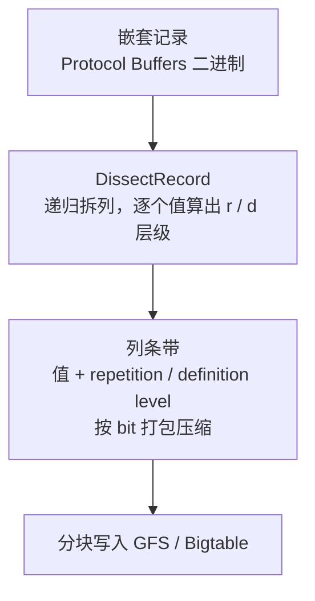
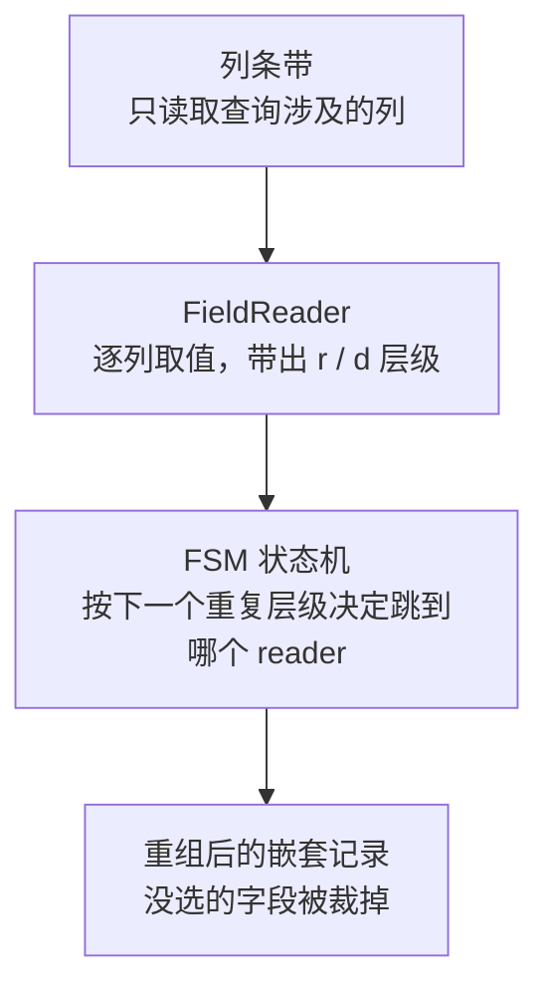
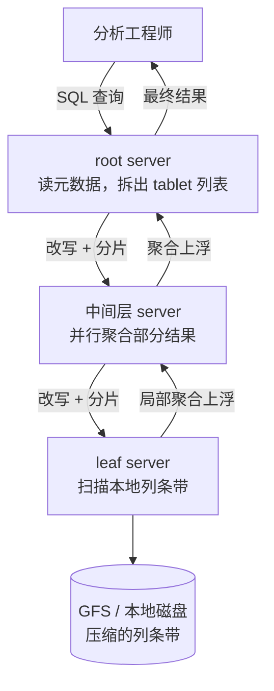

# Dremel：面向Web规模数据集的交互式分析


本篇是论文 [Dremel: Interactive Analysis of Web-Scale Datasets](https://research.google/pubs/pub36632/)（VLDB 2010，[PDF 版本](https://storage.googleapis.com/gweb-research2023-media/pubtools/3293.pdf)）的中文解读。Dremel 是 Google 内部的大规模数据分析系统，也是后来 BigQuery 的技术源头。

<!--more-->

| 层次 | 回答的问题 | 本文对应章节 |
|---|---|---|
| **动机** | 嵌套数据为什么不能直接丢进关系型数据库？ | 第一章 |
| **数据模型** | Dremel 处理的究竟是什么样的记录？ | 第二章 |
| **列式存储** | 列存丢掉了行结构，怎么再把它找回来？ | 第三章 |
| **查询语言** | 不重塑结构的 SQL 长什么样？ | 第四章 |
| **执行架构** | 秒级响应是怎么在几千台机器上做到的？ | 第五章 |
| **实验数据** | 论文里的数字能说明什么？ | 第六章 |
| **今天在哪** | 这套设计现在叫什么名字？ | 第七章 |

## 一、为什么需要 Dremel

先看一个具体场景。工程师 Alice 有了个新想法：给爬来的网页抽取一类以前没抽过的信号。她跑了个 MapReduce 作业，产出了几十亿条记录的新数据集，存在 GFS 上。

接下来的动作就很常见了：她想看看信号的分布，想知道某个取值为什么频繁出现。

如果走传统数据库的路线，得先做 ETL 把嵌套数据摊平成关系表——web 规模下这个开销通常是禁用的——然后装载、等建索引、再查询。如果直接写 MapReduce 作业看，同样是几十分钟起步。

Dremel 提供的是第三条路：**数据原地躺在 GFS 里，一个 SQL 查询，几秒钟出结果**。这个系统 2006 年就在 Google 生产环境跑了，到论文发表时已部署多个实例，规模从几十到几千节点不等。

它快在哪？三个答案，恰好对应论文的三条主要贡献：

1. **嵌套数据用列式存储**，但要解决"列存丢掉了记录结构"这个硬问题——这是全文最硬的部分，也是最有价值的部分；
2. **免重塑的查询语言**，查询直接作用在列式嵌套数据上，不需要先把记录组装出来；
3. **多层服务树**，让 PB 级的聚合在几千台机器上压进秒级。

### 1.1 嵌套数据是常态，不是例外

Web 与科学计算中的数据往往是非关系型的：编程语言里的数据结构、分布式系统之间交换的消息、结构化文档——这些天然就是嵌套的。关系模型要处理它们，只能拆成表再拼回去（反规范化），在 web 规模下这个代价通常是"禁止"的。

论文开门见山：**嵌套数据模型支撑了 Google 内部大部分结构化数据处理**，据说其他几家大型互联网公司也一样。

### 1.2 In situ：不要"先装载再查询"

传统分析型数据库的流程是"装载 → 查询"。在分析场景里，"跑几十个 MR 分析之后，DBMS 才刚把数据装完、跑出第一条查询"是常见现象——装载阶段吃掉了大部分时间。

Dremel 走 **in situ** 路线：直接在分布式文件系统（GFS）或其它存储层（Bigtable）上就地查询。省下的不只是装载时间，还包括文件系统本身的好处——数据可以用标准工具搬运、改访问权限、按文件名挑出子集来分析。

### 1.3 Dremel 不是要取代 MapReduce

论文写得很明确：Dremel 不是 MapReduce 的替代品，两者常常配合使用。论文第 2 节给出的完整场景是一条流水线：

Alice 先用 MR 产出新数据集 → 启动 Dremel 跑几条交互式查询验证想法（秒级）→ 发现 `signal1` 的分布有异常 → 写个 FlumeJava 程序做更复杂的计算 → 修好问题后把流程做成持续运行的 pipeline → 写几条固定的 SQL 聚合跨维度统计结果 → 挂到交互式 dashboard → 最后把新数据集注册进 catalog，让别的工程师也能快速找到并查询它。

换句话说：**MR 负责批量重活，Dremel 负责"看两眼"和固化查询**。

### 1.4 它用在哪些地方

论文列的 Google 内部用例相当具体：爬取网页的分析、Android Market 上应用安装数据追踪、Google 产品的崩溃上报、Google Books 的 OCR 结果、垃圾邮件分析、Google Maps 地图瓦片的调试、Bigtable 托管实例的 tablet 迁移、分布式构建系统的测试结果、几十万块磁盘的 I/O 统计、数据中心作业的资源监控，以及 Google 代码库中符号与依赖的分析。

## 二、数据模型

Dremel 的数据模型源自 **Protocol Buffers**——那个名字里的 "Dremel" 原本是 Google 内部用的一把电动工具（以转速而非扭矩取胜），论文说是拿来做内部项目的代号。

### 2.1 抽象语法

```plaintext
τ = dom | hA₁: τ[∗|?], …, Aₙ: τ[∗|?]i
```

- `dom` 是原子类型：整数、浮点数、字符串等；
- 记录类型由若干字段 `A₁ … Aₙ` 组成；
- `[∗]` 是 **repeated**：可以出现多次，按列表理解，**出现顺序有意义**；
- `[?]` 是 **optional**：可以缺失；
- 其余是 **required**：必须恰好出现一次。

### 2.2 两条样例记录

论文用一个 `Document` 类型贯穿全文。schema 如下：

```protobuf
message Document {
  required int64 DocId;
  optional group Links {
    repeated int64 Backward;
    repeated int64 Forward;
  }
  repeated group Name {
    repeated group Language {
      required string Code;
      optional string Country;
    }
    optional string Url;
  }
}
```

两条记录（缩进表示嵌套层级）。第一条 `r1` 有 3 个 `Name`，其中第 2 个只有 `Url`、第 3 个只有 `Language`：

```plaintext
DocId: 10
Links
  Forward: 20
  Forward: 40
  Forward: 60
Name
  Language
    Code: 'en-us'
    Country: 'us'
  Language
    Code: 'en'
  Url: 'http://A'
Name
  Url: 'http://B'
Name
  Language
    Code: 'en-gb'
    Country: 'gb'
```

第二条 `r2` 要短得多，`Links` 下只有 `Backward`，`Name` 下只有 `Url`：

```plaintext
DocId: 20
Links
  Backward: 10
  Backward: 30
  Forward: 80
Name
  Url: 'http://C'
```

schema 的字段形成一棵**树层级**结构，嵌套字段用点号全路径表示，例如 `Name.Language.Code`。

这个例子被论文反复使用——第三章讲列式存储、第四章讲查询语言，都拿它当标尺。

## 三、嵌套列式存储

这一章是整篇论文的核心。

### 3.1 列存的老问题与新问题

把某个嵌套字段的所有值连续存放，好处很直接：取 `A.B.C` 不用碰 `A.E`、`A.B.D`；列存配合廉价压缩还能省 CPU。

但**列存对平面关系数据早就有人做过**（Abadi 等人的工作），据作者所知**没有扩展到嵌套数据模型**。要扩展，难在三处：

1. 如何在列格式里**无损**地保留记录结构；
2. 如何**高效地把嵌套记录拆成列**；
3. 如何高效地**把任意字段子集重组回记录**。

论文把列式格式设计成 Google 内部很多数据处理工具都能用的通用格式——MR、Sawzall、FlumeJava 都用它。

### 3.2 光有值，结构就没了

问题出在：值本身不携带结构。

- 同一个 repeated 字段的两个值，光看值**不知道它们在哪一层重复**——是来自两条不同的记录，还是同一条记录里重复了两次？
- 一个缺失的 optional 字段，光看缺失**不知道外层哪些记录是真的定义过的**。

### 3.3 重复层级（repetition level）

给每个值附一个 repetition level，说明它在路径上"**是哪一个 repeated 字段处发生了重复**"。

以 `Name.Language.Code` 为例，它的路径上有两个 repeated 字段（`Name` 和 `Language`），所以 repetition level 取值 0 到 2，其中 **0 表示一条新记录的开始**。

顺着 r1 自顶向下扫一遍：

| 遇到的值 | 最近重复的是谁 | repetition level |
|---|---|---|
| `'en-us'` | 还没遇到任何 repeated 字段 | 0 |
| `'en'` | `Language` 重复了 | 2 |
| `'en-gb'` | `Name` 最近重复（`Language` 之后只出现过一次） | 1 |

所以 r1 里 `Code` 的 repetition level 依次是 **0, 2, 1**。

这里有个细节值得停一下：r1 的第二个 `Name` 里**一个 `Code` 都没有**。光看 'en' 和 'en-gb' 两个值，没法知道 'en-gb' 属于**第三个** `Name` 而不是第二个。解决办法是在中间**插一个 NULL**，靠这个 NULL 占位，才能还原出正确的嵌套位置。

### 3.4 定义层级（definition level）

给每个值（**尤其是每个 NULL**）附一个 definition level：路径上有多少个"可能未定义"的字段（也就是 optional 或 repeated 的那些）**确实存在**。

用整数而不是一个 is-null 标志位，是为了**让叶子字段的数据里就带着父字段是否出现的信息**。

举例：

- r1 没有任何 `Backward` 链接，但 `Links` 字段本身在第 1 层是**定义过**的——于是 `Links.Backward` 列里补一个 definition level 为 **1** 的 NULL，把这个信息保住；
- r2 里缺失的那次 `Name.Language.Country`，definition level 是 **1**；
- r1 里缺失的两次，一次在 `Name.Language` 里，definition level 是 **2**；另一次在 `Name` 里，definition level 是 **1**。

### 3.5 完整编码

把两条记录拆成列之后，长这样（r 是 repetition level，d 是 definition level）。路径上只有一层重复或可选字段的"浅列"：

| 字段 | 值 | r | d |
|---|---|---|---|
| `DocId` | 10 | 0 | 0 |
| `DocId` | 20 | 0 | 0 |
| `Name.Url` | `http://A` | 0 | 2 |
| `Name.Url` | `http://B` | 1 | 2 |
| `Name.Url` | NULL | 1 | 1 |
| `Name.Url` | `http://C` | 0 | 2 |
| `Links.Forward` | 20 | 0 | 2 |
| `Links.Forward` | 40 | 1 | 2 |
| `Links.Forward` | 60 | 1 | 2 |
| `Links.Forward` | 80 | 0 | 2 |
| `Links.Backward` | NULL | 0 | 1 |
| `Links.Backward` | 10 | 0 | 2 |
| `Links.Backward` | 30 | 1 | 2 |

路径上有两层重复字段的"深列"：

| 字段 | 值 | r | d |
|---|---|---|---|
| `Name.Language.Code` | `en-us` | 0 | 2 |
| `Name.Language.Code` | `en` | 2 | 2 |
| `Name.Language.Code` | NULL | 1 | 1 |
| `Name.Language.Code` | `en-gb` | 1 | 2 |
| `Name.Language.Code` | NULL | 0 | 1 |
| `Name.Language.Country` | `us` | 0 | 3 |
| `Name.Language.Country` | NULL | 2 | 2 |
| `Name.Language.Country` | NULL | 1 | 1 |
| `Name.Language.Country` | `gb` | 1 | 3 |
| `Name.Language.Country` | NULL | 0 | 1 |

对照着看几行就能验证这套编码是对的：`Name.Url` 那列里 `http://B` 的 r=1 表示"在 `Name` 这一层重复过"，NULL 的 d=1 表示"`Name` 存在、但 `Url` 不存在"；`Name.Language.Country` 的最大值是 d=3，因为路径 `Name → Language → Country` 上有三个可能未定义的字段。

### 3.6 存储细节

- 每一列存成**若干 block**，每个 block 含层级 + 压缩后的字段值；
- **NULL 不显式存储**，由 definition level 隐含：路径上 repeated 与 optional 字段的总数是 N，那么 definition level 小于 N 即表示 NULL；
- 恒定定义的字段**不存** definition level；同理 definition level 为 0 蕴含 repetition level 为 0，后者也可以省掉；
- 层级按**位序列**打包，只用必要的位数——最大 definition level 是 3 时，每级 2 bit。

### 3.7 拆列：记录怎么变成列

基础算法叫 `DissectRecord`（论文附录 A），递归遍历记录结构计算层级。

真正的难点是：**层级必须在字段值缺失的情况下也能算出来**。Google 内部很多数据集是稀疏的——schema 有几千个字段，一条记录实际只用了一百个。

做法是建一棵 **field writer 树**，结构与 schema 同构：

- 只在 writer 自己有数据时才更新它；
- 除非绝对必要，**不把父状态向下传播**；
- 子 writer 记住"自己上次同步到父的哪个版本"，一旦拿到自己的数据，才去拉父的新层级，然后写自己的数据。

还有一个边角情况：为了无损编码空记录，像 `Name.Language` 这样的**非原子字段可能需要拥有自己的列条带，里面只有层级、没有值**。

### 3.8 重组：列怎么变回记录

关键思路是：**用一个有限状态机（FSM）读各列的值和层级，按顺序往输出记录里追加**。

- 每个 FSM 状态对应一个字段 reader；
- 状态转移用 **repetition level** 标注；
- 一个 reader 取完值后，看**下一个 repetition level** 决定下一个该用哪个 reader；
- FSM 从起始状态走到终止状态，对应一条记录的重建。

转移怎么构造？设 `l` 是字段 `f` 的下一个 repetition level：从 `f` 在 schema 树里往上找"在层级 l 处重复的那个祖先"，取该祖先里的**第一个叶子字段** `n`，就得到一条转移 `(f, l) → n`。

举个例子：`l = 1`，`f = Name.Language.Country`。在层级 1 处重复的祖先是 `Name`，它的第一个叶子字段是 `Name.Url`，所以转移是 `(Name.Language.Country, 1) → Name.Url`。

只取字段子集（比如只要 `DocId` 和 `Name.Language.Country`）时，可以构造更简单的 FSM，执行代价也更低。

整套写入/读取路径长这样：





## 四、查询语言

Dremel 的查询语言基于 SQL，目标是**能在列式嵌套存储上高效实现**。

### 4.1 一个样例查询

```sql
SELECT DocId AS Id,
       COUNT(Name.Language.Code) WITHIN Name AS Cnt,
       Name.Url + ',' + Name.Language.Code AS Str
FROM t
WHERE REGEXP(Name.Url, '^http') AND DocId < 20;
```

在前面那两条记录上跑，结果是：

```plaintext
Id: 10
  Name
    Cnt: 2
    Str: 'http://A,en-us'
    Str: 'http://A,en'
  Name
    Cnt: 0
```

注意这个结果**是嵌套的**——尽管查询里根本没有出现任何 record constructor。

### 4.2 三条关键语义

**选择（WHERE）**：把嵌套记录看成一棵带标签的树，选择算子把不满足条件的分支剪掉。于是只有 `Name.Url` 有定义且以 `http` 开头的那些嵌套记录被保留下来。

**投影（SELECT）**：每个标量表达式在"**该表达式用到的最深的重复输入字段**"所处的同一嵌套层级上产出值。上例里字符串拼接表达式用到了 `Name.Language.Code`，所以 `Str` 就在这一层产出。

**记录内聚合（WITHIN）**：`COUNT(...) WITHIN Name` 表示聚合在**每个 `Name` 子记录内部**进行，产出该 `Name` 下 `Name.Language.Code` 的出现次数（uint64）。上面结果里第一个 `Name` 的 `Cnt` 是 2（'en-us' 和 'en'），第二个是 0。

语言还支持嵌套子查询、记录内与记录间聚合、top-k、join、用户自定义函数等。

## 五、执行架构

### 5.1 多层服务树

Dremel 用一棵**多层服务树**执行查询，思路借自分布式搜索引擎的 serving tree——就像一次搜索请求，查询沿树向下推送，每一层都被改写，结果由低层返回的回复聚合而成。



以 `SELECT A, COUNT(B) FROM T GROUP BY A` 为例：root 确定了构成 T 的所有 tablet（表的水平分区）之后，把查询改写成：

```sql
SELECT A, SUM(c) FROM (R1 UNION ALL ... Rn) GROUP BY A
```

其中 `Ri = SELECT A, COUNT(B) AS c FROM Ti GROUP BY A`，`Ti` 是第 i 层第 i 号服务器负责的那批互不相交的 tablet。每一层都做同样的改写，直到查询抵达叶子层并行扫描 tablet；返回途中，中间层逐级做并行聚合。

每台服务器内部还有一棵**执行树**，对应物理查询执行计划，包含标量表达式的求值——多数标量函数会**生成专用代码**。

这里有个关键优化：select-project-aggregate 类型的执行计划由一组 **iterator 锁步扫描输入列**，产出的聚合结果与标量函数值都**带上正确的 repetition level 和 definition level**，从而**完全绕过记录组装**（附录 D）。

### 5.2 查询分发器

Dremel 是多用户系统，通常有多个查询同时在跑。**查询分发器**（query dispatcher）负责按优先级调度、平衡负载，并在某台服务器明显变慢或某个 tablet 副本不可达时提供容错。

- **slot** 是叶子服务器上的一个执行线程。3000 台叶子服务器各 8 线程 = 24000 个 slot；一个包含 10 万个 tablet 的表，大约每个 slot 分到 5 个 tablet。
- 执行过程中，分发器统计每个 tablet 的处理时长**直方图**；某个 tablet 耗时明显偏长，就**重新调度**到别的服务器上。一个 tablet 可能被反复重派多次。
- 分发器还接受一个参数：**返回结果前至少要扫描多少百分比的 tablet**。论文指出，把它设成 98% 而不是 100%，**常常反而更快**。
- 叶子层读列条带时做异步预取，read-ahead 缓存命中率通常在 **95%**；tablet 通常三副本，某条副本不可达时自动切到另一条。

### 5.3 这套模型适合什么查询

服务树模型非常适合**结果集小到中等**的聚合查询——这在交互式分析里是最常见的一类。大聚合和其他类型的查询，则需要依赖并行 DBMS 与 MR 的执行机制。

## 六、实验：数字怎么说

### 6.1 数据集

| 数据集 | 记录数 | 压缩后大小 | 字段数 | 副本数 |
|---|---|---|---|---|
| T1 | 850 亿 | 87 TB | 270 | 3× |
| T2 | 240 亿 | 13 TB | 530 | 3× |
| T3 | 40 亿 | 70 TB | 1200 | 3× |
| T4 | 1 万亿+ | 105 TB | 50 | 3× |
| T5 | 1 万亿+ | 20 TB | 30 | 2× |

未压缩、未复制的数据合计约 **1 PB**。所有表都在数据中心 A 和 B 上，T5 是唯一两副本的表——这让后面的 straggler 实验有了对照组。每个表包含 10 万到 80 万个大小不一的 tablet。

### 6.2 列存 vs 行存（单机）

取 T1 的一个 1GB 片段（约 30 万行），列存压缩后约 375MB。行存格式压缩更狠，体积却差不多。

- 只读少数几列时，**列存快约一个数量级**；
- 列存的读取时间**随字段数线性增长**；
- 记录组装和解析都很贵，**各自都可能让执行时间翻倍**；
- 行存开始反超列存的**交叉点通常在几十个字段**，但随数据集而变，取决于是否需要记录组装。

### 6.3 MR 与 Dremel

用 Sawzall 写了个统计词频的 MR 程序（3000 个 worker），和 3000 节点的 Dremel 实例对比：

- Dremel 和 MR-on-columns 读约 **0.5 TB** 压缩数据，而 MR-on-records 读了 **87 TB**；
- **换成列存，MR 从小时级降到分钟级——一个数量级**；
- **再用 Dremel，从分钟级降到秒级——又一个数量级**。

### 6.4 服务树深度

固定叶子数 2900，比较三种拓扑：2 层（1:2900）、3 层（1:100:2900）、4 层（1:10:100:2900）。

- **Q2**：`SELECT country, SUM(item.amount) FROM T2 GROUP BY country` — T2 有 240 亿条嵌套记录，`item.amount` 在整个数据集里重复了约 400 亿次。这条查询读约 60GB，返回几百条记录。**用 3 层时 3 秒跑完，再加一层收益不大**。
- **Q3**：`SELECT domain, SUM(item.amount) FROM T2 WHERE domain CONTAINS '.net' GROUP BY domain` — 读约 180GB，返回约 110 万个不同域名。**多一层，耗时减半**。2 层时这条查询直接跑出图表：root 需要近乎串行地聚合来自几千台机器的结果。

结论很清楚：**返回分组数很多的聚合，从多层服务树里受益明显**。

### 6.5 记录内聚合

Q4 在 T3 上比较每条记录里 `a.b.c.d` 之和与 `a.b.p.q.r` 之和的大小，这两个字段在**不同的嵌套层级**上重复。

**只从 70TB 里读了 13GB，15 秒完成。** 论文的评论很直接：如果没有嵌套支持，这个查询在 T3 上"贵得离谱"。

### 6.6 扩展性

Q5 在 T4 上取 `TOP(aid, 20)`，扫描 4.2TB 压缩数据。系统规模从 1000 扩到 4000 节点：

- 每次运行的**总 CPU 时间几乎完全相同**（约 30 万秒）；
- 但**用户感知的延迟随规模近似线性下降**。

也就是说，更大的系统在资源消耗上和小系统等价，却给出了更快的执行。

### 6.7 Straggler

Q6 在 T5（**两副本**，重调度机会更少）上跑 `COUNT(DISTINCT a)`，读了超过 1TB 压缩数据：

- **99% 的 tablet 每个 slot 5 秒内处理完**；
- 但**少数极慢的 tablet 把 2500 节点系统的响应时间从 1 分钟以内拖到了几分钟**。

### 6.8 论文的观察总结

- 扫描型查询在最高万亿条记录的磁盘驻留数据集上能做到**交互速度**；
- **列数与服务器数都可以做到近似线性扩展**；
- **MR 也能从列存受益**，就像 DBMS 一样；
- **记录组装和解析很贵**，查询处理层之外的软件层需要优化，才能直接消费列式数据；
- MR 与查询处理可以**互补**，一层的输出喂给另一层的输入；
- 多用户环境下，更大的系统能同时吃到规模经济和更好的用户体验；
- 用速度换精度可以接受时，查询可以**提前终止**而仍看到绝大部分数据；
- **web 规模数据集的主体部分可以扫得很快，要在紧时限内拿到最后几个百分点则很难。**

## 七、今天在哪

论文发表已经十几年，但它的核心设计几乎原封不动地留在了今天的技术栈里：

| 论文里的机制 | 今天的对应物 |
|---|---|
| 列条带 + repetition / definition level | Parquet、ORC 的列编码；Arrow 规范里的 rep / def level 数组 |
| 就地查询（in situ） | BigQuery、Presto / Trino、Snowflake 的开放表格式 |
| 多层服务树 | coordinator + worker 的分层调度与聚合 shuffle |
| 记录内聚合（WITHIN） | OLAP 的 grouping sets、window function |
| 免重塑的路径表达式 | SQL/JSON path、Presto 的 lambda、BigQuery 的 JSON 字段 |

作者 Sergey Melnik 团队后来做的 **BigQuery**，架构上是 Dremel 的直接延续。论文里那句"代码库不到 10 万行 C++、Java、Python"，说的就是这套系统的全部实现。

论文也留了一堆给未来工作：join、索引、更新在文中都被推给了后续。**这些缺口后来由 Presto、Iceberg、Delta Lake 等一批系统补齐**——Dremel 定下的是存储与执行的骨架，而不是一个封闭的产品。

## 八、总结

> **Dremel 用"列存 + 两个整数层级"让嵌套数据在列式存储里不丢结构，用"多层服务树"把 PB 级聚合压进秒级。**

如果只能带走四句话：

1. **列存丢掉了行结构，repetition level 和 definition level 把它找回来。** 这是全文最值钱的一节，也是 Parquet、ORC、Arrow 至今采用的方案。
2. **查询层不该被记录组装拖累。** select-project-aggregate 完全可以锁步扫列、绕过组装——这也是为什么现代分析引擎都把"免组装"当作基本要求。
3. **聚合的并行度取决于结果的基数，而不是输入的规模。** 返回几百万个分组的聚合需要更深的服务树；返回几百个的，3 层就够了。
4. **"扫得快"和"收得尾"是两件事。** 99% 的数据可以秒级扫完，剩下那 1% 才是延迟的真正来源。

参考资料：

- 论文主页：[Dremel: Interactive Analysis of Web-Scale Datasets](https://research.google/pubs/pub36632/)
- PDF：[storage.googleapis.com/gweb-research2023-media/pubtools/3293.pdf](https://storage.googleapis.com/gweb-research2023-media/pubtools/3293.pdf)
- Proceedings of the VLDB Endowment, Vol. 3, No. 1, 2010, pp. 330–339

