# What Every Programmer Should Know About Memory (4)

本文翻译自 [What Every Programmer Should Know About Memory](https://people.freebsd.org/~lstewart/articles/cpumemory.pdf#link=pdf)的第 7、8 章

<!--more-->

## 内存性能工具

有非常多种工具可供使用，以帮助程序员理解程序的性能特性，其中包括 cache 与 memory 的使用情况等。现代处理器带有性能监控硬件，可以加以利用。有些事件很难被精确测量，因此仿真（simulation）也有存在的空间。当涉及更高层次的功能时，则有专门的工具来监控进程的执行。我们将介绍一组在大多数 Linux 系统上都能用到的常用工具。

### 内存操作剖析

剖析内存操作需要硬件的配合。单靠软件也可以收集到一些信息，但这些信息要么是粗粒度的，要么仅仅是一个仿真。仿真的例子会在 7.2 节与 7.5 节中说明。这里我们将专注于可测量的内存效应。

在 Linux 上访问性能监控硬件是由 oprofile 提供的。Oprofile 提供了 [2](#refer-anchor-2) 中最初描述的连续剖析能力；它执行统计式的、全系统的剖析，并提供了一个易于使用的接口。Oprofile 绝不是使用处理器性能测量功能的唯一方式；Linux 开发者正在研究 pfmon，它在某个时候可能会被部署得足够广泛，以至于也值得在这里描述一番。

Oprofile 提供的接口简单而精简，但即使使用了可选的 GUI，也依然相当底层。用户必须从处理器可以记录的事件中做出选择。处理器的架构手册描述了这些事件，但很多时候，要解读这些数据需要关于处理器本身的深入知识。另一个问题是对所收集数据的解读。性能测量计数器是绝对值，可以任意地增长。对于某个给定的计数器来说，多高才算太高呢？

对这个问题的部分回答是：不要去看绝对值，而是把多个计数器互相关联起来。处理器可以同时监控多个事件；这样就可以检查所收集到的绝对值之间的比值。这样能得出漂亮且可比较的结果。通常除数是处理时间的一个度量值、时钟周期数或者指令数。作为衡量程序性能的一个初步手段，仅仅把这两个数字关联起来就已经很有用了。

图 7.1 展示了简单随机 "Follow" 测试用例在不同工作集大小下的每指令周期数（CPI）。在大多数 Intel 处理器上，收集这个信息所需的事件名是 `CPU_CLK_UNHALTED` 与 `INST_RETIRED`。正如名字所暗示的，前者统计 CPU 的时钟周期，后者统计指令数。我们看到的图形与我们此前用过的「每列表元素周期数」测量类似。对于小的工作集，这个比值是 1.0 甚至更低。这些测量是在一颗 Intel Core 2 处理器上做的，它是多标量（multi-scalar）的，可以同时处理多条指令。对于一个不受内存带宽限制的程序，这个比值可以显著低于 1.0；但在这个例子里，1.0 已经相当不错了。

一旦 L1d 不足以容纳工作集，CPI 就跳到略低于 3.0 的位置。注意 CPI 比值是把访问 L2 的代价平均到所有指令上，而不只是访存指令。利用列表元素数据所占的周期数，可以算出每个列表元素需要多少条指令。如果连 L2 cache 都不够用，CPI 比值就会跳到 20 以上。这些都是预期之中的结果。

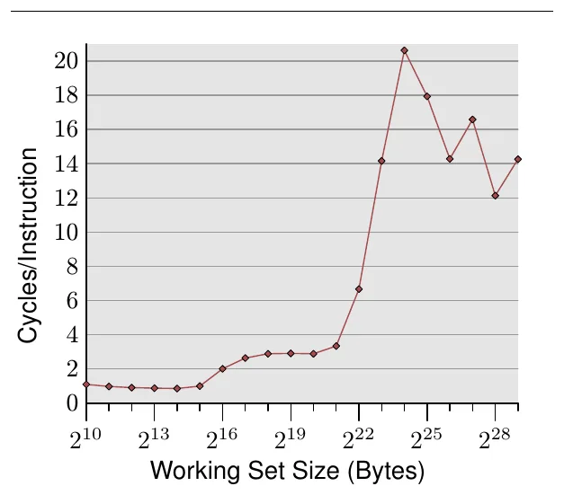

但是，性能测量计数器本应让我们对处理器内部正在发生什么有更深入的了解。为此我们需要考虑处理器的实现。在本文档中我们关心的是 cache 处理的细节，所以我们必须去看与 cache 相关的事件。这些事件、它们的名称以及它们统计的内容，都是与处理器相关的。这里就是 oprofile 目前难以使用的地方——不管它的用户界面有多简单：用户必须自己弄清楚性能计数器的细节。在附录 B 中我们会看到一些处理器的细节。

对于 Core 2 处理器，要找的事件是 `L1D_REPL`、`DTLB_MISSES` 与 `L2_LINES_IN`。后者既能测量所有的缺失，也能测量由指令（而非硬件预取）造成的缺失。随机 "Follow" 测试的结果见图 7.2。

所有比值都是用退休指令数（`INST_RETIRED`）计算的。这意味着，为了算出 cache 缺失率，必须从 `INST_RETIRED` 的数值中减去相当数量的载入与存储指令——也就是说，访存操作实际的 cache 缺失率比图中显示的数字还要高。

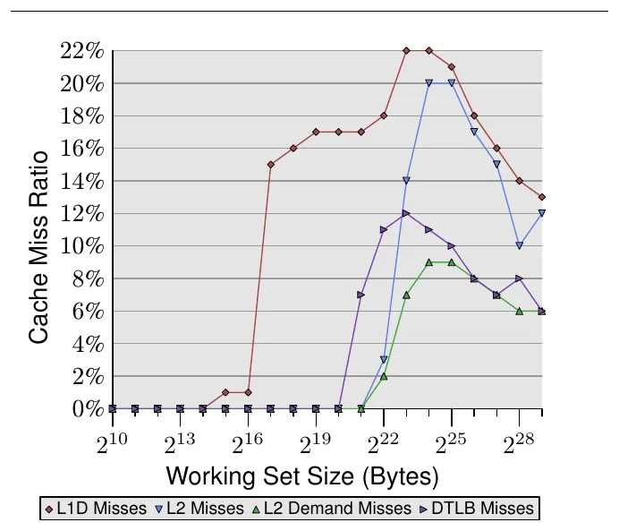

对 Intel 处理器而言，L1d 缺失意味着使用了 inclusive cache，所以 L1d 缺失数压倒了其它所有项。处理器有 32k 的 L1d，因此正如预期，我们看到 L1d 缺失率在工作集大小约 32k 附近从零开始上升（cache 除了列表数据结构之外还有别的用途，这意味着上升实际发生在 16k 与 32k 之间）。有意思的是，硬件预取可以把缺失率维持在 1%，直到工作集大小达到并超过 64k。此后 L1d 缺失率就直线上升。

L2 缺失率在 L2 被耗尽之前一直是零；由 L2 其它用途造成的少量缺失对数字影响不大。一旦超过 L2 的大小（$2^{21}$ 字节），缺失率就上升。值得注意的是 L2 需求缺失（demand miss）率不为零。这表明硬件预取器并没有把后续指令需要的全部 cache 行都载入进来。这是意料之中的：访问的随机性使得完美的预取成为不可能。把它与图 7.3 中顺序读取的数据对比一下。

在顺序访问的图中，L2 需求缺失率基本为零（注意这张图的刻度与图 7.2 不同）。对于顺序访问的情形，硬件预取器工作得完美：几乎所有 L2 cache 缺失都是由预取器造成的。L1d 与 L2 缺失率相同这一事实表明，所有 L1d cache 缺失都被 L2 cache 吸收，没有带来进一步的延迟。这是所有程序的最理想情形，但当然几乎不可能达成。

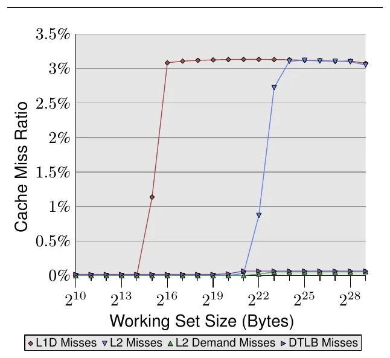

两张图中的第四条线是 DTLB 缺失率（Intel 为代码和数据各有独立的 TLB，DTLB 是数据 TLB）。对于随机访问的情形，DTLB 缺失率相当可观，并且对延迟有贡献。有意思的是，DTLB 的惩罚在 L2 缺失之前就出现了。在顺序访问的情形下，DTLB 的开销基本为零。

回到 6.2.1 节的矩阵相乘例子以及 A.1 节的示例代码，我们可以再用上三个计数器。`SSE_HIT_PRE`、`SSE_PRE_MISS` 与 `LOAD_PRE_EXEC` 计数器可以用来观察软件预取有多有效。运行 A.1 节中的代码会得到以下结果：

<figure>
  <div class="table-wrapper">
    <table>
      <tr>
        <th>描述</th>
        <th>比率</th>
      </tr>
      <tr>
        <td>有用的 NTA 预取</td>
        <td>2.84%</td>
      </tr>
      <tr>
        <td>过晚的 NTA 预取</td>
        <td>2.65%</td>
      </tr>
    </table>
  </div>
  <figcaption>NTA 预取的有效性统计</figcaption>
</figure>

较低的 NTA（non-temporal aligned，非暂存对齐）预取有用比率表明，许多预取指令是对那些已经被载入的 cache 行执行的，因此并不需要任何工作。这意味着处理器白白浪费了时间去解码预取指令并查询 cache。不过也不能太过苛责这份代码。很多事情取决于所用处理器的 cache 大小；硬件预取器也扮演了一个角色。

较低的过晚 NTA 预取比率具有误导性。这个比率意味着所有预取指令中有 2.65% 发出得太晚了——需要数据的指令在数据被预取进 cache 之前就执行了。必须记住的是，只有 2.84% + 2.65% = 5.5% 的预取指令有任何用处。在那些有用的 NTA 预取指令中，48% 没有及时完成。因此这段代码还可以进一步优化：

- 大多数预取指令并不需要。
- 预取指令的使用方式可以调整得更好地匹配硬件。

至于针对现有硬件的最佳方案，就留给读者作为练习了。具体的硬件规格在这里起着很大的作用。在 Core 2 处理器上 SSE 算术操作的延迟是 1 个周期。更早的版本延迟是 2 个周期，也就是说硬件预取器和预取指令有更多时间来把数据带进来。

为了确定哪里可能需要预取——或者哪里是不需要预取的——可以使用 opannotate 程序。它列出程序的源代码或汇编代码，并显示出识别到该事件的指令。注意这里有两个含混之处：

1. Oprofile 执行的是随机（stochastic）剖析。只有每第 N 个事件（其中 N 是一个 per-event 的阈值，并有一个强制下限）会被记录下来，以免对系统运行造成过多 slowdown。可能有些行造成了 100 个事件，却根本没出现在报告中。
2. 并非所有事件都被准确地记录。例如，记录某个特定事件时的指令计数器可能是不正确的。处理器是多标量的，这让给出 100% 正确的答案变得困难。不过某些处理器上的少数事件是精确的。

带标注的列表不仅对确定预取信息有用。每个事件都是带着指令指针被记录的；因此也可以定位程序中的其它热点。产生大量 `INST_RETIRED` 事件的位置被执行得很频繁，值得调优。报告了大量 cache 缺失的位置，可能值得加上一条预取指令来避免 cache 缺失。

有一种不借助硬件支持就能测量的事件，那就是页面错误（page fault）。操作系统负责解决页面错误，并且在解决这些错误的场合也顺便对它们计数。它区分两种页面错误：

**次要页面错误（Minor Page Faults）**：针对匿名（即非文件后备）且此前尚未使用的页面、copy-on-write 页面，以及其它内容已经存在于内存某处的页面。

**主要页面错误（Major Page Faults）**：解决它们需要访问磁盘，以取回文件后备（或已换出）的数据。

显然，主要页面错误比次要页面错误要贵得多。但后者也不便宜。无论哪种情况，都需要进入内核，必须找到一个新的页面，必须用合适的数据清零或填充它，而且页表树必须相应地修改。最后这一步需要与其它正在读或修改页表树的任务同步，这可能引入进一步的延迟。

获取页面错误计数信息最简单的方法是使用 time 工具。注意：要使用真正的工具，而不是 shell 内建版本。输出见图 7.4。[^1]

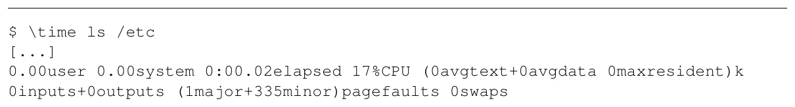

这里有趣的是最后一行。time 工具报告了一次主要页面错误和 335 次次要页面错误。具体数字会有变化；特别是，紧接着再运行一次，很可能现在一次主要页面错误都没有了。如果程序执行同样的动作、且环境没有变化，页面错误总数将是稳定的。

对页面错误而言，一个特别敏感的阶段是程序启动。每一个被用到的页面都会产生一次页面错误；可见的效果（对 GUI 程序尤其明显）是：用到的页面越多，程序开始工作所需的时间就越长。在 7.5 节中我们会看到一个专门测量这个效应的工具。

在底层，time 工具使用的是 rusage 功能。当父进程等待子进程终止时，`wait4` 系统调用会填充一个 `struct rusage` 对象；这正是 time 工具所需要的。但一个进程也可以请求关于自身资源使用的信息（rusage 这个名字正来源于此），或者关于它已终止的子进程的资源使用信息。

```c
#include <sys/resource.h>
int getrusage(__rusage_who_t who,
              struct rusage *usage)
```

`who` 参数指定为哪个进程请求信息。目前只定义了 `RUSAGE_SELF` 与 `RUSAGE_CHILDREN`。子进程的资源使用在每个子进程终止时累加。它是一个总计值，而不是某个具体子进程的使用量。已经有提案允许请求线程相关的信息，所以我们很可能会在不久的将来看到 `RUSAGE_THREAD`。rusage 结构体被定义为包含各种度量指标，包括执行时间、发送的 IPC 消息数量，以及使用的内存量和页面错误数。后者的信息在结构的 `ru_minflt` 与 `ru_majflt` 成员中。

一个试图找出她的程序在哪里因页面错误而损失性能的程序员，可以定期请求这些信息，然后把返回的值与上一次的结果做比较。

从外部看，如果请求者拥有必要的权限，这些信息同样是可见的。伪文件 `/proc/<PID>/stat`（`<PID>` 是我们关心的进程的进程 ID）在第十到第十四字段中包含页面错误数。它们分别是该进程及其子进程累计的次要与主要页面错误数（成对给出）。

### 模拟 CPU 缓存

上图中收集的数据是使用一个 cache 模拟器得到的。这个程序叫 cachegrind，它使用 valgrind 框架；该框架最初是为了检查程序中与内存处理相关的问题而开发的。valgrind 框架模拟程序的执行，在这个过程中，它允许各种扩展（例如 cachegrind）挂接到执行框架上。cachegrind 工具利用这一点拦截所有对内存地址的使用；然后它以给定的容量、cache 行大小与相联度模拟 L1i、L1d 与 L2 cache 的运作。

缓存如何工作的技术性描述相对容易理解，但要看出一个真实的程序在缓存方面究竟如何表现，就没那么容易了。程序员并不直接关心地址的数值，无论是绝对的还是相对的。地址一部分由链接器决定，一部分在运行时由动态链接器与内核决定。生成的汇编代码必须能够适用于所有可能的地址，而在源语言中甚至连绝对地址值的一点痕迹都没有留下。所以，要判断一个程序究竟是如何使用内存的，可能相当困难。[^2]

诸如 oprofile（见 7.1 节）这类 CPU 层面的剖析工具可以帮助理解 cache 的使用情况。得到的数据对应于真实的硬件，如果不需要太细粒度的采集，收集起来也相对快捷。一旦需要更细粒度的数据，oprofile 就不能再用了；线程被打断得太频繁。此外，要观察程序在不同处理器上的内存行为，实际上必须拥有那些机器并在它们上面运行程序。这有时（往往）是不可能的。一个例子就是图 3.8 中的数据。要用 oprofile 收集这样的数据，得有 24 台不同的机器，其中很多根本不存在。

要使用这个工具，必须以 valgrind 作为包装器来运行程序：

```bash
valgrind --tool=cachegrind command arg
```

在这种最简形式下，程序 `command` 会带着参数 `arg` 执行，同时模拟三个 cache，其容量与相联度与运行它的处理器相对应。输出的一部分在程序运行时被打印到标准错误；它由 cache 使用的总体统计组成，如图 7.5 所示。给出了总的指令数与访存引用数，以及它们在 L1i/L1d 与 L2 cache 上产生的缺失数、缺失率等等。这个工具甚至能把 L2 访问拆分成指令访问与数据访问，所有数据 cache 的使用也会被拆分成读访问与写访问。

当改变模拟 cache 的细节并比较结果时，事情就变得更有意思了。通过使用 `--I1`、`--D1` 与 `--L2` 参数，可以指示 cachegrind 不要理会处理器的 cache 布局，而采用命令行上指定的那一套。例如：

```bash
valgrind --tool=cachegrind \
  --L2=8388608,8,64 command arg
```

这将模拟一个 8MB、8 路组相联、64 字节 cache 行的 L2 cache。注意 `--L2` 选项出现在命令行中、被模拟的程序名之前。

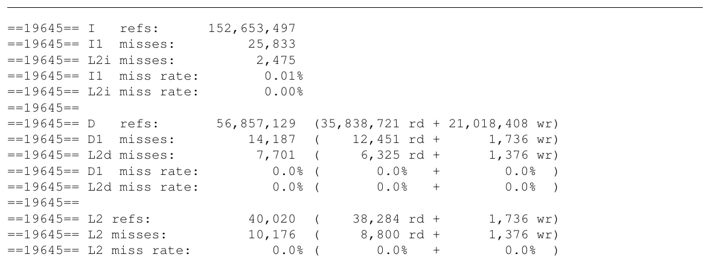

cachegrind 能做的还不止这些。在进程退出之前，它会写出一个名为 `cachegrind.out.XXXXX` 的文件，其中 XXXXX 是进程的 PID。这个文件包含汇总信息，以及每个函数与源文件的 cache 使用的详细信息。这些数据可以用 `cg annotate` 程序查看。

这个程序产生的输出包含程序终止时也打印过的 cache 使用汇总，以及程序中每个函数 cache 行使用的详细汇总。生成这种按函数的数据，需要 `cg annotate` 能够把地址匹配到函数。这意味着最好有调试信息可用。否则 ELF 符号表能帮上一点忙，但由于内部符号不会列在动态符号表中，结果并不完整。图 7.6 显示的是与图 7.5 同一程序运行时的部分输出。

`Ir`、`Dr` 与 `Dw` 三列显示的是 cache 使用的总量，而不是 cache 缺失；缺失显示在后面的两列中。这份数据可以用来找出产生最多 cache 缺失的代码。首先大概会专注于 L2 cache 缺失，然后再去优化 L1i/L1d 的 cache 缺失。

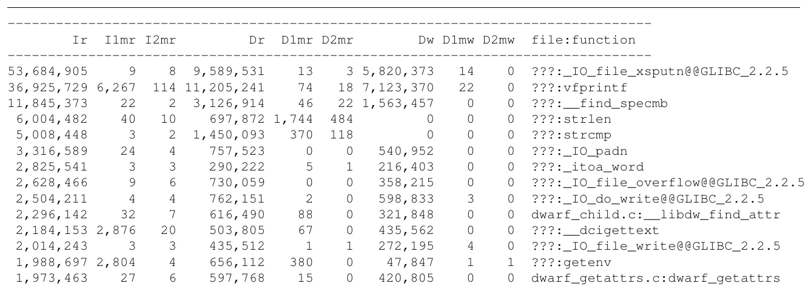

`cg annotate` 能提供更详细的数据。如果给出一个源文件名，它还会（程序名也由此而来）标注源文件的每一行，给出与该行对应的 cache 命中与缺失次数。这份信息允许程序员一路下钻到 cache 缺失出问题的确切那一行。程序接口有点粗糙：截至撰写本文时，cachegrind 数据文件与源文件必须位于同一个目录中。

此时应当再次指出：cachegrind 是一个模拟器，它并不使用来自处理器的测量数据。处理器中真正的 cache 实现很可能完全不同。cachegrind 模拟的是最近最少使用（LRU）淘汰，对于大相联度的 cache 来说很可能代价太高。此外，模拟没有把上下文切换与系统调用考虑进去，而这两者都会摧毁 L2 的大部分内容，并且必须冲刷 L1i 与 L1d。这会导致总的 cache 缺失数低于现实中的经历。不过，cachegrind 仍是一个了解程序内存使用及其内存问题的不错工具。

### 测量内存使用量

知道一个程序分配了多少内存、以及分配可能发生在哪里，是优化其内存使用的第一步。幸运的是，有一些易于使用的程序，不需要重新编译程序，也不需要对程序做特别的修改。

第一个工具叫 massif，只要不去剥离编译器本可以自动生成的调试信息就够了。它给出随时间累积的内存使用概览。图 7.7 展示了生成输出的一个例子。和 cachegrind（7.2 节）一样，massif 是一个使用 valgrind 基础设施的工具。它这样启动：

```bash
valgrind --tool=massif command arg
```

其中 `command arg` 是要观察的程序及其参数。程序将被模拟，所有对内存分配函数的调用都会被识别。调用点连同一个时间戳值一起被记录；新的分配大小会同时加到全程序总量以及该特定调用点的总量上。释放内存的函数也是同样处理，只不过显然，被释放块的大小是从相应的和里减掉的。然后就可以用这些信息生成一张图，显示程序生命周期内的内存使用，并按每个时间值把分配请求的位置区分开来。

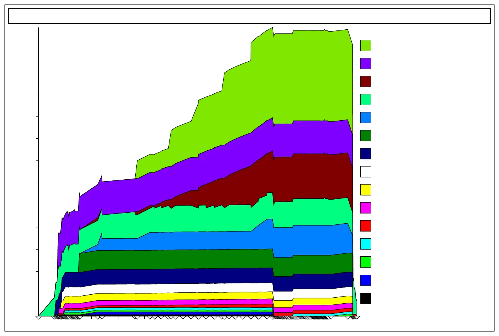

在进程终止之前，massif 会创建两个文件：`massif.XXXXX.txt` 与 `massif.XXXXX.ps`；XXXXX 与之前一样是进程的 PID。`.txt` 文件是所有调用点的内存使用汇总，`.ps` 就是图 7.7 中看到的东西。

massif 还可以记录程序的栈使用，这在确定一个应用总的内存占用时可能有用。但这并不总是可能。在某些情形下（某些线程栈，或者使用了 sigaltstack 时），valgrind 运行时无法知道栈的上限。在这些情形下，把这些栈的大小加进总量也没有多大意义。还有若干其它情形也不适合这样做。如果程序受此影响，应当给 massif 加上附加选项 `--stacks=no` 来启动。注意这是 valgrind 的选项，因此必须放在被观察的程序名之前。

有些程序提供了自己的内存分配实现，或者在系统的分配函数外面包了一层包装函数。前一种情况下，分配通常会被漏掉；后一种情况下，记录下来的调用点掩盖了信息，因为只记录了包装函数内部调用的地址。为此，可以把额外的函数加入分配函数列表。`--alloc-fn=xmalloc` 参数会指定 `xmalloc` 函数也是一个分配函数，这在 GNU 程序中很常见。对 `xmalloc` 的调用会被记录，但 `xmalloc` 内部发出的分配调用不会。

第二个工具叫 memusage；它是 GNU C 库的一部分。它是 massif 的一个简化版本（不过比 massif 早存在很久）。它只记录堆的总内存使用（如果给出 `-m` 选项，还包括可能的 mmap 等调用），并且可选地记录栈。结果可以显示为内存使用随时间变化的图形，或者替代地，显示为随对分配函数的调用次数线性变化的图形。图形由 memusage 脚本单独生成；和 valgrind 一样，必须用它来启动应用程序：

```bash
memusage command arg
```

必须使用 `-p IMGFILE` 选项来指定图形生成到 IMGFILE 文件中。这是一个 PNG 文件。收集数据的代码运行在真正的程序自身内部，它不像 valgrind 那样是一个模拟。这意味着 memusage 比 massif 快得多，并且在 massif 派不上用场的场合仍然可用。除了总内存消耗之外，这段代码还记录分配大小，并在程序终止时显示一个已用分配大小的直方图。这些信息被写到标准错误。

有时不可能（也不可行）直接调用那个本应被观察的程序。一个例子是 gcc 的编译阶段，它是由 gcc 驱动程序启动的。在这种情况下，必须用 `-n NAME` 参数把要被观察的程序名提供给 memusage 脚本。这个参数在被观察的程序会启动其它程序时也很有用。如果没有指定程序名，那么所有被启动的程序都会被剖析。

massif 与 memusage 这两个程序都有额外的选项。一位发现自己需要更多功能的程序员，应当先查阅手册或帮助信息，以确保额外的功能还没有被实现。

现在我们知道了内存分配的数据如何被采集，接下来就必须讨论这些数据在内存与 cache 使用的语境下如何被解读。高效动态内存分配的主要方面是线性分配以及已用部分的紧凑性。这又回到了让预取高效、减少 cache 缺失这个主题上。

一个必须读入任意数量数据以供后续处理的程序，可以通过创建一个列表来做到这一点，列表的每个元素包含一个新的数据项。这种分配方法的额外开销可能很小（单链表只有一个指针），但使用这些数据时的 cache 效应可能让性能急剧下降。

一个问题是，顺序分配的内存并不保证在内存中也是顺序布局的。可能的原因有很多：

- 由内存分配器管理的大块内存内部的内存块，实际上是从后往前返回的；
- 一个内存块耗尽了，于是在地址空间的不同部分开始了一个新的块；
- 分配请求的大小不同，而它们由不同的内存池来满足；
- 多线程程序中各个线程的分配相互交错。

如果数据必须预先分配以供后续处理，那么链表的做法显然是个坏主意。没有任何保证（甚至没有可能性）让列表中相邻的元素在内存中也是相邻布局的。为了确保连续分配，那块内存就不能以小块的方式分配。必须使用另一层内存处理机制；它可以很容易地由程序员自己实现。另一种选择是使用 GNU C 库中提供的 obstack 实现。这个分配器向系统的分配器请求大块内存，然后交出任意大或小的内存块。除非那块大内存被耗尽（这取决于所请求的分配大小，发生得相当罕见），否则这些分配总是顺序的。Obstacks 并不是内存分配器的完全替代品，它们释放对象的能力有限。细节请参见 GNU C 库手册。

那么，如何从图形中看出适合使用 obstack（或者类似技术）的情况呢？不查阅源代码就无法确定可能的改动点，但图形可以提供一个搜索的入口。如果许多分配都来自同一个位置，这可能意味着批量分配会有帮助。在图 7.7 中，我们可以把地址 `0x4c0e7d5` 处的分配看成一个可能的候选点。从运行开始约 800ms 直到 1,800ms，这是唯一在增长（除了最上面那条绿色区域）的区域。而且斜率不陡，这意味着有大量相对较小的分配。这确实是一个适合使用 obstack 或类似技术的候选点。

图形还能显示的另一个问题是分配总数很高。如果图形不是按时间线性绘制，而是按调用次数线性绘制（memusage 的默认做法），这一点尤其容易看出来。在这种情况下，图形上平缓的斜率意味着大量的小额分配。memusage 不会说明分配发生在哪里，但与 massif 的输出做比较就能说明，或者程序员可能立刻就认出来了。许多小额分配应当被合并，以达到线性的内存使用。

不过，对于后一类情况，还有另一个同样重要的方面：大量的分配也意味着更高的管理数据开销。这一点本身也许不算太成问题。massif 图中名为 "heap-admin" 的红色区域就代表这部分开销，而且它相当小。但是，取决于 malloc 的实现，这部分管理数据是与数据块一起分配的，就在同一块内存里。GNU C 库当前的 malloc 实现就是这种情况：每个被分配的块至少有一个 2 字（word）的头部（32 位平台上是 8 字节，64 位平台上是 16 字节）。此外，由于内存管理方式的关系，块的大小往往比必要的稍大一些（把块大小向上取整到特定的倍数）。

这一切都意味着，程序使用的内存与仅被分配器用于管理目的的内存交错在一起。我们可能看到像这样：

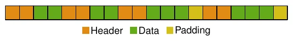

每个块代表一个内存字。在这一小段内存中我们有四个被分配的块。由于块头部与填充带来的开销是 50%。由于头部就放在那里，这自动意味着处理器的有效预取率最多也降低了 50%。如果这些块是被顺序处理的（以最大程度利用预取），处理器会把所有头部和填充字都读进 cache，尽管它们从来不会被应用程序自己读取或写入。只有运行时才会使用这些头部字，而运行时只在块被释放时才登场。

到这一步人们或许可以争辩说，实现应当改变，把管理数据放到别的地方去。有些实现确实这样做，而且这可能证明是个好主意。但需要考虑很多方面，安全性还不是其中最不重要的。无论未来是否会看到变化，填充的问题永远都不会消失（在例子中，忽略头部时占数据的 16%）。只有当程序员直接掌控分配时，这一点才能避免。当对齐要求发挥作用时，仍然可能有洞，但这同样在程序员的掌控之内。

### 改进分支预测

在 6.2.2 节中，提到过两种通过分支预测与代码块重排来改进 L1i 使用的方法：通过 `__builtin_expect` 进行的静态预测，以及 profile guided optimization（PGO，profile 引导优化）。正确的分支预测对性能有影响，但这里我们感兴趣的是它对内存使用的改进。

使用 `__builtin_expect`（或者更好的 likely 与 unlikely 宏）很简单。定义放在一个中心化的头文件里，编译器会处理好其余的事。不过这里有个小问题：程序员很容易在该用 unlikely 的地方用了 likely，反之亦然。即便有人使用像 oprofile 这样的工具去测量错误的分支预测和 L1i 缺失，这些问题也很难被发现。

不过有一个简单的方法。A.2 节中的代码给出了 likely 与 unlikely 宏的另一种定义，它在运行时主动测量静态预测是否正确。程序员或测试人员随后可以检查这些结果并作出调整。这些测量并不真正把程序性能考虑在内，它们只是检验程序员所作的静态假设。更多细节连同代码见上面引用的那一节。

如今用 gcc 来做 PGO 相当容易。不过这是一个三步的过程，并且必须满足某些要求。首先，所有源文件都必须用额外的 `-fprofile-generate` 选项来编译。这个选项必须传给所有编译过程，也必须传给链接程序的命令。混用带和不带这个选项编译出来的目标文件是可能的，但 PGO 对那些没有启用它的目标文件不会有任何好处。

编译器会生成一个行为正常的二进制文件，只是它明显更大也更慢，因为它要记录（并存储）分支是否被采用（分支走向）的信息。编译器还会为每个输入文件生成一个扩展名为 `.gcno` 的文件。这个文件包含与代码中分支有关的信息，必须保留下来以备后用。

一旦有了程序二进制文件，就应当用它来运行一组有代表性的工作负载。无论用的是什么工作负载，最终的二进制文件都会被优化成擅长做这件事。可以连续多次运行程序，而且一般来说这是必要的；所有这些运行都会累加到同一个输出文件里。在程序终止之前，程序运行期间收集到的数据会被写入扩展名为 `.gcda` 的文件。这些文件建在包含源文件的目录里。程序可以从任意目录执行，二进制文件也可以被复制，但源码目录必须可用且可写。同样，每个输入源文件会产生一个输出文件。如果程序被运行多次，那么很重要的一点是，能在源码目录中找到上一次的 `.gcda` 文件，否则各次运行的数据就无法累积到同一个文件里。

当一组有代表性的测试跑完之后，就该重新编译应用了。编译器必须能在与源文件相同的目录里找到 `.gcda` 文件。这些文件不能被移动，因为编译器会找不到它们，而且文件中内嵌的校验和也不再匹配。重新编译时，把 `-fprofile-generate` 参数换成 `-fprofile-use`。至关重要的是，源码不得以任何会改变所生成代码的方式发生变化。也就是说：改空白字符、编辑注释是可以的，但增加分支或基本块会让收集到的数据失效，编译也会随之失败。

这就是程序员需要做的一切；这是个相当简单的过程。最重要的是要选对有代表性的测试来做测量。如果测试负载与程序实际的使用方式不匹配，所做的优化实际上可能弊大于利。正因如此，PGO 常常很难用于库。库可能在许多——有时差异极大——的场景中被使用。除非这些使用场景确实相似，通常更好的做法是完全依赖 `__builtin_expect` 的静态分支预测。

关于 `.gcno` 与 `.gcda` 文件再说几句。它们是二进制文件，不能直接查看。不过可以用同样属于 gcc 包的 gcov 工具来检查它们。这个工具主要用于覆盖率分析（名字也由此而来），但使用的文件格式与 PGO 相同。gcov 工具为每个含有已执行代码的源文件（可能包括系统头文件）生成扩展名为 `.gcov` 的输出文件。这些文件是带标注的源码清单，根据传给 gcov 的参数标注出分支计数、概率等信息。

### 页面错误优化

在像 Linux 这样支持需求分页（demand-paging）的操作系统上，`mmap` 调用只修改页表。它确保了对于文件后备的页面，底层数据可以被找到；对于匿名内存，确保在访问时会提供初始化为零的页面。在 `mmap` 调用的时刻并没有真正分配任何内存。[^3]

分配的部分发生在某个内存页首次被访问时，无论是读还是写数据，还是执行代码。针对随之而来的页面错误，内核接管控制，并使用页表树来确定该页上必须存在的数据。这个页面错误的解决过程并不便宜，但它是进程用到的每一个页面都要付的代价。

为了把页面错误的代价降到最低，用到的页面总数就必须减少。为代码体积做优化对此有帮助。为了降低某条特定代码路径（例如启动代码）的代价，也可以重新排列代码，使得在该路径中被触及的页面数量最少。不过，确定正确的顺序并不容易。

作者基于 valgrind 工具集写了一个工具，用来测量页面错误发生的过程。不是测量页面错误的数量，而是测量它们发生的原因。pagein 工具会输出页面错误的顺序与时序信息。输出被写入一个名为 `pagein.<PID>` 的文件，样子如图 7.8。第二列指定被换入页面的地址。第三列表示它是代码页还是数据页，分别为 'C' 或 'D'。第四列指定从第一次页面错误以来经过的周期数。剩下的部分则是 valgrind 试图为导致页面错误的地址找一个名字。地址值本身是正确的，但如果没有调试信息，名字并不总是准确。

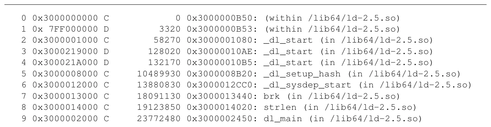

在图 7.8 的例子中，执行从地址 3000000B50<sub>16</sub> 开始，这迫使系统换入地址 3000000000<sub>16</sub> 的页面。紧随其后的是紧随其后的那个页面也被带进来；在那个页面上被调用的函数是 `_dl_start`。初始代码访问了 7FF000000<sub>16</sub> 页上的一个变量。这发生在第一次页面错误之后仅仅 3,320 个周期，最有可能是程序的第二条指令（仅在第一条指令之后三个字节）。如果看一下程序，就会注意到这次内存访问有点古怪。那条指令是一条 call 指令，它并不显式地加载或存储数据。但它确实会把返回地址存到栈上，而这正是这里发生的事情。这并不是进程正式的栈，而是 valgrind 为应用程序维护的内部栈。这意味着，在解读 pagein 的结果时，务必记得 valgrind 会引入一些人为的痕迹。

pagein 的输出可以用来确定哪些代码序列理想情况下应当在程序代码中相邻。快速看一眼 `/lib64/ld-2.5.so` 的代码就会发现，前几条指令立即调用了 `_dl_start` 函数，而这两处位于不同的页面上。重新排列代码，把这些代码序列移到同一页面上，可以避免——或者至少推迟——一次页面错误。到目前为止，确定最优代码布局还是一个繁琐的过程。由于某个页面的第二次使用按设计不会被记录，需要用试错法才能看到一次改动的效果。利用调用图分析，可以推测出可能的调用序列；这或许能加快对函数与变量进行排序的过程。

在非常粗略的层面上，调用序列可以通过观察构成可执行文件或 DSO 的目标文件来看出来。从一个或多个入口点（即函数名）开始，可以计算出依赖链。不费什么功夫，这在目标文件层面就做得很好。在每一轮中，确定哪些目标文件包含了所需的函数与变量。种子集合必须显式指定。然后确定那些目标文件中所有未定义的引用，并把它们加入所需符号的集合。重复直到集合稳定。

这个过程的第二步是确定一个顺序。各个目标文件必须分组在一起，以尽可能少地占用页面。作为额外的红利，任何函数都不应该跨越页面边界。所有这一切中的一个复杂之处是，为了最好地安排目标文件，必须知道链接器之后会做什么。重要的事实是：链接器会按照目标文件在输入文件（例如归档文件）中以及在命令行上出现的顺序，把它们放进可执行文件或 DSO 中。这给了程序员足够的控制权。

对于那些愿意多花点时间的人，已经有一些使用自动调用追踪进行重排的成功尝试，追踪借助的是 gcc 在 `-finstrument-functions` 选项下插入的 `__cyg_profile_func_enter` 与 `__cyg_profile_func_exit` 钩子 [17](#refer-anchor-17)。关于这些 `__cyg_*` 接口请查阅 gcc 手册了解更多。通过创建一份程序执行的轨迹，程序员可以更准确地确定调用链。[17](#refer-anchor-17) 中的结果仅仅通过重排函数就使启动开销下降了 5%。主要的好处是页面错误数量的减少，但 TLB cache 也扮演了一个角色——在虚拟化环境中 TLB 缺失变得显著更贵，这个角色越来越重要。

把 pagein 工具的分析与调用序列信息结合起来，就有可能优化程序的某些阶段（例如启动），以把页面错误数量降到最低。

Linux 内核还提供了另外两种避免页面错误的机制。第一种是 mmap 的一个标志，它指示内核不只是修改页表，而是真正预先触发（pre-fault）映射区域中所有页面的错误。这只需在 mmap 调用的第四个参数加上 `MAP_POPULATE` 标志即可实现。这会让 mmap 调用显著变贵，但如果该调用映射的所有页面马上都会被使用，收益可以很大。程序不必再经历一系列每次都相当昂贵（因为同步要求等等带来的额外开销）的页面错误，而是会有一次更贵的 mmap 调用。不过使用这个标志也有缺点：如果映射的页面中有很大一部分在调用之后不久（或者永远不会）被使用的话。已映射却未使用的页面显然是对时间和内存的浪费。被立即预先触发、却在很久以后才使用的页面也会让系统变得拥堵。内存在使用之前就被分配了，这可能导致此期间内存不足。另一方面，在最坏的情况下，这个页面干脆被重新用于别的用途（因为它还没被修改过），这不算太贵，但连同分配本身一起，还是增加了一些成本。`MAP_POPULATE` 的粒度实在太粗了。还有第二个可能的问题：这是一种优化；并非所有页面都真的被映射并非关键。如果系统太忙而无法执行这个操作，预先触发是可以被放弃的。等页面真的被使用时，程序仍然会产生页面错误，但这并不比人为地制造资源匮乏更糟。

另一种选择是用 `posix_madvise` 函数给出 `POSIX_MADV_WILLNEED` 建议。这是给操作系统的一个提示：程序在不久的将来会需要调用中所描述的页面。内核可以自由地忽略这个建议，但也可以预先触发页面。这里的优势是粒度更细。任意映射地址空间区域中的单个页面或页面区间都可以被预先触发。对于包含大量运行时并未使用的数据的内存映射文件，这比使用 `MAP_POPULATE` 有巨大的优势。

除了这些主动减少页面错误数量的方法之外，还可以采取一种更被动的做法，这在硬件设计者中很流行。一个 DSO 占据地址空间中相邻的页面，代码和数据各占一段页面区间。页面越小，装下这个 DSO 所需的页面就越多。这也就意味着更多的页面错误。这里重要的是反过来说也对：页面越大，映射（或匿名内存）所需的页面数量就越少；随之减少的还有页面错误的数量。

大多数架构支持 4k 的页面大小。在 IA-64 与 PPC64 上，64k 的页面大小也很流行。这意味着内存被分配出来的最小单位是 64k。这个值必须在编译内核时指定，并且不能动态更改（至少目前不能）。多页面大小架构的 ABI 被设计成允许应用以任意一种页面大小运行。运行时会做出必要的调整，而正确编写的程序不会察觉到任何东西。更大的页面意味着部分使用的页面带来的更多浪费，但在某些情形下这是可以接受的。

大多数架构还支持 1MB 或更大的超大页面大小。这类页面在某些情形下也很有用，但让所有内存都以这么大的单位来分配是没有意义的。物理 RAM 的浪费会实在太巨大。不过超大页面有它们的优势：如果使用巨大的数据集，把它们存放在 x86-64 的 2MB 页面中，与用 4k 页面存放同样多的内存相比，每个大页面会少需要 511 次页面错误。这可以带来很大的差别。解决方案是有选择地请求内存分配，只对所请求的地址范围使用超大内存页，而对同一进程中的其它所有映射使用正常的页面大小。

超大页面是有代价的。由于大页所用的物理内存必须是连续的，过一段时间之后可能就无法再分配这样的页面，因为内存碎片化了。人们正在研究内存碎片整理与碎片避免，但这非常复杂。对于 2MB 这样的大页，需要的 512 个连续页面总是很难凑齐，只有一个时刻例外：系统刚启动的时候。这就是当前大页方案需要使用一个特殊文件系统 hugetlbfs 的原因。这个伪文件系统由系统管理员按需分配，写入应当预留的大页数量：

```bash
/proc/sys/vm/nr_hugepages
```

如果找不到足够的连续内存，这个操作可能会失败。如果使用了虚拟化，情况会变得格外有趣。使用 VMM 模型的虚拟化系统并不直接管理物理内存，因此它自己无法分配 hugetlbfs。它必须依赖 VMM，而且这个特性并不保证被支持。对于 KVM 模型，运行着 KVM 模块的 Linux 内核可以完成 hugetlbfs 的分配，并且可能把这样分配到的页面中的一部分传给某个客户域。

通过在 open 调用中使用同一个文件名，多个进程可以共享同一批超大页面并协同工作。也可以让这些页面可执行，此时在 mmap 调用中必须同时设置 `PROT_EXEC` 标志。和 System V 共享内存的例子一样，`LENGTH` 的值必须是系统超大页面大小的整数倍。

一个防御性地编写（所有程序都应该如此）的程序，可以用类似下面这样的函数在运行时确定挂载点：

```c
char *hugetlbfs_mntpoint(void) {
  char *result = NULL;
  FILE *fp = setmntent(_PATH_MOUNTED, "r");
  if (fp != NULL) {
    struct mntent *m;
    while ((m = getmntent(fp)) != NULL)
      if (strcmp(m->mnt_fsname,
                 "hugetlbfs") == 0) {
        result = strdup(m->mnt_dir);
        break;
      }
    endmntent(fp);
  }
  return result;
}
```

后来，当程序需要一个大页时，有多种可能：

- 程序可以使用带 `SHM_HUGETLB` 标志的 System V 共享内存接口。
- 可以实际挂载一个 hugetlbfs 类型的文件系统，程序随后可以在挂载点下创建文件，并用 mmap 把一个或多个页面映射为匿名内存。

在第一种情况下，hugetlbfs 不必被挂载。请求一个或多个大页的代码可以像这样：

```c
key_t k = ftok("/some/key/file", 42);
int id = shmget(k, LENGTH,
                SHM_HUGETLB|IPC_CREAT
                |SHM_R|SHM_W);
void *a = shmat(id, NULL, 0);
```

这段代码序列的关键之处在于使用 `SHM_HUGETLB` 标志，以及为 `LENGTH` 选取正确的值——它必须是系统大页大小的整数倍。不同架构有不同的值。使用 System V 共享内存接口有一个讨厌的问题：它依赖 key 参数来区分（或共享）映射。`ftok` 接口很容易产生冲突，因此如果可能，最好使用其它机制。

如果挂载 hugetlbfs 文件系统这一要求不构成问题，那么用它比用 System V 共享内存更好。使用这个特殊文件系统真正的麻烦只有两个：内核必须支持它，而且目前还没有一个标准化的挂载点。一旦文件系统被挂载——例如挂在 `/dev/hugetlb`——程序就可以轻松地使用它：

```c
int fd = open("/dev/hugetlb/file1",
              O_RDWR|O_CREAT, 0700);
void *a = mmap(NULL, LENGTH,
               PROT_READ|PROT_WRITE,
               fd, 0);
```

关于这两种情况的更多信息，可以在随内核源码树一起发布的 `hugetlbpage.txt` 文件中找到。该文件还描述了 IA-64 所需的特殊处理。

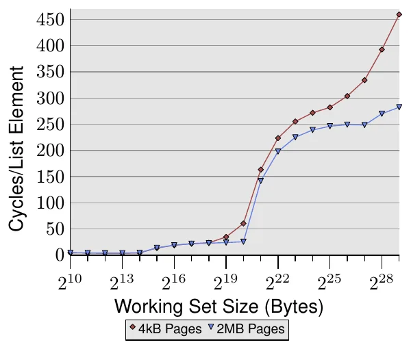

为了说明超大页的优势，图 7.9 展示了以 NPAD=0 运行随机 Follow 测试的结果。这与图 3.15 中的数据相同，但这一次我们也测量了内存分配在超大页中的情形。可以看到性能优势可以非常巨大。对于 $2^{20}$ 字节，使用超大页的测试快了 57%。这是因为这个大小仍然完全装得进一个 2MB 页面，因此不会发生 DTLB 缺失。

过了这个点，收益起初变小，但随着工作集增大又重新增长。对于 512MB 的工作集大小，超大页测试快了 38%。超大页测试的曲线在 250 个周期左右有一个平台期。超过 $2^{27}$ 字节的工作集之后，数字又显著上升。平台期的原因是 2MB 页面对应的 64 个 TLB 表项覆盖了 $2^{27}$ 字节。

正如这些数字所显示的，使用大工作集大小的代价中有很大一部分来自 TLB 缺失。使用本节描述的这些接口可以带来丰厚的回报。图中的数字很可能是上限，但即使是真实世界的程序也能显示出可观的加速。数据库由于要使用大量数据，是今天使用超大页的程序之一。

目前没有办法用大页来映射文件后备的数据。实现这一能力的兴趣是存在的，但迄今为止的提案都涉及显式地使用大页，并且依赖于 hugetlbfs 文件系统。这不可接受：这种情形下大页的使用必须是透明的。内核完全可以确定哪些映射是大映射，然后自动使用大页。一个大问题是内核并不总是知道使用模式。如果本可以被映射为大页的内存后来需要 4k 粒度（例如因为用 mprotect 改变了内存范围中一部分的保护属性），那么大量宝贵资源——特别是线性物理内存——就被浪费掉了。所以这种做法显然还需要一些时间才能成功实现。

## 即将到来的技术

在前面关于多处理器处理的各节中，我们已经看到，如果 CPU 或核心的数量被扩展上去，就必须预期到显著的性能问题。但这种扩展恰恰是未来必须预期的。处理器会得到越来越多的核心，而程序必须越来越并行，才能利用 CPU 增加的潜力，因为单核性能不会再像从前那样快速提升。

### 原子操作的问题

对共享数据结构的访问同步，传统上有两种做法：

- 通过互斥，通常是借助系统运行时的功能来实现的；
- 通过使用无锁（lock-free）数据结构。

无锁数据结构的问题在于，处理器必须提供能够原子地完成整个操作的原语。这种支持是有限的。在大多数架构上，支持仅限于原子地读写一个字。这有两种基本实现方式（见 6.4.2 节）：

- 使用原子的比较并交换（CAS）操作；
- 使用 load lock / store conditional（LL/SC）指令对。

很容易看出 CAS 操作如何用 LL/SC 指令实现。这使得 CAS 操作成为大多数原子操作与无锁数据结构的基本构件。

有些处理器——尤其是 x86 与 x86-64 架构——提供了一套远为精致的原子操作。其中许多是针对特定用途对 CAS 操作的优化。例如，把一个值原子地加到某个内存位置，可以用 CAS 与 LL/SC 操作实现，但在 x86/x86-64 处理器上对原子自增的原生支持更快。程序员了解这些操作、以及在编程时让它们可用的那些内部函数（intrinsic）是很重要的，不过这并不是什么新鲜事。

这两个架构非凡的扩展是它们拥有双字 CAS（DCAS）操作。这对某些应用很重要，但并非对所有应用都重要（见 [5](#refer-anchor-5)）。作为 DCAS 如何被使用的一个例子，让我们试着写一个基于数组的无锁栈/LIFO 数据结构。用 gcc 的内部函数写的第一版尝试见图 8.1。

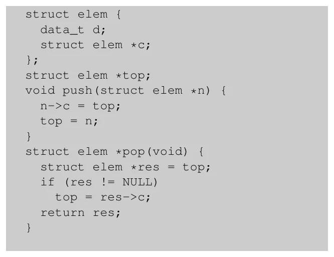

这段代码显然不是线程安全的。不同线程中的并发访问会在不考虑其它线程修改的情况下修改全局变量 `top`。元素可能会丢失，被移除的元素也可能神奇地重新出现。可以使用互斥，但这里我们只尝试使用原子操作。

修复这个问题的第一次尝试，是在安装或移除列表元素时使用 CAS 操作。得到的代码如图 8.2。

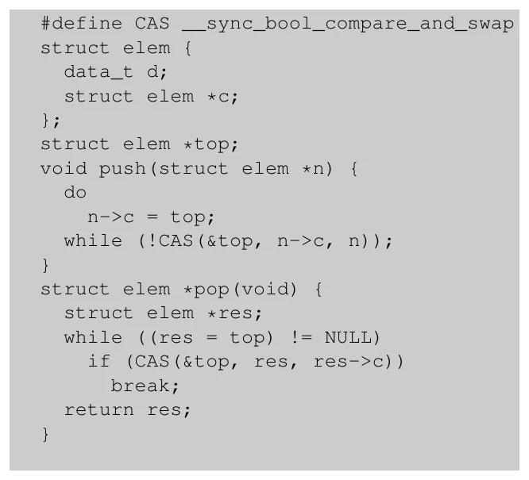

乍一看这似乎是个能工作的解决方案。`top` 永远不会被修改，除非它与操作开始时位于 LIFO 顶部的那一个元素相符。但我们必须把各个层面的并发都考虑进去。有可能在另一个操作这个数据结构的线程恰好在最糟糕的时刻被调度。这里就有所谓的 ABA 问题。考虑这样一个情形：第二个线程恰好在 `pop` 中的 CAS 操作之前被调度，并且执行了如下操作：

```
1. l = pop()
2. push(newelem)
3. push(l)
```

这次操作的最终效果是，LIFO 原先的顶部元素又回到了顶部，但第二个元素变了。回到第一个线程，因为顶部元素没有变，CAS 操作会成功。但 `res->c` 的值不是正确的那个。它指向的是原来 LIFO 中的第二个元素，而不是 `newelem`。结果就是这个新元素丢失了。

在文献 [10](#refer-anchor-10) 中可以找到一些建议，利用某些处理器上的一个特性来绕过这个问题。具体来说，这指的是 x86 与 x86-64 处理器执行 DCAS 操作的能力。这在图 8.3 中代码的第三版里被用到了。

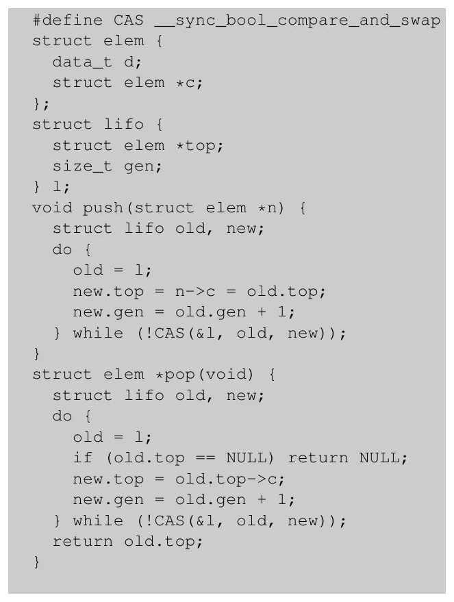

与另外两个例子不同，这（目前）是伪代码，因为 gcc 不支持在 CAS 内部函数中使用结构体。尽管如此，这个例子应该足以说明这个思路。一个世代计数器（generation counter）被加到了 LIFO 顶部的指针上。由于它在每一次操作（无论 push 还是 pop）中都会改变，上面描述的 ABA 问题就不再是问题了。等到第一个线程真正交换顶部指针、恢复其工作时，世代计数器已经被增加了三次。CAS 操作会失败，而在循环的下一轮中，LIFO 正确的第一个和第二个元素被确定下来，LIFO 不会损坏。成了。

这就是解决方案吗？[10](#refer-anchor-10) 的作者们当然把它说得像那么回事，而且值得肯定的是，他们确实提到过可以构造出允许使用上述代码的 LIFO 数据结构。但总的来说，这个方法与前一个一样注定失败。我们仍然有并发问题，只不过换了个地方。让我们假设一个线程执行 `pop`，在 `old.top == NULL` 的测试之后被打断。这时第二个线程也执行 `pop`，并取得了 LIFO 原先第一个元素的所有权。它可以对它做任何事，包括修改其中所有的值，或者在元素是动态分配的情况下，释放那块内存。现在第一个线程恢复了。`old` 变量中仍然填着 LIFO 先前的顶部。更确切地说，`top` 成员指向被第二个线程弹出的那个元素。在 `new.top = old.top->c` 中，第一个线程解引用了元素中的一个指针。但这个指针所引用的元素可能已经被释放了。那段地址空间可能已不可访问，进程可能崩溃。对一个通用数据类型实现来说，这是不能允许的。对这个问题的任何修复都极其昂贵：内存绝不能被释放，或者至少在释放之前必须确认没有线程还在引用它。鉴于无锁数据结构本应更快、并发度更高，这些额外的要求完全摧毁了它的任何优势。在支持垃圾收集的语言里，通过垃圾收集处理内存可以解决这个问题，但这是要付出代价的。

对于更复杂的数据结构，情况往往更糟。上面引用的同一篇论文还描述了一个 FIFO 的实现（在后续论文中有所改进）。但那段代码有完全相同的问题。由于现有硬件（x86、x86-64）上的 CAS 操作[^4] 被限制为只能修改内存中相邻的两个字，它们在其它常见情形中帮不上任何忙。例如，在双向链表中的任意位置原子地添加或移除元素是不可能的。问题在于，一般来说涉及不止一个内存地址，而且只有当这些地址的值都没有被并发修改时，整个操作才能成功。这是数据库处理中一个众所周知的概念，而这也正是最有希望的解决方案之一的出发点。

### 事务内存

这就是内存发挥作用的地方，也是上一节费劲地用原子操作开发算法的原因。事务内存的目的是在许多情形中替代——并扩展——原子操作，尤其是对无锁数据结构而言。把一套事务系统集成进处理器听起来是一件可怕地复杂的事，但实际上，大多数处理器在某种程度上已经有着类似的东西。

某些处理器实现的 LL/SC 操作就形成了一个事务。SC 指令根据那个内存位置是否被触碰过，来中止或提交事务。事务内存是这一概念的扩展。现在，参与事务的不再是一对简单的指令，而是多条指令。为了理解这是如何做到的，先看看 LL/SC 指令可以如何实现是值得的。[^5]

#### Load Lock / Store Conditional 的实现

如果发出 LL 指令，内存位置的值会被载入一个寄存器。作为该操作的一部分，这个值也被载入 L1d。后来的 SC 指令只有在这个值没有被篡改时才能成功。处理器如何检测到这一点？回看图 3.18 中 MESI 协议的描述，答案应该很明显。如果另一个处理器改变了这个内存位置的值，那么第一个处理器 L1d 中的那份拷贝必须被撤销。当第一个处理器执行 SC 指令时，它会发现必须重新把该值载入 L1d。这是处理器本来就已经必须检测的事情。

关于上下文切换（同一处理器上可能发生的修改）以及在另一个处理器写入之后缓存行被意外重新载入，还有若干细节需要敲定。这些都不是策略（上下文切换时刷新缓存）加上额外的标志，或者为 LL/SC 指令使用单独的缓存行所能解决的。

总的来说，有了像 MESI 这样的缓存一致性协议，LL/SC 的实现几乎是免费的。

#### 事务内存操作

在他们那篇开创性的 1993 年论文 [13](#refer-anchor-13) 中，Herlihy 与 Moss 提出在硬件中为内存操作实现事务，因为单靠软件无法高效地解决这个问题。当时的 Digital Equipment Corporation 已经在他们那台配有几十个处理器的高端硬件上与可扩展性问题做斗争了。其原理与数据库事务相同：要么事务的结果一次性全部变得可见，要么事务被中止、所有值保持不变。

为了让事务内存具有普遍用途，一个事务不能以第一条存储指令就结束。相反，实现应当允许一定数量的载入与存储操作；这意味着我们需要单独的提交与中止指令。过一会儿我们会看到，我们还需要另外一条指令，用来检查事务的当前状态，以及它是否已经被中止。

要实现的有三种不同的内存操作：

- 读取内存
- 读取稍后会被写入的内存
- 写入内存

看着 MESI 协议，应该就能明白这种特殊的第二类读操作何以有用。普通的读可以由处于 'E' 与 'S' 状态的缓存行满足。第二类读操作则需要处于 'E' 状态的缓存行。第二类内存读究竟为什么必要，从下面的讨论中可以看出端倪；不过想要更完整的描述，感兴趣的读者可以去读关于事务内存的文献，从 [13](#refer-anchor-13) 开始。

此外我们还需要事务处理，它主要由提交与中止操作构成——这两者我们在数据库事务处理中已经熟悉了。不过还有另一个操作，理论上它是可选的，但要编写使用事务内存的健壮程序则需要它。这条指令让一个线程测试事务是否仍然在轨道上、并且（也许）之后还能被提交，还是事务已经失败、无论如何都将被中止。

我们将讨论这些操作实际上如何与 CPU cache 交互，以及它们如何与总线操作对应。不过在讨论这些之前，我们先看看一些真正使用事务内存的代码。希望这会让本节剩下的部分更容易理解。

#### 使用事务内存的示例代码

在这个例子里，我们回到那个一直在用的示例，给出一个使用事务内存原语的 LIFO 实现。

这段代码看上去与那个非线程安全的代码非常相似，这是一份额外的额外好处，因为它让使用事务内存编写代码变得更容易。代码中新增的部分是 LTX、ST、COMMIT 与 VALIDATE 操作。这四个操作是请求访问事务内存的方式。实际上还有一个操作 LT，这里没有用到。LT 请求非独占的读访问，LTX 请求独占的读访问，ST 是对事务内存的存储。VALIDATE 操作检查事务是否仍在可以提交的轨道上。如果这个事务仍然 OK，它返回 true。如果事务已经被标记为中止，它将被实际中止，并返回一个表明此事的值。下一条事务内存指令将开始一个新事务。因此，代码在事务仍在继续的情况下使用了新的 if 块。

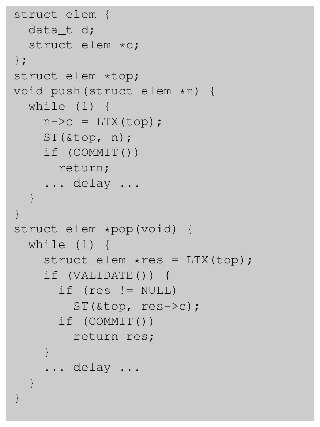

COMMIT 操作结束事务；如果成功完成，该操作返回 true。这意味着程序的这一部分已经完成，线程可以继续往下走。如果操作返回一个假值，这通常意味着整段代码必须重做一遍。这正是这里外层 while 循环所做的事。不过这并非绝对必要——在某些情况下，放弃这项工作反而是正确的做法。

LT、LTX 与 ST 操作有趣之处在于，它们可以在不直接发出任何失败信号的情况下失败。程序获取这一信息的途径是 VALIDATE 或 COMMIT 操作。对载入操作而言，这可能意味着实际载入选寄存器的值是虚假的；这正是上面示例中必须在解引用指针之前使用 VALIDATE 的原因。在下一节中我们会看到，为什么这对一个实现来说是明智的选择。等到事务内存真的被广泛提供之后，处理器可能会实现一些不同的东西。不过 [13](#refer-anchor-13) 中的结果支持我们这里描述的做法。

push 函数可以这样概括：事务通过读取列表头部的指针开始。这次读取请求独占所有权，因为稍后在函数中这个变量会被写入。如果另一个线程已经开启了一个事务，这次载入就会失败，并把那个尚未出生的事务标记为中止；这时实际载入的值可能是垃圾。不过不管其状态如何，这个值都会被存进新列表成员的下一个字段。这没问题，因为这个成员尚未投入使用，而且只被恰好一个线程访问。接着，列表头部的指针被赋予新元素的指针。如果事务仍然 OK，这次写入可以成功。这是正常情况；它只有在某个线程用提供的 push 与 pop 函数之外的代码访问这个指针时才会失败。如果在执行 ST 时事务已经被中止，那么什么都不会做。最后，线程尝试提交事务。如果提交成功，工作就完成了；其它线程现在可以开始它们的事务。如果事务失败，就必须从头重做一遍。不过在那之前，最好插入一段延迟。如果不这样做，线程可能会陷入一个忙循环（浪费能量、把 CPU 过热）。

pop 函数稍微复杂一些。它同样以读取包含列表头部的变量开始，请求独占所有权。代码随即检查 LTX 操作是否成功。如果不成功，这一轮中除了延迟下一轮之外什么都不做。如果顶部指针被成功读取，这意味着它的状态是好的；现在我们可以解引用这个指针了。记住，这正是使用原子操作的代码的问题所在；有了事务内存，这种情况可以毫无问题地处理。

接下来的 ST 操作只在 LIFO 非空时执行，正如原来那份线程不安全的代码一样。最后事务被提交。如果成功，函数返回旧的顶部指针；否则延迟并重试。这段代码中棘手的一点是记住：VALIDATE 操作会在事务已经失败时中止它。下一条事务内存指令会开始一个新事务，因此我们必须跳过函数中剩下的部分。

延迟代码具体怎么实现，要等事务内存有硬件实现后才能看到。如果做得很糟，系统性能可能会显著受损。

#### 事务内存的总线协议

现在我们已经看过事务内存背后的基本原则，可以深入实现细节了。请注意，这不是基于真实硬件的。它基于事务内存的原始设计以及关于缓存一致性协议的知识。有些细节被省略了，但仍然应该能从中获得关于性能特征的洞见。

尽管名字叫「事务内存」，事务内存其实并不是作为独立的内存来实现的；鉴于需要的是线程地址空间中任意位置上的事务，那样做毫无道理。相反，它是作为第一级缓存处理的一部分来实现的。理论上，实现可以放在普通的 L1d 中，但正如 [13](#refer-anchor-13) 指出的，那不是个好主意。我们更可能看到事务缓存被实现在与 L1d 并列的地方。所有访问都将以与使用 L1d 相同的方式使用这个更高层级的缓存。事务缓存很可能比 L1d 小得多。如果它是全相联的，它的大小由一个事务所能包含的操作数决定。实现很可能会针对架构和/或特定的处理器版本设定上限。完全可以想象一个只有 16 个甚至更少元素的事务缓存。在上面的例子里我们只需要一个内存位置；工作集更大的事务算法会变得非常复杂。有可能我们会看到支持同时有多个活动事务的处理器。那样的话缓存中的元素数量会成倍增加，但仍然足够小，可以做全相联。

事务缓存与 L1d 是互斥的。这意味着一个缓存行最多存在于这两个缓存之一中，绝不会同时存在于两者。事务缓存中的每个槽位在任何时刻都处于 MESI 协议四种状态之一。除此之外，一个槽位还有一个事务状态。这些状态如下（名称依照 [13](#refer-anchor-13)）：

**EMPTY**：该缓存槽位不包含数据。MESI 状态始终是 'I'。

**NORMAL**：该缓存槽位包含已提交的数据。这份数据同样也可能存在于 L1d 中。MESI 状态可以是 'M'、'E' 和 'S'。允许 'M' 状态这个事实意味着，事务提交并不强制把数据写入主内存（除非该内存区域被声明为 uncached 或 write-through）。这可以显著有助于提升性能。

**XABORT**：该缓存槽位包含在中止时要被丢弃的数据。这显然是 XCOMMIT 的反面。事务期间创建的所有数据都保存在事务缓存中，在提交之前什么都不会写入主内存。这限制了事务的最大尺寸，但它的含义是：除了事务缓存之外，没有其它内存需要知道单个内存位置上 XCOMMIT/XABORT 的二元性。可能的 MESI 状态是 'M'、'E' 和 'S'。

**XCOMMIT**：该缓存槽位包含在提交时要被丢弃的数据。这是处理器可以实现的一种优化。如果一个内存位置是通过事务操作被改变的，旧内容不能直接丢掉：如果事务失败，旧内容需要被恢复。MESI 状态与 XABORT 相同。与 XABORT 的一个区别是，如果事务缓存已满，处于 'M' 状态的 XCOMMIT 条目可以先被写回内存，然后对所有状态而言都被丢弃。

当一个 LT 操作开始时，处理器在缓存中分配两个槽位。选择牺牲者时，先为该操作地址寻找 NORMAL 槽位，也就是一次缓存命中。如果找到了这样的条目，就定位第二个槽位，复制该值，一个条目被标记为 XABORT，另一个被标记为 XCOMMIT。

如果该地址尚未被缓存，则寻找 EMPTY 缓存槽位。如果找不到，就去找 NORMAL 槽位。此时如果 MESI 状态是 'M'，旧内容必须被刷新到内存。如果连 NORMAL 槽位也没有，那么可以牺牲 XCOMMIT 条目。这很可能只是一个实现细节。因为事务的最大尺寸由事务缓存的大小决定，而由于事务中每个操作所需的槽位数量是固定的，所以可以在不得不驱逐 XCOMMIT 条目之前就给事务数量设限。

如果该地址在事务缓存中找不到，就会发出一个 `T READ` 总线请求。这和普通的 READ 总线请求很像，但它表明这是为事务缓存而发的。和普通 READ 请求一样，其它所有处理器中的缓存先有机会响应。如果没有，则从主内存读取该值。MESI 协议决定新缓存行的状态是 'E' 还是 'S'。`T READ` 与 READ 的差别在于缓存行当前正被另一个处理器或核心上的活动事务使用时的情形。在这种情况下，`T READ` 操作直接失败，不传输任何数据。发出 `T READ` 总线请求的那个事务被标记为失败，而在该操作中使用的值（通常是一个简单的寄存器载入）是未定义的。回看前面的例子，可以看到只要事务内存操作被正确使用，这个行为就不会造成问题。在事务中载入的值被使用之前，必须用 VALIDATE 加以验证。这在几乎所有情况下都不是额外的负担。正如我们在尝试用原子操作实现 FIFO 时所看到的，我们所添加的那个检查，正是能让无锁代码工作的那个缺失的环节。

LTX 操作与 LT 几乎完全相同。唯一的区别是总线操作是 `T RFO` 而不是 `T READ`。`T RFO` 与普通的 RFO 总线消息一样，请求缓存行的独占所有权。得到的缓存行状态是 'E'。与 `T READ` 总线请求一样，`T RFO` 也可能失败，那时使用的值同样是未定义的。如果缓存行已经以 'M' 或 'E' 状态位于本地事务缓存中，那么什么都不必做。如果本地事务缓存中的状态是 'S'，就必须发出总线请求以作废所有其它副本。

ST 操作与 LTX 类似。值首先被独占地放入本地事务缓存。然后 ST 操作把该值的一份副本放入缓存中的第二个槽位，并把该条目标记为 XCOMMIT。最后，另一个槽位被标记为 XABORT，新值被写入其中。如果事务已经被中止，或者因为隐含的 LTX 失败而新近被中止，那么什么都不会写入。

VALIDATE 与 COMMIT 操作都不会自动、隐式地产生总线操作。这是事务内存相对于原子操作的巨大优势。使用原子操作时，并发是通过把改变后的值写回主内存来实现的。如果你读完了本文档至此为止的部分，你应该知道这有多么昂贵。使用事务内存时，不会强制发生对主内存的访问。如果缓存没有 EMPTY 槽位，当前内容必须被驱逐，而对于处于 'M' 状态的槽位，内容必须被写入主内存。这与常规缓存并无不同，而且写回可以在没有特殊原子性保证的情况下进行。如果缓存容量足够，内容可以存活很长时间。如果事务对同一个内存位置反复进行，速度的提升可以是天文数字般的——因为在前一种情况下每一轮都有一到两次主内存访问，而对事务内存来说，所有访问都命中事务缓存，其速度与 L1d 一样快。

事务中止时，VALIDATE 与 COMMIT 操作所做的全部事情，就是把标记为 XABORT 的缓存槽位标为空、把标记为 XCOMMIT 的槽位标为 NORMAL。同样，当 COMMIT 成功结束一个事务时，XCOMMIT 槽位被标为空，XABORT 槽位被标为 NORMAL。这些都是事务缓存上非常快的操作。不会向那些想要执行事务的其它处理器发送显式通知；它们只需要继续尝试。如何高效地做到这一点是另一个问题。在上面的示例代码中，我们在合适的位置简单地写了 `...delay...`。我们或许会看到处理器对「延迟」提供有用的支持。

总结一下：事务内存操作只在开始一个新事务时，以及当一条尚未在事务缓存中的新缓存行被加入一个仍然成功的事务时，才会产生总线操作。处于中止状态的事务中的操作不会产生总线操作。不会再有多个线程试图使用同一块内存而导致缓存行来回乒乓。

#### 其它考量

在 6.4.2 节中我们已经讨论过，x86 与 x86-64 上可用的 lock 前缀如何在某些情形下避免编写原子操作。不过，当有多个线程在用、而它们并不争用同一块内存时，所提的这些技巧就不够用了。这种情况下原子操作被不必要地使用了。有了事务内存这个问题就消失了。昂贵的 RFO 总线消息只在内存被不同 CPU 并发地或先后地使用时才发出；只有那时才需要它们。这几乎不可能做得更好了。

细心的读者也许一直在疑惑延迟的事。最坏的情况会是什么样？如果持有活动事务的线程被剥夺了运行时间，或者它收到了信号并可能被终止，或者它决定用 siglongjmp 跳转到外层作用域，答案是：事务将被中止。可以在每次线程发起系统调用或收到信号（即发生了环级变更）时中止事务。中止事务也可能是操作系统在执行系统调用或处理信号时的职责之一。我们只能等到有实现可用时，才能看到实际是怎么做的。

这里应该讨论的、也是人们今天可能就想一想的事务内存的最后一个方面是：事务缓存和其它缓存一样，是以缓存行为单位操作的。由于事务缓存是一个独占式缓存，把同一个缓存行同时用于事务操作和非事务操作就会出问题。因此有两点很重要：

- 把非事务性数据从缓存行上挪走
- 为分别用于不同事务的数据准备各自独立的缓存行

第一点并不新鲜，同样的努力今天用原子操作时也要付出。第二点则更成问题，因为今天的对象几乎从不按缓存行对齐（相关的成本很高）。如果所用数据与使用原子操作修改的字位于同一缓存行上，那么就可以少用一个缓存行。这不适用于互斥（互斥量对象应当总是拥有自己独占的缓存行），但人们完全可以做出原子操作与其他数据同处一行的情形。有了事务内存，把一个缓存行用于两种用途很可能是致命的。

对数据的每一次普通访问[^6] 都会把该缓存行从事务缓存中移除，并顺带中止事务。今后，数据对象的缓存对齐将不只是性能问题，也是正确性问题。

事务内存的实现有可能采用更精细的记账方式，从而不会因为对那些属于事务一部分的缓存行上的数据进行普通访问而受影响。但这需要多得多的工作，因为那样一来 MESI 协议的信息就不再充分了。

### 延迟的增长

关于内存技术未来的发展，有一件事几乎可以肯定：延迟会继续缓慢上升。我们在 2.2.4 节中已经讨论过，即将到来的 DDR3 内存技术会比当前的 DDR2 技术有更高的延迟。FB-DRAM 如果投入部署，也可能具有更高的延迟，尤其在 FB-DRAM 模块以菊花链方式连接时。请求与结果的转发不是免费的。

延迟的第二个来源是 NUMA 越来越多的使用。AMD 的 Opteron 如果有不止一个处理器，就是 NUMA 机器。有一些本地内存连同自己的内存控制器接在 CPU 上，但在 SMP 主板上，其余的内存必须通过 Hypertransport 总线访问。Intel 的 CSI 技术将使用几乎相同的技术。由于每处理器的带宽限制，以及需要服务（比如）多块 10Gb/s 以太网卡的要求，多插槽主板不会消失，即使每个插槽的核心数在增加。

延迟的第三个来源是协处理器。我们本以为在 1990 年代初商品处理器的数学协处理器不再必要之后就把它们淘汰了，但它们正在卷土重来。Intel 的 Geneseo 与 AMD 的 Torrenza 是对平台的扩展，允许第三方硬件开发者把他们的产品集成进主板。也就是说，协处理器不必再插在 PCIe 卡上，而是被安置在离 CPU 更近的位置。这给了它们更大的带宽。

IBM 走了另一条路（尽管像 Intel 与 AMD 那样的扩展仍然可能存在），这就是 Cell CPU。Cell CPU 除了 PowerPC 核心之外，还包含 8 个协同处理单元（SPU），它们是主要面向浮点计算的专用处理器。协处理器与 SPU 的共同点是：它们很可能拥有比真正处理器更慢的内存逻辑。这部分是由于必要的简化：所有缓存处理、预取等等都很复杂，尤其是在还需要缓存一致性的情况下。高性能程序将越来越多地依赖协处理器，因为性能差异可能是惊人的。Cell CPU 的理论峰值性能是 210 GFLOPS，而高端 CPU 是 50-60 GFLOPS。今天使用的图形处理器（GPU，显卡上的处理器）达到的数字更高（500 GFLOPS 以上），而且它们大概不用太多努力就能被集成进 Geneseo/Torrenza 系统。

所有这些发展的结果是，程序员必须得出结论：预取会变得愈发重要。对协处理器来说它将是绝对关键的。对 CPU 来说，尤其是核心越来越多时，必须让 FSB 始终保持繁忙，而不是把请求成批堆积上去。这要求通过高效使用预取指令，让 CPU 尽可能多地预知未来的流量。

### 向量操作

今天主流处理器中的多媒体扩展只以有限的方式实现了向量操作。向量指令的特征是一条指令引发大量操作（Single Instruction Multiple Data，SIMD）。与标量操作相比，这一点对于多媒体指令来说是相当不错的，但与 Cray-1 这样的向量计算机，或 IBM 3090 这类机器的向量单元所做的相比，则有天壤之别。

为了弥补一条指令所能执行的操作数量有限（大多数机器上是四个浮点或两个双精度操作），周围的循环就必须执行更多次。A.1 节中的例子清楚地展示了这一点：每条缓存行都需要 SM 次迭代。

有了更宽的向量寄存器与向量操作，循环迭代的次数可以减少。这带来的不仅仅是指令解码等方面的改进；这里我们更感兴趣的是内存效应。用一条指令加载或存储更多数据，处理器对应用程序内存使用情况的把握会更好，不必再试图从单条指令的行为中拼凑出信息。

此外，提供不影响缓存的载入或存储指令会变得更有用。在 x86 CPU 上以 16 字节宽载入一个 SSE 寄存器时，使用非缓存载入是个坏主意，因为对同一条缓存行的后续访问必须再次从内存加载数据（如果发生缓存缺失的话）。另一方面，如果向量寄存器宽到足以容纳一条或多条缓存行，那么非缓存载入或存储就不会有负面影响。对装不进缓存的数据集进行操作就变得实际多了。

拥有大向量寄存器并不必然意味着指令延迟增加；向量指令不必等到所有数据都读完或写完才能开始。向量单元可以从已经读到的数据开始工作，前提是它能识别代码流。也就是说，比如说，如果一个向量寄存器要被加载，然后把所有向量元素乘以一个标量，CPU 可以在向量的第一部分被加载之后就启动乘法操作。这只是向量单元精巧程度的问题。这表明，理论上向量寄存器可以变得非常宽，而程序今天就可能据此来设计。实践中，向量寄存器的大小受到限制，因为处理器运行在多进程、多线程的操作系统中。结果是，包含寄存器值存储与加载的上下文切换时间变得很重要。

向量寄存器更宽带来的另一个问题是，操作的输入与输出数据无法在内存中顺序布局。这可能是因为矩阵是稀疏的，矩阵是按列而非按行访问的，还有许多其它原因。向量单元为这种情形提供了以非顺序模式访问内存的方式。一次向量载入或存储可以被参数化，并被指示从地址空间中许多不同的位置加载数据。用今天的多媒体指令，这完全做不到。各个值必须被一个一个显式地载入，然后费力地组合进一个向量寄存器。

过去的向量单元有不同的工作模式，以允许最有用的访问模式：

- 使用 striding（步进），程序可以指定两个相邻向量元素之间的间隔有多大。所有元素之间的间隔必须相同，但这比如说可以轻松地让程序用一条指令把矩阵的一列读进一个向量寄存器，而不是每行一条指令。
- 使用 indirection（间接寻址），可以构造出任意的访问模式。载入或存储指令接收一个指向数组的指针，该数组包含真正要载入的内存位置的地址或偏移量。

目前尚不清楚我们是否会在未来版本的主流处理器中看到真正向量操作的复兴。也许这项工作会被降格到协处理器上。无论如何，如果我们真的能得到向量操作，那么正确组织执行这类操作的代码就更加重要了。代码应当是自包含且可替换的，接口应当足够通用，以便高效地应用向量操作。例如，接口应当允许对整个矩阵做加法，而不是只能对行、列甚至元素组做操作。构件越大，用上向量操作的机会就越大。

在 [11](#refer-anchor-11) 中，作者们热切地呼吁复兴向量操作。他们指出许多优势，并试图揭穿各种误解。不过他们描绘的图景过于简单。如上所述，大寄存器组意味着高的上下文切换时间，而这在通用操作系统中必须避免。可以看看 IA-64 处理器在上下文切换密集型操作上遇到的问题。如果涉及中断，向量操作执行时间长也是个问题。如果一个中断被触发，处理器必须停止当前工作，转而开始处理中断。之后，它必须恢复执行被中断的代码。在一条指令执行到一半时中断它通常是个大问题；这不是不可能，但很复杂。对于长时间运行的指令，这必须发生，或者这些指令必须以可重启的方式实现，否则中断响应时间就太高了。后一种做法是不可接受的。

从内存访问对齐的角度看，过去的向量单元也很宽容，这塑造了当时所开发出来的算法。今天的一些处理器（尤其是 RISC 处理器）要求严格对齐，因此扩展到完整的向量操作并不简单。拥有向量操作有着巨大的潜在好处，尤其当支持了步进与间接寻址时，所以我们有理由期待在未来看到这项功能。

## 参考

<div id="refer-anchor-2"></div>

- [2] [Jennifer M. Anderson, Lance M. Berc, Jeffrey Dean, Sanjay Ghemawat, Monika R. Henzinger, Shun-Tak A. Leung, Richard L. Sites, Mark T. Vandevoorde, Carl A. Waldspurger, and William E. Weihl. Continuous profiling: Where have all the cycles gone. In Proceedings of the 16th ACM Symposium of Operating Systems Principles, pages 1–14](http://citeseer.ist.psu.edu/anderson97continuous.html), October 1997.

<div id="refer-anchor-5"></div>

- [5] [Simon Doherty, David L. Detlefs, Lindsay Grove, Christine H. Flood, Victor Luchangco, Paul A. Martin, Mark Moir, Nir Shavit, and Jr. Guy L. Steele. DCAS is not a Silver Bullet for Nonblocking Algorithm Design. In SPAA ’04: Proceedings of the Sixteenth Annual ACM Symposium on Parallelism in Algorithms and Architectures, pages 216–224, New York, NY, USA, 2004. ACM Press. ISBN 1-58113-840-7](http://research.sun.com/scalable/pubs/SPAA04.pdf).

<div id="refer-anchor-10"></div>

- [10] [Dominique Fober, Yann Orlarey, and Stephane Letz. Lock-Free Techiniques for Concurrent Access to Shared Objects. In GMEM, editor, Actes des Journes d’Informatique Musicale JIM2002, Marseille, pages 143–150](http://www.grame.fr/pub/fober-JIM2002.pdf), 2002.

<div id="refer-anchor-11"></div>

- [11] Joe Gebis and David Patterson. Embracing and Extending 20th-Century Instruction Set Architectures. Computer, 40(4):68–75, April 2007.

<div id="refer-anchor-13"></div>

- [13] [Maurice Herlihy and J. Eliot B. Moss. Transactional memory: Architectural support for lock-free data structures. In Proceedings of 20th International Symposium on Computer Architecture](http://citeseer.ist.psu.edu/herlihy93transactional.html), 1993.

<div id="refer-anchor-17"></div>

- [17] [Caol ́an McNamara. Controlling symbol ordering](http://blogs.linux.ie/caolan/2007/04/24/controlling-symbol-ordering/), April 2007.

[^1]: 前导的反斜杠避免了使用内建命令。

[^2]: 贴近硬件编程时情况可能有所不同，但这与常规编程无关；而且无论如何，这只可能发生在内存映射设备这类特殊地址上。

[^3]: 如果你想说「错！」，请等一下，后面会对此加以限定。

[^5]: 这并不意味着它实际上是按这种方式实现的。

[^4]: 顺带一提，IA-64 的开发者没有包含这个特性。他们允许比较两个字，但只允许替换其中一个。

[^6]: 指的是那条缓存行。访问任意其它缓存行不会影响该事务。

