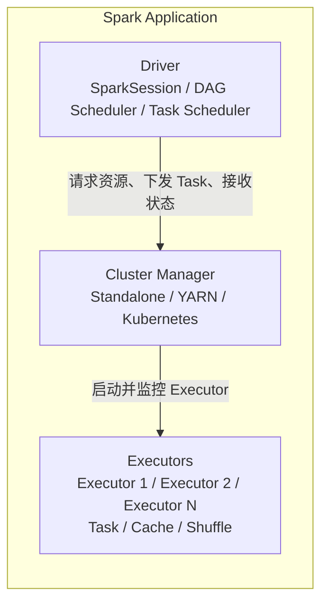
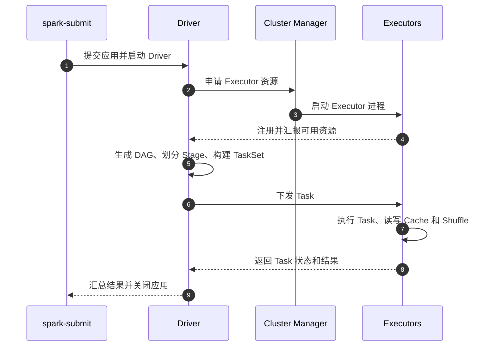
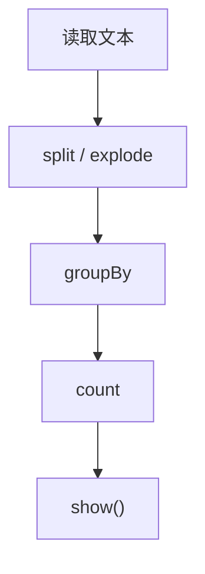
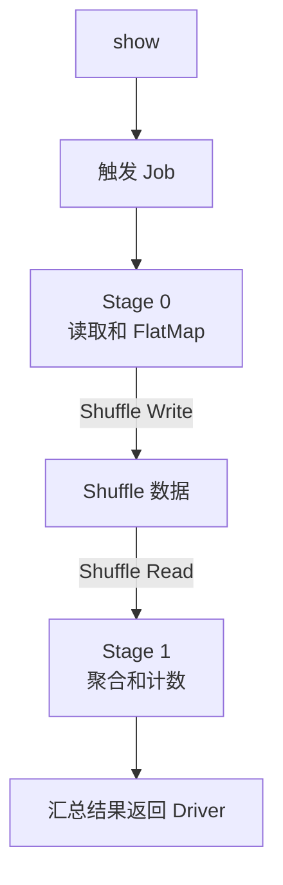
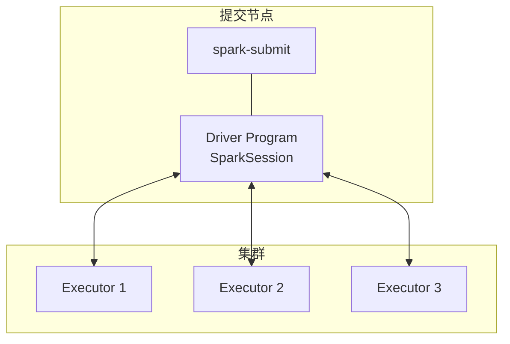
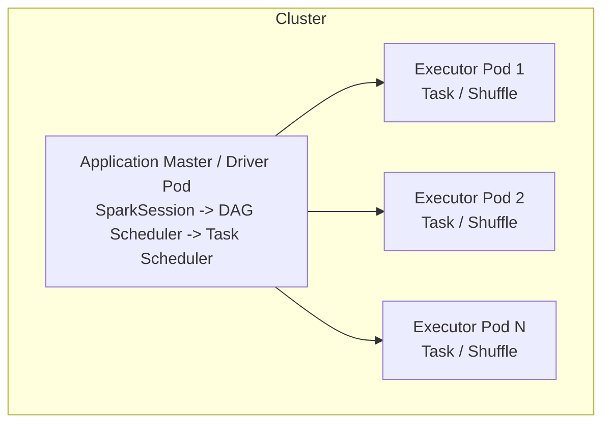

# Spark 简介


当数据量超过单机内存和 CPU 的处理能力时，很多熟悉的批处理程序会遇到同一个问题：逻辑不难，但很难高效地拆到多台机器上运行。Spark 要解决的正是这件事。它把分布式存储上的数据抽象成可并行操作的数据集，把用户代码转换成可以在集群中调度的任务，同时提供 SQL、流处理、机器学习等统一 API。

<!--more-->

## Spark 是什么

Apache Spark 是一个分布式计算引擎，而不是数据库或资源管理系统。它通常从 HDFS、对象存储、Hive、Kafka、JDBC 等外部系统读取数据，完成计算后再把结果写回这些系统。集群资源则由 YARN、Kubernetes 或 Spark Standalone 等系统管理。

Spark 的几个核心特征如下：

- **统一 API**：可以用 Scala、Java、Python、R 或 SQL 表达计算，上层组件包括 Spark SQL、Structured Streaming、MLlib 和 GraphX。
- **基于内存的计算**：中间结果可以保存在 Executor 的内存或本地磁盘中，减少反复读写 HDFS 的开销。
- **惰性求值**：`filter`、`select`、`map` 这类 Transformation 只会生成逻辑计划，遇到 `count`、`collect`、`write` 这类 Action 才会触发真正执行。
- **分区并行**：数据被划分成多个 Partition，一个 Partition 通常对应一个 Task，由不同 Executor 并行处理。

下面这个 PySpark 示例体现了“Transformation 惰性、Action 触发执行”的特点：

```python
from pyspark.sql import SparkSession

spark = SparkSession.builder.appName("word-count").getOrCreate()

text = spark.read.text("hdfs:///data/logs/app.log")
words = text.selectExpr("explode(split(value, ' ')) as word")
counts = words.groupBy("word").count()

# 前面的 select、groupBy 都没有真正执行，
# show() 这个 Action 才会生成 Job 并调度到集群。
counts.show()
```

可以把 Spark 理解成一条编译和调度流水线：用户声明“想要什么结果”，Spark 分析依赖关系，生成分布式执行计划，再把计算拆成许多 Task 放到集群里运行。

## 内部集群架构

一个 Spark 应用由 Driver、Executor 和 Cluster Manager 协作完成。三者的职责不同，但共同目标只有一个：把用户代码转换成可并行执行的任务。



### Driver

Driver 是 Spark 应用的控制中心。用户程序中的 `main` 函数通常运行在 Driver 进程里，`SparkSession` 也在这里创建。

Driver 的主要工作包括：

- 解析用户代码，构建 RDD 或 DataFrame 的依赖关系图；
- 遇到 Action 时生成 Job，并根据 Shuffle 边界划分 Stage；
- 把 Stage 拆成 TaskSet，调度到不同 Executor；
- 跟踪 Task 状态，处理失败重试和推测执行；
- 协调结果返回、缓存清理和作业关闭。

需要注意的是，Driver 并不负责执行大部分数据计算。它的核心价值是维护全局执行计划、任务状态和数据依赖。

### Executor

Executor 是运行在工作节点上的进程，通常以 JVM 进程形式存在。它持有 CPU 和内存资源，是真正执行 Task 的地方。

Executor 的职责主要有三类：

- 执行 Driver 分配的 Task；
- 缓存 RDD、DataFrame 的 Partition，供后续 Stage 或 Action 复用；
- 管理 Shuffle 数据，为其他 Executor 提供读取服务。

一个 Executor 内部可以运行多个 Task，数量通常由分配给它的 CPU core 数决定。例如一个 Executor 拿到 4 个 core，就通常可以同时执行 4 个 Task。

### Cluster Manager

Cluster Manager 负责资源分配，不理解具体的业务计算逻辑。Spark 应用提交后，Driver 或集群服务会向它申请启动 Executor 的资源。

常见选择包括：

| Cluster Manager | 特点 |
| :--- | :--- |
| Local | 进程内模拟并行，适合开发、调试和小数据验证 |
| Standalone | Spark 自带的简单集群管理器，部署轻量 |
| YARN | Hadoop 生态中常见，能够和其他大数据组件共享资源 |
| Kubernetes | 使用 Pod 运行 Driver 和 Executor，适合云原生环境 |

Cluster Manager 只决定“资源在哪里、由谁启动”。Spark 作业的 DAG、Stage、Task 仍然由 Driver 和 Spark 框架负责。

## 应用如何运行

Spark 应用从提交到结束，大致经历六个阶段。

1. **提交应用**：用户通过 `spark-submit` 指定主类或脚本、master 地址、deploy mode、资源大小和依赖包。
2. **启动 Driver**：Driver 创建 `SparkSession`，初始化调度器和通信模块。
3. **申请资源**：Cluster Manager 根据配置启动 Executor，Executor 反向注册到 Driver。
4. **生成执行计划**：Catalyst 会分析、优化 SQL / DataFrame 计划，RDD 则根据转换关系构建 DAG。
5. **划分 Stage**：Driver 根据 Shuffle 依赖切分 Job。宽依赖处形成 Stage 边界，窄依赖则尽量合并到同一个 Stage。
6. **调度 Task**：Task 被发送到 Executor，按 Partition 并行执行。Shuffle Map Stage 写出中间数据，Result Stage 生成最终结果。



以一个典型的 DataFrame Word Count 为例，用户代码先形成一条惰性转换链路：



当 `show()` 触发 Action 后，Driver 才会把它转换成真正的分布式执行过程：



这里的关键概念是**宽依赖**。如果多个 Partition 的结果需要重新组织才能得到下游 Partition，例如 `groupBy`、`reduceByKey`、`join`，Spark 通常需要 Shuffle。Shuffle 会带来磁盘写入、网络传输和序列化成本，所以它经常是 Spark 调优时最需要关注的区域。

一个简单的 `spark-submit` 命令如下：

```bash
spark-submit \
  --master yarn \
  --deploy-mode cluster \
  --class com.example.WordCount \
  --num-executors 10 \
  --executor-memory 4g \
  --executor-cores 2 \
  word-count.jar
```

这条命令向 YARN 申请 10 个 Executor，每个 Executor 使用 4 GB 内存和 2 个 CPU core。

## 应用运行模式

Spark 的 **deploy mode** 决定 Driver 进程运行在哪里。它不改变程序逻辑，但会影响资源占用、日志查看方式和提交进程的生命周期。

### Client 模式

在 client 模式下，Driver 运行在提交命令的进程中。`spark-submit` 启动后，本机进程就是 Driver。



这种方式适合开发调试和交互式场景：

- 代码和日志离开发者更近，排障方便；
- 可以方便地接入 `spark-shell`、PySpark REPL 或 Notebook；
- Driver 使用的是提交节点资源，不占用集群分配的 Driver 容器。

但它也有明显限制：提交进程不能退出，否则应用结束；提交节点和 Executor 之间要频繁交换调度信息和数据，网络距离过远时效率会下降。

### Cluster 模式

在 cluster 模式下，Driver 由 Cluster Manager 启动在集群内部。YARN 中通常运行在 Application Master 进程里，Kubernetes 中则运行在 Driver Pod 中。



这种方式更适合生产作业：

- Driver 和 Executor 位于同一套集群资源体系内，调度通信更均衡；
- `spark-submit` 提交完成后可以退出，长任务继续由集群管理；
- Driver 的资源、日志和生命周期由 YARN 或 Kubernetes 统一治理。

代价是调试不如 client 模式直接。开发者通常需要查看 YARN Application 日志、Kubernetes Pod 日志或 Spark History Server。

### 模式选择

常见选择可以概括为：

| 场景 | 推荐模式 |
| :--- | :--- |
| 本地开发 | `--master local[*]` |
| Notebook、REPL、临时调试 | client 模式 |
| 定时批处理、生产长任务 | cluster 模式 |
| Hadoop 平台 | YARN + cluster 模式 |
| 云原生平台 | Kubernetes + cluster 模式 |

## 小结

Spark 的价值在于把分布式计算拆成了几个清晰的层次：用户用 DataFrame、SQL 或 RDD 描述计算；Driver 负责生成 DAG 和调度任务；Cluster Manager 提供资源；Executor 并行执行 Task 并管理缓存与 Shuffle。

理解一个 Spark 应用时，可以沿这条链路思考: 程序以什么模式提交，Driver 在哪里，Cluster Manager 是谁，Action 触发后生成了哪些 Stage，哪些地方发生了 Shuffle，Task 是否有足够分区和资源。很多性能问题，本质上都藏在这条链路里。

## 参考

- [Apache Spark Overview](https://spark.apache.org/docs/latest/cluster-overview.html)
- [Spark SQL, DataFrames and Datasets Guide](https://spark.apache.org/docs/latest/sql-programming-guide.html)
- [Running Spark on Kubernetes](https://spark.apache.org/docs/latest/running-on-kubernetes.html)

