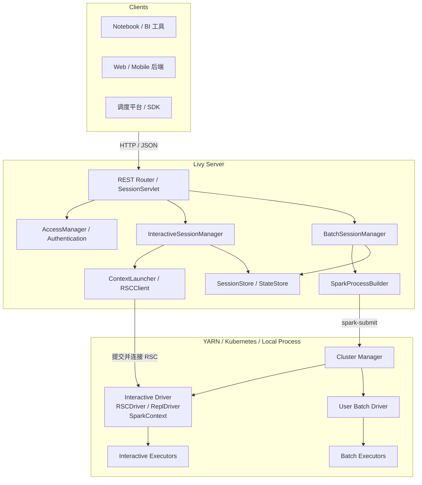
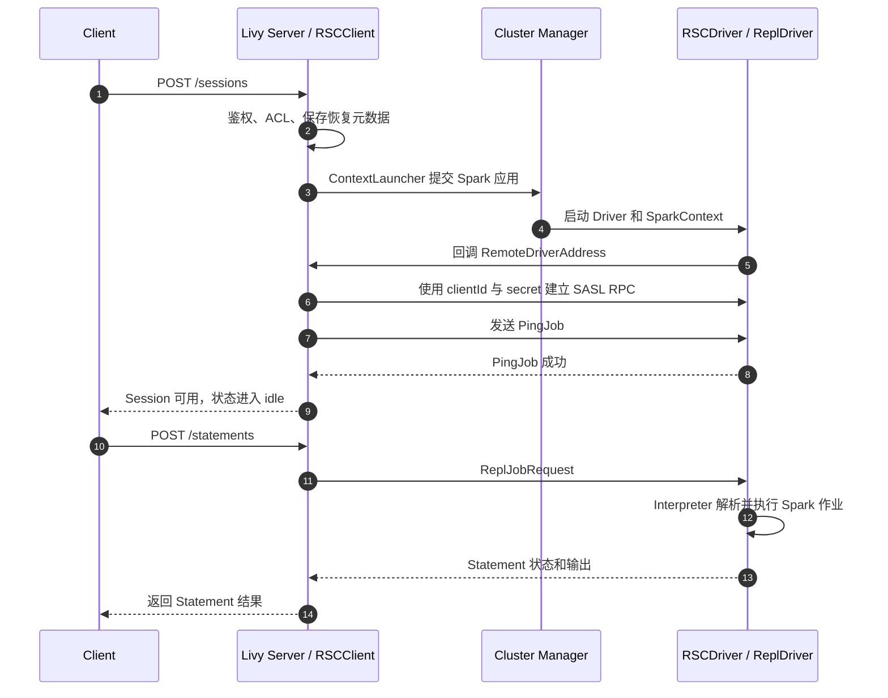
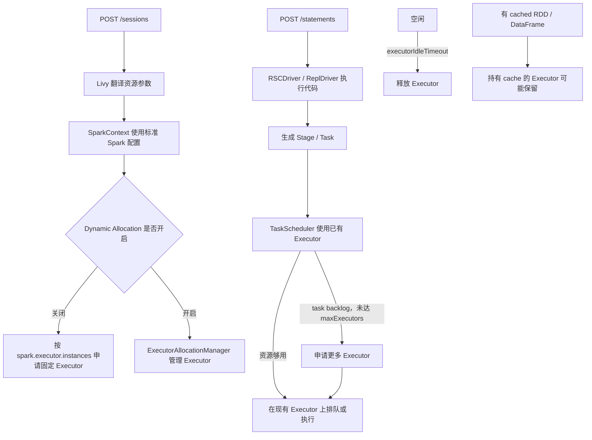
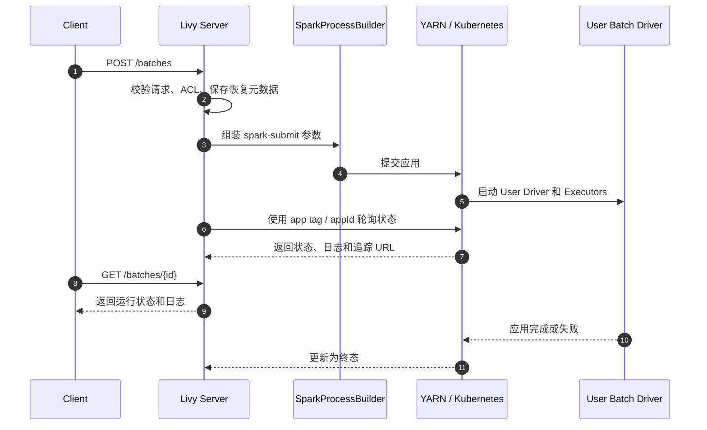
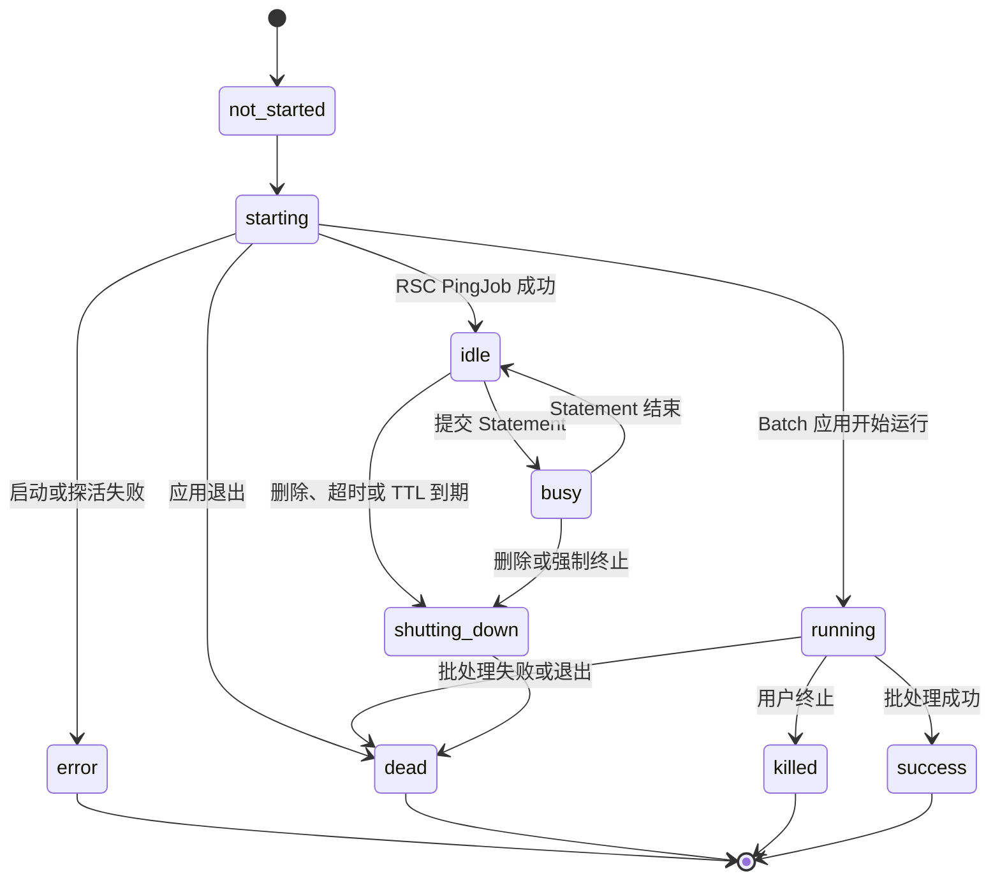
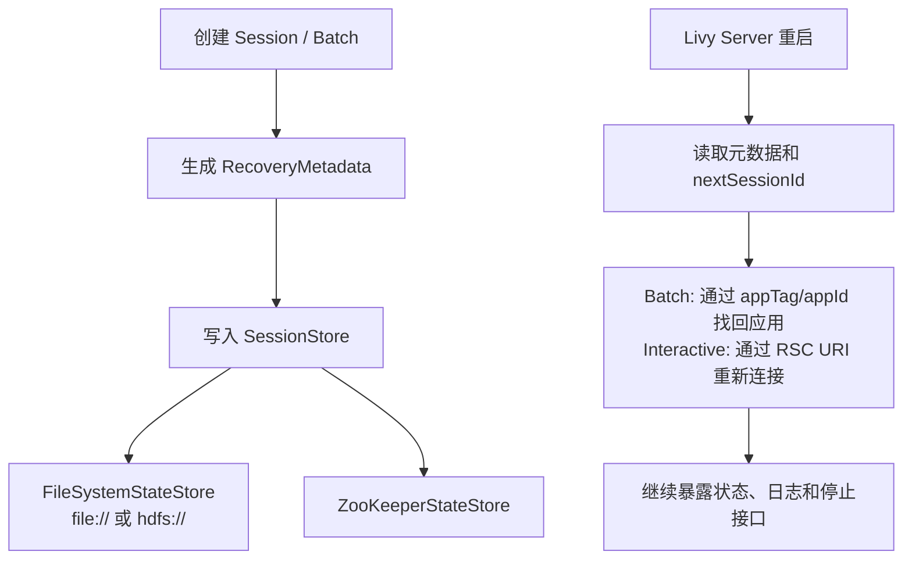
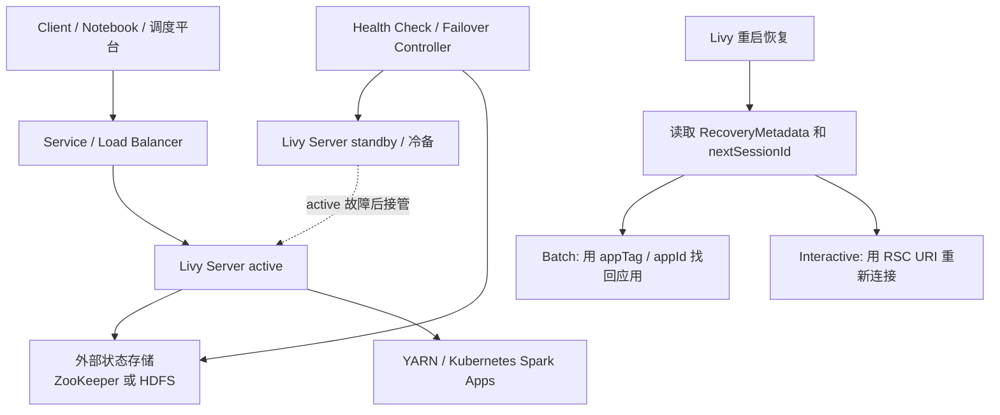

# Apache Livy 简介


当你把一个 Spark 应用交给数据平台服务化时，很快会遇到三个现实问题：客户端机器不一定能直连集群；`spark-submit` 不适合由 Web 后端反复执行；多个用户的长任务、权限、日志和资源也不能只靠脚本管理。Apache Livy 要解决的就是这一层问题：它把 Spark 集群包装成可远程访问、可管理、可多租户使用的 REST 服务。

这篇文章面向已经了解 Spark Driver、Executor 和 Cluster Manager 的读者。读完你可以理解 Livy Server 的职责边界、Interactive Session 与 Batch Session 的差异、RSC 的连接建立过程、Executor 资源如何分配和扩缩容、Session 状态恢复机制，以及 Livy 与 Spark Connect 的适用边界。

<!--more-->

## Livy 是什么

Apache Livy 是一个通过 REST 接口与 Spark 集群交互的服务。它支持提交 Spark 代码片段或完整应用，支持同步和异步获取结果，也支持管理 Spark Context。对 Web、移动端或调度平台来说，它们只需要访问 Livy Server，而不必在每台客户端机器上维护完整的 Spark 客户端环境。

Livy 的关键特征可以概括为四点：

- **远程提交**：客户端通过 HTTP/JSON 或 client library 使用 Spark 集群。
- **长 Context 复用**：Interactive Session 可以让 SparkContext 持续存在，多个语句和作业复用其中的缓存数据。
- **多租户管理**：多个 Session / Batch 可以共存，并且支持 impersonation、ACL、Kerberos/LDAP 等安全机制。
- **控制面与数据面分离**：Livy Server 负责接入、路由、鉴权、状态管理和生命周期控制；真正的 Spark 计算仍然发生在被管理的集群里。

版本方面，Apache Livy 仍处于 incubating 状态。较新的 `0.9.0-incubating` 增加了 Kubernetes 提交支持、Spark 3.5.6 支持和 Java 17 测试支持；`0.8.0-incubating` 则引入了 Scala 2.12 支持等变化。下面以官方 latest 文档和当前 master 源码为主线展开，具体可用特性仍要核对你部署的 Livy 版本。

## 总体架构

官方架构图把系统分成三段：Client 通过 HTTP 访问 REST Server；REST Server 管理多个 Context；Context 所在的 Driver 与 Executor 运行在 Cluster Manager 管理的集群中。可以把 Livy Server 理解成 Spark 集群的**服务化控制面**，而不是替代 Spark 的计算引擎。



这个边界很重要：Livy Server 挂了，不代表已经运行中的 Spark 应用一定会立刻被杀掉；但客户端可能失去统一的入口，Livy 也可能无法继续更新 Session 状态。开启 recovery 后，Livy 重启可以从状态存储里找回 Session 元数据；不开 recovery 时，默认行为会随服务关闭而遗忘或停止 Session。

## 入口层与 REST 路由

Livy 的两个核心资源是 `/sessions` 和 `/batches`。前者对应可反复提交语句的交互式会话，后者对应一次完整应用的批处理提交。Livy Server 内部由 `LivyServer` 挂载路由，由 `SessionServlet` 提供通用能力，再由 `InteractiveSessionServlet` 和 `BatchSessionServlet` 处理各自的差异。

| API | 作用 |
| :--- | :--- |
| `POST /sessions` | 创建交互式 Scala、Python、R 或 SQL 会话 |
| `GET /sessions/{id}` | 查询 Session 信息 |
| `POST /sessions/{id}/statements` | 向会话提交代码片段 |
| `GET /sessions/{id}/statements/{statementId}` | 查询语句状态和输出 |
| `POST /batches` | 提交一个 JAR / Python 文件形式的批处理应用 |
| `GET /batches/{id}` | 查询批处理应用信息 |
| `DELETE /sessions/{id}` 或 `DELETE /batches/{id}` | 停止 Session 或 Batch |

`SessionServlet` 并不只是做 URL 转发。它会检查 Session 是否存在，判断请求人是 owner 还是具备 view / modify / super 权限，然后把请求交给 `SessionManager`。创建请求还会受到最大进程数限制，避免一次突发流量启动过多 Spark 应用。

## Interactive 与 Batch

Interactive Session 的目标是“长时间使用一个 Spark 环境”。用户可以先定义变量和 DataFrame，再反复提交 SQL、Python、Scala 或 R 语句。它适合探索式分析、Notebook、教学环境和需要复用缓存的场景。

Batch Session 的目标是“运行一个已经完成的程序”。请求中必须提供 `file`，通常会指定 `className` 和参数。Livy 用它生成 `spark-submit` 命令，然后跟踪应用状态、日志和退出结果。它适合定时 ETL、模型训练脚本和不需要人工交互的作业。

| 维度 | Interactive Session | Batch Session |
| :--- | :--- | :--- |
| 提交内容 | 代码片段、SQL、Job API 请求 | 完整 JAR / Python 应用 |
| 生命周期 | 长 Context，等待多轮语句 | 应用退出即结束 |
| 核心机制 | RSC + ReplDriver | `spark-submit` + 应用监控 |
| 状态特点 | idle / busy 等状态反复切换 | running 到终态 |
| 典型场景 | Notebook、交互查询、特征探索 | 定时 ETL、批处理作业 |

## Interactive Session 的 RSC 链路

RSC（Remote Spark Context）是 Livy 最有代表性的设计。它让 SparkContext 运行在集群里的专用 Driver 中，而 Livy Server 只保存一个远程客户端连接。

创建 Interactive Session 时，`InteractiveSession` 会组装 Spark 配置，并通过 `LivyClientBuilder` 创建 `RSCClient`。驱动类被设置为 `ReplDriver`，随后 `ContextLauncher` 使用 Spark Launcher 提交一个专用 Spark 应用。这个应用的 Driver 启动 `SparkContext`，同时启动自己的 RPC Server。



RSC 的 RPC 层有几个关键点：

- `ContextLauncher` 生成 `clientId` 和 `secret`，Driver 回调后向 Livy Server 返回自己的 RPC 地址。
- 客户端与 Driver 建立 Netty RPC，使用 SASL 做身份握手，消息用 Kryo 序列化。
- RPC 调用是异步的；连接没有自动重试，RPC 断开通常意味着该交互式上下文需要终止。
- `ReplDriver` 根据 statement 的 kind 分发到 Scala、PySpark、SparkR 或 SQL 解释器。

因此，Interactive Session 的 `idle` / `busy` 并不只是 Livy Server 自己的状态。Livy Server 还会从 RSCClient 读取 REPL 状态：没有语句在执行时是 `idle`，正在执行语句时是 `busy`。

## Interactive Session 的 Executor 资源模型

这里要先区分两个容易混淆的“executor”。RSCDriver 内部有线程池来处理 RPC 请求和 Job API 请求；但真正占用集群 CPU 和内存的是标准 Spark Executor 进程。它可能是 YARN Container，也可能是 Kubernetes Pod。Livy 不自己维护这类 Executor，而是把配置交给 Spark，由 SparkContext 和 Cluster Manager 完成申请、注册、失败替换和释放。

创建 Interactive Session 时，Livy 会把请求中的资源字段翻译成标准 Spark 配置：

- `numExecutors` 对应 `spark.executor.instances`，表示静态分配下的 Executor 数量，也是动态分配时常用的初始值；
- `executorCores` 对应 `spark.executor.cores`，表示单个 Executor 可并发执行的 Task 数；
- `executorMemory` 对应 `spark.executor.memory`，表示单个 Executor 的 JVM 内存；
- `driverCores` 对应 `spark.driver.cores`，表示 Driver 可并发使用的 CPU 数；
- `driverMemory` 对应 `spark.driver.memory`，表示 Driver JVM 内存。

这些参数在 Session 创建时生效。它们不是 Livy 提供的运行中扩缩容接口；Livy Statement 也不会单独向 Cluster Manager 申请资源。



### 静态分配

Spark 原生默认关闭 Dynamic Allocation。如果 effective Spark 配置没有开启它，`numExecutors` 基本就是固定目标数量。

例如请求中有：

```json
{
  "numExecutors": 20,
  "executorCores": 2,
  "executorMemory": "4g"
}
```

这个 Session 可能长期持有约 40 个 Executor task slot 和 80 GB Executor 内存。即使它进入 `idle` 状态，Driver 和 Executor 通常也还会存在。

这时提交一条生成 100 个 partition 的 Statement，Spark 不会因为数据量更大而自动增加 Executor。它只能在现有 Executor 上排队执行。如果某个 Executor 失败，Spark 可能向 Cluster Manager 申请 replacement Executor，但这是失败替换，不是根据业务负载扩容。

### 动态分配（Dynamic Allocation）

如果希望 idle Session 自动释放 Executor，应显式开启 Spark Dynamic Allocation：

```json
{
  "kind": "pyspark",
  "conf": {
    "spark.dynamicAllocation.enabled": "true",
    "spark.dynamicAllocation.minExecutors": "0",
    "spark.dynamicAllocation.maxExecutors": "50",
    "spark.dynamicAllocation.initialExecutors": "1"
  }
}
```

开启后，Statement 执行时如果出现 task backlog，`ExecutorAllocationManager` 会向 Cluster Manager 申请更多 Executor，直到 `maxExecutors` 或队列资源上限。空闲后，Spark 会按 `executorIdleTimeout` 释放多余 Executor。

但仍然有几个边界要注意：

- Driver 会一直存在，Dynamic Allocation 只管理 Executor，不会释放整个 Session。
- 有 cached RDD / DataFrame 的 Executor 可能不会被立即释放，需要关注 `cachedExecutorIdleTimeout`。
- YARN 上通常要配合 external shuffle service；Kubernetes 上则要确认当前 Spark 版本的 shuffle tracking 和 Dynamic Allocation 支持方式。
- Cluster Manager 队列资源不足时，Spark 的申请会等待或失败，Livy Statement 会继续保持 `busy`，而不是自动换一个队列。

一句话总结：**Livy Statement 只是提交到已有 RSCDriver；Executor 是 Spark 根据 Session 的 Spark 配置管理的。静态分配不会自动扩容，开启 Spark Dynamic Allocation 后才可能根据 task backlog 继续申请 Executor。**

## Batch Session 的提交流程

Batch Session 的链路更接近被服务化的 `spark-submit`。`BatchSession` 收到请求后，把用户声明的 `file`、`className`、资源参数、队列和 Spark 配置交给 `SparkProcessBuilder`。后者生成启动命令，同时会注入一个用于追踪应用的唯一 tag。



Livy 会根据配置选择不同的 `SparkApp` 实现：YARN 环境使用 `SparkYarnApp`，Kubernetes 环境使用 `SparkKubernetesApp`，其他模式退化为本地进程监控 `SparkProcApp`。在 YARN 上，Livy 会把应用 tag 写入 `spark.yarn.tags`；在 Kubernetes 上，则写入 Driver 和 Executor 的 label。这样即使提交命令已经返回，Livy 仍然能继续找到真实应用。

官方文档强烈建议生产环境使用 YARN cluster mode。这样 Driver 由集群调度和计费，Livy Server 所在主机不会因为承载大量用户 Driver 而变成瓶颈。

## Session Manager 与状态机

`SessionManager` 是一个泛型管理器，Interactive 和 Batch 各有自己的 manager。它维护内存中的 Session 映射，分配递增 ID，处理同名冲突，注册 Session，定期回收超时对象。Interactive Session 还支持心跳、idle timeout 和 TTL。



这不是每个版本都完全等价的状态转移图，而是一张便于理解的心智模型。REST 文档中 Session 可能出现 `not_started`、`starting`、`idle`、`busy`、`shutting_down`、`error`、`dead`、`killed`、`success` 等状态；Batch 还会使用 `running` 表示应用运行中。Statement 另有 `waiting`、`running`、`available`、`error`、`cancelling`、`cancelled` 状态。

## 状态存储与恢复

Livy 的 recovery 目标是：Livy Server 重启后，不丢失对已有 Session / Batch 的管理视角。默认 `livy.server.recovery.mode=off` 时使用 `BlackholeStateStore`，服务关闭时会停止并遗忘 Session。开启 `recovery` 后，Livy 会把恢复元数据写入状态存储。



几个生产要点：

- 状态存储可以选择 `filesystem` 或 `zookeeper`。
- 文件系统状态存储要求支持原子 rename，源码注释明确建议不要使用 S3 这类不满足该前提的文件系统。
- 当前源码要求 recovery 运行在 YARN 或 Kubernetes 上；本地进程模式无法提供同样可靠的恢复语义。
- recovery 是“找回管理视角”，不是完整的双活 HA。多实例接入、负载均衡、隔离和状态一致性仍需要平台层设计。

## 高可用与故障切换

Livy 官方内置的机制更准确地说是 **Session Recovery**，不是完整的 active-active 高可用。它能保证 Livy Server 重启后找回 Session 元数据，但当前实现没有内置 leader election、standby、fencing，也没有多个 Server 安全共享同一批 Session 的语义。

因此，生产上的推荐形态是：**外部状态存储 + 单活 Livy Server + 平台层故障切换**。可以准备多个 Livy 节点或镜像，但同一时间只允许一个实例作为 active。备用实例不能和 active 同时管理同一批 Session，否则可能出现重复恢复、Session ID 冲突、重复 kill、状态互相覆盖等问题。



开启 recovery 的 ZooKeeper 配置可以这样组织：

```properties
livy.server.recovery.mode=recovery
livy.server.recovery.state-store=zookeeper
livy.server.zookeeper.url=zk1:2181,zk2:2181,zk3:2181
livy.server.zk.retry-policy=5,100
```

如果选择 HDFS 状态存储，则改为：

```properties
livy.server.recovery.mode=recovery
livy.server.recovery.state-store=filesystem
livy.server.recovery.state-store.url=hdfs:///livy/recovery
```

Batch Session 的恢复通常更稳。Livy 保存了 `appId`、`appTag`、owner 和 proxyUser，重启后可以继续到 YARN 或 Kubernetes 查询真实应用状态、日志和诊断信息。Interactive Session 则依赖 `rscDriverUri`。只有原来的 RSCDriver 还活着，新的 Livy Server 才能重新连接；如果 Driver 已经因为空闲超时、失败或集群回收退出，这个 Session 就无法继续。

部署时可以按故障切换速度选择方案：

| 方案 | 适用场景 | 注意点 |
| :--- | :--- | :--- |
| Kubernetes `Deployment replicas=1` + `Recreate` | 大多数平台默认选择 | Pod 重建期间有短暂不可用窗口 |
| 外部 health check + 冷备接管 | 部署在虚拟机或物理机 | 必须先确认 active 已失联，避免双 active |
| 多套独立 Livy 集群按租户分片 | 需要横向扩展或隔离爆炸半径 | 每个分片内部仍是单活 |

如果确实需要横向扩展，可以用“分片多活”替代“单个服务多活”：

```text
tenant-a -> Livy Cluster A -> hdfs:///livy/tenant-a/recovery
tenant-b -> Livy Cluster B -> hdfs:///livy/tenant-b/recovery
tenant-c -> Livy Cluster C -> hdfs:///livy/tenant-c/recovery
```

每个分片内部仍然保持单活语义。这样整体服务的容量可以扩展，也能把某个 Livy Server 故障的影响范围限制在一个租户内。

高可用上线前，至少要演练这些场景：Livy Server 重启后 `/batches` 是否恢复；Batch 的状态、日志和 kill 接口是否继续可用；Interactive 的 RSC URI 是否已经持久化；ZooKeeper 或 HDFS 短暂不可用时 Livy 的行为；备用节点接管后新建 Session 的 ID 是否连续且不冲突；以及故障期间 idle、TTL 或心跳超时是否已经把 Session 回收。

## 安全与多租户

Livy 的安全边界要分成几层看：

- **接入认证**：可配置 Kerberos/SPNEGO、LDAP，或通过自定义 authentication class 扩展。
- **REST ACL**：`AccessManager` 区分 view、modify、super 和 allowed 用户。查看日志通常走 view 权限，提交、停止和上传资源走 modify 权限。
- **用户 impersonation**：管理员用户可以通过 `proxyUser` 或 `doAs` 以另一个用户身份启动应用，必须显式开启 `livy.impersonation.enabled` 并满足 superuser 校验。
- **传输与 Web 安全**：可配置 SSL keystore；较新版本还提供 CSRF 保护和安全响应头。
- **Spark 配置隔离**：`spark-blacklist.conf` 可以禁止用户覆盖关键 Spark 配置，避免绕过队列、资源或安全策略。

如果 Livy Server 暴露在内网负载均衡之后，务必确认真实用户身份如何传入。否则 ACL 和 impersonation 可能只能依赖代理层的正确实现，而不能自动保证租户隔离。

## 最小使用示例

创建一个 PySpark 交互式 Session：

```bash
BASE="http://livy.example.com:8998"

curl -X POST "$BASE/sessions" \
  -H 'Content-Type: application/json' \
  -d '{
    "kind": "pyspark",
    "name": "demo-pyspark",
    "conf": {
      "spark.master": "yarn",
      "spark.submit.deployMode": "cluster"
    }
  }'
```

向该 Session 提交一条语句，并轮询结果：

```bash
SESSION_ID="0"

curl -X POST "$BASE/sessions/$SESSION_ID/statements" \
  -H 'Content-Type: application/json' \
  -d '{"code": "spark.range(1000000).count()"}'

curl "$BASE/sessions/$SESSION_ID/statements/0"
```

提交一个 Batch 应用：

```bash
curl -X POST "$BASE/batches" \
  -H 'Content-Type: application/json' \
  -d '{
    "file": "hdfs:///apps/spark-examples.jar",
    "className": "org.apache.spark.examples.SparkPi",
    "numExecutors": 4,
    "executorMemory": "2g",
    "executorCores": 2
  }'
```

这些示例省略了认证头。生产环境应结合 Kerberos、LDAP、反向代理或内部网关补齐认证，不要把未认证的 Livy 端口直接暴露给普通用户。

## 常见误区

**把 Livy Server 当成 Spark Driver**。多数场景下，Livy Server 只是控制面。Interactive 的 SparkContext 在 RSCDriver 中，Batch 的 Driver 由 Spark 自己启动。Livy Server 的资源规划应该围绕连接数、元数据、日志缓存和管理线程，而不是把所有用户计算都压到这台机器。

**只看 Livy 状态，不看集群状态**。Livy 的状态来自 REST 对象、RSC REPL 状态以及 YARN/Kubernetes 应用状态的组合。排障时要同时看 Livy Session 日志、Spark UI、YARN application 或 Kubernetes Pod。

**长时间保留 idle Session**。Interactive Session 的 Driver 会持续存在；Executor 是否继续占用资源取决于 Spark Dynamic Allocation、cache 数据和 idle timeout。静态分配下，Executor 通常也会保留。应根据业务配置 idle timeout、TTL、heartbeat、Session 上限，并评估是否开启 Dynamic Allocation。

**把 recovery 理解为高可用**。状态存储能帮助 Livy 重启后找回 Session，但它不自动解决多活写入、请求路由、实例隔离和脑裂问题。高可用方案要在架构层额外设计。

**忽略版本兼容性**。Livy 不捆绑 Spark 发行版，运行时通过 `SPARK_HOME` 使用 Spark。不同 Livy / Spark / Scala / Java 版本组合的行为可能有差异，升级前要跑真实的 Interactive 和 Batch 链路。

## 与 Spark Connect 的关系

Spark 3.4 引入了 Spark Connect。它的客户端把 DataFrame 操作翻译成 unresolved logical plan，通过 gRPC 发送到 Spark 服务端，结果再用 Arrow 流式返回。它带来的客户端/服务端解耦、稳定性和可升级性都很适合现代数据应用。

| 维度 | Apache Livy | Spark Connect |
| :--- | :--- | :--- |
| 主要协议 | REST + RSC 的 Netty RPC | gRPC + logical plan |
| 核心对象 | Session、Batch、Statement、SparkContext | 远程 SparkSession |
| API 能力 | 代码片段、Batch、Job API、多语言 REPL | 主要是 DataFrame 生态，不支持 RDD |
| 平台能力 | 多租户、ACL、YARN/K8s 管理集成 | 通常由 Spark 服务端或基础设施扩展 |
| 适用重点 | 服务化网关和既有 Hadoop/YARN 平台 | 新一代远程 DataFrame 客户端 |

两者不是简单的替代关系。如果平台已经有 YARN、Kerberos、多用户 Session 管理和 Notebook 集成，Livy 仍是常见选择；如果新系统只需要远程 DataFrame API，并且希望使用 Spark 官方的解耦客户端，Spark Connect 更值得评估。

## 小结

Livy 的价值在于把 Spark 的接入方式服务化：客户端不需要本地 Spark 环境，Web 平台可以通过 REST 创建 Session 或提交 Batch；Livy Server 负责路由、鉴权、状态和生命周期；真正的 Spark 应用运行在 YARN、Kubernetes 或本地进程中。

理解 Livy 时，关键是区分四条链路：REST 请求如何进入 `SessionServlet`；Interactive Session 如何通过 RSC 与远程 Driver 保持连接；Interactive 的资源参数如何交给 Spark，并由静态分配或 Dynamic Allocation 管理 Executor；Batch Session 如何转换成 `spark-submit` 并持续追踪应用状态。再叠加状态存储、安全 ACL 和超时回收，就能看清它在数据平台中的位置。

## 参考

- [Apache Livy 官方网站](https://livy.apache.org/)
- [Apache Livy REST API 文档](https://livy.apache.org/docs/latest/rest-api.html)
- [Apache Livy Programmatic API](https://livy.apache.org/docs/latest/programmatic-api.html)
- [Apache Livy Getting Started](https://livy.apache.org/get-started/)
- [Apache Livy Release History](https://livy.incubator.apache.org/history/)
- [Apache Livy GitHub 仓库](https://github.com/apache/livy)
- [Spark Connect Overview](https://spark.apache.org/docs/latest/spark-connect-overview.html)
- [腾讯云开发者社区：Apache Livy 实现思路及模块概述](https://cloud.tencent.com/developer/article/1194700)

