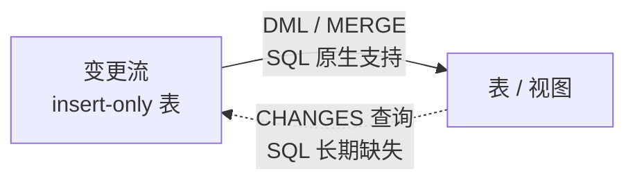
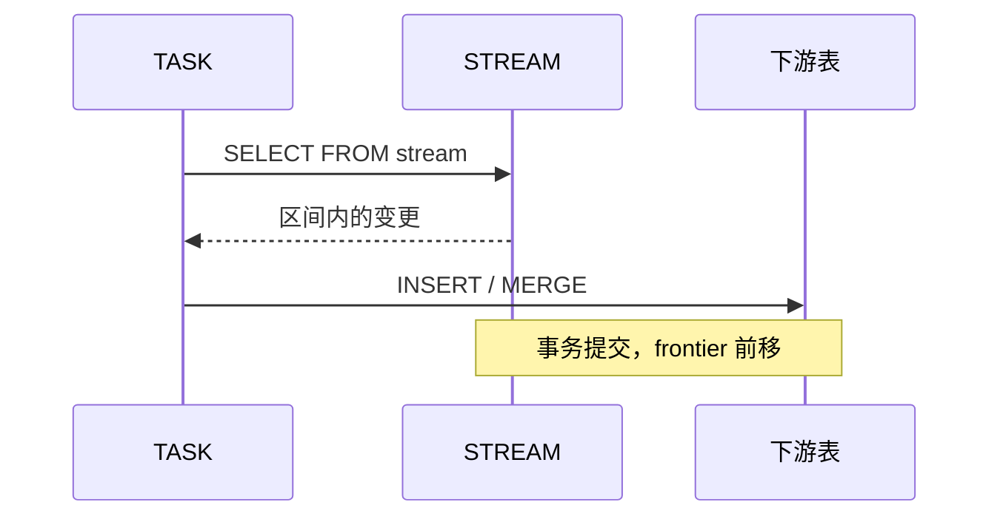
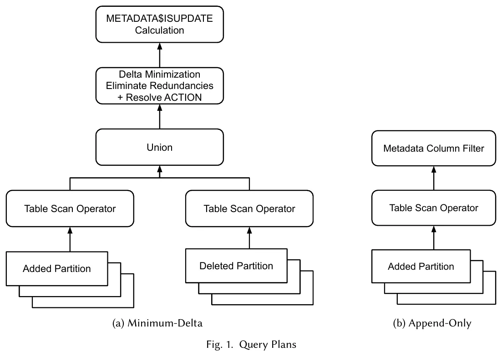
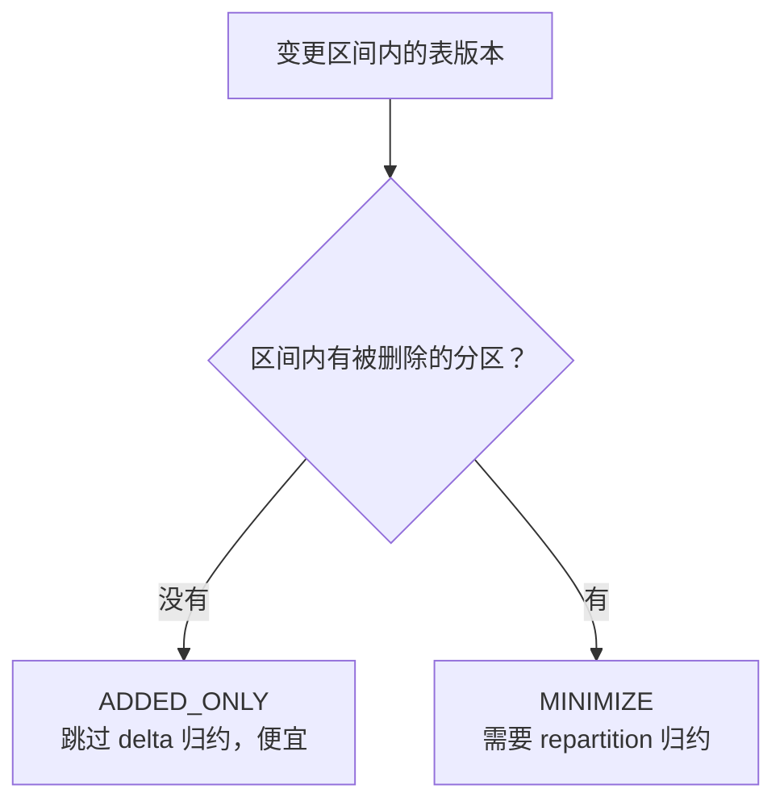
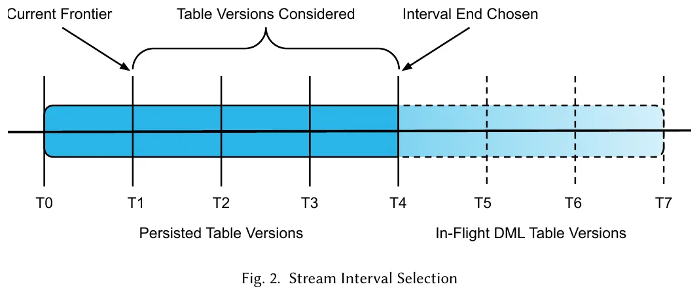
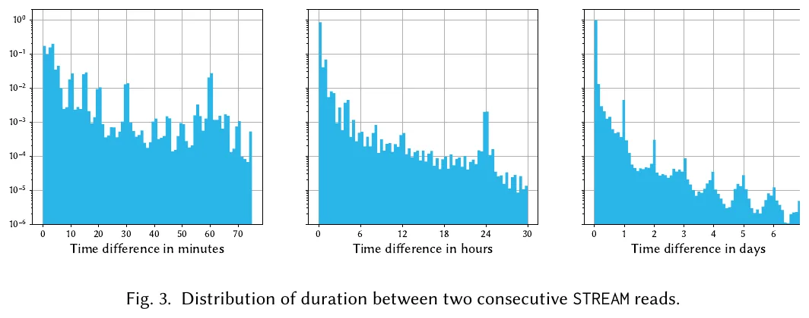
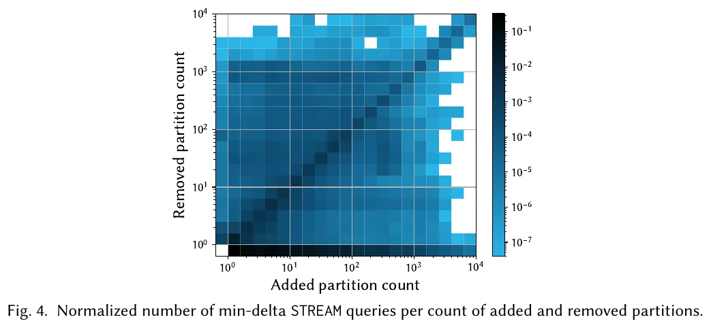

# 在 SQL 里查询变更：Snowflake 的 CHANGES 与 STREAM


<!--more-->

> 原文：Tyler Akidau, Paul Barbier, Istvan Cseri, Fabian Hueske, Tyler Jones, Sasha Lionheart, Daniel Mills, Dzmitry Pauliukevich, Lukas Probst, Niklas Semmler, Dan Sotolongo, Boyuan Zhang. **What's the Difference? Incremental Processing with Change Queries in Snowflake.** Proc. ACM Manag. Data 1, 2, Article 196 (June 2023), 27 pages. https://doi.org/10.1145/3589776

| 层次 | 回答的问题 | 核心标识 | 本文对应章节 |
|---|---|---|---|
| **动机** | SQL 到底缺了哪块能力？ | table → stream 转换 | 第一章 |
| **语义** | 变更长什么样？ | 变更元数据三列 | 第二章 |
| **实现** | 怎么在任意视图上算出变更？ | 查询微分、变更跟踪列 | 第三章 |
| **数据** | 真实用起来什么表现？ | 计划形态、扫描分区数、执行耗时 | 第四章 |
| **对照** | 别的系统怎么做的？ | 时态表、SUBSCRIBE、表格式 | 第五章 |

## 摘要

增量算法是流处理的内核。低延迟的结果取决于能否只对数据集**发生变化的那部分**做反应，而不是每次把整个数据集重算一遍。

但 SQL 语言在表达「变更流」（用表表示）和「把变更应用到表上」（用 DML 表示）这两件事上都很顺手，却**完全缺少查询变更本身的方法**。本文介绍 Snowflake 的两个原语：`CHANGES` 查询与 `STREAM` 对象——它们分别是「查询变更」和「消费变更」的入口。

论文还披露了两个有意思的生产数据：Snowflake 内部 90.8% 的 min-delta 查询走的是最便宜的 `ADDED_ONLY` 计划；而一旦变更区间里出现了被删除的分区，同一条查询的耗时立刻跳到 9～16 倍。

## 1. 引言

批处理 vs 流处理是流领域永恒的争论，各有拥趸。但有一点双方共识一致：批处理系统把输入数据集**整体**处理一遍，产出新的完整数据集；流处理系统处理输入数据集的**变更**，增量地演进对应的输出。

这种「增量性」——把一次计算拆成可分离的片段、在时间上分批推进——正是大多数人心中流处理的根基。现代流式系统里，增量性无处不在：Actor 模式天然逐条处理；NoSQL 式架构支撑起大量按 key 分区的增量场景（同一个 key 内部串行，key 之间并行）。

于是就有了**表与流的二元性**：表表示数据集在某个时间点的完整状态，等价于关系数据库里的一张表；流表示数据集随时间发生的变化，如果时间区间内只有一行被修改，流里就只记录这一个变化。两者承载同样的信息，只是呈现方式不同。

关系数据库社区几十年来也在思考同一批问题。**流本质上就是 insert-only 的表**，实践中确实这么用；DML 负责把流转换成表，其中 `MERGE` 是流转表的瑞士军刀——它把一个变更流解析成对一张表的修改。但标准 SQL 的特性不足以**抽取已经应用到表上的变更**。2000 年代初就有研究试图把 table→stream 的转换写进语言原语，然而现代 SQL 实现大多没有正面回应用户抽取和处理 changelog 的困难。

即便如此，直接查询变更仍然是一批场景的刚需：

- **事件队列**：消息队列是事件处理方案的地基。Kafka 这类系统能方便地入队出队并保持一定顺序。SQL 里 insert-only 表从入队和存储的角度算是消息队列的合理替身，但**缺少事务性出队机制**；
- **通知**：需要在特定数据变更时触发动作的场景，用表式接口来写很别扭——增量消费变更流通常比反复轮询整张表去找变化便宜得多；
- **增量视图维护（IVM）**：实时看板往往依赖某种形式的 IVM，要么在数据库内部实现，要么把增量变更直接喂给看板。很多数据库都提供某种物化视图原语，底下用的就是 IVM，但支持的操作和实现效率差异极大，常常逼着用户自己实现；
- **灵活的变更转换**：CDC/ETL 场景里，把变更用 SQL 转换一下能大幅降低整体复杂度——比如只关心部分变更，或者想以特定方式解释某些值。



这张图就是全文的靶子：**流的两个方向，SQL 只实现了一个**。

## 2. 语义

抽象地说，一张表是随时间变化的一组行，也就是所谓的**时变关系**（time-varying relation，TVR）。关系随时间演进，每次变化（行被加入或移除）都产生一个新的快照。表达 TVR 的另一种方式是直接编码它的变更流——这和数据库系统里普遍存在的 **redo log** 是一回事，redo log 捕获 TVR 的所有变化，表现为一串 INSERT、UPDATE、DELETE 操作。

redo log 有多种表示方式：有的把 UPDATE 打包成一行同时带新旧值，有的拆成独立的 DELETE + INSERT 配对。各有取舍。

先用一个具体的例子把语义钉住。假设有一张这样的表：

```sql
SELECT * FROM people;

-- +----+--------+
-- | id | name   |
-- +----+--------+
-- |  1 | Jeff   |
-- |  2 | Donny  |
-- +----+--------+
```

接下来是一串 DML：

```sql
INSERT INTO people VALUES (3, 'Walter'), (4, 'Maud'), (5, 'Uli');
UPDATE people SET name = 'Jeffrey' WHERE id = 1;
UPDATE people SET name = 'Maude'   WHERE id = 4;
DELETE FROM people WHERE id IN (2, 5);
```

如果这个数据库支持 redo log 格式的变更查询，那么这些变更的 redo log 大致长这样：

| id | name | `$ACTION` | `$ISUPDATE` | `$ROW_ID` |
|---|---|---|---|---|
| 3 | Walter | INSERT | FALSE | 5ca38031 |
| 4 | Maud | INSERT | FALSE | e4d0387c |
| 5 | Uli | INSERT | FALSE | 16d193d9 |
| 1 | Jeff | DELETE | TRUE | f70c423b |
| 1 | Jeffrey | INSERT | TRUE | f70c423b |
| 4 | Maud | DELETE | TRUE | e4d0387c |
| 4 | Maude | INSERT | TRUE | e4d0387c |
| 2 | Donny | DELETE | FALSE | f0452fd5 |
| 5 | Uli | DELETE | FALSE | 16d193d9 |

注意 UPDATE 被表示为**带标签的 DELETE + INSERT 配对**，两者共享同一个 `$ROW_ID`。这一点和传统 redo log 是同一个套路，但后面会看到，Snowflake 提供了**另一种**表示方式。

还要强调一点：这些概念不局限于持久化表，同样适用于**由复杂 SELECT 定义的视图**。这正是 Snowflake 采用「动态渲染变更流」这一方案的动因——视图的变更不是从某个日志里读出来的，而是**算出来的**。

### 2.1 CHANGES 查询

`CHANGES` 查询是一种特殊的 Snowflake 查询，用来观察某个表对象在**两个时间点之间**的变化。时间窗口通过 `AT` 子句指定起止，配合可选的 `END` 子句；`END` 缺省为当前时刻。这些子句接受 Query UUID、墙上时钟时间戳、相对当前时间的偏移，或者一个 `STREAM` 对象。

除了源表的列，`CHANGES` 查询还定义了几个「元数据」列：

- `$ACTION`——该行由哪种 DML 操作产生，取值 `INSERT` 或 `DELETE`；
- `$ISUPDATE`——表的 UPDATE 被建模成 DELETE + INSERT 一对行，两者的 `$ISUPDATE` 都为 TRUE；
- `$ROW_ID`——行唯一且不可变的 ID，用于跨时间追踪行的变化，包括配对 UPDATE 的 DELETE/INSERT。

除时间区间外，`CHANGES` 查询还接受一个 `INFORMATION` 参数，指定使用哪种变更格式。Snowflake 支持两种：**append-only** 和 **minimum-delta**。两者都与上文那种传统的 redo log 格式不同。

**append-only** 只包含行**首次插入**表时发生的变化。插入可以来自 `INSERT`、`MERGE`、`COPY` 语句，也可以由 Snowpipe 或 Snowpipe Streaming 驱动。它的用途是高效地看到表里新增的行，再对这些行做转换并写到别的表里——这正对应流式系统最关注的 insert-only 事件驱动场景。

从概念上说，append-only 就是在 redo log 上加一个过滤器，但 Snowflake 的实现可以把它渲染得高效得多。

一个常见套路是：对一张由 Snowpipe 或 Snowpipe Streaming 填充的表请求 append-only 变更，消费方拿到原始摄取数据做转换后再写入一张或多张表（比摄取前转换更省事），然后对初始表执行 `DELETE` 或 `TRUNCATE` 以压低存储成本。**按设计，这些删除不会被 append-only 变更感知到**。

同一个例子，append-only 的渲染结果是：

| id | name | `$ACTION` | `$ISUPDATE` | `$ROW_ID` |
|---|---|---|---|---|
| 3 | Walter | INSERT | FALSE | 5ca38031 |
| 4 | Maud | INSERT | FALSE | e4d0387c |
| 5 | Uli | INSERT | FALSE | 16d193d9 |

UPDATE 和 DELETE 被过滤掉了。

**minimum-delta** 包含「能解释两个时间点之间差异的最小变更集」，也就是把区间内冗余的修改合并掉。它**总是捕获完整的行**，即使只改了一列——部分更新往往很难处理也很贵。

min-delta 适合分析型场景：多数增量算法用**净变更**和用细粒度 redo log 效果相当（有时还更高效），而且合并后的变更通常更好用。比如 CDC 场景里要把一个表的内容复制到另一个库，用 `MERGE` 就很合适——`MERGE` 在源表出现主键重复时行为未定义，而 redo log 格式恰恰会出现重复主键。

同样的例子，min-delta 的渲染结果是：

| id | name | `$ACTION` | `$ISUPDATE` | `$ROW_ID` |
|---|---|---|---|---|
| 3 | Walter | INSERT | FALSE | 5ca38031 |
| 1 | Jeff | DELETE | TRUE | f70c423b |
| 1 | Jeffrey | INSERT | TRUE | f70c423b |
| 4 | Maude | INSERT | FALSE | e4d0387c |
| 2 | Donny | DELETE | FALSE | f0452fd5 |

对比着看就能体会差别：`Maud` 的插入和随后改成 `Maude` 的更新被合并成了一条非 UPDATE 的 INSERT；`Uli` 的插入加上删除因为净效果为零，**整条消失**。尽管比 redo log 紧凑，把这份 delta log 应用到初始表上，结果与 redo log 完全一致。

两种格式的取舍可以这样总结：

| 维度 | append-only | minimum-delta |
|---|---|---|
| 覆盖的变更 | 只有 INSERT | INSERT / UPDATE / DELETE |
| 行的粒度 | 完整行 | 完整行（不做部分更新） |
| 合并冗余 | 不适用 | 是 |
| 典型用途 | 事件队列、摄取管道 | CDC 复制、IVM |
| 成本 | 低 | 视区间内变更量而定 |

### 2.2 视图上的 CHANGES 查询

视图上的变更查询语义定义很简单，但实践中会浮现出若干**微妙行为**。

#### 2.2.1 append-only 在视图上的歧义

**单调性（Monotonicity）**。对非单调查询（非单调指源表里的插入可能导致结果里的删除，比如反连接）计算 append-only 变更，等价于先算 redo log 再过滤掉 DELETE。对这类查询，append-only 的性能收益就没了——这违背了程序员「append-only 变更很便宜」的预期。为了遵循「最小惊讶原则」，Snowflake 把 append-only 限制在**单调查询**上，宁可牺牲查询类的覆盖范围，也要保证性能的一致性。

**重复插入（Repeated Inserts）**。有些查询会让同一行先插入、再删除、之后又插入。对 append-only 流来说，这类重复插入该不该保留并不显然。Snowflake 选择排除它们，理由是实现更简单。

#### 2.2.2 min-delta 在视图上的意外结果

**被排除的列（Excluded columns）**。对于只选了部分列的视图，更新那些未选中的列**不会产生任何变更**。

**UPDATE 强制转换（UPDATE coercion）**。对于会过滤掉行的视图，一次更新让某行从「被排除」变成「被包含」，会表现为 INSERT；反之则表现为 DELETE。

来看一个实际的例子。有两张表：

```sql
SELECT * FROM people;

-- +----+---------+
-- | id | name    |
-- +----+---------+
-- |  1 | Jeffrey |
-- |  2 | Donny   |
-- |  3 | Walter  |
-- |  4 | Maude   |
-- +----+---------+

SELECT * FROM items;

-- +----+-----+-------------+---------------+
-- | id | oid | item        | desc          |
-- +----+-----+-------------+---------------+
-- | 11 |   2 | Ball        | Bowling       |
-- | 12 |   2 | Surfboard   | Yater         |
-- | 13 |   1 | Car         | 1973          |
-- | 14 |   1 | Rug         | Classic       |
-- | 15 |   4 | Autobahn LP |               |
-- +----+-----+-------------+---------------+
```

基于它们建一个内连接视图，只取 `name` 和 `item` 两列：

```sql
CREATE VIEW owner_and_items AS
SELECT name, item FROM people JOIN items ON people.id = oid;

SELECT * FROM owner_and_items;

-- +---------+-------------+
-- | name    | item        |
-- +---------+-------------+
-- | Donny   | Ball        |
-- | Donny   | Surfboard   |
-- | Jeffrey | Car         |
-- | Jeffrey | Rug         |
-- | Maude   | Autobahn LP |
-- +---------+-------------+
```

现在对基表做几处修改：把 `Car` 改名成 `Ford`、把 `Rug` 的属主改成 `Maude`、改掉 `Autobahn LP` 的描述、删掉 `people` 里的 `Donny`。视图随之变成：

```sql
-- +---------+-------------+
-- | name    | item        |
-- +---------+-------------+
-- | Jeffrey | Ford        |
-- | Maude   | Rug         |
-- | Maude   | Autobahn LP |
-- +---------+-------------+
```

对视图发起 min-delta 变更查询：

```sql
SELECT * FROM owner_and_items
CHANGES (INFORMATION => DEFAULT)
AT (TS => 12:13);
```

| name | item | `$ACTION` | `$ISUPDATE` | `$ROW_ID` |
|---|---|---|---|---|
| Donny | Ball | DELETE | FALSE | a438feb7 |
| Donny | Surfboard | DELETE | FALSE | 82fc9cd3 |
| Jeffrey | Car | DELETE | TRUE | 34dce5de |
| Jeffrey | Ford | INSERT | TRUE | 34dce5de |
| Jeffrey | Rug | DELETE | FALSE | 0d5eebca |
| Maude | Rug | INSERT | FALSE | 08e24602 |

四件事值得注意：

- 把 `Car` 改名为 `Ford`，在结果里是配对的 DELETE + INSERT，两者都标记为 update 且共享 `$ROW_ID`——符合预期；
- 把 `Autobahn LP` 的描述改成 `Techno`，**结果里完全没有体现**，因为 `desc` 列压根没出现在视图里——这就是「被排除的列」；
- 从基表视角看，把 `Rug` 的属主改一下只是一个 UPDATE；但从**视图**视角看，旧行被过滤掉了、新行被加进来了，于是输出里的 DELETE 和 INSERT **没有**被标记为 update，`$ROW_ID` 也**不相同**——这就是「UPDATE 强制转换」；
- 删掉 `people` 里的 `Donny`，输出里出现了**两条** DELETE，对应他名下那两件物品。这里最关键的是：变更系统正确体现了内连接的语义，**真正删掉了对应的行**。这与多数流式系统不同——在流式系统里，维度表的变化通常只对之后新产生的连接行生效（有时叫 stream-static join）。

### 2.3 STREAM 对象

`CHANGES` 查询很强，但留下一个关键问题没解决：**怎么跟踪消费进度**。这牵出一串子问题——如何准确表示变更的推进位置、把这个状态存在哪、如何容忍错误和故障。

Snowflake 用一个叫 `STREAM` 的对象来解决。`STREAM` 是 **schema 级的 catalog 对象**，创建在某个表（持久表或视图）上，那个表称为它的源表。`STREAM` 的状态叫作 **frontier**（前沿），表示源表的变更被消费到时间线上的哪个位置。

- 在 DML 语句中查询 `STREAM` 时，`STREAM` 会作为外层事务的一部分被修改；事务提交时，frontier 前进到变更区间的末尾。这个动作叫**消费 STREAM**；
- 在多语句事务中查询 `STREAM`，它在整个事务期间返回**同一份**变更集合。这让「事务性消费」变得容易——即使这些变更要被分发到多个下游目标。

这样就能构建复杂的增量数据管道：定期消费 `STREAM`，把变更应用到下游表。每个 `STREAM` 预期由**单个读者**消费，但同一张表上可以高效地创建多个 `STREAM`。

`STREAM` 还支持 `SHOW_INITIAL_ROWS` 属性：第一次消费时，除了变更之外还包含表的当前状态。这个特性把 backfill 封装进了进度追踪里——首次消费提交后，`STREAM` 就按常规返回变更了。

```sql
CREATE STREAM people_stream ON TABLE people SHOW_INITIAL_ROWS = true;

CREATE TABLE people_changes (name varchar, action varchar, isUpdate varchar);

INSERT INTO people_changes
SELECT name, $ACTION, $ISUPDATE FROM people_stream;
```

第一次消费返回表的当前状态（Jeff、Donny 两条 INSERT），第二次消费返回第一批插入（Walter、Maud、Uli），第三次消费返回 12:03 的更新。注意第三次虽然 INSERT 发生在 12:06，却**不包含** 12:04 对 Donny 和 Uli 的删除——因为事务从 12:03 开始。



`STREAM` 的存储开销可以忽略不计——就是在 catalog 里存一个 frontier。因此同一张源表上可以创建大量 `STREAM` 而不用担心成本，它们之间还能独立推进。

直接依赖表存储有一个缺点：`STREAM` 的生命周期被源表的**保留策略**耦合了。如果在源表保留期之内没有消费，`STREAM` 就会变 stale（底层数据已过期）。Snowflake 的缓解办法是**自动延长表的保留期**，防止 `STREAM` 变 stale，直到一个可配置的上限。这个能力之所以能实现，正是因为 Snowflake **存储与计算分离**的架构基础。

## 3. 实现

变更查询是在 Snowflake 核心功能全部完成之后才加进来的，因此设计目标很明确：尽可能复用已有组件、与当前和未来特性干净集成、把客户增量采用的门槛降到最低。

最终方案是把问题拆成三块高度定向的增强：

1. 在**存储层**加元数据，做行粒度的变更跟踪；
2. 实现一个**查询微分（query differentiation）框架**，把查询重写成能产出变更的查询；
3. 把 `STREAM` 与**事务处理引擎**集成，实现变更的事务性消费。

结果是 `STREAM` 和 `CHANGES` 与 Snowflake 其余部分深度集成：复用现有的查询优化器与执行引擎，与治理、数据共享、复制等特性自然协同，客户还能**渐进采用**——先改造最受益的环节。

### 3.1 表元数据

Snowflake 的表由一组不可变的列式数据文件组成，叫作 **micro-partition**。micro-partition 存放在对象存储（S3、Azure Blob、GCS）里，而跟踪它们的元数据存放在一个 FoundationDB 集群中。

任意时刻，表的**状态**由一个「表版本」（table version）刻画，它包含三部分：

| 组成 | 说明 |
|---|---|
| 系统时间戳 | 该表版本开始生效的时刻 |
| micro-partition 集合 | 该版本下表所包含的数据 |
| 分区级统计信息 | 每列的 min/max、null 计数等优化器要用的维度 |

表随时间的状态就是表版本构成的序列：`INSERT` 增加新的 micro-partition，其他 DML 通过 copy-on-write 用新的替换旧的，或通过元数据操作直接移除。元数据系统跟踪这些版本，跨版本协调事务以在并发操作下保证快照隔离，并在超出保留期后让它们过期。

**这串表版本与时变关系中一串快照关系直接对应。** 时间旅行查询因此是自然产物：元数据系统解析出请求时刻对应的表版本，在对应的 micro-partition 集合上执行查询即可。但变更查询要费一番周折。

### 3.2 查询微分

框架用微积分的术语来避免「变更」一词的过度使用：想要查询 `Q` 在区间 `I` 上的变更，就说我们对 `Q` **求导**，得到它的导数 $\Delta_I Q$，它在 $I$ 上变化。

框架用一组**语法重写规则**实现：规则匹配求导算子和它下面的计划，产生一个等价的表达式——用内部各项的导数来表达。这个过程消除了所有求导算子，最终得到只含 scan、project、filter、join 等可执行算子的计划。重写之后，计划像普通计划一样被优化和执行。


#### 3.2.1 关系代数等价式

增量视图维护（IVM）领域已有大量前人工作可资借鉴。Snowflake 的做法是寻找**代数等价式**，把一个算子的导数表达成它各参数导数的组合——很像微积分里熟悉的链式法则。通过反复代入，求导算子逐步下移到语法树的叶子，最终被彻底消除。

找等价式的流程很直接：

1. 对每个算子 `op`，令 $Q = op(R, \ldots)$，`R` 是一个关系，`\ldots` 是多元算子的其余参数；
2. 假设每个参数 `R` 上有任意变更 $\delta R$；
3. 把表达式 $op(R + \delta R, \ldots)$ 对 `+` 分配展开；
4. 整理成 $Q + \delta Q$ 的形式，其中 $\delta Q$ 命名了除 `Q` 之外的项；
5. 定义 $\Delta_I Q = \delta Q[\delta R := \Delta_I R, \ldots]$。

记号约定：$\sigma$ 是过滤，$\pi$ 是投影，`+` 是 union-all，$\bowtie$ 是内连接，$\gamma_k$ 是按键聚合，$\ltimes_k$ 是按键半连接，$Q|_{t}$ 是时刻 `t` 的时变关系 `Q`，$\pi^-$ 与 $\pi^+$ 分别表示删除和插入。

由此得到一批实用的等价式：

$$
\Delta_I(\sigma(Q)) \Rightarrow \sigma(\Delta_I(Q))
$$

$$
\Delta_I(\pi(Q)) \Rightarrow \pi(\Delta_I(Q))
$$

内连接的导数有两种等价写法：

$$
\Delta_I(Q \bowtie R) \Rightarrow Q|_{I_0} \bowtie \Delta_I(R) + \Delta_I(Q) \bowtie \Delta_I(R) + \Delta_I(Q) \bowtie R|_{I_0}
$$

$$
\Delta_I(Q \bowtie R) \Rightarrow Q|_{I_0} \bowtie \Delta_I(R) + \Delta_I(Q) \bowtie R|_{I_1}
$$

聚合的导数要分别算出被删除和被插入的部分：

$$
\Delta_I(\gamma_k(Q)) \Rightarrow \pi^-(\gamma_k(Q|_{I_0} \ltimes_k \Delta_I(Q))) + \pi^+(\gamma_k(Q|_{I_1} \ltimes_k \Delta_I(Q)))
$$

不是所有等价式的性能都一样。有些情况下哪种计划更好一目了然——比如上面两个内连接导数，把三次连接合并成两次显然有优势（前提是查询处理器支持对不同时刻的表做查询）。但另一些情况下，性能优劣**强烈依赖底层数据**：如果变更区间内大多数 key 都被改过，聚合的导数可能比未求导的查询本身贵得多。

这类歧义在聚合、半连接/反连接、外连接、窗口（分析）函数上都遇到过。Snowflake 认为**基于代价的优化**是解决之道——从候选等价式中挑出好的那个，这是未来工作的一部分。

#### 3.2.2 变更跟踪

求导最终会把求导算子下推到查询计划的扫描算子上。这时候就需要知道**持久表上到底发生了什么变化**。Snowflake 靠**隐藏的变更跟踪列**（change tracking columns）里保存的逐行元数据来支撑，每行有两个关键属性：

1. 一个**跨更新稳定的行唯一标识**，可以用来合并 min-delta 变更中的冗余；
2. 该行是**被插入到当前 micro-partition**，还是**从别处拷进来的**。

变更跟踪列把每行的身份表达为它**首次插入表时的位置**。行首次插入时这些列为 NULL；发生 copy-on-write 时，一些行从原位置搬到新位置，于是拷贝过程中原始位置被写进新的 micro-partition。

这套机制的开销极低。**处理成本**上，`INSERT` 零惩罚，`UPDATE` 和 `DELETE` 只是略微多点——它们必须写入并压缩这些列；而位置信息高度冗余，压缩率极高，除极端病态场景外都可忽略。**存储成本**上，变更跟踪列极其紧凑：大多数行是 NULL，几乎不占空间；被 copy-on-write 过的行也只占极小空间。

正因为开销可以忽略，Snowflake 敢于**对所有表**开启变更跟踪。

#### 3.2.3 变更格式与计划形态

对 min-delta 格式，实现上的核心挑战是**消除冗余**——也就是互相抵消的变更对。很多操作都会引入冗余：例如视图里的「被排除的列」场景会造成冗余更新。

在持久表扫描上产生 delta 变更的计划，产生的 delta 就带冗余。它的做法是遍历变更区间内的表版本，找出期间被加入或移除的 micro-partition，然后扫描它们——加入的分区里的行标 INSERT，移除的分区里的行标 DELETE。由于 Snowflake DML 的 copy-on-write 语义，**很多行会同时出现在加入和移除的分区里**，于是产生了冗余。

为了处理这件事，查询微分器内部有一个 **redundant-delta** 变更格式，用来表示「还需要被归约」的 delta。重写器在决定用哪条规则时会考虑变更格式：**任何可能引入冗余的规则只匹配 redundant-delta 格式**，同时还有一条额外规则负责把 min-delta 转成 redundant-delta。把冗余 delta 和最小 delta 分开表示，就很容易判断什么时候需要做归约操作。

delta 归约是个昂贵操作，需要对输入做重新分区。但**多数变更查询的区间内只有插入或只有删除**，这时根本不需要归约。Snowflake 实现了一个优化来跳过这步，于是形成了几种**计划形态**：



- `ADDED_ONLY` 和 `REMOVED_ONLY` 省略了 delta 归约，以及 union all 的一个分支；
- `MINIMIZE` 是默认形态；
- `INITIAL_ROWS` 是 `SHOW_INITIAL_ROWS` 的特殊情形，本质上是一个时间旅行查询，读源表全量并把所有行当作 INSERT 返回，通常用于在持续摄取流程的开头初始化下游表。



append-only 变更的算法更简单：同样遍历区间内的表版本，但这次**只找加入的 micro-partition**，并且**只选变更跟踪列为 NULL 的行**（见上图右侧的 Append-Only 计划）。append-only 的真正挑战在于**性能要符合用户预期**——它存在的理由就是比 min-delta 便宜。非单调查询上的 append-only 很贵，原因很直观：当一行从源表里插入进来时，它的加入可能只让连接结果**减少**一行。

#### 3.2.4 元数据列

`$ACTION` 由上文那些代数等价式定义，因此是**推导**出来的而非额外计算的。

`$ISUPDATE` 只在 min-delta 变更里需要计算（append-only 里恒为 FALSE）。由于 2.2.2 节提到的那些效应，各种操作都可能让「某次变更是不是一次更新」这个问题失效。Snowflake 的做法是：**把 `$ISUPDATE` 的计算推迟到 min-delta 结果的最后一步**——具体而言，是利用 min-delta 与 redundant-delta 之间的区分来重写算子，让计算 `$ISUPDATE` 的操作只匹配 min-delta 派生式，确保它发生在正确的位置。

`$ROW_ID` 的实现有一系列取舍：

- **格式**：ID 里该不该包含有意义的信息？包含有意义信息的 ID 有风险——会形成一种非预期的 API 契约，限制系统演进。但不透明的 ID 局部性差，在剪枝和 shuffle 时可能性能更差。Snowflake 选择**不透明**，换取系统灵活性。行 ID 是变更跟踪列的**加密哈希**，唯一性概率极高；
- **传播**：select 和 project 可以原样透传 ID。join 时，Snowflake 选择**拼接**匹配行的 ID 之后取哈希；group by（每个 key 至多产出一行）拼接 key 后取哈希；标量聚合产出常量哈希；
- **union all 的唯一性**出乎意料地难。比如对同一张表的两个不同 filter 做 union-all，要保证 ID 唯一，要么能证明两个 filter 互斥，要么给 ID 打上分支标签。union of joins、union of joins of unions 也是类似问题。所幸没有真实用例依赖这些边界情况，实现会**检测并拒绝**可能存在 ID 域重叠的变更请求。

这些决策都是在「ID 的统一性、紧凑性、不透明性」和「潜在性能」之间做的交换。实践中性能影响不大，因为**多数客户数据都有主键**，可以直接用主键代替行 ID。

### 3.3 Stream 事务

`STREAM` 提供的是**恰好一次**（exactly-once）的事务性消费接口。被查询时，`STREAM` 返回从 frontier 到当前时刻之间的变更，同时计算出一个新 frontier，保证**恰好包含所有已提交的表版本**。这意味着进行中的事务会在未来的读取中出现，而已消费的 DML 操作绝不会再出现一次。



实现上要处理几个技术难点。

**乱序提交**。版本在单表内是全序的，但**跨表可能乱序提交**。因此多基表的 `STREAM` 无法用单一时间戳表示 frontier——frontier 必须**按基表分别跟踪表版本**，以确保既不漏读也不重读。

不过 Snowflake 仍然想保留「`STREAM` 代表过去某个时刻」这个抽象，因为它对两个用例有用：时间旅行到某个 `STREAM` 的 frontier、以及在另一个 `STREAM` 的当前位置创建新 `STREAM`。为支持这些，frontier 里还存了一个 `last updated` 时间戳，代表 STREAM 被消费时的 `AS OF` 时刻；当用 frontier 作为时间点时，自动替换成这个时间戳。这个时间戳与 frontier 并不严格对应（版本在集群中传播需要一点时间），但它提供的快照隔离在实践中够用。

**并发消费**。`STREAM` 的消费是可串行化的，以保证语义直观。单语句事务用乐观并发控制，多语句事务用悲观并发控制——无论哪种，**同一时刻只有一个消费者能推进 `STREAM`**。

**陈旧（staleness）**。如前所述，通过自动延长保留期处理。这在概念上简单，实现上却需要为每张表确定「不超过最大延长量的最老 frontier」，再把这个信息喂给后台数据过期流程——数据要等到那个最老 frontier 被消费掉、或超过最大值，才会被真正过期。

没有 `STREAM` 的话，用户得自己理解并解决上面每一个麻烦。把它们封装起来，正是 `STREAM` 的价值所在。而实现这种封装需要贯穿整个系统做侵入式改动（事务处理引擎、版本解析算法、后台过期流程），这得益于 Snowflake 一体化的单系统架构。

## 4. 使用与性能分析

`STREAM` 和 `CHANGES` 子句已经上线三年多，使用量稳步增长，成为许多客户搭建数据管道的关键积木。Snowflake 有系统日志、catalog 元数据和详细的查询统计，因此可以分析客户怎么用、性能怎么随用法变化。

### 4.1 Snowflake 上的使用情况

在论文写作时，**所有活跃 `STREAM` 中 48% 是 append-only，52% 是 min-delta**。虽然语义上 append-only 的适用范围更窄，但它的性能更好也更可预测，所以用得很频繁。

`STREAM` 可以像普通表一样出现在查询和 DML 里。引用 `STREAM` 的语句类型分布如下：

| 语句类型 | append-only STREAM | min-delta STREAM |
|---|---|---|
| INSERT | 54.5% | 15.0% |
| MERGE | 29.4% | 63.2% |
| DELETE | 0.4% | 0.4% |
| UPDATE | 0.0% | 0.3% |
| CREATE TABLE AS | 2.1% | 11.3% |
| SELECT | 13.6% | 9.9% |

几点解读：

- append-only 的 `STREAM` 主要出现在 `INSERT` 里——这不奇怪，它只产出被插入基表的新行。接近 1/3 是 `MERGE`，典型场景是**用 UPSERT 语义更新带主键的表**：key 不存在就插入，存在就更新；
- 读 min-delta `STREAM` 的语句**接近 2/3 是 `MERGE`**。`MERGE` 是唯一能同时做插入、更新、删除的语句，而 min-delta `STREAM` 产出全部类型的变更，这在意料之中；
- `INSERT` 和 `CTAS` 常用于把 min-delta `STREAM` 的输出**临时落盘**——因为反复读同一个 `STREAM` 可能很贵，落盘之后可以用更便宜的 append-only `STREAM` 消费多次；
- 两类 `STREAM` 都有约 10% 的读取来自 `SELECT`，这类查询**不推进 frontier**，多半是用户随手写的即席查询。

消费 `STREAM` 的 DML 通常由 **TASK** 触发。TASK 是 Snowflake 的数据库对象，按 CRON 式的调度或另一个 TASK 的完成来周期性执行语句，目前最短触发间隔是 1 分钟。



间隔分布明显聚集在 **5 分钟、10 分钟、1 小时、1 天**的倍数上——说明绝大多数 `STREAM` 读取由周期性 TASK 驱动（而且 TASK 可以配置成「基表无变更就跳过执行」，这也解释了为什么常见 TASK 间隔的倍数上会出现尖峰）。

从图中还能看出，Snowflake 的 `STREAM` 覆盖了**从 1 分钟到数天**的延迟谱。用户按数据新鲜度要求、预算、以及基表更新频率与规模来选择消费间隔：消费得越稀疏，查询越少、每次越重，但固定开销被摊薄后总成本更低。

### 4.2 变更查询性能分析

`STREAM` 查询的执行时间受**扫描到的加入与移除分区数量**的强烈影响。而这两个数量取决于：基表上 DML 的频率、每次 DML 影响多少行、以及消费间隔。



横轴、纵轴和色标都是**对数刻度**。可以看出：**绝大多数 min-delta 查询不扫描任何被删除的分区**，多数查询扫描的新增分区不超过 100 个；但也有查询扫到 10000 个新增和 10000 个移除分区。图中那条明显的**深色对角线**来自 Snowflake 的 copy-on-write 机制——增删分区往往数量相当。

由此形成了几种计划形态：

| 计划形态 | 占比 | 触发条件 |
|---|---|---|
| `ADDED_ONLY` | 90.8% | 区间内没有被删除的分区 |
| `MINIMIZE` | 7.1% | 至少一个新增分区且至少一个被删除分区 |
| `INITIAL_ROWS` | 2.0% | `SHOW_INITIAL_ROWS` 的首次消费 |
| `REMOVED_ONLY` | 0.1% | 只扫描被删除的分区 |

`REMOVED_ONLY` 极其罕见，性能特征与 `ADDED_ONLY` 相同。`INITIAL_ROWS` 是特殊情况，本质是时间旅行查询。

为了评估不同计划的性能，Snowflake 建了一张表和其上的一个 min-delta `STREAM`，用精确控制扫描分区数的工作负载跑了一轮。下表是**归一化执行时间**（相对于新增 1 个分区、移除 0 个分区的基准）：

| 新增分区数 | 移除 0 | 移除 1 | 移除 10 | 移除 100 |
|---|---|---|---|---|
| 1 | 1.0x | 12.9x | 28.7x | 39.1x |
| 10 | 1.6x | 14.3x | 34.0x | 45.6x |
| 100 | 2.1x | 23.0x | 43.1x | 72.1x |
| 1000 | 5.3x | 87.3x | 105.9x | 347.7x |
| 10000 | 44.9x | 758.7x | 778.6x | 3064.3x |

（移除分区数为 1000 时还有一列，最高达 3628x，未列出。）

两个结论：

1. 扫描分区数在 100 以内时呈现**次线性**增长，说明计算资源没有被充分利用；但超过 1000 个分区后耗时明显上升；
2. **扫描 0 个与 1 个被删除分区之间有 9～16 倍的性能差**。这个差距完全来自计划形态的不同：只要 min-delta 的变更区间里出现了至少一个新增分区**和**至少一个被删除分区，查询就会走效率低得多的 `MINIMIZE` 计划。

生产环境里的执行时间分布：

| 耗时上限 | 快于该耗时的查询占比 |
|---|---|
| 500 ms | 47.8% |
| 1 s | 63.9% |
| 10 s | 87.5% |
| 30 s | 93.5% |
| 1 min | 96.1% |
| 10 min | 99.7% |

将近一半的查询在 500 毫秒内完成，多数在 1 分钟内完成，绝大多数（99.7%）在 10 分钟内。确实存在长尾（观测到的最长执行时间是 34 小时），但要注意报告的耗时**包含了用户查询里的其他操作**（DML、连接），不只是读 `STREAM` 的时间。

小结一下：append-only `STREAM` 服务「抽取表中所有新增行」这个常见用例，代价极低；min-delta `STREAM` 更贵，但它是抽取全部变更不可或缺的能力。分析表明 **90% 的 min-delta 查询都很便宜**，需要扫描大量增删分区的查询要少得多。用户可以在新鲜度和成本之间做交易——调节查询 `STREAM` 的频率即可。

## 5. 相关工作

### 5.1 早期学术方案

2000 年代，学界第一次大规模推动用声明式语言定义流处理逻辑。Cugola 和 Margara 对那个十年的做法有很全面的综述，试图统一两个研究社区：一是数据库社区提出的数据流管理系统（DSMS），如 Aurora 和 STREAM（配套 CQL），它们让用户在非静态数据上定义静态查询——这与 DBMS 在静态快照上执行即席查询形成对照；二是基于事件的系统社区提出的复杂事件处理（CEP）系统，如 Amit、Cayuga 和 T-REX（配套 TESLA），它们把输入数据解释为基本事件流，让用户定义逻辑以推导更高层的事件。

这些方案都提出了有意思的声明式流处理概念。CQL 的独特之处在于它把流和表分开看待，并提出了一组两者之间的转换算子。

### 5.2 流处理框架

2010 年代涌现出一大批开源流处理框架，让流处理对更广泛的人群变得可及：Storm、Spark Streaming、Flink、Samza、Beam、Kafka Streams，多为 Apache 基金会项目。起源于 Hadoop 生态的早期编程模型要求用户手工拼装数据流图。

后来这些项目大多加上了声明式 API：Spark 推出 Structured Streaming（构建在 Spark SQL 之上），Confluent 发布了 Kafka Streams。

### 5.3 数据库管理系统

**支持查询的**。不少现代 DBMS 像 Snowflake 一样把时间旅行和 CDC 当作一等公民。

许多 DBMS 支持 SQL:2011 标准化的**时态表**：Oracle Database、Microsoft SQL Server、IBM DB2、SAP HANA、MariaDB。SQL 扩展增加了 `AS OF ...` 和 `SYSTEM_TIME BETWEEN ... AND ...` 子句，分别用于取出某个时刻有效的全部行版本、或某个时间区间内有效的行版本。此外还支持应用时间周期表，用用户指定的列表达同样的语义。

`SYSTEM_TIME BETWEEN` 与本文的变更查询相似，但有个关键差别：**删除一行时只改变其有效区间的上界，而不是返回一条显式的删除记录**。因此其结果**不构成 changelog**——changelog 会在不改动既有行的情况下单调增长。基于 changelog 的流处理惯用法很难用时态扩展支撑起来。而且据 Snowflake 所知，这些产品**都没有**类似 `STREAM` 的数据库对象来跨客户端会话跟踪已读变更。

**Materialize** 是构建在 differential dataflow 之上的流式数据库，用 `SUBSCRIBE` 语句取回数据库对象的 changelog。`SUBSCRIBE` 游标看起来像 `STREAM`，但有区别：它是**客户端对象**，只能用来周期性拉取新变更；而 Snowflake 的 `STREAM` **本身就是数据库对象**，可以跨多个客户端会话使用。而且 Materialize 不支持在查询表达式里取回数据库对象的过去版本或某个过去区间的变更。

**BigQuery** 最近预览了变更历史支持，实现方式是 `APPENDS` 表值函数。`APPENDS` 与 Snowflake 的 append-only `CHANGES` 查询非常相似，接受一张表和可选的起止时间戳，返回该区间内的所有 INSERT，受时间旅行窗口限制。目前还不支持提取 UPDATE 和 DELETE 记录，而且由于缺少 `STREAM` 的对应物，**偏移量管理必须手工处理**。

**只导出变更的**。有些 DBMS 不支持查询变更，但仍通过日志文件等外部机制暴露变更，消费和转换被推给下游处理器或数据仓库。

- **DynamoDB** 支持把表上所有变更按事务顺序发布到 DynamoDB Stream，保留过去 24 小时，可用 Kinesis 客户端库读取；
- **Azure Cosmos DB** 为每个容器维护持久化的 change feed，记录每个文档最近一次变更（插入或更新），只要没被删除就一直保留；
- **PostgreSQL** 用 WAL、**MySQL** 用 binlog、**MongoDB** 用操作日志，都可以被 Meroxa、Debezium 等工具读取。

### 5.4 表格式

今天的结构化数据常以不可变文件的形式存在云存储上，用的是 Delta Lake、Apache Iceberg、Apache Hudi 这类表格式。和 Snowflake 一样，它们都支持读取表的过去版本，也都以不同程度支持返回表上发生过的变更。

- **Delta Lake** 的 change data feed 通过持久化所有行级变更来提供变更访问，但**整分区的增删除外**（那可以用分区级变更表示）。相比之下 Snowflake 把变更跟踪元数据与表数据放在一起，存储和处理开销都可忽略；
- **Iceberg** 区分 append、override、delete 三种文件变更，足够让 Spark 这类引擎从 Iceberg 表里抽取类似 append-only 的变更——这与 Snowflake 的 append-only 格式类似；
- **Hudi** 的做法与 Snowflake 类似：在系统列里维护行级元数据以支持抽取全部类型的行变更。

> 顺带一提，这个仓库里还有一篇 [DBLog 的论文翻译](/posts/2022/04/d24c18fd/)——那是从**外部**用事务日志做 CDC 的方案，和本文「数据库内部原生支持变更查询」的路线正好构成一对参照。

## 6. 未来工作

除了那些显而易见的方向（支持更多可微算子、提升性能、实现 redo log 与提交时间戳），还有几个方向值得一提。

**Dynamic Tables**。增量视图维护是变更查询的关键用例之一。Snowflake 基于变更查询实现了自己的通用 IVM 特性，称为 Dynamic Tables。变更查询解决了其中一个关键问题，但在调度、事务隔离、查询演进，以及围绕它的开发体验上，仍有不少有意思的挑战。

**基于代价的优化**。增量查询和普通查询一样可以用不同的执行计划计算，而从一组语义等价的计划中挑一个，是数据库研究社区研究得相当透彻的技术。放到增量计算的语境里，它带来一些新挑战，也带来一些新机会：

- 增量查询通常是**静态的、反复执行**的，但它处理的数据可能随基表上实际发生的变更而大幅波动。周期性模式（昼夜、工作日与周末、季度报表周期）会影响待处理数据的数量与特征，这类模式知识可以用来改进基数估计、或提前调整执行计划；
- 有些增量执行策略依赖**跨次执行持久化的状态**。不同策略对应不同结构和大小的状态。一旦选定有状态的执行策略，其状态通常**只有用同一个策略执行时**才能继续维护和使用。输入数据的变化可能让另一个计划更优，但要迁移过去，就得从头计算新状态——而这个 bootstrap 成本可能相当可观，需要更优计划真正划算之后才值得。

固定查询、有状态增量策略、以及（周期性地）变化的输入特征，这三者的组合呼唤新的代价模型和优化技术。

**横跨延迟谱**。论文开头提到了那个长期的批处理 vs 流处理争论，但 Snowflake 坚定地认为这个讨论的前提本身是**误导性的**：真正的终局不是二选一，而是**两者的无缝融合**。擅长低延迟处理的流式系统，常见的问题是在大规模下无法兑现延迟承诺，或者代价高到不切实际。这时候用户会退回批处理系统，从而放弃了流式系统本来要提供的那些语义收益。

无论你的场景是「几秒内处理几兆字节」还是「几小时内处理几 PB」，增量性始终是同时压低延迟和成本的关键。见过太多现有流式系统在真实场景下的短板之后，Snowflake 的判断是：批处理和流处理不该是二选一，而应该是同一条时间轴上的两个刻度。

## 7. 总结

流处理建立在增量性之上：把对数据集的变更序列拆成离散块来处理，而不是反复处理整个数据集。但尽管数据库社区和流社区都独立地推导出了「表/流二元性」这个概念，**今天的 SQL 语言只原生支持了一个方向的转换**——通过 DML 或聚合把流转成表。而从表里**抽取**变更流、再用 SQL 操作它们的能力，一直痛苦地缺席。

本文提出的 `CHANGES` 查询和 `STREAM` 对象，让增量性第一次在 SQL 里成为一等公民：

- `CHANGES` 查询抽取持久表或视图在某个时间区间内发生的变化。虽然多数变更跟踪系统历史上以细粒度的 redo log 格式呈现变更，Snowflake 的做法给出了**两种格式**：append-only 与 minimum-delta；
- **append-only** 捕获表或视图随时间的增量变化：全部 INSERT，不含 UPDATE 和 DELETE。只关注 INSERT 变更带来了效率收益，同时仍服务于事件队列、ETL 等一批实用场景；
- **minimum-delta** 呈现区间内变更的最小 INSERT/UPDATE/DELETE 集合。对多数增量算法和 CDC 场景，它比全保真 redo log 更简洁，还省去了处理同一行多次更新的麻烦。redo log 仍然是硬需求的主要场景是**审计日志**；
- 变更查询基础设施用存储与计算都高效的**元数据列**做行粒度变更跟踪，从而对所有表都能开启变更跟踪；可扩展的**查询微分框架**用关系代数等价式把变更查询重写成可执行计划。到目前为止，Snowflake 已为过滤、投影、聚合、窗口函数，以及内连接、外连接、半连接、反连接实现了 `CHANGES` 功能；
- `STREAM` 对象提供了**事务性消费**变更流的简单机制：frontier 跟踪 `STREAM` 在其基表上的进度，消费 `STREAM` 作为 DML 操作的一部分时，frontier 随之事务性地更新。

最后那句「redo log 依然是审计场景的硬需求」，值得单独强调——因为它划出了这套设计的边界：**Snowflake 用「最小 delta」换来了巨大的效率，代价是丢失了变更的完整时序**。中间状态被合并掉了。审计需要知道「这一行在 12:02 是什么、12:03 是什么」，而 min-delta 只能告诉你「12:00 时是 A，12:04 时是 B」。这两种需求在同一个系统里是可以共存的，但它们对变更表示的要求是冲突的。

## 参考资料

- Tyler Akidau et al. **What's the Difference? Incremental Processing with Change Queries in Snowflake.** Proc. ACM Manag. Data 1, 2, Article 196 (June 2023). https://doi.org/10.1145/3589776
- Snowflake 官方文档：[CHANGES 子句](https://docs.snowflake.com/en/sql-reference/sql/changes)、[CREATE STREAM](https://docs.snowflake.com/en/sql-reference/sql/create-stream)
- Cugola, M., Margara, M. **CQL: A Language for Continuous Querying over Streaming Data.** ICDE 2007.
- Harris, T. **Differential Dataflow.** 2013.
- 本仓库相关文章：[DBLog：一款通用的变化数据捕获框架](/posts/2022/04/d24c18fd/)

