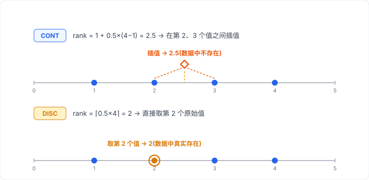
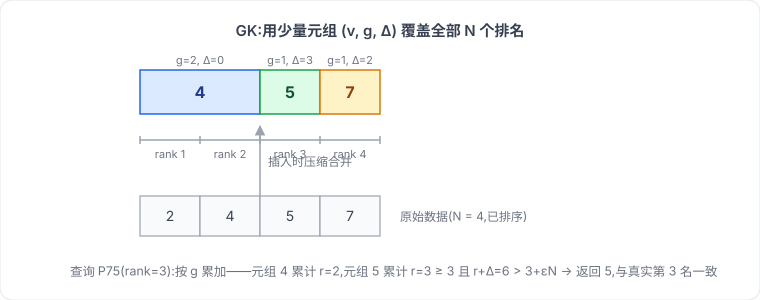
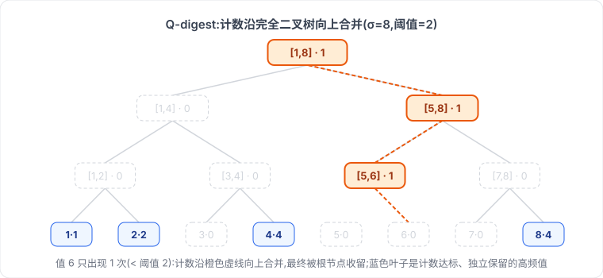
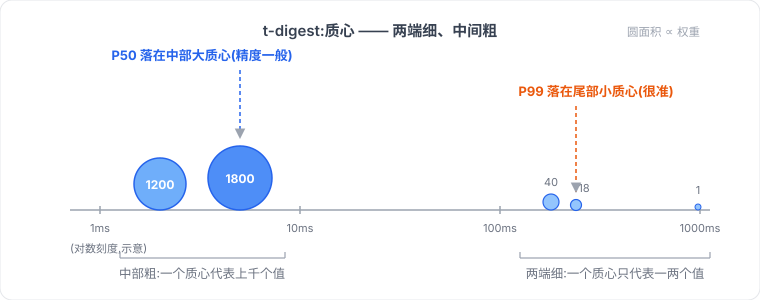
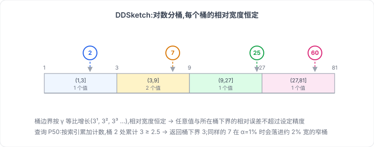
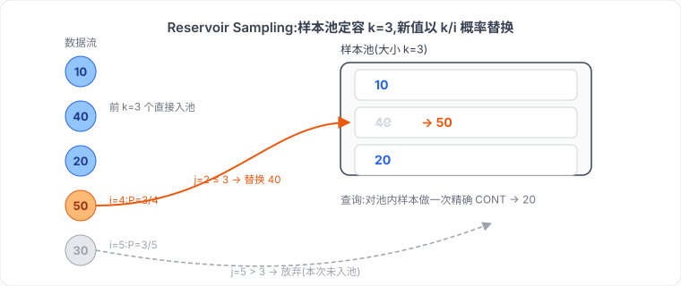

# 百分位数函数原理


百分位数是描述数据分布最常用的指标之一:P95、P99 告诉你接口长尾延迟,中位数告诉你"典型"水平。SQL 标准为精确计算提供了 `PERCENTILE_CONT` 和 `PERCENTILE_DISC`,大数据引擎则普遍内置了以 sketch 为核心的近似算法。本文从原理出发介绍这些函数与算法,给出每种算法的伪代码,并配上可以手算验证的例子。

<!--more-->

## 从一个实际需求说起

假设你在做接口监控,表里有一列 `latency_ms` 记录每次请求的耗时。产品经理说:"帮我看看 P95 是多少?"这个 P95 就是第 95 百分位数的值——把所有耗时从小到大排,排在 95% 位置上的那个数。它比 AVG 更能反映长尾:均值会被极端值拉高或拉低,而 P95 告诉你"95% 的用户感受到的延迟不超过这个数"。

标准 SQL 提供两个函数来回答这类问题:`PERCENTILE_CONT`(连续型)和 `PERCENTILE_DISC`(离散型)。当数据量大到内存装不下、或者需要分布式多节点并行时,精确算法就不够了,这时需要各数据库的近似函数。下面分别展开。

## PERCENTILE_CONT(连续型)

`CONT` 是 continuous 的缩写。它在排序后的数据上进行**线性插值**,返回值可以不是数据集中实际存在的数。

标准语法:

```sql
PERCENTILE_CONT(fraction) WITHIN GROUP (ORDER BY salary)
```

以数据 `[1, 2, 3, 4]`、p = 0.5 为例:

$$
\text{rank} = 1 + p \times (N - 1) = 1 + 0.5 \times 3 = 2.5
$$

位置 2.5 落在第 2 个值(2)和第 3 个值(3)之间,插值得到 2.5。注意这个结果**不在原始数据里**,这正是"连续"的含义——理论上可以取到排序轴上的任何一个点。

支持数据库:PostgreSQL、Oracle、SQL Server(仅窗口形式)、Snowflake、Redshift、DuckDB 等。MySQL 没有内置。

伪代码:

```text
function PERCENTILE_CONT(values, p):
    sorted = sort(values)                  # O(N log N)
    n = length(sorted)
    rank = 1 + p * (n - 1)                 # 1-based 定位
    lower = floor(rank)
    upper = ceil(rank)
    frac = rank - lower
    if lower == upper:
        return sorted[lower]               # rank 恰好是整数,无需插值
    return sorted[lower] + frac * (sorted[upper] - sorted[lower])
```

## PERCENTILE_DISC(离散型)

`DISC` 是 discrete 的缩写。它不做插值,直接返回排序后**实际存在**的那一行,取第 $\lceil p \times N \rceil$ 个值(向上取整)。

同样以 `[1, 2, 3, 4]`、p = 0.5 为例:

$$
\lceil 0.5 \times 4 \rceil = 2
$$

第 2 个值是 2,所以结果就是 2。DISC 的最大优势是可以用于**任何可排序类型**(字符串、日期),不限于数值——日期之间没法做插值,但可以比较大小。

伪代码:

```text
function PERCENTILE_DISC(values, p):
    sorted = sort(values)
    n = length(sorted)
    rank = ceil(p * n)                     # 1-based 向上取整
    return sorted[rank]
```

## CONT 与 DISC 的核心区别

以数据 `[1, 2, 3, 4]`、p = 0.5 为例:

- **CONT**:线性插值,结果 **2.5**(数据里不存在的值)
- **DISC**:取第 2 个原始值,结果 **2**(一定是数据里真实存在的值)

推广开来:

- CONT 只能用于数值列;DISC 可以对任何可排序类型(字符串、日期)求"百分位"
- 偶数个元素求中位数时,CONT 取中间两数平均,DISC 取偏小的那个
- 奇数个元素时,两者通常结果一致



## 算法的输入:批量数据与数据流

在展开近似算法之前,先明确各算法"吃什么"——精确算法和近似算法的输入模型有本质区别,这也是它们能力边界不同的根本原因。

### 精确算法:批量输入

PERCENTILE_CONT / DISC 的输入只有两个:

- **一列值**:CONT 要求可插值的数值列,DISC 接受任何可排序类型(字符串、日期)
- **分位点 p** ∈ [0, 1]

引擎拿到的是**批量数据**:必须等整列全部物化才能开始排序,排序后可以随机访问任意位置。O(N) 的内存开销、"不能边扫边出结果"的约束,都来自这个输入模型。

### 近似算法:流式输入

五种近似算法的输入则是**数据流加精度参数**:

- **单遍数据流**:值一条一条随时间到达,只能按顺序读一次,读完即忘,无法回头访问
- **精度参数**:控制摘要大小与误差上界

流式输入不是凭空设计的,它直接对应三类真实场景:

1. **监控埋点**:每个请求完成时上报一条耗时,agent 边收边喂给 sketch,内存里永远只有一个几 KB 的摘要,却能在任意时刻回答"最近这一分钟 P99 是多少"。如果要把一天的请求攒成列表再算,内存早就爆了。
2. **流式计算**:Flink / Kafka Streams 这类无限流,数据永远没有"全部到齐"的时刻——列表模型在这里根本无法定义。
3. **分布式并行**:ClickHouse / Spark 的每个节点只看到本地数据块(对单个节点而言是列表),各自维护一个 sketch,最后把所有 sketch 合并。正因为 sketch 可合并,聚合才能拆成"局部建摘要、全局并摘要"两阶段。

所以每个近似算法都只暴露三个接口:`insert(x)` 喂入一个值、`merge(other)` 合并另一个摘要、`query(p)` 查询分位点。使用方式统一长这样:

```text
sketch = TDigest(compression=100)   # 以 t-digest 为例
for value in stream:                # 每来一条喂一条
    sketch.insert(value)
sketch.query(0.99)                  # 任意时刻都能查
```

对比 CONT/DISC 的输入——引擎必须等整列物化、排序后才能给出答案:

```sql
SELECT PERCENTILE_CONT(0.5) WITHIN GROUP (ORDER BY latency_ms) FROM api_log;
```

| 算法 | 输入 | 精度参数 |
|------|------|---------|
| Greenwald-Khanna | 可比较大小的值流 | ε(排名误差上界) |
| Q-digest | 离散化到 [1, σ] 的整数流 | ε 与值域大小 σ |
| t-digest | 浮点数流 | compression(质心压缩参数) |
| DDSketch | 正数流(零与负数放独立域) | relativeAccuracy(相对精度) |
| Reservoir Sampling | 任意值流 | k(样本池大小) |

两个值得注意的输入约束:Q-digest 要求值先离散化成整数(连续值需先按精度量化);DDSketch 的误差保证只覆盖正数域,零和负数需要额外的 sketch 域。

## 近似百分位数:当数据大到内存装不下

有了流式输入模型,近似算法的思路就顺理成章了:**不保存全部数据,单遍扫描维护一个有损但可合并的摘要结构**。这个结构占用远小于 O(N) 的内存,能以可控误差回答分位数查询,并且支持两两合并,天然适合分布式。按实现思路可以分为三类:**树形摘要**(GK、Q-digest)、**直方图桶**(t-digest、DDSketch)、**采样**(蓄水池)。五种代表性算法如下。

### Greenwald-Khanna Sketch

GK 算法维护一个有序的摘要元组序列 $S = \{(v_i, g_i, \Delta_i)\}$,其中:

- $v_i$:观察到的值
- $g_i$:$v_i$ 与前一个摘要元素之间的隐含排名跨度
- $\Delta_i$:$v_i$ 在插入时可能的最大排名不确定性上界

对任意查询 p,GK 保证返回值的真实排名误差在 $\pm \varepsilon N$ 以内(ε 是精度参数,通常取 0.01)。内存占用 $O\left(\frac{1}{\varepsilon}\log(\varepsilon N)\right)$,远小于 O(N)。Spark / Hive 的 `percentile_approx` 底层就是 GK sketch。

伪代码:

```text
function GKSketch(epsilon):
    S = []                        # 有序元组列表,每项为 (v, g, delta)
    N = 0

    function insert(v):
        N += 1
        # 找到 v 应插入的有序位置,新元组 g=1, delta=floor(2*epsilon*N)
        insert (v, 1, floor(2 * epsilon * N)) into S at sorted position
        if S.size > 1 / (2 * epsilon):
            compress()

    function compress():
        # 相邻两个元组,若合并后不确定性仍在误差范围内,就合并
        for i from S.size - 2 downto 0:
            (v_i, g_i, delta_i) = S[i]
            (v_next, g_next, delta_next) = S[i + 1]
            if g_i + g_next + delta_next <= floor(2 * epsilon * N):
                S[i + 1].g += g_i
                remove S[i]

    function query(p):
        rank = p * N
        r = 0
        for (v, g, delta) in S:
            r += g
            if r + delta > rank + epsilon * N:
                return v
```

例子:数据流 `[4, 2, 7, 5]`,ε = 0.4(新元组 Δ = ⌊2εN⌋,摘要上限 1/2ε ≈ 1.25,几乎每次插入都触发压缩):

| 插入 | N | 新元组 | 压缩后的 S |
|-----|---|--------|-----------|
| 4 | 1 | (4,1,0) | [(4,1,0)] |
| 2 | 2 | (2,1,1) | [(2,1,1), (4,1,0)](无合并) |
| 7 | 3 | (7,1,2) | [(4,2,0), (7,1,2)] |
| 5 | 4 | (5,1,3) | [(4,2,0), (5,1,3), (7,1,2)] |

第 3 步的压缩:(2,1,1) 与 (4,1,0) 相邻,满足 1+1+0 ≤ ⌊2εN⌋ = 2,合并为 (4,2,0),左元组移除。查询 P75:rank = 0.75×4 = 3,阈值 = rank + εN = 4.6;逐项累加 g:(4,2,0) 处 r+Δ = 2 ≤ 4.6 继续;(5,1,3) 处 r+Δ = 6 > 4.6 → 返回 **5**。真实数据排序为 [2,4,5,7],第 3 个值正是 5,结果完全正确。



### Q-digest(GK 的离散化特化)

Q-digest 把整数离散值域 [1, σ] 均匀切分成完全二叉树的叶子,每个节点维护落入其区间的计数,再通过自底向上合并小计数节点来压缩体积。它同样保证 ±ε·N 的排名误差,分位数查询按中序遍历累加计数即可。Trino / Presto 的 `approx_percentile` 底层就是 Q-digest(源码里的 QuantileDigest)。

伪代码:

```text
function QDigest(epsilon, sigma):    # sigma = 离散化后的值域大小
    tree = 完全二叉树,sigma 个叶子,每个叶子对应值域中的一小段
    k = ceil(log(sigma) / epsilon)
    N = 0

    function insert(v):
        N += 1
        leaf(v).count += 1
        if tree.hasSmallNodes(threshold = ceil(N / k)):
            compress()

    function compress():
        # 不变量:任意内部节点的两个子节点,计数之和要么为 0,
        # 要么 >= 阈值 ceil(N / k);不满足就把子节点计数并入父节点
        for node in tree.bottomUp():
            total = node.left.count + node.right.count
            if 0 < total < ceil(N / k):
                node.count += total
                node.left.count = 0
                node.right.count = 0

    function query(p):
        rank = p * N
        r = 0
        for node in tree.inOrder():      # 按值域顺序累加各桶计数
            r += node.count
            if r >= rank:
                return node.valueRange   # 该桶的值区间即近似结果
```

例子:值域 σ = 8(叶子对应整数 1~8),ε = 0.5 → k = ⌈log₂8 / 0.5⌉ = 6,数据流 `[1,2,2,4,4,4,4,6,8,8,8,8]`(N = 12,压缩阈值 ⌈N/k⌉ = 2)。

插入完成后叶子计数:v1=1, v2=2, v4=4, v6=1, v8=4。压缩自底向上扫描:

- 节点 [5,6]:子计数 0+1 = 1 < 2 → 合并,[5,6] = 1
- 节点 [5,8]:子计数 1+0 = 1 < 2 → 合并,[5,8] = 1
- 根节点:子计数 0+1 = 1 < 2 → 合并,根 = 1

稀有值 6 没有保住自己的叶子,它的计数一路被更粗的祖先"收留"——这正是 Q-digest 压缩体积的方式。查询 P50:rank = 6,按值域顺序累加:v1 → r=1;v2 → r=3;v4 → r=7 ≥ 6 → 返回 **4**。真实数据排序后第 6 个值正是 4。



### t-digest

t-digest 把数据流压缩成几百个**质心**(centroid),每个质心记录均值和权重。关键设计:质心的分辨率不均匀——**靠近分布两端的质心更细、精度更高;中间的质心更粗**。

这个"两端细、中间粗"的设计非常契合实际需求:运维关心 P99,风控关心 P0.1,而分布中间(P30、P50)的精度要求通常没那么高。内存 O(1/压缩参数),压缩参数通常取 100-500。BigQuery 的 `APPROX_QUANTILES` 和 Snowflake 的 `APPROX_PERCENTILE` 底层是 t-digest。

伪代码:

```text
function TDigest(compression):
    centroids = []                # 每项为 {mean, weight},按 mean 有序
    N = 0

    function maxSize(centroid):
        # 估算质心所处的分位 q;越接近两端(q→0 或 q→1),
        # 允许的权重越小,质心越密、精度越高
        q = estimateQuantile(centroid)
        return max(1, N * compression * q * (1 - q))

    function insert(x):
        N += 1
        if centroids is empty:
            add {mean: x, weight: 1}
            return
        c = nearest centroid to x
        if c.weight + 1 <= maxSize(c):
            c.mean = (c.mean * c.weight + x) / (c.weight + 1)
            c.weight += 1
        else:
            insert {mean: x, weight: 1} at sorted position

    function query(p):
        target = p * N
        cumulative = 0
        for c in centroids:                     # 按 mean 升序
            if cumulative + c.weight / 2 >= target:
                return c.mean
            cumulative += c.weight
        return last centroid mean
```

例子(示意):1 万条接口耗时灌入 t-digest(压缩参数 100)后,质心列表大致长这样:

| 质心均值 | 权重 | 说明 |
|---------|------|------|
| 2ms | 1200 | 分布中部:一个质心吞掉上千个值 |
| 5ms | 1800 | 同上 |
| 180ms | 40 | 接近 P98,质心开始变细 |
| 240ms | 18 | 更细 |
| 980ms | 1 | 最尾部:一个质心只代表一两个值 |

查询 P99:按均值顺序累加权重,累计到 9900 时正好落在 240ms 质心附近 → 返回约 240ms。中部的质心每个代表上千个值(粗),尾部的质心每个只代表一两个值(细)——这就是"两端细、中间粗"的具体形态,也是 t-digest 敢保证尾部精度的原因。



### DDSketch(值相对误差保证)

GK 和 Q-digest 保证的是**排名误差**(±ε·N),但排名误差不等于值误差:如果 99% 的请求都是 1ms、1% 是 1000ms,±1% 的排名误差可能让 P99 在 1 和 1000 之间跳。DDSketch(Datadog 开源)换了一个角度——直接保证**返回值的相对误差**:返回的 P99 与真实 P99 相差不超过设定的相对精度。

实现上采用对数分桶:桶的宽度与值本身成正比,同一个桶内任意值的相对误差恒定,因此只需维护桶索引到计数的映射,内存与数据量 N 无关。这使得 DDSketch 特别适合监控场景——Datadog、OpenTelemetry 的分位数指标底层就是它。Java 生态的 HdrHistogram 是它的固定数组变体:用两层索引(量级桶 + 桶内线性细分)替代哈希表,换取零分配的极致写入速度。

伪代码:

```text
function DDSketch(relativeAccuracy):
    gamma = (1 + relativeAccuracy) / (1 - relativeAccuracy)
    buckets = Map()              # 桶索引 -> 计数
    count = 0

    function bucketIndex(x):
        # 对数分桶:桶宽度与值成正比,桶内相对误差恒定
        return ceil(log(x) / log(gamma))

    function insert(x):
        count += 1
        buckets[bucketIndex(x)] += 1

    function merge(other):       # 分布式两阶段聚合的核心
        for (idx, c) in other.buckets:
            buckets[idx] += c
        count += other.count

    function query(p):
        target = p * count
        r = 0
        for idx in buckets.keys() sorted ascending:
            r += buckets[idx]
            if r >= target:
                return gamma^(idx - 1)   # 桶左端点,相对误差 <= relativeAccuracy
```

例子:relativeAccuracy = 0.5 → γ = (1+0.5)/(1−0.5) = 3,数据流 `[2, 7, 25, 60, 7]`。每个值的桶索引 = ⌈log₃x⌉:

- 2 → ⌈0.63⌉ = 1;7 → ⌈1.77⌉ = 2;25 → ⌈2.93⌉ = 3;60 → ⌈3.73⌉ = 4

桶计数:{1: 1, 2: 2, 3: 1, 4: 1}。查询 P50:目标秩 2.5,按索引累加计数,桶 2 处达到 3 ≥ 2.5 → 返回桶 2 的下界 **3**(桶 2 覆盖 (3, 9])。真实中位数是 7,相对误差 57%——α=50% 本来就是粗粒度演示;生产上取 α=1%(γ≈1.02,桶宽约 2%),同样的 7 会落进 (6.86, 7.00] 这样的窄桶,误差不超过约 2%。



### Reservoir Sampling(蓄水池采样)

ClickHouse 的 `quantile` 默认用蓄水池采样:维护一个固定大小(默认 8192)的样本集,流式扫描时按概率替换旧样本,扫完后在样本集上做精确分位数计算。

优点:实现极简,速度极快。缺点:**没有严格的误差保证**,对尾部百分位(P99、P99.9)的偏差可能比较大,因为极端值本来就少,被采样到的概率低。

伪代码:

```text
function ReservoirSampler(k):       # k = 样本池大小
    reservoir = []
    count = 0

    function insert(x):
        count += 1
        if count <= k:
            reservoir.append(x)             # 前 k 个直接放入
        else:
            j = random(1, count)            # 均匀取 [1, count] 的整数
            if j <= k:
                reservoir[j - 1] = x        # 以 k/count 概率替换

    function query(p):
        # 样本池上跑一次精确计算
        return PERCENTILE_CONT(reservoir, p)
```

例子:k = 3,数据流 `[10, 40, 20, 50, 30]`:

- 前 3 个直接入池:[10, 40, 20]
- 第 4 个(50):j = random(1, 4),设抽到 2 → 替换池中第 2 个 → [10, 50, 20]
- 第 5 个(30):j = random(1, 5),设抽到 5 > 3 → 不替换 → [10, 50, 20]

查询 P50:对池内 [10, 20, 50] 做一次精确 CONT → **20**。真实全量 P50 是 30——换一组随机数结果就不同。蓄水池采样只保证每个值以 k/N 的概率入池,不提供误差界,这就是它"快但无保证"的具体含义。



## 小结

| 算法 | 精确性 | 内存 | 误差保证 | 代表实现 |
|------|-------|------|---------|---------|
| PERCENTILE_CONT | 精确 | O(N) | 无误差 | PostgreSQL / Oracle / DuckDB |
| PERCENTILE_DISC | 精确 | O(N) | 无误差 | PostgreSQL / Oracle / DuckDB |
| Greenwald-Khanna | 近似 | $O(\frac{1}{\varepsilon}\log(\varepsilon N))$ | ±ε·N 排名误差 | Spark `percentile_approx` |
| Q-digest | 近似 | O(log²σ/ε) | ±ε·N 排名误差 | Trino `approx_percentile` |
| t-digest | 近似 | O(1/压缩参数) | 尾部精度高 | BigQuery / Snowflake |
| DDSketch | 近似 | 与数据量无关 | 返回值相对误差可控 | Datadog / OpenTelemetry |
| Reservoir Sampling | 近似 | O(样本池大小) | 无严格保证 | ClickHouse `quantile` |

精确场景用 CONT/DISC,大数据量、能容忍 ~1% 误差、尤其关心 P95/P99 尾部指标时用近似函数——它们能把内存从 O(N) 降到常数级,还能在分布式引擎里边扫描边聚合。GK、Q-digest、t-digest、DDSketch 的摘要都可以直接合并且误差保证不变,这是它们在分布式场景下受青睐的根本原因;而 reservoir sampling 合并两个样本池等价于再做一次采样,误差会退化。

