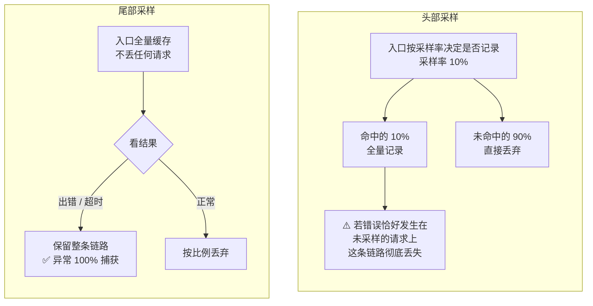
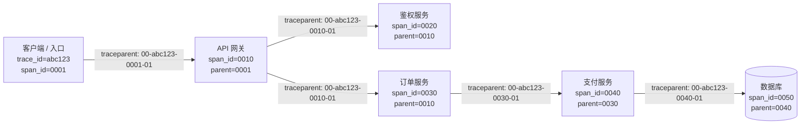
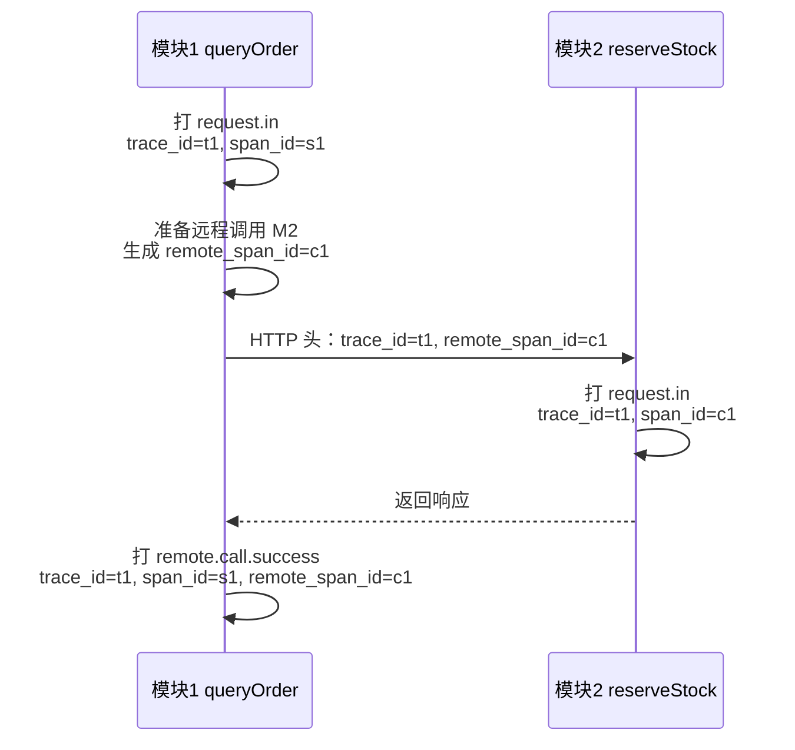
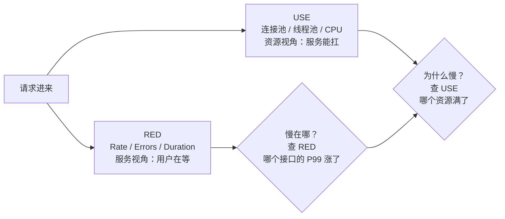
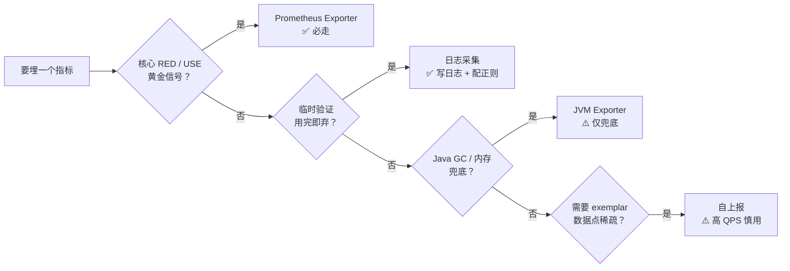
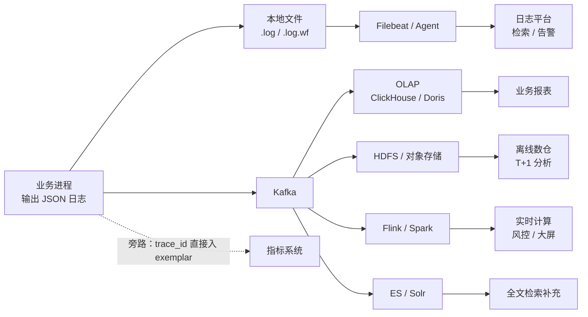
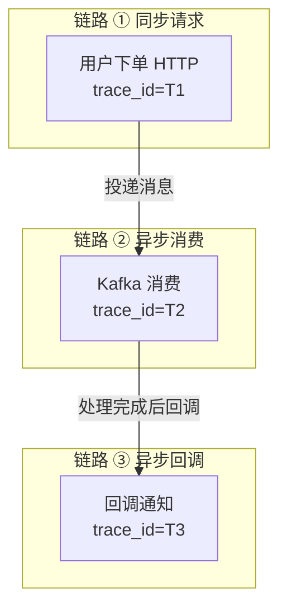
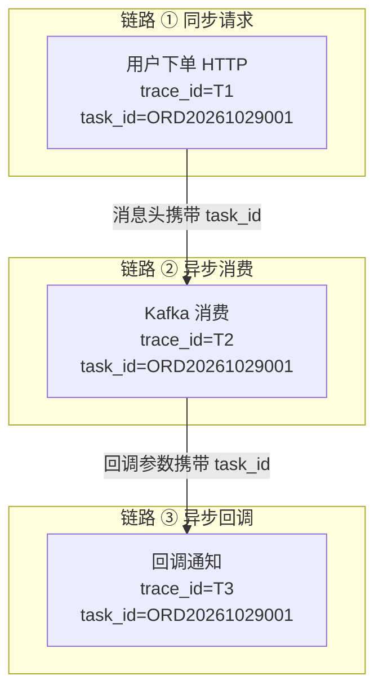
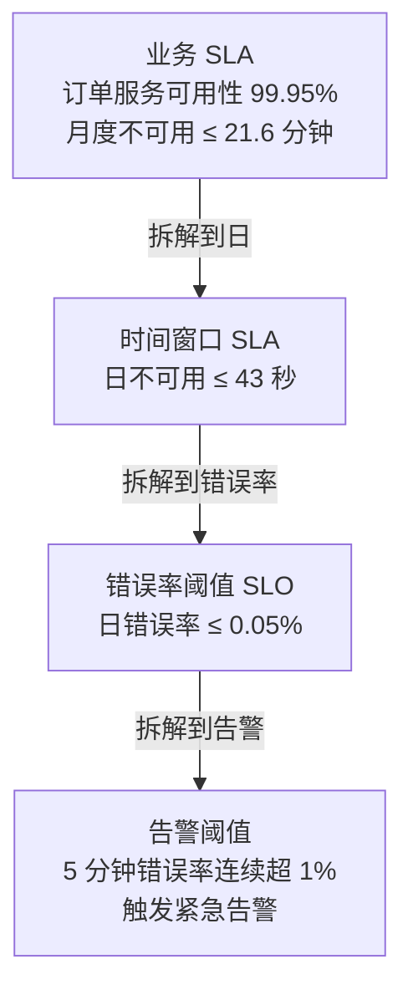
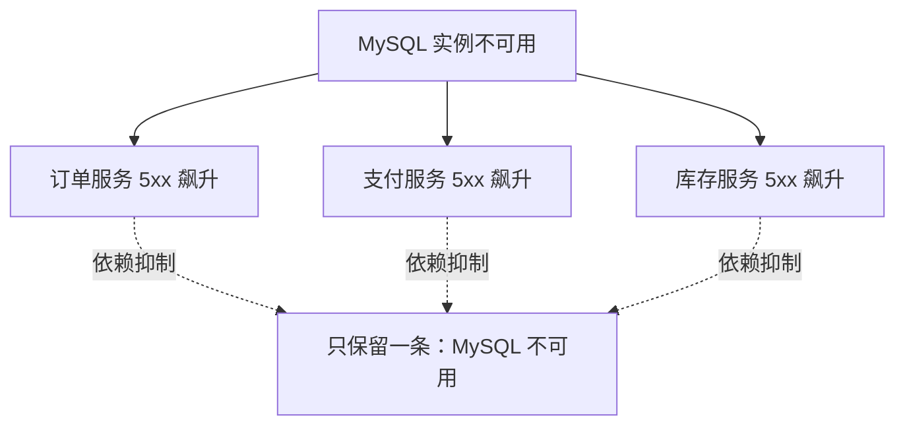

# 可观测性三支柱：链路追踪、指标与日志的落地实践


很多团队做可观测性，第一步都做错了：接了监控大盘、配了告警、装了日志采集 agent，然后 incident 一来，翻遍十几个界面也说不清"到底是哪一环坏了"。

问题不在于工具不够多，而在于**三大支柱没有被当成一套东西来设计**。Metric 告诉你哪里坏了，Trace 告诉你坏在哪一环，Log 告诉你坏在什么代码上——但如果它们之间没有共享的标识符和字段契约，三张数据就只是三张互不相干的数据表。

这篇讲的是怎么把这三者真正打通：从链路追踪的数据模型，到日志的字段契约，到异步场景的关联标识，最后到告警阈值怎么从业务 SLA 一层层推出来。第七章会用一次真实故障的定位流程，把所有零件串起来走一遍。

<!--more-->

## 一、为什么需要可观测性

先把"可观测"和"监控"的区别说清楚，这两个词经常被混着用，但解决的是两类不同的问题。

**监控**是提前想好要盯哪些指标，异常了就报警。它擅长处理**可预知的故障**——磁盘满了、进程挂了、QPS 掉了。

**可观测性**处理的是另一类问题：**没人预料到的故障**。比如"某个租户在某个接口上变慢了"——这个指标你事前根本想不到要盯，但它正在实实在在损害用户。监控在这时会一片安静，可观测性却能顺着遥测数据把问题挖出来。

一句话：**监控告诉你"有事发生"，可观测性告诉你"发生了什么、为什么"。** 两者互补而非替代——只有监控的团队，会在半夜被自己没设过的告警打脸。

单体应用时代，"服务挂了"基本等于"问题清楚了"——重启就能解决大半故障。但云原生 + 微服务架构下，一个用户请求可能穿越网关、鉴权、业务、缓存、消息队列、数据库等十余个服务。任何一环出问题都可能引发雪崩，而 CPU/内存/磁盘这些基础指标往往是"正常"的，错误日志也可能根本看不到。

这就是经典的"凌晨三点支付失败"：所有仪表盘都是绿的，客服却在投诉。

> **可观测性（Observability）** 源自控制理论，指通过系统外部输出推断其内部状态的能力。它要求系统不仅"可监控"，还要"可提问"——任何线上问题都能通过遥测数据快速回答"为什么发生"。

业界共识的可观测性由三大支柱构成：**Tracing（链路追踪）**、**Metric（指标）**、**Log（日志）**。三者各有分工、相互补充，缺一不可。

先给出本文的整体地图，方便你按需跳转：

| 层次 | 回答的问题 | 核心标识 | 本文对应章节 |
|---|---|---|---|
| **Tracing** | 问题出在哪个环节？瓶颈在哪？ | `trace_id` / `span_id` | 第二章 |
| **Metric** | 系统健康吗？哪里异常？ | 指标名 + 标签 | 第三章 |
| **Log** | 发生了什么？具体错在哪行代码？ | `trace_id` + `task_id` | 第四章 |
| **串联层** | 怎么把三者连起来？ | `trace_id` + `task_id` | 第五章 |
| **告警层** | 什么时候该响？响给谁？ | 阈值 + 级别 | 第六章 |
| **实战层** | 一次真实故障怎么定位？ | 三者配合 | 第七章 |

## 二、Tracing：分布式链路追踪

### 2.1 核心数据模型

Tracing 的全部概念都建立在三个名词上：

| 概念 | 定义 | 标识 |
|---|---|---|
| **Trace** | 一次端到端业务请求的完整调用链 | 全局唯一 `trace_id`，整条链路保持不变 |
| **Span** | 调用链中的一个工作单元（一次 HTTP 调用、一次 SQL、一个函数） | 每个 Span 有唯一 `span_id`，并记录父 `span_id` |
| **SpanContext** | 跨进程传播的上下文（`trace_id` + `span_id` + Trace Flags） | 通过协议头传播 |

Span 之间形成树状父子结构，还原调用的先后与嵌套关系。

### 2.2 采样策略

全量追踪每个请求成本过高（存储 + 网络），所以生产环境几乎一定会采样：

- **头部采样（Head-based）**：在入口处决定是否采样。实现简单，但会丢失尾部异常——请求进来时一切正常，出错在下游，采样率一低，这条链路可能根本没被记录。
- **尾部采样（Tail-based）**：先全量缓存，再根据错误/延迟决定保留。能精准捕获异常链路，但实现复杂、延迟高、内存开销大。
- **优先级采样**：关键链路全采、普通链路按比例。实践中往往是它的变体——给高价值业务路径单独设置采样率。



一句话对比：**头部采样省钱但可能把事故现场一起扔了，尾部采样保现场但要自己扛住全量流量。**

### 2.3 主流实现

| 项目 | 特点 |
|---|---|
| **OpenTelemetry** | CNCF 毕业项目，统一 traces/metrics/logs 三大信号的采集标准 |
| **Jaeger** | Uber 开源，CNCF 毕业，支持多种后端存储 |
| **Zipkin** | Twitter 开源，轻量，最早的链路追踪系统之一 |
| **SkyWalking** | Apache 顶级项目，对国产中间件适配较好 |

### 2.4 上下文传播：W3C Trace Context

链路能串起来的前提是上下文能跨进程传出去。当前的行业标准是 **W3C Trace Context**，核心就是 `traceparent` 这个 HTTP 头：

```
traceparent: 00-<trace-id>-<span-id>-<flags>
```

例如 `traceparent: 00-4bf92f3577b34da6a3ce929d0e0e4736-00f067aa0ba902b7-01`，其中 `00` 是版本号、`01` 表示"本链路被采样"。

一次典型的调用链长这样：



图里有三个关键点：

- **入口**生成 `trace_id` 与根 `span_id`，写入 `traceparent` 头。
- **跨服务调用**时 `trace_id` 始终不变，`span_id` 在每个服务重新生成，并通过 `parent_id` 串联父子关系。
- **同一请求**在所有服务里共享同一个 `trace_id`，这是后续与 Metric、Log 关联的"身份证"。

Span 树可以直接渲染成火焰图：每个 Span 的宽度即耗时占比，瓶颈一眼可见。

### 2.5 OpenTracing：厂商中立的 API 标准

[OpenTracing](https://opentracing.io/docs/overview/) 是 CNCF 制定的**厂商中立**的链路追踪 API 标准。它在 2019 年与 OpenCensus 合并成 OpenTelemetry，并于 2022 年 1 月正式归档，但它的概念模型至今仍是行业共识。

它回答的核心问题是：**怎样让一套埋点代码不绑定任何后端**，从而可以在 Jaeger、Zipkin、Datadog、SkyWalking 之间无缝切换。

#### 2.5.1 四大组成

一个完整的链路追踪系统由四部分组成，OpenTracing 只对前两者做标准化：

| 组成 | 职责 | OpenTracing 是否标准化 |
|---|---|---|
| **Instrumentation API** | 在业务代码里埋点 | ✅ 标准 API |
| **Wire Protocol** | 跨进程传输的协议头（如 `traceparent`、B3） | ❌ 由具体实现决定 |
| **Data Protocol** | 把 span 异步上报到后端的格式（Thrift、protobuf、OTLP） | ❌ 由具体实现决定 |
| **Analysis System** | 后端的存储 + 查询 + 可视化 UI | ❌ 由具体实现决定 |

> **关键启示**：OpenTracing 不解决"如何传输"，只解决"如何埋点"。这也解释了后来业界为什么把"传输协议 + 数据协议"统一收敛到了 OpenTelemetry 的 OTLP。

#### 2.5.2 核心 API 形态

```python
# 伪代码：OpenTracing 风格的 API 抽象
with tracer.start_span("http_request") as span:
    span.set_tag("http.method", "GET")
    span.set_tag("http.url", "/api/orders")
    span.log_kv({"event": "request_received", "uid": 12345})

    carrier = {}
    tracer.inject(span.context, Format.HTTP_HEADERS, carrier)
    # carrier 现在是 {"traceparent": "00-abc...-001-01"}

    response = downstream.call(headers=carrier)

    span.set_tag("http.status_code", response.status)
```

这套 API 的精髓在于：**业务代码只依赖 `tracer` 接口，不依赖任何具体后端**。后端从 Jaeger 换到 Tempo，业务代码一行都不用改。

### 2.6 日志与 Trace 的字段契约

上面讲的是"应该怎么做"，但落到生产里，**日志规范才是 trace 能不能用的关键**。因为 trace 数据只有"和日志长在一起"才能被搜索、被定位、被告警。

这一节给出一套可以直接落地的字段契约。它不绑定任何厂商——无论是自研日志平台还是 Loki/ELK，字段约定都是一样的。

#### 2.6.1 事件类型标签

每条业务日志必须打一个**事件类型标签**（event tag），用来表达这条日志的语义。系统根据标签决定后续走链路检索、日志分析、服务画像还是告警。

常用的标签类型：

| 事件标签 | 含义 |
|---|---|
| `http.request.in` | 当前接口入口（收到请求） |
| `http.request.out` | 当前接口出口（返回响应） |
| `remote.http.success` / `remote.http.failure` | HTTP 远程调用 |
| `remote.rpc.success` / `remote.rpc.failure` | RPC 远程调用（Dubbo / Thrift 等） |
| `db.mysql.success` / `db.mysql.failure` | MySQL 调用 |
| `cache.redis.success` / `cache.redis.failure` | Redis 调用 |

> **落地启示**：分类标签让日志从"自由文本"变成"结构化事件"。同一个 trace 在不同模块、不同 RPC 框架下都有对应标签，下游系统可以按标签统计接口画像、按标签配告警规则。

#### 2.6.2 三个 ID 的分工

每个事件标签都强制要求打出一组字段，这是 trace 能串联的"最小公约数"：

- `trace_id`：32 位 hex，全链路透传（同一个请求经过所有模块都是同一个值），**必须**字段，不可缺。
- `span_id`：16 位 hex，**当前模块内部**所有日志都用同一个 `span_id`。
- `remote_span_id`：**本次远程调用**新生成的 span id。上游把它通过协议头传给下游，下游把它**当作自己的 `span_id` 来使用**。

这里第三个别扭的约定值得展开讲，它是"日志也能串链路"的关键。

#### 2.6.3 跨服务串联：按值 join

标准做法（OpenTelemetry）是下游为每次调用创建**子 Span**，`parent_span_id` 指向上游的 `span_id`，这样得到一棵标准的 Span 树，代价是检索时要沿着树一层层遍历。

而日志平台更擅长的是**单字段等值查询**。于是有了另一种思路：上游在发起远程调用时，为这次调用生成一个新的 `remote_span_id`，通过协议头传下去；下游收到后，**直接把它当成自己的 `span_id` 用**。



**串联查询怎么写**：找 `trace_id=t1` 的所有日志 → 看到模块 1 的 `remote_span_id=c1` → 再找 `span_id=c1` 的日志 → 这些就是模块 2 的日志。上下游因为"同一个 ID 值"自然 join 起来了。

**代价也要说清楚**：下游丢掉了"自己独立的 span"。如果下游还要继续调下游（C），C 会再生成新的 `remote_span_id` 给 D，整条链路呈**单向链表**而不是 Span 树。所以这套方案适合"日志检索优先、火焰图次要"的场景；如果要做精细的火焰图分析，就应该老老实实走标准 Span 树，把"值 join"只用在日志侧。

#### 2.6.4 一条容易踩的坑

**绝对不能把自己的 `span_id` 直接透传给下游。** 否则下游会被错误地归到同一个 span 上——链路会"平"掉，多个模块的日志挤在一个 span 里，既画不出树，也定位不到具体是谁慢。

记忆口诀很简单：**`span_id` 是"自家的事"，`remote_span_id` 是"给下游的接力棒"，接力棒一到下游手里就变成下游的 `span_id`。**

#### 2.6.5 字段契约速查

把上面的约定提炼成可执行的清单：

1. `trace_id` **全链路保持一致**，贯穿入口到所有下游。
2. `span_id` **在单个模块内固定不变**，但**绝对不能透传给另一个模块**。
3. **每次远程调用都生成新的** `remote_span_id`（由上游生成），并通过协议头（HTTP Header / RPC 上下文 / 附件）传给下游。
4. **下游收到后直接把它当作自己的** `span_id`，上游出站日志的 `remote_span_id` 与下游入站日志的 `span_id` 字段值相同，单字段等值查询即可串联。
5. **每个事件标签的必选项必须全打**，缺字段会导致链路检索、接口画像、告警全部失效。
6. `uri` **表示当前接口**、`target_uri` **表示下游接口**（A → B 调用时 `uri=A, target_uri=B`），且不要把参数塞进 path，必须用 `param` 字段。
7. **业务错误用** `error_code` **区分**；**RPC 调用失败**才打 `_failure` 类标签，**业务失败仍打** `_success` 类标签。
8. `duration` **必须带单位**（`ms` / `us` / `ns` / `s`），否则下游按默认单位解析会算错。
9. 敏感信息（账号、密码、手机号、邮箱）**严禁打到日志里**。

完整日志样例：

```plaintext
[INFO][2026-10-29T14:55:11.051+0800][order/service.py:147] http.request.out||trace_id=000102035ba1f2c8569d6e||span_id=00000202396480a9||uri=/getuser||remote=127.0.0.1||duration=1 ms||error_code=0
```

#### 2.6.6 落地启示

这套规范给我们的最大启示不是字段名，而是"**日志即 trace"的设计哲学**：

- **trace 数据不能脱离日志单独存在**——只有 trace 的 span、没有对应的业务日志，定位故障时仍然看不到上下文。
- **跨语言、跨 RPC 框架必须统一字段**——同一个 `trace_id` 必须在 HTTP、RPC、MySQL 之间无缝传递。
- **事件标签是可观测性的"数据契约"**——下游所有分析系统（接口画像、告警、监控）都依赖它做分类和聚合。
- **业务代码要承担一部分责任**——`trace_id` 不会自己传播，必须由框架（HTTP Client / RPC Stub / Filter）在调用前后自动注入和提取。

## 三、Metric：指标

### 3.1 四种核心类型

以 Prometheus 为例：

| 类型 | 特征 | 典型场景 | PromQL 常用函数 |
|---|---|---|---|
| **Counter** | 单调递增，只能归零 | 请求总数、错误总数、消息处理数（命名通常带 `_total`） | `rate()`, `increase()`, `topk()` |
| **Gauge** | 可增可减，反映瞬时状态 | CPU/内存使用率、队列长度、在线连接数 | `delta()`, `deriv()`, `predict_linear()` |
| **Histogram** | 在客户端按桶采样，可服务端聚合分位数 | 请求延迟、响应大小 | `histogram_quantile()` 算 P99 |
| **Summary** | 客户端计算分位数，服务端不可聚合 | 单一实例的精确 P99（牺牲聚合能力） | 直接读取 quantile 标签 |

Histogram 和 Summary 的取舍值得强调：**需要跨实例聚合分位数，就只能用 Histogram**。Summary 在客户端算好分位数，多实例合并时数学上没有意义。

### 3.2 两种经典方法论

- **RED 方法**（来自 Weaveworks），适合**服务**视角；
- **USE 方法**（来自 Brendan Gregg），适合**资源**视角。

**RED**：

- **R**ate：每秒请求数（Counter + `rate`）
- **E**rrors：每秒错误数（Counter + 错误标签）
- **D**uration：请求耗时分布（Histogram）

**USE**：

- **U**tilization：资源使用率（Gauge，如 CPU%）
- **S**aturation：饱和度（Gauge，如队列长度）
- **E**rrors：错误事件计数（Counter）

> 实战中通常组合使用：服务层看 RED，资源层看 USE。

#### 3.2.1 RED 方法实战：HTTP 请求监控

RED 是**每个对外 HTTP 接口的标配**，下面以 `/api/orders` 接口为例：

```promql
# Rate（每秒请求数，按 uri 分组）
sum by (uri) (rate(http_requests_total{service="order-svc"}[1m]))

# Errors：HTTP 层错误（5xx）
sum by (uri) (
  rate(http_requests_total{service="order-svc",status=~"5.."}[1m])
)

# Errors：业务层错误（业务错误码非 0）
sum by (uri) (
  rate(http_requests_total{service="order-svc",error_code!="0"}[1m])
)

# 错误率
sum by (uri) (rate(http_requests_total{service="order-svc",status=~"5.."}[1m]))
/
sum by (uri) (rate(http_requests_total{service="order-svc"}[1m]))

# Duration（P50 / P95 / P99 延迟）
histogram_quantile(0.50, sum by (le, uri) (rate(http_request_duration_seconds_bucket[5m])))
histogram_quantile(0.95, sum by (le, uri) (rate(http_request_duration_seconds_bucket[5m])))
histogram_quantile(0.99, sum by (le, uri) (rate(http_request_duration_seconds_bucket[5m])))
```

**关键设计**：

- `uri` 维度必须打，否则聚合出来全是"服务整体"，**慢接口无法定位**。
- `status` 和 `error_code` 双标签：错误既要看 HTTP 状态码，也要看业务错误码——业务失败 ≠ RPC 失败。
- Duration 一定用 Histogram（按分桶采样），不要用 Gauge。"平均延迟"会掩盖长尾。

#### 3.2.2 USE 方法实战：数据库连接池监控

USE 监控的是**资源被消耗得有多狠**，下面以 JDBC / HikariCP 连接池为例：

```promql
# Utilization（连接池使用率 = active / max）
db_connection_pool_active / db_connection_pool_max

# Saturation（饱和度：等待获取连接的请求数）
db_connection_pool_waiting_threads

# Saturation 衍生指标：等待耗时 P99（线程等连接等了多久）
histogram_quantile(0.99,
  sum by (le) (rate(db_connection_acquire_seconds_bucket[5m]))
)

# Errors（获取连接失败的次数）
rate(db_connection_acquire_failures_total[1m])
```

**关键设计**：

- **Utilization 是"平均"，Saturation 才是"危险信号"**。连接池平均使用率 50% 时，如果突发流量让 100 个请求同时等连接，其实已经濒临崩溃——只看 Utilization 抓不到。
- **等待耗时比 Utilization 更敏感**。连接池打满前，**获取连接的时间会先变长**（Histogram 的 P99 上涨），所以这个指标比"使用率"更早预警。
- 对应到告警：Utilization > 80% 触发 P2、Saturation（waiting > 0 持续 1 分钟）触发 P1、获取连接失败触发 P0。

#### 3.2.3 RED 与 USE 的协作



> **实战口诀**：**RED 找问题，USE 找根因**。一个慢接口（RED 告警）可能由多种资源瓶颈（USE 监控）导致，必须两层都有才能定位。

### 3.3 四大黄金信号（Google SRE）

- **Latency**：服务响应延迟
- **Traffic**：单位时间请求量
- **Errors**：失败率
- **Saturation**：饱和度（最逼近极限的资源占用）

### 3.4 主流实现

| 项目 | 特点 |
|---|---|
| **Prometheus** | CNCF 毕业，云原生事实标准，Pull 模型 + PromQL |
| **InfluxDB** | 高写入吞吐，适合时序密集场景 |
| **VictoriaMetrics** | 与 Prometheus 兼容，存储成本显著降低 |
| **OpenTelemetry Metrics** | 标准化采集，后端可对接任意时序库 |

### 3.5 指标采集方式的选型

核心指标永远走 Prometheus 生态，但具体怎么把指标"塞"进监控系统，有几种常见路子，各有取舍：

| 方式 | 接入难度 | 性能开销 | 扩展性 | 典型场景 |
|---|---|---|---|---|
| **Prometheus HTTP Exporter** | 低（语言官方 SDK） | 低（进程内计算，HTTP 暴露 `/metrics`） | ✅ 高（任何 Prometheus 客户端都行） | 核心接口 QPS、延迟 P99、错误率 |
| **JVM Exporter**（插件或 jar） | 中（需配置插件或依赖） | 低 | ❌ 差（插件写死、难自定义指标） | Java 进程的存活、fgc/ygc、内存分区 |
| **日志采集**（平台侧解析日志生成指标） | 极低（写一行带关键字段的日志，配正则） | 低（由日志路径解析） | 中（可任意配正则与标签，但只能聚合） | 临时、业务场景、流式统计 |
| **自上报**（HTTP push 到 agent/collector） | 低（HTTP POST） | ⚠️ 高（每条数据点都走网络，QPS 越大越费） | ✅ 高（可任意定义 metric） | exemplar 关联 trace；多机房自定义点 |

逐条说清楚：

**Prometheus HTTP Exporter**——服务暴露 `/metrics`，监控平台通过 PromQL 拉取和查询，后续可在平台上做复杂聚合、跨曲线计算。这是**少数能直接使用 PromQL 写报警曲线**的接入方式。

需要注意标签值的转义问题：部分监控平台在写查询语句时会对标签值做转义（`:` `=` `,` 会被转义成 `\_`），标签设计时避开这些字符能少踩坑。

**日志采集**——直接在业务日志里打印关键字段，然后在监控平台配置一条"日志采集"规则：写正则抓取字段、选择计算方法（avg / count / sum / max / min）、配置标签。生成的指标通常统一带 `LOG.` 前缀。

优势是**不用改代码、不引入 SDK、不重启服务**，配完即可生效。适合临时验证、AB 效果、业务流式指标这类**用完即弃**的场景。

**JVM Exporter**——接入形态有插件和独立 jar 包两种，主要暴露存活、fgc/ygc、各分区内存。这些 JVM 通用指标**够用但不好扩展**：插件写死，想加自定义指标很难。

建议只作为 Java 服务的"基础健康兜底"，不要把它当成业务监控的主路径。

**自上报**——本机 agent 模式或中心收集器模式（适合高 QPS 场景）。优势是灵活、可加 exemplar（带 `trace_id` / `span_id` 直接关联链路）。但**每条数据点都是一次 HTTP 调用**，高 QPS 场景下会吃掉可观的应用 CPU 和网络带宽。

另外，单指标可容纳的曲线（time series）数量通常有配额上限，超限后平台会按周期把上报数据降采样到固定条数，导致业务"**看不见"自己想看的指标**。所以仅在确实需要 exemplar 关联、且数据点稀疏（秒级以下）的场景使用。

### 3.6 一个必须提前知道的坑：标签基数爆炸

Prometheus 里，每一条时间序列都由"指标名 + 一组标签"唯一确定。**标签组合数就是曲线数**：

```plaintext
http_requests_total{service="order-svc",uri="/api/orders",method="GET",status="200"}
http_requests_total{service="order-svc",uri="/api/orders",method="POST",status="200"}
```

这看起来还好。但如果有人顺手把 `user_id` 也打成了标签：

```plaintext
http_requests_total{service="order-svc",uri="/api/orders",user_id="10086"}
```

那每个用户一条曲线。1000 QPS 的服务，一天就是 **8640 万条曲线**，存储和内存直接被打爆——这是指标系统最经典的自伤方式。

**三条规则**：

- 指标标签只用**低基数**维度：服务名、接口名、方法、状态码、错误码
- **绝不**把 `user_id`、`order_id`、`trace_id`、客户端 IP 这类高基数值当指标标签
- 高基数值应该放进**日志字段**，或者用 **exemplar**（见 §5.2）做样本引用，而不是标签

如果历史上已经打错了，Prometheus 侧可以用 relabel 规则在抓取阶段丢弃高基数标签——但更好的做法永远是从源头不埋。

### 3.7 采集方式决策树



> **经验之谈**：团队刚开始做监控时，**先把 Prometheus Exporter 跑通**——核心接口的 QPS、P99、错误率各一个就够，其它诉求都用日志采集满足。只有当日志采集的性能或聚合能力不够时，才考虑自上报，而且要严格评估数据点规模和 RPS。

## 四、Log：日志

### 4.1 结构化 vs 非结构化

```plaintext
# 非结构化（难以解析）
2026-08-19 10:23:45 ERROR user login failed for uid=12345, ip=10.0.0.1
```

```json
// 结构化（推荐）
{
  "ts": "2026-08-19T10:23:45.123Z",
  "level": "ERROR",
  "service": "user-svc",
  "trace_id": "4bf92f3577b34da6a3ce929d0e0e4736",
  "span_id": "00f067aa0ba902b7",
  "uid": 12345,
  "ip": "10.0.0.1",
  "msg": "login failed",
  "err": "invalid token"
}
```

> **关键结论**：可观测性的前提是"结构化"。JSON（或 logfmt）能让日志与 `trace_id` / `span_id` 等维度天然衔接，下游聚合系统才能高效索引和过滤。

### 4.2 日志字段契约

具体怎么写一条能被链路检索、接口画像、告警都消费的结构化日志？这里给出一套通用的三段式 KV 格式规范，很多团队的自研日志平台用的都是类似约定。

> 不规范的日志会让链路检索、日志分析、服务画像、告警、监控**全部失效**。这一节是把 2.6 节的"链路串联"前置到日志侧：日志本身就是链路数据的载体。

#### 4.2.1 三段式格式

每条落盘日志由**三段**拼接而成：

```plaintext
[日志级别][时间戳][扩展区域] event||key1=value1||key2=value2||key3=value3
└──── 固定头 ─────┘ └ event ┘ └──── KV 列表（双竖线分隔）─────────┘
```

- **固定头**：包含 `[日志级别]` `[时间戳]` `[扩展区域]`，三个中括号之间无空格。
- **事件标签**：表达这条日志含义的分类标签（如 `http.request.in`），与固定头之间有且仅有一个空格。
- **KV 列表**：每个 kv 之间用双竖线 `||` 分隔，`key=value` 形式；`value` 中不能再含 `||`，`key` 之间不能重复。

典型样例：

```plaintext
[INFO][2026-10-29T00:00:07.099+0800][com.example.handler.DataApi:212] http.request.in||trace_id=000102035ba1f2c8569d6e||span_id=00000202396480a9||uri=/getuser
```

#### 4.2.2 时间戳格式

线上推荐使用带时区的 ISO 格式，可被多种采集器自动解析：

| 格式 | 样例 |
|---|---|
| `yyyy-MM-dd HH:mm:ss` | 2026-10-29 15:19:25 |
| `yyyy-MM-dd HH:mm:ss.SSS` | 2026-10-29 15:19:25.089 |
| `yyyy-MM-ddTHH:mm:ss.SSS+0800` | 2026-10-29T15:19:25.089+0800 |
| 毫秒时间戳 | 1793362765089 |

#### 4.2.3 日志文件命名与滚动

- 普通日志：`{file_name}.log`
- 错误日志：`{file_name}.log.wf`（仅错误级别）
- 滚动后：`{file_name}.log.2026102914`（`yyyyMMddHH` 格式的时间戳后缀）
- 单条日志建议**不超过 1MB**，超过会被采集端截断
- 敏感信息（账号、密码、手机号、邮箱）**严禁打到日志里**

#### 4.2.4 事件标签与必打字段

事件标签是日志体系的"骨架"。每种标签都有**强制的必打字段**，缺一个就视为不规范日志，对应的链路检索、接口画像、告警全部失效。

| 事件标签 | 含义 | 基础必选项（缺一不可） |
|---|---|---|
| `http.request.in` | 当前接口入口（收到请求） | `trace_id`、`span_id`、`uri` |
| `http.request.out` | 当前接口出口（返回响应） | `trace_id`、`span_id`、`uri`、`duration`、`error_code` |
| `remote.http.success` / `remote.http.failure` | 远程 HTTP 调用 | `trace_id`、`span_id`、`remote_span_id`、`uri`、`target_uri`、`duration`、`error_code`、`service_name` |
| `remote.rpc.success` / `remote.rpc.failure` | 远程 RPC 调用 | 同上 |
| `db.mysql.success` / `db.mysql.failure` | MySQL 调用 | `trace_id`、`span_id`、`uri`、`method_name`、`duration`、`error_code` |
| `cache.redis.success` / `cache.redis.failure` | Redis 调用 | `trace_id`、`span_id`、`uri`、`method_name`、`duration`、`error_code` |

字段约束细节：

- `trace_id`：32 位 hex，不识别其它大小写。
- `span_id`：16 位 hex。
- `uri`：当前接口名称，**不要把参数塞进 path**（如 `/getinfo/user/{id}/address`），参数必须放在 `param` 字段。
- `target_uri`：下游接口名称，`A → B` 调用时 `uri=A, target_uri=B`。
- `duration`：必须带单位（`m` / `s` / `ms` / `us` / `ns`），且数值与单位之间有且仅有一个空格（`duration=345 ms`）。
- `error_code`：业务错误用 `error_code` 区分，**RPC 调用失败**才打 `_failure` 类标签，**业务失败仍打** `_success` 类标签。
- `service_name`：下游服务名称。

#### 4.2.5 与 JSON 格式的对比

KV 格式是很多团队沿用的"老规范"，业界主流是 JSON。但落到链路串联这个目的上，两者能力等价，只是载体不同：

| 维度 | KV 格式 | JSON 结构化日志 |
|---|---|---|
| 解析成本 | 高（自定义解析器） | 低（通用 JSON parser） |
| 人类可读 | ✅ 强（一眼能看懂） | 中（需要格式化） |
| 字段扩展 | 通过事件标签分类 | 通过 schema / 字段名 |
| 跨语言一致性 | ⚠️ 依赖公司统一日志 SDK | ✅ OTel / JSON 标准天然一致 |
| 链路串联 | ✅ 通过 `trace_id` / `span_id` / `remote_span_id` 字段 | ✅ 通过 OTel `traceparent` + trace 字段 |
| 与 Loki / ELK 对接 | 需要解析器 | 直接 ingestion |

> **落地启示**：如果你在做新系统，建议直接采用 **JSON + OpenTelemetry Attributes**，复用业界生态。如果你接的是已有老服务，**严格遵守既有的日志规范**——否则下游的所有能力（链路检索、接口画像、告警、监控）都用不了。

### 4.3 日志接入扩展：从本地文件到 Kafka / OLAP / HDFS

4.2 节讲的是"怎么写一条合格的日志"，但**日志写出来之后流向哪里**，决定了它能被消费到什么程度。

最朴素的方式是写本地文件（`*.log` / `*.log.wf`），由日志采集 agent 拉走。但如果只走这一条路，日志的潜力就被严重低估了——它只能做检索和告警，**做不了分析**。

#### 4.3.1 多通路架构

实际生产中，日志应该同时接入多条通路，各管一段：



核心思路：**同一份 JSON 日志，多通路并行消费**，互不干扰。

#### 4.3.2 为什么首选 Kafka 作为中转

- **解耦**：日志生产者和下游消费方解耦，加新通路不需改业务代码。
- **削峰**：突发流量不会压垮下游 OLAP / HDFS。
- **多订阅**：一份日志可以被 OLAP、HDFS、Flink 同时消费。
- **重放**：下游出问题可以从 Kafka 重放，不会丢日志。

#### 4.3.3 主要通路怎么选

| 下游 | 适合做什么 | 不适合做什么 | 接入成本 |
|---|---|---|---|
| **OLAP**（ClickHouse / Doris / StarRocks） | 实时报表、秒级聚合、按维度下钻、用户行为分析 | 超长期存储（>1 年）、超大规模冷数据 | 中（需建表 + 同步任务） |
| **HDFS / 对象存储** | T+1 离线分析、数据仓库、机器学习样本、合规审计 | 实时查询（分钟级延迟） | 高（需 ETL） |
| **ES / Solr** | 全文检索、模糊查询、日志上下文回放 | 大规模聚合统计 | 中 |
| **Flink / Spark Streaming** | 实时风控、实时大屏、CEP 复杂事件 | 历史回溯 | 高（需写流计算任务） |

#### 4.3.4 基于日志明细构建业务报表

日志里其实**藏着大量业务数据**，但很少有人系统性地利用。典型场景：

| 报表主题 | 数据来源 | 能看出什么 |
|---|---|---|
| **接口质量看板** | `http.request.out` 的 `duration` / `error_code` | P50/P95/P99 趋势、错误率分布、慢接口 TopN |
| **业务漏斗** | 关键事件标签按 `task_id` 聚合 | 下单 → 支付 → 成单转化率 |
| **用户路径** | 按 `uid` / `task_id` 把多条日志串成事件流 | 用户从进入到转化的全路径 |
| **异常分布** | ERROR 日志按 `error_code` / `errmsg` 聚合 | 高频错误 TopN、错误码分布 |
| **业务量监控** | 事件标签的 count 聚合 | DAU / 订单量 / 支付量实时大屏 |

> **关键洞察**：日志比业务数据库更适合做"事后分析"——因为它**记录了所有路径**（包括失败路径、用户取消、超时重试），而数据库只记录最终落库的状态。

#### 4.3.5 接入 Kafka 的注意事项

1. **JSON 优先**：日志写入 Kafka 前用 JSON 序列化，下游所有系统（OLAP / HDFS / Flink）都能直接消费，**避免继续用自定义 KV 格式**——下游分析系统对 JSON 更友好。
2. **统一 Schema**：在 Kafka topic 上约定 JSON schema（Avro / Protobuf / JSON Schema），避免字段名拼写不一致。
3. **分区策略**：按 `task_id` 或 `trace_id` hash 分区，保证同一事务的日志落在同一分区，下游聚合时无需二次 shuffle。
4. **保留周期**：Kafka 本身只做短期缓冲（3-7 天），长期数据落 HDFS。
5. **旁路 exemplar**：高频指标不要走日志，走 3.5 节的自上报直接带 exemplar，避免日志重复计算。

#### 4.3.6 落地方案

- **最小可行**：JSON 日志 → Filebeat → Kafka → ClickHouse（一张事实表 + N 张聚合表）。够支撑 80% 的业务报表。
- **进阶**：Kafka → Flink → 多路分发（ClickHouse 实时 + HDFS 离线 + 实时风控）。
- **完整**：日志平台（检索/告警）+ OLAP（实时报表）+ 数仓（离线分析）+ 流计算（实时计算）四套并存，按场景走。

> **一句话总结**：日志不该只用来"翻看"。**JSON + Kafka + 多通路消费**，让同一份日志同时服务检索、告警、实时分析、离线分析、业务报表——这是把日志从"运维工具"升级成"数据资产"的关键一步。

## 五、三大支柱的统一与关联

### 5.1 为什么必须统一

单一支柱都有"看不见的盲区"：

| 支柱 | 能回答 | 不能回答 |
|---|---|---|
| **Metric** | 系统健康吗？哪里异常？ | 为什么异常？ |
| **Log** | 发生了什么？代码细节？ | 在哪个环节？为什么慢？ |
| **Trace** | 问题出在哪个环节？性能瓶颈在哪？ | 具体错误是什么？全链路长什么样？ |

**实战公式**：


### 5.2 通过 trace_id 串联全链路

`trace_id` 是三大支柱之间的"钢筋"，贯穿 Metric、Log、Trace：

1. **入口服务**生成 `trace_id`，写入 SpanContext。
2. **HTTP / RPC 调用**通过 `traceparent` 头向下游传递。
3. **下游服务**提取并续接 Span，成为 Span 树的子节点。
4. **日志框架**通过 MDC（Mapped Diagnostic Context）把 `trace_id` / `span_id` 自动注入每条日志。
5. **指标系统**把 `trace_id` 作为 exemplar（样本引用），允许从指标直跳到具体链路。

```java
// Java Logback 经典做法：MDC 注入 trace_id
MDC.put("trace_id", span.getSpanContext().getTraceId());
logger.error("user login failed, uid={}", uid);
MDC.clear();
```

exemplar 在 Prometheus 的 OpenMetrics 暴露格式里，就是挂在某个样本后面的一个"引用注释"：

```plaintext
# TYPE http_request_duration_seconds histogram
http_request_duration_seconds_bucket{le="0.1",service="order-svc"} 128 # {trace_id="4bf92f3577b34da6a3ce929d0e0e4736",span_id="00f067aa0ba902b7"} 0.7
http_request_duration_seconds_bucket{le="+Inf",service="order-svc"} 128
```

这样一个 P99 曲线上的点，就带着一条具体链路的"身份证"。在 Grafana 里点击这个点，可以直接跳到对应的 Trace。

> **一个容易忽略的前提**：exemplar 需要用 **OpenMetrics 暴露格式**（`Content-Type: application/openmetrics-text`）才能被 Prometheus 采集，标准的 Prometheus 文本格式会把它丢掉。

### 5.3 异步任务：用 task_id 进一步串联

`trace_id` 解决了"一次 HTTP 请求跨多少服务"的串联问题，但生产环境还有一类场景它天然覆盖不了——**异步任务**：消息队列消费、定时任务、批处理、回调重试。



这三段在链路视角是三条独立链路，但**业务上是同一件事**——把"下单 → 异步处理 → 回调"完整串起来才能定位"这个订单最终为什么没回调成功"。

#### 5.3.1 为什么 trace_id 不够用

- HTTP / RPC 调用的 `trace_id` 是**入口服务一次请求**的标识，生命周期 = 一次同步请求。
- 异步任务**没有"入口请求"**——消息进 Kafka 的时候，上游 HTTP 请求早就返回了。
- 同一个业务事务（"一个订单"）可能跨**多个独立链路**，每段都有自己的 `trace_id`。

#### 5.3.2 task_id：业务事务级标识

解决方案是引入一个**业务事务级**的标识 `task_id`（也叫 `biz_id` / `request_id` / 业务流水号），由发起方生成并贯穿整个事务生命周期：



#### 5.3.3 task_id 的传播路径

`task_id` 不走 `traceparent` 这种协议头，而是在**消息体 / 业务参数**里传播：

| 异步通道 | task_id 传播方式 |
|---|---|
| **Kafka / RocketMQ** | 放在消息头（Header），消费侧读 header 写入日志 MDC |
| **定时任务 / 批处理** | 由调度器在启动任务时从业务主键生成（如 `order_id`） |
| **异步回调（HTTP）** | 放在 URL 参数或回调 body 的固定字段 |
| **DB 驱动异步** | 写入数据库的"业务关联字段"，消费侧通过 `task_id` 反查 |

#### 5.3.4 与 trace_id 的关系

`task_id` 和 `trace_id` 是**两个不同维度**的串联：

| 维度 | `trace_id` | `task_id` |
|---|---|---|
| **作用域** | 单次同步请求 | 整个业务事务（可能跨多个异步链路） |
| **生命周期** | 一次 HTTP 调用结束即销毁 | 事务完成才销毁（可能是分钟/小时/天级） |
| **生成者** | 入口服务自动生成 | 业务发起方主动生成（通常 = 业务主键） |
| **传播载体** | `traceparent` 协议头 | 消息体 / 业务参数 / DB 字段 |
| **关系** | 一对多（一次事务包含多条 trace） | 一对多（一个 task 包含多条 trace） |

#### 5.3.5 落地实践

1. **日志必填字段升级**：把基础必选项从 `[trace_id, span_id, uri]` 升级为 `[trace_id, span_id, task_id, uri]`。`task_id` 缺失等同于日志不规范。
2. **MDC 自动注入**：消费 Kafka 消息时，从 header 读出 `task_id` 写入 MDC，业务日志里就能自动带上。
3. **检索入口**：在日志平台上提供"按 `task_id` 检索"的能力——拿到一个订单号就能拉出这个订单跨所有异步环节的所有日志和链路。
4. **指标 exemplar 升级**：自上报指标时，除了 `trace_id` / `span_id`，**也把 `task_id` 放进 exemplar tags**，方便从业务指标跳转到全链路异步串联。
5. **告警升级**：当一个异步任务失败时，告警通知里除了 `trace_id`，还要带 `task_id`，让 oncall 一键查到完整业务上下文。

> **一句话总结**：`trace_id` 串联"一次请求"，`task_id` 串联"一个业务事务"。两者协同，才能把"下单 → 异步处理 → 回调"这类分布式异步场景的全链路还原出来。

## 六、告警规则与 SLA

可观测性"看得见"只是基础，最终目的是"该响的时候响、不该响的时候不响"。

### 6.1 告警的核心原则

业界对"好的告警"有几条共识：

1. **每个告警都必须有 owner**——无人认领的告警等于没设。
2. **告警必须 actionable**——收到后能采取明确动作（回滚 / 扩容 / 切流），不是"看看就好"。
3. **告警要分级**——按严重程度走不同通知通道和响应时效。
4. **告警要抑制**——同一根因触发的多条告警，要收敛到一条。
5. **告警要有 runbook 链接**——告警文案里必须告诉 oncall 第一步做什么。

> **反面教训**：一个团队最容易掉进的坑是"什么指标异常都告警"——结果是 oncall 每天被几十条无关紧要的告警淹没，**真出问题反而漏掉**。

### 6.2 SLA：从业务目标到告警阈值

SLA（Service Level Agreement）是告警阈值最顶层的依据。推导链路：



#### 6.2.1 错误预算（Error Budget）

SLA 99.95% 意味着**每月允许 0.05% 的请求失败**——这就是"错误预算"。用完即触发"冻结变更 / 优先稳定性"等动作。

```promql
# 过去 1 小时错误率
sum(rate(http_requests_total{status=~"5.."}[1h]))
/
sum(rate(http_requests_total[1h]))
```

错误预算是把"要不要继续上线新功能"这个争论变成可量化决策的工具：预算还剩很多就正常发版，烧完了就停下修稳定性。

#### 6.2.2 多窗口多阈值

生产环境的告警几乎都用**多窗口多阈值**策略，避免抖动：

| 指标 | 短窗口（快速发现） | 长窗口（持续性确认） |
|---|---|---|
| 错误率 | 1 分钟 > 5% 触发 | 5 分钟 > 1% 触发 |
| 延迟 P99 | 1 分钟 > 2s 触发 | 10 分钟 > 1s 触发 |
| QPS | 1 分钟跌幅 > 50% | 5 分钟跌幅 > 30% |

短窗口负责"快"，长窗口负责"准"。两者 AND 触发才算真告警。

### 6.3 黄金告警模板

直接对应四大黄金信号，是**每个核心服务**的**最低告警配置**：

```promql
# Latency：延迟 P99 告警（5 分钟窗口，超过 1s 触发）
histogram_quantile(0.99,
  sum by (le, service) (rate(http_request_duration_seconds_bucket[5m]))
) > 1
```

```promql
# Traffic：流量暴跌告警（5 分钟平均 QPS 比 1 小时前下跌 50%）
sum(rate(http_requests_total[5m]))
<
0.5 * sum(rate(http_requests_total[5m] offset 1h))
```

```promql
# Errors：错误率告警（5 分钟错误率 > 1%）
sum(rate(http_requests_total{status=~"5.."}[5m]))
/
sum(rate(http_requests_total[5m]))
> 0.01
```

```promql
# Saturation：CPU 使用率告警（5 分钟平均 > 80%）
100 - (avg by (instance) (rate(node_cpu_seconds_total{mode="idle"}[5m])) * 100) > 80
```

### 6.4 为什么告警优先用 Metric，而不是 Trace / Log

| 维度 | Metric | Trace | Log |
|---|---|---|---|
| **实时性** | ✅ 秒级 | ⚠️ 依赖采集+上报链路 | ❌ 通常有索引延迟 |
| **稳定性** | ✅ 数值稳定、易做聚合 | ⚠️ 采样率波动 | ⚠️ 突发流量会丢日志 |
| **计算成本** | ✅ 后端一次聚合 | ⚠️ 需要遍历 span | ❌ 全文检索慢 |
| **阈值判断** | ✅ 直接比数值 | ❌ 需计算 P99 等 | ❌ 需正则匹配 |
| **适用告警类型** | 阈值告警、趋势告警、同比告警 | 异常链路模式告警（弱项） | 关键字告警、错误堆栈告警 |

**核心结论**：**阈值类告警（错误率、延迟、饱和度）必须走 Metric**——因为它实时、稳定、可聚合；Trace 和 Log 的告警只能作为补充（关键字、异常模式）。

### 6.5 告警分级与抑制

#### 6.5.1 分级建议

| 级别 | 含义 | 响应时效 | 通知通道 |
|---|---|---|---|
| **P0 / 紧急** | 核心业务不可用，影响用户和收入 | 5 分钟内 | 电话 + 短信 + IM @所有人 |
| **P1 / 高** | 部分功能受损或即将受损 | 30 分钟内 | IM @oncall + 工单 |
| **P2 / 中** | 指标偏离但暂未影响用户 | 2 小时内 | 工单 |
| **P3 / 低** | 优化建议、容量预警 | 下一个工作日 | 邮件 / 周报 |

#### 6.5.2 抑制策略

- **依赖抑制**：DB 挂了导致所有上游服务 5xx 飙升 → 只发"DB 不可用"，抑制所有上游告警。
- **静默窗口**：已知变更窗口（发布 / 迁移）静默相关告警。
- **时间抑制**：同一告警 10 分钟内只发一次，避免轰炸。
- **聚合告警**：同一服务多条相似告警聚合成"XX 服务异常 N 条"。

依赖抑制是其中最关键的一条，因为它决定了故障时的告警噪音：



没有依赖抑制，故障时你会收到几十条"XX 服务错误率超标"，真正的原因（MySQL 挂了）淹没在里面；有了它，只有一条告警指向根因。

### 6.6 一个完整的告警模板

```yaml
# service: order-svc
# metric: 错误率
# window: 5m
# severity: P0

alert: OrderErrorRateHigh
expr: |
  sum(rate(http_requests_total{service="order-svc",status=~"5.."}[5m]))
  /
  sum(rate(http_requests_total{service="order-svc"}[5m]))
  > 0.01
for: 2m          # 持续 2 分钟才触发（避免抖动）
labels:
  severity: P0
  service: order-svc
annotations:
  summary: "订单服务错误率超 1%（5 分钟平均）"
  description: "当前错误率 {{ $value | humanizePercentage }}，已持续 2 分钟"
  runbook: "https://wiki.example.com/runbook/order-svc-error"
  dashboard: "https://monitoring.example.com/dashboard/order-svc"
```

关键字段：

- `for: 2m`：必须加持续时间判断，过滤瞬时抖动。
- `runbook`：oncall 第一步动作的链接，**没有 runbook 的告警不该上线**。
- `dashboard`：直接跳到对应服务的看板，加速定位。
- `summary` / `description`：用模板带上具体数值，避免"告警了但不知道多严重"。

### 6.7 告警运营：避免"狼来了"

告警体系上线后必须持续运营：

1. **定期 review**：每周 review 新增告警，把没人认领的清掉。
2. **统计误报率**：误报率 > 30% 的告警必须调阈值或下线。
3. **演练**：每季度做一次故障演练，验证告警链路是否通、oncall 是否能拿到上下文。
4. **事后总结**：每次真实告警后复盘——是否及时？是否准确？runbook 是否有效？

> **一句话总结**：告警的终极目标是"**真出问题一定响，假问题一定不响**"。基于 Metric 实时数据 + SLA 推导的阈值 + 多窗口多阈值 + 分级抑制，是实现这个目标的工程化路径。

## 七、实战：一次故障的完整定位流程

前面六章讲的零件，最后都要在一次真实故障里拼起来。这一节走一遍完整流程——**从告警到根因，全程只用 Metric / Trace / Log 三样东西**。

**故障场景**：某天上午 10:02，订单服务错误率从 0.02% 飙到 8%，客服开始收到"下单失败"的投诉。

### 7.1 第一步：Metric —— 哪里坏了

10:02，P0 告警触发：

```yaml
alert: OrderErrorRateHigh
summary: "订单服务错误率超 1%（5 分钟平均）"
```

打开看板，第一眼要看的不是曲线形状，而是**标签维度**：

- 按 `status` 拆开 → 全是 `500`，没有 `400`（不是参数校验问题）
- 按 `uri` 拆开 → `/api/orders` 独占 92% 的错误，其它接口完全正常
- 按 `target_uri` 拆开 → 错误全部落在下游 `inventory-svc` 的 `/api/reserve` 调用上

**结论**：不是订单服务自己坏了，是它调下游库存服务失败了。全程 2 分钟，只用了 Metric。

### 7.2 第二步：Trace —— 坏在哪一环

告警里带着一条 `trace_id`（多亏了 exemplar），丢进链路系统看火焰图：

`inventory-svc` 的 `reserveStock` span 占了总耗时的 97%，而且这个 span 的状态是 `error`。

再看它的 attributes：

```plaintext
http.request.method  = POST
http.url             = http://inventory-svc/api/reserve
http.status_code     = 500
error.message        = connection pool exhausted
```

根因基本锁定：**库存服务的数据库连接池被打满**。

### 7.3 第三步：Log —— 坏在什么代码上

带着 `trace_id` 去日志平台搜：

```plaintext
http.request.out||trace_id=xxx||uri=/api/orders||target_uri=/api/reserve||duration=3002 ms||error_code=500
```

再用订单服务出站日志里的 `remote_span_id` 去捞库存服务的日志（`span_id=c1`）：

```plaintext
db.mysql.failure||trace_id=xxx||span_id=c1||method_name=updateStock||duration=3000 ms||error_code=2003
```

`error_code=2003` 是 MySQL 的锁等待超时。日志把"连接池耗尽"翻译成了真正的原因。

### 7.4 第四步：USE —— 为什么资源会满

回到 USE 视角做交叉验证：

```promql
db_connection_pool_waiting_threads   # 从 0 涨到 87
histogram_quantile(0.99,
  sum by (le) (rate(db_connection_acquire_seconds_bucket[5m]))
)                                        # 从 3 ms 涨到 2900 ms
db_connection_pool_active / db_connection_pool_max  # 稳定在 100%
```

连接池打满 + 获取连接耗时暴涨到 2.9 秒，和 Trace 里看到的"单次调用耗时 3 秒"严丝合缝。

### 7.5 结论

**根因**：库存服务有一条长事务 SQL 持有行锁，连接被长时间占用，连接池耗尽；订单服务调用超时后返回 500。

四步各自贡献了一部分，缺一不可：

| 步骤 | 用了什么 | 回答了什么 | 单用它的局限 |
|---|---|---|---|
| 1 | Metric | 错误集中在哪个接口、哪个下游 | 不知道具体慢在哪 |
| 2 | Trace | 慢在 `reserveStock` 这一环 | 不知道数据库为什么慢 |
| 3 | Log | `updateStock` 遇到锁等待超时 | 不知道影响面有多大 |
| 4 | USE | 连接池打满、获取连接耗时暴涨 | 不能独立定位问题 |

**处理**：先扩连接池 + 缩短长事务止血，再回滚引入长事务的变更。事后把 `updateStock` 挪到异步队列，并把"连接池等待数"加进核心告警。

## 八、总结

| 维度 | Metric | Log | Trace |
|---|---|---|---|
| **数据形态** | 数值时间序列 | 文本 / JSON 事件 | 调用树 |
| **回答问题** | 系统健康吗 | 发生了什么 | 哪个环节出了问题 |
| **存储成本** | 低 | 高 | 中 |
| **实时性** | 强 | 弱（需索引） | 中 |
| **典型工具** | Prometheus | Loki / ELK | Jaeger / Tempo |
| **关联纽带** | exemplar（带 `trace_id` / `task_id`） | `trace_id` + `task_id` 字段 | `trace_id` / `span_id` |
| **标准协议** | OTel / PromQL | OTel Logs | OTel / W3C Trace Context |

**一句话总结**：

> Metric 告诉你**哪里坏了**，Trace 告诉你**坏在哪一环**，Log 告诉你**坏在什么代码上**。三者通过 `trace_id` 串联，异步场景再叠加 `task_id`——这就是现代可观测性。

如果只能带走三句话：

1. **没有共享标识符和字段契约的三大支柱，等于三张互不相干的数据表。** 先定 `trace_id` / `span_id` / `task_id` 的传播规则，再谈工具选型。
2. **日志即 trace。** 链路数据只有和业务日志长在一起，才能被搜索、被定位、被告警。
3. **告警的目标是"真问题一定响，假问题一定不响"。** 阈值从业务 SLA 推导，用 Metric 做判断，用多窗口多阈值抗抖动，再配上分级和抑制。

## 参考资料

- [OpenTelemetry 官方文档](https://opentelemetry.io/)
- [OpenTracing Overview（数据模型与四大组成）](https://opentracing.io/docs/overview/)
- [W3C Trace Context 规范](https://www.w3.org/TR/trace-context/)
- [Google SRE Book：Monitoring Distributed Systems](https://sre.google/sre-book/monitoring-distributed-systems/)
- [Google SRE Workbook：Alerting on SLOs](https://sre.google/workbook/alerting-on-slos/)
- [Prometheus 官方文档：Querying basics](https://prometheus.io/docs/prometheus/latest/querying/basics/)
- [Prometheus 官方文档：Exemplars](https://prometheus.io/docs/prometheus/latest/querying/examples/#exemplars)
- [OpenMetrics 规范](https://openmetrics.io/)

