# Morsel-Driven Parallelism：面向多核时代的 NUMA 感知查询执行框架


> 原文：Viktor Leis, Peter Boncz, Alfons Kemper, Thomas Neumann. **Morsel-Driven Parallelism: A NUMA-Aware Query Evaluation Framework for the Many-Core Age.** SIGMOD 2014, pp. 743–754.
>
> 本文是原文的中文翻译，保留了原 paper 的章节编号、图、表与脚注。原文作者单位：Technische Universität München（慕尼黑工业大学）与 CWI（荷兰数学与计算机科学研究基础研究所）。

## 摘要

随着现代计算机架构的演进，两个问题共同阻碍了并行查询执行的前沿方法：(i) 为了利用多核，所有查询工作必须均匀地分配到（很快会是）数百个线程上才能获得好的加速比，然而 (ii) 即使拥有准确的数据统计信息，由于现代乱序执行核心的复杂性，把工作**均匀**地划分也依然很困难。结果是，现有的"plan-driven（计划驱动）"并行方法撞上了负载均衡和上下文切换的瓶颈，因此不再具备可扩展性。多核架构面临的第三个问题是内存控制器的去中心化，这导致了非一致性内存访问（NUMA）。

对此，我们提出"morsel-driven（小块驱动）"查询执行框架，其中调度成为一个细粒度的、NUMA 感知的运行时任务。Morsel-driven 查询处理取输入数据的小片段（"morsels"），把它们调度给 worker 线程，由 worker 线程执行完整的算子流水线直到下一个 pipeline breaker。并行度不是被烘焙进计划里，而是在查询执行过程中可以弹性地改变，因此 dispatcher（调度器）能够对不同 morsel 的执行速度做出反应，也能根据工作负载中新到达的查询动态调整资源。此外，dispatcher 还感知 NUMA 本地 morsel 和算子状态的数据局部性，使得绝大部分执行都发生在 NUMA 本地内存上。我们在 TPC-H 和 SSB 基准上的评估显示出极高的绝对性能，以及在 32 核上超过 30 的平均加速比。

**关键词**：Morsel-driven parallelism；NUMA-awareness

<!--more-->

## 1. 引言

当今硬件性能提升的主要动力来自不断增加的多核并行，而非提升单线程性能 [<sup>2</sup>](#refer-anchor-2)。到 2014 年 SIGMOD 时，Intel 即将发布的主流服务器 Ivy Bridge EX 可以并发运行 120 个线程。我们用"many-core（多核）"来指代这类拥有数十或数百个核心的架构。

与此同时，单台服务器的主内存容量增加到数 TB，这推动了内存数据库系统的发展。在这些系统中，查询处理不再受 I/O 限制，多核巨大的并行计算资源可以被真正利用起来。不幸的是，把内存控制器移入芯片内部、从而实现内存访问去中心化的趋势——这是把吞吐扩展到巨大内存所必需的——导致了非一致性内存访问（NUMA）。本质上说，计算机自身变成了一个网络，因为数据项的访问代价取决于数据和访问它的线程分别位于哪个芯片。因此，多核并行化需要把 RAM 和缓存层次纳入考虑。特别地，必须仔细考虑 RAM 的 NUMA 划分，以确保线程（主要）在 NUMA 本地数据上工作。

1990 年代关于并行处理的大量研究，促使大多数数据库系统采用了一种受 Volcano 模型 [<sup>12</sup>](#refer-anchor-12) 启发的并行形式，其中算子基本不知道并行的存在。并行性被封装进所谓的"exchange"算子，负责在多个线程之间路由元组流，而这些线程各自执行查询计划中相同的流水线段。Volcano 模型的这类实现可以被称为 plan-driven：优化器在查询编译期静态决定应该运行多少线程，为每个线程实例化一份算子计划，然后用 exchange 算子把它们连接起来。

在本文中，我们提出自适应的 morsel-driven 查询执行框架，它是为我们的内存数据库系统 HyPer [<sup>16</sup>](#refer-anchor-16) 设计的。我们的方法在图 1 中针对三路 join 查询 R ⋈<sub>A</sub> S ⋈<sub>B</sub> T 做了勾勒。并行性通过让不同的核心并行处理各条流水线来实现，如图 1 中上方（红色）和下方（蓝色）两条流水线所示。核心思想是一种调度机制（"dispatcher"），它允许对算子流水线进行灵活的并行执行，**并且能在查询执行过程中改变并行度**。一个查询被划分成若干段，每一段执行时取一个 morsel（例如 100,000 个），执行它并在下一个 pipeline breaker 处物化结果。morsel 框架使得 NUMA 本地处理成为可能，正如图中的颜色标注所示：一个线程在 NUMA 本地的输入上操作，并把结果写入 NUMA 本地的存储区域。我们的 dispatcher 运行一个固定的、依赖于机器的线程数，因此即使有新查询到达也不会出现资源超订，并且这些线程被绑定（pinned）到各核心上，从而不会因为 OS 把线程移动到不同核心而发生意外的 NUMA 局部性丢失。

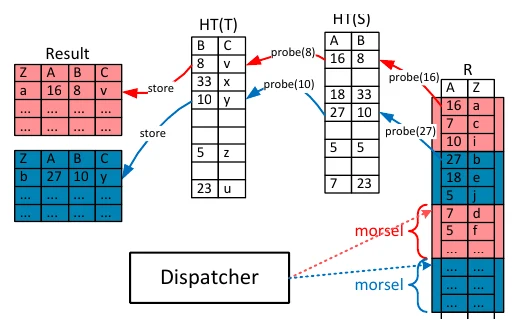

*图 1：morsel-driven 并行的思想。R、S、T 三张表各自按颜色（红、蓝）标注其所在的 NUMA socket，HT(T) 与 HT(S) 是构建的哈希表，Dispatcher 把 R 上的 morsel 派发给线程。*

morsel-driven 调度的关键特性是**任务分发在运行时完成，因此是完全弹性的**。这使得即使中间结果规模不确定、且现代 CPU 核心性能难以预测（即使分到的工作量相同，性能也会变化），也能实现完美的负载均衡。它在"弹性"意义上的含义是：它能处理运行时发生变化的工作负载（通过减少或增加正在执行的查询的并行度），并且能容易地集成一种以不同优先级运行查询的机制。

morsel-driven 的思想不止于调度，它扩展成一整套完整的查询执行框架：所有物理算子都必须能够在它们所有的执行阶段按 morsel 并行执行（例如 hash join 的 build 和 probe 都要），这是考虑到 Amdahl 定律后达成多核可扩展性的关键要求。morsel-wise 框架中一个重要的部分是对数据局部性的感知。这从输入 morsel 和物化输出缓冲区的局部性开始，但延伸到算子可能创建和访问的状态（数据结构，例如哈希表）。这种状态是可能被任意核心访问的共享数据，但具有高度的 NUMA 局部性。因此 morsel-wise 调度是灵活的，但强烈倾向于选择能最大化 NUMA 本地执行的任务。这意味着远程 NUMA 访问只在每个查询处理少数几个 morsel 时发生，目的是实现负载均衡。通过主要访问本地 RAM，内存延迟得到优化，而会拖慢其他线程的跨 socket 内存流量被最小化。

在纯粹的基于 Volcano 的并行框架中，并行性对算子隐藏、共享状态被避免，这导致了 exchange 算子中的即时数据分区。我们认为这并不总能产生最优计划（因为分区工作并不总是划算的），而在 exchange 算子中通过即时分区所获得的局部性，我们的 locality-aware dispatcher 同样能够达到。其他系统曾倡导 per-operator 并行化 [<sup>21</sup>](#refer-anchor-21) 来实现执行的灵活性，但这会导致同一流水线段内算子之间大量的同步。尽管如此，我们确信 morsel-wise 框架可以被整合进许多现有系统，例如通过修改 exchange 算子的实现来封装 morsel-wise 调度，并引入诸如哈希表共享之类的机制。我们的框架同样适用于使用即时（JIT）代码编译的系统 [<sup>19</sup>, <sup>25</sup>](#refer-anchor-19)，因为计划中每条流水线生成的代码随后都可以按 morsel-wise 调度。事实上，我们的 HyPer 系统正使用这种 JIT 方式 [<sup>25</sup>](#refer-anchor-25)。

本文提出了一系列相关的思想，用以实现高效、可扩展且有弹性的并行处理。主要贡献是一份查询引擎的架构蓝图，它包含以下内容：

* morsel-driven 查询执行是一个全新的并行查询评估框架，它与传统 Volcano 模型有本质区别：它通过 work-stealing 在线程之间**动态**分发工作。这避免了负载不均衡造成的 CPU 资源浪费，并支持弹性，即 CPU 资源可以在任何时刻在不同查询之间重新分配。
* 一组面向最重要的关系算子的快速并行算法。
* 一套把 NUMA 感知整合进数据库系统的系统化方法。

本文其余部分组织如下。第 2 节详细讨论流水线并行化以及把数据切分成 morsel。第 3 节讨论 dispatcher，它把任务（pipeline job）和数据片段（morsel）分配给 worker 线程。dispatcher 实现了完整的弹性，允许在任意时刻改变在特定查询上工作的并行线程数量。第 4 节讨论并行 join、聚合和排序算子的算法细节与同步细节。第 5 节通过完整的 TPC-H 查询套件评估查询引擎的性能。第 6 节讨论相关工作，以阐明我们并行查询引擎架构的新颖之处。第 7 节总结论文。

## 2. Morsel-Driven 执行

我们将用引言中的查询来说明示例查询计划上的并行流水线查询执行：

```text
σ...(R) 1A  σ...(S) 1B  σ...(T) σ...(T)
```

假设 R 是（过滤后）最大的表，优化器会选择 R 作为 probe 输入，并为另外两个表 S 和 T 构建（team）哈希表。由基于代价的优化器得到的代数查询计划（如图 2 左侧所示）包含三条流水线：

1. 扫描、过滤基表 T 并构建哈希表 HT(T)；
2. 扫描、过滤参数 S 并构建哈希表 HT(S)；
3. 扫描、过滤 R，并探测哈希表 HT(S) 和哈希表 HT(T)，然后存储结果元组。

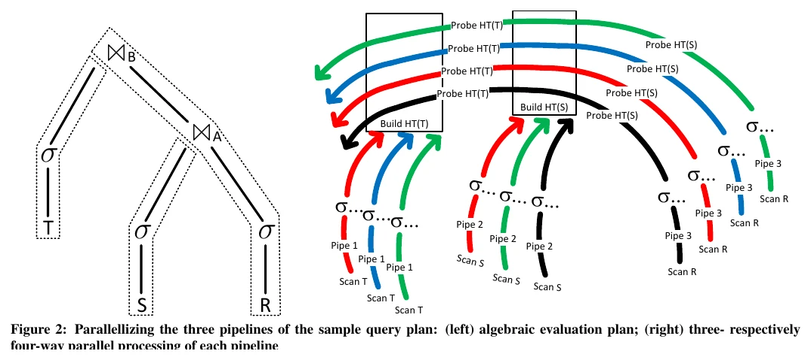

*图 2：示例查询计划三条流水线的并行化：（左）代数求值计划；（右）每条流水线分别以三路、四路并行处理。*

HyPer 使用即时（JIT）编译生成高效的机器码。每条流水线段（包括其中所有算子）被编译成一个代码片段。这带来了很高的原始性能，因为传统查询求值器中存在的解释开销被消除了。此外，这些流水线中的算子甚至不物化它们的中间结果，而这仍然是由效率高得多的 vector-at-a-time 求值引擎来做的 [<sup>34</sup>](#refer-anchor-34)。

代数计划的 morsel-driven 执行由一个所谓的 **QEPobject** 控制，它把可执行的流水线传递给 dispatcher——参见第 3 节。观察数据依赖关系是 QEPobject 的职责。在我们的示例查询中，第三条（probe）流水线只有在两个哈希表都构建完成之后才能执行，也就是在前两条流水线完全执行之后。

对于每条流水线，QEPobject 分配临时存储区域，并行线程执行该流水线时把结果写入其中。整个流水线完成之后，这些临时存储区域被**逻辑上**重新切分成大小相等的片段。在我们的图中画出了三个并行线程，每个线程一次操作一个 morsel。由于我们的基表 T 是"morsel-wise"地存放在一个 NUMA 组织的内存中，调度器在可能的情况下，会分配一个位于线程所在同一 socket 上的 morsel。这由图中的颜色标注表示：运行在红色 socket 某个核心上的红色线程，被分配了处理一个红色 morsel 的任务，也就是基表 T 的一段小片段，它位于红色 socket 上。一旦线程处理完被分配的 morsel，它要么被委派（dispatched）去执行不同的任务，要么获取另一个（同样颜色的）morsel 作为下一个任务。由于线程一次处理一个 morsel，整个系统是完全弹性的。并行度（MPL）可以在处理一个查询期间的任何时刻（更精确地说，是在 morsel 边界处）被减少或增加。

在图 2 中，(1) 扫描/过滤输入 T 与 (2) 构建哈希表这一逻辑代数流水线，实际上被拆解成左侧图中标记为阶段（phases）的两个物理处理流水线。在第一阶段中，过滤后的元组被插入 NUMA 本地的存储区域，也就是说，每个核心有一个独立的存储区域，以避免同步。为了在后续处理阶段保持 NUMA 局部性，某个核心的存储区域是在同一 socket 上本地分配的。当所有基表 morsel 都扫描和过滤完毕之后，在第二阶段中，这些存储区域被再次扫描——同样由位于对应核心上的线程完成——并且指针被插入到哈希表中。把逻辑的哈希表构建流水线切分成两个阶段，使得全局哈希表可以被完美地确定大小，因为在第一阶段完成之后，"存活"对象的准确数量已经知道了。这个（大小被完美确定的）全局哈希表将被位于 NUMA 系统各个 socket 上的线程探测；因此，为了避免争用，它不应当驻留在某个特定的 NUMA 区域，而是应当交织（spread）在所有 socket 上。由于有许多并行线程竞争着向这个哈希表中插入数据，无锁（lock-free）实现是必需的。哈希表的实现细节在第 4.2 节描述。

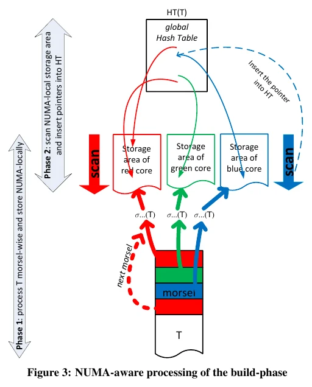

*图 3：build 阶段的 NUMA 感知处理。Phase 1 按 morsel 处理 T 并 NUMA 本地存储；Phase 2 扫描 NUMA 本地存储区并把指针插入哈希表。*

在任意时刻工作在任一流水线上的并行线程数量，都受限于处理器的硬件线程数量。为了 NUMA 本地地写入、并避免在写中间结果时同步，QEPobject 为每条可执行流水线的每个这样的线程/核心都分配一个存储区域。

过滤 T 并构建哈希表 HT(T) 的流水线并行处理如图 3 所示。让我们把注意力集中在过滤输入 T 并把"存活"元组存入临时存储区域的第一阶段上。

当两个哈希表都构建完成之后，probe 流水线就可以被调度。probe 阶段的详细处理如图 4 所示。同样地，一个线程从 dispatcher 请求工作，dispatcher 分配对应 NUMA 分区中的一个 morsel。也就是说，位于红色 NUMA 分区某个核心上的线程会被分配一个位于对应"红色" NUMA socket 上的基表 R 的 morsel。probe 流水线的结果同样被存入 NUMA 本地存储区域，以便为后续处理（在我们的示例查询计划中不存在）保持 NUMA 局部性。

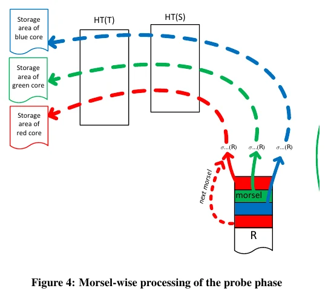

*图 4：probe 阶段的 morsel-wise 处理。R 的 morsel 被切分后，线程就绪（dispatch(0)）并对 (J1, M) 执行 pipeline-job。*

总而言之，morsel-driven 并行执行多条流水线，这与 Volcano 模型的典型实现是相似的。然而与 Volcano 不同的是，这些流水线**并非相互独立**。也就是说，它们共享数据结构，并且算子知道自己在被并行执行，必须执行同步（通过高效的 lock-free 机制——后文会讲）。另一个差异是，执行该计划的线程数量是完全弹性的。也就是说，这个数量不仅可以在不同的流水线段之间不同（如 Figure 2 所示），也可以在查询执行期间的**同一个**流水线段内部不同——如下文所述。

## 3. Dispatcher：并行流水线任务的调度

dispatcher 负责把计算资源分配给并行流水线，做法是把任务赋给 worker 线程。我们为机器提供的每个硬件线程（预先）创建一个 worker 线程，并永久地把每个 worker 绑定到它上面。因此，某个查询的并行级别不是通过创建或终止线程来控制的，而是通过为它们分配（可能属于不同查询的）特定任务来控制的。赋给这样一个 worker 线程的任务，由一个 pipeline job 和该流水线必须在其上执行的一个特定 morsel 组成。任务的抢占发生在 morsel 边界处——从而消除了可能代价高昂的中断机制。我们通过实验确定，约 100,000 个元组的 morsel 大小，在即时弹性调整、负载均衡和低维护开销之间能取得良好的折中。

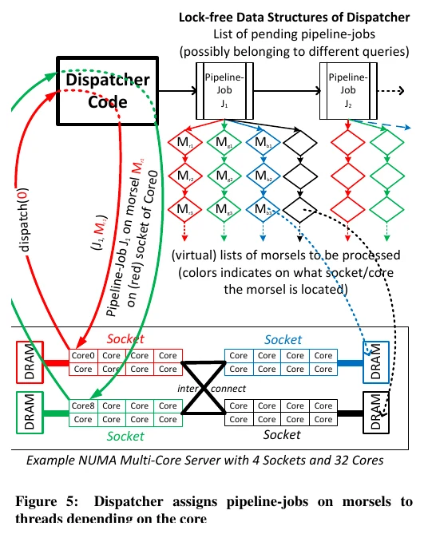

*图 5：dispatcher 架构。它维护一个待处理 pipeline-job 的列表，以及每个核心的（虚拟）待处理 morsel 列表；图例为 4 socket、32 核的 NUMA 多核服务器示例。*

把任务赋给运行在特定核心上的线程，有三个主要目标：

1. **保持（NUMA）局部性**：把数据 morsel 分配给这些 morsel 所位于的核心；
2. **对特定查询的并行度保持完全弹性**；
3. 负载均衡要求所有参与某条查询流水线的核心在同一时刻完成工作，以防止（快）核心等待其它（慢）核心<sup>1</sup>。

在图 5 中描绘了 dispatcher 的架构。它维护一个待处理 pipeline job 的列表。这个列表只包含其前置依赖已经被处理的 pipeline job。例如，对于我们正在运行的示例查询，build 输入流水线首先被插入到待处理 job 的列表中。probe 流水线只有在两个 build 流水线都结束之后才被插入。如前所述，每个活跃查询都由一个 QEPobject 控制，它负责把可执行流水线传递给 dispatcher。因此，dispatcher 只维护那些所有依赖流水线都已被处理的 pipeline job 列表。一般来说，dispatcher 队列中会包含来自不同查询的待处理 pipeline job，它们被并行执行以容纳查询间并行。

### 3.1 弹性

通过"一次一个 morsel"地分发 job 所实现的完全弹性并行，允许依据服务质量模型，对这些查询间的并行流水线 job 进行智能调度。它使得我们可以在长运行查询 Q<sub>l</sub> 处理的任何阶段**优雅地降低**其并行度，以优先服务可能更重要的交互式查询 Q<sup>+</sup>。一旦优先级更高的查询 Q<sup>+</sup> 结束，天平又摆回长运行查询一边，把全部或大部分核心派发给长运行查询 Q<sub>l</sub> 的任务上。在第 5.4 节我们实验性地展示了这种动态弹性。在我们目前的实现中，所有查询具有相同的优先级，因此线程在所有活跃查询之间被**均匀**分配。基于优先级的调度组件正在开发中，但超出了本文的范围。

对于每个 pipeline job，dispatcher 维护着该 pipeline job 仍待执行的待处理 morsel 的列表。每个核心都有一个独立的列表，以确保比如 Core 0 的工作请求返回一个与 Core 0 分配在同一 socket 上的 morsel。这在我们架构草图的不同颜色中有所体现。一旦 Core 0 处理完被分配的 morsel，它就请求一个新任务，这个任务可能来自也可能不来自同一个 pipeline job。这取决于来自不同执行中查询的各 pipeline job 之间的优先级。如果一个高优先级查询进入系统，就可能导致当前查询的并行度下降。Morsel-wise 处理允许把核心重新分配给不同的 pipeline job，而不需要任何剧烈的中断机制。

### 3.2 实现概览

为了示意，我们在图 5 中为每个核心画出了一条（很长的）morsel 链表。实际上（即在我们的实现中），我们为每个核心/socket 维护存储区域的边界，并按需把这些大存储区域切分成 morsel；也就是说，当一个核心向 dispatcher 请求任务时，该流水线参数在特定 socket 上的存储区域的下一个 morsel 就被"切出"。此外，在图 5 中 Dispatcher 看起来像一个独立的线程。然而这会带来两个缺点：(1) dispatcher 自身将需要一个核心来运行，或者可能抢占查询求值线程；(2) 它可能成为争用的来源，在 morsel 大小配置得很小时尤其如此。因此，dispatcher 仅被实现为一个 lock-free 数据结构。dispatcher 的代码随后由请求工作的查询求值线程自己执行。于是，dispatcher 自动在这个 worker 线程（否则闲置）的核心上执行。依赖 lock-free 数据结构（即 pipeline job 队列以及相关的 morsel 队列）即便在多个查询求值线程同时请求新任务时也减少了争用。类似地，负责通过观察数据依赖（例如在执行 probe 流水线之前构建哈希表）来推动特定查询进展的 QEPobject，被实现为一个被动状态机。当一个 pipeline job 被完全执行完时（表现为在一次工作请求中找不到新的 morsel），dispatcher 就调用这段代码。同样，这个状态机在最初向 dispatcher 请求新任务的那个 worker 线程（否则闲置）的核心上执行。

除了能够在任意时刻把一个核心分配给不同查询的能力——称为弹性——之外，morsel-wise 处理还保证了负载均衡和抗倾斜能力。所有工作在同一个 pipeline job 上的线程都以"冲刺线（photo finish）"的方式运行到完成：它们被保证在处理单个 morsel 所需的时间周期内到达终点线。如果由于某种原因，一个核心处理完了其特定 socket 上的所有 morsel，dispatcher 就会从另一个核心"偷取工作"，即把位于不同 socket 上的 morsel 分配给它。在某些 NUMA 系统上，并非所有 socket 都彼此直接相连；这里优先从更近的 socket 偷取是划算的。在正常情况下，从远程 socket 偷取工作发生得非常少；尽管如此，它对于避免空闲线程仍是必要的。而且，向临时存储的写入反正都会进入 NUMA 本地存储区域（也就是说，一个红色 morsel 在从红色 socket 上的核心（们）偷取工作的过程中，如果被一个蓝色核心处理了，它就变成蓝色的了）。

到目前为止，我们讨论的都是流水线内并行。我们的并行化方案也可以支持 bushy 并行，例如，我们示例中的"过滤并构建 T 的哈希表"和"过滤并构建 S 的哈希表"这两条流水线是独立的，因此可以并行执行。然而这种并行形式的用处是有限的。独立流水线的数量通常远小于核心数量，而且每条流水线中的工作量一般也不同。此外，bushy 并行可能通过降低缓存局部性来损害性能。因此我们目前避免并行执行来自同一查询的多条流水线；在我们的示例中，我们先执行流水线 T，只有在 T 结束后，流水线 S 的 job 才被添加到 pipeline job 列表中。

除了弹性之外，morsel-driven 处理还允许对查询取消进行简单而优雅的实现。用户可能已经中止了她的查询请求，查询中发生了异常（例如数值溢出），或者系统内存不足。如果发生任何这些情况，涉及的查询会在 dispatcher 中被标记。每当该查询的一个 morsel 完成时都会检查这个标记，因此很快所有 worker 线程就会停止在该查询上工作。与强迫操作系统去杀死线程不同，这种方法允许每个线程自行清理（例如释放已分配的内存）。

### 3.3 Morsel 大小

与 Vectorwise [<sup>9</sup>](#refer-anchor-9) 和 IBM 的 BLU [<sup>31</sup>](#refer-anchor-31) 这类在算子之间用 vector/stride 传递数据的系统不同，即使一个 morsel 装不进缓存也没有性能惩罚。Morsel 被用来把一个大任务切分成小的、恒定大小的工作单元，以便于 work-stealing 和抢占。因此，morsel 大小对性能并不关键，它只需要足够大以摊薄调度开销，同时提供良好的响应时间。为了展示 morsel 大小对查询性能的影响，我们在第 5 节描述的 Nehalem EX 系统上用 64 个线程测量了查询 `select min(a) from R` 的性能。这个查询非常简单，因此最大限度地压测了 work-stealing 数据结构。图 6 显示，morsel 大小应当被设定为开销可以忽略的最小可能值，在本例中是高于 10,000 的值。最优设置依赖于硬件，但可以容易地通过实验确定。

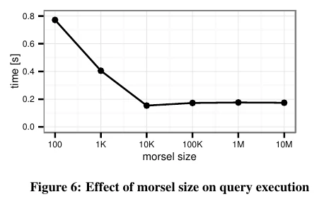

*图 6：morsel 大小对查询执行的影响。时间随 morsel 大小的变化，100 到 10M。*

在多核系统上，任何共享数据结构，即使是无锁的，最终都可能成为瓶颈。然而在我们的 work-stealing 数据结构这个具体情形中，有若干方面防止它成为可扩展性问题。首先，在我们的实现中，总工作量最初在所有线程之间被划分，使得每个线程临时拥有一段本地范围。因为我们对每个范围做了 cache line 对齐，cache line 级别的冲突不太可能发生。只有当这段本地范围被耗尽时，一个线程才会尝试从另一个范围偷取工作。其次，如果并发执行多于一个查询，该数据结构上的压力会进一步减小。最后，总是有可能增大 morsel 大小的。这会减少对 work-stealing 数据结构的访问次数。最坏的情况下，过大的 morsel 大小会导致线程利用不足，但如果执行了足够多的并发查询，就不会影响系统的吞吐。

## 4. 并行算子细节

为了能够完全并行化每条流水线，每个算子必须能够并行地接受元组（例如通过同步共享数据结构），并且对于开启新流水线的算子，必须能够并行地产出元组。在本节中我们讨论最重要的并行算子的实现。

### 4.1 Hash Join

如第 2 节所讨论并在图 3 中所示的，我们 hash join 的哈希表构建由两个阶段组成。在第一阶段，build 输入元组被物化到一个线程本地存储区域中<sup>2</sup>；这不需要同步。一旦所有输入元组都以这种方式被消费掉，就会创建一个大小完美的空哈希表，因为此时输入规模已被精确掌握。这比动态增长哈希表高效得多，后者在并行环境下会带来很高的开销。在并行 build 阶段的第二阶段，每个线程扫描自己的存储区域，并使用原子 compare-and-swap 指令插入指向其元组的指针。细节将在第 4.2 节解释。

外连接是所描述算法的一个小变化。为每个元组额外分配一个标记，用来指示该元组是否曾有匹配。在 probe 阶段，设置该标记以表示发生了匹配。在设置标记之前，先检查该标记尚未被设置是有好处的，这样可以避免不必要的争用。半连接（semi join）和反连接（anti join）的实现方式类似。

通过若干单算子基准测试，Balkesen 等人 [<sup>5</sup>](#refer-anchor-5) 展示了一个高度优化的 radix join 可以取得比单表 join 更高的性能。然而与 radix join 相比，我们的单表 hash join：

* 对较大的输入关系是完全流水线化的，因此使用的空间更少，因为 probe 输入可以就地处理；
* 是一个"好队友（good team player）"，意味着多个小的（维度）表可以被大（事实）表的 probe 流水线当成一个团队，通过所有这些维度哈希表一起 join；
* 当两个输入基数差异很大时非常高效，而这在实际中是非常常见的情况；
* 可以从倾斜的 key 分布中获益<sup>3</sup> [<sup>7</sup>](#refer-anchor-7)；
* 对元组大小不敏感；以及
* 没有硬件相关的参数。

由于这些实践上的优势，在复杂查询处理中，单表 hash join 往往优于 radix join。例如，在 TPC-H 基准中，97.4% 的所有被 join 元组都到达 probe 一侧，因此哈希表通常能装进缓存。这个效应在 Star Schema Benchmark 上更加明显，那里有 99.5% 的被 join 元组到达 probe 一侧。因此，我们专注于单表 hash join，它的好处是没有硬件相关参数、不依赖查询优化器估计，同时提供非常好（如果表能装进缓存）或至少还不错（如果表大于缓存）的性能。我们把 radix join 的实现——由于更高的局部性，它在某些场景下有益——留给我们查询引擎的未来增强。

<sup>2</sup> 我们还在每个元组内为 next 指针预留空间，用于处理哈希冲突。

<sup>3</sup> TPC-H 中出现的一个例子是位置倾斜（positional skew），即在一个 1:n join 中所有 join 伙伴都彼此靠近地出现，这改进了缓存局部性。

### 4.2 无锁带标签哈希表

我们用于 hash join 算子的哈希表带有一个**早期过滤（early-filtering）优化**，它改进了选择性 join 的性能，而这类 join 相当常见。关键思想是：给一个哈希桶链表打上一个小的过滤器，该特定链表的所有元素都被"哈希"进去以设置它们的 1-bit。对于选择性 probe，即那些通过遍历链表也找不到匹配的 probe，这个过滤器通常能把 cache miss 数量减少到 1——在检查标签之后就跳过链表遍历。如图 7（上）所示，我们把一个标签直接编码进哈希表中每个指针的 16 个比特里。这节省了空间，更重要的是，它允许用单次原子 compare-and-swap 操作同时更新指针和标签。

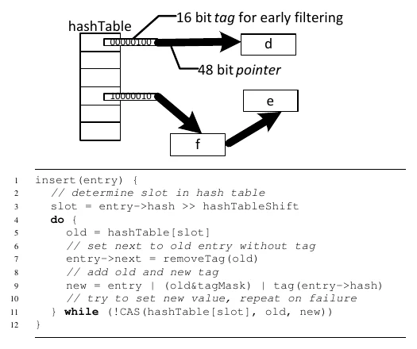

*图 7：向带标签哈希表的无锁插入。（上）16 bit 标签用于早期过滤，48 bit 指针；（下）插入伪代码。*

为了低成本同步，我们利用了 join 中哈希表**只插入、且查找只发生在所有插入完成之后**这一事实。图 7（下）展示了向哈希表插入一个新条目的伪代码。在第 11 行，指向新元素（例如图中的 "f"）的指针通过 compare-and-swap（CAS）设置。这个指针由新标签增强，新标签是从旧标签和新标签计算得到的（第 9 行）。如果 CAS 失败（因为同时发生了另一次插入），就重复这个过程。

与 Bloom filter 相比，我们的标签技术有许多优势；Bloom filter 可以类似地使用，并且例如被 Vectorwise [<sup>8</sup>](#refer-anchor-8)]、SQL Server [<sup>21</sup>](#refer-anchor-21) 和 BLU [<sup>31</sup>](#refer-anchor-31) 所采用。第一，Bloom filter 是一个**额外的数据结构**，会带来多次读取。而且对于大表，Bloom filter 可能装不进缓存（或者只能放进相对慢的最后一级缓存），因为 Bloom filter 的尺寸必须与哈希表尺寸成比例才能有效。因此开销可能相当高，尽管由于 Bloom filter 体积小，它确实可以是一个非常好的优化。在我们的方法中不执行任何不必要的内存访问，只做少量廉价的位运算。因此，哈希标签的开销极低，且**总是**可以使用，而不依赖查询优化器去估计选择率。除了 join 之外，在大多数 key 唯一的聚合过程中，标签也很有益。

哈希表数组只存储指针，而不是元组本身，也就是说我们**不使用开放寻址（open addressing）**。这是出于若干原因：由于元组通常远大于指针，哈希表可以相当慷慨地定尺寸，至少是输入的两倍。这减少了冲突次数而不太浪费空间。此外，链式结构（chaining）允许变长的元组，这是开放寻址所不可能的。最后，由于我们的过滤器，链式的 probe miss 实际上比开放寻址**更快**。

我们在哈希表和元组存储区域上都使用大虚拟内存页（2MB）。这有若干积极影响：TLB miss 数量减少，页表有保证地能放进 L1 缓存，并且在 build 阶段避免了因过多 kernel page fault 而产生的可扩展性问题。如果可用，我们使用 Unix 的 `mmap` 系统调用来分配哈希表。现代操作系统不会立即急切地分配内存，而是只在某个特定页面第一次被写入时才分配。这带来两个积极效果。第一，不需要在额外阶段手工把哈希表初始化为零。第二，表会自适应地分布在 NUMA 节点上，因为页面会位于与第一个写入该页面的线程相同的 NUMA 节点上。如果许多线程构建哈希表，它就会伪随机地交织在所有节点上。如果只有来自单个 NUMA 节点的线程构建哈希表，它就会位于那个节点上——这恰恰正是所期望的。因此，依靠操作系统也就自动地、经常地考虑了多个独立查询被并发执行的情况。

### 4.3 NUMA 感知的表分区

为了实现 NUMA 本地的表扫描，关系必须分布到各个内存节点上。最明显的方式是 round-robin 分配。更好的替代方案是使用某个"重要"属性的哈希值对关系进行分区。好处是，在两张表都按 join key 分区的情况下（例如一张按主键、另一张按外键），匹配的元组通常驻留在同一个 socket 上。一个典型的（来自 TPC-H 的）例子是把 `orders` 和 `lineitem` 都按 `orderkey` 属性分区。需要注意，这更多是一个性能提示而非硬性分区：work stealing 或数据不均衡仍可能导致来自不同 socket 的元组之间的 join，但大多数 join pair 会来自同一个 socket。结果是由于这两个频繁 join 的关系被共同定位，跨 socket 通信减少了。这同样影响到哈希表数组，因为用于决定哈希分区的同一个哈希函数，也正好被用于 hash join 中哈希桶的最高比特。除了分区键的选择之外，这套方案是完全透明的，并且由于使用基于哈希的分片，每个分区包含大致相同数量的元组。应当强调的是，这种共同定位方案对 morsel-driven 执行的高性能有益但并非决定性，因为无论如何，表扫描的 NUMA 局部性是有保证的，而在第一个物化结果的流水线之后，NUMA 局部性也是有保证的。

### 4.4 分组/聚合

聚合算子的性能特征根据组（不同的 key）数量而有很大差异。如果组很少，聚合非常快，因为所有组都能装进缓存。然而如果组很多，就会发生许多 cache miss。倾斜的 key 分布在两种情况下都会带来争用。为了在所有这些情况下都获得良好的性能和可扩展性，且不依赖查询优化器估计，我们使用了与 IBM BLU 聚合 [<sup>31</sup>](#refer-anchor-31) 类似的方法。

如图 8 所示，我们的算法有两个阶段。在第一阶段，线程本地的预聚合用一个线程本地固定大小的哈希表高效地聚合 heavy hitter。当这个小预聚合表被填满时，它被 flush（刷出）到 overflow 分区。在所有输入数据被分区之后，分区在线程之间交换。第二阶段由每个线程扫描一个分区并将其聚合进一个线程本地哈希表组成。由于分区数多于 worker 线程，这个过程会重复直到所有分区都被处理完。每当一个分区被完全聚合，它的元组就会被立即推给后面的算子，而不会先去处理其它任何分区。其结果是，聚合后的元组很可能仍在缓存中，可以被更高效地处理。

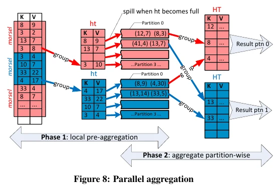

*图 8：并行聚合。Phase 1：本地预聚合（ht 溢出到分区）；Phase 2：按分区聚合。*

注意，聚合算子与 join 有本质不同，因为它的结果只有在所有输入都被读完之后才会产生。由于流水线化本来就不可能，我们使用分区——而不是像 join 算子那样的单一哈希表。

### 4.5 排序

在内存中，基于哈希的算法通常比排序更快 [<sup>4</sup>](#refer-anchor-4)]。因此我们目前不使用基于排序的 join 或聚合，排序只用来实现 order by 或 top-k 子句。在我们的并行排序算子中，每个线程首先就地物化并排序它的输入。在 top-k 查询的情况下，每个线程直接维护一个由 k 个元组组成的堆。本地排序之后，并行归并阶段开始，如图 9 所示。困难在于计算分隔子（separator），使得归并是独立的、可以无同步地并行执行。为此，每个线程首先通过从其有序串中选取等距的 key 来计算本地分隔子。然后，为了处理倾斜分布以及类似于 median-of-medians 算法，所有线程的本地分隔子被组合、排序，最终计算出全局分隔子 key。在确定了全局分隔子之后，通过二分（或插值）搜索在数据数组中找到它们的下标。利用这些下标，可以计算出输出数组的确切布局。最后，各个有序串就可以无任何同步地归并进输出数组。

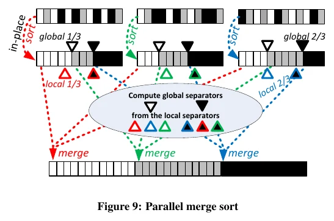

*图 9：并行归并排序。就地本地排序，从本地分隔子计算全局分隔子，然后无同步地归并。*

## 5. 评估

我们把我们的并行查询评估框架集成进了 HyPer [<sup>16</sup>](#refer-anchor-16)]，一个支持 SQL-92 的内存列数据库系统，它有非常好的单线程性能，但此前并未使用查询内并行。在本次评估中我们关注 ad-hoc 决策支持查询，并且除了声明主键之外，不启用任何额外的索引结构。因此，我们的结果主要衡量了表扫描、聚合和 join（包括外连接、半连接、反连接）算子的性能与可扩展性。HyPer 同时支持行式和列式存储；我们在所有实验中都使用了列格式。

### 5.1 实验设置

我们使用了两种不同的硬件平台——都在 Linux 上运行。除非另有说明，我们使用一台 4-socket 的 Nehalem EX（Intel Xeon X7560 @ 2.3GHz）。此外，一些实验在一台 4-socket 的 Sandy Bridge EP（Intel Xeon E5-4650L @ 2.6GHz-3.1GHz）上进行。这类系统特别适合内存数据库系统，因为它们能以合理的成本支持 TB 级 RAM。虽然这两套系统都有 32 个核心、64 个硬件线程和几乎相同数量的缓存，但它们的 NUMA 拓扑相当不同。如图 10 所示，每块 Sandy Bridge CPU 有两倍的理论每节点内存带宽，但只与其他两个 socket 相连。因此，某些内存访问（例如从 socket 0 到 socket 2）需要两跳而不是一跳；这增加了延迟，并由于跨流量而降低了内存带宽 [<sup>23</sup>](#refer-anchor-23)]。注意，即将推出的 4-socket Ivy Bridge 平台将有两个版本：Ivy Bridge EX 像 Nehalem EX 一样是全互联的，而只有单一互连每节点的 Ivy Bridge EP 则像 Sandy Bridge EP。

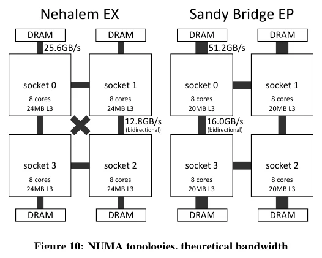

*图 10：NUMA 拓扑与理论带宽。左：Nehalem EX；右：Sandy Bridge EP。*

作为我们主要的对比对象，我们选择了官方单机 TPC-H 榜首 Vectorwise。我们也测量了开源行存 PostgreSQL 和集成进某个主要商业数据库系统的列存的性能。在 TPC-H 上，与 HyPer 相比，PostgreSQL 平均慢 30 倍，商业列存慢 10 倍。因此我们在后续实验中专注于 Vectorwise（2.5 版），因为它在其它系统中要快得多。

在这次评估中我们使用了一个经典的 ad-hoc TPC-H 情境。这意味着没有对物理存储进行任何手工调优，因此所用的计划是相似的（到处都是 hash join）。来自 TPC-H 网站的 Vectorwise 结果包含了这份额外的调优，主要是聚簇索引，这使得某些更大的 join 可以用 merge-join 算法执行。此外，这些索引允许查询优化器把范围限制从一个 join 侧传播到另一个侧 [<sup>8</sup>](#refer-anchor-8)]，这对少数几个查询的性能有极大改进，但对查询处理本身影响不大。这种调优同样不改善查询执行的可扩展性；平均而言，无论调优与否，加速比都低于 10×。为完整起见，我们也提供了 Vectorwise 在 Nehalem EX 上使用 TPC-H 完整披露报告（full disclosure report）设置的结果：

| 系统 | 单线程几何均值 | 总时间 | 加速比 |
|---|---|---|---|
| HyPer | 0.45s | 15.3s | 28.1× |
| Vectorwise | 2.84s | 93.4s | 9.3× |
| Vectorwise，完整披露设置 | 1.19s | 41.2s | 8.4× |

在 HyPer 中数据可以廉价地就地更新。scale factor 100 下的两条 TPC-H refresh 流在不到 1 秒内就执行完毕。这与重读优化的系统（例如 [<sup>10</sup>](#refer-anchor-10)）形成对比，那里的更新由于繁重的索引和重排序而代价高昂。我们的系统通过用主键的第一个属性把每个关系分成 64 个分区，透明地把输入关系分布到所有可用的 NUMA socket 上。执行时间包含了（来自操作系统的）中间结果、哈希表等的内存分配和释放。

### 5.2 TPC-H

图 11 比较了 Nehalem 系统上 HyPer 与 Vectorwise 的可扩展性；两个 DBMS 都以 HyPer 的单线程执行时间做了归一化。注意最多到 32 个线程时使用的是"真实"核心，其余是"HyperThreads"（同时多线程）。对于大多数查询，HyPer 达到接近 30 的加速比。在某些情况下，由于同时多线程，加速比接近或超过 40。尽管 Vectorwise 的单线程性能与 HyPer 相近，但它的总体性能被其低加速比严重限制了，加速比常常低于 10。

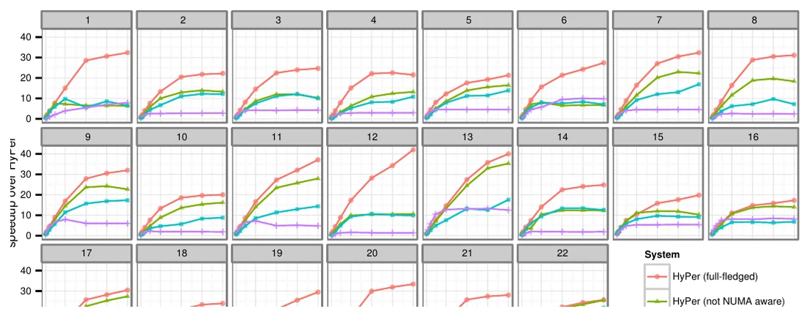

*图 11：Nehalem EX 上的 TPC-H 可扩展性（核心 1-32 是"真实"的，核心 33-64 是"虚拟"的）。四组曲线：HyPer（完整功能）、HyPer（不 NUMA 感知）、HyPer（非自适应）、Vectorwise。*

一个问题是负载均衡：在（可平凡并行化的）纯扫描查询 6 中，最慢的线程往往比最后一个早完成 50% 的工作。虽然在真实场景中通常是数据倾斜在挑战负载均衡，但这在完全均匀的 TPC-H 中并不是情况。这些问题与在 Vectorwise 中使用 Volcano 模型来并行化查询有关 [<sup>3</sup>](#refer-anchor-3)。这种做法很常见（例如 Oracle 和 SQL Server 中），因为它允许实现并行而不影响现有的查询算子，通过在计划时刻实例化一组独立的查询计划并用"exchange"算子 [<sup>12</sup>](#refer-anchor-12)] 连接起来，从而把并行性烘焙进计划之中。我们指出，固定的工作划分加上缺乏 NUMA 感知，可能导致线程之间显著的性能差异（Vectorwise 3 版之前不 NUMA 感知，这已由我们在 5.3 节的实验证实）。

图 11 还展示了我们禁用查询引擎某些重要特性时的可扩展性结果。当我们禁用显式的 NUMA 感知而依赖操作系统时，性能显著降低（对比"HyPer（不 NUMA 感知）"）。如果我们额外禁用自适应的 morsel-wise 处理以及本文引入的性能增强（比如哈希标签），可以观察到进一步的性能惩罚。这给出了各个技术各自效果的印象。但要注意，这会高估了单算子的效果，因为我们仍然使用高度调优的、试图最大化局部性的算子实现。

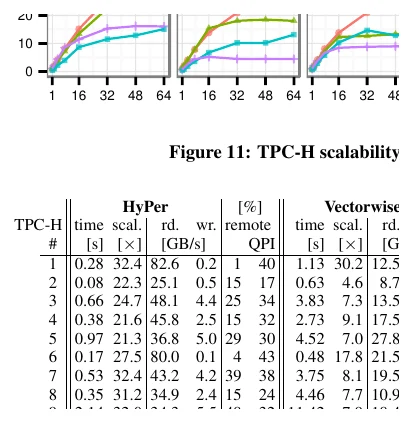

*表 1：TPC-H（scale factor 100）在 Nehalem EX 上的统计。*

表 1 和表 2 允许我们比较 Nehalem 和 Sandy Bridge 系统上的 TPC-H 性能。两套系统上的总体性能是相似的，因为 Sandy Bridge EP 上缺失的互连链路（导致可扩展性略低）被其更高的时钟频率所抵消。注意所有查询都在 3 秒内完成——在 100GB 数据集上使用 ad-hoc hash join 且不使用任何索引结构。

### 5.3 NUMA 感知

表 1 给出了 22 条 TPC-H 查询中每一条的内存带宽和 QPI 统计<sup>4</sup>。例如聚合了最大关系的查询 1，以 82.6GB/s 的速率读取，接近 100GB/s 的理论带宽上限。表中的"remote（远程）"列显示了通过互连（远程）访问的数据百分比，因此衡量了每个查询的局部性。由于 NUMA 感知的处理，大部分数据是本地访问的，这带来了更低的延迟和更高的带宽。从"QPI"列<sup>5</sup>——显示最繁忙的 QPI 链路的饱和度——可以得出结论，在这套系统上 QPI 链路的带宽是足够的。该表还显示 Vectorwise 未做 NUMA 优化：大多数查询都有很高比例的远程内存访问。例如，查询 1 的 75% 远程访问表明它的 buffer manager 不是 NUMA 感知的。然而，QPI 链路被相当均匀地使用，因为数据库关系似乎被分布在了所有 4 个 NUMA 节点上。这防止了单个内存控制器及通往它的 QPI 链路成为瓶颈。

到目前为止大多数实验都使用了我们的 NUMA 感知存储布局、NUMA 本地扫描、NUMA 感知的分区（这减少了 join 中的远程访问），以及所有算子都尽可能保持数据 NUMA 本地的事实。为了展示 NUMA 感知的总体性能收益，我们还实验了几个看似合理的替代方案："OS default"，其中放置由操作系统<sup>6</sup>执行；以及"interleaved"，其中所有内存 round-robin 分配到所有节点上。我们报告了我们在 TPC-H 上 NUMA 感知方法的几何平均和最大加速比：

| | Nehalem EX 几何均值 | 最大 | Sandy Bridge EP 几何均值 | 最大 |
|---|---|---|---|---|
| OS default | 1.57× | 4.95× | 2.40× | 5.81× |
| interleaved | 1.07× | 1.24× | 1.58× | 5.01× |

显然，操作系统的默认放置是次优的，因为一个 NUMA 节点的内存控制器和通往它的 QPI 链路会成为瓶颈。这些结果还显示，在 Nehalem EX 上，仅仅把内存交织起来就是一个合理的、尽管不是最优的策略，而在 Sandy Bridge EP 上 NUMA 感知对获得好性能重要得多。原因是这两套系统的 NUMA 行为相当不同，这可以从一个比较 NUMA 本地访问与 25% 本地 + 75% 远程随机混合访问的微基准中看出（Sandy Bridge EP 上还包括 25% 的两跳访问）：

| | 带宽 本地 | 混合 | 延迟 本地 | 混合 |
|---|---|---|---|---|
| Nehalem EX | 93 GB/s | 60 GB/s | 161 ns | 186 ns |
| Sandy Bridge EP | 121 GB/s | 41 GB/s | 101 ns | 257 ns |

在 Sandy Bridge EP 上，只有绝大部分访问是本地的，才能达到理论内存带宽的一小部分，并且其延迟是本地访问的 2.5 倍。相比之下，在 Nehalem EX 上这些效应要小得多，这解释了为什么 NUMA 感知的正面效应在该系统上更小。NUMA 感知的重要性显然取决于跨 socket 互连的速度和数量。

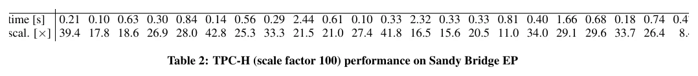

*表 2：TPC-H（scale factor 100）在 Sandy Bridge EP 上的性能。*

<sup>4</sup> 这些统计使用开源工具"Intel Performance Counter Monitor"（www.intel.com/software/pcm）获得。"rd."（读）、"wr."（写）和"remote"（远程）值在所有 socket 上聚合。"QPI"列显示被最充分利用的那条 QPI 链路的利用率（不过有了 NUMA 感知，各链路的利用率非常相似）。遗憾的是，这些统计在 Sandy Bridge EP 上没有暴露。

<sup>5</sup> QPI 链路既用于发送实际数据，也用于广播缓存一致性请求，后者是不可避免的，即使对本地访问也是如此。例如查询 1 以 82.6GB/s 读取，其中 99% 是本地的，但仍然使用了 40% 的 QPI 链路带宽。

### 5.4 弹性

为了展示我们方法的弹性，我们做了一个实验，改变并行查询流的数量。64 个可用硬件线程被均匀地分配给各个流，每个流执行 TPC-H 查询的随机排列。图 12 显示，即使流数很少（但每条流有多个核心），吞吐也保持在高位。这允许在不过多牺牲吞吐的情况下最小化高优先级查询的响应时间。

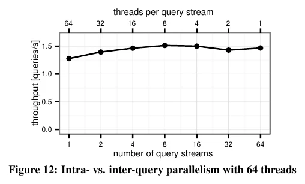

*图 12：64 线程下的查询内并行与查询间并行对比。*

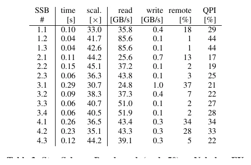

*表 3：Nehalem EX 上的 Star Schema Benchmark（scale 50）。*

图 13 通过展示我们并行 profiler 的带注释执行轨迹来说明 morsel-wise 处理。每种颜色代表一个流水线阶段，每个方块是一个 morsel。出于图形上的考虑，这个实验中我们只用了 4 个线程。我们首先执行 TPC-H 查询 13，它得到 4 个线程；一段时间后，TPC-H 查询 14 被启动。如轨迹所示，一旦 worker 线程 2 和 3 当前的 morsel 完成，这些线程就切换到查询 14 直到它完成，然后最终继续在查询 13 上工作。这个实验表明，可以动态地把 worker 线程重新分配给其它查询，也就是说，我们的并行化方案是完全有弹性的。

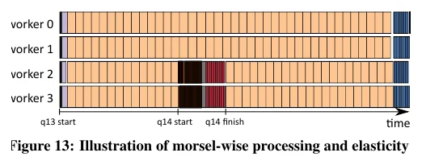

*图 13：morsel-wise 处理与弹性示意。4 个 worker，Q13 开始后 Q14 插入，Q14 结束后回到 Q13。*

正如引言中提到的，Volcano 方式通常静态地把工作分配给线程。为了与此方式对比，我们在自己的 morsel-driven 方案中模拟了它——把工作切成和线程数一样多的块，即把 morsel 大小设为 n/t，其中 n 是输入规模、t 是线程数。只要我们一次只执行一条 TPC-H 查询，这一改变本身就显著降低性能，因为输入数据在这个工作负载上是均匀分布的。然而，如果我们从其它进程引入一些干扰，情况就变了。例如，当我们在跑 TPC-H 查询的同时，让另一个无关的单线程进程占用一个核心时，查询性能在静态方式下下降了 36.8%，而在动态 morsel 分配下只下降了 4.7%。

<sup>6</sup> 实践中，数据库自身位于单个 NUMA 节点上，因为数据是由单个线程从磁盘读入的。其它所有分配对于首先写入该内存的线程来说是本地的。因此，哈希表被随机分布到各节点上。

### 5.5 星型模式基准

除了 TPC-H 之外，我们还在模仿数据仓库场景的 Star Schema Benchmark（SSB）[<sup>26</sup>](#refer-anchor-26) 上测量了系统的性能与可扩展性。表 3 显示，我们的并行化框架在这个工作负载上表现非常好，多数查询加速超过 40×。SSB 的可扩展性高于 TPC-H，因为 TPC-H 是一个复杂得多的、更具挑战性的工作负载。TPC-H 包含非常多样的一组查询：只扫描单表的查询、有复杂 join 的查询、有简单聚合的、有复杂聚合的等等。在这个工作负载上获得良好的性能和可扩展性是相当困难的，因为所有算子都必须可扩展，且能高效地处理非常多样的输入分布。相比之下，所有 SSB 查询都是把一个大事实表与多个更小的维度表 join，这非常契合我们 hash join 算法的流水线化能力。大部分数据来自可以 NUMA 本地读取的大事实表（对比图 3 中的"remote"列），维表的哈希表比事实表小得多，而聚合相对于查询的其余部分而言相当便宜。

## 6. 相关工作

本文与三条不同的工作线相关：专注于孤立研究多核 join 或聚合处理的论文、全系统描述，以及并行执行框架，尤其是 Volcano。

radix hash join 最初是为提高局部性而设计的 [<sup>24</sup>](#refer-anchor-24)。Kim 等人基于对输入关系的反复分区，为并行处理提出了它 [<sup>18</sup>](#refer-anchor-18)。Blanas 等人 [<sup>7</sup>](#refer-anchor-7) 首次把 radix join 与简单的单全局哈希表 join 做了比较。Balkesen 等人 [<sup>5</sup>, <sup>4</sup>](#refer-anchor-4) 全面研究了基于哈希和基于排序的 join 算法。Ye 等人评估了多核 CPU 上的并行聚合算法 [<sup>33</sup>](#refer-anchor-33)。Polychroniou 和 Ross 设计了一种高效聚合 heavy hitter（频繁项）的算法 [<sup>27</sup>](#refer-anchor-27)。

有若干论文特别关注 NUMA。在第一篇指出 NUMA 局部性重要性的论文中，Teubner 和 Müller [<sup>32</sup>](#refer-anchor-32) 提出了一个 NUMA 感知的基于窗口的流 join。在另一篇早期的 NUMA 论文中，Albutiu 等人设计了一个 NUMA 感知的并行排序归并 join [<sup>1</sup>](#refer-anchor-1)。Li 等人细化了该算法，通过显式调度有序串在 NUMA 互连网络上的 shuffle 来避免跨流量 [<sup>23</sup>](#refer-anchor-23)。然而，尽管有保留局部性的特性，该算法由于排序的高昂代价最终不如 hash join 高效 [<sup>4</sup>, <sup>20</sup>](#refer-anchor-20)。Lang 等人 [<sup>20</sup>](#refer-anchor-20) 设计了一个低同步开销的 NUMA 感知 hash join，与我们的算法相似。它依赖一个交织在所有 NUMA 节点上的单 latch-free 哈希表，所有线程向其中插入 build 输入。

遗憾的是，这些孤立单算子研究对完整查询引擎的结论性有限，因为用于测试的微基准通常使用单一简单 key（有时甚至直接包含哈希值），且典型地使用非常小的 payload（只有一列）。此外，每个算子都是孤立分析的，这忽略了算子之间如何传递数据，因此例如忽略了不同算法的流水线化能力差异。在我们的 morsel-driven 数据库系统中，我们专注于（非物化的）流水线 hash join，因为在实践中，join 的一侧往往比另一侧大得多。因此流水线 join 的团队经常是可能且有效的。此外，对于某些被频繁遍历的大 join（例如 TPC-H 中的 orders-lineitem），预分区的数据存储可以在大 join 上实现 NUMA 局部性，而无需物化。

新的 IBM BLU 查询引擎 [<sup>31</sup>](#refer-anchor-31) 和微软的 Apollo 项目 [<sup>22</sup>](#refer-anchor-22) 是利用现代多核服务器进行并行查询处理的两个突出商业项目。IBM BLU 以"Vectorwise"风格处理数据，即所谓 stride-at-a-time。在这方面它与我们的 morsel-wise 处理技术有相似之处。然而，没有迹象表明这些 stride 会根据核心利用率的变化而改变 [<sup>30</sup>](#refer-anchor-30)。

Volcano 模型 [<sup>12</sup>](#refer-anchor-12) 构成了当前大多数支持多核以及分布式 [<sup>13</sup>](#refer-anchor-13) 并行的查询求值引擎的基础。注意，在非并行语境下，Volcano 也与解释式的迭代器执行范式相关联：通过调用每个算子的 `next()` 方法，把结果沿着算子树向上拉，每个算子交付一个元组。这种一次一个元组的执行模型尽管实现优雅，但已被证明会引入显著的解释开销 [<sup>25</sup>](#refer-anchor-25)。随着高性能分析型查询引擎的出现，系统正在从这一模型转向面向 vector 或批的执行，其中每个 `next()` 方法处理成百上千个元组。这种面向 vector 的执行模型出现在 Vectorwise [<sup>3</sup>](#refer-anchor-3) 中，也出现在 SQL Server [<sup>22</sup>](#refer-anchor-22)（Apollo 项目）提供的 ColumnStore Index 表的批模式执行中，以及用于 DB2 的 IBM BLU 引擎 [<sup>31</sup>](#refer-anchor-31) 的 stride-at-a-time 执行中。在 HyPer 中我们依赖编译式查询求值，它最早由 Krikellas 等人 [<sup>19</sup>](#refer-anchor-19) 提出，后由 Neumann [<sup>25</sup>](#refer-anchor-25) 完善，获得了相同甚至更高的原始执行性能。

就并行性而言，Volcano 区分了垂直并行（本质上是把两个算子之间的流水线转换为异步的生产者/消费者模型）和水平并行（把一个算子通过划分输入数据来并行化，每个并行线程处理其中一个分区）。大多数系统实现了水平并行，因为如我们早先观察到的，垂直和 bushy 并行由于其不均衡的本质用处较小。例如 Microsoft SQL Server 和 Vectorwise [<sup>3</sup>](#refer-anchor-3) 中的水平 Volcano 并行就是这种情况。

尽管这些系统之间可能存在（未公开的）实现差异，morsel-driven 执行通过使并行查询调度细粒化、运行时自适应且 NUMA 感知，从而与它们区分开来。本文描述的并行查询引擎依赖于把输入数据切分成细粒度的 morsel。一个 morsel 完整地驻留在单个 NUMA 分区中。dispatcher 把一个 morsel 的处理分配给运行在同一 socket 某个核心上的线程，以保持 NUMA 局部性。morsel-wise 处理还便于实现完全的弹性，意味着并行度可以在任何时刻被调整，例如在查询处理中途。一旦一个 morsel 完成，线程就可以被分配属于同一查询流水线的一个 morsel，或者被分配另一个任务的 morsel，例如另一个更重要查询的任务。这样 dispatcher 就显式地控制了并行度，与 Psaroudakis 等人 [<sup>30</sup>](#refer-anchor-30) 最近提出的方法相对，后者的线程数是根据核心利用率来改变的。

## 7. 结论与未来工作

我们提出了面向并行查询处理的 morsel-driven 查询求值框架。它针对的是多核时代分析型查询性能的主要瓶颈：负载均衡、线程同步、内存访问局部性以及资源弹性。我们在 HyPer 上用完整的 TPC-H 和 SSB 查询工作负载展示了该框架的良好可扩展性。必须强调，在撰本文时，所呈现的结果是单服务器架构上迄今为止最快的（除去在完全索引和定制存储方案上运行手写查询的结果 [<sup>10</sup>](#refer-anchor-10)）<sup>7</sup>。指出这一点并不是在宣称一个性能纪录——这些是学术的、未经审计的结果——而是为了强调 morsel-driven 框架在实现可扩展性上的有效性。特别地，人们需要记住，在计算上缓慢的系统上提供线性可扩展性，比在 HyPer 这样的快速系统上要容易得多。与使用经典 Volcano 式并行的最先进系统 Vectorwise 的比较表明，超过 8 核、在多核领域里，morsel-driven 框架开始领先；我们相信它在细粒度调度、完整算子并行化、低开销同步和 NUMA 感知调度方面的原则，可以被用来改进其它系统的多核扩展性。

除了可扩展性之外，完全弹性的 morsel-driven 并行还允许对动态查询工作负载进行基于优先级的智能调度。设计并评估这样一个考虑服务质量约束的调度器超出了本文范围，将在后续工作中处理。

我们的系统在许多非常不同的硬件平台上都表现良好，尽管没有任何硬件相关的参数（我们测试了单 socket 系统和具有不同拓扑的 NUMA 系统）。尽管如此，研究考虑底层硬件知识的算法将是有趣的。肯定还有进一步优化的空间，特别是那些进一步减少远程 NUMA 访问的优化，如在 Sandy Bridge EP 平台上部分连通 NUMA 拓扑所显示的更慢结果（与全连通的 Nehalem EX 相比）。

<sup>7</sup> Dees 和 Sanders 的论文 [<sup>10</sup>](#refer-anchor-10) 虽然作为 TPC-H 的一种极端做法很有意思，但它明显违反了许多实现规则，包括使用预计算 join、预计算聚合和全文索引。它提出的存储结构通常非常昂贵，难以更新。

## 参考文献

<div id="refer-anchor-1"></div>

- [1] M.-C. Albutiu, A. Kemper, and T. Neumann. Massively parallel sort-merge joins in main memory multi-core database systems. PVLDB, 5(10), 2012.
<div id="refer-anchor-2"></div>

- [2] G. Alonso. Hardware killed the software star. In ICDE, 2013.
<div id="refer-anchor-3"></div>

- [3] K. Anikiej. Multi-core parallelization of vectorized query execution. Master's thesis, University of Warsaw and VU University Amsterdam, 2010.
<div id="refer-anchor-4"></div>

- [4] C. Balkesen, G. Alonso, J. Teubner, and M. T. Özsu. Multi-core, main-memory joins: Sort vs. hash revisited. PVLDB, 7(1), 2013.
<div id="refer-anchor-5"></div>

- [5] C. Balkesen, J. Teubner, G. Alonso, and M. T. Özsu. Main-memory hash joins on multi-core CPUs: Tuning to the underlying hardware. In ICDE, 2013.
<div id="refer-anchor-6"></div>

- [6] S. Bellamkonda, H.-G. Li, J. Jagtap, W. Liang, and C. Crunes. Adaptive and big data scale parallel execution in oracle. PVLDB, 6(11), 2013.
<div id="refer-anchor-7"></div>

- [7] S. Blanas, Y. Li, and J. M. Patel. Design and evaluation of main memory hash join algorithms for multi-core CPUs. In SIGMOD, 2011.
<div id="refer-anchor-8"></div>

- [8] P. Boncz, T. Neumann, and O. Erling. TPC-H analyzed: Hidden messages and lessons learned from an influential benchmark. In TPCTC, 2013.
<div id="refer-anchor-9"></div>

- [9] P. A. Boncz, M. Zukowski, and N. Nes. MonetDB/X100: Hyper-pipelining query execution. In CIDR, 2005.
<div id="refer-anchor-10"></div>

- [10] J. Dees and P. Sanders. Efficient many-core query execution in main memory column-stores. In ICDE, 2013.
<div id="refer-anchor-11"></div>

- [11] G. Giannikis, G. Alonso, and D. Kossmann. SharedDB: Killing one thousand queries with one stone. PVLDB, 5(6), 2012.
<div id="refer-anchor-12"></div>

- [12] G. Graefe. Encapsulation of parallelism in the Volcano query processing system. In SIGMOD, 1990.
<div id="refer-anchor-13"></div>

- [13] G. Graefe. Query evaluation techniques for large databases. ACM Comput. Surv., 25(2), 1993.
<div id="refer-anchor-14"></div>

- [14] S. Harizopoulos, V. Shkapenyuk, and A. Ailamaki. QPipe: A simultaneously pipelined relational query engine. In SIGMOD, 2005.
<div id="refer-anchor-15"></div>

- [15] M. Heimel, M. Saecker, S. Pirk, S. Manegold, and V. Markl. Hardware-oblivious parallelism for in-memory column-stores. PVLDB, 6(9), 2013.
<div id="refer-anchor-16"></div>

- [16] A. Kemper and T. Neumann. HyPer: A hybrid OLTP&OLAP main memory database system based on virtual memory snapshots. In ICDE, 2011.
<div id="refer-anchor-17"></div>

- [17] T. Kiefer, B. Schlegel, and W. Lehner. Experimental evaluation of NUMA effects on database management systems. In BTW, 2013.
<div id="refer-anchor-18"></div>

- [18] C. Kim, E. Sedlar, J. Chhugani, T. Kaldewey, A. D. Nguyen, A. Blas, V. W. Lee, N. Satish, and P. Dubey. Sort vs. hash revisited: Fast join implementation on modern multi-core CPUs. PVLDB, 2(2), 2009.
<div id="refer-anchor-19"></div>

- [19] M. Krikellas, S. Viglas, and M. Cintra. Generating code for holistic query evaluation. In ICDE, 2010.
<div id="refer-anchor-20"></div>

- [20] H. Lang, V. Leis, M.-C. Albutiu, T. Neumann, and A. Kemper. Massively parallel NUMA-aware hash joins. In IMDM Workshop, 2013.
<div id="refer-anchor-21"></div>

- [21] P.-Å. Larson, C. Clinciu, C. Fraser, E. N. Hanson, M. Mokhtar, M. Nowakiewicz, V. Papadimos, S. L. Price, S. Rangarajan, R. Rusanu, and M. Saubhasik. Enhancements to SQL Server column stores. In SIGMOD, 2013.
<div id="refer-anchor-22"></div>

- [22] P.-Å. Larson, E. N. Hanson, and S. L. Price. Columnar storage in SQL Server 2012. IEEE Data Eng. Bull., 35(1), 2012.
<div id="refer-anchor-23"></div>

- [23] Y. Li, I. Pandis, R. Müller, V. Raman, and G. M. Lohman. NUMA-aware algorithms: the case of data shuffling. In CIDR, 2013.
<div id="refer-anchor-24"></div>

- [24] S. Manegold, P. A. Boncz, and M. L. Kersten. Optimizing main-memory join on modern hardware. IEEE Trans. Knowl. Data Eng., 14(4), 2002.
<div id="refer-anchor-25"></div>

- [25] T. Neumann. Efficiently compiling efficient query plans for modern hardware. PVLDB, 4, 2011.
<div id="refer-anchor-26"></div>

- [26] P. O'Neil, B. O'Neil, and X. Chen. The star schema benchmark (SSB), 2007. http://www.cs.umb.edu/~poneil/StarSchemaB.PDF.
<div id="refer-anchor-27"></div>

- [27] O. Polychroniou and D. A. Ross. High throughput heavy hitter aggregation for modern SIMD processors. In DaMoN, 2013.
<div id="refer-anchor-28"></div>

- [28] D. Porobic, E. Liarou, P. Tözün, and A. Ailamaki. ATraPos: Adaptive transaction processing on hardware islands. In ICDE, 2014.
<div id="refer-anchor-29"></div>

- [29] D. Porobic, I. Pandis, M. Branco, P. Tözün, and A. Ailamaki. OLTP on hardware islands. PVLDB, 5(11), 2012.
<div id="refer-anchor-30"></div>

- [30] I. Psaroudakis, T. Scheuer, N. May, and A. Ailamaki. Task scheduling for highly concurrent analytical and transactional main-memory workloads. In ADMS Workshop, 2013.
<div id="refer-anchor-31"></div>

- [31] V. Raman, G. Attaluri, R. Barber, N. Chainani, D. Kalmuk, V. KulandaiSamy, J. Leenstra, J. Lightstone, S. Liu, G. M. Lohman, T. Malkemus, M. Mueller, I. Pandis, M. Schiefer, D. Sharpe, S. Sidle, L. Zhang. DB2 with BLU acceleration: So much more than just a column store. In VLDB, 2013.
<div id="refer-anchor-32"></div>

- [32] T. Teubner and R. Müller. How soccer players would do stream joins. In ICDE, 2011.
<div id="refer-anchor-33"></div>

- [33] Y. Ye, K. A. Ross, and N. Vesdapunt. Scalable aggregation on multicore processors. In DaMoN, 2011.
<div id="refer-anchor-34"></div>

- [34] M. Zukowski and P. A. Boncz. Vectorwise: Beyond column stores. IEEE Data Eng. Bull., 35(1), 2012.
