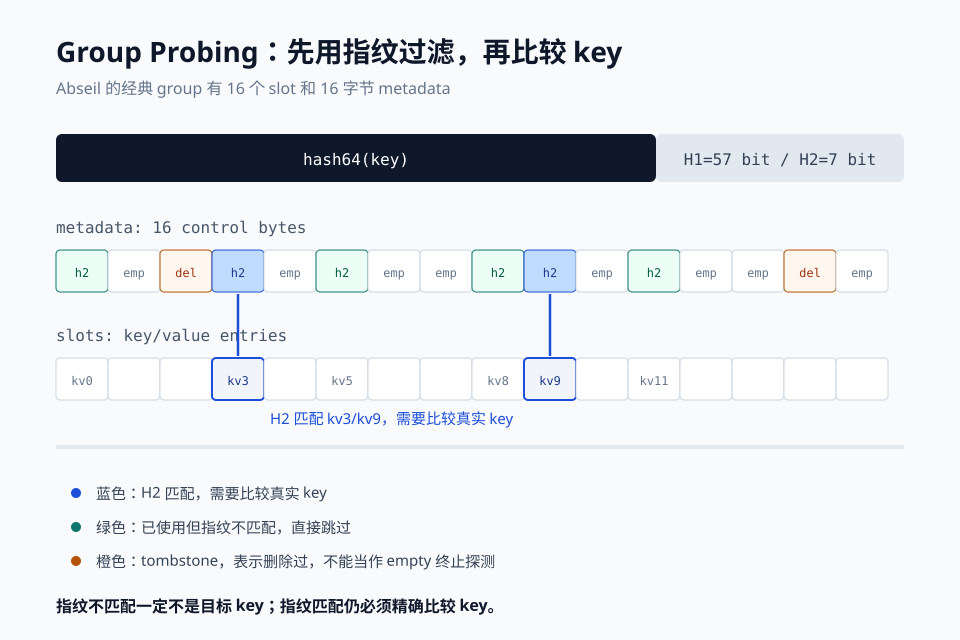
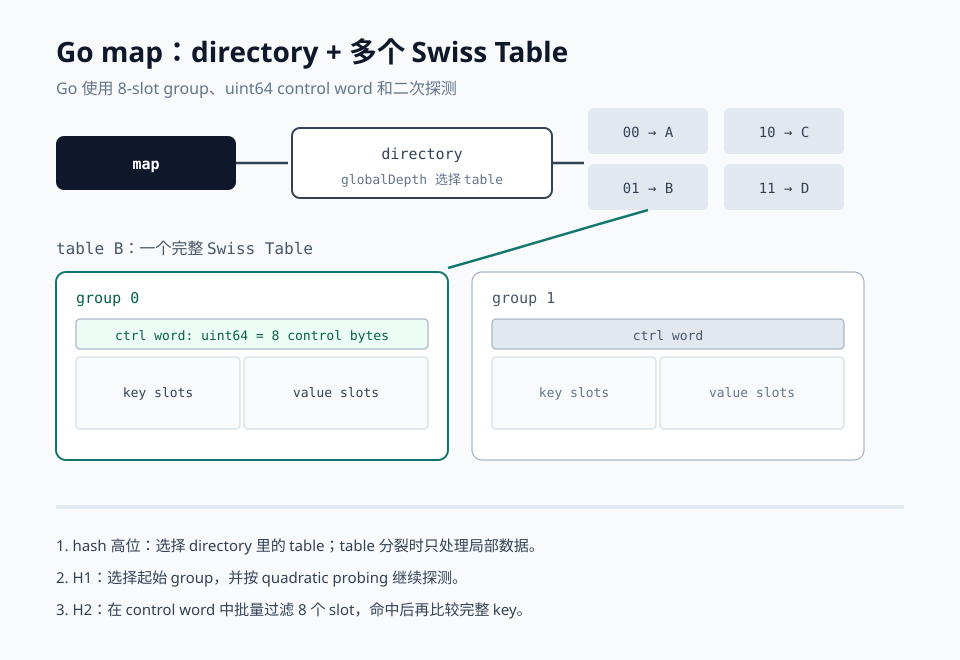

# Swiss Table：Go map 背后的高效 Hash 表

## 为什么值得单独讲

Hash 表的性能通常取决于两件事：冲突发生后如何找下一个候选位置，以及这些候选位置离缓存有多远。传统链式哈希把冲突元素串成链表，逻辑简单，但一次查询可能要跳过多个指针；普通开放寻址没有指针跳跃，却常常只能逐个 slot 检查。

Swiss Table 的核心贡献是在开放寻址表前面加了一层非常小的元数据，让 CPU 能按 group 批量排除大量不可能匹配的 slot。它不改变 hash 表的基本语义，而是改变查找、插入、删除时的观察方式：先用极小的哈希指纹过滤，再对少数候选 key 做精确比较。

这个设计来自 Google 的工程实践，后来成为 Abseil `flat_hash_map` 的底层实现，也被 Rust 标准库 `HashMap` 采用。Go 1.24 之后，内置 `map` 的默认运行时实现也切换到了 Swiss Table 风格。

<!--more-->

### 从开放寻址说起

在开放寻址表里，所有元素都直接放在 slot 中，不挂链表。发生冲突后，表会按探测序列寻找下一个位置：

```text
index = h1(key) mod group_count
next  = probe(index, attempt)
```

这种方式节省指针和内存，但传统实现有个尴尬之处：为了确认一个 key 是否存在，可能要逐个访问很多 slot。尤其当负载率升高时，缓存行虽然被读进来，却只有一两个 slot 有用。

Swiss Table 的解法是把“探测”拆成两层：

1. **group 内批量过滤**：用一个 group 的控制元数据快速找出可能的 slot；
2. **精确 key 比较**：只对过滤后的候选 slot 比较 key。

因为控制元数据远小于完整 key/value，CPU 可以一次载入并处理一整段元数据。这就是 Swiss Table 名称里“高效”的关键。

### 通用 Swiss Table 的结构

Abseil 的经典实现把 hash 值分成两部分：

* **H1**：高位，用来选择起始 group 和探测位置；
* **H2**：低 7 位，作为当前 key 的小指纹，保存到控制字节里。

每个 group 通常有 16 个 slot，并对应 16 字节 metadata。每个控制字节描述一个 slot 的状态：

| 状态 | 控制字节 | 含义 |
| --- | --- | --- |
| Empty | `1000 0000` | 从未使用 |
| Deleted | `1111 1110` | 已删除，也称为 tombstone |
| Full | `0hhh hhhh` | 已使用，`hhhh hhh` 保存 H2 指纹 |

查询时的逻辑可以概括为：

```text
hash = hash64(key)
h1   = high bits(hash)
h2   = low 7 bits(hash)

for group in probe_sequence(h1):
    candidates = simd_match_h2(group.ctrl, h2)
    for i in candidates:
        if group.slot[i].key == key:
            return group.slot[i]

    if group.has_empty():
        return not_found
```

下图展示了 metadata 如何在一个 16-slot group 中过滤候选：



这里有一个重要细节：H2 只有 7 bit，不同 key 的指纹可能相同。因此 metadata 匹配是“高效率的预筛”，不是结论。Swiss Table 仍然必须比较完整 key；指纹匹配可能误报，但指纹不匹配一定不会是这个 key。

### 为什么是 16 个 slot

16 个控制字节正好是 16 B，而现代 CPU 常见缓存行是 64 B。一次 SIMD 操作可以比较 16 个控制字节，把 16 次 slot 判断压缩成少量指令。

更重要的是访问模式。传统开放寻址可能沿着 slot 一路读下去；Swiss Table 每轮探测先读一个小而连续的 metadata 块，只有候选 slot 才读 key/value。这样减少了不必要的完整元素访问，也更容易利用缓存预取。

当然，16 不是数学上的必然，而是工程折中。group 太小，批量过滤收益不足；group 太大，一次比较的成本和空 slot 的空间浪费又会增加。Abseil 选择了 16；Go 运行时则因为自身结构选择了 8。

### 删除为什么需要 tombstone

开放寻址的探测序列经常跨越多个位置。如果一个元素在后面的 group 中，中间某个 slot 被删除后不能简单地改成 empty，否则探测会在中途停下，后面的元素就“找不到”了。

Swiss Table 因此引入 `Deleted` 状态：

* 删除时优先把 slot 标记成 `Deleted`；
* 后续探测会跳过 tombstone，不会提前结束；
* 插入时可以复用 tombstone；
* rehash 时清理 tombstone。

这也是删除频繁的 hash 表需要关注的一点：tombstone 可以维持正确性，但堆积后会拉长探测路径。

### 扩容仍然必要

Swiss Table 并没有取消负载因子。当使用量、tombstone 数量超过阈值后，表会 rehash：分配更多 group，重新计算每个 key 的位置。

和普通开放寻址类似，单次 rehash 可能耗时较长。这也是 Go 没有照搬“一个大 Swiss Table”的原因：如果 map 很大，一次性扩容会带来明显延迟尖刺。

### Go map 的 Swiss Table 改造

Go 1.24 release notes 把新的内置 `map` 实现列为 runtime 性能改进的一部分。实现位于 `src/internal/runtime/maps`。它借鉴 Abseil Swiss Table，但不是原样移植。

**1. 每个 group 是 8 个 slot**

Abseil 常用 16-slot group 加 16 字节 metadata；Go 的 group 是 8 个 slot，加上一个 `uint64` control word。这个大小更容易嵌入 Go runtime 的 map 结构，也能在 AMD64 上用位操作和 intrinsic 批量匹配；在无 SIMD 的架构上也有可移植实现。

**2. H1 和 H2 的分工不变**

64 位 hash 的高 57 位是 H1，用来确定起始 group 和二次探测序列；低 7 位是 H2，保存到 control word。H2 匹配可能 false positive，所以命中后仍会比较真实 key。

**3. 初始小 map 走 single group 路径**

元素很少时，Go 可以把数据放在一个 group 里，避免 directory 和多 table 带来的额外间接层。这对小程序里大量的 `make(map[K]V)` 很重要，因为很多 map 终其一生都只有几个元素。

**4. 一个 map 由多个 table 组成**

Go map 的顶层结构是 directory，directory 里的多个 entry 指向 table。每个 table 才是一个完整的 Swiss Table。选择 table 用的是 hash 高位，类似 extendible hashing。

`globalDepth` 表示当前 directory 使用的 hash 位数；`localDepth` 表示某个 table 自己的深度。当一个 table 需要分裂时，如果它的 `localDepth` 等于 `globalDepth`，directory 才会扩大；否则可以让多个 directory entry 继续指向同一个 table。



这种设计解决的是延迟问题：单个 table 的扩容仍然是一次性的，但 map 整体扩容被限制在局部。大 map 增长时，不需要每次搬移全部元素。

**5. Go 使用二次探测**

Go runtime 文档说明 group 数量必须是 2 的幂，probe sequence 是 quadratic probing，并且最终必须遇到带 empty slot 的 group。因此删除满 group 中的元素时不能直接改成 empty，而要留下 tombstone，避免后续探测提前停止。

### Go 语义没有变化

对普通 Go 代码来说，`map` 的 API 没有变化：

```go
m := make(map[string]int, 1024)
m["server"] = 1

if v, ok := m["server"]; ok {
    fmt.Println(v)
}

delete(m, "server")
```

下面的语义仍然保持：

* 迭代顺序不保证，实现上还会刻意随机化；
* 并发读写仍是不受支持的使用方式，可能触发 fatal error；
* `nil` map 可以读，不能写；
* key 类型仍必须可比较；
* map 不承诺精确删除、遍历或顺序行为。

如果程序以前依赖运行时实现的内部行为，例如某种测量到的迭代顺序，那么新的底层实现可能让差异暴露出来；这不是语言语义破坏，而是本就不该依赖。

### 性能提升要看负载

知乎上 Tony Bai 的文章记录了 Go 1.24 正式发布前的实验结果：字节工程师最初的 benchmark 显示查询、插入、删除最高有 20% 到 50% 的提升，迭代约提升 10%，内存使用最多减少 25%；但也有少数场景变慢，例如部分小 map 或增长路径。

Go 1.24 官方 release notes 的说法更保守：包括新 map 在内的一组 runtime 改进，在代表性 benchmark 中平均降低 2% 到 3% CPU 开销。这两组数字并不矛盾，前者是针对 map 操作的局部 benchmark，后者是完整服务与通用工作负载的平均值。

Swiss Table 更容易受益的场景通常是：

* map 很大，完整 key/value 访问成本高；
* 读多写少，尤其是大量 lookup；
* key/value 较大，metadata 过滤能避免很多无效访问；
* 容量可以预估，减少频繁增长。

不一定受益的场景包括：

* 只有几个元素的小 map；
* 写入和删除交替极其频繁；
* key 很小且 hash 计算占主导；
* 负载模式严重偏离 benchmark。

所以更准确的说法不是“Swiss Table 一定快 50%”，而是它在很多典型 map 操作上降低了无效探测和缓存访问。

### 实践建议

Go 开发者通常不需要改代码来使用新实现，但以下习惯仍然有价值：

* 已知规模时 `make(map[K]V, n)` 预分配，避免反复扩容；
* 不要把 map 当作有序集合；
* 不要依赖 map 迭代顺序；
* 并发访问仍然要自己加锁或使用同步结构；
* 对热点 map 用真实业务负载做 profile 和 benchmark，而不是只看单点 microbenchmark。

如果想对比 Go 1.24 中的开关，Go 1.24 release notes 提到构建时可以使用 `GOEXPERIMENT=noswissmap` 关闭新 map 实现。这个开关主要用于排障和性能比较，不是长期 API 承诺。

### 小结

Swiss Table 不是玄学，也没有推翻 hash 表。它只是把 hash 表里的老问题拆得更细：

* 用开放寻址减少指针追逐；
* 用控制字节保存短指纹；
* 用 group probing 批量排除错误候选；
* 用 tombstone 保证删除后的探测链完整；
* 在 Go 里进一步用多 table 和 extendible hashing 控制扩容延迟。

Go map 换成 Swiss Table 后，使用方式几乎不变，但 runtime 在内存局部性和批量探测上获得了更多优化空间。理解这个设计，也能帮助我们在写出高性能 Go 服务时更清楚 `make(map[K]V, n)`、读写热点和扩容成本分别发生在哪里。

---
## 参考资料

- [Go map使用Swiss Table重新实现，性能最高提升近50%（Tony Bai）](https://zhuanlan.zhihu.com/p/7640644919)
- [Go 1.24 Release Notes](https://go.dev/doc/go1.24)
- [runtime: use SwissTable](https://github.com/golang/go/issues/54766)
- [Go runtime maps 源码](https://github.com/golang/go/tree/master/src/internal/runtime/maps)
- [Swiss Tables Design Notes](https://abseil.io/about/design/swisstables)
- [Designing a Fast, Efficient, Cache-friendly Hash Table, Step by Step](https://www.youtube.com/watch?v=ncHmEUmJZf4)
- [Swiss Tables and absl::Hash](https://abseil.io/blog/20180927-swisstables)

