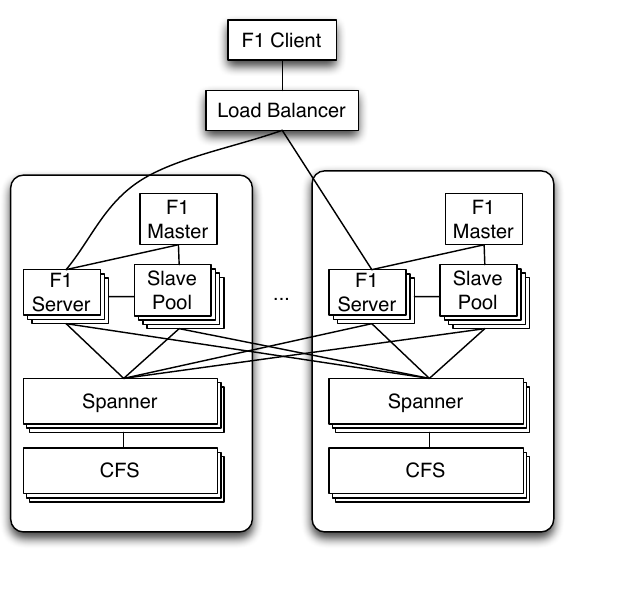
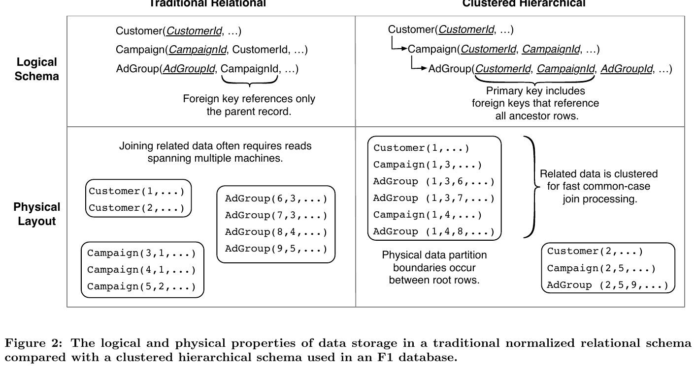
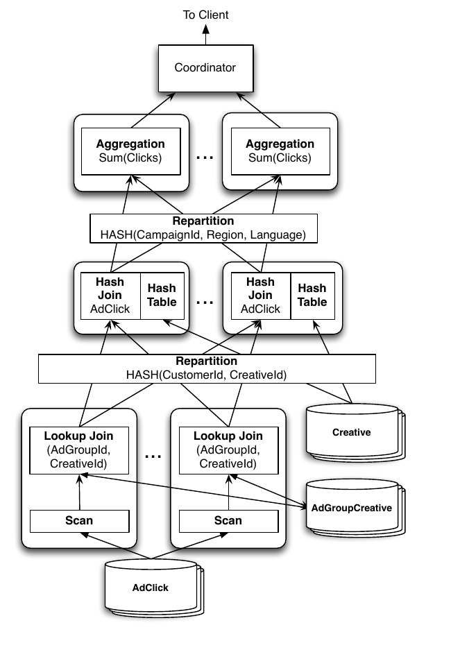

# F1：一个可扩展的分布式 SQL 数据库


> 原文：Jeff Shute, Radek Vingralek, Bart Samwel, Ben Handy, Chad Whipkey, Eric Rollins, Mircea Oancea, Kyle Littlefield, David Menestrina, Stephan Ellner, John Cieslewicz, Ian Rae, Traian Stancescu, Himani Apte. **F1: A Distributed SQL Database That Scales.** VLDB 2013.

## 摘要

F1 是 Google 构建的一套分布式关系型数据库，用于支撑 AdWords 业务。F1 是一种混合型数据库，同时具备高可用性、Bigtable 这类 NoSQL 系统的可扩展性，以及传统 SQL 数据库的一致性和易用性。F1 构建在 Spanner 之上，Spanner 提供了跨数据中心的同步复制与强一致性。同步复制意味着更高的 commit 延迟，但 F1 通过带结构化数据类型的层次化 schema 模型以及合理的应用设计缓解了这种延迟。F1 还包含一套功能完整的分布式 SQL 查询引擎，以及自动的变更追踪和发布机制。最近的若干出版物曾断言这些设计目标相互排斥 [<sup>5</sup>](#refer-anchor-5), [<sup>11</sup>](#refer-anchor-11), [<sup>23</sup>](#refer-anchor-23)。本文的一个关键贡献就是展示我们如何在 F1 的设计中同时达成所有这些目标，以及我们在何处做了取舍与牺牲。

## 1. 引言

F1 是 Google 构建的一套容错的、全球分布的 OLTP 与 OLAP 数据库，作为 Google AdWords 系统新的存储系统。它被设计用来替代一套分片 MySQL 实现——后者已经无法满足我们日益增长的可扩展性和可靠性需求。

F1 设计的关键目标包括：

1. **可扩展性**：系统必须能够通过简单地增加资源，以透明的方式扩展。基于 MySQL 的分片数据库难以扩展，更难以重新平衡。我们的用户需要复杂查询和 JOIN，这就意味着他们必须仔细地对数据分片，并且不破坏应用地对数据重分片是极具挑战的。

2. **可用性**：系统在任何情况下都不能停机——数据中心故障、计划维护、schema 变更等。系统为 Google 的核心业务存储数据，任何停机都会带来显著的收入影响。

3. **一致性**：系统必须提供 ACID 事务，并且始终向应用呈现一致且正确的数据。让应用去处理数据中的并发异常非常容易出错、耗时，并且最终也不值得性能上的那点收益。

4. **易用性**：系统必须提供完整的 SQL 查询支持以及用户期望从 SQL 数据库获得的其它功能。索引和 ad hoc 查询等特性不只是 nice-to-have，而是我们业务的硬性需求。

这些设计目标相互排斥这一断言被本文的贡献之一所反驳——我们展示了在 F1 的设计中能够同时达成所有这些目标，以及我们在何处做了取舍与牺牲。F1 这个名字来自遗传学——Filial 1 杂交一代是不同亲本类型杂交产生的第一代后代。F1 数据库系统确实就是这样一种杂交体，它结合了传统关系数据库和 Bigtable 这类可扩展 NoSQL 系统的优点。

F1 构建在 Spanner 之上，Spanner 提供了极具可扩展性的数据存储、同步复制以及强一致性和全局排序能力。F1 从 Spanner 继承这些特性，并补充了以下能力：

* 分布式 SQL 查询，包括与外部数据源的 JOIN；
* 事务一致的二级索引；
* 异步 schema 变更，包括数据库重组；
* 乐观事务；
* 自动的变更历史记录与发布。

F1 的设计选择导致典型读写延迟更高。我们开发了一系列技术来隐藏这部分额外延迟，并且发现用户层面事务的体验可以达到原来 MySQL 系统的水平：

* F1 schema 通过使用具有层次关系的表以及带结构化数据类型的列来显式地组织数据聚簇。这种聚簇提升了数据局部性，减少了读取远程数据所需的 RPC 次数和成本。
* F1 用户大量使用批处理、并行和异步读。我们使用一套新的 ORM（对象-关系映射）库把这些概念显式化。这给典型应用层操作所需的 RPC 数设定了上限，让这些操作天然地具备良好的可扩展性。

F1 系统自 2012 年初开始在生产环境管理 AdWords 全部广告活动数据。AdWords 是一个庞大而多元的生态系统，包含数百个应用和上千个用户，全部共享同一套数据库。该数据库超过 100 TB，每秒处理数十万次请求，运行的 SQL 查询每天扫描数万亿数据行。即使在非计划停机的情况下，可用性也达到 5 个 9，并且可观测到的 Web 应用延迟相比原来的 MySQL 系统并未增加。

我们将在整篇论文中以 AdWords 的 F1 数据库作为讨论对象，因为它是 F1 最初也是最关键的驱动用户。Google 内部其它若干团队目前也在开始部署 F1。

## 2. 基础架构

用户通过 F1 client 库与 F1 交互。其它工具，例如命令行 ad hoc SQL shell，也基于同一 client 实现。Client 把请求发送给众多 F1 server 之一，F1 server 负责从远程数据源读写数据并协调查询执行。图 1 描绘了 F1 的基础架构以及各组件之间的通信。



*图 1：F1 系统基础架构，server 部署在两个数据中心。*

由于 F1 是分布式架构，必须特别注意避免不必要地增加请求延迟。例如，F1 client 和负载均衡器在可能的情况下都优先连接到本数据中心的 F1 server。但在高负载或故障情况下，请求也可能被透明地转发到远程数据中心的 F1 server。

F1 server 通常与存储数据的 Spanner server 部署在同一组数据中心。这种共置确保 F1 server 通常能快速访问底层数据。出于可用性和负载均衡的需要，F1 server 在必要时可以与本数据中心之外的 Spanner server 通信。每个数据中心的 Spanner server 再从本数据中心的 Colossus File System（CFS）[<sup>14</sup>](#refer-anchor-14) 拉取数据。与 Spanner 不同，CFS 并不是全球复制的服务，因此 Spanner server 永远不会与远程 CFS 实例通信。

F1 server 在很大程度上是无状态的，client 可以为每个请求与不同的 F1 server 通信。唯一的例外是 client 使用悲观事务并且必须持有锁时——此时 client 在整个事务期间被绑定到一台 F1 server。F1 事务的更多细节在第 5 节描述。因为 F1 server 不持有任何数据，所以可以根据总负载快速地向系统中加入（或移除）F1 server，而无需任何数据迁移。

F1 集群包含若干额外组件，用于执行分布式 SQL 查询。当查询规划器估计更高的并行度能够降低查询处理延迟时，就会选用分布式执行而不是集中执行。共享 slave pool 由若干 F1 进程组成，这些进程仅用于代表普通 F1 server 执行分布式查询计划中的部分片段。Slave pool 的成员关系由 F1 master 维护，F1 master 监控 slave 进程的健康状况并把可用 slave 列表分发给 F1 server。F1 也通过 Google 的 MapReduce 框架 [<sup>10</sup>](#refer-anchor-10) 支持大规模数据处理。出于性能考虑，MapReduce worker 被允许直接与 Spanner server 通信以批量抽取数据（图 1 中未显示）。其它 client 的读写操作全部通过 F1 server 进行。

整个系统的吞吐可以通过加入更多 Spanner server、F1 server 或 F1 slave 来扩展。因为 F1 server 不存储数据，增加新的 server 不涉及任何数据再分布的成本。增加新的 Spanner server 会引起数据再分布，但这个过程对 F1 server（进而对 F1 client）完全透明。

基于 Spanner 的远程存储模型以及我们的地理分布式部署使得 F1 的延迟特性与普通数据库截然不同。因为数据在多个数据中心之间被同步复制，又因为我们选择了地理跨度很大的数据中心，commit 延迟相对较高（50–150 ms）。这种高延迟要求 client 访问数据库的模式必须做出改变。我们将在第 7.1 节描述这些改变，并在第 9 节和第 10 节进一步给出关于部署选择以及由此带来的可用性与延迟的细节。

### 2.1 Spanner

F1 构建在 Spanner 之上。两套系统是同期开发、紧密协作的。Spanner 负责处理更底层的存储问题，例如持久化、缓存、复制、容错、数据分片与迁移、位置查找以及事务。

在 Spanner 中，数据行被按照 schema 中的祖先关系划分到称为 directory 的聚簇中。每个 directory 至少有一个 fragment，大的 directory 可以有多个 fragment。Group 存储若干 directory fragment。每个 group 通常在每个数据中心有一个副本 tablet。数据使用 Paxos 算法 [<sup>18</sup>](#refer-anchor-18) 同步复制，group 内所有 tablet 存储相同的数据。其中一个副本 tablet 被选为 group 的 Paxos leader，它是该 group 所有事务活动的入口。Group 也可以包含 readonly 副本，这些副本不参与 Paxos 投票，也不会成为 group leader。

Spanner 提供使用严格两阶段锁的可串行化悲观事务。一个事务包含多次读（获取共享锁或排他锁），随后是一次升级锁并原子提交事务的写操作。所有 commit 都使用 Paxos 同步复制。事务在更新位于同一 group 内的数据时效率最高。Spanner 也支持跨多个 group（称为 transaction participant）的事务，使用两阶段提交（2PC）协议跑在 Paxos 之上。2PC 增加了一次额外的网络往返，因此通常会把观察到的 commit 延迟翻倍。2PC 在参与者数量为几十时扩展性良好，但当参与者数量达到数百时，abort 频率和延迟会显著上升 [<sup>7</sup>](#refer-anchor-7)。

Spanner 拥有非常强的一致性和 timestamp 语义。每个事务都被分配一个 commit timestamp，这些 timestamp 为 commit 提供了一个全局全序。Spanner 使用一种新颖的机制来以可扩展的方式挑选全局有序的 timestamp，这一机制依赖于 Google 数据中心内部署的硬件时钟。Spanner 利用这些 timestamp 提供多版本一致读，包括当前数据的快照读，而无需获取读锁。为了保证非阻塞的全局一致读，Spanner 提供了一个 global safe timestamp，低于该 timestamp 不会有任何正在执行或未来事务可能 commit。Global safe timestamp 通常比当前时间晚 5–10 秒。在这个 timestamp 上的读通常可以在任意副本 tablet（包括 readonly 副本）上执行，并且它们永远不会在运行中事务之后阻塞。

## 3. 数据模型

### 3.1 层次化 Schema

F1 数据模型与 Spanner 数据模型非常相似。事实上，Spanner 最初的数据模型更接近 Bigtable，但 Spanner 后来采用了 F1 的数据模型。在逻辑层面，F1 拥有一套与传统 RDBMS 类似的关系 schema，并做了一些扩展：显式的表层次结构以及带 Protocol Buffer 数据类型的列。

在逻辑上，F1 schema 中的表可以被组织成一棵层次树。在物理上，F1 把每个子表的行与父表的对应行**聚簇**在一起并**交错**存储。逻辑 schema 中的表不能被任意交错：子表必须以引用父表的外键作为其主键的前缀。例如，AdWords 的 schema 中包含一张 Customer 表，主键为 `(CustomerId)`，它有一张子表 Campaign，主键为 `(CustomerId, CampaignId)`，后者又有一张子表 AdGroup，主键为 `(CustomerId, CampaignId, AdGroupId)`。层次结构中根表的一行称为一个 root row。一个 root row 对应的所有子表行都与该 root row 一起被聚簇到同一个 Spanner directory 中，这意味着该聚簇通常存储在单台 Spanner server 上。子行按主键顺序存储于其父行之下。图 2 给出了一个例子。



*图 2：传统规范化关系 schema 与 F1 数据库中使用的层次化聚簇 schema 在逻辑与物理数据存储属性上的对比。*

层次化聚簇的物理 schema 相比扁平关系 schema 有几项优势。考虑图 2 中对应的传统 schema：在这种传统 schema 中，要取出给定 CustomerId 对应的所有 Campaign 和 AdGroup 记录需要两个串行步骤，因为没有直接按 CustomerId 取 AdGroup 记录的方式。在 F1 版本的 schema 中，层次化的主键让 Campaign 和 AdGroup 记录的取数可以并行启动，因为两张表都以 CustomerId 作为键。主键前缀这一性质意味着读取某个 Customer 的所有 AdGroup 可以表达为一次范围读，而不是使用索引逐行读取。进一步，因为这两张表都按主键顺序存储，两张表的行可以通过一个简单的有序合并来 JOIN。因为数据被聚簇到同一个 directory 中，我们可以在一次 Spanner 请求中读完所有数据。层次化 schema 的所有这些性质都有助于缓解远程数据带来的延迟。

层次化聚簇对更新尤其有用，因为它减少了事务涉及的 Spanner group 数量。因为每个 root row 和它的所有后代行都存储在同一个 Spanner directory 中，限定在单个 root 内的事务通常能避开 2PC 以及相关的延迟代价，所以大多数应用都尽量使用单 root 事务。即使在跨多个 root 的事务中，限制涉及的 root 数量仍然重要，因为增加更多的参与者通常会提高延迟并降低成功 commit 的概率。

层次化聚簇在 F1 中并非强制要求。一个 F1 schema 经常包含多个根表，事实上完全扁平的 MySQL 风格 schema 仍然是可能的。但只要层次结构与数据语义匹配，使用层次结构就是非常有益的。在 AdWords 中，大多数事务通常一次只更新单个广告主的数据，所以我们把广告主设为根表（Customer），并把相关表都聚簇到它下面。这种聚簇对于达到可接受的延迟至关重要。

### 3.2 Protocol Buffers

F1 数据模型支持表中的列包含结构化数据类型。这些结构化类型使用 Google 开源 Protocol Buffer [<sup>16</sup>](#refer-anchor-16) 库提供的 schema 和二进制编码格式。Protocol Buffer 的字段是带类型的，可以是 required、optional 或 repeated；字段也可以是嵌套的 Protocol Buffer。在 Google 内部，Protocol Buffer 广泛用于数据存储和应用之间的数据交换。当我们还在用 MySQL schema 时，用户经常不得不编写繁琐且容易出错的转换代码，把数据库行转换成内存中的数据结构。把 Protocol Buffer 直接放进 schema 消除了这种阻抗失配，给了用户一种既能在数据库中使用也能在应用代码中使用的统一数据结构。

Protocol Buffer 允许使用 repeated 字段。在 F1 schema 设计中，当子记录数量有明确上限时，我们经常用 repeated 字段代替子表。通过使用 repeated 字段，我们避免了存储和 JOIN 多个子记录带来的性能开销与复杂度。整段 Protocol Buffer 实质上被 Spanner 当作一个 blob 处理。除了性能上的影响之外，Protocol Buffer 列对用户来说更自然、降低了语义复杂度，因为用户现在可以把他们的逻辑业务对象作为原子单元读写，而不必考虑跨多张表用 JOIN 物化它们。F1 SQL 中 Protocol Buffer 的使用将在第 8.7 节中介绍。

F1 schema 中的许多表只包含单个 Protocol Buffer 列。其它表则把数据拆分到若干列中，按访问模式对字段进行划分。把字段分到不同列的目的是把通常被一起访问的字段归到同一列、分离静态字段和频繁更新字段、允许为不同列指定不同的读/写权限、或者允许对不同列进行并发更新。在 Spanner 中，每列都可能带来较高的开销，所以使用更少的列通常会提升性能。

### 3.3 索引

F1 中所有索引都是事务一致且完全一致的。索引在 Spanner 中以独立表的形式存储，主键为索引键与被索引表主键的拼接。索引键既可以是标量列，也可以是从 Protocol Buffer（包括 repeated 字段）中抽取的字段。F1 索引有两种物理存储布局：local 和 global。

**Local index** 的键必须以 root row 的主键作为前缀。例如，对 `(CustomerId, Keyword)` 建立的索引用来为每个客户存储唯一的 keyword，它就是一个 local index。与子表类似，local index 与对应的 root row 存储在同一个 Spanner directory 中。因此，local index 的索引条目与被索引行存储在相同的 Spanner server 上，local index 的更新几乎不会给任何事务增加额外成本。

相比之下，**global index** 的键不包含 root row 主键前缀，因此无法与被索引行共置。例如，对 `(Keyword)` 建立的索引把整个数据库的所有 keyword 映射到使用它们的 Customer 上，这就必须是 global index。Global index 通常规模很大，可能具有很高的总体更新速率。因此它们被分片到许多 directory 中，存储在多台 Spanner server 上。写入单行同时更新一个 global index 需要给事务增加一个额外的参与者，这意味着事务必须使用 2PC，但这是为一致的 global index 付出的合理代价。

Global index 对单行更新工作得相当好，但在大批量事务中可能引起扩展性问题。考虑一个插入 1000 行的事务。每一行都需要增加一条或多条 global index 入口，而这些 index 入口可能分散在数百个 index directory 中，这意味着该 2PC 事务将拥有数百个参与者，使其更慢且更容易出错。因此，我们在 schema 中谨慎使用 global index，并鼓励应用作者在向带 global index 的表批量插入时使用小事务。

Megastore [<sup>3</sup>](#refer-anchor-3) 通过放弃一致性、只支持异步 global index 的方式让 global index 具备扩展性。我们目前正在探索其它机制，希望在不让步一致性的前提下让 global index 更具扩展性。

## 4. Schema 变更

AdWords 数据库由上千名用户共享，并且始终在开发中。Schema 变更批次由开发者排队，每天执行一次。这个数据库对 Google 来说是关键业务，要求非常高的可用性。在 schema 变更期间（例如添加索引）出现停机或表锁是不可接受的。

我们把 F1 设计为让所有 schema 变更完全非阻塞。F1 系统的若干特性使得非阻塞的 schema 变更尤其具有挑战性：

* F1 是一个大规模分布式系统，server 分布在多个地理上分散的数据中心。
* 每台 F1 server 在内存中都有一份本地 schema。要让一次更新在所有 server 上原子地发生是不现实的。
* 即使在正在发生 schema 变更的表上，查询和事务也必须继续。
* 在 schema 变更期间，系统的可用性和延迟不能受到负面影响。

因为 F1 是大规模分布的，即使 F1 拥有一个全局的 F1 server 成员关系仓库，跨所有 server 的同步 schema 变更也会对响应时间造成严重破坏。为了让变更原子生效，在某个时刻 server 必须阻塞事务，直到确认所有其它 server 都已收到变更。为了规避这一点，F1 的 schema 变更采用**异步**方式，在不同 F1 server 上在不同的时间应用。这意味着两台 F1 server 可能使用不同的 schema 并发地更新数据库。

如果两台 F1 server 使用根据我们的 schema 变更算法不兼容的 schema 更新数据库，就可能引发异常，包括数据库损坏。我们用一个例子来说明数据库损坏的可能性。考虑把 schema `S1` 变为 schema `S2` 的变更，在表 `T` 上添加索引 `I`。因为 schema 变更在不同的 F1 server 上异步应用，假设 server `M1` 正在使用 schema `S1`，而 server `M2` 正在使用 schema `S2`。首先，server `M2` 插入新行 `r`，这同时为行 `r` 添加了新的索引入口 `I(r)`。随后，行 `r` 被 server `M1` 删除。因为该 server 正在使用 schema `S1` 而不知道索引 `I` 的存在，server 删除了行 `r`，但没有删除索引入口 `I(r)`。于是数据库变得不一致。例如，对 `I` 的索引扫描将返回与已删除行 `r` 对应的脏数据。

我们实现了一种 schema 变更算法来防止类似上述的异常，它通过以下方式做到：

1. **强制所有 F1 server 同时最多激活两种不同的 schema**。每台 server 使用 current schema 或 next schema 之一。我们对 schema 颁发租约，并确保没有 server 在租约到期后仍然使用该 schema。
2. **把每次 schema 变更细分为多个阶段**，相邻的两个阶段互相兼容，不会引发异常。在上述例子中，我们先以只执行 delete 操作的模式添加索引 `I`。这会阻止 server `M1` 把 `I(r)` 写入数据库。随后，我们升级索引 `I` 让 server 执行所有写操作。然后我们启动一个 MapReduce，为表 `T` 中的所有行回填索引入口，使用精心构造的事务处理并发写。完成之后，我们让索引 `I` 对常规读操作可见。

完整的 schema 变更算法细节见 [<sup>20</sup>](#refer-anchor-20)。

## 5. 事务

AdWords 产品生态需要一个支持 ACID 事务的数据存储。我们存储的是金融数据，对数据完整性和一致性有硬性要求。我们对最终一致性系统在 Google 内部也有大量经验。在所有这类系统中，我们都发现开发者把显著比例的时间花在了构建极其复杂且容易出错的机制上，以应对最终一致性并处理可能过期的数据。我们认为这是开发者身上不可接受的负担，一致性问题应该在数据库层面解决。完整的事务一致性是 F1 最重要的属性之一。

每个 F1 事务由多次读组成，可选地跟一次写来提交事务。F1 实现三种类型的事务，它们都构建在 Spanner 的事务支持之上：

1. **Snapshot transactions**。这些是只读事务，具有快照语义，在一个固定的 Spanner snapshot timestamp 上读取可重复数据。默认情况下，snapshot 事务在 Spanner 的 global safe timestamp（通常比当前时间晚 5–10 秒）上读取，并从本地 Spanner 副本读取。用户也可以显式请求一个特定 timestamp，或让 Spanner 选择当前 timestamp 以看到最新数据。后一种选择可能带来更高的延迟并需要远端 RPC。

   Snapshot 事务是 SQL 查询以及 MapReduce 的默认模式。Snapshot 事务允许多个 client server 在同一 timestamp 上看到整个数据库的一致视图。

2. **Pessimistic transactions**。这些事务直接映射到 Spanner 事务 [<sup>7</sup>](#refer-anchor-7)。悲观事务使用一种有状态的通信协议，需要持有锁，因此单个悲观事务中的所有请求都被导向同一台 F1 server。如果 F1 server 重启，悲观事务就会 abort。悲观事务中的读可以请求共享锁或排他锁。

3. **Optimistic transactions**。乐观事务包含一个读阶段（可以任意长，并且永远不获取 Spanner 锁）以及一个短的写阶段。为了检测行级冲突，F1 在返回每一行时同时返回该行的 last modification timestamp（存储在该行的一个隐藏 lock column 中）。每次对应数据被更新时（无论是悲观事务还是乐观事务），新的 commit timestamp 都会被自动写入 lock column。Client 库收集这些 timestamp，并在提交事务的写操作中将它们一并传给一台 F1 server。F1 server 创建一个短命的 Spanner 悲观事务，重新读取所有读过的行的 last modification timestamp。如果任何一行重新读到的 timestamp 与 client 传入的不一致，说明发生过冲突更新，F1 就 abort 该事务。否则，F1 把写操作发送给 Spanner 完成 commit。

   F1 client 默认使用乐观事务。乐观事务有若干好处：

   * **容忍行为不当的 client**。读永远不持锁，也永远不会与写冲突。这避免了行为不当的 client（运行长时间事务或不 abort 就放弃事务）造成的任何问题。
   * **长时间运行的事务**。乐观事务可以任意长，这在某些场景下是有用的。例如，一些 F1 事务需要等待终端用户的交互。同时，逐行单步调试一个事务时也很难，因为悲观事务会一直被 abort。空闲事务通常在 10 秒内会被 kill，以避免泄漏锁，这意味着长时间运行的悲观事务往往无法 commit。
   * **Server 端可重试**。乐观事务的 commit 是自包含的，这使得它们很容易在 F1 server 端透明地重试，把大部分 Spanner 瞬时错误隐藏在用户面前。悲观事务不能被 F1 server 重试，因为重试需要重新跑一遍用户的业务逻辑才能复现同样的加锁副作用。
   * **Server 故障切换**。乐观事务关联的所有状态都保存在 client 端。因此，client 可以在故障后或出于负载均衡的考虑，把读和 commit 发送给不同的 F1 server。
   * **Speculative writes**。Client 可以在一个乐观事务之外（可能是在一次 MapReduce 中）读取一些值，并记住那次读使用的 timestamp。然后 client 可以在一个乐观事务中使用这些值和 timestamp 做一次 speculative write，只有在原始读之后没有发生过其它写的情况下，写才会成功。

   乐观事务确实也有一些不足：

   * **Insertion phantoms**。Modification timestamp 只对表中已存在的行存在，因此乐观事务无法防止 insertion phantoms [<sup>13</sup>](#refer-anchor-13)。当这成为问题时，可以在父表上使用锁来避免 phantom（见第 5.1 节）。
   * **高争用下吞吐低**。例如，在一张维护计数器、且被许多 client 并发递增的表中，乐观事务会导致大量失败的 commit，因为读到的 timestamp 到写时几乎一定已经过期。在这种情况下，使用排他锁的悲观事务可以避免失败 commit，但同时也会限制吞吐。如果每次 commit 需要 50 ms，那么每秒最多只能有 20 个事务。要突破这个限制，需要在应用层做出改变，例如对更新做批处理。

F1 用户可以任意混用乐观事务和悲观事务，同时仍然保留 ACID 语义。所有 F1 写操作都会更新每个相关 lock column 上的 last modification timestamp。Snapshot 事务独立于任何写事务，并且始终是一致的。

### 5.1 灵活的锁粒度

F1 默认提供行级锁。每个 F1 行包含一个 default lock column，覆盖该行所有列。但 schema 中可以改变并发度。例如，用户可以通过在同一行中定义额外的 lock column 来提高并发度，每个 lock column 覆盖列的一个子集。在极端情况下，每一列可以被一个独立的 lock column 覆盖，相当于列级锁。

列级锁的一个常见用途是在并发写场景中：每个写者更新一组不同的列。例如，可以有一个允许用户修改 keyword 出价的前端系统，以及一个在相同 keyword 上更新投放统计的后端系统。活跃的客户可能在出价被持续更新的同时，后端系统也在更新统计数据。列级锁避免了这些独立的更新流之间的事务冲突。

用户也可以通过在父表上使用 lock column 来覆盖子表中的列，从而选择性地降低并发度。这意味着子表中的一组行共享同一个 lock column，这些行内的写会被串行化。F1 用户经常在父表中使用 lock column 来避免特定谓词下的 insertion phantom，或让其它业务逻辑约束更易于强制执行。例如，可以规定每个 AdGroup 的 keyword 数量上限，并要求 keyword 必须互不重复。如果同一 AdGroup 内的并发 keyword 插入不可能发生，这种约束就很容易被正确地强制执行。

## 6. 变更历史

许多数据库用户都会构建机制来记录变更，无论是通过应用代码还是借助数据库特性（如触发器）。在 AdWords 之前使用的 MySQL 系统中，我们的 Java 应用库在所有事务里都增加变更历史记录。这虽然不错，但效率不高，而且从来都不是 100% 可靠的。某些类别的变更不会产生历史记录，包括通过 Python 脚本执行的变更以及手动的 SQL 数据变更。

在 F1 中，Change History 成为了数据库级别的一等特性，在这里我们可以最高效地实现它，并且能保证完整的覆盖。在一个开启变更追踪的数据库中，所有表默认都会被追踪变更，但可以在 schema 中选择性地让特定表或列退出追踪。F1 中的每个事务都会生成一个或多个 ChangeBatch Protocol Buffer，其中包含每条被更新行的主键以及被更新列的 before 和 after 值。这些 ChangeBatch 被写入普通的 F1 表，这些表作为每个根表的子表存在。ChangeBatch 表的主键包含关联的根表键以及事务的 commit timestamp。当一个事务在多个 root row（可能来自不同的根表层次）下更新数据时，会为每个不同的 root row 各写入一个 ChangeBatch（这些 ChangeBatch 互相之间带有指针，以便在必要时可以重新拼装出完整的事务）。这意味着对于每个 root row，变更历史表中的 ChangeBatch 按 commit 顺序展示该 root row 所有子节点的变更，并且这些数据可以通过 SQL 方便地查询。这种聚簇也意味着变更历史与被追踪的数据存储得很近，因此这些额外的写入通常不会给 Spanner 事务增加额外的参与者，因此对延迟的影响极小。

F1 的 ChangeHistory 机制有多种用途。最常见的用途是那些希望接收变更通知、然后做一些增量处理的应用。例如，审批系统需要在插入新广告时收到通知以便审批它们。F1 使用一套发布-订阅系统推送关于特定 root row 发生变更的通知。发布发生在 Spanner 中，并被保证在任何 root row 的任何变更序列之后至少发生一次。订阅者通常为每个 root row 记住一个 checkpoint（即高水位），每当收到通知时就读取该 checkpoint 之后的所有变更。这是 Spanner timestamp 排序属性特别有用的一个例子，因为它们允许使用 checkpoint 来保证每条变更恰好被处理一次。存在一个独立的系统让这些 client 可以很容易地只看到它们关心的表或列的变更。

Change History 也以一种有趣的方式被用于缓存。有一个 client 使用一份基于数据库状态的内存缓存，分布在多台 server 上，并在 AdWords Web UI 渲染页面时使用。在用户提交一次更新之后，重要的是接下来渲染的页面要反映出那次更新。当这个 client 从缓存中读取时，它会传入 root row 的键以及必须可见的最后一次写入的 commit timestamp。如果缓存落后于该 timestamp，它会读取自己 checkpoint 之外的 Change History 记录并把这些变更应用到内存状态中以追赶上来。这比用一次全量抽取重新加载缓存便宜得多，也比可比的缓存失效协议简单且准确得多。

## 7. 客户端设计

### 7.1 简化的 ORM

与一个分布式数据存储打交道的本质要求我们重新思考 client 应用与数据库交互的方式。我们的许多 client 应用原本是基于一套 MySQL 的 ORM 层编写的，那套 ORM 无法很好地适配 F1。使用该库编写的代码会表现出若干常见的 ORM 反模式：

* **对开发者隐藏数据库操作**。
* **串行读**，包括在 `for` 循环里每次迭代执行一次查询。
* **隐式遍历**：添加不需要的 JOIN，并"以防万一"地预加载不必要的数据。

这类模式在 ORM 库中很常见。在使用本地数据存储的小规模系统中它们可能节省开发时间，但即使在那种情况下它们也会损害可扩展性。当与像 F1 这样高延迟的远程数据库结合时，它们就是灾难性的。在 F1 中，我们用一个全新的、剥除了多余功能的 API 替换了那套 ORM 层，强制规避这些反模式。新的 ORM 层不使用任何 JOIN，也不会隐式遍历记录之间的任何关系。所有对象加载都是显式的，并且 ORM 层暴露的 API 推动并行与异步读访问的使用。在 F1 schema 中这种做法是可行的，原因有二。第一，可见的表更少，client 通常直接从数据库加载 Protocol Buffer。第二，层次化结构的主键让加载一个对象的所有子节点可以表达为单次范围读，而无需 JOIN。

使用这套新的 F1 ORM 层，应用代码会更显式，可能比使用 MySQL ORM 时略复杂，但这种复杂度部分被 Protocol Buffer 列带来的阻抗失配降低所抵消。迁移的结果通常是获得更好的 client 代码——使用对数据库更高效的访问模式。避免串行读以及其它反模式带来的结果是，代码在更大的数据集上能更好地扩展，并表现出更平坦的整体延迟分布。

在 MySQL 时代，我们主交互应用的延迟方差很大。平均延迟通常为 200–300 ms。在小客户上的小操作会远快于这个值，但在大客户上的大操作会慢得多，延迟尾部的请求甚至会消耗数秒。开发者经常需要斗争式地定位并修复他们代码中引起过度串行读和高延迟的案例。在 F1 ORM 的新编码风格下，这种情况不再发生。用户请求通常需要固定数量（少于 10）的读，与请求大小或数据大小无关。最小延迟比 MySQL 更高，因为读操作的最低成本更高了，但平均值基本相同，而大请求的延迟尾部只比中位数慢几倍。

### 7.2 NoSQL 接口

F1 支持一种基于 key/value 的 NoSQL 接口，允许以快速、简单的方式编程访问行。读请求可以包含任意一组表，指定每张表的特定列和 key 范围。写请求按主键指定 insert、update 和 delete，并可指定任何列的新值，覆盖任意一组表。

该接口被 ORM 层在内部使用，同时也对 client 直接开放。这个 API 允许在单次调用中从多张表批量取回行，最大化减少完成一次数据库事务所需的往返次数。许多应用更喜欢直接使用这套 NoSQL 接口，因为在代码中构造结构化的读和写请求比生成 SQL 更简单。该接口也可以在 MapReduce 中用来指定要读取哪些数据。

### 7.3 SQL 接口

F1 同时提供一套功能完整的 SQL 接口，用于低延迟 OLTP 查询、大型 OLAP 查询以及介于二者之间的一切查询。F1 支持把 Spanner 数据存储中的数据与其它数据源（包括 Bigtable、CSV 文件以及 AdWords 聚合分析数据仓库）进行 JOIN。SQL 方言在标准 SQL 基础上扩展了若干用于访问 Protocol Buffer 中存储数据的构造。更新也通过 SQL DML 语句支持，并扩展了对 Protocol Buffer 内字段以及 Protocol Buffer 中 repeated 结构的更新支持。完整语法细节超出本文范围。

## 8. 查询处理

F1 SQL 查询处理系统具有以下关键性质，本节将逐一展开：

* 查询要么以低延迟集中执行，要么以高并行度分布式执行。
* 所有数据都是远程的，并大量使用批处理以缓解网络延迟。
* 所有输入数据以及内部数据都以任意方式分片，几乎没有可用的有序性。
* 查询使用大量基于 hash 的重分区步骤。
* 单个查询计划算子被设计为尽快把数据流给后续算子，最大化查询计划中的流水线。
* 层次化聚簇的表有经过优化的访问方法。
* 查询数据可以被并行消费。
* Protocol Buffer 类型的列提供对结构化数据类型的一等支持。
* Spanner 的快照一致性模型提供全局一致的结果。

### 8.1 集中式与分布式查询

F1 SQL 同时支持集中式和分布式执行。集中式执行用于短小的 OLTP 风格查询，整个查询跑在一台 F1 server 节点上。分布式执行用于 OLAP 风格查询，把查询工作负载分散到 F1 slave pool 中的 worker 任务上（见第 2 节）。分布式查询始终使用 snapshot 事务。查询优化器使用启发式来决定给定查询适合采用哪种执行模式。在接下来各小节中，我们将主要关注分布式查询执行。许多概念同样适用于集中执行的查询。

### 8.2 分布式查询示例

下面这个查询会使用分布式执行：

```sql
SELECT agcr.CampaignId, click.Region,
       cr.Language, SUM(click.Clicks)
FROM AdClick click
JOIN AdGroupCreative agcr
  USING (AdGroupId, CreativeId)
JOIN Creative cr
  USING (CustomerId, CreativeId)
WHERE click.Date = '2013-03-23'
GROUP BY agcr.CampaignId, click.Region, cr.Language
```

这个查询使用了 AdWords schema 的一部分。AdGroup 是若干具有某些共享配置的广告的集合。Creative 是实际的广告文案。AdGroupCreative 表是 AdGroup 和 Creative 之间的关联表；Creative 可以被多个 AdGroup 共享。每条 AdClick 记录了用户看到的 Creative 以及该 Creative 所选自的 AdGroup。该查询取出某一天的所有 AdClick，找到对应的 AdGroupCreative 并找到 Creative。然后按 campaign、地区和语言聚合，得到点击数。

该查询的一种可能的执行计划如图 3 所示。在查询计划中，数据从最底层的算子开始自底向上流过各个算子，直到聚合算子。最深的算子执行对 AdClick 表的扫描。在同一个 worker 节点上，AdClick 扫描出来的数据流入一个 lookup join 算子，该算子使用二级索引键查找 AdGroupCreative 记录。然后该计划对数据流按 CustomerId 和 CreativeId 的哈希进行重分区，并在以同样方式分区的 hash 表中执行查找（一次分布式 hash join）。在分布式 hash join 之后，数据再次被重分区，这次按 CampaignId、Region 和 Language 字段的哈希，然后送入一个按这些字段分组的聚合算子（一次分布式聚合）。



*图 3：一个分布式查询计划。圆角矩形代表跑在不同机器上的进程，箭头表示数据流，可以是进程内部的数据流，也可以是以 RPC 形式跨网络的数据流。*

### 8.3 远程数据

SQL 查询处理（尤其是 join 处理）在 F1 中带来了一些有趣的挑战，主要因为 F1 不在本地存储数据。F1 的主数据存储是 Spanner——一个远程数据源；F1 SQL 也能访问其它远程数据源并跨它们进行 JOIN。这些远程数据访问涉及高度可变的网络延迟 [<sup>9</sup>](#refer-anchor-9)。相比之下，传统数据库系统通常在承载数据的同一台机器上完成处理，它们主要通过优化来减少磁盘寻道次数和磁盘访问次数。

网络延迟和磁盘延迟在两个根本方面有所不同。第一，网络延迟可以通过批处理或流水线数据访问来缓解。F1 大量使用批处理来缓解网络延迟。第二，磁盘延迟通常是对单一有限资源（实际的磁盘硬件）争用的结果。这严重限制了在同一时刻发出多个数据访问的用处。相比之下，F1 基于网络的存储通常分布在许多磁盘上，因为 Spanner 把数据分片到许多物理 server，并且还在更细的粒度上分片，因为 Spanner 把数据存在 CFS 中。这使得多个数据访问争用相同资源的可能性大大降低，因此并行调度多个数据访问通常会带来近似线性的加速，直到底层存储系统真正过载。

F1 SQL 利用批处理的最典型例子是 lookup join 查询计划算子。该算子通过使用等值查找键从内表读取来执行 join。它首先从外表读取行，从这些行中提取查找键的值并去重。它持续累积，直到收集到 50 MB 的数据或 10 万个不同的查找键为止。然后它对内表中的所有键执行并发查找。这会以任意顺序返回所请求的数据。Lookup join 算子把检索到的内表行与保存在内存中的外表行进行 join，使用 hash 表进行快速查找。命中结果立即作为输出从 lookup join 节点流出。

F1 的查询算子被设计为尽可能多地流式数据，减少流水线停顿的发生。这种设计选择限制了算子保留输入数据有序性的能力。具体来说，一个 F1 算子常常有多个读在并行异步运行，并尽快把可用的行流给下一个算子。这种对数据流式化的强调意味着输入数据的有序性会丢失，但它换来了最大的读请求并发度并限制了行缓冲所需的空间。

### 8.4 分布式执行概览

一个完整的查询计划由若干 plan part 组成，每个 plan part 代表若干执行同一查询子计划的 worker。Plan part 被组织成一个有向无环图（DAG），数据从 DAG 的叶子流向唯一的根节点——唯一的汇点。根节点也称为 query coordinator，它由收到 SQL 查询请求的 server 执行。Query coordinator 规划查询的执行，从倒数第二层 plan part 接收结果，执行任何最终的聚合、排序或过滤，然后把结果流回 client，除非是第 8.6 节中描述的分区消费场景。

分布式数据库系统经常使用的一种技术是利用数据显式共分区（co-partitioning）的优势。这种共分区可被用来把大量查询处理下推到承载分区的各个处理节点上。F1 无法利用这种分区，部分原因在于数据永远是远程的，更重要的原因在于 Spanner 施加的是一种任意且实际上随机的分区。此外，Spanner 还可以动态地改变分区。因此，为了高效地执行操作，F1 必须经常诉诸于对数据进行重分区。因为没有任何输入数据是按 range 分区的，并且 range 分区依赖正确的统计信息，我们完全放弃了 range 分区，只使用 hash 分区。

传统上，这种重分区因为涉及大量网络流量而被认为是要尽量避免的。最近网络交换机硬件可扩展性的进步，让我们能够将数百个 F1 worker 进程连接在一起，让所有 server 能同时以接近其全速网络接口速度相互通信。这让我们在进行重分区时几乎不需要担心网络容量和机架亲和性等概念。这种方案的一个潜在缺点是它把 F1 集群的规模限制在了可用网络交换机硬件的极限之内。在 F1 系统面对的查询和数据规模下，这一点还没有构成实际问题。

F1 SQL 算子在内存中执行，不向磁盘做 checkpoint，并尽可能多地流式数据。这避免了把中间结果保存到磁盘的开销，所以查询运行得和能够处理数据一样快。然而，这也意味着任何 server 故障都可能让整个查询失败。失败的查询会被透明地重试，这通常能隐藏掉这些失败。在实践中，运行长达一小时的查询足够可靠，但比这长得多的查询可能经历过多失败。我们正在探索为部分中间结果加入 checkpoint，但要做到这一点而不伤害正常情况下（没有故障发生）的延迟，是有挑战的。

### 8.5 层次化表的 join

如第 3.1 节所述，F1 数据模型支持层次化聚簇表，其中子表的行被交错在父表中。该数据模型让我们能够通过共享的主键前缀高效地把父表与某个后代表进行 join。例如，考虑 Customer 表与 Campaign 表的 join：

```sql
SELECT *
FROM Customer JOIN
     Campaign USING (CustomerId)
```

层次化聚簇的数据模型允许 F1 通过一次对 Spanner 的请求完成该 join——我们在同一次请求中请求两张表的数据。Spanner 会以交错顺序（前序深度优先遍历）把数据返回给 F1，按主键前缀排序，例如：

```text
Customer(3)
  Campaign(3,5)
  Campaign(3,6)
Customer(4)
  Campaign(4,2)
  Campaign(4,4)
```

在读取这个流的同时，F1 使用一种类似 merge-join 的算法，我们称之为 cluster join。Cluster join 算子只需要为每张表各自缓冲一行，就能以流式方式在 Spanner 输入数据到达时输出 join 结果。任何数量的表只要落在表层次结构的同一条 ancestry 路径上，都能通过一次 Spanner 请求以这种方式 cluster join。例如，在下面的表层次结构中，F1 SQL 只能以这种方式把 RootTable join 到 ChildTable1 或 ChildTable2，但不能同时 join 到两者：

```text
RootTable
  ChildTable1
  ChildTable2
```

当 F1 SQL 必须在这样的同代表（兄弟表）之间进行 join 时，它会对其中一条 join 使用 cluster join 算法，并为其它的 join 选择另一种 join 算法。例如 lookup join 这种算法就能完成这种 join 而不需要把数据溢出到磁盘，也不会有无界的内存使用，因为它可以用有限大小的查找键批次来增量地构造 join 结果。

### 8.6 分区消费者

F1 查询可能产生海量数据，把这些数据全部通过单一 query coordinator 推送可能成为瓶颈。此外，单一 client 进程接收所有数据也可能成为瓶颈，并且很可能跟不上多台 F1 server 并行产生结果行的速度。为了解决这个问题，F1 允许多个 client 进程并行消费来自同一查询的分片数据流。该特性被用于 MapReduce [<sup>10</sup>](#refer-anchor-10) 这类分区消费者。Client 应用向 F1 发送查询并请求分布式数据检索。F1 然后返回一组连接端点。Client 必须连接到所有这些端点并并行取回数据。由于 F1 查询本质上是流式的，并且频繁的 hash 重分区带来了跨分区的相互依赖，所以一个分布式 reader 变慢也会拖慢其它分布式 reader，因为 F1 查询是同步地为所有 reader 产生结果。一种已识别但尚未实现的水平依赖缓解策略是使用磁盘支持的缓冲来打破依赖，让 client 能独立地继续。

### 8.7 包含 Protocol Buffer 的查询

如第 3 节所述，F1 数据模型大量使用 Protocol Buffer 类型的列。F1 SQL 方言把这些值视为一等对象，提供对其内含数据的完整访问。例如，下面的查询请求 country code 为 US 的每个客户的 CustomerId 以及整个 Protocol Buffer 类型的列 Info：

```sql
SELECT c.CustomerId, c.Info
FROM Customer AS c
WHERE c.Info.country_code = 'US'
```

这个查询展示了 Protocol Buffer 支持的两个方面。第一，查询使用路径表达式来提取单个字段（`c.Info.country_code`）。第二，F1 SQL 也允许查询整段 Protocol Buffer 并把整段 Protocol Buffer（`c.Info`）作为值传递。对整段 Protocol Buffer 的支持降低了 F1 SQL 与 client 应用之间的阻抗失衡——client 应用通常更倾向于接收完整的 Protocol Buffer。

Protocol Buffer 也允许使用 repeated 字段，它可以有零个或多个实例，也就是说它们可以被视作变长数组。当这些 repeated 字段出现在 F1 数据库列中时，它们实际上和 1:N 关系中的层次化子表非常相似。子表与 repeated 字段之间的主要区别在于：子表包含对父表的显式外键，而 repeated 字段对其所在的 Protocol Buffer 有一个隐式外键。利用这种相似性，F1 SQL 通过 PROTO JOIN 支持对 repeated 字段的访问，PROTO JOIN 是一种通过隐式外键进行 join 的 join 变体。例如，假设我们有一张 Customer 表，它有一个 Protocol Buffer 类型的列 Whitelist，而 Whitelist 又包含一个 repeated 字段 feature。进一步假设该字段 feature 的值本身就是 Protocol Buffer，每个 Protocol Buffer 表示对应客户对某项特性的白名单状态。

```sql
SELECT c.CustomerId, f.feature
FROM Customer AS c
PROTO JOIN c.Whitelist.feature AS f
WHERE f.status = 'STATUS_ENABLED'
```

该查询通过隐含在包含关系中的外键把 Customer 表与其虚拟子表 Whitelist.feature join 起来。然后它按子表 `f` 中字段 `f.status` 的值过滤结果，并返回该子表中的另一个字段 `f.feature`。在这个查询语法中，PROTO JOIN 通过使用 `c`（父关系的别名）来限定 repeated 字段名，从而指定 repeated 字段的父关系。PROTO JOIN 构造的实现很直接：在读取外关系时，我们取出包含该 repeated 字段的整个 Protocol Buffer 列，然后对每个外行，在内存中枚举 repeated 字段的实例并把它们与外行 join。

F1 SQL 也允许对 Protocol Buffer 中的 repeated 字段做子查询。下面的查询有一个用于统计 Whitelist.feature 数量的标量子查询，以及一个 EXISTS 子查询用于只选择那些至少有一个 feature 不是 ENABLED 的客户。每个子查询都对当前行中 Protocol Buffer 所包含的 repeated 字段值进行迭代。

```sql
SELECT c.CustomerId, c.Info,
       (SELECT COUNT(*) FROM c.Whitelist.feature) nf
FROM Customer AS c
WHERE EXISTS (SELECT * FROM c.Whitelist.feature f
              WHERE f.status != 'ENABLED')
```

Protocol Buffer 对查询处理有性能方面的影响。第一，我们必须始终从 Spanner 中取出整个 Protocol Buffer 列，即使我们只对其中的少量字段感兴趣。这会同时消耗额外的网络和磁盘带宽。第二，为了抽取查询引用的字段，我们必须始终对 Protocol Buffer 字段的内容进行解析。即使我们已经实现了一个优化的解析器来只抽取被请求的字段，这一步解码操作的影响仍然是显著的。未来的版本会通过把解析和字段选择下沉到 Spanner 来改善这一点，从而减少所需的网络带宽并节省 F1 的 CPU，同时可能在 Spanner 中使用更多 CPU。

## 9. 部署

F1 和 Spanner 当前为 AdWords 部署的集群使用美国大陆的 5 个数据中心。Spanner 的配置使用 5 路 Paxos 复制以保证高可用性。每个 region 还有额外的 readonly 副本，这些副本不参与 Paxos 算法。Readonly 副本仅用于 snapshot 读，因此让我们可以把 OLTP 和 OLAP 工作负载隔离开来。

直觉上，3 路复制应该就足以提供高可用性。在实践中这并不够。当一个数据中心下线时（无论是故障还是计划维护），剩下两个副本必须都保持可用，F1 才能 commit 事务，因为一次 Paxos commit 需要在多数副本上成功。如果第二个数据中心也下线，整个数据库就完全不可用了。即使是单机故障或重启也会临时移除一个副本，导致该 server 上承载的数据暂时不可用。

Spanner 的 Paxos 实现会把其中一个副本指定为 leader。所有事务读和 commit 都必须路由到 leader 副本。用户事务通常需要至少两次往返到 leader（读然后 commit）。此外，F1 server 通常会在事务 commit 过程中执行一次额外的读（用来获取 Change History、索引更新、乐观事务 timestamp 校验以及引用完整性检查的旧值）。因此，事务延迟在 client 和 F1 server 与 Spanner leader 副本共置时最低。我们指定其中一个数据中心为 preferred leader location。Spanner 会尽可能把 leader 副本放在 preferred leader location。执行重度数据库修改的 client 通常被部署在 preferred leader location 附近。其它 client，包括主要运行查询的 client，可以部署在任何地方，通常从本地 F1 server 发起读。

我们选择了部署 5 个读写副本：东海岸两个、西海岸两个、中部一个。Leader 放在东海岸。Commit 需要从 leader 到东海岸另一个数据中心以及中部数据中心的往返，这就构成了 50 ms 的最小 commit 延迟。我们选择这种部署是为了在发生大规模区域故障时最大化可用性。其它 F1 和 Spanner 实例可以采用更近的副本部署来降低 commit 延迟。

## 10. 延迟与吞吐

在我们的配置中，F1 用户观察到的读延迟为 5–10 ms，commit 延迟为 50–150 ms。Commit 延迟主要由数据中心之间的网络延迟决定。Paxos 算法允许事务在大多数投票 Paxos 副本确认后 commit。在 5 个副本的情况下，commit 需要从 leader 到两个最近副本的往返。跨多个 group 的 commit 需要 2PC，这通常会把最小延迟翻倍。

尽管数据库延迟更高，但主交互 AdWords Web 应用的总体用户面延迟平均约为 200 ms，这与之前运行在 MySQL 上的系统相当。我们的 schema 聚簇和应用编码策略成功地隐藏了同步 commit 的固有延迟。很大一部分功劳来自避免 client 代码中的串行读。事实上，虽然平均值相当，但 MySQL 应用表现出的延迟尾部比同样应用在 F1 上要差得多。

对于执行批量更新的非交互应用，我们优化吞吐而不是延迟。我们通常把这些应用组织成做小事务的形式，可能的话事务范围限定在单个 Spanner directory 内，并使用并行来达到高吞吐。例如，我们有一个应用每天更新数十亿行，我们把它设计成每个事务最多 500 行，跑在单个 directory 内，事务之间并行执行，目标是 500 TPS。F1 和 Spanner 为这类并行写提供了非常高的吞吐，通常不会成为瓶颈——我们的速率限制通常是选择用来保护下游的 Change History 消费者的，因为它们处理变更的速度不够快。

对于查询处理，我们到目前为止主要关注功能和等价性，而不是绝对查询性能。小的集中式查询稳定运行在 10 ms 以内，一些应用每秒执行数万到数十万次 SQL 查询。大型分布式查询的延迟与 MySQL 相当。许多最大的查询实际上在 F1 上运行得更快，因为它们能使用比 MySQL 更多的并行度——MySQL 最多只能并行到 MySQL 分片数。在 F1 中，这类查询在获得更多资源时常常表现出近线性的加速。

资源成本在 F1 中通常更高，F1 查询的 CPU 消耗比同类 MySQL 查询高一个数量级。MySQL 把数据未压缩地存在本地磁盘上，并且通常被磁盘而非 CPU 限制，即使使用闪存盘也是如此。F1 查询从磁盘上压缩的数据开始，经过解压缩、处理、再压缩、再通过网络传输等多个层，每一层都有显著的开销。提高这里的 CPU 效率是未来工作的方向。

## 11. 相关工作

作为关系型与 NoSQL 系统的混合体，F1 与这两个领域的工作都有关联。F1 的关系型查询执行技术与 shared-nothing 数据库文献中描述的技术（例如 [<sup>12</sup>](#refer-anchor-12)）相似，但有一些关键差异，例如忽略 interesting order 以及缺少共分区数据。F1 的 NoSQL 能力与其它被详尽描述的可扩展 key-value 存储（包括 Bigtable、HBase 和 Dynamo [<sup>6</sup>](#refer-anchor-6), [<sup>1</sup>](#refer-anchor-1), [<sup>11</sup>](#refer-anchor-11)）共享一些属性。层次化 schema 和聚簇属性与 Megastore [<sup>3</sup>](#refer-anchor-3) 类似。

乐观事务在 Percolator 和 Megastore [<sup>19</sup>](#refer-anchor-19), [<sup>3</sup>](#refer-anchor-3) 等先前系统中已被使用。关于事务、一致性和锁模型（包括乐观和悲观事务）有大量文献，例如 [<sup>24</sup>](#refer-anchor-24), [<sup>4</sup>](#refer-anchor-4)。

先前的工作 [<sup>15</sup>](#refer-anchor-15) 也选择通过在查询处理中使用异步性来缓解远程查找的固有延迟。然而，由于 F1 处理的数据量巨大，我们的系统无法做出"可以同时发起无限多个异步请求"这种简化假设。这种复杂度，加上存储操作延迟的高度可变性，导致了第 8.3 节中描述的乱序流式设计。

MDCC [<sup>17</sup>](#refer-anchor-17) 提出了一些可以应用于多参与者事务的 Paxos 优化，以降低其开销。

将 Protocol Buffer 作为一等类型让 F1 在某种程度上成为一种对象数据库 [<sup>2</sup>](#refer-anchor-2)。由此带来的简化 ORM 在 Google 内部（Protocol Buffer 在这里被广泛使用）为大多数 client 应用降低了阻抗失配。层次化 schema 和聚簇属性与 Megastore 和 ElasTraS [<sup>8</sup>](#refer-anchor-8) 类似。F1 把 Protocol Buffer 中的 repeated 字段当作嵌套关系来处理 [<sup>21</sup>](#refer-anchor-21)。

## 12. 结论

近年来，工程界流行的常识是：如果你需要一个高度可扩展、高吞吐的数据存储，唯一可行的选择就是使用 NoSQL key-value 存储，并围绕缺乏 ACID 事务保证、缺乏二级索引和 SQL 等便利设施来构建。当我们寻求替代 Google 用于 AdWords 产品的 MySQL 数据存储时，这个选项根本不可行：在业务逻辑的每一处去处理一个非 ACID 的数据存储的复杂度太高了，而且我们的业务在没有 SQL 查询的情况下根本无法运行。我们没有走 NoSQL 路线，而是构建了 F1——一套分布式关系型数据库，它同时具备高可用性、NoSQL 系统的吞吐和可扩展性、以及传统关系型数据库的功能性、易用性和一致性，包括 ACID 事务和 SQL 查询。

Google 核心的 AdWords 业务现在完全运行在 F1 之上。F1 提供了我们的开发者熟悉、我们的业务需要的 SQL 数据库功能。不同于我们的 MySQL 方案，F1 只需要简单地加机器就能轻松扩展。我们的底层 commit 延迟更高，但通过使用带丰富列类型的粗粒度 schema 设计以及改进 client 应用的编码风格，可观测到的终端用户延迟与之前一样好，最坏情况的延迟实际上得到了改善。

F1 证明了完全有可能构建一个高度可扩展、高可用的分布式数据库，同时仍然提供传统关系型数据库的所有保证和便利设施。

## 13. 致谢

我们要感谢 Spanner 团队，没有他们的卓越努力我们就不可能构建 F1。我们也要感谢 AdWords 各团队的许多开发者和用户，他们将自己的系统迁移到了 F1，并在影响和验证本系统的设计方面发挥了重要作用。我们还要感谢所有前任以及现任的 F1 团队成员，包括帮助撰写本文的 Michael Armbrust，以及在 F1 查询引擎早期设计阶段工作的 Marcel Kornacker。

## 14. 参考文献
<div id="refer-anchor-1"></div>

- [1] Apache Foundation. Apache HBase. http://hbase.apache.org/.
<div id="refer-anchor-2"></div>

- [2] M. Atkinson et al. The object-oriented database system manifesto. In F. Bancilhon, C. Delobel, and P. Kanellakis, editors, Building an object-oriented database system, pages 1–20. Morgan Kaufmann, 1992.
<div id="refer-anchor-3"></div>

- [3] J. Baker et al. Megastore: Providing scalable, highly available storage for interactive services. In CIDR, pages 223–234, 2011.
<div id="refer-anchor-4"></div>

- [4] H. Berenson et al. A critique of ANSI SQL isolation levels. In SIGMOD, 1995.
<div id="refer-anchor-5"></div>

- [5] E. A. Brewer. Towards robust distributed systems (abstract). In PODC, 2000.
<div id="refer-anchor-6"></div>

- [6] F. Chang et al. Bigtable: A distributed storage system for structured data. In OSDI, 2006.
<div id="refer-anchor-7"></div>

- [7] J. C. Corbett et al. Spanner: Google's globally-distributed database. In OSDI, 2012.
<div id="refer-anchor-8"></div>

- [8] S. Das et al. ElasTraS: An elastic, scalable, and self-managing transactional database for the cloud. TODS, 38(1):5:1–5:45, Apr. 2013.
<div id="refer-anchor-9"></div>

- [9] J. Dean. Evolution and future directions of large-scale storage and computation systems at Google. In SOCC, 2010.
<div id="refer-anchor-10"></div>

- [10] J. Dean and S. Ghemawat. Mapreduce: Simplified data processing on large clusters. In OSDI, 2004.
<div id="refer-anchor-11"></div>

- [11] G. DeCandia et al. Dynamo: Amazon's highly available key-value store. In SOSP, 2007.
<div id="refer-anchor-12"></div>

- [12] D. J. Dewitt et al. The Gamma database machine project. TKDE, 2(1):44–62, Mar. 1990.
<div id="refer-anchor-13"></div>

- [13] K. P. Eswaran et al. The notions of consistency and predicate locks in a database system. CACM, 19(11):624–633, Nov. 1976.
<div id="refer-anchor-14"></div>

- [14] A. Fikes. Storage architecture and challenges. Google Faculty Summit, July 2010.
<div id="refer-anchor-15"></div>

- [15] R. Goldman and J. Widom. WSQ/DSQ: A practical approach for combined querying of databases and the web. In SIGMOD, 2000.
<div id="refer-anchor-16"></div>

- [16] Google, Inc. Protocol buffers. https://developers.google.com/protocol-buffers/.
<div id="refer-anchor-17"></div>

- [17] T. Kraska et al. MDCC: Multi-data center consistency. In EuroSys, 2013.
<div id="refer-anchor-18"></div>

- [18] L. Lamport. The part-time parliament. ACM Trans. Comput. Syst., 16(2):133–169, May 1998.
<div id="refer-anchor-19"></div>

- [19] D. Peng and F. Dabek. Large-scale incremental processing using distributed transactions and notifications. In OSDI, 2010.
<div id="refer-anchor-20"></div>

- [20] I. Rae et al. Online, asynchronous schema change in F1. PVLDB, 6(11), 2013.
<div id="refer-anchor-21"></div>

- [21] M. A. Roth et al. Extended algebra and calculus for nested relational databases. ACM Trans. Database Syst., 13(4):389–417, Oct. 1988.
<div id="refer-anchor-22"></div>

- [22] J. Shute et al. F1: The fault-tolerant distributed RDBMS supporting Google's ad business. In SIGMOD, 2012.
<div id="refer-anchor-23"></div>

- [23] M. Stonebraker. SQL databases v. NoSQL databases. CACM, 53(4), 2010.
<div id="refer-anchor-24"></div>

- [24] G. Weikum and G. Vossen. Transactional Information Systems. Morgan Kaufmann, 2002.

