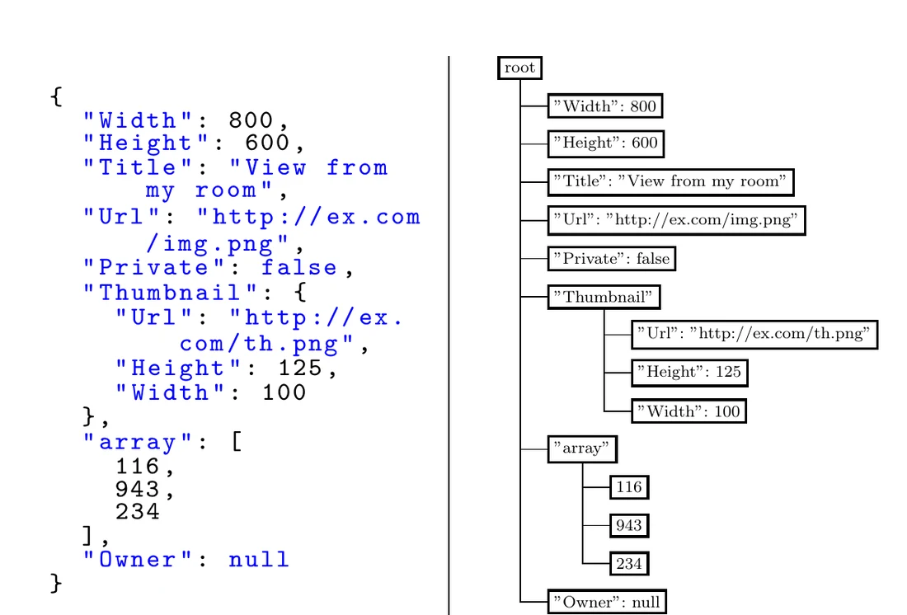
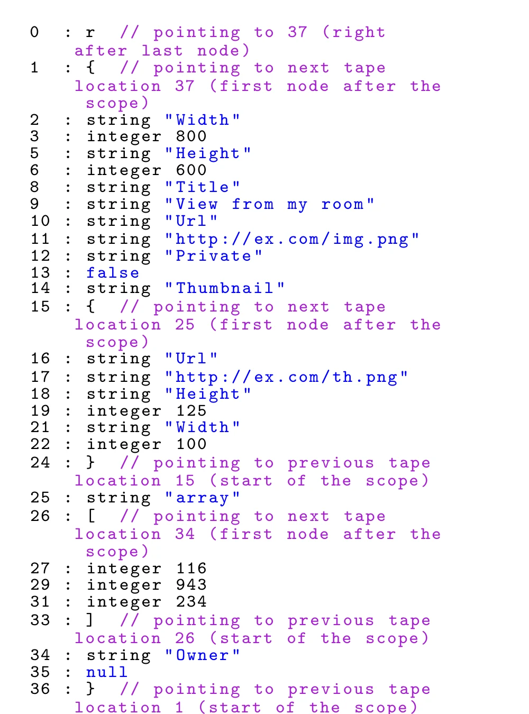
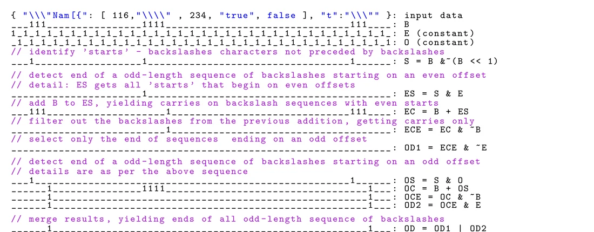
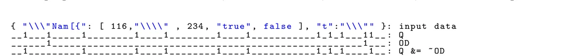
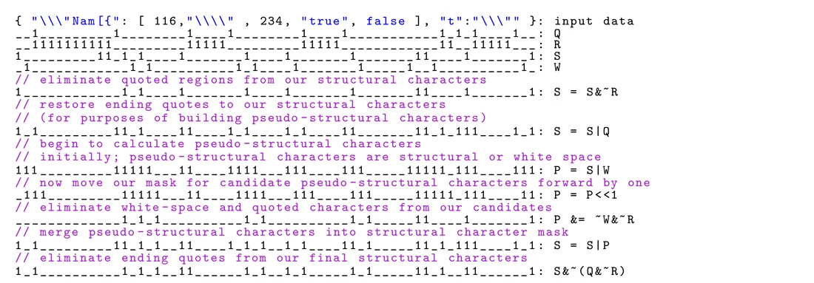

# simdjson：每秒解析数 GB 的 JSON


> 原文：Geoff Langdale, Daniel Lemire. **Parsing Gigabytes of JSON per Second.** arXiv:1902.08318v7 [cs.DB], 2024 年 7 月 23 日版。
>
> 本文是原文的中文翻译，保留了原 paper 的章节编号、图、表与脚注。原文作者单位：branchfree.org（澳大利亚）与 Université du Québec (TELUQ)（加拿大魁北克大学）。

## 摘要

JSON（JavaScript Object Notation）是一种在 Web 上无处不在的数据交换格式。由于数据量之巨，接收 JSON 文档很容易成为性能瓶颈。因此我们有动机让 JSON 解析尽可能快。

尽管 JSON 解析这个问题已经相当成熟，我们仍然展示了相当可观的加速空间。我们提出了第一个**完全符合标准**的 JSON 解析器：它在使用普通商用处理器的**单核**上每秒可以处理数 GB 数据。它使用的指令数不超过 RapidJSON 这样的先进参考解析器的四分之一。与其它做校验（validating）的解析器不同，我们的软件 simdjson 广泛使用了 SIMD（Single Instruction, Multiple Data，单指令多数据）指令。为了保证可复现性，simdjson 以宽松许可证开源。

## 本文速览

这篇论文的思路可以概括成一句话：**把 JSON 解析从"解析问题"重新定义成"扫描问题"**。一个 JSON 文档里绝大多数字节是无趣的——字符串内容、数字位、空白——真正需要结构化处理的字符只占百分之几。所以论文的主体工作不是"解析"，而是**用最便宜的方式在一大堆字节里把有意思的位置挑出来**。

下面按层次列出论文用到的主要技术，以及每一项各自解决了什么问题。

**架构层**

| 技术 | 解决的问题 |
|---|---|
| **两阶段设计**：stage 1 扫描定位 → stage 2 构建 tape | 单遍递归下降必须先解析完一个原子才知道下一个在哪，于是"找位置"和"解析值"被绑死，查找无法向量化。拆开后 stage 1 退化为纯粹的字节扫描，每 64 字节一批、成本固定；stage 2 因位置已知而不再有数据依赖 |
| **tape：扁平 64 位字数组** | 指针树要分配、要跳转、缓存不友好。扁平 tape 让遍历变成顺序访问；对象与数组的起止字互存对方下标，于是**跳过整个子树是 O(1)**，无需读取内容 |
| **高字节存类型标签**（如 `'n'×2^56`） | 若类型另存一张平行表，每次分派都要多一次访存（cache miss 风险）。塞进 payload 字里，读**一个** 64 位字就同时拿到类型和负载 |
| **字符串走独立 buffer，tape 只存偏移** | 字符串长度不固定，tape 就无法保持定宽。分开后 tape 全部是 8 字节定长，字符串还能整块做校验与规范化 |
| **goto 状态机 + 显式栈** | 递归深度不可控、跳转不可预测。显式栈让状态可见，代码接近无分支 |

**SIMD 扫描层（stage 1 的主体）**

| 技术 | 解决的问题 |
|---|---|
| **转义引号检测改用位运算** | 判断引号是否被转义，本质是"前面连续反斜杠个数的奇偶"——一个天然的**串行依赖**，naive 写法必须循环 |
| **前缀和 = 无进位乘法**（`pclmulqdq`） | 上述奇偶信息等价于对引号位图做 XOR 前缀和。用 carry-less 乘法一步算完，取代 64 次移位 XOR 的循环 |
| **`vpshufb` 两表 + 按位与做分类** | 6 个结构字符 + 4 个空白字符本需 10 次比较加 10 次 OR。改成**两次查表 + 一次 AND**，且分类结果留在寄存器里，下游 `& 0b111` / `& 0b11000` 一次拆开全部类别 |
| **伪结构字符** | `true`/`false`/`null`/数字无法靠单个字符识别，得知道"原子能从哪开始"。规则化成"非空白 + 前驱是空白或结构字符"后即变得可扫描，顺带还能检出散落的非法字符 |
| **无条件提取 8 个索引再回退** | 朴素写法每个置位一次分支，走向取决于数据、几乎不可预测。改成每 64 位字只判断一次，**切断了分支与数据的相关性** |
| **整块向量化 UTF-8 校验** | UTF-8 校验本身是逐字符状态机；逐字符串做又不划算（字符串普遍很短）。干脆**对整个输入一起校验**——既快又简单 |
| **错误位累加到最后统一检查** | 中途 `if (err) return` 会引入一条数据相关分支，正确路径上它永不成立、预测器无从校准。推迟到最后检查，代价是错误定位退化为一次二次遍历——**但只有出错的文档才付** |

**数值与字符串层**

| 技术 | 解决的问题 |
|---|---|
| **八位数字一次折叠**（`pmaddubsw` / `pmaddwd` / `packusdw`） | 十进制解析是串行依赖链。用 10/1、100/1、10000/1 三组交替乘数做"隔位折叠"，8 位 → 2 位 → 4 位 → 8 位 |
| **字符串 32 字节批量处理** | 找到引号与转义字符后整块写入 buffer，只有提前撞上转义才退回常规路径 |
| **越界整数直接拒绝而非降级** | RapidJSON 把过大的整数转成有损的双精度。simdjson 选择拒绝——**静默的有损转换是正确性隐患** |

**方法论**

论文没有只报"更快"，而是同时报告**每字节指令数**与**实际周期数**两个口径。指令数是确定性的、可跨机器比较；周期数则受噪声影响。前者提供了一个不依赖具体硬件的、可复现的代理指标——这本身是论文的贡献之一。

**贯穿全局的三个手法**

把上面这些串起来，会看到论文反复在用同样的三招：

1. **把数据相关的判断换成数据无关的** —— 分支粒度降低、掩码拆分类别、错误累加到末尾，都是这一招的不同形态；
2. **把代价转移到可以接受的地方** —— 缓冲区留 8 个槽位余量换掉分支，错误定位退化成二次遍历换掉热路径上的分支；
3. **用位运算承载"看起来需要顺序逻辑"的东西** —— 反斜杠奇偶变成前缀和，字符类别变成查表结果，类型分派变成高位字节。

> **译者补充：关于"指令数不超过四分之一"这个说法**
>
> 摘要里"不超过 RapidJSON 的四分之一"取自原文的 "a quarter or fewer instructions"，是**最坏情况**的表述。对照表 8 的实测：`RapidJSON/simdjson` 的比值在 1.8 到 4.7 之间，**几何平均为 2.4**——也就是说平均而言只省到约 42%，只有在 `gsoc-2018` 这类结构字符稀疏的文件上才逼近四分之一。原文的 "a quarter or fewer" 对应的中文习惯说法是"至多四分之一"，读的时候需要留意这个口径。

## 1. 引言

JSON 是一种用于表示数据的文本格式 [<sup>4</sup>](#refer-anchor-4)。它常用于 Web 上浏览器与服务器之间的通信，被 MySQL、PostgreSQL、IBM DB2、SQL Server、Oracle 等众多数据库系统，以及 Pandas 这类数据科学框架支持。许多面向文档的数据库（如 CouchDB、RethinkDB）也以 JSON 为核心。

JSON 语法可以看作 JavaScript 的一种受限形式，尽管它被用在许多编程语言中。JSON 有四种原始类型（atom）：string、number、Boolean、null，它们可以嵌入在复合类型（数组和对象）之中。对象的形式是一系列位于花括号之间的键值对，其中键是字符串（例如 `{"name":"Jack","age":22}`）。数组是一列位于方括号之间、由逗号分隔的值（例如 `[1,"abc",null]`）。复合类型可以包含原始类型，也可以包含任意深度嵌套的复合类型作为其值。图 1 给出了一个例子。



*图 1：JSON 示例。左为 JSON 文本，右为解析后的树形逻辑表示。*

JSON 规范定义了六个结构字符（`'['`、`'{'`、`']'`、`'}'`、`':'`、`','`）：它们用于界定对象和数组的位置与结构。

要让软件访问 JSON 文档中的数据，通常的做法是把 JSON 文本转换成树形的逻辑表示（类似于图 1 的右侧），我们把这个操作称为 **JSON 解析**。我们把解析后树中的每个值、对象和数组称为一个节点。解析完成后，程序员可以逐个访问节点，在其兄弟节点或子节点之间导航，而无需进行复杂且容易出错的字符串解析。

解析大型 JSON 文档是一项常见任务。Palkar 等人指出，大数据应用可能会把 80–90% 的时间花在解析 JSON 文档上 [<sup>25</sup>](#refer-anchor-25)。Boncz 等人则把加速 JSON 解析识别为加速数据库处理的一个值得研究的方向 [<sup>2</sup>](#refer-anchor-2)。

JSON 解析意味着错误检查：数组必须以左括号开始、右括号结束；对象必须以花括号开始、花括号结束；对象必须由逗号分隔的（以冒号分隔的）值对组成，且所有键都是字符串。数字必须符合规范并落在有效范围内。在字符串值之外，只允许出现少数几个 ASCII 字符。在字符串值之内，有若干字符（如 ASCII 行结束符）必须被转义。JSON 规范要求文档使用某种 unicode 字符编码（UTF-8、UTF-16 或 UTF-32），其中 UTF-8 是默认选择。因此我们必须校验所有字符串的字符编码。JSON 解析因而比"仅仅定位节点"要繁重得多。

我们的观点是：一个接受错误 JSON 的解析器既**危险**——它会静默地接受畸形 JSON，无论这是意外产生还是恶意构造的——又**规范不明**：很难预期、或就畸形 JSON 文件的语义达成广泛共识。

为了加速处理，我们应当尽可能高效地使用处理器。商用处理器（Intel、AMD、ARM、POWER）都支持 SIMD 指令。这些 SIMD 指令与常规指令不同，一次可以操作若干个字。例如从 Haswell 微架构（2013 年）开始，Intel 和 AMD 处理器支持 AVX2 指令集和 256 位向量寄存器。因此在近期的 x64 处理器上，我们可以用一条指令比较两个各 32 个字符的字符串。用 SIMD 指令配合很少的指令就能定位重要字符（例如 `"`、`=`）是很直接的。我们把 SIMD 指令的应用称为**向量化**。向量化软件生成的指令往往比传统软件更少。其他条件相同时，生成更少指令的代码更快。

与向量化密切相关的一个概念是**无分支处理**（branchless processing）：每当处理器必须在两条代码路径（一个分支）之间做选择时，都有可能因为当前流水线处理器上的分支预测失败而付出若干个周期的代价。根据我们的经验，SIMD 指令在无分支环境下最有可能带来收益。

据我们所知，公开可用的 JSON 校验型解析器很少使用 SIMD 指令。由于其复杂性，完整的 JSON 解析问题看上去并不容易直接向量化。

我们的一个核心结果是：SIMD 指令结合最小化的分支可以给 JSON 解析带来新的速度纪录——通常在单核上每秒处理数 GB 数据。我们提出若干条具体的、面向性能优化的策略，它们具有普遍意义：

* 我们检测带引号的子串，仅使用算术与逻辑运算，以及每输入字节数固定数量的指令，同时省去对转义引号的处理（§ 3.1.1）。
* 我们使用向量化的分类来区分码点值的若干集合，从而避免了为识别一个值属于一个大小为 N 的集合而做 N 次比较的负担（§ 3.1.2）。
* 我们仅使用 SIMD 指令来校验 UTF-8 字符串（§ 3.1.5）。

## 2. 相关工作

文献中加速 JSON 解析的一个常见策略是**选择性解析**。Alagiannis 等人 [<sup>1</sup>](#refer-anchor-1) 提出了 NoDB，一种无需先把数据载入数据库就能查询 JSON 数据的方法，它部分依赖于对输入的选择性解析。Bonetta 和 Brantner 使用推测性的即时编译（JIT）与选择性数据访问来加速 JSON 处理 [<sup>3</sup>](#refer-anchor-3)。他们发现重复出现的常量结构，并生成针对这些结构的代码。

Li 等人提出了他们的快速解析器 **Mison**，它能够直接跳到被查询的字段而无需解析中间内容 [<sup>17</sup>](#refer-anchor-17)。Mison 使用 SIMD 指令快速识别部分结构字符，但其余工作是在通用寄存器中以位向量为基础、带有大量分支的循环完成的。Mison 不尝试校验文档；它假设文档是纯 ASCII 而非 unicode（UTF-8）。我们把 Mison 架构中最相关的组件概括如下：

1. 第一步，把输入文档与每个结构字符（`'['`、`'{'`、`']'`、`'}'`、`':'`、`','`）以及反斜杠（`'\'`）做比较。每次比较使用一条 SIMD 指令，一次比较 32 对字节。比较结果被转换成位图，其中某个比特为 1 表示对应结构字符的存在。当不需要时，Mison 会省去与数组相关的结构字符（`'['`、`']'`）。Mison 仅在这第一步使用 SIMD 指令；它似乎也是唯一一个基本无分支的步骤。
2. 第二步，Mison 识别文档中每个字符串的起点和终点。它使用引号位图和反斜杠位图。对每个引号字符，Mison 使用一条快速指令（popcnt）统计其前面反斜杠的数量：被奇数个反斜杠前缀的引号被关闭并忽略。
3. 第三步，Mison 识别由引号界定的字符串跨度。它从第二步产生的位图中取每个字（例如 32 位）。它迭代地把成对的引号转换为字符串掩码（其中 1 位表示字符串的内容），每次迭代只用少量算术和逻辑运算。
4. 最后一步，Mison 使用字符串掩码关闭并忽略字符串内部的结构字符（例如 `{`、`}`、`:`）。Mison 把所有左花括号存入栈中。它从左到右地在每个新的右花括号处弹栈，从而找出匹配的括号对。通过部分复制输入的冒号位图，可以为每一种可能的嵌套深度构造一个指示冒号位置的位图。

从位图中提取出的冒号位置出发，Mison 可以向后扫描解析键、向前扫描解析值。它可以选择只取某个给定深度的内容。实际上，冒号位图充当了一个索引，用于选择性解析输入文档。在某些情况下，Mison 在一个 3.5 GHz 的 Intel 处理器上扫描 JSON 文档的速度可以超过 2 GB/s，用于高选择性的查询。它比 RapidJSON 这类常规的校验型解析器所能达到的速度更快。

FishStore [<sup>29</sup>](#refer-anchor-29) 解析 JSON 数据并选出感兴趣的子集，把结果存入一个快速的键值存储 [<sup>6</sup>](#refer-anchor-6)。虽然最初的 FishStore 依赖 Mison，开源版本 [^1] 默认使用 simdjson 来做快速解析。

Pavlopoulou 等人 [<sup>26</sup>](#refer-anchor-26) 提出了一个支持高级查询与重写规则的并行 JSON 处理器，它避免了对"先把数据载入数据库"的需要。

Sparser 先快速过滤未处理的文档，以找出大部分相关信息 [<sup>25</sup>](#refer-anchor-25)，然后依赖一个真正的解析器。我们可以把 simdjson 与 Sparser 结合使用。

像 Mison 或 Sparser 这样基于选择性解析的系统，在只对一小部分数据感兴趣时可能是有益的。然而，如果数据会被反复访问，用一个标准解析器把数据载入数据库引擎可能更合适。像 Mison 这类不校验的解析器，可能最适合那些紧耦合的系统，在那里无效输入不太可能出现。

### 2.1 XML 解析

在 JSON 之前，XML 解析上已有大量类似的工作。Noga 等人 [<sup>24</sup>](#refer-anchor-24) 报告说，当需要解析的值少于 80% 时，只解析所需的值更经济。Marián 等人 [<sup>19</sup>](#refer-anchor-19) 提出把 XML 文档"投影"为更小的文档后再执行查询。Green 等人 [<sup>14</sup>](#refer-anchor-14) 展示了我们可以用一个确定性有限自动机（DFA）快速解析 XML，其状态在解析过程中被懒惰地计算出来。Farfán 等人 [<sup>10</sup>](#refer-anchor-10) 更进一步，利用内部的物理指针跳过 XML 文档的整段内容。Takase 等人 [<sup>28</sup>](#refer-anchor-28) 通过在某些文本子集此前已被遇到时避免语法分析来加速 XML 解析。

Kostoulas 等人设计了一个快速的校验型 XML 解析器 Screamer，它通过减少不同处理步骤的数量来获得更高速度 [<sup>15</sup>](#refer-anchor-15)。Cameron 等人展示了可以用 SIMD 指令更快地解析 XML [<sup>5</sup>](#refer-anchor-5)，他们的解析器称为 Parabix。Zhang 等人 [<sup>31</sup>](#refer-anchor-31) 展示了如何先索引文档、再分别解析文档各分区，从而并行地解析 XML 文档。

Mytkowicz 等人 [<sup>22</sup>](#refer-anchor-22) 展示了如何用 SIMD 指令对有限状态机进行向量化。他们在 HTML 分词上得到了不错的结果，速度超过基线的两倍。

### 2.2 CSV 解析

数据也以逗号分隔值（CSV）的形式到来。Mühlbauer 等人使用 SIMD 指令定位分隔符与非法字符，从而优化了 CSV 的解析与载入 [<sup>20</sup>](#refer-anchor-20)。Ge 等人使用两遍方法：第一遍识别分隔符之间的区域，第二遍处理各条记录 [<sup>12</sup>](#refer-anchor-12)。

## 3. 解析器架构与实现

根据我们的经验，大多数 JSON 解析器采用自顶向下的递归下降解析 [<sup>7</sup>](#refer-anchor-7)，对输入字节做一遍单遍扫描，逐字符解码。我们采用了一种不同的策略，使用两个不同的阶段。下面先简要介绍这两个阶段，随后章节再详细展开。

1. **阶段 1**：我们校验字符编码，并识别所有 JSON 节点（例如 number、string、null、true、false、array、object）的起始位置。我们还需要所有结构字符（`'['`、`'{'`、`']'`、`'}'`、`':'`、`','`）的位置，这些字符由 JSON 规范定义 [<sup>4</sup>](#refer-anchor-4)。这些位置被写成一个独立的整数索引数组。

   在这一阶段中，有必要区分位于引号之间、因而在字符串值内部的字符，与其它字符。例如 JSON 文档 `"[1,2]"` 是一个字符串，尽管它看起来有方括号。也就是说，这些方括号不应被识别为相关的结构字符。由于引号可以被转义（例如 `\"`），因此也有必要识别反斜杠字符本身。在字符串之外，只允许四种特定的空白字符（space、tab、line feed、carriage return）。任何其它空白字符都需要被识别出来。

   阶段 1 要么是对字节的 SIMD 处理，要么是对位集（每字节一位的位数组）的操作。因此它对某些输入可能是低效的——我们可以观察到，为了发现在一个输入块中实际上并不存在奇数长度的反斜杠序列或引号序列，需要执行数十次操作。不过这种低效被另一事实抵消了：在复杂结构化输入上运行这段代码不花费更多，而替代方案通常需要执行若干次不可预测的分支。

2. **阶段 2**：我们处理所有节点和结构字符。我们依据起始字符区分不同节点。当遇到引号（`"`）时，我们解析一个字符串；当遇到数字或连字符时，我们解析一个数字；当遇到字母 `'t'`、`'f'`、`'n'` 时，我们查找 true、false 和 null 这几个值。

JSON 中的字符串不能包含某些未转义的字符（即码点小于 `0x20` 的 ASCII 字符），并且它们可能包含各种转义字符。因此必须对字符串做规范化：把它们转换成有效的 UTF-8 序列。遇到的数字必须转换成整数或浮点值。它们可以采取多种形式（例如 `12`、`3.1416`、`1.2e+1`）。然而在解析数字时我们必须检查许多规则。例如以下字符串是无效数字：`012`、`1E+`、`.1`。JSON 规范并未具体规定我们应该接受多大的数值范围：许多解析器无法表示区间 $[-2^{53}, 2^{53}]$ 之外的整数值。相比之下，我们选择接受区间 $[-2^{63}, 2^{63})$ 内的所有 64 位整数，同时拒绝该区间之外的整数。我们也拒绝过大的浮点数（例如 `1e309` 或 `-1e309`）。

我们把对象校验为字符串、冒号（`':'`）和值构成的序列；把数组校验为由逗号（`','`）分隔的值构成的序列。我们确保所有以左花括号（`'{'`）开始的对象都以右花括号（`'}'`）结束。我们确保所有以左方括号（`'['`）开始的数组都以右方括号（`']'`）结束。

结果按文档顺序写入一条 **tape**：一个 64 位字的数组。Tape 为每个节点值（string、number、true、false、null）包含一个字，并且在每个对象或数组的开头和结尾各包含一个字。为了保证快速导航，tape 上对应花括号或方括号的字被加上标注，使得我们可以从对象或数组起始处的字直接跳到其末尾处的字，而不必读取数组或对象的内容。具体来说，tape 的构造方式如下。

* 一个 null 原子被表示为 64 位值 `'n'×2^56`，其中 `'n'` 是对应字母 `'n'` 的 8 位码点值（在 ASCII 中）。true 原子被表示为 `'t'×2^56`，false 原子为 `'f'×2^56`。
* 数字用两个 64 位字表示。整数由字 `'l'×2^56` 后跟一个 64 位有符号整数（标准二进制补码形式）给出。浮点数由字 `'d'×2^56` 后跟一个 64 位浮点值（标准 binary64）给出。
* 对于一个数组，tape 的第一个 64 位元素包含值 `'['×2^56 + x`，其中 `x` 是 tape 上第二个 64 位元素索引加一。第二个 64 位元素包含值 `']'×2^56 + x`，其中 `x` 是 tape 上第一个 64 位元素的索引。数组的全部内容都位于这两个 tape 元素之间。对象以同样的方式处理，使用 `'{'×2^56 +x` 与 `'}'×2^56 + x` 形式的字。在这两个 tape 元素之间，我们在 key（必须是字符串）与 value 之间交替。value 可以是原子、对象或数组。
* 我们有一个次级数组（**string buffer**），其中存放规范化后的字符串值。我们把一个字符串表示为字 `'"'×2^56 + x`，其中 `x` 是该字符串在次级数组中起始处的索引。

此外，我们在文档的开头和结尾各加一个特殊字。第一个字被标注为指向 tape 上最后一个字。见图 2 给出的 tape 示例。



*图 2：与图 1 示例对应的 JSON tape。*

> **译者补充：为什么是 2^56？**
>
> 上面反复出现的 $'n'×2^{56}$、`'['×2^56 + x` 里的 `2^56`，本质上就是**把一个 8 位的类型标签放进 64 位字最顶上的那个字节**。因为 `64 - 8 = 56`，一个 ASCII 码点左移 56 位正好落在最高字节，空出低 56 位放负载。
>
> `'n'` 的 ASCII 值是 `0x6E`（110），所以：
>
> ```text
> 'n' × 2^56  =  0x6E << 56  =  0x6E00000000000000   ← 一个 null
> 't' × 2^56  =  0x7400000000000000                  ← true
> 'f' × 2^56  =  0x6600000000000000                  ← false
> ```
>
> 低 56 位全是 0，说明这三个原子不需要任何负载——**一个 null 就是整整 8 字节**。而 `'['×2^56 + x`、`'"'×2^56 + x` 这类，payload 就是一个下标：
>
> ```text
> 高 8 位（标签）        低 56 位（payload）
> [........][..............56 bits..............]
>    '['                  x（tape 索引 / string buffer 偏移）
> ```
>
> 取出方式是移位和掩码，没有查表、没有额外结构：
>
> ```c
> 类型   = (word >> 56) & 0xFF;      // 拿到 'n' / '[' / '{' ...
> 负载 x =  word & 0x00FFFFFFFFFFFFFF;
> ```
>
> **为什么值得这么设计？**
>
> 1. **阶段 2 可以只看一个字就完成类型分派。** 这是核心动机。阶段 2 是一个 `goto` 状态机，每一步都得知道"我手上这个节点是什么"，才能决定往哪个 `goto` 跳。如果类型信息存在一个平行的判别数组里，每次都要多一次访存（一次 cache miss 的风险）。把标签塞进 payload 字里，读**一个** 64 位字就同时拿到类型和负载，`goto` 后面直接跟不同分支，零额外开销。
> 2. **tape 保持紧凑。** 绝大多数节点（null/true/false、字符串、各类结构字符）都是**一个** 8 字节字。类型若单独存，整条 tape 至少要翻倍。
> 3. **56 位当偏移量绰绰有余。** 字符串的 `x` 是 string buffer 里的字节偏移，结构字符的 `x` 是 tape 里的字下标。`2^56` 个字 × 8 字节 ≈ 576 PB 的 tape，真实文档差着十几个数量级，所以砍掉 8 位给标签，代价是零。
> 4. **标签用 ASCII 字母而不是枚举常量。** dump 成十六进制时自带可读性（`0x5B...` 一眼看出是 `[`）；`n`/`t`/`f`/`l`/`d` 又是 null/true/false/long/double 的助记首字母；而且标签和阶段 1 找到的那些结构字符是同一套字符，比较起来是同一件事。
>
> **为什么唯独数字占两个字？** 整数和浮点数需要**完整的 64 位**——一个 binary64 双精度，或一个 64 位补码整数，一位都多余不下，塞不进标签。所以它们退化成两个字：先用 `'l'×2^56` 或 `'d'×2^56` 占一个"类型槽"，后面再跟一个纯负载字。那个标签字此时唯一的职责变成告诉阶段 2"跳过这一个字，我占了两个 slot"。这也解释了图 2 里为什么下标是 2→3→5 这样跳着走的——一个整数在 tape 上占两个位置。
>
> **最后是那个 "+1" 的不对称。** `'['×2^56 + x` 里 `x` 是"第二个元素下标 + 1"，而 `']'×2^56 + x` 里 `x` 是"第一个元素的**绝对**下标"（不带 +1）。这两个方向不对称是有意的：闭合符存绝对下标，于是 `&tape[x]` 一把取到开括号，**向后跳**零成本（拿到一个对象的起始位置、或反推它的父作用域）；开启符存"下标 + 1"，这个数在正向游标遍历时可以直接当"要走多远"用，**向前跳**跳过整个容器的内容，全程不读 body。`[...all content...]` 夹在两个标签字之间，说的就是这个意思：一个字跳到另一个字，中间的都不必碰。

在两个阶段结束时，我们报告 JSON 文档是否有效 [<sup>4</sup>](#refer-anchor-4)。我们产生一个错误码（例如 string error、number error、utf8 error 等）。所有字符串都被规范化，所有数字都被解析和校验。

### 3.0 为什么是两阶段

我们的两阶段设计是出于性能考虑而做出的。阶段 1 直接在输入字节上操作，以 64 字节为一批处理数据。以这种方式，我们可以充分利用 SIMD 指令——那是我们高性能的关键。阶段 2 更容易，因为阶段 1 已经识别出所有原子、对象和数组的位置：不必完成一个原子的解析才知道下一个原子在哪里。因此当解析 `{"key1":"val1", "key2":"val2"}` 时，阶段 2 接收到的 token 位置是 `}`、`"`、`:`、`"`、`:`、`"`、`}`，分别对应对象的开始与结束、两个冒号，以及四个字符串各自的开始。它可以无数据依赖地处理这四个字符串——我们不需要完成字符串 `"key1"` 的解析就能在找到字符串 `"val1"` 的位置之前找到冒号（`:`）的位置。除了 unicode 校验之外，我们刻意把数字和字符串的校验推迟到阶段 2，因为相对于无条件地、廉价地对全部输入执行，这些任务是相当昂贵且困难的。

### 3.1 阶段 1：结构字符与伪结构字符

我们处理的阶段 1 必须识别输入中的关键点：JSON 的结构字符（花括号、方括号、冒号和逗号）、由双引号界定的字符串的起止、无法用简单字符区分的其它 JSON 原子（`true`、`false`、`null` 以及数字），以及在同时存在引号约定与反斜杠转义约定的情况下发现这些字符与原子。

在 JSON 中，对输入做第一遍扫描可以高效地发现界定语法元素（对象和数组）的重要字符。不幸的是，这些字符也可能出现在引号之间，因此我们需要识别引号。同样也有必要识别反斜杠字符，因为 JSON 允许转义字符：`\"`、`\\`、`\/`、`\b`、`\f`、`\n`、`\r`、`\t`，以及转义的 unicode 字符（例如 `\uDD1E`）。

一个参考点是 **Mison** [<sup>17</sup>](#refer-anchor-17)，一个 C++ 快速解析器。Mison 使用向量指令识别冒号、花括号、引号和反斜杠。检测到的引号和反斜杠被用于过滤掉不重要的冒号和花括号。我们遵循 Mison 论文中构造结构索引的总体思路：首先发现奇数长度反斜杠序列（它们会导致紧随其后的引号被转义，不承担引用作用而只是字面字符），其次发现引号对（它们会使引号对内部的结构字符同样只是字面字符、不承担结构功能），最后发现不包含在引号对中的结构字符。

我们在方法与整体设计上不同于 Mison 论文。Mison 的作者在他们最初 SIMD 字符识别结果之上做循环，而我们提出用**无分支的指令序列**完成类似的任务。例如，为了定位被转义的引号字符，他们迭代遍历重复出现的引号字符。他们的算法 1 通过迭代未转义的引号字符来识别带引号字符的位置。我们的阶段 1 中没有这样的循环：它基本上是无分支的，每输入字节成本固定（字符编码校验除外，见 § 3.1.5）。此外，Mison 的向量化处理在设计上更加受限：它不识别原子的位置，不处理空白字符，也不校验字符编码。

#### 3.1.1 识别带引号的子串

识别转义引号比看上去要不平凡。识别字符串 `\"` 由一个被转义的引号构成是容易的，因为紧随反斜杠之后的引号字符就是被转义的；但如果一个引号被**偶数**个反斜杠前缀（例如 `\\"`），那么它就**没有**被转义，因为 `\\` 是一个被转义的反斜杠。

我们区分那些从奇数索引位置开始与从偶数索引位置开始的反斜杠字符序列。一段从奇数（相应地，偶数）索引位置开始并在奇数（相应地，偶数）索引位置结束的字符序列，其长度必为偶数，因此它是一段被转义的反斜杠。否则该序列包含奇数个反斜杠，其后的任何引号字符都必须被视为被转义。图 3 给出了包含两个被转义引号字符的示例代码 [^2]。

在识别出反斜杠与引号字符之后，我们可以高效地定位未转义的引号字符。我们计算一次移位再接一次按位与非（ANDNOT），从而消除被转义的引号字符。



*图 3：识别转义引号字符的无分支代码序列（含示例）。我们使用 C 语言的约定：`'&'` 表示按位与，`'|'` 表示按位或，`'<<'` 表示左移，`'~'` 表示按位取反。*

然而我们感兴趣的是找到引号之间（即字符串）的位置，从而找到真正的结构字符。期望的位模式是：如果到我们所在位置为止（含）的未转义引号个数为奇数则为 1，否则为 0。

例如，给定表示引号位置（1 位）的字 `0b100010000`，我们希望计算出 `0b011110000` [^3]。我们可以通过对我们表示未转义引号的位向量做 XOR 操作的前缀和来达到这一结果。也就是说，结果中索引 `i` 处的位值，等于输入中直到并包含索引 `i` 处为止的所有位值的 XOR。

我们可以在 C++ 中用一个循环反复对左移后的字做按位 XOR 来计算这样的前缀和：

```c
for (i=0;i<64;i++){mask = mask xor (mask << 1)}
```

这个前缀和可以更高效地实现为一条指令：把我们表示未转义引号的 64 位向量与另一个全为 1 的 64 位字做**无进位乘法**（carry-less multiplication）[^4]（由 `pclmulqdq` 指令实现）。无进位乘法的工作方式与常规整数乘法类似，但正如其名所示，它不带进位，因为它依赖 XOR 运算而非加法。

设对于一个 64 位整数 $a$，$a_i$ 是 $a = \sum_{i=0}^{63} a_i 2^i$ 中第 $i$ 位的值。两个 64 位整数 $a$、$b$ 之间的常规乘积为 $\sum_{i=0}^{63} a_i b 2^i$，其中当 $a_i$ 为零时 $a_i b 2^i$ 为零，否则为 $b$ 左移 $i$ 位。在这些约定下，无进位乘积为 $\sum_{i=0}^{63} a_i b 2^i$；也就是说我们把求和（$+$）替换为一系列 XOR（用符号 $\oplus$ 表示）。因此我们看到，当所有 $i$ 上 $a_i = 1$ 时，结果为 $\sum_{i=0}^{63} b 2^i$，也就是 XOR 运算的前缀和。由于无进位乘法在密码学中的应用，它在近期处理器上得到了广泛支持且速度很快。在 Skylake 处理器上，无进位乘法（`pclmulqdq`）的延迟为 7 个周期，且每周期可以发射一条 [^5]。



*图 4：识别带引号范围（不含结尾引号字符）的无分支代码序列。CLMUL 指无进位乘法。我们假定 OD 是使用图 3 的代码序列计算的。*

#### 3.1.2 向量化分类

Mison 对每个字符（`':'`、`'\'`、`'"'`、`'{'`、`'}'`）做一次 SIMD 比较。我们同样处理引号与反斜杠字符的识别。然而结构字符有六个，出于后续分析的需要，我们还需要发现四种允许的空白字符。做十次比较并伴随按位或运算会很昂贵。

我们不是用比较，而是使用 AVX2 的 `vpshufb` 指令充当向量化的表查找来做**向量化分类** [^6]。`vpshufb` 指令使用每个字节的最低 4 位（低半字节）作为索引，索引到一个 16 字节的表。其它处理器架构（ARM 和 POWER）有类似的 SIMD 指令。

通过一次查找、接着一次 4 位右移、再用（不同的）表做第二次查找，我们可以把字符分成两类：结构字符和空白字符。第一次查找把每个字节的低半字节（最低 4 位）映射到一个字节值；第二次查找把每个字节的高半字节（最高 4 位）映射到一个字节值。两个字节值用按位与结合起来。

举例说明如何用这种方式识别字符集合，假设我们要识别字节值 `0x9`、`0xa` 和 `0xD`。它们的低半字节是 `9`、`a`、`d`，高半字节都是零。在第一个 16 字节查找表中，我们把对应索引 `9`、`a`、`d`（且仅这三个值）的第四个最低位设为 1。在第二个 16 字节查找表中，把索引 0 处的值（且仅该值）的第四个最低位设为 1。于是只要且仅当输入中出现 `0x9`、`0xa`、`0xD` 时，按位与结果的第四个最低位才为 1。因此用两条 `vpshufb` 指令、一次移位和少量位逻辑运算，我们就能识别一个字符集合。如果只能识别一个字符集合，这个方法未必有优势，但我们可以用同样这两条 `vpshufb` 指令识别许多不同的集合。我们可以反复使用同样的策略处理新的输入值集合，总是让它们匹配一个给定的位索引（在我们的例子中是第四个）。为了避免错误分类，我们需要确保对应某个位索引的每个输入值集合，都能被一组低半字节和一组高半字节唯一刻画。集合 `{0x9, 0xa, 0xD}` 可行，因为它是所有低半字节为 `9`、`a`、`d` 且高半字节为 `0` 的值的集合。集合 `{0x5b, 0x5d, 0x7b, 0x7d}` 也可行，因为它是所有低半字节为 `b` 和 `d`、高半字节为 `5` 和 `7` 的值的集合。集合 `{0x21, 0x33}` 则不行，因为 `0x31` 和 `0x23` 共享相同的高半字节和低半字节：我们需要把集合 `{0x21, 0x33}` 拆成两个子集（`{0x21}`、`{0x33}`）。我们支持的集合数量等于我们拥有的位索引数量（8 个）。

我们把对应结构字符的码点值集合拆成三个集合：`{0x2c}`、`{0x3a}`、`{0x5b, 0x5d, 0x7b, 0x7d}`，把它们匹配到前三个位索引。我们把对应空白字符的码点值集合拆成两个集合 `{0x9, 0xa, 0xD}` 和 `{0x20}`，把它们匹配到第四个和第五个位索引。这些集合都能被其低半字节和高半字节唯一刻画。我们的方案并不唯一：例如我们本可以把 `{0x5b, 0x5d, 0x7b, 0x7d}` 拆成两个集合（`{0x5b, 0x5d}`、`{0x7b, 0x7d}`）。

| 高半字节 | H[high] | 0 | … | 9 | a | b | c | d | … | f |
|---|---|---|---|---|---|---|---|---|---|---|
| **0** | 8 | 0 | … | 8 | 8 | 0 | 0 | 8 | … | 0 |
| **1** | 0 | 0 | … | 0 | 0 | 0 | 0 | 0 | … | 0 |
| **2** | 17 | 16 | … | 0 | 0 | 0 | 1 | 0 | … | 0 |
| **3** | 2 | 0 | … | 0 | 2 | 0 | 0 | 0 | … | 0 |
| **4** | 0 | 0 | … | 0 | 0 | 0 | 0 | 0 | … | 0 |
| **5** | 4 | 0 | … | 0 | 0 | 4 | 0 | 4 | … | 0 |
| **6** | 0 | 0 | … | 0 | 0 | 0 | 0 | 0 | … | 0 |
| **7** | 4 | 0 | … | 0 | 0 | 4 | 0 | 4 | … | 0 |

*表 1：码点的向量化分类。行与列分别是高半字节与低半字节的索引；单元格中的值是两个查找表值按位与的结果（例如 `10 AND 8 = 8`），省略的值为零。原文在这张网格右侧还列了一栏期望的分类结果，一并附在下方。*

**原文表 1 右列的期望分类结果**：`0x2c` → 1、`0x3a` → 2、`0x5b,0x5d,0x7b,0x7d` → 4、`0x09,0x0a,0x0d` → 8、`0x20` → 16、其余 → 0。

低半字节的表为 `16, 0, 0, 0, 0, 0, 0, 0, 0, 8, 10, 4, 1, 12, 0, 0`；高半字节的表为 `8, 0, 17, 2, 0, 4, 0, 4, 0, 0, 0, 0, 0, 0, 0, 0`[^21]。应用我们的算法，我们得到如下结果：

* 对逗号（码点值 `0x2c`），我们得到 `1`，即 `17 AND 1` 的按位与结果。
* 对冒号（码点值 `0x3a`），我们得到 `0b10`（二进制 `2`）。
* 对其余结构字符 `'['`、`']'`、`'{'`、`'}'`（码点值 `0x5b`、`0x5d`、`0x7b`、`0x7d`），我们得到 `0b100`（`4`）。
* 对前三个空白字符（码点值 `0x9`、`0xa`、`0xD`），我们得到 `0b1000`（`8`）。
* 对空格字符（码点值 `0x20`），我们得到 `0b10000`（`16`）。
* 所有其它字符输入都将得到零。

我们可以通过与 `0b111` 做按位与识别出结构字符（`','`、`':'`、`'['`、`']'`、`'{'`、`'}'`），通过与 `0b11000` 做按位与识别出空白字符。也就是说，仅用两条 `vpshufb` 指令和少量逻辑指令，我们就能把所有码点值分类为三类之一：结构字符（逗号、冒号、花括号、方括号）、ASCII 空白字符（`'\r'`、`'\n'`、`'\t'`、`' '`）以及其它。整个过程不需要任何分支。

> **译者补充：两张查找表 + 一次按位与，凭什么就能分类？**
>
> 原文只说了"两个字节值用按位与结合起来"，但没交代这一步为什么成立。关键在于下面这个约束。
>
> **一、能被这套办法表示的集合必须是"矩形"**
>
> 把一个字节拆成高低两个半字节，它就落在 16 × 16 的网格上。假设我们想识别的字符集合 $S$ 可以写成
>
> $$S = \{x \mid \mathrm{low}(x) \in L \ \text{且}\ \mathrm{high}(x) \in H\}$$
>
> 也就是 $S = L \times H$——在网格上是**一个矩形**。那么只需要两张各 16 项的表：
>
> * 表 $A$ 按**低**半字节索引，把属于 $L$ 的那些下标对应的项打上标记位 $k$；
> * 表 $B$ 按**高**半字节索引，把属于 $H$ 的那些下标对应的项也打上标记位 $k$；
> * 两次查完 AND 一下，结果的第 $k$ 位为 1，就说明这个字节属于第 $k$ 号集合。
>
> 整套判定只是两次查表和一次按位与，没有任何分支。
>
> **二、走一遍 $\{0x9, 0xa, 0xd\}$**
>
> `0x9 = 0000 1001`、`0xa = 0000 1010`、`0xd = 0000 1101`，三者的低半字节是 `9`、`a`、`d`，高半字节全是 `0`。所以 $L = \{9, a, d\}$、$H = \{0\}$：
>
> * 表 $A$ 在下标 `9`、`a`、`d` 处打上标记位 3（即值 `8`）；
> * 表 $B$ 在下标 `0` 处打上标记位 3。
>
> AND 之后第 3 位为 1，当且仅当"低半字节 ∈ {9, a, d}"**且**"高半字节 = 0"——不多不少，正好是 $\{0x09, 0x0a, 0x0d\}$。
>
> **三、$\{0x21, 0x33\}$ 为什么不行**
>
> `0x21` 的低/高半字节是 `1`/`2`，`0x33` 是 `3`/`3`。若照上面的办法取 $L = \{1,3\}$、$H = \{2,3\}$，那么矩形 $L \times H$ 是
>
> $$\{0x21, 0x23, 0x31, 0x33\}$$
>
> **多罩了 `0x23` 和 `0x31`**。根本原因是这两个字节与目标集合里的成员共享了相同的高低半字节组合，矩形这个形状天然区分不出来。论文举这个例子是想说明失败，但可以推广成一条判据：**一个集合能用这套办法表示，当且仅当它恰好等于某个 $L \times H$**；不满足就必须拆成子集（这里拆成 $\{0x21\}$ 和 $\{0x33\}$ 两个单元素集合，正好各占一个位）。
>
> 顺带看另一个：$\{0x5b, 0x5d, 0x7b, 0x7d\}$ 的低半字节是 $\{b, d\}$、高半字节是 $\{5, 7\}$，四个组合恰好就是这四个字符，矩形精确吻合——所以它一个位就够了。
>
> **四、为什么上限是 8 个集合**
>
> 因为分类的结果只装得下**一个字节**，也就是 8 个位，每个集合占一位。这不是 SIMD 的限制，而是"结果字段宽度"的限制。反过来说，两张表各有 16 项、每项 1 字节，信息量上刚好支持 8 个集合——论文里"We can support as many sets as we have bit indexes (8)"说的就是这个。
>
> **五、真正的收益在下游，而不只是省了几条指令**
>
> 朴素做法是 10 次比较，得到 **10 个彼此独立的位集**，往后每用一个类别都要单独去取和合并。而分类之后，**同一个向量寄存器里同时带着所有类别的标记位**——每个字节的高 8 位就是它的"类别码"。下游只要掩码一下就完成拆分：
>
> ```c
> structural  = classified & 0b00000111;   // bit0 逗号 | bit1 冒号 | bit2 括号花括号
> whitespace  = classified & 0b00011000;   // bit3 {0x9,0xa,0xd} | bit4 {0x20}
> ```
>
> 指令账也很划算：朴素做法 10 次 `vpcmpeqb` 加 10 次 `vpor` 约 20 条 uop；这里只需要 2 条 `vpshufb`（高半字节那张表靠先整体右移 4 位得到）、1 次移位和几条位运算，约 6～8 条 uop。
>
> **六、`vpshufb` 凭什么能当查找表用**
>
> 它只取每个字节的**最低 4 位**当下标，去索引一个 16 字节的常量表，输出对应项——本质是一次 16 项的字节重排。正因如此它才有能力"一次查 32 个字节"（AVX2 下）。论文顺带提了一句其它架构（ARM、POWER）有类似的 SIMD 指令，同一套"矩形"论证在那边照样成立，只是查表指令换成了别的名字。

#### 3.1.3 识别空白字符与伪结构字符

我们还利用在这一早期阶段快速检测空白字符的能力。可以用另一次位集变换，发现数据中那些"跟随一个结构字符或引号、其后是零个或多个空白字符"的位置；排除字符串内的位置以及我们自己已经发现的那些结构字符。这些位置是唯一可能出现 JSON 原子（无论是否以负号开头的数字、`null`、`true`、`false`）起始的地方。因此这些位置被视为结构性的，我们称之为**伪结构字符**。形式化地说，我们把伪结构字符定义为满足以下条件的非空白字符：(1) 位于引号之外，且 (2) 它的前驱是空白字符或结构字符。

我们利用了 JSON 的一个特性：合法的原子都可以通过它们的第一个字符互相区分——`true` 以 `'t'` 开头，`false` 以 `'f'` 开头，`null` 以 `'n'` 开头，数值则以字符类 `[0-9-]` 开头。

识别伪结构字符还有一个副作用：它帮助我们校验文档。例如，在 JSON 中只有某些 ASCII 空白字符允许未转义地出现在带引号范围之外。一个孤立的、不允许出现的字符会被标记为伪结构字符，并随后在阶段 2 被拒绝。此外，悬空的原子也会被自动识别出来（如 `[12 a]` 中的 `a`），并同样被拒绝。这里的关键洞察是：阶段 1 不需要判断这些错位字符是否是合法 JSON——它只需要把它们暴露在将由阶段 2 解析的结构字符与伪结构字符的流中即可。



*图 5：识别结构字符与伪结构字符的无分支代码序列。引号 Q 和带引号范围 R 使用图 4 的代码序列计算。结构字符（S）与空白字符（W）通过向量化分类识别。*

#### 3.1.4 索引提取

在阶段 1 中，我们以 64 输入字节为一块进行处理。最终产物是一个 64 位位集，其中对应结构字符或伪结构字符的位置为 1。

我们的结构字符与伪结构字符相对稀疏，有时（但并不总是）很少出现。例如，我们可以构造出看起来合理的 JSON 输入，其每 40 个字符才出现一次这样的字符，或每 4 个字符出现一次。因此，继续把结构字符作为位集处理意味着要操作间距不可预测的数据结构。

我们选择把这些位集转换成索引：也就是提取出 1 位所处位置的一个列表。一旦索引提取完成，我们就可以丢弃位集。相比之下，Mison 没有这样的提取步骤，而是直接迭代遍历 1 位。

我们的实现使用 count trailing zeroes 操作（通过 `tzcnt` 指令）以及清除最低置位位的操作 `s = s & (s - 1)`，来把位集转换为索引；在 C 中 `s & (s - 1)` 会编译为一条指令（`blsr`）。这个策略引入了一个不可预测的分支；除非我们的位集有某种规律，否则我们预期每个字至少会有一次分支未命中。然而我们采用了一种技巧：**无条件地从位集中提取 8 个索引，然后通过下一轮索引提取循环的覆写来忽略那些提取过多的索引**。

```c
// we decode the set bits from 's'
// to array 'b'
uint64_t s = ...
uint32_t * b = ...
// net line => popcnt instruction
uint32_t cnt = popcount(s);
uint32_t next_base = b + cnt;
while (s) {
    // next line => tzcnt instruction
    *b++ = idx + trailingzeroes(s);
    // next line => blsr instruction
    s = s & (s - 1);
    // ...（重复 7 次，总共无条件提取 8 个索引）...
}
b = next_base;
```

*图 6：从位集中提取置位位的代码序列（简化示意）。完整代码见 `simdjson` 源码。*

这意味着只要我们置位位的频率低于 64 位中的 8 位，我们就预期只有很少的不可预测分支。数字 8 是一个基于我们 JSON 文档经验的启发式选择；更大的无条件提取过程会更昂贵（因为需要更多操作），但由于更宽范围的位密度也能通过提取（比如）8 个索引来处理，也更不容易引起分支未命中。

> **译者补充：图 6 到底在做什么**
>
> 这段代码读起来很别扭，值得拆开看。先说一处笔误：原文 Fig. 6 里定义的是 `next_base`，收尾却写成 `b = new_base`——`new_base` 这个名字从未定义，照抄编译不过。上面的译文已统一为 `next_base`。
>
> 真正需要理解的是"**乐观写入再回退**"这套套路：
>
> 1. `cnt = popcount(s)` 一次数出这个 64 位字里有多少个 1 位；
> 2. `next_base = b + cnt` **在动手写之前**就算好了"正确终点"在哪；
> 3. 循环体里那 8 组 `tzcnt` + 写内存 + `blsr` 是**无条件**执行的——哪怕 `s` 只剩 3 个 1 位，也照样写满 8 个槽位，多出来的几个写的是垃圾值（`trailingzeros(0)` 之类）；
> 4. 循环结束后 `b = next_base` 把游标**一次性拨回**真实位置。刚才多写的垃圾不落在有效区间里，下一轮循环正好从那里开始覆盖，等于自动清场。
>
> 所以缓冲区必须预留 8 个槽位的余量，多写是安全的。
>
> **省下的到底是哪些分支？** 注意 `while (s)` 这个判断本身还在。真正的收益在于：分支粒度从"**每个置位一次**"降到了"**每个 64 位字一次**"。原来 10 个 1 位就要 10 次"还有没有下一个"的判断，每次的走向取决于位图内容、几乎无法预测；现在无论一个字里有几个 1 位，循环体内部一条数据相关分支都没有，只剩出口那一次判断。一句话：**分支与数据的相关性被切断了**——这是无分支处理真正的价值，不是消灭分支，而是让分支变得与数据无关、因而可预测。
>
> **这个启发式的适用范围：数据其实越界了**
>
> "频率低于 64 位中的 8 位"换算过来就是"平均每 8 个字节才有一个结构字符"，对应表 5 最后一列 `byte/struc.` ≥ 8。可拿论文自己的数据集一对照，14 个文件里有 **5 个低于这条线**：`numbers` 7.5、`canada` 6.7、`random` 5.8、`mesh` 4.7、`marine_ik` 4.6。
>
> 而它们恰好是每字节指令数最高的那几个——表 8 中 simdjson 指令数排前 7 的里有 5 个是它们（`mesh` 14.3、`marine_ik` 13.4、`canada` 12.9、`numbers` 11.7、`random` 8.9），剩下两个 `mesh.pretty` 9.0 与 `twitterescaped` 9.3 也只是刚过线。这与 § 4.3 的观察对得上：那里点名"每输入字节时间更高"的文件正是 canada、marine_ik、mesh、random，并把原因归结为索引提取的成本。
>
> 所以这个 8 不是随手拍脑袋的数字，它在真实数据上确实卡在了一个可辨识的边界附近——只不过**约三分之一的测试集落在假设之外**，这部分的速度收益要打折扣。

#### 3.1.5 字符编码校验

根据我们的经验，JSON 文档是以 unicode 格式 UTF-8 提供的。一些编程语言（如 Java）使用 UTF-16 作为内存中的字符串。然而，如果我们考虑流行的 JSON Java 库 Jackson，把对象序列化为 JSON 的常见方式是调用 `ObjectMapper.writeValue`，其结果是 UTF-8 的。事实上 JSON 规范指出许多实现不支持 UTF-8 之外的编码。像 Mison 这样的解析器假设字符编码是 ASCII [<sup>17</sup>](#refer-anchor-17)。虽然这算合理，但一个更安全的假设是使用 unicode（UTF-8）。并非所有字节序列都是有效的 UTF-8，因此一个校验型解析器需要确保字符编码正确。我们假设传入的数据意在遵循 UTF-8，并且解析器应当产出 UTF-8 字符串。

UTF-8 是 ASCII 的超集。ASCII 字符可以用单个字节表示，其数值称为码点，取值在 0 到 127 之间（含）。也就是说，ASCII 码点是一个最高位为零的 8 位整数。UTF-8 把这 128 个码点扩展到总共 1,114,112 个码点。非 ASCII 码点用 2 到 4 个字节表示，每个字节的最高位为 1。非 ASCII 码点不能包含 ASCII 字符：因此我们可以从 UTF-8 字节流中移除任意数量的 ASCII 字符而不影响其校验。

在 JSON 的字符串之外，所有字符都必须是 ASCII。只有字符串可能需要昂贵的校验。然而，一个文档中可能会有很多小字符串，因此不清楚在单个字符串层面做向量化的 unicode 校验是否有利。因此我们对整个输入字节做校验。

我们首先测试一个 64 字节的块是否完全由 ASCII 字符构成。只需验证所有字节的最高位都是零即可完成这一检查。这个优化可能触发一些不可预测的分支，但考虑到 JSON 文档很可能几乎完全由 ASCII 字符构成，这是一次必要的冒险。

如果存在非 ASCII 字符，我们应用向量化的 UTF-8 校验算法。我们需要检查字节序列确实由有效的 UTF-8 码点构成（见表 2）。它涉及若干步骤，但每一步都很高效。我们完全使用 SIMD 指令。

* 我们需要验证所有字节值都不大于 `0xF4`（即 244）：我们可以用与 `0xF4` 的 8 位饱和减法来做到这一点。减法的结果为零当且仅当该值不大于 `0xF4`。
* 字节值 `0xC0` 和 `0xC1` 是被禁止的。当字节值为 `0xE0` 时，下一个字节值必须大于 `0xA0`。当字节值为 `0xF0` 时，下一个字节值至少为 `0x90`。
* 当字节值为 `0xED` 时，下一个字节值必须不大于 `0x9F`；当字节值为 `0xF4` 时，下一个字节值必须不大于 `0x8F`。这些条件可以用向量化的字节比较和字节移位来检查。
* 当一个字节值超出 ASCII 值范围时，它属于四个类别之一，取决于其高半字节的值：
  * 如果高半字节是 8、9、a 或 b（十六进制），那么该字节是一个码点的第二、第三或第四个字节。
  * 如果高半字节是 c 或 d，那么该字节必须是一个由两个字节构成的码点的第一个字节。
  * 如果高半字节是 e，那么该字节是由三个字节构成的码点的第一个字节。
  * 最后，如果高半字节是 f，那么该字节是由四个字节构成的序列中的第一个字节。

我们使用 `vpshufb` 指令把字节快速映射到这些类别之一，取值为 0、2、3、4，并把 ASCII 字符映射到值 1。如果找到值 4（对应半字节值 f），它后面应该跟着三个值 0。给定这样一个整数向量，我们可以如下检查它是否匹配一个有效的码点序列。

把值移位 1 并用饱和减法减去 1，再把结果加回原向量。再用因子 2 重复同样的过程：把值移位 2 并减去 2，再加回原向量。从序列 `4 0 0 0 2 0 1 1 3 0 0` 开始，你先得到 `4 3 0 0 2 1 1 1 3 2 0`，然后得到 `4 3 2 1 2 1 1 1 3 2 1`。如果该序列来自有效的 UTF-8，那么所有最终的值都应大于零，且不大于原向量。

所有这些检查都只使用 SIMD 寄存器完成，没有分支。在处理开始时，我们把一个错误变量（32 字节向量）初始化为零。我们就地计算每次检查的结果与错误变量的按位或。如果任何检查失败，错误变量就会变成非零。我们只在处理结束时（一次）检查该变量是否为零。如果需要诊断错误发生的位置，我们可以对输入再做一遍扫描。

> **译者补充：为什么不"一错就停"**
>
> 这段"把所有错误位 or 到一起、最后只看一次"的设计看起来很反直觉——正常人的写法是每校验一块就判断一次，错了立刻跳出。但这里恰恰不能这么做：一旦引入 `if (err) return`，就多了一条**数据相关分支**。而 JSON 文档绝大多数时候是合法的，这个分支几乎总是"不成立"、走向高度可预测——听起来无害，对吧？
>
> 问题在于它的**反面**：一条永远不成立的分支，意味着 CPU 的分支预测器无从校准，一旦遇到一个真的非法的文档（攻击者构造的畸形输入），预测全部落空，代价要在这条路径上一次性还清。更麻烦的是，正确路径下这条指令仍要占一个指令槽和一次发射机会。simdjson 的整套思路就是"把判断推到没有数据依赖的地方"，所以这里选择把检查推迟到最后。
>
> **代价是什么？** 定位能力。累加之后只知道"这个文档某处有非法 UTF-8"，不知道在哪。所以论文才补了"可以再做一遍扫描"这句话——错误定位退化成一次 O(n) 的二次遍历。实践中这是笔划算的买卖：**只有出错的文档才付这个代价**，合法文档（绝大多数）永远不需要。
>
> 这也解释了论文开篇的一个立场：一个不校验的解析器"危险"——它会静默接受畸形 JSON，无论这来自意外还是恶意。校验本身不是可选项，问题只在于把它放在循环里的哪个位置。

| 码点范围 | 第 1 字节 | 第 2 字节 | 第 3 字节 | 第 4 字节 |
|---|---|---|---|---|
| 0x000000…0x00007F | 00…7F | | | |
| 0x000080…0x0007FF | C2…DF | 80…BF | | |
| 0x000800…0x000FFF | E0 | A0…BF | 80…BF | |
| 0x001000…0x00CFFF | E1…EC | 80…BF | 80…BF | |
| 0x00D000…0x00D7FF | ED | 80…9F | 80…BF | |
| 0x00E000…0x00FFFF | EE…EF | 80…BF | 80…BF | |
| 0x010000…0x03FFFF | F0 | 90…BF | 80…BF | 80…BF |
| 0x040000…0x0FFFFF | F1…F3 | 80…BF | 80…BF | 80…BF |
| 0x100000…0x10FFFF | F4 | 80…8F | 80…BF | 80…BF |

*表 2：unicode 码点及其在 UTF-8 下最多四个字节的表示。*

### 3.2 阶段 2：构建 Tape

在阶段 2 中，我们遍历阶段 1 找到的索引。为了处理可以嵌套的对象和数组，我们使用一个基于 `goto` 的状态机。我们的状态被记录为一个栈，指示我们当前在数组中还是在对象中；每当我们遇到一个内嵌的数组或对象，就把新状态压入栈。当内嵌的对象或数组结束时，我们使用栈中保存的状态和一条 `goto` 命令，从外层作用域的相应状态恢复解析。`true`、`false`、`null` 这类值作为简单的字符串比较处理。我们使用专门函数来解析数字和字符串。

不太费力的话，我们可以支持流式处理而不物化 JSON 文档对象，即不做内存中的 tape [<sup>18</sup>](#refer-anchor-18)。

#### 3.2.1 数字解析

如果不能以标准的逐字符方式进行，数字的解析和校验就很难做。我们必须检查规范 [<sup>4</sup>](#refer-anchor-4) 中的所有规则。因此我们像大多数解析器那样推进。不过我们发现，对"数字的小数部分中至少有八位数字"这一常见情况做检测是有用的。给定这八个字符被解释为 64 位整数 `val`，我们可以用一次廉价的比较检查它是否由八位数字构成：

```c
(((val & 0xF0F0F0F0F0F0F0F0)
  | (((val + 0x0606060606060606)
      & 0xF0F0F0F0F0F0F0F0) >> 4)))
 == 0x3333333333333333)
```

当该检查成功时，我们调用一个快速向量化的函数来计算对应的整数值（图 7）。这个快速函数首先从所有字符值中减去字符 `'0'` 的码点，使用 `_mm_sub_epi8` intrinsic（`psubb` 指令）。因为数字在 ASCII 中的码点是连续的，这保证了数字字符被映射到它们的数值：`'0'` 变为 0，`'1'` 变为 1，以此类推。然后我们调用 `_mm_maddubs_epi16` intrinsic（即 `pmaddubsw` 指令），把每一位交替的数字乘以 10 并加到前一位上，得到一个 16 位的和。接着我们用 `_mm_madd_epi16` intrinsic（即 `pmaddwd` 指令）重复类似的过程，这次把每一个交替的值乘以 100 并加到前一个值上，得到一个 32 位的和。

这些和的最大值是 9999，可以放进一个 16 位整数。我们应用 `_mm_packus_epi32` intrinsic（即 `packusdw` 指令）把四个 32 位整数打包为四个 16 位整数。最后我们再次调用 `_mm_madd_epi16` intrinsic，把每一个 16 位值乘以 10000 并加到前一个值上，生成一个 32 位和。我们只返回对应八位数字的一个 32 位值，尽管从技术上讲，我们的函数把两串八位数字转换为 32 位整数。在 Skylake 处理器上，这些指令的延迟是 1 个周期（`psubb`、`packusdw`）或 5 个周期（`pmaddubsw` 和 `pmaddwd`）。由于 `pmaddwd` 指令需要两次，我们可以估计该函数的延迟至少为 17 个周期，不计 store 和 load 指令。然而只需要大约七条指令（含 load/store 指令），这可能不到朴素做法所需的一半。事实上，仅仅把八位数字加载进来就可能需要八条独立的 load 指令。

```c
uint32_t parse_eight_digits_unrolled(char *chars) {
    __m128i ascii0  = _mm_set1_epi8('0');
    __m128i mul_1_10   = _mm_setr_epi8(10,1,10,1,10,1,10,1,10,1,10,1,10,1,10,1);
    __m128i mul_1_100  = _mm_setr_epi16(100,1,100,1,100,1,100,1);
    __m128i mul_1_10000= _mm_setr_epi16(10000,1,10000,1,10000,1,10000,1);
    __m128i in  = _mm_sub_epi8(_mm_loadu_si128((__m128i *)chars), ascii0);
    __m128i t1  = _mm_maddubs_epi16(in, mul_1_10);
    __m128i t2  = _mm_madd_epi16(t1, mul_1_100);
    __m128i t3  = _mm_packus_epi32(t2, t2);
    __m128i t4  = _mm_madd_epi16(t3, mul_1_10000);
    return _mm_cvtsi128_si32(t4);
}
```

*图 7：使用 Intel intrinsics 把八位数字转换为整数值的代码序列。*

> **译者补充：`pmaddubsw` 那一步到底在算什么**
>
> 图 7 里有三步是同一个"隔位折叠"模式，只是乘数不同，论文只写了"把每一位交替的数字乘以 10 再加上前一位"就没细说了。有两点值得补。
>
> **第一，`pmaddubsw` 的两个操作数是异号宽度的。** `pmaddubsw` 的全称是 packed multiply-add unsigned bytes with signed words——它把 8 位操作数当**无符号数**，把 16 位操作数当**有符号数**，相乘后两两相邻求和，输出 16 位。左边放已经减过 `'0'` 的字节（0–9，无符号），右边放交替的 `10, 1, 10, 1, ...`（有符号）。所以 `10×d₀ + 1×d₁` 就是把相邻两位拼成两位数——这正是十进制的权值结构，靠的就是"隔位放 10 和 1"这个技巧。理解了这个异号宽度，就不会奇怪为什么字节能被当作 16 位乘数用了。
>
> **第二步是"重复加权"，两次就够了。** 一次 `pmaddubsw` 得到 `d₀·10 + d₁` 这样的两位数；再 `pmaddwd` 配 `100, 1, 100, 1` 得到 `a·100 + b`，四位数；最后配 `10000, 1, 10000, 1` 把两个四位数拼成八位数。三次折叠，8 位 → 2 位 → 4 位 → 8 位，正好对应十进制位权的 10、100、10000。
>
> **第三，`packusdw` 是饱和打包，这一步是安全的。** `packusdw` 的 `us` 指 unsigned saturate——超出 16 位无符号范围（65535）时钳到 65535，而不是回绕。前一步每个 16 位值最大是 `9×10000 + 9999 = 99999`？这里要小心：论文说"这些和的最大值是 9999"，指的是**一对相邻四位数折叠后**的上界——`a·100 + b` 中 `a ≤ 99`、`b ≤ 99`，故最大 `9999`，稳稳落在 16 位范围内，饱和永远不会触发。论文正是用这个论证来保证 `packusdw` 的钳位行为不影响结果。这一点原文只给了一句话，但它是整段代码正确性的支点：一旦有人改了乘数常量，就必须重新验证这个上界。
>
> 另外注意 `pmaddubsw` 把两个 32 位输入的高半也算了，所以实际会同时算出两串八位数字；论文为此专门返回低 32 位。

#### 3.2.2 字符串校验与规范化

遇到一个引号字符时，我们总是在一个向量寄存器中读取 32 字节，然后寻找引号和转义字符。如果在第一个引号字符之前发现了一个转义字符，我们就使用一条常规代码路径处理该转义字符；否则我们只需把这个 32 字节寄存器写入我们的 string buffer。某些 unicode 字符可能使用一个或两个 4 字符的十六进制码表示（例如 `\uD834\uDD1E`）；我们把它们转换为有效的 UTF-8 字节。

我们的 string buffer 由一个指示字符串长度的 32 位整数，以及随后 UTF-8 形式的字符串内容组成。JSON 规范允许字符串中包含 null 字符，因此需要一个指定字符串长度的整数。作为字符串校验的一部分，我们必须检查没有发现小于 `0x20` 的码点值：我们使用向量化的比较。

## 4. 实验

我们通过一组在多种数据上可复现的实验来验证我们的结果 [^7]。在 § 4.3 中我们报告，解析期间的运行时间在两个阶段之间大致均分。在 § 4.4 中我们展示，解析期间我们使用的指令数只有最强竞争对手的一半。在 § 4.5 中我们展示，这一减少的指令数转化为可比的运行时间优势。

### 4.1 硬件与软件

近期的多数 Intel 处理器基于 Skylake 微架构。我们还在测试中包含了一台采用更新的 Cannon Lake 微架构的计算机。表 3 总结了我们的硬件平台特征。我们用 `avx-turbo` [^8] 实验性地验证了 CPU 特征。

| 处理器 | 基准频率 | 最大频率 | 微架构 | 内存 | 编译器 |
|---|---|---|---|---|---|
| Intel i7-6700 | 3.4 GHz | 3.7 GHz | Skylake (x64, 2015) | DDR4 (2133 MT/s) | GCC 9.1 |
| Intel i3-8121U | 2.2 GHz | 3.2 GHz | Cannon Lake (x64, 2018) | LPDDR4 (3200 MT/s) | GCC 9.1 |

*表 3：硬件配置。*

我们的软件使用 C++17 编写。我们在若干近期编译器（LLVM 的 clang、GNU GCC、Microsoft Visual Studio）下测试了它。我们的库经过充分测试，并已被纳入 Yandex ClickHouse 等实际系统中。我们使用 GNU GCC 9.1 编译器，在 Linux 下以 `-O3` 和 `-march=native` 标志编译代码。我们按原样编译，不使用 profile-guided optimization。所有代码都是单线程的。我们禁用了超线程。

我们的实验假设 JSON 文档在内存中；我们省略了磁盘和网络访问。流行的磁盘（例如 NVMe）有 3 GB/s 的带宽 [<sup>30</sup>](#refer-anchor-30) 以上。实际上 JSON 文档经常从网络接收。然而当前网络标准允许超过 10 GB/s 的速度 [<sup>8</sup>](#refer-anchor-8)，现代网络硬件可以让网络数据被直接读入 cache line。因此，即使数据来自快速磁盘或网络，一个高性能的 JSON 扫描实现也是可取的。虽然我们关注速度，但我们也期望更高效的解析器会降低能耗。

我们审视了若干解析器后，选择 **RapidJSON** 和 **sajson** 两个开源 C++ 解析器作为参考（见表 4）。Palkar 等人把 RapidJSON 描述为可获得的最快的传统状态机解析器 [<sup>25</sup>](#refer-anchor-25)。在实践中我们发现另一个 C++ 解析器 sajson 更快。它们都是成熟且高度优化的：分别创建于 2011 年和 2012 年。sajson 解析器可以使用静态或动态内存分配；静态版本更快，因此我们采用它。

把我们的解析器（simdjson）自己算上，这三个解析器都能解析 64 位浮点数以及整数。然而 sajson 只支持 32 位整数，而 RapidJSON 和 simdjson 都支持 64 位整数。RapidJSON 把过大的整数表示为 64 位浮点数（有损），而我们的解析器（simdjson）和 sajson 都拒绝那些它们无法精确表示的整数文档。

| 解析器 | 快照 | 链接 |
|---|---|---|
| simdjson | 2019 年 6 月 12 日 | https://github.com/lemire/simdjson |
| RapidJSON | 版本 1.1.0 | https://github.com/Tencent/rapidjson |
| sajson | 2018 年 9 月 20 日 | https://github.com/chadaustin/sajson |

*表 4：竞争解析器。*

RapidJSON 可以在一个新的 buffer 中规范化字符串，也可以就地（insitu）在输入字节内规范化。我们发现在 insitu 模式下解析速度更快，因此我们给出这些更好的数字。相比之下，sajson 只支持 insitu 解析。我们自己的解析器不修改输入字节：它没有 insitu 模式。三个解析器都对输入做 UTF-8 校验。然而 sajson 解析器只做部分 UTF-8 校验，接受无效的码点序列例如 `0xb1 0x87`。三个解析器的数字解析精度都在最后一位的一个单位内 [<sup>13</sup>](#refer-anchor-13)。

我们考虑过其它开源解析器，但发现它们要么比 RapidJSON 更慢，要么未能遵守 JSON 规范（见 § 4.5）。例如 gason、jsmn 和 ultrajson 这样的解析器接受 `[0e+]` 作为有效 JSON。fastjson 和 ultrajson 这样的解析器接受字符串中未转义的换行。其它解析器与更大的框架紧密集成，难以公平地评测。为了方法上的简洁，我们也不考虑用 Java 或其它语言编写的解析器。

RapidJSON 有编译期选项可以启用使用 SIMD 优化的代码路径：这些优化跳过值之间或结构字符之间的空格。然而我们发现在我们的测试中这两个编译期宏（`RAPIDJSON_SSE2` 和 `RAPIDJSON_SSE42`）系统性地损害性能。此外，它们在库中默认是禁用的。因此我们不使用这些优化。

除了 RapidJSON，我们发现所考虑的库中没有一个有意使用 SIMD 指令。然而我们预期所有库在我们的测试中都会受益于 SIMD 指令：标准库中的许多函数被向量化了，并且编译器会把一些常规代码翻译成 SIMD 指令（例如通过自动向量化 [<sup>23</sup>](#refer-anchor-23)）。

我们无法与 Mison 直接比较，因为他们的软件没有公开发布 [<sup>17</sup>](#refer-anchor-17)。然而 Mison 的作者报告在一个基准频率为 3.5 GHz 的 Intel Xeon Broadwell-EP (E5-1620 v3) 上速度略超 2 GB/s：例如在解析部分 Twitter 数据时。Mison 不尝试校验文档也不完整解析它们，但它确实做一些额外处理以回答一个特定的查询。

### 4.2 数据集

解析速度必然依赖于 JSON 文档的内容。为了公平评估，我们选择了范围广泛的数据。表 5 给出了所选文件的详细统计信息。表 6 给出了原始文档和去除字符串外部多余空白字符版本两者的字节数。

| 文件 | integer | float | string | non-ascii | object | array | null | true | false | struct. | byte/struc. |
|---|---|---|---|---|---|---|---|---|---|---|---|
| apache_builds | 2 | 0 | 5289 | 0 | 884 | 3 | 0 | 2 | 1 | 12365 | 10.3 |
| canada | 46 | 111080 | 12 | 0 | 4 | 56045 | 0 | 0 | 0 | 334374 | 6.7 |
| citm_catalog | 14392 | 0 | 26604 | 348 | 10937 | 10451 | 1263 | 0 | 0 | 135991 | 12.7 |
| github_events | 149 | 0 | 1891 | 4 | 180 | 19 | 24 | 57 | 7 | 4657 | 14.0 |
| gsoc-2018 | 0 | 0 | 34128 | 0 | 3793 | 0 | 0 | 0 | 0 | 75842 | 43.9 |
| instruments | 4935 | 0 | 6889 | 0 | 1012 | 194 | 431 | 17 | 109 | 27174 | 8.1 |
| marine_ik | 130225 | 114950 | 38268 | 0 | 9680 | 28377 | 0 | 6 | 0 | 643013 | 4.6 |
| mesh | 40613 | 32400 | 11 | 0 | 3 | 3610 | 0 | 0 | 0 | 153275 | 4.7 |
| mesh.pretty | 40613 | 32400 | 11 | 0 | 3 | 3610 | 0 | 0 | 0 | 153275 | 10.3 |
| numbers | 0 | 10001 | 0 | 0 | 0 | 1 | 0 | 0 | 0 | 20004 | 7.5 |
| random | 5002 | 0 | 33005 | 103482 | 4001 | 1001 | 0 | 495 | 505 | 88018 | 5.8 |
| twitterescaped | 2108 | 1 | 18099 | 0 | 1264 | 1050 | 1946 | 345 | 2446 | 55264 | 10.1 |
| twitter | 2108 | 1 | 18099 | 95406 | 1264 | 1050 | 1946 | 345 | 2446 | 55264 | 11.4 |
| update-center | 0 | 0 | 27229 | 49 | 1896 | 1937 | 0 | 134 | 252 | 63420 | 8.4 |

*表 5：数据集统计。倒数第二列（struct.）是结构字符与伪结构字符的数量。最后一列是总字节数与结构字符及伪结构字符数量之比。*

| 文件 | bytes (minified) | bytes (original) | ratio |
|---|---|---|---|
| apache_builds | 94653 | 127275 | 74% |
| canada | 2251027 | 2251027 | 100% |
| citm_catalog | 500299 | 1727204 | 29% |
| github_events | 53329 | 65132 | 82% |
| gsoc-2018 | 3073766 | 3327831 | 92% |
| instruments | 108313 | 220346 | 49% |
| marine_ik | 1834197 | 2983466 | 61% |
| mesh | 650573 | 723597 | 90% |
| mesh.pretty | 753399 | 1577353 | 48% |
| numbers | 150121 | 150124 | 100% |
| random | 461466 | 510476 | 90% |
| twitterescaped | 562408 | 562408 | 100% |
| twitter | 466906 | 631514 | 74% |
| update-center | 533177 | 533178 | 100% |

*表 6：数据集大小：minified 大小省略了引号之外的空白字符。*

从 RapidJSON 的作者处我们获得了三个数据文件 [^9]。我们有 canada.json，它是 GeoJSON 中加拿大轮廓的描述：它包含大量数字。我们有 citm_catalog.json，这是一个常用的基准测试文件。最后我们有 twitter.json，它是通过 Twitter API 搜索字符 one 的日文和中文用法得到的结果：它包含大量非 ASCII 字符。我们从 sajson 的作者处又获取了若干文件 [^10]：apache_builds.json、github_events.json、instruments.json、mesh.json、mesh.pretty.json、update-center.json。

我们还生成了 number.json，它是一个随机浮点数的大数组。我们还创建了 twitterescaped.json，它是 twitter.json 的压缩版本，其中所有非 ASCII 字符都被转义。

这些文档中有许多需要大量数字解析或大量字符串规范化。我们有意不考虑小文档（小于 50 kB）。解析大量微小文档的任务不在我们的范围内。

### 4.3 运行时间分布

我们为每个测试文件呈现每阶段的每字节周期数分布：

* **1: no utf8** 指阶段 1 中除 UTF-8 校验之外所花的时间。这个时间在所有文件上都相似，介于每输入字节 0.5 到 1 个周期之间。对于每输入字节有大量结构和伪结构字符的文档（诸如 canada、marine_ik、mesh 和 random），每输入字节的时间更高。这个差异可以由索引提取的成本来解释——在有大量结构字符的文档中，每字节的索引提取成本更高（见 § 3.1.4）。
* **1: just utf8** 指 UTF-8 校验所花的时间。除 random 和 twitter 文档外，它对所有文件都可以忽略。在 random 文件中，UTF-8 校验是一项显著成本。该文件有相对较高的非 ASCII 字符比例（20%）。相比之下，twitter 文件只有 3% 的非 ASCII 字符。
* **2: core** 是阶段 2 中除字符串和数字解析之外所花的时间。对于 marine_ik 和 mesh 这类每输入字节有大量结构和伪结构字符的文档，它更高。
* **2: numbers** 指阶段 2 中花在数字解析上的时间。在 canada、marine_ik、mesh、mesh.pretty 和 numbers 这些文件中，大约三分之一的 CPU 周期花在解析数字上。在其它文件中，花在解析数字上的时间可以忽略。
* **2: strings** 指阶段 2 中花在字符串解析上的时间。在 twitterescaped 文件中字符串解析时间是一项可观的成本。在这个文件中，所有非 ASCII 字符都被转义了，这使得字符串规范化更加困难。

大约一半的每输入字节 CPU 周期（介于 0.5 到 3 个周期）花在阶段 1 上。这个阶段很大程度上依赖向量处理（使用 SIMD 指令）。因此至少一半的处理时间直接与 SIMD 指令和无分支处理相关。

解析器的运行时间依赖 JSON 文档的特征。建模性能可能是有用的：例如一位工程师可以据此预测执行时间并做相应预算。为此我们基于数据集文件使用了线性回归 [^11]。我们的数据集相对较小，但我们预期它足够支撑一个简单的线性回归。

* 设 $F$ 为浮点数的数量；
* $S$ 为结构和半结构元素的数量；
* $B$ 为字节数。

在高精度下（$R^2 \ge 0.99$），我们得到如下成本模型（单位：CPU 周期）：

| | Skylake | Cannon Lake |
|---|---|---|
| **阶段 1** | $1.7 S + 0.62 B$ | $1.7 S + 0.59 B$ |
| **阶段 2** | $19 F + 8.7 S + 0.31 B$ | $17 F + 9.1 S + 0.29 B$ |
| **总运行时间** | $19 F + 11 S + 0.92 B$ | $17 F + 11 S + 0.88 B$ |

输入字节数有一个很小的系数（每输入字节不到 1 个周期），但由于字节数远多于结构元素或浮点数的数量，它对总成本的贡献仍然显著。

在我们的模型中，一个浮点数不仅有直接成本，还会生成一个伪结构字符并包含若干字节：因此每个数字要花费几十个周期。

### 4.4 更少的指令

SIMD 指令的主要好处是用更少的指令完成更多工作。因此我们预期我们的解析器会使用更少的指令。表 8 呈现了解析各种文件所需的指令数。我们给出的是 Skylake 处理器上的结果，但指令数在 Cannon Lake 处理器上实际上相同。

平均而言，simdjson 使用的指令数约为 sajson 和 RapidJSON 的一半。我们最强的竞争对手 sajson 使用多 1.5 到 3.5 倍的指令。RapidJSON 使用多 1.8 到 4.7 倍的指令。我们相对 sajson 的优势最小的文件是 marine_ik、mesh.pretty 和 twitterescaped。这些文件要么涉及大量数字解析，要么涉及昂贵的字符串规范化。

simdjson 解析器总体上使用更少的指令，但它使用多得多的向量指令。表 7 给出了 simdjson 中 256 位向量指令的延迟与吞吐。大多数指令的延迟极小（1 个周期），并且若干指令有高吞吐：每周期可以发射两次（`vpaddb`、`vpand`、`vpcmpeqb` 等）。所有这些向量指令每周期至少可以发射一次。

| 指令 | 描述 | 延迟（周期） | 吞吐（周期/指令） |
|---|---|---|---|
| `vpaddb` | 8 位整数加法 | 1 | 0.5 |
| `vpalignr` | 拼接 16 字节块对 | 1 | 1 |
| `vpand` | 计算按位与 | 1 | 0.5 |
| `vpcmpeqb` | 比较 8 位整数 (=) | 1 | 0.5 |
| `vpcmpgtb` | 比较 8 位整数 (>) | 1 | 0.5 |
| `vperm2i128` | 洗牌整数 | 3 | 1 |
| `vpmaxub` | 计算 8 位整数的最大值 | 1 | 0.5 |
| `vpor` | 计算按位或 | 1 | 0.5 |
| `vpshufb` | 字节洗牌 | 1 | 1 |
| `vpsrld` | 右移 32 位整数 | 1 | 1 |
| `vpsrlw` | 右移 16 位整数 | 1 | 1 |
| `vpsubusb` | 8 位整数减法 | 1 | 0.5 |
| `vptest` | 零测试 | 3 | 1 |

*表 7：256 位 SIMD 指令在 Skylake 处理器上的延迟（周期）与吞吐（周期/指令）[^5]。*

| 文件 | simdjson | RapidJSON | sajson | RapidJSON/simdjson | sajson/simdjson |
|---|---|---|---|---|---|
| apache_builds | 5.6 | 15.9 | 10.0 | 2.8 | 1.8 |
| canada | 12.9 | 26.2 | 20.9 | 2.0 | 1.6 |
| citm_catalog | 5.3 | 11.7 | 11.1 | 2.2 | 2.1 |
| github_events | 4.9 | 15.5 | 10.1 | 3.2 | 2.1 |
| gsoc-2018 | 3.2 | 15.0 | 11.2 | 4.7 | 3.5 |
| instruments | 6.4 | 15.3 | 12.6 | 2.4 | 2.0 |
| marine_ik | 13.4 | 23.7 | 20.6 | 1.8 | 1.5 |
| mesh.pretty | 9.0 | 17.0 | 14.9 | 1.9 | 1.7 |
| mesh | 14.3 | 27.2 | 23.3 | 1.9 | 1.6 |
| numbers | 11.7 | 25.9 | 18.8 | 2.2 | 1.6 |
| random | 8.9 | 19.6 | 15.4 | 2.2 | 1.7 |
| twitter | 5.5 | 14.3 | 11.5 | 2.6 | 2.1 |
| twitterescaped | 9.3 | 16.5 | 13.7 | 1.8 | 1.5 |
| update-center | 6.2 | 18.4 | 12.1 | 3.0 | 2.0 |
| **average** | **8.3** | **18.7** | **14.7** | | |
| **geometric mean** | | | | **2.4** | **1.9** |

*表 8：解析并校验文档所需的每字节指令数。*

### 4.5 速度比较

我们给出各解析器的原始解析速度。只有在少数情形下，sajson 能略微超过 1 GB/s，RapidJSON 能略微超过 0.5 GB/s。在我们的 Skylake（3.4 GHz）处理器上，我们的解析器（simdjson）在六个文件上能达到甚至超过 2 GB/s，在 gsoc-2018 上达到 3 GB/s。

解析的目的是访问文档中包含的数据。如果我们在快速解析文档之后却不能快速访问解析出的树，那就没有帮助。在表 9 中我们给出了解析 twitter 文档并找出所有唯一 `user.id`（`SELECT DISTINCT "user.id" FROM tweets`，一个来自 Tahara 等人的查询 [<sup>27</sup>](#refer-anchor-27)）的结果。我们以 GB/s 报告解析并扫描所生成树的吞吐。我们的解析器再次比参考解析器快两倍。我们完全解析然后完全遍历结果，分两个阶段进行，不做任何优化。我们达到 1.8 GB/s，而在仅做解析时是 2.2 GB/s。不出所料，完全遍历解析树所花的时间只是完整解析原始文档所需时间的一小部分——在我们的情形中相当于 10 GB/s。

表 10 呈现了若干不同解析器的解析速度（GB/s）。特别地，我们呈现了 RapidJSON 使用默认配置和我们其它地方使用的更快版本（带 insitu 处理）的结果。在若干情形下，insitu 处理更快（apache_builds、gsoc-2018、twitter 等），最多快两倍；而在另一些情形下，比如几乎全由数字组成的文件，差异可以忽略。相比不带 insitu 字符串处理的 RapidJSON，我们的解析器（simdjson）可以快五倍以上。RapidJSON 还允许我们禁用字符编码校验或使用更高精度的数字解析，我们不报告这些情形的结果。对 sajson，我们使用默认的动态内存分配以及我们其它地方使用的更快的静态内存分配版本。动态内存分配导致显著的性能损失，但我们预期它使解析器在内存使用上更保守。作为参考，我们也包含了若干其它流行的 C/C++ 解析器，尽管我们发现它们在校验方面都有欠缺：Dropbox 解析器 [^12]、fastjson [^13]、gason [^14]、ujson4c（对 UltraJSON 库 [^15] 的封装）、jsmn [^16]、cJSON [^17]、jsoncpp [^18]，以及 "JSON for Modern C++" [^19]。在所有情形中我们都使用了可获得的最新版本，并尽力基准测试以获得最佳速度。在这些其它解析器中，速度上有竞争力的是 gason，它接近 sajson 的最佳表现。

| 解析器 | 处理器 | parse + select | parse only | select only |
|---|---|---|---|---|
| simdjson | Skylake | **1.8** | **2.2** | 11.7 |
| RapidJSON | Skylake | 0.7 | 0.8 | 10.8 |
| sajson | Skylake | 0.9 | 1.0 | 15.5 |
| simdjson | Cannon Lake | **1.6** | **2.0** | 9.4 |
| RapidJSON | Cannon Lake | 0.6 | 0.7 | 9.7 |
| sajson | Cannon Lake | 0.8 | 0.9 | 13.6 |

*表 9：解析 twitter 文件后从解析树中选出所有唯一 `user.id` 值的吞吐（GB/s）。三列依次为「解析并选出全部唯一值」「仅解析并生成解析树」「仅遍历解析树寻找唯一值」。*

| 文件 | simdjson | RapidJSON | RapidJSON ins. | sajson dyn. | sajson |
|---|---|---|---|---|---|
| apache_builds | **2.3** | 0.48 | 0.80 | 0.84 | 1.2 |
| canada | **1.1** | 0.43 | 0.43 | 0.60 | 0.76 |
| citm_catalog | **2.5** | 0.86 | 1.0 | 0.85 | 1.2 |
| github_events | **2.5** | 0.46 | 0.79 | 1.0 | 1.1 |
| gsoc-2018 | **3.2** | 0.51 | 1.0 | 0.96 | 1.1 |
| instruments | **2.1** | 0.59 | 0.76 | 0.70 | 1.1 |
| marine_ik | **0.94** | 0.45 | 0.45 | 0.51 | 0.67 |
| mesh | **0.95** | 0.41 | 0.41 | 0.52 | 0.62 |
| mesh.pretty | **1.5** | 0.67 | 0.67 | 0.64 | 0.92 |
| numbers | **1.1** | 0.45 | 0.45 | 0.55 | 0.77 |
| random | **1.4** | 0.38 | 0.58 | 0.46 | 0.81 |
| twitter | **2.2** | 0.45 | 0.72 | 0.73 | 1.0 |
| twitterescaped | **1.2** | 0.38 | 0.62 | 0.62 | 0.84 |
| update-center | **1.9** | 0.38 | 0.64 | 0.50 | 0.86 |

*表 10：若干不同解析器的解析速度（GB/s，Skylake）。为便于阅读，此处仅列出 simdjson 与三个主要竞争者；注意原表把 `sajson dyn.` 列排在 `sajson` 之前，即静态分配的 sajson 整体更快（均值 0.93 对 0.68），与 § 4.1 的说法一致。原文完整表格还包括 Dropbox、fastjson、gason、ultrajson、jsmn、cJSON、jsoncpp 和 "JSON for Modern C++" 的结果；其中速度上有竞争力的是 gason（0.71–1.10 GB/s，均值 0.89），整体最慢的是 "JSON for Modern C++"（0.05–0.14 GB/s，均值 0.09）。*

## 5. 结论与未来工作

尽管把 SIMD 指令用于解析并不新鲜 [<sup>5</sup>](#refer-anchor-5)，我们的结果表明它们在流行的 JSON 解析器中仍未被充分利用。我们预期我们的许多策略可以让 RapidJSON 这类现有 JSON 解析器受益。甚至有可能把我们的解析器（simdjson）的代码直接集成进现有库中。

JSON 是若干流行数据格式之一，还有 Protocol Buffers、XML、YAML、MessagePack、BSON、CSV 或 CBOR。我们预期我们的许多想法同样适用于其它格式。

JSON 文档都是文本。然而我们经常需要在这样的文档中嵌入二进制内容。标准做法是使用 base64 编码。Base64 数据可以用 SIMD 指令快速解码 [^6]。由于从文本解析数字是昂贵的，用 base64 以二进制格式存储大数组数字可能是有价值的。

Intel 已经推出了一系列带有更宽向量寄存器和更强大指令（AVX-512）的新指令集。我们的 Cannon Lake 处理器支持这些指令，包括与本工作所需的字节处理相关的 AVX512-VBMI 扩展。未来研究应当评估 AVX-512 指令带来的收益。

我们的许多策略与处理器具体架构无关。未来研究应当在其它处理器（例如 ARM 或 POWER 系列）上评估我们的性能 [^20]。

在 simdjson 当前的实现中，我们在完成整个阶段 2 之前先完成整个阶段 1。对大文档，我们可以交错执行阶段 1 与阶段 2。如果需要，阶段 1 还可以进一步与线程级并行化，因为阶段 1 中的大部分工作只需要输入的局部知识。

## 致谢

向量化 UTF-8 校验的想法来自 O. Goffart 的一篇博客文章。K. Willets 帮助设计了当前的向量化 UTF-8 校验；特别地，他提供了检查两字节、三字节和四字节非 ASCII 序列是否匹配其前导字节的算法和代码。作者们感谢 W. Mula 在线分享相关的数字解析代码。这个软件库受益于 T. Navennec、K. Wolf、T. Kennedy、F. Wessels、G. Fotopoulos、H. N. Gies、E. Gedda、G. Floros、D. Xie、N. Xiao、E. Bogatov、J. Wang、L. F. Peres、W. Bolsterlee、A. Karandikar、R. Urban、T. Dyson、I. Dotsenko、A. Milovidov、C. Liu、S. Gleason、J. Keiser、Z. Bjornsson、V. Baranov、I. A. Daza Dillon 等人的贡献。

本工作部分受到加拿大自然科学与工程研究委员会（NSERC）的资助（grant RGPIN-2017-03910）。

## 附录 A：压缩（Minification）的影响

为便于阅读，JSON 文档在原子之间、对象内部和数组内部可能包含数量可变的空白字符。直觉上这些多余字符应该降低解析速度。为验证这一直觉，我们在解析前对文档做了压缩。我们发现三个解析器（simdjson、RapidJSON、sajson）解析压缩后的文档都使用更少的 CPU 周期（见表 11）。然而处理速度上的收益往往小于存储上的收益。例如压缩后的 apache_builds 文件是原文件的 74%，但处理时间只减少到原来的 82% 到 90% 之间——取决于解析器。sajson 解析器往往从压缩中获益更多。因此，虽然 simdjson 在原始 twitter 文档上比 sajson 快 2.1 倍以上，但在压缩之后只快 1.9 倍。

| 文件 | 压缩比例 | 解析器 | original | minified | minified/original |
|---|---|---|---|---|---|
| apache_builds | 74% | simdjson | 0.19 | 0.17 | 86% |
| | | RapidJSON | 0.55 | 0.49 | 90% |
| | | sajson | 0.34 | 0.28 | 82% |
| citm_catalog | 29% | simdjson | 2.34 | 1.64 | 70% |
| | | RapidJSON | 6.30 | 3.49 | 55% |
| | | sajson | 4.79 | 2.40 | 50% |
| github_events | 82% | simdjson | 0.09 | 0.08 | 90% |
| | | RapidJSON | 0.29 | 0.25 | 86% |
| | | sajson | 0.20 | 0.16 | 81% |
| gsoc-2018 | 92% | simdjson | 3.58 | 3.39 | 95% |
| | | RapidJSON | 11.2 | 10.6 | 95% |
| | | sajson | 8.76 | 8.19 | 95% |
| instruments | 49% | simdjson | 0.36 | 0.29 | 80% |
| | | RapidJSON | 0.98 | 0.75 | 77% |
| | | sajson | 0.70 | 0.47 | 68% |
| marine_ik | 61% | simdjson | 10.6 | 10.2 | 96% |
| | | RapidJSON | 22.3 | 20.2 | 91% |
| | | sajson | 15.1 | 12.9 | 85% |
| mesh | 90% | simdjson | 2.56 | 2.54 | 99% |
| | | RapidJSON | 6.06 | 6.00 | 99% |
| | | sajson | 3.88 | 3.70 | 96% |
| mesh.pretty | 48% | simdjson | 3.64 | 3.19 | 88% |
| | | RapidJSON | 8.50 | 6.56 | 77% |
| | | sajson | 5.61 | 4.08 | 73% |
| random | 90% | simdjson | 1.22 | 1.19 | 97% |
| | | RapidJSON | 2.96 | 2.90 | 98% |
| | | sajson | 2.08 | 1.96 | 94% |
| twitter | 74% | simdjson | 0.99 | 0.88 | 90% |
| | | RapidJSON | 3.08 | 2.40 | 78% |
| | | sajson | 2.11 | 1.63 | 77% |

*表 11：解析并校验所选文档所需的百万周期数（Skylake），压缩前后对比。*

## 附录 B：具体优化的影响

在 JSON 解析这样复杂的任务中，不太可能有单一优化带来巨大差异。然而，量化某些优化的影响可能是有用的。

* 我们可以用一次无进位乘法计算字符串掩码（指示字符串跨度），即在一个包含引号字符位置（作为 1 位）的字与一个只含 1 的字之间做乘法（见 § 3.1.1）。作为替代，我们可以用一系列移位和 XOR 达到同样结果：

  ```c
  uint64_t mask =        quote    xor (quote << 1);
  mask = mask xor (mask << 2);
  mask = mask xor (mask << 4);
  mask = mask xor (mask << 8);
  mask = mask xor (mask << 16);
  mask = mask xor (mask << 32);
  ```

* 我们可以不使用我们优化的算法（见 § 3.1.4 图 6）提取置位位，而用一个朴素方法：

  ```c
  while (s != 0) {
      *b++ = idx + trailingzeroes(s);
      s = s & (s - 1);
  }
  ```

* 我们可以不使用向量化分类（§ 3.1.2），而用一个更朴素的方法：对每个结构字符做一次向量化比较检测其位置，并做按位或。类似地，可以对每个允许的空白字符做一次比较并做按位或来检测空格。

我们在表 12 中给出逐一禁用这三个优化后的每输入字节周期数。第一个数值列呈现所有优化都启用时的原始性能。第二列呈现不使用无进位乘法的结果。第三列呈现使用朴素位提取的结果。第四列呈现使用朴素分类（不用向量化分类）的结果。我们测量的标准误差约为每字节 0.02 个周期，因此小的差异（< 0.05 周期）可能不具有统计显著性。快速索引提取在若干情形（例如 twitter、update-center）把阶段 1 的成本降低了 10% 以上。无进位乘法在某些情形下带来超过 5% 的收益，在一个个例中（mesh）接近 20%。向量化分类同样有帮助。

| 文件 | 全部优化 | 不用无进位乘法 | 朴素位提取 | 朴素分类 |
|---|---|---|---|---|
| canada | 0.90 | 0.94 | 0.96 | 0.96 |
| citm_catalog | 0.75 | 0.78 | 0.80 | 0.81 |
| github_events | 0.74 | 0.77 | 0.74 | 0.83 |
| gsoc-2018 | 0.65 | 0.67 | 0.69 | 0.68 |
| instruments | 0.81 | 0.84 | 1.01 | 0.88 |
| marine_ik | 1.02 | 1.09 | 1.25 | 1.09 |
| mesh | 0.90 | 1.07 | 1.07 | 0.99 |
| mesh.pretty | 0.77 | 0.82 | 0.82 | 0.85 |
| numbers | 0.83 | 0.86 | 0.88 | 0.89 |
| random | 1.22 | 1.26 | 1.57 | 1.31 |
| twitter | 0.90 | 0.92 | 1.14 | 1.00 |
| twitterescaped | 0.79 | 0.86 | 0.96 | 0.85 |
| update-center | 0.85 | 0.87 | 1.09 | 0.91 |

*表 12：simdjson 解析器在阶段 1 中的每字节性能（周期）。*

## 附录 C：大文件

三个快速解析器（simdjson、RapidJSON、sajson）主要在内存中顺序读写。此外我们系统的内存带宽远高于我们的解析速度。因此我们可以预期即使全部数据放不进 cache，它们也会表现良好。为验证在输入数据超出 cache 时我们仍能高速处理 JSON 数据，我们创建了一个大文件（`refsnp-unsupported35000`），由描述人类单核苷酸变异的一个文件（`refsnp-unsupported.json`）的前 35000 个条目组成。表 13 显示，在这一情形下 simdjson 远远超过 1 GB 每秒，尽管该文件放不进 CPU cache。

| 解析器 | Skylake | Cannon Lake |
|---|---|---|
| simdjson | **1.4** | **1.3** |
| RapidJSON | 0.56 | 0.44 |
| sajson | 0.93 | 0.84 |

*表 13：解析一个大文件（84 MB）`refsnp-unsupported35000` 时的吞吐（GB/s）。*

## 参考文献
<div id="refer-anchor-1"></div>

- [1] Alagiannis I, Borovica R, Branco M, Idreos S, Ailamaki A (2012) NoDB in Action: Adaptive Query Processing on Raw Data. Proc VLDB Endow 5(12):1942–1945
<div id="refer-anchor-2"></div>

- [2] Boncz PA, Graefe G, He B, Sattler KU (2019) Database architectures for modern hardware. Tech. Rep. 18251, Dagstuhl Seminar
<div id="refer-anchor-3"></div>

- [3] Bonetta D, Brantner M (2017) FAD.Js: Fast JSON Data Access Using JIT-based Speculative Optimizations. Proc VLDB Endow 10(12):1778–1789
<div id="refer-anchor-4"></div>

- [4] Bray T (2017) The JavaScript Object Notation (JSON) Data Interchange Format. https://tools.ietf.org/html/rfc8259, internet Engineering Task Force, Request for Comments: 8259
<div id="refer-anchor-5"></div>

- [5] Cameron RD, Herdy KS, Lin D (2008) High Performance XML Parsing Using Parallel Bit Stream Technology. In Proceedings of the 2008 Conference of the Center for Advanced Studies on Collaborative Research: Meeting of Minds, ACM, New York, NY, USA, CASCON '08, pp 17:222–17:235
<div id="refer-anchor-6"></div>

- [6] Chandramouli B, Prasaad G, Kossmann D, Levandoski J, Hunter J, Barnett M (2018) FASTER: A concurrent key-value store with in-place updates. In 2018 ACM SIGMOD International Conference on Management of Data, ACM, New York, NY, USA, SIGMOD '18, pp 275–288
<div id="refer-anchor-7"></div>

- [7] Cohen J, Roth MS (1978) Analyses of deterministic parsing algorithms. Commun ACM 21(6):448–458
<div id="refer-anchor-8"></div>

- [8] Cole CR (2011) 100-Gb/s and beyond transceiver technologies. Optical Fiber Technology 17(5):472–479
<div id="refer-anchor-9"></div>

- [9] Downs T (2019) avx-turbo: Test the non-AVX, AVX2 and AVX-512 speeds across various active core counts. https://github.com/travisdowns/avx-turbo
<div id="refer-anchor-10"></div>

- [10] Farfán F, Hristidis V, Rangaswami R (2007) Beyond Lazy XML Parsing. In Proceedings of the 18th International Conference on Database and Expert Systems Applications, Springer-Verlag, Berlin, Heidelberg, DEXA'07, pp 75–86
<div id="refer-anchor-11"></div>

- [11] Fog A (2018) Instruction tables: Lists of instruction latencies, throughputs and micro-operation breakdowns for Intel, AMD and VIA CPUs. Tech. rep., Copenhagen University College of Engineering, Copenhagen, Denmark, http://www.agner.org/optimize/instruction_tables.pdf
<div id="refer-anchor-12"></div>

- [12] Ge C, Li Y, Eilebrecht E, Chandramouli B, Kossmann D (2019) Speculative distributed CSV data parsing for big data analytics. In ACM SIGMOD International Conference on Management of Data, ACM
<div id="refer-anchor-13"></div>

- [13] Goldberg D (1991) What every computer scientist should know about floating-point arithmetic. ACM Comput Surv 23(1):5–48
<div id="refer-anchor-14"></div>

- [14] Green TJ, Gupta A, Miklau G, Onizuka M, Suciu D (2004) Processing XML Streams with Deterministic Automata and Stream Indexes. ACM Trans Database Syst 29(4):752–788
<div id="refer-anchor-15"></div>

- [15] Kostoulas MG, Matsa M, Mendelsohn N, Perkins E, Heifets A, Mercaldi M (2006) XML Screamer: An Integrated Approach to High Performance XML Parsing, Validation and Deserialization. In: Proceedings of the 15th International Conference on World Wide Web, ACM, New York, NY, USA, WWW '06, pp 1032–1042
<div id="refer-anchor-16"></div>

- [16] Lemire D, Kaser O (2016) Faster 64-bit universal hashing using carry-less multiplications. Journal of Cryptographic Engineering 6(3):171–185
<div id="refer-anchor-17"></div>

- [17] Li Y, Katsipoulakis NR, Chandramouli B, Goldstein J, Kossmann D (2017) Mison: A Fast JSON Parser for Data Analytics. Proc VLDB Endow 10(10):1118–1129, DOI 10.14778/3115404.3115416
<div id="refer-anchor-18"></div>

- [18] Liu ZH, Hammerschmidt B, McMahon D (2014) Json data management: Supporting schema-less development in rdbms. In 2014 ACM SIGMOD International Conference on Management of Data, ACM, SIGMOD '14, pp 1427–1438
<div id="refer-anchor-19"></div>

- [19] Marian A, Siméon J (2003) Projecting XML Documents. In VLDB '03, pages 213–224
<div id="refer-anchor-20"></div>

- [20] Mühlbauer T, Rödiger W, Seilbeck R, Reiser A, Kemper A, Neumann T (2013) Instant loading for main memory databases. Proc VLDB Endow 6(14):1702–1713
<div id="refer-anchor-21"></div>

- [21] Mula W, Lemire D (2018) Faster Base64 Encoding and Decoding Using AVX2 Instructions. ACM Trans Web 12(3):20:1–20:26
<div id="refer-anchor-22"></div>

- [22] Mytkowicz T, Musuvathi M, Schulte W (2014) Data-parallel finite-state machines. In ASPLOS '14, pp 529–542
<div id="refer-anchor-23"></div>

- [23] Naishlos D (2004) Autovectorization in GCC. In Proceedings of the 2004 GCC Developers Summit, pp 105–118
<div id="refer-anchor-24"></div>

- [24] Noga ML, Schott S, Löwe W (2002) Lazy XML Processing. In DocEng '02, pp 88–94
<div id="refer-anchor-25"></div>

- [25] Palkar S, Abuzaid F, Bailis P, Zaharia M (2018) Filter before you parse: faster analytics on raw data with Sparser. Proceedings of the VLDB Endowment 11(11):1576–1589
<div id="refer-anchor-26"></div>

- [26] Pavlopoulou C, Carman Jr EP, Westmann T, Carey MJ, Tsotras VJ (2018) A Parallel and Scalable Processor for JSON Data. In EDBT'18
<div id="refer-anchor-27"></div>

- [27] Tahara D, Diamond T, Abadi DJ (2014) Sinew: A SQL System for Multi-structured Data. In SIGMOD '14, pp 815–826
<div id="refer-anchor-28"></div>

- [28] Takase T, Miyashita H, Suzumura T, Tatsubori M (2005) An Adaptive, Fast, and Safe XML Parser Based on Byte Sequences Memorization. In WWW '05, pp 692–701
<div id="refer-anchor-29"></div>

- [29] Xie D, Chandramouli B, Li Y, Kossmann D (2019) FishStore: Faster ingestion with subset hashing. In SIGMOD '19, pp 1711–1728
<div id="refer-anchor-30"></div>

- [30] Xu Q, Siyamwala H, Ghosh M, Suri T, Awasthi M, Guz Z, Shayesteh A, Balakrishnan V (2015) Performance analysis of NVMe SSDs and their implication on real world databases. In SYSTOR '15, pp 6:1–6:11
<div id="refer-anchor-31"></div>

- [31] Zhang Y, Pan Y, Chiu K (2009) Speculative p-DFAs for parallel XML parsing. In: High Performance Computing (HiPC), 2009 International Conference on, IEEE, pp 388–397

[^1]: https://github.com/microsoft/FishStore

[^2]: 为清晰起见我们简化了这个序列。我们的结果会受到对前一个 64 字节输入（如果有）的上一次迭代的影响。假设单个反斜杠结束了之前的 64 字节输入，这会改变上述算法的结果。我们在后续算法的表述中同样省略了前一轮状态的调整细节。

[^3]: 我们使用这样的约定：`0b100010000` 是二进制值，其中第 5 低位和第 9 低位被设为 1。

[^4]: Lemire D, Kaser O (2016) Faster 64-bit universal hashing using carry-less multiplications. Journal of Cryptographic Engineering 6(3):171–185

[^5]: Fog A (2018) Instruction tables: Lists of instruction latencies, throughputs and micro-operation breakdowns for Intel, AMD and VIA CPUs. Tech. rep., Copenhagen University College of Engineering, Copenhagen, Denmark, http://www.agner.org/optimize/instruction_tables.pdf

[^6]: Mula W, Lemire D (2018) Faster Base64 Encoding and Decoding Using AVX2 Instructions. ACM Trans Web 12(3):20:1–20:26

[^7]: 脚本、代码和原始结果在线可得：https://github.com/lemire/simdjson 和 https://github.com/lemire/simdjson_experiments_vldb2019


[^8]: Downs T (2019) avx-turbo: Test the non-AVX, AVX2 and AVX-512 speeds across various active core counts.

[^9]: https://github.com/miloyip/nativejson-benchmark

[^10]: https://github.com/chadaustin/sajson/tree/master/testdata

[^11]: 线性回归系数使用 R 工具计算。

[^12]: https://github.com/dropbox/json11

[^13]: https://github.com/mikeando/fastjson

[^14]: https://github.com/vivkin/gason

[^15]: https://github.com/esnme/ujson4c

[^16]: https://github.com/zserge/jsmn

[^17]: https://github.com/DaveGamble/cJSON

[^18]: https://github.com/open-source-parsers/jsoncpp

[^19]: https://nlohmann.github.io/json/

[^20]: simdjson 库在 64 位 ARM 处理器上工作。

[^21]: 原文此处印的是 `16, 0, 0, 0, 0, 0, 0, 0, 8, 10, 4, 1, 12, 0, 0`，只有 15 项——低半字节查找表需要 16 项，原文漏印了一个 `0`（对应低半字节 `8`）。若按原文字面读取，其后所有下标都会左移一位，与表 1 的网格及下文的分类结果自相矛盾。上面的译文已按 16 项补齐；高半字节查找表原文为 16 项，无误。

