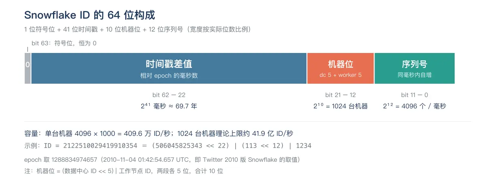
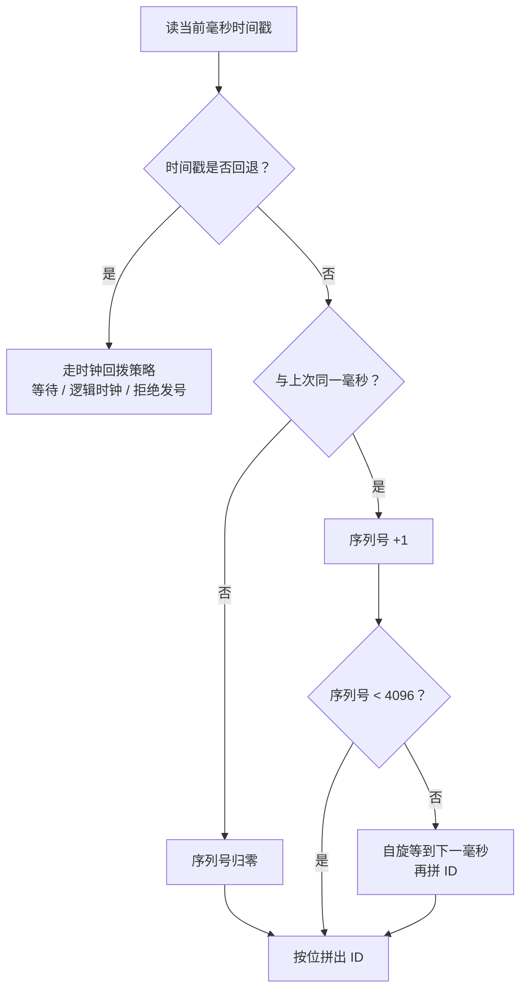
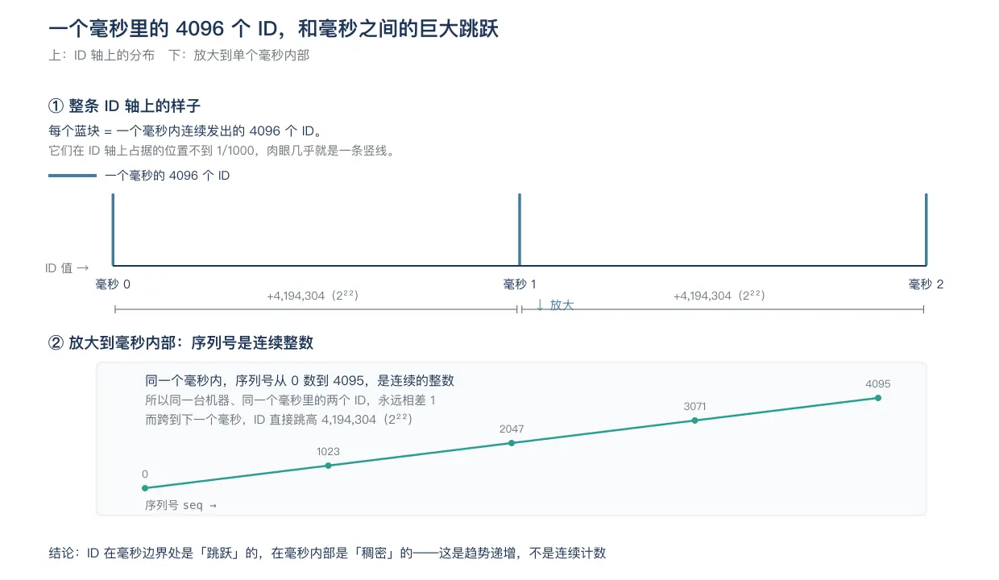
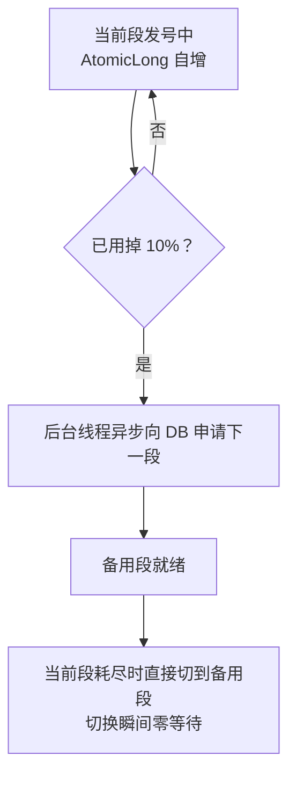
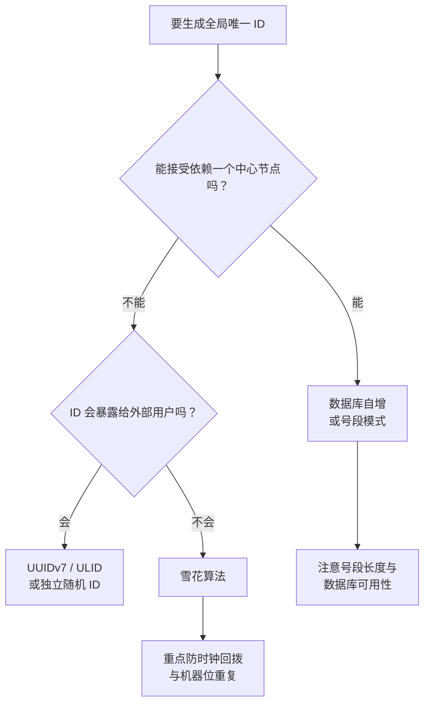

# 雪花算法：把时间、机器和序列号塞进 64 位整数


<!--more-->

订单表的主键想换成雪花 ID。

这是很多团队在分库分表之后遇到的第一个坎。原来的 `AUTO_INCREMENT` 主键在单库时代很好用：顺序递增、8 个字节、不用操心。拆成 16 个库之后，它不再是**一个** ID 序列，而是 16 个——全局唯一性没了。

几种常见的补救方式都不理想：

- **UUID v4**：唯一性没问题，但 36 个字符的字符串主键塞进 InnoDB 聚簇索引，等于随机插入，页分裂、写放大、索引膨胀全来了；
- **Redis `INCR`**：能自增，但凭空多一个强依赖，Redis 抖动时业务直接发不出 ID；
- **数据库号段模式**：可行，但每次取号都要跟数据库打交道。

于是有了雪花算法（Snowflake）。

**核心结论先摆出来**：雪花算法把「时间」「机器」「序列号」三样东西压进一个 64 位整数里，用**位**换**时间**——时间戳占 41 位，机器位占 10 位，序列号占 12 位。它换来的是「单机无协调、趋势递增、8 个字节」，代价是把**唯一性**押在了两件事上：**机器位不重复**、**时钟不回拨**。

这两件事在生产环境里都会出事，而且出事的方式都很隐蔽。本文会把这两个坑讲透。

| 章节 | 回答什么问题 | 核心结论 |
|---|---|---|
| 一 | 为什么需要雪花，而不是自增或 UUID | 分布式 ID 的四条硬需求，以及每种方案缺哪一条 |
| 二 | 64 位是怎么分配的 | 1 + 41 + 10 + 12，每个字段的容量、代价与取舍 |
| 三 | 一个 ID 是怎么生成出来的 | 三步流程、序列号耗尽怎么办、为什么不需要全局协调 |
| 四 | 时钟回拨怎么办 | Twitter 的原始选择，以及三种能落地的应对策略 |
| 五 | 机器位怎么分配 | 物理机写死 vs 容器里动态申领，为什么 IP 哈希不行 |
| 六 | 趋势递增不等于严格有序 | 跨节点顺序的真实边界，以及它对分页的影响 |
| 七 | 号段模式：另一条路 | 美团 Leaf 的双 Buffer 方案，以及与雪花的取舍 |
| 八 | 变体与新标准 | Sonyflake、Discord、Mastodon、UUIDv7 |
| 九 | 生产环境踩过的坑 | 机器位重复、时钟回拨、JS 精度、信息泄露 |
| 十 | 怎么选 | 按场景选方案，以及什么时候**不该**用雪花 |

## 一、分布式 ID 的四条硬需求

先说清楚需求，后面的方案取舍才有意义。一个能用的分布式 ID，需要同时满足下面四条：

| 需求 | 含义 | 不满足会怎样 |
|---|---|---|
| 全局唯一 | 任意两个节点、任意时刻生成的 ID 不相同 | 数据合并时主键冲突 |
| 趋势递增 | 大体随时间单调增长 | 插入随机，索引页分裂，写放大 |
| 长度可控 | 最好一个 `bigint` 装下 | 字符串主键让索引和存储翻倍 |
| 无外部依赖 | 不因为某个服务挂了就发不出 ID | 可用性被绑死在另一个组件上 |

逐个看现有方案缺什么：

**数据库自增**。单库时代它四条全满足，分库之后才栽跟头——栽在第一条上。`db_0` 的第 1 号和 `db_1` 的第 1 号会撞车。常见补救是「雪花 ID 做主键 + 数据库自增做业务号」，或者用一张独立的 ID 表集中发号——后者本质上是换了个地方自增，单点问题还在。

**UUID v4**。它天然全局唯一，也不需要任何协调，但**无序**这一条要命。InnoDB 的主键是聚簇索引，数据行按主键物理存放；随机主键意味着新行总要插到某个中间页，页被撑满就分裂。更糟的是 UUID 有 16 字节（二进制）或 36 字符（字符串），索引体积翻几倍。

**UUID v7** 是后来补上的答案：前 48 位放毫秒时间戳，后面 74 位随机。它保留了 UUID 的全部好处，又补上了时间有序这一条，而且是 2024 年 RFC 9562 正式标准化的格式。本文第八章会细讲它和雪花的取舍。

**Redis `INCR`**。它满足了唯一性和趋势递增，8 个字节，吞吐也够——但把可用性押在了 Redis 上。Redis 做持久化时的 fork 抖动、主从切换时的数据丢失，都是会真实发生的事故。

**雪花算法**。它满足全部四条：不依赖任何外部组件，唯一性靠「机器位不重复 + 时钟不回拨」两个前提保证，趋势递增，8 个字节。

代价是：它把「谁来保证唯一性」这个问题，从数据库转移到了**运维纪律**上。

## 二、64 位是怎么分配的

Twitter 2010 年那版 Snowflake 的位分配长这样：



四个字段的容量都能直接算出来：

| 字段 | 位数 | 位置 | 取值 | 容量 |
|---|---|---|---|---|
| 符号位 | 1 | bit 63 | 恒为 0 | 保证 ID 永远是**正数** |
| 时间戳差值 | 41 | bit 62–22 | 毫秒 | $2^{41}$ 毫秒 ≈ 69.7 年 |
| 机器位 | 10 | bit 21–12 | 数据中心 5 位 + 工作节点 5 位 | 1024 台机器 |
| 序列号 | 12 | bit 11–0 | 0 – 4095 | 每毫秒 4096 个 ID |

想验证自己项目里的 ID 布局，可以用在线的 [Snowflake ID 解析工具](https://unikit.cc/en/tools/snowflake) 拆开一个 ID，看看各字段是不是落在预期的位置。

### 2.1 为什么必须留一个符号位

Java 的 `long` 是**有符号** 64 位，取值上限是 $2^{63}-1$。如果把 64 位全部分给有效字段，ID 一旦超过 $2^{63}-1$ 就会变成负数——很多系统（JSON 序列化、数据库 `bigint` 某些驱动、前端 `parseInt`）会在这里出各种离奇的问题。

留 1 位恒为 0，等于把上限砍到 41 + 10 + 12 = 63 位，换来「这个数永远是正的」这条省心的性质。

### 2.2 41 位时间戳，以及那个关键的 epoch

$2^{41}$ 毫秒约等于 69.7 年。看起来很多，但**从哪一刻开始算**才是关键。

Twitter 用的 epoch 是 `1288834974657`，也就是 2010-11-04 01:42:54.657 UTC，而不是 Unix 纪元 1970-01-01。这个选择白赚了几十年：如果从 1970 年起算，41 位只能撑到 2039 年就满了；从 2010 年起算，同样的 41 位能用到 2080 年。

**这是设计 ID 格式时最容易忽略的一笔账**——位是固定的，但起点是自由的。

### 2.3 机器位：10 位够不够

10 位机器位 = 32 个数据中心 × 32 个工作节点 = 1024 台。物理机时代够用得很。容器时代要看 Pod 数量——几百个 Pod 的集群已经吃掉三分之一到一半的机器位，再往上就得重排位宽了。

### 2.4 序列号：12 位，以及那个此消彼长的关系

序列号占 12 位，意味着同一台机器、同一个毫秒内最多发 4096 个 ID；超过就得等下一毫秒。

这里有个容易忽略的约束：**序列位和时间位是零和的**。序列号多给 1 位，时间戳就少 1 位，寿命直接砍半（69.7 年 → 34.8 年）。所以位分配不是随手填的，每一位都要拿寿命去换。

单机理论吞吐因此是：

$$
2^{12} \times 1000 = 4096000 \ \text{个/秒}
$$

1024 台机器理论上限约 41.9 亿个/秒。这个数字大得没有意义——真实瓶颈从来不在发号，而在下游能不能吃得下。

## 三、一个 ID 是怎么生成出来的

流程比想象中简单，只有三步：**读时间戳 → 决定序列号 → 按位拼起来**。



把 Twitter 2010 年的 Scala 实现翻译成 Java，是理解这套机制最快的方式（原始代码在 `twitter/snowflake` 仓库的 `snowflake-2010` 标签下，核心逻辑集中在 `IdWorker.scala`）：

```java
public class Snowflake {
    // 2010-11-04 01:42:54.657 UTC，Twitter 2010 版 Snowflake 的取值
    private static final long EPOCH = 1288834974657L;

    private static final long WORKER_ID_BITS = 5L;
    private static final long DATACENTER_ID_BITS = 5L;
    private static final long SEQUENCE_BITS = 12L;

    private static final long MAX_WORKER_ID = ~(-1L << WORKER_ID_BITS);           // 31
    private static final long MAX_DATACENTER_ID = ~(-1L << DATACENTER_ID_BITS);   // 31
    private static final long SEQUENCE_MASK = ~(-1L << SEQUENCE_BITS);             // 4095

    private static final long WORKER_ID_SHIFT = SEQUENCE_BITS;                            // 12
    private static final long DATACENTER_ID_SHIFT = SEQUENCE_BITS + WORKER_ID_BITS;      // 17
    private static final long TIMESTAMP_LEFT_SHIFT =
            SEQUENCE_BITS + WORKER_ID_BITS + DATACENTER_ID_BITS;                         // 22

    private final long workerId;
    private final long datacenterId;

    private long sequence = 0L;
    private long lastTimestamp = -1L;

    public Snowflake(long datacenterId, long workerId) {
        if (datacenterId < 0 || datacenterId > MAX_DATACENTER_ID) {
            throw new IllegalArgumentException("datacenterId out of range");
        }
        if (workerId < 0 || workerId > MAX_WORKER_ID) {
            throw new IllegalArgumentException("workerId out of range");
        }
        this.datacenterId = datacenterId;
        this.workerId = workerId;
    }

    public synchronized long nextId() {
        long timestamp = System.currentTimeMillis();

        // 时钟回拨：拒绝发号，绝不生成可能重复的 ID
        if (timestamp < lastTimestamp) {
            throw new IllegalStateException(
                    "clock moved backwards, refusing to generate id for "
                            + (lastTimestamp - timestamp) + " milliseconds");
        }

        if (timestamp == lastTimestamp) {
            // 同一毫秒：序列号自增
            sequence = (sequence + 1) & SEQUENCE_MASK;
            if (sequence == 0) {
                // 4096 个用完了，等下一毫秒
                timestamp = waitNextMillis(lastTimestamp);
            }
        } else {
            // 换了毫秒：序列号归零
            sequence = 0L;
        }

        lastTimestamp = timestamp;

        return ((timestamp - EPOCH) << TIMESTAMP_LEFT_SHIFT)
                | (datacenterId << DATACENTER_ID_SHIFT)
                | (workerId << WORKER_ID_SHIFT)
                | sequence;
    }

    private long waitNextMillis(long lastTimestamp) {
        long timestamp = System.currentTimeMillis();
        while (timestamp <= lastTimestamp) {
            timestamp = System.currentTimeMillis();
        }
        return timestamp;
    }
}
```

三个值得注意的地方：

**一、没有任何全局协调。** 每个节点只跟自己的时钟和自己的序列号打交道，不问任何人「上一个 ID 是多少」。这就是雪花最漂亮的地方——**没有中心，就没有中心故障**。多一个节点就多一份吞吐，扩容不需要数据搬迁。

**二、序列号耗尽是自旋，不是阻塞。** 4096 个/毫秒发满了，就 busy-wait 到下一毫秒。对绝大多数业务，这个毫秒级的等待根本感知不到。

**三、`synchronized` 是实例级的。** 多线程共用一个实例，发号会串行化。生产上通常给每个线程一个独立实例（`ThreadLocal`），或者干脆用 `AtomicLong` + CAS 做无锁版本——因为 `sequence` 和 `lastTimestamp` 本来就是每个线程私有的。

### 3.1 一个毫秒里到底发生了什么

ID 在毫秒边界上是「跳跃」的，在毫秒内部是「稠密」的：



同一毫秒内，序列号从 0 数到 4095，是**连续的整数**——两个 ID 永远相差 1。而跨到下一个毫秒，时间戳加 1，ID 直接跳高 $2^{22}$ = 4,194,304。

所以雪花 ID **不是连续计数**。如果你的业务逻辑假设「ID 相邻 = 业务相邻」，那是错的。

## 四、时钟回拨：真正会出事的地方

### 4.1 回拨从哪来

不是玄学，都是日常运维动作：

- **NTP 用 step 模式校时**——直接跳变到目标时间，而不是 slew 模式慢慢调。这是最常见的原因；
- **虚拟机挂起再恢复**，或者**热迁移**到另一台宿主机，时间基准变了；
- **容器迁移**，Pod 换了宿主机；
- **运维手工改时间**，改完忘了改回来。

回拨一旦发生，机器位不变、毫秒数变小，序列号从头开始——**同样的机器位 + 同样的毫秒 + 同样的序列号，直接产出重复 ID**。订单号重复、支付流水重复，是能上事故的级别。

### 4.2 Twitter 原始的选择：拒绝发号

回头看上面那段 `IdWorker.scala`，Twitter 的处理非常干脆：

```scala
if (timestamp < lastTimestamp) {
  log.error("clock is moving backwards.  Rejecting requests until %d.", lastTimestamp)
  throw new InvalidSystemClock(...)
}
```

**语义最干净的做法是：宁可不发，也绝不发可能重复的 ID。** 检测到回拨就抛异常，让调用方重试或降级。

这个选择的前提是「发号失败」比「发号重复」更容易接受。对交易链路来说这通常成立——但对日志埋点、异步任务这种场景，抛异常可能反而更糟。

### 4.3 三种可落地的应对策略

| 策略 | 做法 | 优点 | 代价 |
|---|---|---|---|
| 拒绝发号（Twitter 原版） | 检测到回拨直接抛异常 | 绝不产生重复 ID，语义最干净 | 业务直接失败，需要兜底或人工介入 |
| 等待时钟追平 | 自旋或睡眠直到 `now >= lastTimestamp` | ID 依然严格递增，实现简单 | 回拨 1 秒就阻塞 1 秒；NTP 跳变时业务线程集体卡住 |
| 逻辑时钟 | 沿用 `lastTimestamp`，只把序列号继续往上加 | 不阻塞，用序列号空间换 | 4096 个/毫秒的余量很快被吃掉，回拨幅度大会撑爆序列号 |

**逻辑时钟**是折中方案，也是很多生产实现的选择：把序列号位从 12 位加到 16 或 20 位，多出来的位专门用来吸收时钟回拨。代价是时间戳位数相应减少，寿命变短。

**混合策略**在生产上更常见：小幅回拨（比如 ≤ 5 ms）就等待，大幅回拨就抛异常。美团 Leaf 的做法就是这一类——回拨小于 5 毫秒则自旋等待，超过 5 毫秒直接拒绝发号并告警。

### 4.4 想要彻底解决，得从时钟本身入手

如果你的系统对全局时间有强需求（比如做跨机房的事务排序），那就不能靠应用层的 ID 生成器兜底。Google Spanner 的做法是引入 **TrueTime**：每个数据中心维护一组 GPS 原子钟和时钟服务器，把时间误差控制在一个区间内而不是一个点上，客户端拿到的是一个「时间区间」而不是一个时间点。

本博客早前写过一篇专门讲这件事：[《TrueTime 如何解决时钟回拨》](/posts/2019/08/692d25fe/)。

## 五、机器位怎么分配

机器位重复 = ID 重复。而且这类事故极难排查：两台机器各自正常发号，撞出来的 ID 从数据库里看完全正常，只有当业务逻辑因为重复 ID 出错时，才会发现「怎么有两笔一模一样的订单」。

常见的三种分配方式：

| 方式 | 做法 | 适用场景 | 风险 |
|---|---|---|---|
| 配置写死 | 部署时由配置中心或环境变量指定 | 物理机、机器数固定的集群 | 扩容要人工改配置；两份配置写重了就是撞号 |
| IP + 端口哈希 | `hash(ip:port) & 1023` | 临时方案、实验环境 | 哈希碰撞必然存在；K8s Pod 重建后 IP 复用会撞 |
| 注册中心申领 | 启动时从 ZooKeeper / etcd / 数据库申请一个 workerId | 容器化、K8s 集群 | 注册中心不可用时要有兜底 |

**容器里不要用 IP 哈希。** K8s 的 Pod IP 是会变的，Pod 重建后拿到新 IP，但新 Pod 很可能继承了旧 Pod 的 workerId——旧 Pod 还没彻底退出时，两边就在同一个机器位上发号了。

更稳的做法是**注册中心申领 + 本地持久化**：

1. 启动时向 ZooKeeper（或 etcd / Redis / DB）申领一个 workerId；
2. 把申领到的 ID 写到本地文件，服务重启时优先读本地文件；
3. 本地文件里的 ID 已被别的节点占用时，才去注册中心重新申领。

第 2 步是关键。没有本地持久化，注册中心抖动 + 服务重启 = 换机器位 = 撞号。

K8s 里还有一种更省事的办法：直接用 StatefulSet 的 **ordinal 序号**（`pod-0`、`pod-1`……）作为 workerId。它天然稳定且唯一，代价是机器位数要留够（StatefulSet 序号占 10 位刚好够 1024 个）。

## 六、趋势递增不等于严格有序

这是最容易被宣传话术糊弄过去的一点。

雪花保证的是：

- **同一台机器上**：ID 严格递增 ✅
- **多台机器之间**：只是**大致**有序 ❌

原因有两个，都很实在。

**第一，机器之间有时钟偏差。** 节点 A 的系统时钟比节点 B 快 5 毫秒，那么这 5 毫秒里两台机器发出的 ID 会交叉——时间上更晚发生的业务，拿到的 ID 反而可能更小。

**第二，同一个毫秒内，机器位的权重高于序列号。** 机器位在序列号之上，所以同一毫秒里，机器 1 的 ID 一定大于机器 0 的 ID，哪怕机器 1 的请求其实先到。

所以严格说来，雪花提供的是 **趋势递增（roughly monotonic）**，不是全局全序。

### 6.1 这对分页意味着什么

「按 ID 倒序分页」的典型写法是 `WHERE id < :cursor ORDER BY id DESC LIMIT n`，游标取上一页读到的最小 ID。跨节点并发写入时有两个坑：

- **新插入的行会被跳过**：它的 ID 大于当前游标，排序上落在已经读过的页里，`id < 游标` 抓不到它。**单库自增 ID 同样如此**——倒序游标分页天然会跳过这期间新写入的数据；
- **新插入的行也可能出现在后面的页里**：某节点时钟慢了半秒，它发出的 ID 比游标还小，于是这行数据要等你翻到后面几页才冒出来。不漏，但「按 ID 排序」和「按创建时间排序」彻底对不上了。

雪花比自增多出来的不只是乱序：自增 ID 全局单调，**页内顺序就是写入顺序**；雪花的 ID 在各节点之间是交错的，**同一页里两行的先后，可能和真实发生顺序相反**。做状态机推进、消息去重、增量同步这类逻辑时，「顺序不可信」比「漏数据」更值得警惕。

如果你要的是「翻页看到的是一个稳定快照」，或者业务上真的需要全局严格有序（比如事件流的全局序号、状态机的推进顺序），就别用雪花，换一个**中心化的发号器**：数据库序列、单实例的 Redis `INCR`，或者干脆用消息队列的分区 + 位点来定序。可用性的损失换来的是确定的顺序，这是明确的取舍。

## 七、号段模式：另一条路

号段模式和雪花是完全不同的思路：**不依赖时钟，改为向数据库批量要号**。

美团开源的 **Leaf** 把这个思路做成了工业级方案，提供两种模式（segment 和 snowflake）。它的 segment 模式是这样运作的：

1. 每个业务线（`biz_tag`）在数据库里有一行记录，维护 `max_id` 和 `step`（步长）；
2. 服务向数据库申请**一段** ID（比如 1000 个），整段加载到内存；
3. 发号时纯内存 `AtomicLong` 自增，不碰数据库；
4. 段用完了再去申请下一段。

关键在第 4 步的时机。朴素实现是「段用尽才去 DB 取」，那么取号的那一瞬间就是一次同步 IO——网络抖动或 DB 慢查询会直接变成业务请求的延迟毛刺。

Leaf 的解法是**双 Buffer 异步预取**：当前段用到 10% 左右时，后台线程就去申请下一段，段用尽时直接切到已经备好的段，切换瞬间零等待。



号段长度有讲究：一般建议设为**峰值 QPS × 600**（10 分钟的量）。这样一个段就够撑 10 分钟，双 Buffer 里备着的那一段还能再撑一个整段——数据库即使宕机，发号服务也不会立刻中断。这是一个实打实的可用性收益。

两种方案的对比：

| 维度 | 雪花 | 号段（Leaf-segment） |
|---|---|---|
| 依赖 | 只依赖本机时钟 | 依赖数据库（但只在申请新段时） |
| 时钟回拨 | 有风险，需专门处理 | **不存在** |
| 单机吞吐 | 极高 | 极高 |
| 数据库压力 | 无 | 每 `step` 个 ID 一次 `UPDATE` |
| ID 连续性 | 毫秒内连续，毫秒间跳跃 | 连续（除非丢段） |
| 跨节点全局有序 | 否 | 否（各节点拿到的号段互不重叠，顺序也无意义） |
| 数据库挂了 | 不受影响 | 内存中的号段用完后受影响 |

**选哪个**：**不能接受任何时钟回拨风险**，选号段——它根本不依赖时钟；**不愿让发号依赖数据库**，宁可自己把时钟回拨的工程成本扛下来，选雪花。已经有稳定数据库、并且更在意「ID 连续」的，号段也正合适。

## 八、变体与新标准

位分配不是唯一解。各家都按自己的场景调过：

| 方案 | 时间位 | 机器位 | 序列位 | 特点 |
|---|---|---|---|---|
| Twitter Snowflake | 41（毫秒） | 10 | 12 | 经典版本，69.7 年，1024 台机器 |
| Sonyflake（索尼） | 39（10 毫秒为单位） | 16 | 8 | 174 年，65536 台机器；单机每 10 毫秒 256 个 |
| Discord | 42（毫秒） | 10 | 12 | 比 Twitter 多留 1 位给时间 |
| Mastodon | 48（毫秒） | — | 16 位随机 | 时间有序 + 随机，不保证同毫秒内单调 |
| UUIDv7（RFC 9562） | 48（毫秒） | 无 | 74 位随机 | 2024 年 5 月标准化，无需机器位分配 |

**Sonyflake** 是个有意思的取舍。它把时间单位从 1 毫秒改成 **10 毫秒**，序列号从 12 位砍到 8 位，腾出来的位全给了机器号（16 位 = 65536 台）。结果是寿命从 69.7 年延长到 174 年，机器数从 1024 涨到 65536，代价是单机吞吐下降到每 10 毫秒 256 个（2.56 万/秒）——对绝大多数业务依然远远够用。

**UUIDv7** 走的是另一条路：48 位毫秒时间戳 + 74 位随机数，**不要机器位**。这意味着：

- 不用再操心「谁来分配机器位」这个运维问题；
- 不泄露集群规模，也不泄露 ID 的产生速率；
- 同一毫秒内的多个 UUID 靠随机数区分，**不保证单调**；
- 代价是 16 字节，且文本形式仍是 36 个字符。

如果 ID 要暴露给外部用户（用户可见的订单号、分享链接），UUIDv7 往往比雪花更合适——因为雪花 ID 是**可以枚举的**。这一点下一章会展开。

## 九、生产环境踩过的坑

### 9.1 机器位重复

最隐蔽的一类。配置复制粘贴错了、IP 哈希撞了、Pod 重建继承了旧机器位——表现是两个节点的 ID 交错重复，而单看任何一段日志都正常。

**防御**：机器位必须由一个**唯一的分配源**产生，不能靠人肉配置。

### 9.2 时钟回拨

第四章专门讲过了。**防御**：一定要实现回拨检测，哪怕只是抛异常，也好过静默生成重复 ID。

### 9.3 JS 精度丢失

这是前端最容易撞上的坑。JavaScript 的 `Number` 是双精度浮点数，只有 53 位有效位，安全整数上限是 $2^{53}$，大约 9×10¹⁵。而现在一个用了十几年的雪花 ID 早就在 $2^{60}$ 之上，远远超过了这个上限。

具体会发生什么：

```javascript
const id = 2122510029419910354;   // 后端返回的雪花 ID
console.log(id);                  // 2122510029419910400
```

末尾的 `354` 变成了 `400`，实际偏差是 46。雪花 ID 的低位（序列号）恰恰是最有业务含义的部分，一旦被截断，前端去调接口、去做去重、拿它当数组下标，全都会错。

**防御**：后端 JSON 序列化时把 ID 转成字符串：

```java
@JsonSerialize(using = ToStringSerializer.class)
private Long id;
```

前端用字符串接收，需要做数值比较时用 `BigInt`。注意：**用 `String` 接住比用 `BigInt` 更稳**，因为很多第三方组件库会把 BigInt 再转回 Number。

### 9.4 溢出成负数

如果实现时没留符号位，把 64 位全用上，ID 迟早会超过 $2^{63}-1$。Java 里 `long` 是有符号的，一溢就变成负数：排序全乱，数据库驱动也可能因为类型不匹配而报错。

### 9.5 信息泄露

雪花 ID 里藏着三类信息，而且都能被外部观察到：

| 泄露什么 | 怎么推出来 | 有什么风险 |
|---|---|---|
| 数据创建时间 | 解出高 41 位 | 竞争者能看出你的业务节奏和增长曲线 |
| 集群规模 | 观察 ID 里的机器位 | 暴露基础设施规模 |
| 业务总量 | ID 可预测、可枚举 | 拿到一个 ID 就能推出相邻的 ID |

第三条是安全问题，不是性能问题。**只要 ID 出现在用户可见的 URL 里，就必须额外设计一层对外 ID**：随机串、加密 ID，或者把内部 ID 做一次不可逆的变换。大厂常见的做法是内部一套自增 ID，对外再发一个不可枚举的 ID，两套并存。

### 9.6 容器里的机器位漂移

K8s Pod IP 会变，Pod 重建会换 IP。用 IP 哈希做机器位的方案在这里直接失效。

### 9.7 多线程共用一个实例

`synchronized` 方法让发号串行化，百万 QPS 下锁竞争会把吞吐打下去。每个线程一个实例，或者用无锁版本。

## 十、怎么选



按场景对号入座：

| 场景 | 推荐方案 | 理由 |
|---|---|---|
| 单库、量不大 | 数据库自增 | 最简单，没有额外故障点 |
| 分库分表、QPS 不高 | 号段模式 | 不依赖时钟，ID 连续，DB 只在换段时介入 |
| 高并发、要求趋势递增、可用性优先 | 雪花算法 | 无中心节点，吞吐只跟机器数走 |
| ID 暴露给外部、需要防枚举 | UUIDv7 / ULID / 独立随机 ID | 不泄露规模，不可枚举 |
| 需要全局严格有序 | 中心化发号器 | 雪花只保证趋势递增，不保证全序 |

> 雪花算法用**位**换掉了**协调**和**时钟依赖**：64 位里的 41 位买来 69.7 年的时间，10 位买来 1024 台机器的横向扩展，12 位买来每毫秒 4096 个 ID 的吞吐。它没有中心节点，所以没有中心故障——代价是唯一性需要你自己用运维纪律来保证。

如果只能带走四句话：

1. **雪花的唯一性只依赖两件事：机器位不重复、时钟不回退。** 这两件都要有机制保证，不能靠人。
2. **机器位必须由唯一的分配源产生，容器里不要用 IP 哈希。** 撞号的排查成本极高。
3. **时钟回拨必须被检测到。** 宁可不发号，也不要发重复的 ID。
4. **ID 返回给前端时必须是字符串。** JavaScript 的 53 位精度会吃掉序列号。

## 参考资料

- [Twitter Snowflake（2010 版源码，含 `IdWorker.scala`）](https://github.com/twitter/snowflake/tree/snowflake-2010)
- [Sonyflake](https://github.com/sony/sonyflake)
- [美团 Leaf：分布式 ID 生成系统](https://github.com/Meituan-Dianping/Leaf)
- [RFC 9562：Universally Unique IDentifiers (UUIDs)](https://www.rfc-editor.org/rfc/rfc9562.html)
- [Snowflake ID 布局与解析工具](https://unikit.cc/en/tools/snowflake)

