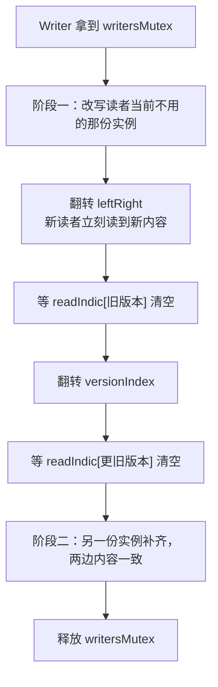
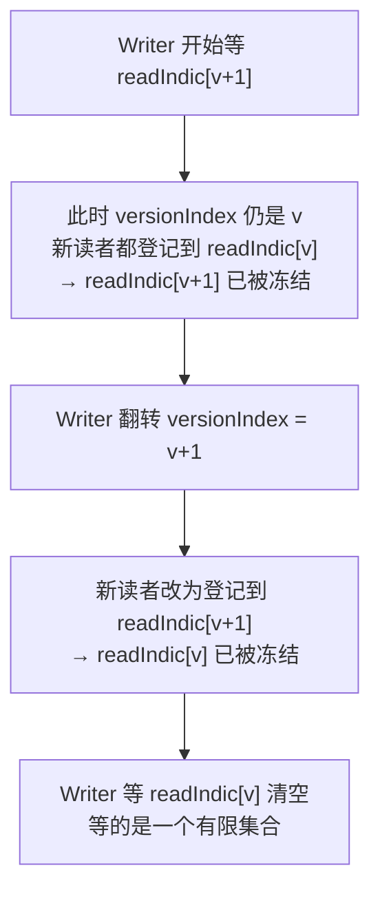

# Left-Right：让读操作永不阻塞的双实例并发控制


<!--more-->

> 原文：Pedro Ramalhete, Andreia Correia. **Left-Right: A Concurrency Control Technique with Wait-Free Population Oblivious Reads.** DISC 2015（国际分布式计算研讨会），2015 年 10 月，日本东京。本文引用的完整版预印本（含状态机图与性能实测）见 [ConcurrencyFreaks 仓库](https://github.com/pramalhe/ConcurrencyFreaks/blob/master/papers/left-right-2014.pdf)。

很多系统里都躺着一个这样的对象：一棵 `TreeMap`、一张路由表、一份配置快照。写它的代码是单线程写的，干净、直观，没有一行 CAS。

后来产品提了个需求：**配置热更新的时候，线上查询不许卡。**

于是三条路摆在面前，每条都有个解不开的结。

| 方案 | 做法 | 解不开的结 |
|---|---|---|
| **读写锁** | 读锁共享、写锁独占 | 写者一进来，所有读者排队等着 |
| **Copy-On-Write** | 写时整份复制一份，原子换指针 | 换下来的旧实例谁负责回收？没有 GC 就漏内存 |
| **RCU** | 读侧无锁，靠读侧临界区计数延迟回收 | 需要内核/运行时支持，JVM 上根本没有 |

2015 年，Pedro Ramalhete 和 Andreia Correia 在 DISC 上发了一篇两页的短公告，提出 Left-Right：**用两份实例交替写，把等待全部赶到读者一侧去。**

读操作因此变成了一条常数步的 wait-free 路径——不管有没有写者挡着，不管线程有多少。

这篇讲四件事：它的骨架、那个反过来的握手顺序、论文里的实测数字，以及它十年后被 QuestDB 重新发明时暴露出的边界。

| 层次 | 回答的问题 | 核心标识 | 本文对应章节 |
|---|---|---|---|
| **动机** | 读写锁和 COW 各自卡在哪？ | 读者被挡、GC 依赖 | 第一章 |
| **骨架** | 两份实例怎么交替写？ | `leftRight`、`versionIndex` | 第二章 |
| **握手** | 为什么读写的访问顺序是反的？ | 版本先于方向 | 第三章 |
| **进度** | wait-free 到底意味着什么？ | 常数步、与线程数无关 | 第四章 |
| **变体** | 四种实现各花多少原子操作？ | Basic / NV / RV / Optimistic | 第五章 |
| **实测** | 它比读写锁快在哪、慢在哪？ | 吞吐、尾延迟 | 第六章 |
| **边界** | 用了它要付出什么？ | 内存翻倍、读者纪律 | 第七章 |
| **重演** | 十年后它被重新发明了？ | QuestDB 2023 | 第八章 |

## 一、为什么读写锁和 COW 都不够

先把三条路的死结说清楚，因为 Left-Right 的每一个设计都能对应到其中一条。

**读写锁**的问题在读者。写者一旦进了临界区，读者就得等——哪怕它只是想知道一个键存不存在，哪怕这个键和写者改的那个八竿子打不着。实时系统最怕的就是这个：一个理论上 10 微秒的操作，尾延迟被写者放大到几百微秒。

**Copy-On-Write** 的问题在回收。写的时候复制一份新实例，原子换指针，读者永远跟着最新指针走——读侧确实无阻塞，延迟也确定。但换下来的旧实例什么时候能释放？Java 里靠 GC，C 里没人管。这就是为什么 COW 在 C/C++/Rust 这类没有 GC 的语言里用起来这么别扭。

**RCU** 是 COW 的工程化版本：读侧不复制，只登记自己进过临界区，等所有旧读者都退场了再回收。Linux 内核有 `rcu_read_lock()`，但 JVM 和 Scala 上没有对应的东西——URCU 是个用户态库，用起来跟内核版不是一个东西。

论文把三种通用技术摆成一张表，Left-Right 的位置一目了然：

| 性质 | 读写锁 | COW + CAS | Left-Right |
|---|---|---|---|
| 读阻塞读 | 否 | 否 | 否 |
| 读阻塞写 | 是 | 否 | 是（见下） |
| 写阻塞读 | 是 | 否 | **否** |
| 写阻塞写 | 是 | 否 | 是 |
| 需要 GC | 否 | 是 | **否** |
| 读延迟确定 | 否 | 是（GC 会搅局） | **是** |
| 实例份数 | 1 | N（线程数） | **2** |

"读阻塞写"那一行有个星号，值得单独说：写者**会**被阻塞，但只会被**旧读者**阻塞。旧读者一结束，写者立刻就能推进。而源源不断涌进来的新读者，对写者毫无影响。

这就是整套设计的关键——**把阻塞限制在读者一侧，并且只让已经在场的读者有机会阻塞写者。**

不过这张表里其实还漏了一位。1983 年 Gary Peterson 就系统研究过这个问题——他管它叫 Concurrent Reading While Writing（CRWW），并证明了一个更要命的结论：**想要多强的并发保证，就得付多少份数据副本**。谁都不等的代价是 n+2 份完整拷贝，外加一套垃圾回收。

Left-Right 正是从那个格局里找出的另一条路：它填上了 Peterson 定价表里空着的一格——**读者从不等、写者可以等**，代价只要 2 份副本，而且不需要 GC。那张定价表值得单独看一遍：[系列第一篇](/posts/2026/11/bb1f4e77/)。

## 二、Left-Right 的骨架：两份实例交替写

Left-Right 维护两个内容完全相同的数据结构实例，外加几个组件：

| 组件 | 类型 | 作用 |
|---|---|---|
| `leftInst` / `rightInst` | `T*` | 两份数据实例 |
| `leftRight` | 原子量 | 方向开关，告诉读者该进哪一份 |
| `versionIndex` | 原子量 | 版本号，写者翻转，在 0 和 1 之间来回 |
| `readIndic` | 状态发布结构 | 读者登记簿，登记"我在读第几版" |
| `writersMutex` | 互斥锁 | 保证同一时刻只有一个写者 |

写者的工作流程是这样的：

1. 拿到 `writersMutex`
2. **阶段一**：修改 `leftRight` 当前指向的**对侧**实例——也就是读者此刻不用的那一份
3. 翻转 `leftRight`，新读者立刻进来读刚改好的这份
4. 等旧版本的读者退场（`readIndic` 归零）
5. 翻转 `versionIndex`
6. 等更旧版本的读者退场
7. **阶段二**：把另一份实例也改一遍
8. 释放 `writersMutex`

一次写操作走过两个阶段：



为什么要改两遍、这么绕？

因为改两遍之后，两份实例的内容始终一致，下一个写者一上手就能在任何一份上直接动手，不必先等读者腾地方。论文里管这个叫"写者独处"（the Writer running in isolation）——写者修改某份实例的那一刻，保证没有任何读者在上面。

而"改两遍"本身是有代价的：**写操作被放大了一倍**，而且写被 `writersMutex` 串行化了。这一点第六章会用实测数据说话。

## 三、握手：为什么读写的访问顺序是反的

这是整个算法里最精巧、也最容易被忽略的一段。

读路径和写路径访问两个原子变量的**顺序是相反的**：

| 角色 | 访问顺序 |
|---|---|
| **Reader** | `load versionIndex` → `arrive(v)` → `load leftRight` → 访问实例 → `depart(v)` |
| **Writer** | `store leftRight` → 等 `readIndic[v+1]` 清空 → `store versionIndex` → 等 `readIndic[v]` 清空 |

读是"先版本、后方向"，写是"先方向、后版本"。这个反转不是随手写就的，它构成了一次握手。

**推论一：读到新版本的读者，一定读到了新方向。**

写者先写 `leftRight` 再写 `versionIndex`。读者先读 `versionIndex` 再读 `leftRight`。在顺序一致的内存模型下（论文明确假设 C11/C++1x 默认模型或 JVM 语义），读者既然读到了新 `versionIndex`，就说明写者的 `versionIndex` 写已经对它可见，那么更早发生的 `leftRight` 写当然也可见。

**推论二：还没登记的读者，一定读到了最新方向。**

一个读者如果还没执行 `arrive()`，说明它连 `versionIndex` 都还没读，自然也还没读 `leftRight`。等它去读 `leftRight` 的时候，读到的必然是写者最新写进去的那个值。

两条推论合起来，读者永远不会看到"旧方向 + 新版本"这种自相矛盾的组合。要么它跟着写者去了新实例，要么它还在旧实例上完整地读完。

**但握手真正的价值在写者这一侧。** 写者前后等了两轮，两轮等的是不同的计数器，而**每一次等待都等在一个已经冻结的计数器上**：



第一轮等待时，`versionIndex` 还没翻，新读者全登记在 `readIndic[v]` 上，所以 `readIndic[v+1]` 上的读者集合不会再增长——**冻结了**。

翻转 `versionIndex` 之后，新读者改登记到 `readIndic[v+1]`，于是 `readIndic[v]` 也冻结了。第二轮等待同理，等的是一个不会再变大的集合。

这就是写者不会被读者饿死的确切原因：**它等的永远是一个有限集合，而不是一个会不断有新成员的集合。**

那第一轮等待等的是 `readIndic[v+1]`，为什么它一开始就是空的（或很快会空）？因为上一轮写操作的第二轮等待，恰好等的就是这个计数器。论文原话是：这个保证在下一个写者开始时依然有效，所以下一个写者可以在它的**第一个实例上立即动手**，不必为读者等待。

### readIndic 的三种实现

论文给的最简实现是**两个原子计数器**，每个版本号一个。读者进来时 `readIndic[v]` 加一，走时减一；写者轮询 `readIndic[n] == 0`。

但两个计数器挤在同一条缓存行上会造成伪共享，读者之间互相干扰。改进版是**每个读者一个独立条目**，每条独占一条缓存行（用 padding 和对齐隔开）。代价是写者要扫全表——不过写者本来就慢，这个代价可以接受。

论文还提到已有若干 readIndicator 实现，分别具备 wait-free、lock-free 甚至 NUMA 感知的进度保证。

## 四、进度保证：三个术语

并发论文的进度术语最容易把人绕晕，这里把三个都钉死。

**wait-free（无等待）**：每个操作都在**有限步内**完成，完成时间不依赖其它线程的调度。这是比 lock-free 更强的保证——lock-free 只要求"系统总有进展"，wait-free 要求"每个操作都有进展"。

**population oblivious（与线程数无关）**：步数不随线程数量增长。注意这比 wait-free 更强：wait-free 允许步数依赖别的线程的行为（比如重试次数），population oblivious 连这个都不允许。

**starvation-free（无饥饿）**：一个操作不会被无限期推迟——虽然可能被延迟，但最终一定轮到它。

套到 Left-Right 上：

**读操作是 wait-free 且 population oblivious 的。** 读路径里一个循环都没有：

```cpp
// 读路径：没有循环，步数固定
template<typename R, typename A>
R applyRead(A& arg, function<R(T*, A)>& f) {
    const int vi = arrive();        // 登记：我读的是 vi 这一版
    T* inst = (leftRight.load() == LEFT) ? leftInst : rightInst;
    R ret = f(inst, arg);           // 真正读数据，无人打扰
    depart(vi);                     // 注销
    return ret;
}
```

固定几次原子读、几次原子写，完了。写者在不在、读者有多少，都不改变这个步数。

**写操作是阻塞的，但不会被读者饿死。** 它确实有等待循环：

```cpp
// 写路径：先改"读者不用的那份"，翻转方向，再改另一份
template<typename R, typename A>
R applyMut(A& arg, function<R(T*, A)>& f) {
    lock_guard<mutex> m(writersMutex);      // 写者之间互斥
    const int p = versionIndex.load();
    const int n = (p + 1) & 0x1;            // 下一个版本号
    const int dir = leftRight.load();

    if (dir == LEFT) {
        f(rightInst, arg);                   // 阶段一：改右侧
        leftRight.store(RIGHT);              // 方向翻转，新读者看到新内容
    } else {
        f(leftInst, arg);
        leftRight.store(LEFT);
    }

    while (!readIndic[n]->isEmpty()) yield(); // 等旧版本读者退场
    versionIndex.store(n);
    while (!readIndic[p]->isEmpty()) yield(); // 再等上一版读者退场

    if (dir == LEFT) {
        f(rightInst, arg);                   // 阶段二：另一份补齐
    } else {
        f(leftInst, arg);
    }
    return R();
}
```

两个 `while` 循环等的是第三章论证过的**冻结计数器**，所以只要那批旧读者最终能跑完，写者就一定能推进——**对读者无饥饿**。

至于写者之间，`writersMutex` 是一把普通的互斥锁，进度条件是阻塞的。如果换成无饥饿的互斥锁（比如论文作者后来提出的 C-R 算法），整个写操作就变成无饥饿的。

> **一句话总结**：Left-Right 把"等待"这件事从读者的必经之路，变成了写者偶尔要付的过路费。

## 五、四个变体，以及它们各自的代价

论文给了四种实现，差别在于**读操作要花几次原子操作**，以及**愿意为此牺牲什么**。

| 变体 | 读操作代价 | 牺牲了什么 |
|---|---|---|
| **Basic** | 2 次 load + 2 次 store | 无（基线） |
| **NV**（无版本号） | 1 次 load + 3 次 store | 写者对读者**不再无饥饿** |
| **RV**（读者自有版本号） | 1 次 load + 2 次 store | 内存 O(读者数)；版本号会溢出 |
| **Optimistic**（乐观读） | 3～5 次 load + 2 次 store | 需要 GC；读者与写者可能同时访问同一实例 |

**NV** 去掉了 `versionIndex`，改成每个读者维护一个四态状态：`NOT READING` / `READING` / `LEFT` / `RIGHT`。读者先置 `READING`，读到方向后再置成 `LEFT` 或 `RIGHT`。写者要等所有"正在读"和"还停在上一个方向"的读者都清场。

省下了一次 load，但代价很实在：理论上写者可能被一个"刚读完、立刻又发起下一次读"的读者反复卡住——因为那个读者会再次进入 `READING` 状态。**写者对读者不再无饥饿**，这条性质就此丢掉。

**RV** 让每个读者维护自己的版本号，并用**正负号**表示在读还是不在读：开始读时置正并加一，结束时置负并减一。写者扫描所有读者，等它们的版本号变成负的或者发生过增量。比 Basic 少一次 load，代价是内存占用 O(读者数)，以及版本号会持续递增。论文说用 64 位整数的话，按现代 CPU 的速度要几千年才可能溢出，实践中不用管。

**Optimistic** 最激进：读者假设"此刻没有写者在动我这份实例"，读之前记一次 `versionIndex`，读完再记一次，中间加一道 release barrier 防止指令重排。两次版本号一致就直接返回，不一致就重试。

好处是读者大多数时候**根本不用碰 `readIndic`**（省掉了 arrive/depart），大多数读操作零登记。代价有三条，都写在论文里：需要 GC；读者和写者可能同时访问同一实例，**可能破坏数据结构的不变量**；底层对象的成员必须自身具备原子性保证。

论文对这个变体的评价挺直白：它不像其它三个那么通用。

## 六、实测：它到底快在哪，慢在哪

论文用 `java.util.TreeSet` 套上 Left-Right 做了基准测试。机器是双路 Opteron 6272（32 核），Windows 7，JDK 8u20。树规模 10³ 和 10⁶ 两种，每组跑 7 次取中位数。对比对象包括 ScalableRWLock 保护的 `TreeSet`、四个 Left-Right 变体，以及 Stanford concurrent raylib 里的 `SnapTreeMap`（乐观的 hand-over-hand 校验 + 松散平衡树）。

**结果一：专用读线程下，读吞吐吊打所有对手。** 四个 Left-Right 变体都随读线程数近似线性扩展，在 1000 元素的 `TreeSet` 上，总吞吐最高达到 `SnapTreeMap` 的 **5 倍**。

**结果二：写吞吐 `SnapTreeMap` 反超。** 原因很实在：它用的是松散平衡树，而且允许多个写者并行；Left-Right 要写两棵不同的树，而且写被 `writersMutex` 串行化了。

**结果三：混合负载下 `SnapTreeMap` 整体最好。** 论文测了 10%、1%、0.1% 三种写比例，`SnapTreeMap` 在前两种里都是赢家，Left-Right 的 Optimistic 变体只在 0.1% 写时追平或超过它。

作者对这个结果的解释挺有意思：混合负载里"读依赖前一次写完成"，这人为制造了串行化，把 wait-free 的好处抵消掉了。**Left-Right 的优势要在"读多写少、读写解耦"的工作负载下才体现得出来。**

**结果四：延迟数据是全文最有说服力的部分。** 10⁶ 元素树上 `contains()` 的耗时，单位微秒：

| 分位 | 读写锁 | Left-Right | SnapTreeMap |
|---|---|---|---|
| 99% | 38 | **<1** | 2 |
| 99.9% | 67 | **<1** | 5 |
| 99.99% | 106 | **8** | 11 |

读写锁的尾延迟被写者放大了将近三倍（38 → 106 微秒），因为写者进临界区时读者就得排队。Left-Right 基本是平的：99.9% 的调用在 1 微秒内完成，最差的万分之几也才 8 微秒。

**所以 Left-Right 买的不是吞吐，是尾延迟的确定性。** 它的写吞吐不如别人，内存还要翻倍——但它换来的是：无论读写比例如何、无论有多少线程，读操作的耗时上界是确定的。

这正是实时系统想要的交换。

## 七、代价与边界

论文不会只报喜。下面几条是实际用起来会遇到的坎。

**内存翻倍。** 两份实例。数据量大的时候这笔账不小。

**写者会阻塞。** 写者要等旧读者退场。如果有个读者卡在临界区里——读了个文件、做了个系统调用、甚至被调试器断住——写者就一直等着。

**读者必须守规矩。** 一次 `applyRead` 返回之后，**不能**再持有实例内部的指针。绕过版本登记去用那个指针，等于跳过了整套协议，安全性就没了。这是所有"包装式"并发控制的共同要求，也是最容易写错的地方。

**写被串行化。** `writersMutex` 意味着同一时刻只有一个写者。多个写者想改同一份数据，Left-Right 不解决这个问题。

**它保护的是对象，不是代码块。** 论文明确说了这一点：读写锁保护一段代码，Left-Right 保护一个特定对象，且不依赖共享属性。所以它没法直接替代 `synchronized` 块，但可以包住任意数据结构——论文的思路是把它做成一把"像读写锁一样用起来的锁"。

**线性一致性成立。** 写者一侧，`writersMutex` 保证同一时刻只有一个写者，`modify()` 里的任意原子步骤都可以当线性化点。读者一侧，线性化点是它读到 `leftRight` 的那一刻——要么看到写者翻转之前的状态，要么看到之后的状态。不会有中间态。

## 八、十年后的重演

2023 年 8 月，QuestDB 团队发了一篇《Concurrent Data Structure Design Walkthrough》，讲他们怎么给一个存放 native memory blob 的并发 map 设计无锁读路径。

他们的方案拆开看是这样的：两份 `InternalMap` 轮流当读者侧和写者侧、每份挂一个读者计数器、写者用互斥锁串行化、翻转时把上一次的操作记录下来延迟重放。

骨架和 Left-Right 几乎一模一样。

2023 年 9 月，Left-Right 的作者之一 Pedro Ramalhete 发了一篇《How to (not) invent concurrent algorithms》，把这件事点了出来：QuestDB 的方案是"穷人版的 Left-Right"——用了同样的双实例骨架，但读者只是 lock-free 而非 wait-free，而且丢掉了"写者对读者无饥饿"这条性质。

作者的态度很值得记。他没有把这当成一次抄袭控诉，而是当成"好算法会被反复重新发现"的证据。他举了自己的例子：这十几年里他和 Andreia 反反复复重新发现 Maurice Herlihy 二十年前的东西——每次查完文献发现撞上了，他的反应是"这说明我们走在了正确的路上"。

顺带一提，同一批作者更早就发过 **Double Instance Locking**——同样用双实例，机制却不同：它的读者只是 lock-free，不是 wait-free。Left-Right 比它多出来的，正是第四章那个"读路径一个循环都不能有"的部分。

## 写在最后

> **一句话总结**：Left-Right 用"两份实例 + 反向握手"把等待全部赶到读者一侧，让读操作变成常数步的 wait-free 路径；写操作则诚实地承认自己会阻塞，但保证不会被读者饿死。

如果只能带走三句话：

1. **读要无阻塞，就让读和写碰不同的数据。** 两份实例加一个方向开关，是把"读写互斥"变成"读写并行"最直接的办法。
2. **wait-free 的分量在"与线程数无关"。** 读路径里一个循环都不能有——连"再确认一次版本没变"这种看起来无害的循环也不行。
3. **Left-Right 买的不是吞吐，是尾延迟。** 读写锁在 99.99% 分位上的尾延迟是它的十几倍；代价是写被串行化、内存翻倍。

想了解这个问题的源头——Peterson 当年证明的那套副本数下界，以及"等待与副本数之间是阶梯不是斜坡"这个结论——请看[系列第一篇](/posts/2026/11/bb1f4e77/)。

## 参考资料

1. Pedro Ramalhete, Andreia Correia. "Left-Right: A Concurrency Control Technique with Wait-Free Population Oblivious Reads." *DISC 2015*, Tokyo, Japan, Oct. 2015. <https://hal.science/hal-01207881>
2. ——. 完整版预印本（含状态机图与性能实测）. <https://github.com/pramalhe/ConcurrencyFreaks/blob/master/papers/left-right-2014.pdf>
3. ——. "Left-Right: A Concurrency Control Technique with Wait-Free Population Oblivious Reads." Concurrency Freaks 博客, 2013-12-05. <http://concurrencyfreaks.blogspot.com/2013/12/left-right-concurrency-control.html>
4. ——. "Double Instance Locking." Concurrency Freaks 博客, 2013-11. <https://concurrencyfreaks.blogspot.com/2013/11/double-instance-locking.html>
5. QuestDB. "Concurrent Data Structure Design Walkthrough." 2023-08-17. <https://questdb.io/blog/concurrent-lockfree-datastructure-design-walkthrough/>
6. Pedro Ramalhete. "How to (not) invent concurrent algorithms." Concurrency Freaks 博客, 2023-09-11. <http://concurrencyfreaks.blogspot.com/2023/09/how-to-not-invent-concurrent-algorithms.html>
7. Gary L. Peterson. "Concurrent Reading While Writing." *ACM Trans. Program. Lang. Syst.*, 5(1):46–55, January 1983.
8. N. Bronson, J. Casper, H. Chafi, O. Olukotun. "A Practical Concurrent Binary Search Tree." *PPoPP 2010*, pp. 46–56.
9. M. Herlihy. "Wait-Free Synchronization." *ACM Trans. Program. Lang. Syst.*, 13(1):124–149, 1991.
10. M. Herlihy, N. Shavit. *The Art of Multiprocessor Programming*, 2nd ed. Morgan Kaufmann, 2008.
11. I. Calciu, D. Dice, Y. Lev, V. Luchangco, V. J. Marathe, N. Shavit. "NUMA-aware Reader-Writer Locks." *PPoPP 2013*, pp. 24–34.

