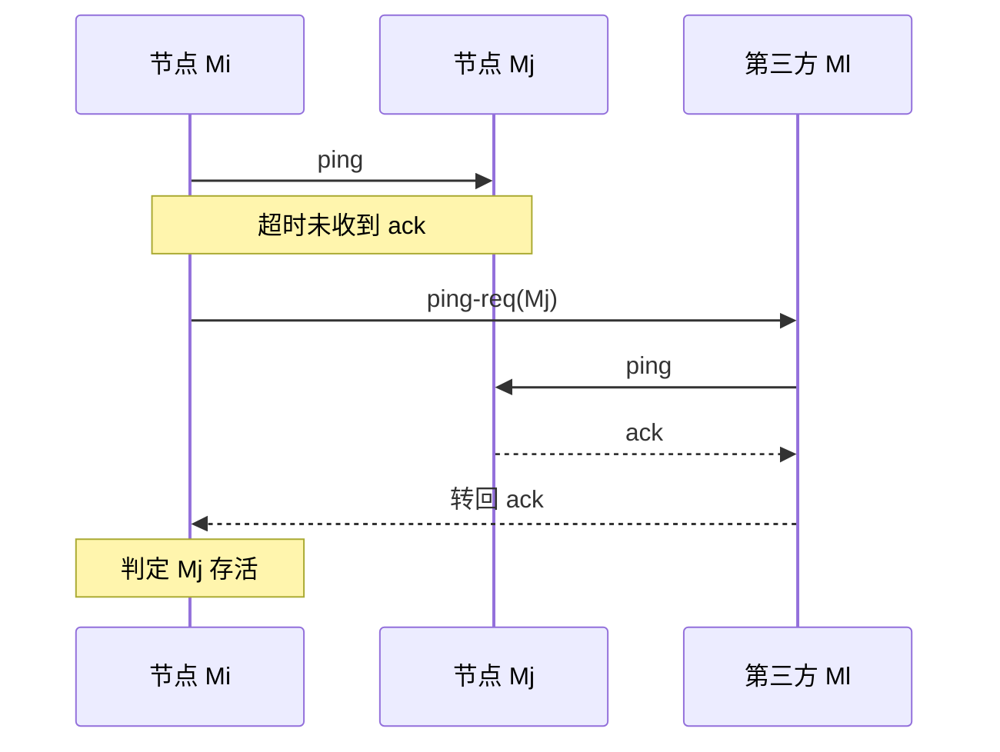
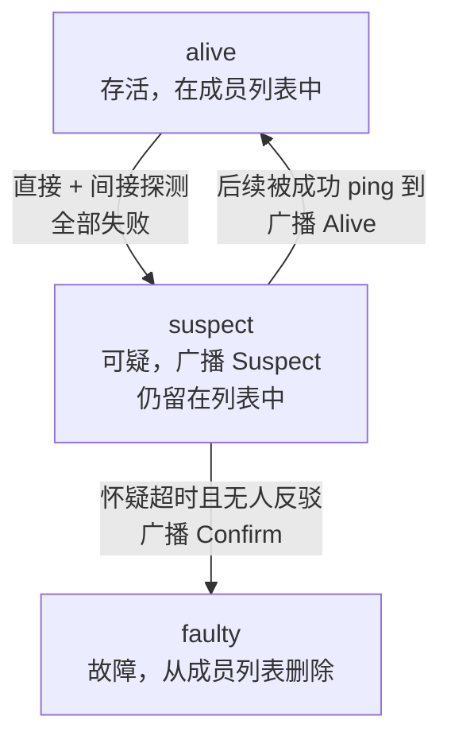

# SWIM：可扩展的弱一致感染式进程组成员协议

<!--more-->

> 原文：Abhinandan Das, Indranil Gupta, Ashish Motivala. **SWIM: Scalable Weakly-consistent Infection-style Process Group Membership Protocol.** Proceedings of the 2002 International Conference on Dependable Systems and Networks (DSN 2002), pp. 303–312. DOI: 10.1109/DSN.2002.1028914.
> 作者单位：Cornell University 计算机系。作者姓氏按字母序排列。
> 题词（原文首页）：*"As you swim lazily through the milieu, the secrets of the world will infect you."*

这是一篇 2002 年的论文，但它提出的两个设计——**把故障检测和成员传播彻底解耦**、以及**允许"怀疑"存在以换取更低的误报率**——至今仍是 Consul、Nomad、Serf 等生产系统成员管理的基础。

| 层次 | 回答的问题 | 核心标识 | 本文对应章节 |
|---|---|---|---|
| **动机** | 心跳协议为什么不可扩展？ | 二次方负载、热点、检测时间 | 第一、二章 |
| **协议** | SWIM 到底怎么跑？ | 协议周期 $T'$、探测子组 $k$ | 第三章 |
| **改进** | 三个关键改造是什么？ | 感染式传播、怀疑机制、轮询探测 | 第四章 |
| **验证** | 实测数据如何？ | 消息负载、检测延迟、误报 | 第五章 |
| **结论** | 留下什么、带走什么？ | WAN 扩展、时间有界完备性 | 第六章 |

## 摘要

若干分布式对等（P2P）应用需要所有参与的进程对**进程组成员信息**具备**弱一致性**（weakly-consistent）的认知。SWIM 是一个**通用的软件模块**，为**大规模进程组**提供这项服务。SWIM 这项工作的出发点，是传统**心跳（heart-beating）协议**的不可扩展性：这类协议要么施加**随组规模二次增长**的网络负载，要么在**检测进程崩溃**时牺牲**响应时间**或**误报频率**。本文报告 SWIM 子系统的**设计、实现与性能**，该子系统部署在一个**由普通商用 PC 组成的大型集群**上。

与传统心跳协议不同，SWIM 把**故障检测**与**成员更新传播**两项功能**解耦**。进程通过一个高效的**对等点对点周期性随机探测**协议来监控。**每个进程故障的首次检测期望时间**与**每个成员期望消息负载**，**都不随组规模变化**。有关成员变更的信息（进程加入、退出、失败）通过**搭载在 ping 消息与应答上**来传播。由此得到一种**稳健而快速的"感染式"**（infection style，亦称 epidemic 或 gossip-style）传播。

SWIM 系统中**误失败检测率**的下降，来自于对协议的修改：允许组成员在把某进程**宣告为失败之前先"怀疑"（suspect）它**——这让系统得以**发现并纠正误判的失败检测**。最后，该协议**保证了一个检测故障的确定性时间上界**。

本文给出了 SWIM 原型的**实验结果**。我们讨论了该设计向 **WAN 规模**扩展的可延展性。

## 1. 引言

运行在互联网上的**大规模 P2P 分布式进程组**依赖于一个**分布式成员维护子系统**。现有的中间件系统中使用成员协议的有：可靠多播 [3, 11]、流行病式信息传播 [4, 8, 13]。这些协议又被用于需要协调近期断连更新的分布式数据库 [14]、发布-订阅系统，以及大规模 P2P 系统 [15]。

**成员协议**给组内每个进程（"member"）提供一份**本地维护的、组内其它非故障进程的列表**。协议保证成员列表能随新成员加入或成员掉出（主动退出或因故障）而更新。列表可以直接放进应用的地址空间，也可以通过回调接口或 API 暴露。

衡量一个成员子系统的性能，有三条标准：

1. 成员变更发生后，必须**快速**在组内传播；
2. 网络的异步与不可靠会导致**消息丢失**，进而导致**误判进程失败**——因为"正在丢消息的进程与已崩溃的进程不可区分" [10]——因此**误报率必须低**；
3. 协议必须是**对等点对点的**（不依赖中心服务器），并且对网络和进程施加**低消息负载与低计算负载**。

传统的分布式心跳实现有三种典型的不可扩展形态：

- **所有心跳发给中心服务器** → 造成**热点**（hot-spot）；
- **所有心跳发给所有成员**（通过**网络多播**或 **gossip** [16]） → 网络与组的**消息负载随组规模二次增长**；
- **沿逻辑环做心跳** [9] → 存在**多个故障**时故障检测时间**不可预测**。而组规模上升时，**同时发生多个故障的概率也随之上升**。

既有工作给出的量化症状是：成员协议**难以扩展到"几十个进程"以上** [11, 16]；在这些组规模下，性能变差的主要症状是**误失败检测率上升**或**故障检测时间变长** [16]；此类协议施加的**消息负载的二次增长**是传统协议不可扩展的另一个症状 [12]。

SWIM 的核心洞见来自 [12] 的工作：**广泛使用的全对全心跳协议之所以不可扩展，源于其中隐含的决定把成员问题规范的两个主要功能融合在了一起**：

1. **成员更新传播**（Membership update Dissemination）：传播由进程加入、离开或失败而产生的成员更新；
2. **故障检测**（Failure detection）：检测已有成员的故障。

解决方式是：**设计一个高效的、基于非多播的故障检测器以消除多播心跳的开销**，并且**仅在发生成员变更时才使用传播组件**。传播组件既可以用**硬件多播**实现，也可以用**感染式**实现。

### 1.1 SWIM 承诺的五条性质

1. 对每个组成员施加**恒定的消息负载**；
2. 在组内**某个非故障进程**处，以**期望恒定的时间**检测到进程故障；
3. 提供一个**关于组规模函数的确定性上界**，约束非故障进程检测到另一进程故障所需的本地时间；
4. 以**感染式**（亦称 gossip 式或流行病式 [2, 8]）传播成员更新，包括故障信息；**组内的传播延迟随成员数量缓慢（对数）增长**；
5. 提供一种机制，通过在组内"**怀疑**"某进程之后才"**宣告**"其失败，来**降低误报率**。

其中 (1)(2) 是 [12] 中故障检测协议已有的性质，**(3)–(5) 是本文的后续工作**。

### 1.2 为什么选择弱一致性

SWIM 关注的是**较弱的组成员变体**：不同成员的成员列表**不需要在同一（因果）时间点上一致**。更强的保证可以通过**增补成员子系统**获得，例如用定期 checkpoint 成员列表的 sequencer 进程提供 virtual-synchronous 风格的成员信息。但论文加了一句保留：**与弱一致问题不同，强一致规范可能有根本的可扩展性限制**。[^1]

[^1]: 对这一问题的讨论超出本文范围。

## 2. 相关工作

原文把这一章的铺垫分三层：传统全对全心跳检测算法的工作方式、分布式故障检测器的**四项基本性质**，以及这些性质之间的**不可能性结论**。

在传统的分布式全对全心跳检测算法中，每个组成员都周期性地把一条"心跳"消息（带一个递增的计数器）发给所有其他成员；某个成员 $M_i$ 在连续若干个心跳周期内没收到 $M_j$ 的心跳时，就把 $M_j$ 宣称为失败。**分布式心跳方案保证一个故障成员最终会在每一个非故障成员处被检测出来**（在其失败后的一段时间区间内），因为崩溃的成员也停止了发送心跳。

> **译者注**：原文这里说的是"分布式心跳方案"（distributed heartbeating schemes）保证强完备性，**多播只是其中一种传输方式**，并非多播独有。

在描述 SWIM 内部机制之前，论文先铺陈分布式故障检测协议的效率与可扩展性特征。多项研究 [6, 7, 12, 16] 促成了对**四项基本性质**的识别（兼顾理论与实践角度），以及与"同时满足它们"相关的**不可能性结论**；由此产生的权衡，通常取决于分布式应用所要求的安全性与活性性质。这四项性质是 [12] 给出的：

1. **强完备性**（Strong Completeness）：任意组成员的崩溃故障，会被**所有**非故障成员检测到 [6]；
2. **故障检测速度**：从成员故障到它被某个非故障组成员检测到的时间区间；
3. **准确性**（Accuracy）：故障检测的误报率；
4. **网络消息负载**：协议每秒产生的字节数。

> **译者注**：一个绕不开的理论约束。[6] 证明了**不可能性**——在异步网络上，无法构建出既**准确**（无误报）又**强完备**的故障检测器。不过由于典型分布式应用依赖的是强完备性，这一结论并不阻断 SWIM 这类协议的道路。

Gupta 等人 [12] 提出了**可扩展的故障检测器**，是 SWIM 故障检测组件的直接基础。他们还给出了一条**最小网络负载基线**：在**各消息独立丢失**的理想化条件下，满足每成员误检测率参数（记作 $\mathcal{PM}(T)$）与检测时间 $T$ 所需的最小总网络负载（字节/秒）计算为

$$
\text{load} = n \cdot \frac{\log\left(\mathcal{PM}(T)\right)}{\log\left(p_{ml}\right)}
$$

其中 $p_{ml}$ 是底层网络中**丢包**的概率。该计算作为比较不同故障检测协议可扩展性的**良好基线**。论文的结论是：**全对全心跳协议存在一个随组规模线性变化的次优因子**。

**Gossip 式协议**（van Renesse 等 [16]）的代价可以精确写出：每 $t_{gossip}$ 个时间单位，每个成员向**少数几个随机目标** gossip 一份大小为 $\theta(n)$ 的"最近收到的各成员心跳计数器列表"。相比多播它能**降低误报率**，但**一条新的心跳计数到达任意其他成员，期望需要 $\theta[\log(n) \cdot t_{gossip}]$ 个时间单位**。为满足应用指定的检测时间，该协议产生的网络负载为

$$
\theta\left(\frac{n^{2} \cdot \log(n)}{t_{gossip}}\right)\ \text{字节/秒}
$$

此外，**批量（batching）受 UDP 包大小限制**：例如 50 个成员的 5 字节心跳（IP 地址 + 计数）已经要占 250 字节；而 **SWIM 生成的包大小最多 135 字节，与组规模无关**。

与之对比，**全对全多播心跳**每 $T$ 个时间单位产生 $\theta\left(\frac{n^{2}}{T}\right)$ 消息/秒（即使使用 IP 多播也是如此），其中 $T$ 是分布式应用所要求的故障检测时间。

分层成员系统（如 **Congress [1]**）属于"每个进程只对**一个子组**做心跳"这一大类。此类协议**需要仔细配置和维护承载成员信息流动的 overlay 覆盖图**，协议准确率**依赖于该图的健壮性**。**SWIM 的设计避免了虚拟图的额外开销**。

## 3. 基础 SWIM 协议

SWIM 有**两个组件**：

- **故障检测组件**（Failure Detector Component）；
- **传播组件**（Dissemination Component）。

基础版本中，传播组件使用**网络多播**；第 4 章会给出三个改进，其中第一个把多播替换为**感染式传播**。

### 3.1 故障检测组件

故障检测器使用两个参数：

- **协议周期 $T'$**（以时间单位计）——所有成员在**各自本地时钟**上按 $T'$ 划分周期。**协议不要求成员之间时钟同步**，且协议的性质在 $T'$ 是组内成员的**平均**协议周期时依然成立。
- **整数 $k$**——故障检测**子组的大小**，即间接探测要动用多少个对等节点。

一个协议周期内的完整流程（成员 $M_i$ 视角）：

1. $M_i$ 从成员列表中**随机**选出一个成员（记为 $M_j$），向它发送 **ping** 消息；
2. $M_i$ 等待 $M_j$ 的 **ack** 应答；
3. 若在**预设超时**内没有收到 ack（该超时由消息**往返时间 RTT** 决定，且**取比协议周期更小的值**），$M_i$ 发起**间接探测** $M_j$：
   - $M_i$ **随机选出 $k$ 个成员**，给每一个发送一条 **ping-req($M_j$)** 消息；
   - 这 $k$ 个成员中的**非故障**者收到 ping-req 后**自己去 ping $M_j$**，并把**从 $M_j$ 收到的 ack 转回给 $M_i$**；
4. 在本协议周期结束时，$M_i$ 检查**是否收到过任何 ack**（直接来自 $M_j$，或经由那 $k$ 个成员间接收到）。若**没有**，则 $M_i$ **在自己的本地成员列表中宣告 $M_j$ 故障（faulty）**，并把这一更新**交给传播组件**。

**为什么要绕这一圈？** 原文给的理由很明确：

> 采用这种做法，而不是直接给 $M_j$ 发 $k$ 条 ping 消息、或者让 ping-req 的应答直接回传给 $M_i$，是为了**避免 $M_i$ 与 $M_j$ 之间网络路径上任何拥塞的影响**——那种拥塞可能导致**原始 ping 消息或其 ack 被丢弃**。

即：**让探测流量绕开可能拥塞/丢包的那条链路**，从而降低因单链路问题造成的误判。

**超时的选取**：触发间接探测的预设超时，基于**网络 RTT 分布的估计**（例如平均值或 99 分位数）。**协议周期 $T'$ 必须至少是 RTT 估计值的三倍**。实验中用的是**实测的平均往返时间**来设置超时，且协议周期显著大于该值。

**消息内容与大小**：每条消息都带有**发起者所在协议周期的唯一序列号**。**ping、ping-req、ack 消息的大小由一个常数界定，且与组规模无关**。

#### 检测时间与误报的分析

设 $q_f$ 为成员列表中**非故障成员所占的比例**：

- 在一个协议周期内，任意成员被选为 ping 目标的概率是 $1-\left(1-\frac{1}{n} \cdot q_f\right)^{n-1}$，它随 $n$ 增大迅速下降（渐近趋于 $1-e^{-q_f}$）。
- 因此，**从任意成员故障到它被组内某进程检测到的期望时间**最多为

$$
T' \cdot \frac{1}{1 - e^{-q_f}}
$$

这就给出了**用应用指定的期望检测时间来反推协议周期长度**的方法。当 $q_f \to 1$（全部成员都活着）时，该系数为 $\frac{1}{1-e^{-1}} = \frac{e}{e-1} \approx 1.582$。

若 $q_{ml}$ 是网络**及时送达**一个包的概率（各包之间独立），则一个任意非故障成员在一个协议周期内被误判为故障的概率是

$$
q_f \cdot \left(1 - q_{ml}^{2}\right) \cdot \left(1 - q_f \cdot q_{ml}^{4}\right)^{k} \cdot \frac{e^{q_f}}{e^{q_f} - 1}
$$

由此**可以按应用所要求的误报概率反解出 $k$ 的取值**。

该故障检测器满足**强完备性**：故障成员最终会在每个非故障成员处被选为 ping 目标，并从其成员列表中删除。**协议施加于每个成员的期望消息负载是一个不随组规模变化的常数**，且**在所有成员之间是对称的**；该负载**可以从 $k$ 的估计值算出**。**这些性质都不依赖组规模 $n$（除渐近意义外）。**

### 3.2 传播组件

基础版本使用**网络多播**。检测到某成员失败后，进程**直接多播 `failed($M_j$)` 消息**给组内其余成员；收到该消息的成员**把 $M_j$ 从本地成员列表中删除**。新成员加入、成员主动离开的信息，**以类似方式多播**。

**加入机制**有三种实现方式：

1. 若组关联到一个**知名服务器或 IP 多播地址**，所有 join 消息可直接发往该地址；
2. 在缺乏此类基础设施时，join 消息可以**广播**，听到它的组成员**以抛硬币的方式概率性地决定**是否回复；
3. 为避免多个成员都回复，可维护一个**静态协调者**（static coordinator）专门处理 join 请求。

论文明确指出：**多个协调者的存在不影响协议正确性**，只会导致对 join 请求的多个回复；**协调者的发现与消解可以通过传播组件随时间完成**。当前版本的 SWIM 选择了维护一个协调者。

## 4. 协议改进

本节给出三个改进，它们让 SWIM 从"能跑"变成"可扩展且少误报"。

### 4.1 感染式传播（Infection-style Dissemination）

**动机**：网络多播原语（IP multicast 等）**只是尽力而为（best-effort）**，网络中的消息丢失会导致成员变更**任意且相关地**无法被接收。此外，硬件多播与 IP 多播**虽然普遍存在，但很少被启用**（例如出于管理原因）；若不能使用，基础版 SWIM 就得用**昂贵的广播**或**低效的点对点消息**来传播成员更新。

根本解法是：**彻底去掉外部多播原语**，改为**把待传播的信息搭载（piggyback）在故障检测协议产生的 ping、ping-req、ack 消息上**。原文称之为**感染式传播机制**，因为信息扩散的方式**类似于社会中八卦的传播、或总体人口中的流行病传播** [8]。

**关键收益**：这个传播组件**不产生任何额外的包**。SWIM 产生的包**只有 ping、ping-req、ack 三种**，因此给出**每组员恒定的期望消息开销**。

**实现细节**：

- SWIM 协议层在每个组员 $M_i$ 处维护一个**近期成员更新的缓冲区**，缓冲区中每个元素带一个**本地计数**，记录该元素**被 $M_i$ 搭载过多少次**，并用于决定**下一次搭载哪些元素**；
- 每个元素**最多被搭载 $\lambda \log n$ 次**（$\lambda$ 是一个可调倍数；论文第 5 节实验里取的具体值是 $3\lceil \log(N+1)\rceil$）；
- 若缓冲区大小**大于单条 ping（或 ack）所能搭载的元素数**，则**优先搭载被 gossip 次数较少的元素**。原因是：协议周期是固定的，**成员变更的注入速率可能暂时超过传播速度**；优先"年轻"的缓冲区元素可保证**所有成员变更至少感染到少数几个成员**，等到注入速率平静下来，这些变更就能传播到全组；
- 实现维护**两份成员列表**：一份是**尚未被宣告失败**的成员，一份是**最近失败**的成员。目前从这两份列表中**各取相同数量**的元素用于搭载。

#### 流行病传播的定量分析

 Bailey [2] 的确定性分析：在**均匀混合**的 $n$ 成员组中，有 1 个初始感染者，接触率为每时间单位 $\beta$，感染成员数 $x$（初始为 1）与时间 $t$ 的关系为

$$
\frac{dx}{dt} = \beta \cdot x \cdot (n - x)
\;\Longrightarrow\;
x = \frac{n}{1 + (n - 1) e^{-\beta n t}}
$$

**映射到 SWIM**：把**协议周期当作一个时间单位**，则接触率 $\beta$ 是**任意一对"已感染 / 未感染"成员之间发生接触的概率**——每个已感染成员每周期发 1 个 ping、收 1 个 ack，故一对成员在一周期内建立联系的概率为

$$
\beta = \left[1 - \left(1 - \frac{1}{n}\right)^{2}\right] = \left(\frac{2}{n} - \frac{1}{n^{2}}\right)
$$

于是感染人数为

$$
x = \frac{n}{1 + (n - 1) e^{-\left(2 - \frac{1}{n}\right) t}}
$$

取 $t = \lambda \log n$（$\lambda$ 是一个参数），感染成员的期望数为

$$
x = \frac{n}{1 + (n - 1) n^{-\left(2 - \frac{1}{n}\right)\lambda}}
\;\geq\;
n \cdot \left(1 - \frac{1}{n^{\left(2 - \frac{1}{n}\right)\lambda - 1}}\right)
$$

也就是说：**一个以感染式搭载传播的成员更新，在 $\lambda \log n$ 个协议周期之后，将到达**

$$
\left(n - n^{-\left(\left(2 - \frac{1}{n}\right)\lambda - 2\right)}\right)
$$

**个组成员**。随 $n$ 增大趋于无穷，$x$ 的估计趋于 $\left(n - n^{-(2\lambda - 2)}\right)$。

**把 $\lambda$ 设为一个小的常数就足以可靠地传播流行病**——论文强调"**这在小规模组下同样成立，由我们第 5 节的实验所印证**"。

文献中还有几种其它流行病风格的分析 [4, 8, 13]，**关于概率可靠性的结论本质相同**；这些分析也表明**感染式传播对进程故障与网络内消息丢失具有韧性**。

### 4.2 怀疑机制（Suspicion Mechanism）

**问题**：基础协议里，探测失败就立刻宣告故障。网络抖动会造成误报，而误报的代价是把一个健康进程踢出成员列表。

**方案**：**不立刻宣告，而是先把该进程标记为"被怀疑"（suspected），并把怀疑传播出去，给它一个自证的机会。**

完整的状态转移链路：

1. $M_i$ 探测 $M_j$，一个周期内**既没收到直接 ack，也没收到经 $k$ 个成员的间接 ack** → $M_i$ **不**宣告 $M_j$ 故障，而是**在本地成员列表里把 $M_j$ 标记为 Suspected**，并通过传播组件向全组播发 `{Suspect $M_j$: $M_i$ suspects $M_j$}`。
2. **任何收到这条 Suspect 消息的组员 $M_l$ 也把 $M_j$ 标为 suspected**。**被怀疑的成员仍留在成员列表里**，并且**在选择 ping 目标时与非故障成员同等对待**。
3. **若 $M_j$ 在后续基本协议周期中被成功 ping 到**，该成员**取消自己列表中对 $M_j$ 的怀疑**，并通过传播组件播发 `{Alive $M_j$: $M_i$ knows $M_j$ is alive}`；收到 Alive 消息的成员**取消**其列表中对 $M_j$ 的 suspected 标记。
   - 特别地：**若 $M_j$ 自己收到了关于自己的 suspect 消息，它就能开始传播一条 Alive 消息来澄清自己并未失败**。
4. **被怀疑的条目在成员列表中于预设超时后过期**。若 $M_j$ 在某成员 $M_h$ 处被怀疑，且该条目在收到 Alive 消息之前超时，则 **$M_h$ 宣告 $M_j$ 为故障、从本地成员列表中删除，并开始通过传播组件播发 `{Confirm $M_j$: $M_h$ declares $M_j$ as faulty}`**。该消息**覆盖此前任何 Suspect 或 Alive 消息**，并在所有接收者的成员列表中级联删除 $M_j$。

这个怀疑超时**本质上是用"检测时间增加"换"误失败检测频率下降"**。

**收益与代价**：该机制**降低但不消除**故障检测的误报率。同时，**原协议的强完备性依然成立**——**怀疑某个已故障进程 $M_j$ 的那些进程自身的故障，会延长检测时间，但最终检测仍然得到保证**。

#### 世代号（incarnation number）与消息优先级

Alive 消息覆盖 Suspect 消息，Confirm 消息覆盖两者——但**同一成员 $M_j$ 在其生命周期内可能被多次怀疑、多次取消怀疑**。这些**多个版本的 Suspect 与 Alive 消息（都关于同一个 $M_j$）需要用唯一标识符区分**。

解决办法是**给成员列表中的每个元素加上一个"虚拟世代号"字段**。规则如下：

- **世代号是全局的**；成员 $M_j$ 的世代号**在加入组时初始化为 0**；
- 它**只能由 $M_j$ 自己递增**，且**仅当 $M_j$ 通过传播组件收到关于"自己在本世代被怀疑"的信息时**才递增；
- 递增后，$M_j$ **生成一条带有自己标识符和递增后世代号的 Alive 消息**并传播到全组。

由此得到消息的覆盖优先级规则：

| 消息 | 覆盖 |
|---|---|
| {Alive $M_l$, inc = $i$} | {Suspect $M_l$, inc = $j$}，其中 $i > j$ {Alive $M_l$, inc = $j$}，其中 $i > j$ |
| {Suspect $M_l$, inc = $i$} | {Suspect $M_l$, inc = $j$}，其中 $i > j$ {Alive $M_l$, inc = $j$}，其中 $i \geq j$ |
| {Confirm $M_l$, inc = $i$} | {Alive $M_l$, inc = $j$}，**任意 $j$** {Suspect $M_l$, inc = $j$}，**任意 $j$** |

论文自己指出，这个规则**并非完全对称**（"Alive 覆盖 Alive"要求 $i > j$，而"Suspect 覆盖 Alive"只要求 $i \geq j$）——这是原文写法，此处照录。

这些规则**维持了故障检测组件的正确性**。熟悉 AODV [5] 这类 ad hoc 路由协议的读者会注意到，**它们对目的序号的使用**与本文的**世代号方案**之间存在相似性。

此外，偏好规则**不依赖怀疑的来源**；感染式传播在有**多个来源**时传播一条消息**更快**，而**每进程的开销与只有一个感染源时完全相同** [8]。

### 4.3 轮询探测目标选择：提供时间有界的强完备性（Round-Robin Probe Target Selection: Providing Time-Bounded Strong Completeness）

**要解决的问题**：基础 SWIM 故障检测器**平均**只需常数个协议周期就能检测故障。但**如果全组的 ping 目标选择走极端路径**，就可能大幅延迟"某进程失败首次被组内任意位置检测到"的时间。**极端情况下这个延迟可以是无界的**——失败进程可能**永远不会被任何其它非故障进程选为 ping 目标**。

**修改方案**：成员 $M_i$ 的故障检测协议维护一份已知成员的列表（直观上是一个数组），**不再随机**选择 ping 目标，而是**轮询**选择：

- **新加入的成员被插入到成员列表中一个均匀随机选取的位置**；
- **遍历完整个列表后**，$M_i$ **把成员列表重新随机排序**。

**确定性界**：一旦成员 $M_j$ 进入 $M_i$ 的成员列表，它就会**在 $M_i$ 每次完整遍历成员列表期间被恰好选中一次**作为 ping 目标。若成员列表大小**不超过 $n_i$**，则**同一目标的连续两次选择**最多相隔

$$
(2 \cdot n_i - 1)\ \text{个协议周期}
$$

因此，**任何成员故障的最坏情形检测时间被界定为 $2n$**（$n$ 为组规模），从而满足**时间有界完备性**（Time Bounded Completeness）性质。

**平均性能未被牺牲**：原协议的平均故障检测时间**得以保持**，因为**各成员的成员列表在组内的随机化，导致每个成员的 ping 目标选择具有相似的分布**。

## 5. 原型实现与评估

### 5.1 实现与平台

| 项目 | 取值 |
|---|---|
| 实现 | 基于 **Winsock 2 API** 的 SWIM 原型 |
| 操作系统 | **Windows 2000** |
| 集群 | 商用 PC 大集群：**16 台 450 MHz Dell PII**、**16 台 1 GHz IBM x220**，另有一批双核与四核节点（200～500 MHz 的 PII / PIII） |
| 网络 | **100 Mbps 以太网，无外部负载** |
| 每节点成员数 | 每个节点最多容纳**一个**进程组成员 |
| 消息传输 | 所有点对点消息均为 **UDP 包** |
| 最大消息载荷 | **SWIM:Basic 为 15 字节**；**SWIM+Inf. 与 SWIM+Inf.+Susp. 为 135 字节**（每条消息最多搭载 6 条成员更新） |

**实验参数**：间接探测子组大小 **$K = 1$**；**协议周期 $T' = 2$ 秒**；每个成员更新**最多被搭载 $3\lceil\log(N+1)\rceil$ 次**；**怀疑超时也设为同一个值** $3\lceil\log(N+1)\rceil$。

论文对这个取值写道：**在这个设置下，我们的实验运行没有观察到任何"成员处永久性的部分成员列表"或"组的非自愿分区"的迹象**。

**对比的三个版本**：

1. **SWIM:Basic** —— 第 3 章的基础协议，加上第 4.3 节的轮询方案；传播用网络多播；
2. **SWIM+Inf.** —— SWIM + **感染式传播组件**；
3. **SWIM+Inf.+Susp.** —— SWIM+Inf. + **怀疑子协议**。

### 5.2 消息负载

在跨越 **40 多个协议周期**的采集下，**直到组规模达到 55 个成员，平均开销都维持在 2.0 左右**。在 **$N = 28$** 个成员时，**发送**消息的开销**以 0.99 的概率小于每个协议周期 5 条消息**。

每个协议周期内，一个组成员**发送一条 ping 并接收相应的 ack**，同时**期望接收一条 ping 消息并发送相应的 ack**。

这条曲线的形状正是 SWIM 承诺的第一条性质的直接体现：**每成员的消息负载不随组规模增长**。

### 5.3 检测与传播延迟

**图 3(a)：首次检测时间**。横轴是组规模，纵轴是时间（协议周期数），图中还画出了第 3.1 节的**解析估计线 $e/(e-1)$**。结论是：**平均检测时间看起来与组规模不相关，因此与解析估计吻合**。

纵轴的含义在三个协议间有差异：**SWIM:Basic** 的纵轴值是"进程失败到**其失败通知被多播出去**"之间的间隔；**SWIM+Inf. / SWIM+Inf.+Susp.** 的纵轴值是"失败到**失败通知 / 怀疑通知开始扩散**"之间的间隔。

**图 3(b)：感染在组内的扩散延迟**。横轴是组规模，纵轴是**中位感染时间**（协议周期数）。结论是：**传播的中位延迟始终只有几个协议周期**，且**随组规模缓慢上升**——这正好印证了第 4.1 节预测的**对数**变化。

**图 3(c)：SWIM+Inf.+Susp. 使用的怀疑超时** $3\lceil\log(N+1)\rceil$，其形状呈**三级台阶**：组规模 8～约 19 时约 **9 个协议周期**，组规模约 20～52 时抬到约 **12 个协议周期**，组规模约 53 以上再抬到约 **15 个协议周期**。

**总延迟的合成方式**：从进程失败到它**从其他成员的成员列表中被移除**的平均时间，由图 3 的三张图合成——**SWIM:Basic** 是图 3(a) 的值**加上网络多播所需的时间**；**SWIM+Inf.** 是图 3(a) 与 3(b) 纵轴分布之**和**；**SWIM+Inf.+Susp.** 则是**三张图纵轴分布之和**。

### 5.4 故障检测误报

图 3 中 **SWIM+Inf.+Susp.** 的运行产生了**极少量的误失败检测**。

为了评估感染机制与怀疑机制的相对收益，实验**人工合成了 10% 的高丢包率**：每个包（包括 SWIM:Basic 中的每次网络多播）都在接收端以该丢包概率被丢弃。实验让 **17 个进程顺序加入**一个 SWIM 组。

结果是三者的组规模稳定性差异巨大：

| 协议 | 10% 丢包下稳定的组规模 |
|---|---|
| `SWIM+Inf.+Susp.` | **12** 个成员 |
| `SWIM+Inf.` | **4** 个成员 |
| `SWIM:Basic` | **2** 个成员 |

在 17 个进程全部加入的情况下，基础版 SWIM 的成员列表塌缩到只剩 2 个，加了感染式传播变成 4 个，再加上怀疑机制才撑到 12 个。**怀疑机制的价值在高丢包环境下体现得最直接**——因为它给每一次误判都留了自证的机会。

论文对这个结果有明确的限定：

> 图 4 的数据仅对所描述的实验设置成立。**对参数 $K$ 和怀疑超时采取更激进的设置，会提升这三种协议的鲁棒性。调整怀疑超时同时也提供了一个在故障检测时间与误报频率之间做权衡的旋钮。** 我们把这类问题的深入研究留给后续文章。

### 5.5 与 Gossip 的对比

> **译者注**：**论文没有做 SWIM 与 Gossip 心跳的对照实验**。Gossip 的对比只出现在第 2 章的**解析层面**（负载 $\theta\left(\frac{n^{2}\log(n)}{t_{gossip}}\right)$ 字节/秒、传播 $\theta[\log(n) \cdot t_{gossip}]$ 时间单位、多播 $\theta\left(\frac{n^{2}}{T}\right)$ 消息/秒、以及 [12] 的下界 $\text{load} = n \cdot \frac{\log(\mathcal{PM}(T))}{\log(p_{ml})}$）。实验部分只对比 SWIM 自身的三个变体。

## 6. 结论

SWIM 的出发点是**基于心跳的协议不可扩展**（这类协议如今仍被分布式系统设计者广泛使用）。SWIM 的方案基于**把故障检测组件与成员更新传播组件分离开**：

- **SWIM 故障检测器通过避免心跳、改用随机点对点探测实现可扩展性**，从而在组成员上给出**恒定开销**与**恒定的期望故障检测时间**；
- 成员更新通过**搭载在故障检测协议产生的包上**，以**感染式**方式**高效且可靠**地传播；
- **加入怀疑机制（配虚拟世代号）降低误报频率**，代价是**检测时间变长**；
- **轮询探测目标选择**保证在每个非故障进程处对故障的**时间有界检测**。

**未来工作**：

1. **WAN / VPN 扩展**。SWIM 可以扩展到广域网或虚拟专用网，方法是**用拓扑信息来加权 ping 目标的选择**，从而减少网络核心元素上的带宽占用 [16]。
2. **适用范围不止超大组**。虽然 SWIM 的设计面向大规模进程组，但分析与实验结果表明，这种全对全分布式心跳的替代方案，在**中等规模子组**（例如 Chord、Pastry、Opus 等 DHT 系统中的副本组）中使用，同样能带来**一个数量级的开销降低** [15]。
3. **怀疑机制的普适性**。怀疑机制**普遍适用于任何具有清晰区分的"故障检测组件"与"成员更新传播组件"的成员系统**。

论文最后一句话是对整个方向的定位：

> 当今互联网中大规模分布式应用的持续扩散，其程度将取决于运行在这些系统中的协议是否可扩展且高效。**SWIM 为这类应用提供了组成员组件方面的一个这样的解决方案。**

**致谢**：感谢 **Werner Vogels** 帮助使用 **Galaxy 集群**；感谢 **Ben Atkin、Ken Birman、Alan Demers、Robbert van Renesse** 以及匿名审稿人审阅草稿。

## 译者补充

论文本身完整且自洽，但有几点在今天读起来需要额外说明。

**"感染式传播"就是今天的 Gossip。** 论文把信息搭载在 ping/ack 上扩散，形式上正是 1987 年 Demers 等人的流行病传播算法——SWIM 把它从"数据同步"改造成了"成员变更广播"。**这个选择的核心收益是零额外包**：多播方案要额外发包，而搭载方案完全不增加包的数量。这也是为什么 SWIM 的包大小能控制在 135 字节且与组规模无关。

**怀疑机制的本质是"给误判一个申诉窗口"。** 论文第 4.2 节的逻辑链值得反复读：Suspect 消息让全组都知道"有人在怀疑 $M_j$"，于是 $M_j$ 自己有机会发一条 Alive 来自证。**incarnation number 解决的是"同一个成员被反复怀疑时，新旧消息如何区分"**——它只由被怀疑者自己递增，因此**协议内的**乱序消息有了确定的全序。但要当心：**它不是拜占庭防护**。恶意节点完全可以直接广播一条更大的世代号（`{Alive $M_j$, inc = 1000}`），它并不需要走"合法递增"这条路径——真要防住，得靠签名或权威第三方的裁决。

**最容易被忽略的是第 4.3 节的轮询探测。** 随机选点会让"某个成员永远不被选中"成为可能，于是最坏检测时间无界。改成轮询后，最坏情况被**界定为 $2n$ 个协议周期**——**随机性被保留在"成员列表每轮重新洗牌"上，而不是用在"选谁探测"上**。这是概率算法里非常典型的"把随机性挪到不会破坏上界的地方"的技巧。

**第 3.1 节的 $k$ 是可反解的工程参数。** 误报概率公式 $q_f \cdot (1-q_{ml}^2) \cdot (1-q_f q_{ml}^4)^k \cdot \frac{e^{q_f}}{e^{q_f}-1}$ 里，$k$（间接探测的 peer 数）是可以按应用要求的误报率**反解**出来的。这也是为什么"用几个 peer 代问"不是拍脑袋定的数字。

**实验数据是 2002 年的。** 平台是 Windows 2000、450 MHz 的 Dell PII，协议周期 2 秒，间接探测只用了 $K=1$ 个 peer。这些数字在今天早该调优过了——**但论文论证的结构（负载与组规模无关、检测延迟与组规模无关、怀疑机制把误报从"不可控"变成"可调"）完全没变**。Consul 的 memberlist 在这三点上都与论文一致。

想了解 Gossip 协议的整体图景请看[系列第一篇](/posts/2026/11/30324d93/)；想了解 SWIM 在生产环境里踩过的坑、以及 HashiCorp 怎么修的，请看[系列第三篇](/posts/2026/11/8984d695/)（Lifeguard）。

## 参考资料

> 编号沿用原文，条目按原文顺序完整列出（原文第 9～10 页）。

1. T. Anker, D. Breitgand, D. Dolev, and Z. Levy. CONGRESS: Connection-oriented group-address resolution service. In Proc. SPIE'97 on Broadband Networking Technologies, 1997.
2. N. Bailey. *The Mathematical Theory of Infectious Diseases and its Applications.* Hafner Press, second edition, 1975.
3. K. P. Birman. The process group approach to reliable distributed computing. *Comm. of the ACM*, 36(12):37–53, 1993.
4. K. P. Birman, M. Hayden, O. Ozkasap, Z. Xiao, M. Budiu, and Y. Minsky. Bimodal multicast. *ACM Trans. on Computer Systems*, 17(2):41–88, 1999.
5. C. E. Perkins and E. Royer. Ad hoc on-demand distance vector routing. In Proc. 2nd IEEE Workshop on Mobile Computing Systems and Applications, pages 90–100, 1999.
6. T. D. Chandra and S. Toueg. Unreliable failure detectors for reliable distributed systems. *Journ. of the ACM*, 43(2):225–267, 1996.
7. W. Chen, S. Toueg, and M. K. Aguilera. On the quality of service of failure detectors. In Proc. 30th Intnl. Conf. on Dependable Systems and Networks, pages 191–200, 2000.
8. A. Demers, D. Greene, C. Hauser, W. Irish, and J. Larson. Epidemic algorithms for replicated database maintenance. In Proc. 6th Annual ACM Symp. Principles of Distributed Computing, pages 1–12. ACM Press, 1987.
9. S. A. Fakhouri, G. Goldszmidt, I. Gupta, M. Kalantar, and J. A. Pershing. Gulfstream — a system for dynamic topology management in multi-domain server farms. In Proc. 3rd IEEE Intnl. Conf. on Cluster Computing, pages 55–62, 2001.
10. M. J. Fischer, N. A. Lynch, and M. S. Paterson. Impossibility of distributed consensus with one faulty process. *Journ. of the ACM*, 32(2):374–382, 1985.
11. I. Gupta, K. Birman, and R. van Renesse. Fighting fire with fire: using randomized gossip to combat stochastic scalability limits. To appear in *The Journ. of Quality and Reliability Engineering International*, 2002.
12. I. Gupta, T. D. Chandra, and G. S. Goldszmidt. On scalable and efficient distributed failure detectors. In Proc. 20th Annual ACM Symp. on Principles of Distributed Computing, pages 170–179. ACM Press, 2001.
13. A.-M. Kermarrec, L. Massoulie, and A. Ganesh. Reliable probabilistic communication in large-scale information dissemination systems. Technical Report MMSR-TR-2000-105, Microsoft Research, Cambridge, UK, 2000.
14. K. Petersen, M. Spreitzer, D. Terry, M. Theimer, and A. J. Demers. Flexible update propagation for weakly consistent replication. In Proc. 16th ACM Symp. on Operating Systems Principles, pages 3–6. ACM Press, 1997.
15. A. Rowstron and F. Kaashoek, editors. Proc. 1st Intnl. Workshop on Peer-to-Peer Systems. Springer-Verlag, 2002.
16. R. van Renesse, Y. Minsky, and M. Hayden. A gossip-style failure detection service. In Proc. Middleware, pages 55–70, 1998.

