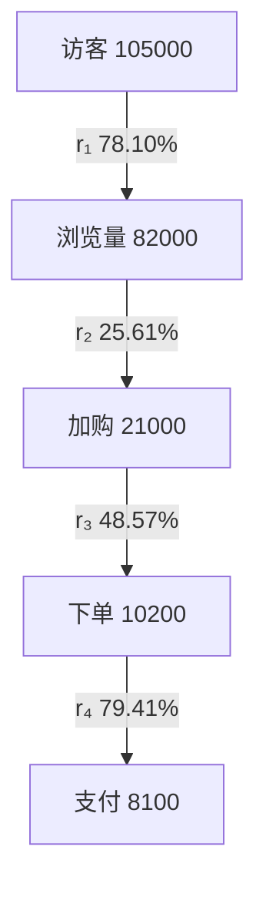
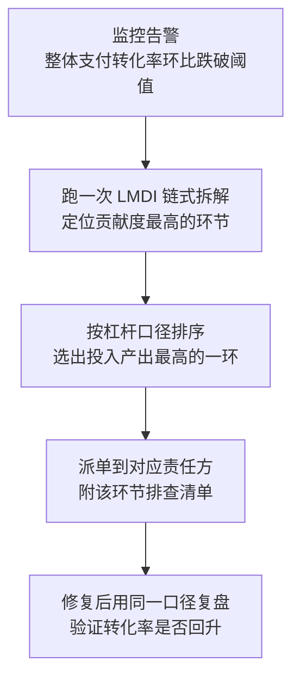

# 漏斗拆解：定位是哪一环坏了


<!--more-->

周一的数据周会上，「好物优选」的分析师把结论摊在桌上：整体支付转化率从 8.00% 掉到 7.71%，四级漏斗拆下来，**加购到下单这一环贡献度 79.71%**，是绝对主因，建议优先优化下单流程。

于是接下来两周，团队扑在结算体验上。改完之后，r₃ 拉回了基期的 50%，整体转化率回到 7.94%——离基期的 8.00% 还差 0.06pp。修了"贡献度最高"的那一环，剩下的问题一点没动。

差在哪？79.71% 这个数字说的是"**这次变化里，加购→下单占了 79.71%**"，它衡量的是相对跌幅的份额，不是"修好这一环能赚回多少钱"。而在漏斗里，这两件事可以差出 5 倍。

本文用 LMDI（[第二篇](/posts/2026/11/c35540ac/) 讲的方法）拆一个四级漏斗，给出每个环节的贡献度；再引入"提升 1pp 值多少钱"的杠杆口径，算出真正该先动手的那一环。最后给出漏斗归因怎么接到告警上，以及四个提前避开就能省下两周返工的坑。

## 一、漏斗是乘法归因的特例

这一章先回答一个前置问题：漏斗拆解和[第一篇](/posts/2026/11/cba63f94/) 讲的维度归因，是同一种方法吗？答案是否定的——漏斗是乘法型指标，得换一把刀。

### 1.1 整体转化率是一个乘积

整体支付转化率看起来是一个比率，其实是一串环节转化率的连乘：

$$
\begin{aligned}R &= \frac{\text{支付数}}{\text{访客数}} \\\\&= \frac{\text{支付数}}{\text{下单数}} \times \frac{\text{下单数}}{\text{加购数}} \times \frac{\text{加购数}}{\text{浏览量}} \times \frac{\text{浏览量}}{\text{访客数}} \\\\&= r\_4 \times r\_3 \times r\_2 \times r\_1\end{aligned}
$$

每个 rᵢ 都是"下一环节的人数 ÷ 上一环节的人数"。以当期数据为例，四级漏斗长这样：



整体 R = 8000/100000 = 8.00% → 8100/105000 = 7.71%。

### 1.2 乘法型指标，先取对数

关键在最后那个等号：R 是四个环节转化率的**乘积**，不是和。

[第一篇](/posts/2026/11/cba63f94/) 说过，比率型指标不可加。四个环节的转化率加起来是 78.10% + 25.61% + 48.57% + 79.41% = 231.69%，跟整体那 −0.2857pp 的变化没有任何对应关系，所以漏斗不能套 Delta 法。

但乘法型指标有办法救：取对数，把乘法变成加法。

$$
\ln R = \ln r\_1 + \ln r\_2 + \ln r\_3 + \ln r\_4
$$

这一步转换就是 LMDI（Logarithmic Mean Divisia Index，对数平均狄氏指数）的全部秘密。它最大的好处是**拆完之后各项贡献加起来正好等于总变化，没有残差**——这正是[第二篇](/posts/2026/11/c35540ac/) 要解决的问题。

所以链条是这样的：漏斗归因就是 **LMDI 在漏斗上的应用**。第 01 篇方法选型地图里"链式拆解"那一行，说的就是这件事。

### 1.3 漏斗比维度归因多一层结构

维度归因里各维度是并列的：搜索、推荐、直播，谁也不依赖谁。漏斗里环节是**串联**的——前一环节的人数就是后一环节的分母。

这个结构带来一个好处：你能定位到"**哪一环**"。也带来一个代价：**环节怎么切，会直接影响结论**。第 01 篇讲过的口径问题，在漏斗里会被放大，这部分放到第五章再说。

## 二、链式拆解：把漏斗拆成环节贡献

这一章把公式落到数字上：四个环节各贡献多少，加起来正好是那 −0.29pp。

### 2.1 先把两期的基础数据摆平

| 环节 | 基期人数 | 当期人数 | 基期转化率 r⁰ | 当期转化率 r¹ |
|---|---|---|---|---|
| r₁ 访客 → 浏览量 | 100000 | 105000 | 80.00% | 78.10% |
| r₂ 浏览量 → 加购数 | 20000 | 21000 | 25.00% | 25.61% |
| r₃ 加购数 → 下单数 | 10000 | 10200 | 50.00% | 48.57% |
| r₄ 下单数 → 支付数 | 8000 | 8100 | 80.00% | 79.41% |

整体转化率 8.0000% → 7.7143%，Δ = **−0.2857pp**，相对变化 **−3.5714%**。

注意当期访客涨了 5%，支付只涨了 1.25%——量在涨，率在跌，这正是漏斗归因的典型场景。

### 2.2 贡献度的公式

LMDI 贡献度的定义在[第二篇](/posts/2026/11/c35540ac/) 已经给过，这里只做一次代入：

$$
\begin{aligned}\Delta \ln R &= \sum\_i \left[ \ln r\_i^{(1)} - \ln r\_i^{(0)} \right] \\\\C\_i &= \frac{\Delta \ln r\_i}{\Delta \ln R}\end{aligned}
$$

因为 ln R = Σ ln rᵢ，各环节的 Δln(rᵢ) 加起来正好是 Δln(R)，除完之后 Cᵢ 加起来正好是 100%。**不用分配残差，也不用归一化凑数。**

符号约定沿用第 01 篇：Cᵢ > 0 表示该环节与整体**反向变动**（拖累了整体转化率），Cᵢ < 0 表示该环节在**拉高**整体转化率。

### 2.3 实算

| 环节 | Δln(rᵢ) | LMDI 贡献度 Cᵢ | 相对跌幅 |
|---|---|---|---|
| r₁ 访客 → 浏览量 | −0.024098 | **+66.26%** | −2.38% |
| r₂ 浏览量 → 加购数 | +0.024098 | **−66.26%** | +2.44% |
| r₃ 加购数 → 下单数 | −0.028988 | **+79.71%** | −2.86% |
| r₄ 下单数 → 支付数 | −0.007380 | **+20.29%** | −0.74% |
| **合计** | **−0.036368** | **100.00%** | **−3.57%** |

四个数加起来 +66.26 − 66.26 + 79.71 + 20.29 = 100.00% ✓，与 Δln(R) = −0.036368 对得上。

有两个现象值得停下来看。

第一，**r₂ 的贡献度是负数**。浏览量到加购的转化率不降反升（25.00% → 25.61%），所以它其实在**帮**整体转化率。贡献度为负不是算错，是这个口径在告诉你"这一环表现比预期好"。

第二，**r₁ 和 r₂ 的贡献度正好一正一负、大小相同**。这不是巧合：r₁ × r₂ = 加购数 / 访客数，而这个乘积两期都是 20.00%（20000/100000 = 21000/105000），一点没变。漏斗顶部的量级变化（访客 +5%）在这套拆解里被完全抵消了。

这提示了链式拆解的一个特征：**它看的是结构，不是规模。** 规模的变化已经被环节之间的乘积关系吸收掉了。

## 三、核心洞见：贡献度不等于优化优先级

这一章是全文的重点。2.3 那张表如果直接拿去排工单，会排错。

### 3.1 按贡献度排序，会得到什么结论

贡献度从大到小：r₃（79.71%）> r₁（66.26%）> r₄（20.29%）> r₂（−66.26%）。

最直观的结论是**优先修加购→下单这一环**，因为它占了这次下滑的近八成。周会上的那份报告就是这么写的，团队也是这么干的。

### 3.2 换一个口径：这个环节每提升 1pp 值多少钱

贡献度回答的是"这次变化里谁占大头"，不是"修哪一环更划算"。要回答后者，得换一个**绝对量**口径——这正是[第一篇](/posts/2026/11/cba63f94/) 讲的 `Vᵢ`（绝对贡献）在漏斗上的具体形态。

定义**杠杆口径**：

$$
\text{该环节提升 1pp 的价值} = \text{该环节上游量（当期）} \times \text{客单价} \times 1\\%
$$

三部分的意思：

- **上游量**：这个环节的入口基数，也就是上一环节的人数。r₃ 的上游量是当期加购数 21000；
- **客单价**：每笔订单的平均金额，本系列取 250 元（与[第二篇](/posts/2026/11/c35540ac/) 的 GMV 算例一致）；
- **1%**：转化率提升 1pp，意味着多出来的 1% 的人能流到下一环。

### 3.3 算出来：差了 5 倍

| 环节 | 贡献度 Cᵢ | 上游量（当期） | 提升 1pp 的价值 |
|---|---|---|---|
| r₁ 访客 → 浏览量 | +66.26% | 105000 | **26.25 万元** |
| r₂ 浏览量 → 加购数 | −66.26% | 82000 | **20.50 万元** |
| r₃ 加购数 → 下单数 | +79.71% | 21000 | **5.25 万元** |
| r₄ 下单数 → 支付数 | +20.29% | 10200 | **2.55 万元** |

拿 r₁ 验一遍：105000 × 250 × 1% = 262500 元 = 26.25 万元 ✓。r₃：21000 × 250 × 1% = 52500 元 = 5.25 万元 ✓。

**r₁ 的杠杆是 r₃ 的 5 倍。** 贡献度排第一的 r₃，在杠杆口径上掉到第三；杠杆排第一的 r₁，贡献度只排第二。

再补一个天花板视角。按同一口径，r₃ 从 48.57% 拉满到 100%（还有 51.43pp 可提升），最多值 5.25 × 51.43 = **270 万元**；r₁ 从 78.10% 拉满到 100%（还有 21.90pp），最多值 26.25 × 21.90 = **575 万元**。r₃ 这一环的**上限**本身就比 r₁ 低一半。

### 3.4 为什么两个口径会给出相反的答案

因为它们量的根本不是一件事。

**贡献度量的是相对变化。** 看 Δln(rᵢ)：r₃ 掉了 0.028988，是四环里最大的；r₁ 掉了 0.024098；r₄ 只掉了 0.007380。换算成相对跌幅，r₃ 的 −2.86% 依然是最大的。所以贡献度本质上只关心一件事——**哪个环节相对自己掉得最狠**。掉得最狠的环节，贡献度就最高。

**杠杆量的是绝对收益。** 它只关心一件事——**这个环节门口还堵着多少人**。r₃ 前面只剩 21000 人，就算这 21000 人全部下单，也不过是 21000 单；r₁ 前面站着 105000 人，每撬动 1pp 就是 1050 个人。

一句话：**贡献度衡量相对变化，杠杆衡量绝对收益。** 一个说"哪里伤得最重"，一个说"哪里能动最多肉"。

### 3.5 结论：两个口径必须一起看

| 口径 | 回答的问题 | 本例排序 | 用在哪一步 |
|---|---|---|---|
| **贡献度 Cᵢ** | 这次变化里谁占大头 | r₃ > r₁ > r₄ > r₂ | 定位嫌疑环节 |
| **杠杆（上游量 × 客单价 × 1pp）** | 修哪一环最划算 | r₁ > r₂ > r₄ > r₃ | 排优化优先级 |

用法是**先定位，再排序**：先用贡献度圈出"哪几环出了问题"，再用杠杆在这几环里排"先修哪个"。两个排序差距越大，越值得单独拎出来讨论——因为那正是"事大但不值得修"（r₃：事大、杠杆低）和"事排第二但最划算"（r₁）所在。

还有一个提醒：上面的"价值"是**规模口径**，衡量的是"这个环节门口堵着多少人"，默认提升的转化率能等量变现。要算真实的 GMV 增量，还得乘上该环节之后各环节的转化率（下游流失）。补上这一步，排序会变——r₂ 以 7.91 万元反超 r₁ 的 2.59 万元，r₄ 垫底。**同一个"值多少钱"，口径不同答案就不同，所以汇报时必须把口径写清楚。** 这也是[第一篇](/posts/2026/11/cba63f94/) 反复强调"口径先钉死"的原因。

## 四、把漏斗归因接到告警上

前面算的是"怎么拆"，这一章讲"拆完怎么用"。归因的价值不在报告里，在工单里。

### 4.1 环节和责任方一一对应

漏斗环节天然对应一个团队或子系统——这是它比维度归因好用的地方：维度归因拆出来是"哪个渠道"，还得再问一层才找到人；漏斗拆出来直接是"哪一段路"，而每段路都有主人。

| 环节 | 典型责任方 | 典型排查动作 | 常见根因 |
|---|---|---|---|
| r₁ 访客 → 浏览量 | 增长、首页与推荐 | 曝光点击比、首屏加载耗时、下发失败率 | 首页改版、推荐位调整、资源包未分包 |
| r₂ 浏览量 → 加购数 | 商品、详情页 | 加购按钮点击率、SKU 库存与价格 | 缺货、价格变动、详情页信息缺失 |
| r₃ 加购数 → 下单数 | 交易、购物车与结算 | 购物车到结算的跳失率、优惠可用性、运费展示时机 | 凑单门槛高、运费到结算才显示、库存被锁 |
| r₄ 下单数 → 支付数 | 支付与收银台 | 支付发起成功率、错误码分布、支付渠道耗时 | 渠道超时、风控误拦、支付方式失效 |

这张表的价值在于：**告警一旦触发，它直接给出"发给谁、附什么排查清单"**。

### 4.2 从告警到工单的五步



关键是第三步。多数团队只做前两步：拆出贡献度最高的环节，直接派单。**中间那步排序才是把"分析"变成"决策"的地方**，也是本文和第 01 篇那句"贡献度排序 ≠ 优化优先级"的落点。

### 4.3 告警不要只做在总量上

第 01 篇讲过"对冲型异动"：总量没动，底下可能已经天翻地覆。漏斗尤其如此——r₁ 掉 5pp、r₄ 涨 5pp，可以让整体转化率纹丝不动，但底下两件事天差地别。

所以告警至少要做两层：整体转化率一个，各环节转化率各自一个。环节级告警的阈值不用定得很严，它的价值是"提醒你去拆"，不是"通知你出事了"。

## 五、四个坑

这一章是踩过的雷。前三个坑会让结论直接算错，第四个会让结论算对了但没人接。

### 5.1 坑一：漏斗环节的切法不是随便定的

环节顺序会改变各环节的转化率，进而改变贡献度。本例里 r₁ 和 r₂ 的贡献度之所以正好抵消，是因为 r₁ × r₂ = 加购数 / 访客数这个乘积两期没变；一旦把这两环合并成"访客 → 加购"一步，它的转化率两期都是 20.00%，Δln = 0，贡献度就是 0——**这两环的信息被彻底抹掉了**。如果它们没抵消，合并后你还会得到一个跟原来不同的结论。

更现实的问题是：不同业务对"环节"的定义完全不同。电商常见"浏览 → 加购 → 下单 → 支付"，SaaS 常见"注册 → 激活 → 首次调用 → 付费"，内容产品又是另一套。**环节划分必须和业务的责任划分对齐**，否则拆出来的结论没人认领。判断标准很简单：**每一环都应该有明确的责任方和一个可观测指标**，两条缺一条，这一环就不该单独拆。

### 5.2 坑二：跨期用户口径

两期必须是同一批用户、同一时间窗的漏斗。

如果有人第一期加购、第二期支付，在按"当期加购数 ÷ 当期下单数"算 r₃ 的时候，这个用户会被算成当期的高质量转化；反过来，有人第一期下单、第二期才支付，就会被算成漏损。**这不是统计误差，是口径错配**，而且错配的方向不可控。

更要命的是 **cohort 成熟度**：新进访客还没走完漏斗，把他算进来会天然拉低靠后环节的转化率。所以当期必须是**已经走完整条路径的窗口**——比如只取 7 天前进入的 cohort，或者两期都按相同长度的观察窗来截。

### 5.3 坑三：同一用户多环节重复计数

一个用户可能加购 3 件商品。"加购数"是次数口径还是去重人数口径，必须**全程统一**。分母用人数、分子用次数，算出来的"转化率"没有意义。

本例中加购 21000 到底是次数还是人数，会直接改变 r₃ 的分母：按人数算是 48.57%，按次数算就是另一个数，贡献度会跟着变。**开拆之前先确认三个环节是同一套口径。**

### 5.4 坑四：环节缺失或合并

拆解粒度决定结论粒度。粒度太粗，"详情页信息缺失导致加购低"这类问题永远看不见；粒度太细，每一环的量太小，噪声占比大，而且没人负责。

本例的 r₃ 贡献度之所以这么高，一个原因就是它把"加购 → 下单"压缩成了一步——购物车、凑单、运费展示、库存锁定全塞在这一环里。拆得更细一点，"加购 → 进入结算"和"结算 → 提交订单"可能给出完全不同的结论：前者掉了、后者没动，那要修的是购物车页，不是结算页。

**所以拆完之后还要看一步：贡献度最高的那一环，是不是本身还需要再拆细。**

## 六、Python 实现

下面这段代码一次跑出两个口径的结果，数据是本系列统一案例「好物优选」的两期漏斗。

```python
import math

# 两期漏斗人数（从访客到支付）
base = {"访客": 100000, "浏览量": 80000, "加购": 20000, "下单": 10000, "支付": 8000}
curr = {"访客": 105000, "浏览量": 82000, "加购": 21000, "下单": 10200, "支付": 8100}
steps = ["访客", "浏览量", "加购", "下单", "支付"]
AOV = 250  # 客单价（元），与本系列 GMV 算例一致

def rates(cnt):
    """各环节转化率 r_i = 下一环节人数 / 上一环节人数"""
    return [cnt[steps[i + 1]] / cnt[steps[i]] for i in range(len(steps) - 1)]

def lmdi_contrib(r0, r1):
    """LMDI 贡献度：C_i = Δln(r_i) / Δln(R)，乘积型指标拆完无残差"""
    dln = [math.log(b) - math.log(a) for a, b in zip(r0, r1)]  # 每环的对数变化
    total = sum(dln)                                        # 等于 Δln(R)
    return [d / total for d in dln], total

def leverage(cnt):
    """杠杆口径：每提升 1pp 转化率对应的 GMV 规模（万元）"""
    return [cnt[steps[i]] * AOV * 0.01 / 1e4 for i in range(len(steps) - 1)]

r0, r1 = rates(base), rates(curr)
contrib, dln_R = lmdi_contrib(r0, r1)
for i, (c, lv) in enumerate(zip(contrib, leverage(curr)), start=1):
    print(f"r{i}: {r0[i-1]:.2%} -> {r1[i-1]:.2%}   贡献度 {c:+.2%}   提升 1pp 价值 {lv:.2f} 万元")
print(f"整体: {base['支付']/base['访客']:.4%} -> {curr['支付']/curr['访客']:.4%}")
```

运行结果：

```plaintext
r1: 80.00% -> 78.10%   贡献度 +66.26%   提升 1pp 价值 26.25 万元
r2: 25.00% -> 25.61%   贡献度 -66.26%   提升 1pp 价值 20.50 万元
r3: 50.00% -> 48.57%   贡献度 +79.71%   提升 1pp 价值 5.25 万元
r4: 80.00% -> 79.41%   贡献度 +20.29%   提升 1pp 价值 2.55 万元
整体: 8.0000% -> 7.7143%
```

两列口径摆在一起，故事就完整了：r₃ 贡献度最高（+79.71%），杠杆只有 5.25 万；r₁ 贡献度第二（+66.26%），杠杆却是 26.25 万——**r₁ 的杠杆是 r₃ 的 5 倍**。这就是第三章要说的全部。

> **漏斗归因要同时给出两个排序：贡献度告诉你哪里出了事，杠杆告诉你修了值不值。**

如果只能带走五句话：

1. **漏斗整体转化率是各环节转化率的乘积**，所以它是乘法型指标，归因要用 LMDI 而不是 Delta——取对数之后拆完无残差。
2. **贡献度是相对变化的份额，杠杆是绝对收益的规模**，两个口径经常指向不同的环节，本例里差了 5 倍。
3. **先按贡献度定位"哪里出事"，再按杠杆排序"先修哪里"**，中间那步排序是把分析变成决策的地方。
4. **漏斗环节的切法要和责任方对齐**，没有责任方的环节拆出来也落不了地。
5. **口径不对，结论就是错的**：跨期 cohort、人数 vs 次数、环节合并，这三个坑踩中任何一个，拆解结果直接作废。

## 七、参考资料

- [1] [B. W. Ang. The LMDI approach to decomposition analysis: a practical guide. Energy Policy, 2005](https://doi.org/10.1016/j.enpol.2003.10.010).
- [2] [B. W. Ang, F. L. Liu, E. P. Chew. Perfect decomposition techniques in energy and environmental analysis. Energy Policy, 2003](https://doi.org/10.1016/S0301-4215(02)00206-9).
- [3] [Funnel analysis - 环节定义与口径的通用实践](https://amplitude.com/blog/funnel-analysis).

