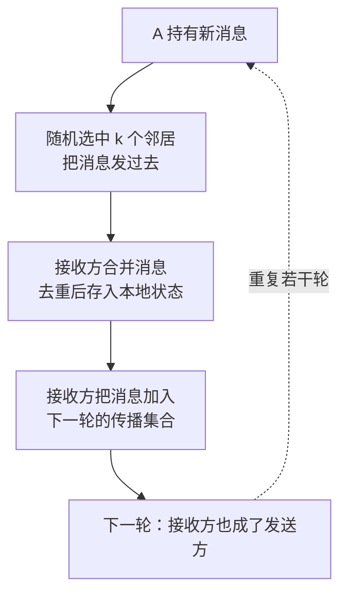
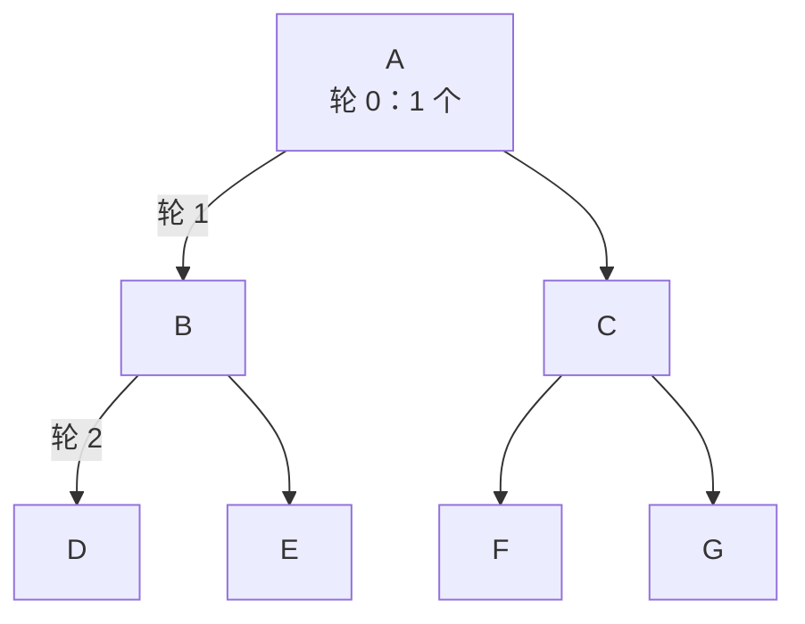
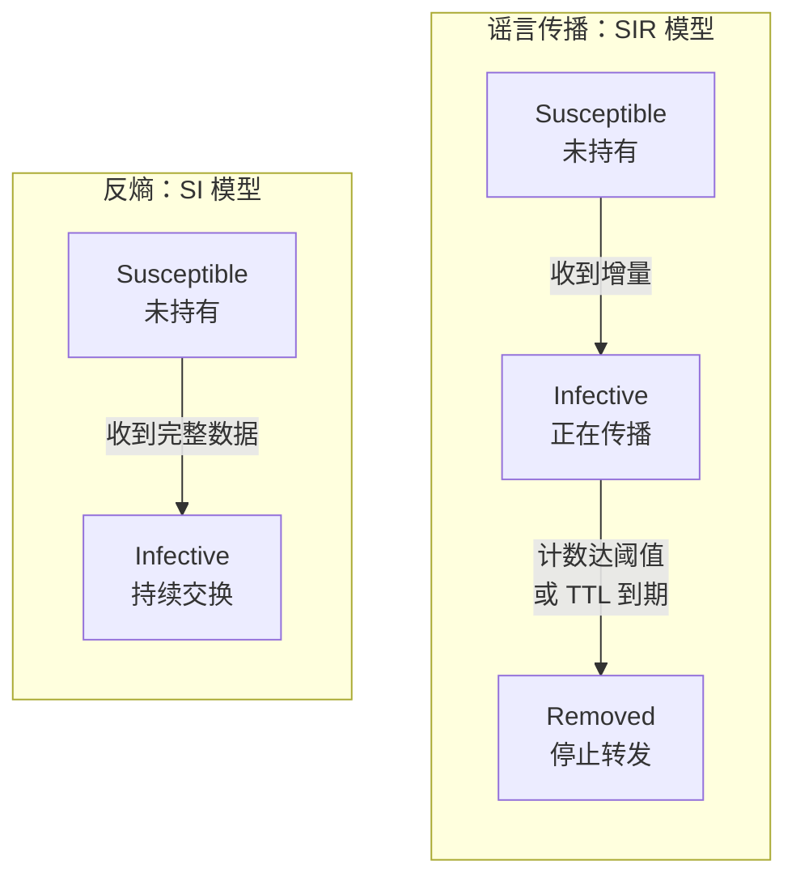
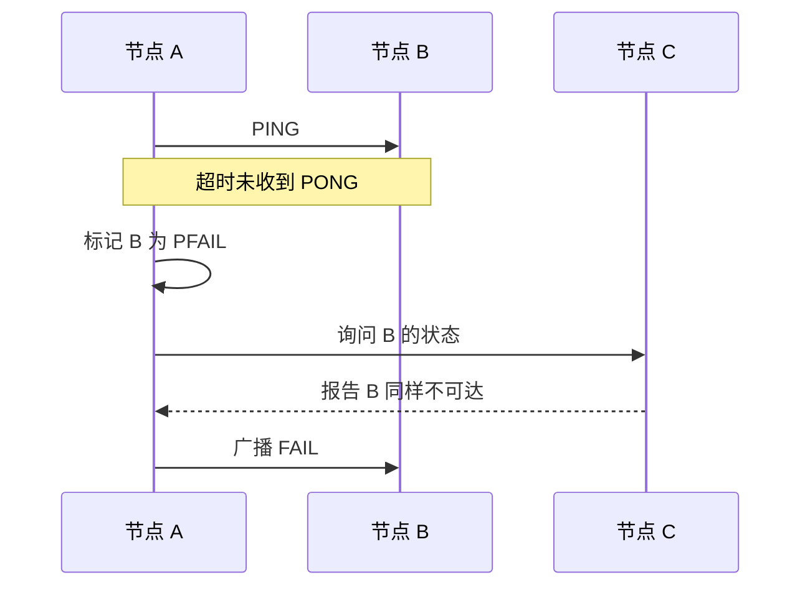
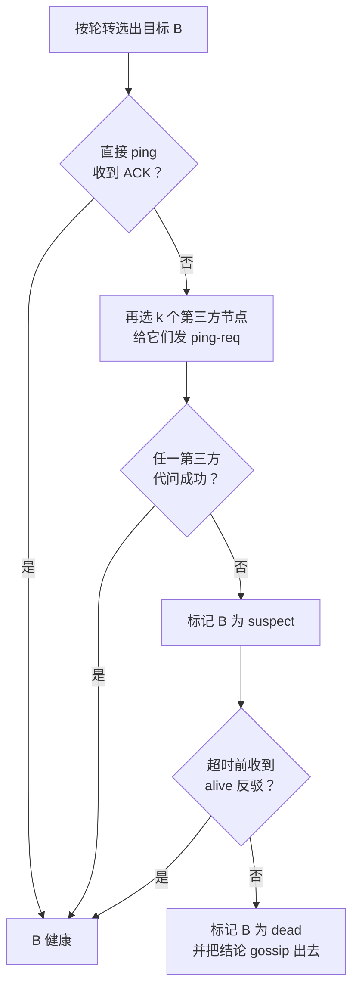
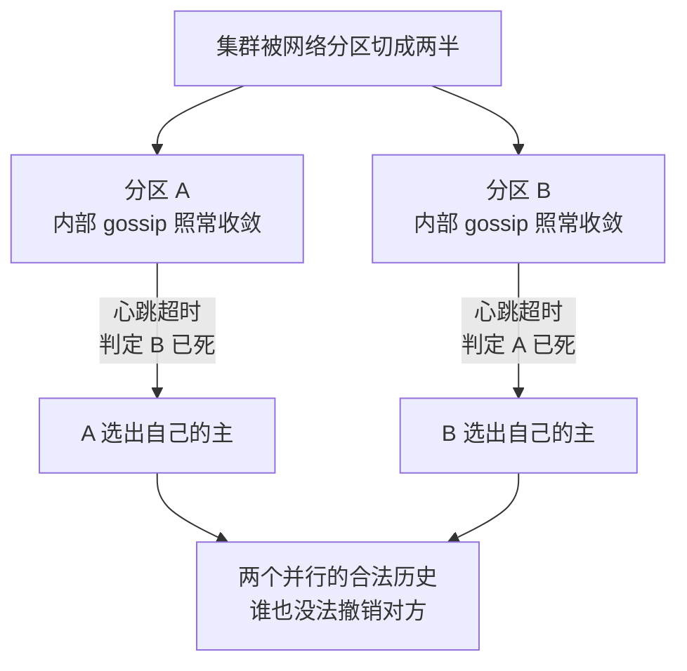

# Gossip 协议：把消息扩散变成收敛算法


<!--more-->

设想一个 500 个节点的集群，现在要上线第 501 个。

最直观的做法是搞一个"配置中心"：新节点注册上去，中心把变更推送给其他 500 个节点。这个方案有两处硬伤——中心节点要应付 500 份状态的全量同步，节点一多就成了吞吐瓶颈；更要命的是中心节点自己挂了，整个集群的元数据分发就断了。

另一种做法是让节点之间互相通知：每个节点每隔一会儿随机挑几个邻居交换一下自己知道的信息。谁上线了、谁下线了，慢慢就传开了。这就是 Gossip。

Gossip 的代价很直白：一条消息要经过好几轮才能传遍全网，同一条消息会被很多人重复收到。它换来的东西同样直白：没有中心节点，也没有单点。

这一篇讲三件事：Gossip 为什么能收敛得这么快（`O(log N)` 到底是怎么来的）、反熵和谣言传播这两种模式的差别、以及工业界是怎么用它的。

| 层次 | 回答的问题 | 核心标识 | 本文对应章节 |
|---|---|---|---|
| **动机** | 为什么不用中心广播？ | 消息量、单点故障 | 第一章 |
| **模型** | Gossip 的循环长什么样？ | `fanout`、随机选点、幂等、Peer Sampling | 第二章 |
| **收敛** | 为什么是 `O(log N)`？ | 期望公式、`log_k N` | 第三章 |
| **模式** | 反熵还是谣言传播？ | Removed 状态、`Push`/`Pull`/`Push-Pull`、Merkle Tree | 第四章 |
| **工程** | 真实系统怎么落地？ | 去重、Jitter、MTU、消息风暴 | 第五章 |
| **成员** | 怎么用 Gossip 做故障检测？ | `PFAIL`/`FAIL`、`probe`/`suspect`/`dead` | 第六章 |
| **边界** | Gossip 做不到什么？ | **脑裂**、最终一致、拜占庭、无自我保护 | 第七章 |

## 一、为什么中心广播撑不住

先把"不用 Gossip 会怎样"算清楚，才能明白 Gossip 到底换掉了什么。

假设有 $N$ 个节点，某个节点的状态发生了变化，要让所有节点都知道。

**中心广播**的做法是：中心节点给其余 $N-1$ 个节点各发一份。总消息量 $O(N)$，一轮就结束——这是它最大的优点。但代价有三条：

1. **吞吐瓶颈**。中心节点的出向带宽和序列化能力必须线性支撑集群规模。500 个节点时它很轻松，50 万个节点时它就是整个系统的天花板。
2. **单点故障**。中心节点挂掉，状态分发直接停摆。要解决它，就得做主备、双活、选举——于是你开始实现 Raft 或 Paxos，来解决一个"广播一条消息"的问题。
3. **组装成本不均**。中心节点要按 $N$ 份数据组装 $N$ 个消息包；换成每个节点只跟几个邻居通信之后，组装成本被摊薄了。

Gossip 的思路是**把"一次广播"拆成"很多次小广播"**：每个节点每一轮只跟随机挑的几个邻居通信，收到消息的节点下一轮继续往外传。消息量从 $O(N)$ 变成 $O(N \log N)$——单轮变贵了，但**总代价只多了一个对数因子**，而单点故障的问题彻底消失了。

> **一句话总结**：Gossip 用"多传几轮、每轮少传一点"，换掉了"一轮传完、但必须有个中心"。

这里有个必须提前说清的前提。Gossip 成立依赖三个假设：

- **没有拜占庭故障**——节点不会恶意伪造消息；
- **没有永久性网络分区**——分区最终会愈合，否则分成两半的集群会各自收敛到不同状态（脑裂为什么是硬边界，见第七章）；
- **节点持续在交换**——不停机、不休眠、不被无限期隔离。

前两条不成立时，Gossip 提供的就不再是"最终一致"，而是"两块各自一致"。

## 二、Gossip 的核心循环

Gossip 又叫 Epidemic Protocol（流行病协议），思想直接来自流行病传播。这个类比比字面更贴切：真实的流行病也是"每个感染者随机接触几个人"，最终传遍人群。

这个借用在数学上比在工程上更早：1927 年 Kermack 与 McKendrick 提出的**流行方程**，就是第四章要讲的 SI / SIR 模型——"易感（Susceptible）—感染（Infective）—移除（Removed）"这套三态划分直接来自那篇论文。

至于"谁最早把八卦用到分布式系统里"，其实不好界定。**Baker 与 Shostak 在 1972 年的《Gossips and Telephones》里就描述过 gossip 协议**（当时的场景是电话交换机的故障检测）；而**被公认为分布式系统里程碑的 Demers 等人 1987 年论文**《Epidemic Algorithms for Replicated Database Maintenance》，第一次把它用在复制数据库的副本同步上。本文第四章讲的反熵与谣言传播，就出自那篇论文。

协议本身只有三步：

1. **随机选点**：每轮从已知节点中随机挑 $k$ 个（$k$ 叫 `fanout`）；
2. **交换信息**：把要传播的内容发给它们；
3. **接力扩散**：收到新内容的节点，把它加入自己的下一轮传播集合。

第三步是关键——**接收方自动变成发送方**。这条规则让扩散形成了指数形状。



把它画成"每轮新增多少知情节点"，就是典型的扩散树：



### 幂等：容错的根基

有个细节值得单独拎出来：**同一条消息被收到多次是正常的，而且是必要的**。

- 每条消息可能被转发给多个邻居，每个邻居又转发给它的邻居——重复是扩散的副产品；
- 节点重启后从旧状态恢复，会把已经传播过的消息再发一遍；
- 消息丢失不需要专门补偿——别的节点下一轮还会再发。

所以 Gossip 的消息处理必须是**幂等**的：重复收到同一条消息，只应被合并一次，不能产生副作用。工程上通常给每条消息带上版本号或唯一 ID，接收方比对后丢弃陈旧或重复的。

这一点反过来解释了一个常见误解：**Gossip 的状态扩散不需要 ack**。发送方不等确认，不重传。丢包了就丢了，下一轮由别人补上。系统能容忍消息丢失，靠的是"多路径冗余"而不是"可靠传输"。（第六章 SWIM 里的 ack 是**故障探测的应答**，不是状态扩散的确认，两者别混。）

### fanout 的取舍

$k$（fanout）越大，单轮扩散越快，但每轮每个节点的网络开销也越大。

| fanout | 每节点每轮发消息数 | 覆盖 $N$ 个节点的轮数 | 特点 |
|---|---|---|---|
| 1 | 1 | 命中单个 $\Theta(N)$，覆盖全部 $\Theta(N \log N)$ | 串行化，不可用 |
| 2 | 2 | $\log_2 N$ | 省带宽，慢 |
| 3～4 | 3～4 | $\log_3 N$ ～ $\log_4 N$ | 常见折中 |
| 16+ | 16+ | 更少 | 只在小集群或高扇出场景用 |

$k=1$ 值得单独说：每轮每个节点只找一个邻居，扩散退化成完全图上的随机游走。**命中某个指定节点**的期望轮数是 $\Theta(N)$，而**覆盖全部节点**还要更久，$\Theta(N \log N)$。而中心广播**一轮**就能让所有人知道——所以 $k=1$ 不是"慢一点"，而是**慢好几个数量级**。这正是 $k$ 至少要大于 1 的原因，实践中通常取 3～4（HashiCorp 的 memberlist 默认 `GossipNodes = 3`）。

### 选邻居：Peer Sampling 这一层

"每轮随机挑几个邻居"——这句里的"随机挑"，在真实系统里并不是免费的。

每个 Gossip 协议都需要一个**选 peer 的组件**，哪怕它没有被显式暴露出来。理想情况下，每个节点维护一份完整的成员列表，再从中做均匀随机采样。但在大规模动态系统里维护这份列表相当麻烦：节点会加入、离开、故障，列表得跟着更新。**而论文推导可扩展性、可靠性时通常假设的"均匀随机采样"，在真实实现里未必成立**。

Jelasity 等人把这件事抽象成了一个 **Peer Sampling Service（对等采样服务）**，接口很简单：`init` 决定初始认识哪些节点，`selectPeer` 返回一个 peer。最简单的实现就是上面说的"完整列表 + 均匀采样"。

更有意思的是**用 gossip 来实现 gossip 的选 peer**：每个节点初始化时只拿一小撮节点，每次 gossip 交换时把自己的视图和对方的视图合并。这样每个节点维护一张**小的本地表**，并被周期性地刷新——HyParView 就是这么做的。用 gossip 做 peer sampling 的协议，被称作 **Meta-Gossip 协议**。

## 三、收敛有多快：$O(\log N)$ 是怎么来的

这一章是全文的核心推导。结论先给：**轮数是节点数的对数级**，而且这个结论对模型的细节不敏感——是各种 Gossip 变体的共同性质。

### 一个精确的期望公式

设当前有 $I_t$ 个节点知道了某条消息，集群共 $N$ 个节点，每个知情节点这一轮随机挑 $k$ 个目标。

一个**不知情**节点被这一轮击中的概率是：$k I_t$ 次独立抽样都没选中它的概率为 $(1 - 1/N)^{k I_t}$，所以被击中的概率为 $1 - (1-1/N)^{k I_t}$。

于是期望的知情节点数为：

$$
\mathbb{E}[I_{t+1}] = I_t + (N - I_t)\left(1 - \left(1 - \frac{1}{N}\right)^{k I_t}\right)
$$

这个公式精确，可以直接拿去做蒙特卡洛验证。但它真正的价值在于**它的形状**。

### 指数增长相

在早期阶段（$I_t \ll N/k$），指数部分可以展开：

$$
\left(1 - \frac{1}{N}\right)^{k I_t} \approx 1 - \frac{k I_t}{N}
$$

代回原式，期望增量变成：

$$
\mathbb{E}[I_{t+1}] - I_t \approx (N - I_t) \cdot \frac{k I_t}{N} \approx k I_t
$$

也就是说，**每轮新增的知情节点数，与当前已知的节点数成正比**。这是指数增长的签名：

$$
I_t \approx (1 + k)^t
$$

要让 $I_t$ 追上 $N$，需要 $t \approx \ln N / \ln(1 + k)$ 轮。**对数就是这么来的**——不是"约等于"，而是增长阶的直接后果。

### 工程上常用的估算

严格的常数依赖模型细节（Push-Pull、Push-only、是否允许同一轮内多次交换，结论会差半个常数），工程上更常用一个更简洁的估算式：

$$
T \approx \log_k N = \frac{\ln N}{\ln k}
$$

取 $k = 4$：

| 节点数 $N$ | 估算轮数 $\log_4 N$ | 相对上一行的增量 |
|---|---|---|
| 20 | 2.16 | — |
| 40 | 2.66 | +0.50 |
| 80 | 3.16 | +0.50 |
| 120 | 3.45 | +0.29 |
| 160 | 3.66 | +0.21 |
| 1000 | 4.98 | — |
| 100000 | 8.30 | — |

这张表里最值得盯的是**增量列**：节点数翻一倍，轮数只多零点几轮；节点数从 1000 涨到 10 万（100 倍），轮数只从约 5 涨到约 8。

> **实用结论：集群规模每翻一倍，多花的轮数恰好是 $1/\log_2 k$**——fanout 取 4 时就是半轮，取 2 时是一轮。这是 Gossip 可扩展性最直观的体现：扩容一个数量级，扩散延迟几乎感觉不到。

需要提醒的是：**估算值是乐观的**。随机选点必然重复命中已有节点（20 个节点、`fanout=4` 时，理论 2.16 轮，模拟跑下来常常要 3～4 轮）。所以工程上应该把它当成**下界附近的量级参考**，而不是精确预测。

还有一个容易被忽略的点：每个节点要发 $O(\log N)$ 条消息才能完成一轮收敛，**全网加起来是 $O(N \log N)$ 条**。如果每条消息都携带全量状态（每个节点 $O(N)$ 大小的成员列表），那么总字节数会退化到 $O(N^2 \log N)$ 量级——这正是第四章要讲的 Merkle Tree 存在的原因。

## 四、两种传播模式：反熵与谣言传播

Gossip 有两个"表亲"，它们在**传播什么**上截然不同，选错了代价很大。

| 维度 | 反熵 Anti-Entropy | 谣言传播 Rumor-Mongering |
|---|---|---|
| 传播内容 | 完整数据或摘要 | 只有增量更新 |
| 流行病模型 | SI（susceptible-infected） | SIR（susceptible-infected-removed） |
| 传播次数 | 持续反复，直到状态一致 | 传播若干次后停止 |
| 消息量 | 无上界（可能一直交换） | 有上界 |
| 收敛目标 | 副本状态收敛到最新 | 所有节点都收到该条更新 |
| 典型场景 | 副本修复、定期对账 | 集群成员变更、事件广播 |

术语解释：**反熵**（anti-entropy）的"反"指的是消除节点间数据的不一致（熵越高表示越混乱），它通过持续交换数据把差异抹平；**谣言传播**只负责把"新发生的事"传出去，每个节点只转发有限的次数。



### Removed：谣言传播凭什么"停下来"

本章开头那张表说谣言传播"消息量有上界"——上界从哪来？来自 **Removed（移除）状态**：节点收到更新、转发若干次之后，就不再主动传播了。

**这个状态最难的地方在于"什么时候停"。** 理想的做法是"等所有 peer 都拿到了再停"，但那需要全局知识，而 gossip 恰恰没有全局知识。实际做法是用局部信号来近似，Jelasity 的分析总结了两种**移除算法**：

| 算法 | 规则 |
|---|---|
| 硬币（随机） | 一次传播失败后，以 $1/k$ 的概率进入 Removed |
| 计数器 | 累计 $k$ 次"对方已经有了"的无效接触后，进入 Removed |

而"什么时候执行这个算法"又有两种模式：**feedback** 模式只在被联系的对方**确实已经知情**时才执行；**blind** 模式则每轮都执行。

$k$ 这个参数直接决定送达率。残留比例 $s$ 指的是**传播停止时仍未收到更新的节点占比**。不同模型（硬币还是计数器、feedback 还是 blind）给出的数字会有出入，但量级是一致的：

| $k$ | 漏掉更新的节点比例 |
|---|---|
| 1 | 约 **两成到四分之一** |
| 2 | 约 **6%** |
| 5 | 约 **0.25%** |

**这组数字是本章最重要的一段**：谣言传播**不是 100% 送达**。$k=1$ 时有相当一部分节点根本收不到消息；但 $k$ 一旦取到 5，失败概率就降到千分之几——再往上，$k \to \infty$ 时它可以**任意小**。

代价是 $k$ 越大，单个节点被转发的次数越多，消息量越高。**送达率与消息量之间，就是这么一条需要权衡的曲线**。

### 三种通信原语

两者的原子操作都是同一套：**Push、Pull、Push-Pull**。

- **Push**：A 把 `(key, value, version)` 推给 B，B 判断版本后决定是否更新自己；
- **Pull**：A 只把 `key` 和 `version` 发给 B，B 返回自己更新的完整数据，由 A 更新；
- **Push-Pull**：先做一次 Pull，再把 A 较新的数据推给 B。

| 模式 | 一个同步周期内的通信次数 | 什么时候最划算 |
|---|---|---|
| Push | 1 | **早期**：知道更新的节点少，pull 请求多半无果 |
| Pull | 2 | **后期**：多数节点已知，pull 才真有东西可取 |
| Push-Pull | 3 | 双向兜底，一个周期内可让两节点完全一致 |

```python
def push_pull(self, peer):
    # 第一步：Pull——问对方要什么
    for key, version in peer.versions():
        if version > self.version(key):
            self.merge(key, peer.get(key))
    # 第二步：Push——把我有的推过去
    for key, value, version in self.dirty_items():
        peer.merge(key, value, version)
```

Push-Pull 通信次数最多，但收敛效果最好——**一个周期就能让两个节点完全一致**。这是工程上的默认选择。

而 Push 与 Pull 的最佳时机恰好相反。**早期**知道更新的节点很少，此时发 pull 请求多半是空转，**push 效率更高**；到了**后期**，大多数节点都知道了，pull 才有东西可取。Saidi 与 Mohtashemi 提出的 **First-Push-Then-Pull** 策略正是把两者串起来：前期用 push 快速铺开，后期改用 pull 收尾。

### 大数据量怎么办：Merkle Tree

Cassandra、DynamoDB 这类系统里，单节点数据量可以是 TB 级。"每轮交换全量数据"这种反熵根本没法做。

Merkle Tree 的做法是把每个节点的数据按 key 排序后切成树，每个内部节点存左右子树的哈希：

1. 两节点先交换**根哈希**；
2. 根哈希相同 → 数据一致，不用往下看；
3. 根哈希不同 → 递归比较对应的子树；
4. 只在哈希不同的路径上传输实际数据。

比较的范围被限制在一棵树的高度 $O(\log M)$ 内（$M$ 是比较范围内的条目数），差异定位完只传差异部分。这就是**用摘要交换替代全量交换**——反熵从"搬运全部数据"变成"搬运差异"。

> **选型判断**：如果集群节点数不多、状态数据量小，反熵直接交换全量更简单；如果单节点数据量大、状态更新不频繁，Merkle Tree 是必需的。Cassandra 和 Dynamo 都走了后者。

## 五、工程细节：协议之外的那些坑

教科书上的 Gossip 只有三行，真正的实现要处理一堆边界情况。

### 去重

用消息 ID、版本号或 `incarnation` 序号（后面 SWIM 会详细讲）丢弃陈旧和重复的消息。这是幂等性的前提。

### Jitter：避免惊群

如果所有节点都用固定的同步周期，理论上所有节点会在同一时刻集体发送，形成周期性的消息尖峰。解决办法是给每轮的触发时刻加一个随机抖动——这在几乎所有 Gossip 实现里都是标配。

### 消息大小与 MTU

Gossip 消息通常跑在 UDP 上，受 MTU 限制（典型 1500 字节）。超过就得分片，而分片消息的重组与重传会引入新的失败模式。

一个应对办法是**限制每条 piggyback 消息里捎带的更新条数**——这也是 SWIM 的做法（详见[系列第二篇](/posts/2026/11/27ee6cbd/)）。另外，别在 gossip 消息里塞大对象：把 payload 放在别处，gossip 里只传引用。

### 消息风暴

高频更新叠加高 fanout 会形成消息风暴。常见的抑制手段：

- **指数退避**：失败后逐步降低发送频率；
- **限流**：单个节点每轮的消息数设上限；
- **合并更新**：短时间内多个更新打包成一条。

### 别忘了"死掉"的节点也要能被通知

一个节点被判定为失败后，通常还要在成员列表里**保留一段时间**。否则它的死亡状态无法通过反熵（Push-Pull 全量交换）扩散出去——因为对方已经不在交换名单里了。memberlist 的做法是保留 `GossipToTheDeadTime` 一段时间后再真正移除。

## 六、失败检测：Gossip 长成成员系统

前面讲的都是"传播一条消息"。但 Gossip 最有价值的用途，是**维护一份所有节点都大致认同的成员列表**——节点上线、下线、地址变更，都靠它同步。

这个能力叫**组成员协议**（group membership protocol）。

### Redis Cluster：把 gossip 用在元数据上

Redis Cluster 3.0 之后采用完全去中心化的架构，节点之间用 gossip 交换三类元数据：**自己是谁、槽位怎么分配、别人是什么状态**。

| 消息 | 用途 |
|---|---|
| `MEET` | 把一个节点引入集群（相当于一次强制的 PING） |
| `PING` | 周期探测，顺便交换状态 |
| `PONG` | 对 PING 的回应，携带自身状态 |
| `FAIL` | 广播"某节点已确认故障" |

`MEET`、`PING`、`PONG` 共用同一种消息结构。`PONG` 通常是对 `PING` 的回应，但节点也可以**主动发 PONG** 来广播自己的配置变化，不必等别人来 ping。

故障检测是两级判定：



1. A 在 `cluster-node-timeout`（默认 15 秒）内没收到 B 的响应 → 标记 B 为 **PFAIL**（疑似故障）；
2. A 收到其他主节点对 B 的 PFAIL 报告，且获得**过半**主节点确认、报告未过期 → 标记 B 为 **FAIL**（确认故障）；
3. A 把 FAIL 广播给集群。

这里的设计精髓：**PFAIL 是本地判断，FAIL 需要集群共识**。Redis 没有用 Raft，但它也没假装自己能——它用"过半主节点确认"这个弱多数规则，把"我这边网络不通"和"它真的挂了"区分开。

> 按官方 spec，Redis Cluster 的心跳带一个 **gossip 段**，里面只装**随机若干个**已知节点的信息（节点数量与集群规模成正比），而不是全量状态——没有 Dynamo 那种全量反熵对账。槽位归属则走另一条路：心跳里自带发送方的**槽位位图**，对方发现你的位图过期了，就回一个 `UPDATE` 消息把它纠正过来。

### SWIM：把故障检测本身做成 gossip

Redis 的方案里，"我 ping 你"这件事还是由每个节点各自发起、各自判定。SWIM（*Scalable Weakly-consistent Infection-style Process Group Membership Protocol*）换了个思路：**故障检测和状态传播彻底解耦**，并且给探测加了一层"第三方代问"的间接机制。



三段式状态机是 SWIM 的核心：

- **alive** → **suspect**：直接和间接探测都失败时，先不急着宣判，而是打上"可疑"标记并把怀疑传播出去；
- **suspect** → **alive**：B 自己收到关于自己的怀疑消息后，可以立刻反驳（发 `alive` 消息），把状态拉回来；
- **suspect** → **dead**：怀疑超时仍无人反驳，才正式判定失败。

"先怀疑再宣判"这一层，把单点的网络抖动挡在了误判之外。

SWIM 的完整设计、延迟推导和实验数据，[系列第二篇](/posts/2026/11/27ee6cbd/)会逐段展开；Consul 在生产环境里怎么把它调稳（以及踩过的坑），在[系列第三篇](/posts/2026/11/8984d695/)。

## 七、Gossip 做不到的事

Gossip 很强，但它有清晰的边界。知道边界在哪，比知道它有多强更重要。

其中有一项需要单独展开——**脑裂**。它不是调参能绕过去的边界，而是必须靠另一套机制来补。

### 脑裂：两边各自都"正确"

**脑裂指的是什么。** 网络分区把集群切成两半。**每一半内部都还在正常运转**——节点互相 ping 得通，gossip 照常扩散，成员列表在每一半内部收敛得相当好。问题在于：**每一半都以为自己是全体**。



**为什么 gossip 挡不住。** 三层原因，从浅到深。

**第一层：gossip 只提供最终一致，不提供"单一历史"。** 一致性有两个维度：**有效性**（大家看到的事实都是真的）与**一致性**（大家看到的事实顺序相同、结论相同）。脑裂破坏的是后者——两个分区各自得出了**都合法的**结论。Gossip 的设计目标是"让状态最终一致"，它从来没有承诺过"任何时刻只有一个真相"。

**第二层：故障检测分不清"死了"和"被隔开了"。** 跨分区的探测失败，在 gossip 的世界里只有一种解释——**它挂了**。心跳和探测机制没法区分"对端进程死了"与"网络把对端隔开了"，因为两者在信号上完全一样：消息发出去，收不到回应。**Gossip 在这里帮不上忙**：它能把"我看不到 B"这条消息扩散得又快又广，让全网都确信"B 死了"，却没法传递"我们可能被隔开了，先别做决定"。

**而分区内部收敛得越好，这个误解就越彻底**。每一半都很快变成一个自洽的整体，成员列表里干净利落地少了另一半，谁也不会再怀疑什么。**Gossip 的收敛速度在脑裂场景里是缺点，不是优点**——第三章那个"集群翻倍只多半轮"的漂亮性质，在这里变成了"两个世界各自飞快地对齐、谁也不知道还有个世界"。

**第三层，也是最根本的一层：gossip 只传播状态，不产生决策。** 成员列表、故障标记、槽位归属、配置版本——这些是**状态**，靠 gossip 传播最终能对上。但"由谁来写""这笔提交算不算数""谁是主""这个令牌发出去了没有"——这些是**决策**，要保证唯一，需要**全局顺序 + 多数派确认**。标准的 Gossip 协议里没有这两个概念——**补上它们，就等于在 gossip 之上叠了一层共识**。

| 事情 | Gossip 够不够 |
|---|---|
| 成员发现、故障标记 | 够——分区愈合后自动合并视图 |
| 状态同步（配置、槽位、版本） | 够——最终一致 |
| 判断"它真的死了" | 不够——只能判断"我这边看不到它" |
| 选主 | 不够——两边都会选出自己的主 |
| 写入决策、事务提交 | 不够——两边都会接受 |
| 脑裂愈合后的数据修正 | 不够——元数据能合并，但已分叉的数据不能 |

**现实中大家怎么做。** 几乎没有系统敢只用 gossip 去做需要唯一性的决策：

- **Redis Cluster**：gossip 只负责元数据传播；**故障转移走 `configEpoch` 加多数派主节点投票**。官方 spec 里明确讨论了两种由脑裂引发的情形，并靠"多数派"最终收敛到单一视图。少数派一侧会**停止接受写入**。
- **Consul**：gossip（memberlist）做成员发现与故障检测，**选主和目录一致性走 Raft**。少数派拿不到多数派票，永远选不出新的主；等网络恢复，少数派那个主看到更高的 term 就会退位，把领导权交回多数派。
- **Cassandra**：读写带**一致性级别（CL）**。`CL=QUORUM` 用多数派交集保证单一历史；**`CL=ANY` 明确放弃了这个保护**——也就明确接受了脑裂下的不一致。

> **判据：这个决策一旦做出，就必须全局唯一、而且事后不能撤销吗？**
> - 是 → 上共识（选主、提交、授权、发号）
> - 否 → gossip 够用（成员发现、配置分发、监控采样、最终一致的缓存）

**和普通"最终一致窗口"的区别。** 网络抖动造成的不一致窗口**会自愈**——gossip 继续传，两边最后能对上。脑裂造成的不一致**不会自愈**：它是两个并行的合法历史，没有机制能撤销其中一边。要么一开始就用多数派规则挡住（少数派那侧干脆不可用），要么事后靠人工仲裁。

**顺带一提，这一节也解释了本系列第三篇（Lifeguard）为什么重要。** 在脑裂里，SWIM 在每个分区内部都会做一次**在崩溃模型下完全正确**的故障检测——分区内部探测正常，跨分区探测失败（间接探测也一样，因为第三方都在同一侧），于是各自把对方判为 dead 并触发 failover。而 Lifeguard 处理的慢消息处理误判，会让节点在**根本不是脑裂**的情况下也触发一次 failover。**两种情况在信号上长得几乎一样**，这就是为什么"先怀疑再宣判"和"怀疑期间允许自证"这两层机制在生产环境里缺一不可。

### 其余的边界

**它不是共识算法。** Raft、Paxos 提供的是强一致性和线性一致性；Gossip 只提供最终一致性。它不保证任何时刻所有节点对同一个问题给出相同答案，也不适合直接用来做选主或需要线性一致性的状态机复制。需要强一致时，正确做法是**在 Gossip 之上叠一层**——Consul 就是用 Raft 提供服务列表的强一致视图，底下仍然用 memberlist 的 Gossip 维护成员关系。

**它防不住拜占庭故障。** Gossip 假设节点不撒谎。恶意节点可以伪造状态、选择性传播、在自己被怀疑时恶意反驳。防御需要签名、证书链或 Merkle 树证明，那是另一套体系。

**它也没有自我保护机制**。2008 年 7 月 20 日的 Amazon S3 服务中断报告里出现过一个典型场景：集群用一个损坏的共享位来同步服务器状态，这个位**仍然是可以读的**，但它被 gossip **忠实地扩散到了全网**——结果是所有节点都拿到了错误状态，最终不得不让服务停机、从磁盘重新修复状态。

这次事故不是攻击造成的，而是**没有攻击也会发生**。Gossip 的设计假设是"状态是对的，只是传得慢"；一旦状态本身是错的，gossip 只会让它错得更快、更一致。

**收敛时间不可精确预测。** $O(\log N)$ 是期望值。尾延迟可能很差——尤其是当网络抖动导致某些节点反复联系不上同一批邻居时。生产系统通常还要叠加超时、退避和抖动来压住长尾。

**消息冗余是设计的一部分，不是 bug。** 同一消息被重复收到是扩散的必然结果。把它去掉，就等于去掉了容错能力。正确的做法是让重复处理**廉价且幂等**。

**它不解决数据一致性的最后一段。** Gossip 能让所有节点都"知道"最新的数据，但不保证这些数据在被读取时是一致的。读己之写、单调读这些语义，仍需要上层机制（版本号、会话令牌、因果一致性）来兜底。

## 尾声

> **一句话总结**：Gossip 用"多传几轮的随机扩散"，把"中心广播"换成了"所有人最终都知道"——用 $O(\log N)$ 的轮数和 $O(N \log N)$ 的消息量，换掉了单点故障和扩容瓶颈。

如果只能带走六句话：

1. **Gossip 不是共识算法**，它只保证最终一致；要强一致就在它上面叠一层 Raft 或 Paxos。
2. **收敛快是因为指数扩散**：每轮新增的知情节点数与已知节点数成正比，所以轮数是节点数的对数。**集群翻倍，只多半轮。**
3. **反熵比的是状态，谣言传播传的是事件**——前者需要 Merkle Tree 才能处理大数据量，后者天然适合广播集群成员变更。
4. **谣言传播不是 100% 送达**：Removed 状态的移除阈值 $k$ 决定了残留比例，$k=1$ 时漏掉两成到四分之一的节点，$k=5$ 时漏掉千分之几。**送达率与消息量之间是一条需要权衡的曲线。**
5. **Gossip 解决不了脑裂**：它只保证状态最终一致，不提供"单一历史"，也**分不清"对端挂了"和"网络把对端隔开了"**。两个分区会各自选出自己的主。需要唯一性的决策必须叠一层共识。
6. **怀疑机制是防误判的关键**：SWIM 的 alive → suspect → dead 三段式，加上"能反驳"的能力，把网络抖动挡在了误判之外。

## 参考资料

1. A. Demers, D. Greene, C. Hauser, W. Irish, J. Larson, S. Shenker, H. Sturgis, D. Swinehart, D. Terry. *Epidemic Algorithms for Replicated Database Maintenance.* PODC 1987. <https://doi.org/10.1145/41840.41841>
2. K. Birman. *The Promise, and Limitations, of Gossip Protocols.* SIGOPS Operating Systems Review, 41(5):8–13, 2007. <https://doi.org/10.1145/1317379.1317382>
3. G. DeCandia et al. *Dynamo: Amazon's Highly Available Key-value Store.* SOSP 2007.
4. A. Das, I. Gupta, A. Motivala. *SWIM: Scalable Weakly-consistent Infection-style Process Group Membership Protocol.* DSN 2002. <https://www.cs.cornell.edu/projects/Quicksilver/public_pdfs/SWIM.pdf>
5. A. Dadgar, J. Phillips, J. Currey. *Lifeguard: Local Health Awareness for More Accurate Failure Detection.* <https://arxiv.org/abs/1707.00788>
6. Redis Cluster Specification. <https://redis.io/docs/latest/operate/oss_and_stack/reference/cluster-spec/>
7. HashiCorp memberlist. <https://github.com/hashicorp/memberlist>
8. JavaGuide：*Gossip 协议详解*。<https://javaguide.cn/distributed-system/protocol/gossip-protocol.html>
9. Amazon S3 服务可用性报告，2008-07-20。<https://aws.amazon.com/message/12721/>
10. B. Baker, R. Shostak. *Gossips and Telephones.* Discrete Mathematics, 2(3):191–193, 1972. <https://doi.org/10.1016/0012-365X(72)90001-5>
11. W. O. Kermack, A. G. McKendrick. *A Contribution to the Mathematical Theory of Epidemics.* Proceedings of the Royal Society A, 115(772), 1927. <https://doi.org/10.1098/rspa.1927.0118>
12. M. Jelasity. *Gossip-based Protocols for Large-scale Distributed Systems.* 博士论文，University of Szeged, 2013.
13. M. Jelasity, R. Guerraoui, A.-M. Kermarrec, M. van Steen. *The Peer Sampling Service: Experimental Evaluation of Unstructured Gossip-based Implementations.* Middleware 2004, LNCS 3231, pp. 79–98. <https://doi.org/10.1007/978-3-540-30229-2_5>
14. A. Saidi, M. Mohtashemi. *Minimum-cost First-Push-Then-Pull Gossip Algorithm.* IEEE WCNC 2012.

