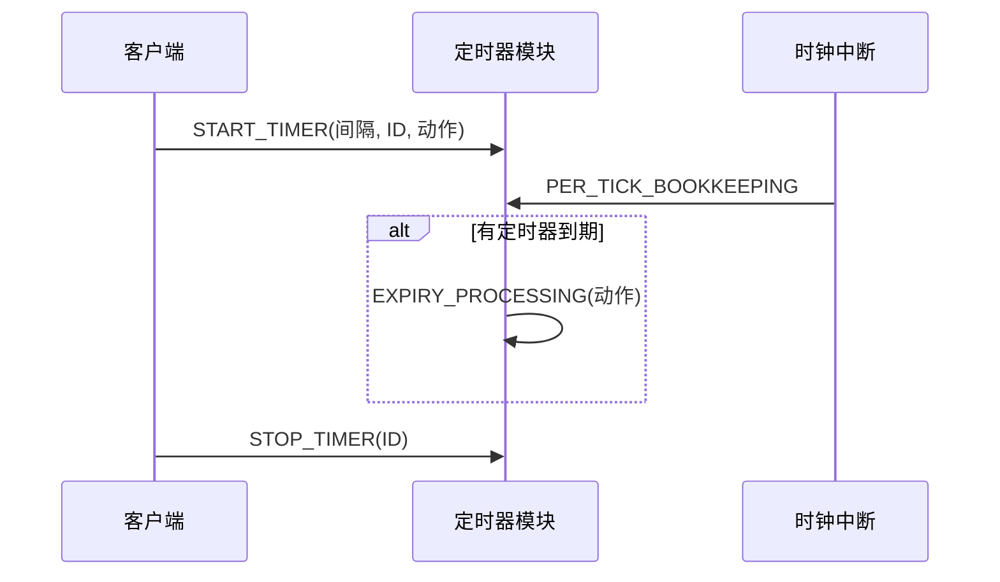
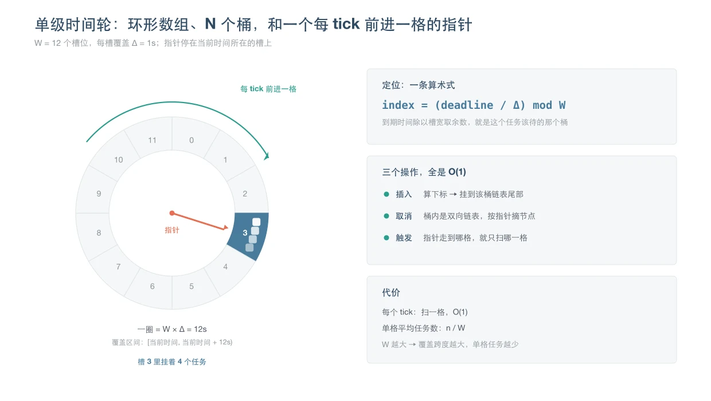
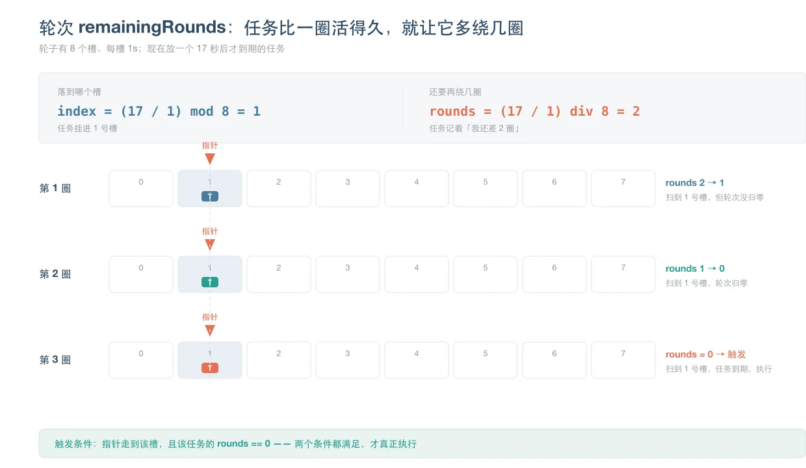
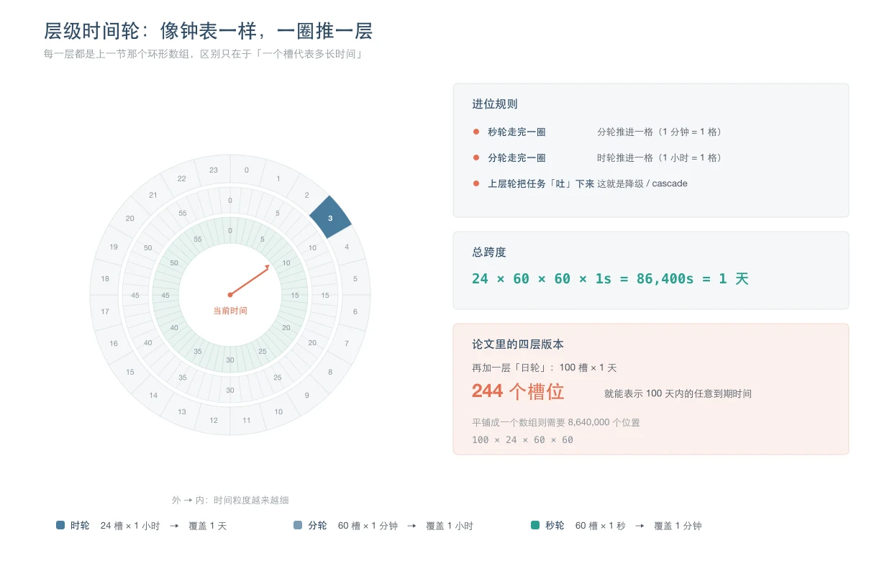
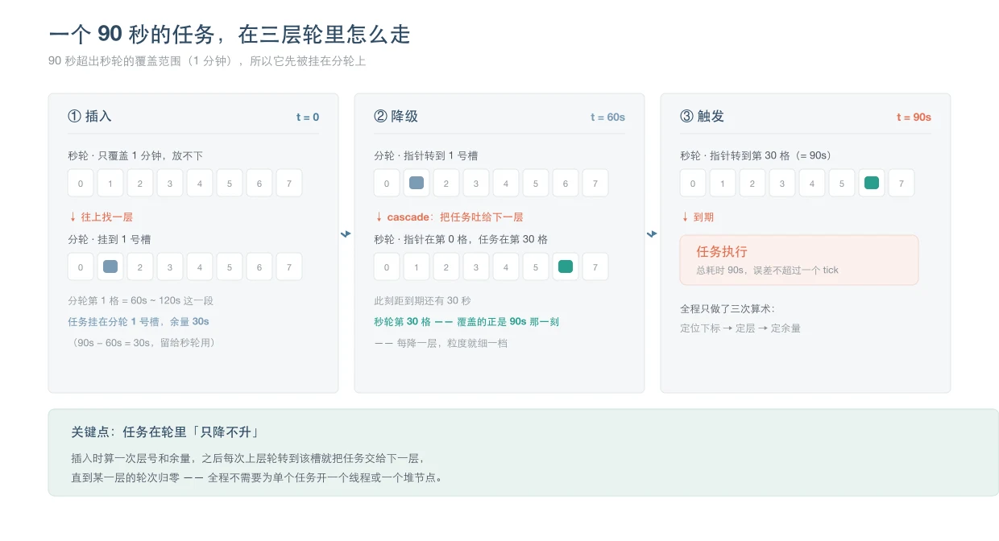
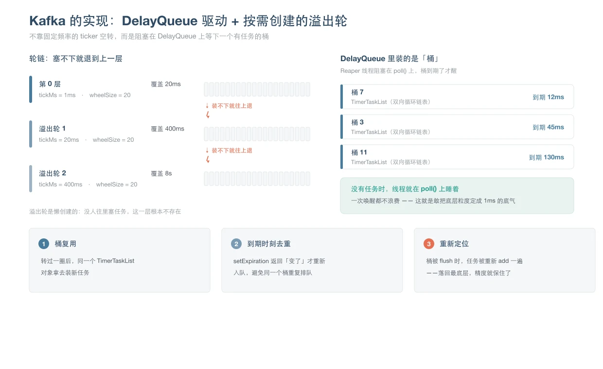
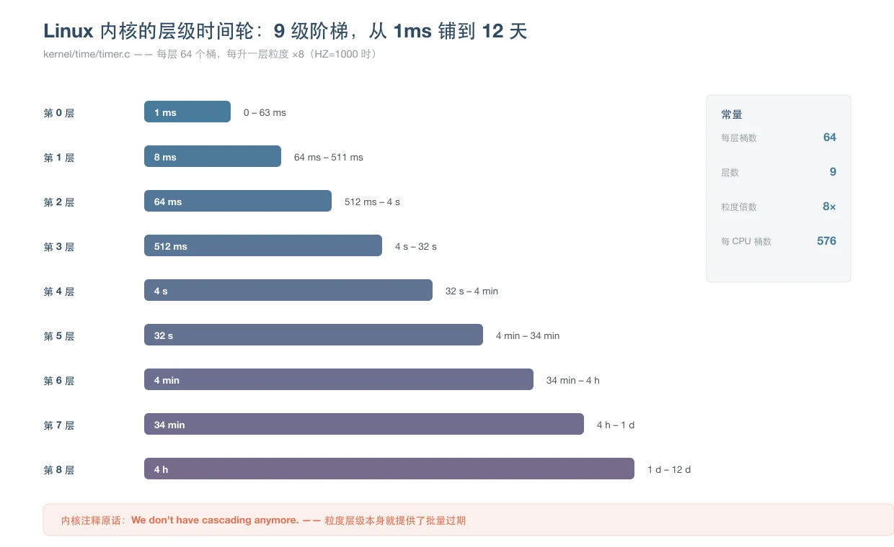
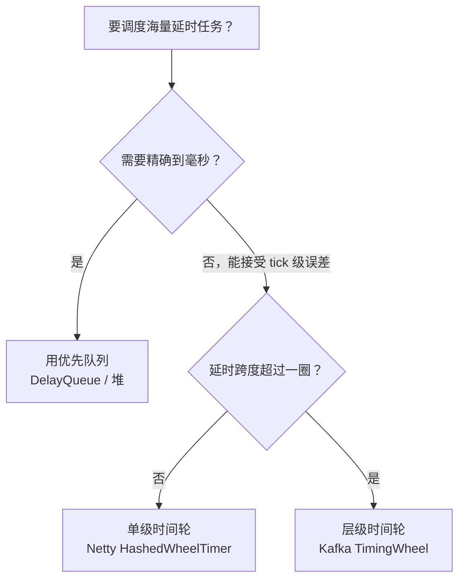

# 时间轮算法：把定时任务塞进一个环形数组


<!--more-->

写后端服务，延时任务几乎是必答题：

- 连接 30 秒没有心跳，断开
- 消息投递失败，10 秒 / 30 秒 / 2 分钟重试
- 下单 15 分钟没支付，取消订单
- 缓存 key 30 分钟没被访问，淘汰掉

单个任务都很简单，难的是**数量**。一个网关撑着几万条长连接，每条连接一个读超时、一个写超时，再叠上业务自己的重试和巡检，很容易就上十万。

最直觉的写法是给每个任务一个独立的定时器：

```go
time.AfterFunc(30*time.Second, func() { conn.Close() })
```

单看没问题，十万条就是灾难：十万个 timer 对象挂在一处，插入和取消都是 O(log n)，到期检查还得靠调度器挨个扫。

时间轮（Timing Wheel）就是为这个场景发明的。

**核心结论先摆出来**：时间轮用**空间换时间**，把「每个任务一个数据结构」换成「所有任务共用一个按时间分桶的环形数组」。任务的到期时间除以槽宽取余数，就得到它该待的桶；插入、取消、触发三个动作全是 O(1)，代价是**精度退化到槽宽（tick）**。

这个思路最早出现在数字电路的逻辑仿真里，1987 年 Varghese 和 Lauck 在 SOSP 上把它系统化成了一套通用定时器方案。今天 Kafka 的延迟消息、Netty 的连接超时、Linux 内核的低精度定时器，底下都是它。

| 章节 | 回答什么问题 | 核心结论 |
|---|---|---|
| 一 | 海量定时任务难在哪 | 四个原语，以及为什么前三种方案都不够用 |
| 二 | 时间轮是怎么来的 | 从逻辑仿真的 timing wheel 到论文里的七个方案 |
| 三 | 单级时间轮怎么工作 | 环形数组 + 桶 + 轮次，插入/取消/触发都是 O(1) |
| 四 | 跨度不够怎么办 | 层级时间轮：像钟表一样一层层进位 |
| 五 | 精度到底差在哪 | 会不会提前触发？三种答案，取决于桶在哪一端到期 |
| 六 | 工业级实现长什么样 | Kafka、Netty、Linux 内核各自的改法，以及那些「看起来像细节」的地方 |
| 七 | 从零实现一个 | 一百多行 Go，核心只有两个函数 |
| 八 | 什么时候该用、什么时候别用 | 选型表，和三个真正会踩的坑 |

## 一、海量定时任务难在哪

### 1.1 把「定时器」抽象成四个原语

Varghese 和 Lauck 的论文没有一上来就讲时间轮，而是先把一个定时器模块抽象成四个原语。这套抽象后来被反复引用，因为**它把「性能好不好」这种模糊感受变成了两个可量化的数字**：空间（SPACE）和延迟（LATENCY）。

| 原语 | 谁调用 | 干什么 |
|---|---|---|
| `START_TIMER(Interval, Request_ID, Expiry_Action)` | 客户端 | 注册一个 Interval 之后到期的定时器，到期时执行 Expiry_Action |
| `STOP_TIMER(Request_ID)` | 客户端 | 撤销一个还没到期的定时器 |
| `PER_TICK_BOOKKEEPING` | 时钟中断 | 每个 tick 来一次，检查有没有定时器到期 |
| `EXPIRY_PROCESSING` | 定时器模块 | 执行到期定时器指定的 Expiry_Action |



前两个原语由客户端调用，后两个由硬件时钟驱动。**性能就藏在 `START_TIMER`、`STOP_TIMER`、`PER_TICK_BOOKKEEPING` 这三个原语的延迟里**——一个好的定时器方案，要让这三个延迟都小。

论文还特别强调了 `STOP_TIMER` 经常被调用：网络协议里的重传定时器、请求超时，拿到响应就取消。「取消」是定时器模块里最容易被忽略、却最能拉开性能差距的操作。

### 1.2 前三种方案，以及它们各自栽在哪

**Scheme 1：每个任务一个计数器。** 每个任务占一个内存位置，存它还剩多少时间。每个 tick 把所有任务减一，减到零就到期。

这个方案最省空间，`START_TIMER` 和 `STOP_TIMER` 都是 O(1)，但 `PER_TICK_BOOKKEEPING` 是 **O(n)**——每 tick 都要遍历所有在途定时器。n = 十万、tick = 1 秒，意味着每秒十万次纯粹的无用操作。

**Scheme 2：有序链表。** 把定时器按到期时间排成一条链表，最早到期的放表头。这样 `PER_TICK_BOOKKEEPING` 退化成 O(1)（只看表头），代价是 `START_TIMER` 变成 **O(n)**——新任务要找到插入位置。

论文里给了一个有意思的细节：如果定时器总是插在链表尾部（所有任务间隔相同的情况），从尾部往前搜就能把 `START_TIMER` 压回 O(1)。但现实里间隔分布不均匀，这个 O(1) 靠不住。

**Scheme 3：树或堆。** 用二叉堆、平衡树、非平衡树来实现优先队列，`START_TIMER` 降到 O(log n)，`STOP_TIMER` 因为存了节点指针可以做到 O(1)，`PER_TICK_BOOKKEEPING` 靠堆顶维持 O(1)。

这已经很不错了，今天的 `DelayQueue`、Go runtime 里的定时器堆，思路都是它。但 O(log n) 在十万级任务、每秒上万次插入的量级下，还是会让 CPU 明显发热。

论文给出的对比：

| 方案 | START_TIMER | STOP_TIMER | PER_TICK | 空间 |
|---|---|---|---|---|
| Scheme 1 计数器 | O(1) | O(1) | **O(n)** | O(n) |
| Scheme 2 有序链表 | **O(n)** | O(1) | O(1) | O(n) |
| Scheme 3 树/堆 | O(log n) | O(1)~O(log n) | O(1) | O(n) |

三个原语里，**总有一个是 O(n) 或 O(log n)**。时间轮的目标就是把这个 O(log n) 也干掉。

## 二、时间轮是怎么来的

### 2.1 它的祖宗是逻辑仿真

论文里明确写了这个思路的来源：*timing wheel technique used in logic simulators*。

数字电路仿真要在离散时间点上处理事件。早期做法是维护一个事件表，每次仿真推进时，在表里找最早的事件——本质就是一个优先队列。但仿真的特点是**事件绝大多数都发生在很短的时间窗内**，「下一个事件什么时候到期」这个查询被反复执行，成为瓶颈。

于是有了 timing wheel：把时间切成等长的片，每片对应数组里的一个位置，那个位置挂一条链表，链上是这一片到期的事件。

论文引用了 Szygenda 等人 1971 年和 Ulrich 1965 年的工作，说明这个技术在逻辑仿真里已经用了十几年；TEGAS-II 这个仿真器就是这么实现的。

论文还列了一批当年真的跑在生产里的实现：BSD UNIX 的 callout 机制（Costello 做的，论文说它基于 Scheme 6）、X-kernel 的定时器设施、DEC Gigaswitch、Siemens 的 CHANNELS 运行时，以及 TCP Vegas。**BSD 的 callout 是时间轮在操作系统里最早的落地之一**——今天很多讲时间轮的文章会跳过这段历史，但从 1987 年算起，这套结构在真实系统里跑了近四十年。

原始的 timing wheel 长这样：

- 时间被划分成**周期（cycle）**，每个周期 N 个时间单位；
- 当前周期数是 S，指针指向数组第 i 个元素，那么当前时间就是 `S × N + i`；
- 本周期内到期的事件，插到数组对应位置（第 j 个元素）链表里；
- **超出本周期的事件，插到一条「溢出链表」（overflow list）**；
- 指针绕回 0 时，S 加一，检查溢出链表，把本周期到期的移进数组。

这个设计有个明显的短板：随着时间推进，数组里没被清空的链表越来越多，事件越来越倾向于进溢出链表。论文提到有实现（引用的 [12]）会改成「转到数组中点时反向旋转」来缓解，但没根治。

### 2.2 论文的关键转折：让轮子每个 tick 转一格

Scheme 4 改了一个地方，结果整个局面就变了。

**原始 timing wheel**：轮子每转 `MaxInterval` 才走完一圈。
**Scheme 4**：轮子**每个 tick 前进一格**。

这样一来，数组位置 i 精确对应「当前时间 + i」这个时刻，所有落在 `[当前时间, 当前时间 + MaxInterval)` 范围内的定时器都确定在数组里，不需要溢出链表。

论文原话是三个延迟全都变成 O(1)：

> If the timer lists are doubly linked, and, as before, we store a pointer to each timer record, then the latency of STOP_TIMER is also O(1).

定位规则简单到可以直接写进代码——到期时间除以粒度取余数：

```
index = (deadline / Δ) mod MaxInterval
```

论文用排序算法给这个方案做了个类比：**Scheme 4 本质上是一次桶排序（bucket sort）**，用内存换处理时间。桶排序是 O(M) 而不是 O(N log N)，但要遍历所有桶——论文说这对排序来说是灾难，对定时器却不是：

> What matters, unlike the sort, is not the total amount of work to sort N elements, but the average (and worst-case) part of the work that needs to be done per timer tick.

因为定时器模块本来每个 tick 就得维护当前时间，多走一个空桶只是几条指令而已。

### 2.3 内存不够怎么办：哈希

Scheme 4 的问题是：要覆盖到 `MaxInterval` 的定时器范围，就得开一个长度为 `MaxInterval` 的数组。32 位定时器要开 2³² 个位置——论文说这是「很难为 32 位定时器 justifying 2³² words of memory」的。

**Scheme 5** 的办法是哈希：把到期时间对数组长度取模得到桶号，高位单独存。

论文举了个例子：表长 256，定时器 32 位，余数是低 8 位。设余数为 20，当前指针是 10，那么索引 = (10 + 20) mod 256 = 30，高 24 位存进 30 号桶指向的链表。

- **Scheme 5**：桶内维持有序链表。`START_TIMER` 最坏 O(n)（要把高位插到正确位置），但 `PER_TICK_BOOKKEEPING` 平均 O(1)；
- **Scheme 6**：桶内用无序链表。`START_TIMER` 稳定 O(1)，代价是每 `TableSize` 个 tick 要给所有存活定时器的高位减一，**平均每 tick 的工作量是 n / TableSize**。

论文的结论很干脆：如果 `n < TableSize`，Scheme 6 每 tick 平均只做 O(1) 的工作；哈希函数选得好不好，只影响延迟的**波动**（burstiness），不影响平均值——所以**用「除以 2 的幂取余」这种一条 AND 指令就能算的哈希就够了**。

### 2.4 层级：把「位数」变成「层数」

**Scheme 7** 是论文的最终方案，也是今天所有人说的「层级时间轮」。

思路来自十进制：表示 1000000 不需要一百万位，只需要 7 位（个、十、百、千……）；表示 32 位定时器也不需要 2³² 个数组位置。

论文给出的四层配置：

| 层 | 元素数 | 每格代表 | 该层覆盖 |
|---|---|---|---|
| 天 | 100 | 1 天 | 100 天 |
| 小时 | 24 | 1 小时 | 1 天 |
| 分钟 | 60 | 1 分钟 | 1 小时 |
| 秒 | 60 | 1 秒 | 1 分钟 |

**244 个槽位**，就能表示 100 天内的任意到期时间。

如果平铺成一个数组，需要 `100 × 24 × 60 × 60 = 8,640,000` 个位置。

论文还给了两个方案的定量对比。设 T 是平均定时器间隔、M 是数组总元素数、m 是层数：

```
Scheme 6（哈希轮）：  n × c(6) / M       每单位时间
Scheme 7（层级轮）：  n × c(7) × m / W   每单位时间
```

结论是：**T 小、M 大时用 Scheme 6 更好；T 大、M 小时用 Scheme 7 更好**。

论文最后还给了实现数据——他们在 VAX / MACRO-11 上实现了 Scheme 6：

- 插入一个定时器：**13 条廉价指令**
- 删除一个定时器：**7 条**
- 每 tick 跳过一个空槽：**4 条**
- 递减一个定时器并跳到下一个队列元素：**6 条**
- 删除一个到期定时器并调用 `EXPIRY_PROCESSING`：**9 条**

平均每 tick 的成本是 `4 + 15 × n / TableSize` 条指令。

> 设计者和实现者长期以来都假设「用大量定时器的协议一定很贵、性能一定很差」。论文最后一段说，这是既有实现和操作系统设施造成的**假象**。

### 2.5 一个容易被忽略的前提

论文在最后从算法角度给了一个更根本的视角：

> From an algorithmic point of view, a timing wheel is just a priority queue. It appears to be just an application of bucket sorting techniques to priority queues.

以及一个**使用前提**：

> Timing wheels work efficiently only for priority queue applications that satisfy the following bounded monotonicity property: any elements inserted into the priority queue are within Max of the last minimum extracted.

翻译过来：**新插入的任务，到期时刻不能离「刚刚触发的那个任务」太远**——最多不能超过一轮（`Max`）。

这个前提听起来像废话，但它恰恰划出了时间轮的边界。想象一个场景：所有任务都在 0 时刻集中插入，但到期时间散布在 0 到 1 小时之间。那么大部分任务会被塞进「轮次」很大的桶里，指针要绕很多圈才轮到它们，轮次机制退化成了一层无用的间接。

反过来，**延时任务天生就满足这个前提**：一个 30 秒超时的任务和一个 30.1 秒超时的任务，到期时刻相差 0.1 秒，永远在彼此的邻域里。指针一圈一圈往前走，每次只需要看当前这一格，桶里的任务要么到期、要么差几圈。

这也解释了为什么「时间轮适合超时任务，不适合日程表」——日程表里任务到期时刻是散乱的，天然违反这个前提。

## 三、单级时间轮怎么工作

### 3.1 数据结构

一个时间轮就是三样东西：

1. **一个环形数组** `slots[0..W-1]`，底层是普通数组，靠取模实现「环形」；
2. **每个槽一条双向链表**，链上的节点是待执行的定时任务；
3. **一个指针** `currentSlot`，每 tick 前进一格。



双向链表不是可有可无的细节：`STOP_TIMER` 要能在 O(1) 里把任务从链上摘下来。如果用单链表，删除一个节点得先找到它的前驱，O(n)。双向链表存了 `prev` 指针，摘节点是 O(1)。

论文里专门提到：*Since Scheme 2 requires the timer list to be doubly linked... STOP_TIMER need not search the list*。**链表方向的选择，是为了让取消操作变快。**

### 3.2 定位规则

任务的到期时间（绝对时刻）除以槽宽取余数，就是它该待的桶：

```
index = (deadline / Δ) mod W
```

`Δ` 是槽宽（tick），`W` 是槽数。整轮覆盖 `W × Δ` 的时间跨度。

### 3.3 轮次 remainingRounds：任务比一圈活得久怎么办

如果任务要等的时间超过一轮（`W × Δ`），光有下标不够——同一个槽会被反复访问，任务得知道「这一圈还轮不到我」。

这就是**轮次（rounds / circle）**。这也是 1987 年那篇论文配套幻灯片里唯一一页讲的内容：

> Say wheel has 8 ticks. Timer value = 17. Make 2 rounds of wheel + 1 more tick. Schedule the timer in the bucket. Keep the # rounds with the timer. At the expiry processing if the # rounds > 0 then reinsert the timer.

翻译过来：轮子 8 个槽，任务值 17（也就是 17 个 tick 后到期）。走 2 整圈再多 1 格，任务挂在 1 号槽上，同时记着「我还差 2 圈」。每次指针扫到这个槽，如果圈数还大于 0 就减 1 继续等；减到 0 才真正执行。



这一页幻灯片几乎可以当作今天所有时间轮实现的「核心机制说明书」：

| 步骤 | 操作 | 复杂度 |
|---|---|---|
| 插入 | 算下标 → 挂进桶的链表尾部 | O(1) |
| 取消 | 双向链表里摘掉节点 | O(1) |
| 触发 | 指针走到哪格，就只扫哪一格 | O(1) + 该格任务数 |

### 3.4 一个容易写错的地方

用**相对步数**算槽位，看起来比用绝对到期时间简单：

```go
steps := int(delay / interval)          // 相对步数
slot := (currentSlot + steps) % size    // 当前指针 + 相对步数
```

但这里藏着两个坑。

**坑一：整除截断。** 上面那行 `int(delay / interval)` 是向下取整的。假设 tick 是 1 秒，任务要 5.5 秒后执行，`steps` 算出来是 5，任务被放进 `currentSlot + 5` 号槽——指针走到那儿时只过了 5 秒，**任务提前了 0.5 秒触发**。

时间轮里「提前」比「晚」危险得多：重试退避被缩短、超时判定提前，都可能直接破坏业务语义。

**坑二：相对步数依赖「读 `currentSlot` 的那一刻」和「任务真正入队的时刻」一致。** 相对步数的含义是「从指针现在站的位置往前数 steps 格」，两者一旦错开，算出来的槽位就偏了。

正确做法是**按绝对到期时间算下标**，让「下标 + 轮次」这个组合唯一确定到期时刻：

```
calculated = deadline / Δ          // 绝对到期时间换算成 tick 序号
stopIndex  = calculated mod W      // 绝对下标
rounds     = (calculated - tick) / W
```

Netty 的 `HashedWheelTimer` 就是这么写的：

```java
long calculated = timeout.deadline / tickDuration;
timeout.remainingRounds = (calculated - tick) / wheel.length;
final long ticks = Math.max(calculated, tick); // Ensure we don't schedule for past.
int stopIndex = (int) (ticks & mask);
```

`mask = wheel.length - 1` 是因为 Netty 把轮子大小**向上取整到 2 的幂**，取模就变成了一次位与。

注意这里的 `calculated` 用的是 `timeout.deadline`——**相对 Worker 启动时刻的绝对纳秒数**，而不是「从现在起还要等多久」。所以无论任务在什么时刻插进来，它落在哪个槽都是一样的；这也是后面层级时间轮能做「降级后重新定位」的前提。

## 四、层级时间轮：像钟表一样进位

单级轮有一圈的天花板。`W × Δ` 之外的任务就得靠轮次硬扛——轮次越大，任务在轮里待的时间越长，延迟也越大。

层级时间轮的思路和钟表一模一样：**秒针走完一圈，分针进一格；分针走完一圈，时针进一格**。



每一层的构造完全一样（环形数组 + 桶 + 指针），只有两个参数不同：**一格代表多长时间**，以及**一圈覆盖多宽**。

| 层 | 槽数 | 每格代表 | 该层覆盖 | 下一层一格 = 上一层一圈 |
|---|---|---|---|---|
| 时轮 | 24 | 1 小时 | 1 天 | 1 天 = 24 格 ✓ |
| 分轮 | 60 | 1 分钟 | 1 小时 | 1 小时 = 60 格 ✓ |
| 秒轮 | 60 | 1 秒 | 1 分钟 | 1 分钟 = 60 格 ✓ |

三条规则串起整个机制：

1. **秒轮走完一圈，分轮推进一格**；
2. **分轮走完一圈，时轮推进一格**；
3. **任务到期前，被上层轮「吐」下来**——这就是所谓的降级（cascade）。

### 4.1 一个 90 秒的任务怎么走

假设现在是 0 秒，要执行一个 90 秒后到期的任务：



1. **插入（t=0）**：秒轮只覆盖 1 分钟，装不下 90 秒 → 退到分轮。分轮第 1 格覆盖「60s ~ 120s」，任务挂在分轮 1 号槽，同时记着**余量 30 秒**。
2. **降级（t=60s）**：分轮指针转到 1 号槽，把任务交给下一层。此刻距到期还有 30 秒，而秒轮指针正停在第 0 格（60s）——任务落到秒轮的**第 30 格**（覆盖的正是 90s 那一刻），指针再走 30 格就到。
3. **触发（t=90s）**：秒轮指针转到第 30 格，任务到期，执行。

全程只做了三次算术：**定位下标 → 定层 → 定余量**。没有为这个任务开线程，没有堆节点，也没有任何一次遍历。

### 4.2 层级数的选择

层级数 H、总槽数 W、底层粒度 Δ，覆盖范围是 `W^H × Δ`（每层槽数相同时）。

论文的四层配置是 244 个槽位覆盖 100 天。Kafka 的默认配置是 `tickMs = 1`、`wheelSize = 20`，也就是底层一轮覆盖 20ms，往上每层一轮扩大 20 倍：

| 层 | tickMs | wheelSize | 该层覆盖 |
|---|---|---|---|
| 0 | 1 | 20 | 20 ms |
| 1 | 20 | 20 | 400 ms |
| 2 | 400 | 20 | 8 s |
| 3 | 8000 | 20 | 160 s |
| … | | | 每层 ×20 |

层级不是越多越好。论文明确说层级数应该很小（`2 ≤ m ≤ 5`），因为**每多一层，`START_TIMER` 就要多做一次判断和一次可能的降级**。

## 五、精度到底差在哪

这是时间轮最容易被讲糊的部分，也是实际用起来最容易翻车的地方。

### 5.1 时间轮会不会提前触发

答案分三种情况，**取决于「桶在区间的哪一端到期」和「下标怎么算」**。

**情况一：单级轮 + 在区间末尾触发 → 只会晚，不会早。**

任务落在 `floor(deadline / Δ) mod W` 号槽。Netty 用的约定是——**指针处理第 T 格时，处理的是「这一格所覆盖的那段时间」，也就是在区间结束时才触发**。第 `floor(deadline / Δ)` 格覆盖的区间是 `[floor(deadline/Δ) × Δ, (floor(deadline/Δ)+1) × Δ)`，它在右端点被处理，而这个右端点 ≥ deadline。

所以触发时刻一定不早于 deadline，误差**晚一个 tick 以内**。换句话说，Netty 的 100ms tick 会把 105ms 的超时推到 200ms 触发。

Netty 的代码里有一条断言把这件事钉死了：

```java
if (timeout.remainingRounds <= 0) {
    if (timeout.deadline <= deadline) {
        timeout.expire();
    } else {
        // The timeout was placed into a wrong slot. This should never happen.
        throw new IllegalStateException(...);
    }
}
```

「放错槽了」——Netty 认为这不可能发生，因为它的下标是按绝对时间算的。

**情况二：单级轮 + 在区间起点触发 → 会提前，但提前不到一个 tick。**

Kafka 的桶语义正好相反，它自己的类注释写得很明确：*The bucket expiration is at the time of bucket beginning*。任务到期时间 105ms、底层粒度 10ms 时，`floor(105/10) = 10` 号桶在 **100ms** 就被取出来——**提前 5ms**。

Kafka 之所以没踩到这个坑，是因为它的底层粒度是 **1ms**：毫秒整数除以 1 还是自己，`floor(expiration / 1) × 1 = expiration`，误差为零。**粒度一旦放大，提前量就跟着出现。**

**情况三：层级轮 + 按层取整、不迁移 → 最多提前 50%。**

层级时间轮也会提前。论文里有一段专门讨论这个：层级结构里，任务被放到某一层时，**比该层粒度更细的余量会被丢掉**。论文转述了 Wick Nichols 的一个想法：既然精度可以随层级下降，就**不用在层之间迁移任务**了——直接按层取整：

> For instance, in the example above, we would round off to the nearest hour and only set the timer in hours. When the hour timer goes off, we do the user specified EXPIRY_PROCESSING without migrating to the minute array.

代价是：

> This reduces PER_TICK_BOOKKEEPING overhead further at the cost of a loss in precision of up to 50% (e.g. a 1 minute and 30 second timer that is rounded to 1 minute).

听上去很美，但「1 分 30 秒的任务被舍入成 1 分钟」意味着**提前 30 秒触发**。对重试退避、支付超时这类业务，这是不能接受的。

论文也给了另一条路：*Alternatively, we can improve the precision by allowing just one migration between adjacent lists*——**允许在相邻层之间迁移**。这正是 Kafka 的做法：粗层负责早点把任务交下来，细层负责精确命中，论文的建议在这里被完整实现了。（Linux 内核走了另一条路：干脆不级联，用「粒度层级」本身来提供批量过期，第六章会讲。）

### 5.2 所以工业实现怎么绕开

关键在于：**粗粒度的层只负责「提前把任务交下去」，不负责「判定到期」**。

Kafka 的做法是，层级轮在粗层**向下取整**定位桶（`virtualId = expirationMs / tickMs`），而桶在**所属区间的起点**就被处理——Kafka 自己的类注释里写得很清楚：*The bucket expiration is at the time of bucket beginning*。也就是说，粗层在任务到期**之前**就把它交回最底层，让最底层去精确命中。

最底层的粒度决定了最终精度。Kafka 的 `SystemTimer` 默认参数是 `tickMs = 1`、`wheelSize = 20`：

```java
public SystemTimer(String executorName) {
    this(executorName, 1, 20, Time.SYSTEM.hiResClockMs());
}
```

**1 毫秒**。这不是随便选的：底层粒度是 1ms、到期时间也是毫秒整数时，`floor(expiration / 1) × 1` 恰好等于 expiration，误差为零——正好落在 5.1 节「情况二」说的那条边界上，把提前量压到了 0。

Netty 则干脆只有一层，精度直接等于 `tickDuration`，默认 **100ms**。它的类注释也坦白了：*this timer does not execute the scheduled TimerTask on time*，只是 *on every tick, will check if there are any TimerTasks behind the schedule and execute them*。

Linux 内核把这条规则写进了注释里，措辞比任何一篇博客都直接：**The timer wheel has to guarantee that a timer does not fire early** —— 然后在计算下标时用一次向上取整把它钉死。第六章会看到这段代码。

### 5.3 选 tick 的三条准则

| 准则 | 说明 |
|---|---|
| 精度下限 | 最细一层的粒度就是精度上限，任务只会晚不会早 |
| 唤醒频率 | tick 越细，调度线程醒得越频繁（Kafka 用 `DelayQueue` 避免了空转） |
| 任务分布 | 延迟分布越集中在少数几档，桶利用率越高；均匀分布时每桶任务数 ≈ n / W |

### 5.4 顺带说说「timer slack」

既然时间轮会损失精度，真实系统就会想办法「买」回来一点。最常见的做法叫 **timer slack**（定时器松弛量）：给到期时刻加上一小段余量，让本来会同时到期的任务可以被批量处理，同时**只往后推、不往前挪**。

Linux 内核把这个做成了可配置项：每个任务有 `timer_slack_ns`，用户可以用 `prctl(PR_SET_TIMERSLACK)` 调整。内核自己的注释里就把它和时间轮挂上了钩：

> The previous 'classic' timer wheel implementation of the kernel already violated the 'exact' expiry by adding slack to the expiry time to provide batched expiration.

Netty 也有类似的东西——它的 tick 默认 100ms，但内部把时间戳换算成纳秒并保留了 `deadline` 原值，触发时用 `timeout.deadline <= deadline` 做了一次「不能提前」的兜底检查。

**共同点是：slack 只能往后加，绝不往前减。** 提前触发在重试退避、超时判定这类场景里是逻辑错误，晚一点最多是体验问题。

## 六、工业级实现长什么样

教科书上的时间轮和真正跑在生产环境里的时间轮，差别比想象中大。下面看三个最有代表性的：Kafka、Netty，以及 Linux 内核。

### 6.1 Kafka：层级时间轮 + 桶复用 + DelayQueue 驱动

Kafka 的实现在 `server-common` 模块的 `org.apache.kafka.server.util.timer` 包里，核心三个类：`TimingWheel`（轮）、`TimerTaskList`（桶）、`SystemTimer`（驱动）。

**第一件事：层级是「懒创建」的。** `TimingWheel` 里有一个 `overflowWheel` 字段：

```java
private volatile TimingWheel overflowWheel = null;

private void addOverflowWheel() {
    if (overflowWheel == null) {
        synchronized (this) {
            if (overflowWheel == null) {
                overflowWheel = new TimingWheel(interval, wheelSize, currentTimeMs, taskCounter, queue);
            }
        }
    }
}
```

只有真的塞不下时，才把上一层建出来。它的 `tickMs` 正好是本层的 `interval`（=`tickMs × wheelSize`）。这样层数是按需增长的，不需要预先配置。

**第二件事：桶是可以复用的。** `TimerTaskList` 是**双向循环链表**，用一个哨兵节点当头：

```java
// TimerTaskList forms a doubly linked cyclic list using a dummy root entry
// root.next points to the head
// root.prev points to the tail
private final TimerTaskEntry root;
```

同一个桶对象在轮子转过一圈之后会被复用去装新任务。Kafka 用 `setExpiration` 保证「桶的到期时刻变了才重新入队」：

```java
public boolean setExpiration(long expirationMs) {
    return expiration.getAndSet(expirationMs) != expirationMs;
}
```

**第三件事：用 DelayQueue 驱动，避免空推进。** 一个朴素的时间轮每秒醒来 1000 次检查「有没有到期的桶」，哪怕一个桶都是空的。Kafka 的做法是把**桶本身**放进 `DelayQueue<TimerTaskList>`：

```java
private final DelayQueue<TimerTaskList> queue;

public boolean advanceClock(long timeoutMs) throws InterruptedException {
    TimerTaskList bucket = delayQueue.poll(timeoutMs, TimeUnit.MILLISECONDS);
    if (bucket != null) {
        writeLock.lock();
        try {
            while (bucket != null) {
                timingWheel.advanceClock(bucket.getExpiration());
                bucket.flush(this::addTimerTaskEntry);
                bucket = delayQueue.poll();
            }
        } finally {
            writeLock.unlock();
        }
        return true;
    }
    return false;
}
```

没有任务时，线程就阻塞在 `DelayQueue.poll(timeoutMs)` 上，**一次唤醒都不浪费**。这也是 Kafka 敢把底层粒度定成 1ms 的底气。



把上面三件事合起来看，Kafka 的层级时间轮长这样：底层是 1ms × 20 个桶，往上每一层的粒度扩大 20 倍（20ms、400ms、8s……），层数按需创建；桶本身是双向循环链表，轮子转过一圈后同一个桶对象会被复用；驱动线程阻塞在 `DelayQueue` 上，只在有桶到期时才醒。

### 6.2 Netty：单级哈希轮 + MPSC 队列

Netty 的 `HashedWheelTimer` 是另一条路线：**只有一层**，但把「谁来改轮子」这件事处理得很干净。

默认参数是 `tickDuration = 100ms`、`ticksPerWheel = 512`（向上取整到 2 的幂），用 `& mask` 代替取模。

调用方线程**不直接改轮子**，而是把任务丢进一个 MPSC 队列：

```java
private final Queue<HashedWheelTimeout> timeouts = PlatformDependent.newMpscQueue();
```

由唯一的 `Worker` 线程批量搬运：

```java
private void transferTimeoutsToBuckets() {
    // transfer only max. 100000 timeouts per tick to prevent a thread to stale the workerThread
    for (int i = 0; i < 100000; i++) {
        HashedWheelTimeout timeout = timeouts.poll();
        if (timeout == null) break;
        ...
        long calculated = timeout.deadline / tickDuration;
        timeout.remainingRounds = (calculated - tick) / wheel.length;
        final long ticks = Math.max(calculated, tick);
        int stopIndex = (int) (ticks & mask);
        wheel[stopIndex].addTimeout(timeout);
    }
}
```

每 tick 最多搬 10 万个，防止某个线程狂提交任务把 Worker 饿死。调用方线程**零阻塞**——提交完就返回，任务的执行交给 `taskExecutor` 线程池。

Netty 还有个细节值得学：取消不是立刻从链表里摘节点，而是打一个 `ST_CANCELLED` 状态标记，由 Worker 在下一个 tick 统一清理。这样调用方的取消操作也不用抢锁。

### 6.3 三个实现的关键差异

| 维度 | Kafka | Netty | ZooKeeper |
|---|---|---|---|
| 结构 | 层级时间轮（溢出轮懒创建） | 单级哈希轮 | 单层分桶过期队列 |
| 底层粒度 | 1 ms | 100 ms | 服务端 tick（默认 2 s） |
| 桶结构 | 双向循环链表 + 哨兵 | 双向链表 | 按到期时刻分组的集合 |
| 驱动方式 | `DelayQueue` 阻塞等待 | 单 Worker 线程 + ticker | `SessionTracker` 线程 |
| 取消 | 标记失效，flush 时才真正摘除 | CAS 标记，延迟清理 | 从到期表摘除 |
| 典型用途 | 延迟消息、purgatory | 连接超时、心跳 | 会话过期、连接保活 |

ZooKeeper 这一栏值得多说一句：它**没有用时间轮**，但用了结构上几乎同构的东西——`ExpiryQueue`。会话按到期时刻分桶存进一张哈希表，桶的时间点按 tick 向上取整：

```java
private long roundToNextInterval(long time) {
    return (time / expirationInterval + 1) * expirationInterval;
}
```

类注释写得很直白：*It always rounds up the tick interval to provide a sort of grace period*——**向上取整，给一段宽限期，绝不提前把会话判死**。这是所有真实系统里时间轮变体的共同底线。

### 6.4 Linux 内核：一个真在跑的层级时间轮

内核里的 `hrtimer`（高精度定时器）用的是有序结构——v6.8 之前是红黑树，更新的内核换成了链表——都不是轮子。但**低精度的 `timer_list` 用的正是层级时间轮**——`kernel/time/timer.c`，每个 CPU 一份。

内核源码的注释把设计讲得很清楚：

> The timer wheel has LVL_DEPTH array levels. Each level provides an array of LVL_SIZE buckets. Each level is driven by its own clock and therefore each level has a different granularity.
>
> The array level of a newly armed timer depends on the relative expiry time. The farther the expiry time is away the higher the array level and therefore the granularity becomes.



几个常量：每层 `LVL_SIZE = 64` 个桶，层数 `LVL_DEPTH = 9`（HZ > 100 时），**每升一层的粒度乘以 `LVL_CLK_DIV = 8`**。HZ=1000 时，各层的粒度和覆盖范围是：

| 层 | 粒度 | 覆盖范围 |
|---|---|---|
| 0 | 1 ms | 0 – 63 ms |
| 1 | 8 ms | 64 ms – 511 ms |
| 2 | 64 ms | 512 ms – 4 s |
| 3 | 512 ms | 4 s – 32 s |
| 4 | 4 s | 32 s – 4 min |
| 5 | 32 s | 4 min – 34 min |
| 6 | 4 min | 34 min – 4 h |
| 7 | 34 min | 4 h – 1 d |
| 8 | 4 h | 1 d – 12 d |

有两点特别值得学。

**第一，内核明确选择了「不级联」。** 注释里写道：

> Contrary to the original timer wheel implementation, which aims for 'exact' expiry of the timers, this implementation removes the need for recascading the timers into the lower array levels. […] The granularity levels provide implicit batching.

翻译过来：**层级结构本身就提供了批量过期**，所以不需要把任务一层层往下捋。这正是 Kafka 那种「粗层提前交下来」的思路的另一种实现。

**第二，内核把「不提前触发」写进了注释。** 计算桶下标的函数里：

```c
static inline unsigned calc_index(unsigned long expires, unsigned lvl,
				  unsigned long *bucket_expiry)
{
	/*
	 * The timer wheel has to guarantee that a timer does not fire
	 * early. Early expiry can happen due to:
	 * - Timer is armed at the edge of a tick
	 * - Truncation of the expiry time in the outer wheel levels
	 *
	 * Round up with level granularity to prevent this.
	 */
	expires = (expires >> LVL_SHIFT(lvl)) + 1;
	*bucket_expiry = expires << LVL_SHIFT(lvl);
	return LVL_OFFS(lvl) + (expires & LVL_MASK);
}
```

那句 `+ 1` 就是**向上取整**。为什么必须向上取整？注释列了两个会导致提前触发的原因：一是定时器恰好在 tick 边界上被装进去，二是外层轮的到期时间被截断。两者的解法都是同一个——**宁可晚一点触发，绝不提前触发**。

顺便，内核还坦白了一个取舍：绝大多数超时定时器（网络、磁盘 I/O）在到期前就被取消了，「如果超时真的发生了，说明正常流程已经被打乱了，晚一点点无关紧要」。这话反过来读也对：**时间轮的精度损失之所以可接受，是因为超时语义本身就带弹性。**

还有一个反差值得注意：**论文里「O(1) 启动/停止」的承诺，在现代内核里并不完全成立**。轮子的那部分确实是 O(1)——算下标、挂进 576 个 `vectors[]` 桶之一；但整个 `add_timer` 还要拿住该 CPU 的 `raw_spinlock_t`，`timer_delete` 也一样。所以真实成本是「O(1) 的桶运算 + 一把自旋锁」。论文的模型是 1987 年的 VAX，锁的成本被单独列在实现章节里；而今天的内核，光是那把锁就足以让「O(1)」这个说法需要加个脚注。

### 6.5 其它地方的影子，以及几个流传很广的误解

- **Go 的 runtime** 至今没有时间轮。Go 1.22 的 `src/runtime/time.go` 里，每个 P 各有一个定时器堆（`pp.timers`）；Go 1.23 重构了这套结构（引入 `timers` 类型和 `minWhenModified` 加速查找），但底层仍然是**按到期时间排序的最小堆**，不是轮子。原因也不难猜：Go 的 timer 数量级和取消频率，跟内核里那些「基本都会被取消」的超时定时器不在一个量级上。社区里最接近的替代品是 `github.com/RussellLuo/timingwheel`——Kafka 那套 purgatory 轮子的 Go 移植版，连 Java 的 `DelayQueue` 都一并移植了过来。
- **Dubbo** 用的是 Netty 那套的**自带副本**（`org.apache.dubbo.common.timer.HashedWheelTimer`），用在心跳、重连、优雅关闭这几个定时器上。
- **Akka 并不用时间轮**——不少资料（包括一些时间轮的科普文章）都这么说，但去 `akka/akka` 仓库里搜 `HashedWheelTimer` 是零命中。
- **Quartz 也不用**。它的 `RAMJobStore` 里放触发器的是一个有序集合：`protected final TreeSet<TriggerWrapper> timeTriggers`。需要按时间排序的场景，优先队列往往才是正确答案。
- **Redis 也不用**。Redis 的定时器是单线程事件循环里的一个时间事件（`aeCreateTimeEvent`），根本没有「大量并发定时任务」这个场景。

把这几条放在一起看，一个反直觉的结论就出来了：**真正需要时间轮的系统，比想象中小得多。** Kafka 需要，是因为它要给 broker 攒上百万个延迟请求；Netty 需要，是因为它要在一条连接上挂几十个超时；而你手里那个「每秒几千个延时任务」的服务，先确认一下是不是该用优先队列——`DelayQueue` 在任务量上万时其实相当能打。

## 七、从零实现一个

下面这份实现是一个三层的层级时间轮，约 120 行。核心只有两个函数：`place`（定位）和 `expire`（触发 + 降级）。

### 7.1 数据结构

```go
type Task struct {
	Key string
	Fn  func()
}

// Entry 挂在某个桶里的任务节点
type Entry struct {
	task     Task
	deadline time.Time // 绝对到期时间
	rounds   int       // 还要再绕几圈才轮到它
}

// Level 是一层时间轮
type Level struct {
	interval time.Duration // 本层一个 tick 覆盖多长时间
	size     int           // 槽位数
	overhead time.Duration // 一整圈 = interval × size
	buckets  []*list.List  // 每个槽一条双向链表
	current  int64         // 本层当前所在的 tick 序号
	base     time.Time     // 计时起点
}
```

`current` 记的是**绝对 tick 序号**而不是「第几格」，这一点很关键：只有绝对序号才能让不同层的指针保持对齐，也才能在降级时算出正确的余量。

### 7.2 定位：定层、定槽、定轮次

先看一个辅助方法——把绝对时间换算成本层的 tick 序号（向下取整）：

```go
// ticksOf 把绝对时间换算成本层的 tick 序号
func (l *Level) ticksOf(t time.Time) int64 {
	d := t.Sub(l.base)
	if d <= 0 {
		return 0
	}
	return int64(d / l.interval)
}
```

然后是核心的定位函数：

```go
// place 把任务放进某一层、某一个槽
func (tw *TimingWheel) place(level int, e *Entry) {
	l := tw.levels[level]
	// 最底层向上取整，保证不会提前触发；粗层向下取整，好尽早交给下一层
	k := l.ticksOf(e.deadline)
	if level == 0 && k < l.ticksOf(time.Now())+1 {
		k = l.ticksOf(time.Now()) + 1
	}
	if k <= l.current {
		// 已经到期
		if level == 0 {
			go e.task.Fn()
			return
		}
		tw.place(level-1, e) // 粗层：交给下一层
		return
	}
	if k-l.current >= int64(l.size) && level+1 < len(tw.levels) {
		tw.place(level+1, e) // 这一层装不下，往上一层放
		return
	}
	// 定位到具体的槽，并算出还要绕几圈
	d := k - l.current
	slot := int(k % int64(l.size))
	delta := d % int64(l.size)
	if delta == 0 {
		delta = int64(l.size)
	}
	e.rounds = int((d - delta) / int64(l.size))
	l.buckets[slot].PushBack(e)
}
```

三个动作对应三个问题：

| 代码 | 回答的问题 |
|---|---|
| `k <= l.current` | 到期了吗？到期就执行，粗层则交给下一层 |
| `k-l.current >= l.size` | 这一层装得下吗？装不下就退到上一层 |
| `slot` / `rounds` | 放哪个槽？还要绕几圈？ |

`delta` 那三行是「轮次」的核心：指针每次访问这个槽，相隔整整一圈（`size` 个 tick），所以任务要跳过的圈数是 `(d - delta) / size`。

### 7.3 触发与降级

```go
// expire 处理某一层某个槽里的任务
func (tw *TimingWheel) expire(level, slot int) {
	l := tw.levels[level]
	bucket := l.buckets[slot]
	for el := bucket.Front(); el != nil; {
		next := el.Next()
		e := el.Value.(*Entry)

		switch {
		case e.rounds > 0:
			e.rounds-- // 还没轮到它，轮次减一
		case level == 0:
			bucket.Remove(el)
			go e.task.Fn() // 最底层且轮次归零：到期
		default:
			bucket.Remove(el)
			tw.place(level-1, e) // 粗粒度层：交给下一层重新定位
		}
		el = next
	}
}
```

注意降级那一步是 `tw.place(level-1, e)`——**重新走一遍定位逻辑**，而不是简单地挪个位置。剩下的时间会被下一层用更细的粒度重新算一遍，这正是层级时间轮能保持精度的原因。

### 7.4 驱动

```go
func (tw *TimingWheel) run() {
	for {
		select {
		case <-tw.stopCh:
			return
		case <-tw.ticker.C:
			tw.mu.Lock()
			tw.baseTick++
			now := time.Now()
			for i, l := range tw.levels {
				target := l.ticksOf(now) // 每层的指针按真实时间推进
				for l.current < target {
					l.current++
					tw.expire(i, int(l.current%int64(l.size)))
				}
			}
			tw.mu.Unlock()
		}
	}
}
```

这里有个容易写错的地方：**每层的指针要按真实时间算，不要各自数自己的 tick**。否则各层的指针会慢慢错开，降级时算出来的余量就不准了。

### 7.5 跑起来是什么样

用 `New(10*time.Millisecond, 20, 3)` 建一个三层轮（底层 10ms，20 个槽，往上每层 20 倍），实测（Go 1.26，darwin/arm64）：

| 期望延迟 | 实际触发 | 偏差 |
|---|---|---|
| 5 ms | 10.7 ms | +5.7 ms |
| 50 ms | 51.0 ms | +1.0 ms |
| 300 ms | 300.6 ms | +0.6 ms |
| 3 s | 3.010 s | +10 ms |
| 30 s | 30.011 s | +11 ms |

**没有一个提前触发。** 偏差全部落在「零到两个 tick」之间——多出来的那一点是调度线程本身被唤醒的抖动。

顺带测了一轮压力：2000 个延迟分布在 0~800ms 的任务，1.5 秒内全部触发，没有漏、没有提前。

这两条正是第五节那两个结论的实验验证：**时间轮只会晚，不会早；跨层降级不会丢任务。**

## 八、什么时候该用、什么时候别用

### 8.1 选型表

| 场景 | 推荐 | 理由 |
|---|---|---|
| 海量延时任务，精度要求不高 | **时间轮** | 插入/取消 O(1)，任务数上万时优势明显 |
| 任务少（几十个），要求精确到毫秒 | **优先队列** | `DelayQueue` 够用，精度还更高 |
| 需要严格按到期时间排序输出 | **优先队列** | 时间轮的遍历顺序不是全局有序的 |
| 延时跨度不确定（几秒到几小时都有） | **层级时间轮** | 单级轮的轮次会变得很大 |
| 分布式、需要跨节点一致性 | **都不是** | 该用延迟队列 / 事务消息 / 定时任务表 |

### 8.2 三个真正会踩的坑

**坑一：以为时间轮是精确的。** 它的精度上限就是 tick，而且只会**向后**取整。Netty 默认 100ms 的粒度，意味着一个 105ms 的超时会被推到 **200ms** 才触发（105ms 落到 100~200ms 这一格，格子在右端点被处理）。**业务上必须能容忍这个误差**——比如「30 秒没心跳就断开」是可以的，「重试间隔必须精确到 5ms」不行。

**坑二：以为时间轮只有一个线程在干活。** 任务的**到期检测**是单线程串行的（Kafka 一个 Worker，Netty 一个 Worker），但任务**本身**通常会被丢进线程池并发执行。如果你的任务逻辑很重，要小心别把线程池打满——时间轮保证了「准时发现」，不保证「准时做完」。

**坑三：漏算「取消」的成本。** 论文特意强调 `STOP_TIMER` 可能被频繁调用。如果你的任务用 `time.AfterFunc` 之后没法取消（`AfterFunc` 返回的 `Timer` 可以 `Stop`，但很多人没用），那每次「业务提前完成」都会留下一条无用记录，白白占用内存并推迟回收。

### 8.3 一句话决策



> **时间轮是把「排序问题」换成「分桶问题」**：不再维护一个全局有序的任务集合，而是把时间切成格子，让每个任务自己找到该待的那一格。插入和取消因此都变成 O(1)，代价是精度退化到格子宽度，以及「全局有序」这个特性被丢掉了。

如果只能带走四句话：

1. **时间轮 = 环形数组 + 每格一条双向链表 + 一个每 tick 前进的指针。** 定位公式只有一条：`(deadline / Δ) mod W`。
2. **轮次（rounds）是让任务「等好几圈」的机制**，也是 1987 年那篇论文配套幻灯片里唯一一页讲的东西。
3. **层级时间轮靠「粗层提前交下来、细层精确命中」保住精度**；最底层的粒度就是你的精度上限。**会不会提前触发，取决于桶在区间的哪一端到期**——在末尾到期就只会晚，在起点到期就会提前，而提前量小于一个 tick。
4. **各家实现的差别不在算法，在工程**：Kafka 用 `DelayQueue` 避免空转、用桶复用省内存；Netty 用 MPSC 队列让调用方零阻塞、用 CAS 标记延迟取消；Linux 内核干脆放弃了级联，用「粒度层级」换批量过期。算法是论文给的，实现是各家打磨出来的。

## 参考资料

- George Varghese, Tony Lauck. *Hashed and Hierarchical Timing Wheels: Data Structures for the Efficient Implementation of a Timer Facility*. ACM SOSP 1987；扩展版见 *IEEE/ACM Transactions on Networking*, Vol. 5, No. 6, 1997, pp. 823–834。 <https://www.cs.cmu.edu/~dunlop/cs588/papers/varghese-timing.pdf>
- Apache Kafka. [`TimingWheel`](https://github.com/apache/kafka/blob/trunk/server-common/src/main/java/org/apache/kafka/server/util/timer/TimingWheel.java)（`org.apache.kafka.server.util.timer` 包，源码注释即设计文档）。
- Netty. [`HashedWheelTimer`](https://github.com/netty/netty/blob/4.1/common/src/main/java/io/netty/util/HashedWheelTimer.java)。
- Apache ZooKeeper. [`ExpiryQueue`](https://github.com/apache/zookeeper/blob/release-3.9.3/zookeeper-server/src/main/java/org/apache/zookeeper/server/ExpiryQueue.java)（会话与连接的过期队列）。
- Linux kernel. [`kernel/time/timer.c`](https://github.com/torvalds/linux/blob/master/kernel/time/timer.c)（层级时间轮）与 [`kernel/time/hrtimer.c`](https://github.com/torvalds/linux/blob/master/kernel/time/hrtimer.c)（高精度定时器）。
- 一份中文实现视角的整理（单级轮 + 轮次）：<https://juejin.cn/post/7298627398684524582>
- 续篇：[时间轮实现剖析：Kafka 的 TimingWheel 与 Netty 的 HashedWheelTimer](/posts/2026/11/c759f6e0/)

