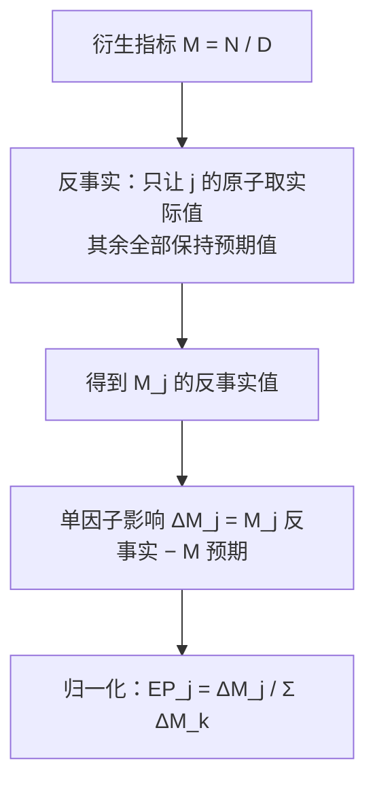
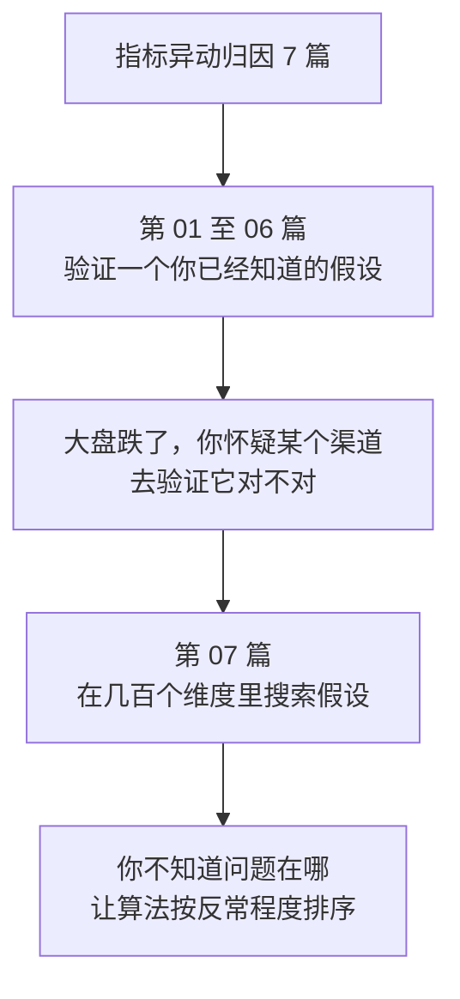

# 异常维度定位：Adtributor 的意外性与解释力


<!--more-->

好物优选的 GMV 从 2000 万掉到 1400 万，一个月掉了 30%。

数据团队按三个维度各拆了一遍，每个维度都给出了"主因"：

| 维度 | 贡献度第一 | 该维度的"主因" |
|---|---|---|
| 渠道 | 推荐 50.00% | 推荐 |
| 品类 | 服饰 50.00% | 服饰 |
| 城市线级 | 一线 50.00% | 一线 |

三个头名都是 50%——各自扛下了跌幅的一半。排查资源按这个顺序排了下去：先查推荐，再查服饰，再查一线。

结果推荐这边查了两天，什么都没查出来：素材没换、召回没动、排序模型没发版、AB 实验也没开。**推荐一切正常。**

问题出在哪？

**贡献度回答的是"谁造成的变化大"，而异动归因要找的是"谁反常"。**这是两个不同的问题，排序规则也就完全不同。上面那张表之所以把"推荐"推上第一，不是因为推荐反常，而是因为推荐本来就占大盘 35%——它跌得多，理应贡献得多。

这是全系列第 07 篇，讲 Adtributor 这个算法。它不按贡献度排序，而是按**意外性**排序：一把尺子量反常程度，一把尺子量体量，两把一起用。

| 章节 | 回答什么问题 | 核心结论 |
|---|---|---|
| 一 | 按贡献度排序错在哪 | 三个盲区：体量霸榜、组合爆炸、小而反常被埋没 |
| 二 | 怎么量"反常" | JS 散度：比的是分布形状，不是绝对量 |
| 三 | 怎么量"体量" | 解释力 EP，同维度内加总 100% |
| 四 | 算法怎么跑 | 三步走：算 S → 生成候选集 → 维度排序 |
| 五 | 拿本期数据实算 | 渠道维度最反常的是搜索，不是推荐 |
| 六 | 预期值从哪来 | 四个层级，以及它和异动检测的接口 |
| 七 | 衍生指标怎么算 | 反事实 + 归一化 |
| 八 | 四个坑 | 0 值、单维度、结构重组、维度粒度 |
| 九 | 全系列收官 | 七种方法的分工与成本 |

## 一、维度归因的三个盲区

### 1.1 盲区一：占比大的维度天然霸榜

贡献度 $C\_i = V\_i / \Delta Y$，分子是某个因子自己的变化量，分母是这次变化的总量。这等于把**体量**和**异常**揉进了同一个数。

推论很直接：**大盘里占比越大的维度，波动一下贡献度就越高。**推荐的预期占比是 35%（700 万 / 2000 万），它跌了 300 万，贡献度自然冲到 50%。但这恰恰是"它本来就大"的正常表现——一个占三分之一盘子的东西，少掉的量当然多。

反过来看直播：预期 300 万，实际 200 万，绝对贡献同样是 −100 万，贡献度 16.67%。听起来"没那么重要"，可它自身跌了 33.3%，大盘跌 30%，**它基本是跟着大盘一起走的**，没有任何异常。

把贡献度当异常探测器用，等于在排序里混进了一个"体量"因子。体量大的维度天然霸榜，体量小的维度再怎么反常也挤不上来。

### 1.2 盲区二：维度组合爆炸

真实业务里维度不是三个，是几十个：渠道、品类、城市线级、终端、新老客、会员等级、支付方式、履约方式……每个维度各有 10–30 个枚举值。

一旦想看"组合"，单元格数量就是乘法：三个维度各 20 个值，组合出 8000 个格子。两个坏结果随之而来。

**一是信号被稀释。**每个组合单元格的贡献度均值量级在 1/8000，排序出来的名次差异完全被噪声淹没，第 5 名和第 50 名可能只差几个基点。

**二是组合的"贡献度"在数学上根本不成立。**同一个用户既可能被算进"搜索 × 一线 × 服饰"，也可能被算进"推荐 × 二线 × 食品"。各组合的贡献度加起来不会等于 100%，因为发生了重叠计数。**这不是一个分解，它根本不是一个可加的分解。**

### 1.3 盲区三：绝对贡献小但相对变化大的被埋没

第三种情况更隐蔽。一个只占大盘 1% 的枚举值翻了倍，绝对变化只有大盘的 1% 量级，贡献度排在榜尾——**但它是唯一一个真的出问题的**。

反过来也可能：一个占大盘 40% 的枚举值跌了 30%，贡献度榜一，但它只是跟着大盘走。

在贡献度排名里，这两类是完全无法区分的。

### 1.4 核心转变：两个不同的问题

| | 贡献度视角 | 归因视角 |
|---|---|---|
| 想回答 | 谁造成的变化大 | 谁的行为偏离了预期 |
| 排序依据 | 绝对变化量 | 占比相对预期的偏移 |
| 体量大的维度 | 天然靠前 | 不再有优势 |
| 体量小但反常的 | 永远看不见 | 会被顶到前面 |

$$
\begin{aligned}p &= \frac{F\_{ij}}{F} \qquad \text{（预测占比）} \\\\q &= \frac{A\_{ij}}{A} \qquad \text{（实际占比）}\end{aligned}
$$

## 二、意外性：衡量分布差异，而不是绝对变化

### 2.1 换一个视角

Adtributor 的第一步动作是把问题换掉。不问"这个枚举值掉了多少"，而问：

**这个枚举值在大盘里的占比，和预期相比变了多少？**

占比的偏移不受体量影响。一个只占 1% 的枚举值，如果占比翻倍，它的占比偏移和一个大枚举值的占比偏移在同一个尺度上，可以直接比。

### 2.2 JS 散度

把预测分布和实际分布各写成一组占比。对维度 i 下的枚举值 j：

$$
D\_{JS}(P, Q) = \frac{1}{2} \left[ \sum\_i p\_i \log\_2 \frac{2 p\_i}{p\_i + q\_i} + \sum\_i q\_i \log\_2 \frac{2 q\_i}{p\_i + q\_i} \right]
$$

两个分布之间的 Jensen-Shannon 散度：

$$
S\_{ij} = \frac{1}{2} \left[ p \log\_2 \frac{2 p}{p + q} + q \log\_2 \frac{2 q}{p + q} \right]
$$

单个枚举值的意外性，就是 JS 散度在这个枚举值上的贡献：

$$
\mathrm{EP}\_{ij} = \frac{A\_{ij} - F\_{ij}}{A - F}
$$

有个顺手的性质：**一个维度所有枚举值的 S 之和，正好等于该维度预测分布与实际分布之间的 JS 散度。**所以 S_ij 既可以单独读（这个枚举值有多反常），也可以汇总读（这个维度的整体分布形状变了多少）。

### 2.3 为什么用 JS 散度，而不是 KL 散度

相对熵（KL 散度）是度量两个分布差异的更古老的工具，但它在这个场景有两个硬伤。

**第一，KL 散度不对称。**KL(P‖Q) ≠ KL(Q‖P)，方向反了数值就变了。而"实际和预期差多少"这件事，在业务上是**对称**的——预期 40% 变实际 50%，和预期 50% 变实际 40%，应该是同一个严重程度。

**第二，KL 散度在零值处未定义。**只要有一个 pᵢ = 0 而 qᵢ > 0（或反过来），KL 散度就是无穷大。业务里某个枚举值为 0 太常见了：某个渠道当天没量、某个品类断货、某个广告主暂停投放。

JS 散度把两个问题都绕开了：它对称，并且在零值处有限（pᵢ = 0 时那一项按极限取 0，剩下的一半仍然可算）。另外它的值域有界 `[0, 1]`，**跨维度比较时不需要归一化**——这一点在维度排名时很关键。

| | KL 散度 | JS 散度 |
|---|---|---|
| 对称性 | 不对称，KL(P‖Q) ≠ KL(Q‖P) | 对称 |
| 零值处理 | pᵢ=0 且 qᵢ>0 时为无穷大 | 有限，按极限取 0 |
| 值域 | 无界 | `[0, 1]` |
| 跨维度可比 | 需要归一化 | 直接可比 |

### 2.4 JS 散度的直觉

**它衡量两个分布"重叠得有多差"。**

把预测分布和实际分布各自当成一堆概率质量，JS 散度问的是"这两堆东西错位得有多厉害"。取 0 表示两个分布完全一致；越大表示分布形状完全变了，极端情况下（p 和 q 完全不重叠）取 1。

因为公式里用的是 log₂，量纲是比特。所以 S 值都是 0.004016 这种小数——**别把它读成 0.4%，它没有任何百分比含义。**要用就用它的相对排序：同一个维度内谁比谁更反常，不同维度之间比大小（因为值域有界）。

## 三、解释力 EP

### 3.1 定义

$$
\sum\_j \mathrm{EP}\_{ij} = \sum\_j \frac{A\_{ij} - F\_{ij}}{A - F} = \frac{A - F}{A - F} = 1
$$

这就是[第一篇](/posts/2026/11/cba63f94/) 讲的贡献度在 Delta 法下的样子：分子是该枚举值自己的变化量，分母是大盘总变化量。前提是指标在这个维度上可加——[第一篇](/posts/2026/11/cba63f94/) 3.1 节讲过，可加性不成立时这个式子直接没有意义。

### 3.2 它保证同维度内加总为 100%

$$
M\_j^{cf} = \frac{F(N) + \Delta N\_j}{F(D) + \Delta D\_j}
$$

因为分母对同一维度内的所有枚举值都是同一个，分子可以直接整体求和。这是 EP 最重要的性质：**它是一把体量尺，告诉你这个枚举值能解释多少总变化。**

两个边界情况要记住：EP 可以为负（该枚举值与大盘反向变动），也可以超过 100%（它自己变化的幅度超过了大盘总变化）。

### 3.3 两把尺子一起用

| 尺子 | 记号 | 回答的问题 | 特点 |
|---|---|---|---|
| **意外性** | S_ij | 这个枚举值的行为有多反常 | 只看分布形状，与体量无关；同维度内不保证加总为 100% |
| **解释力** | EP_ij | 这个枚举值能解释多少总变化 | 与体量强相关；同维度内加总恰好 100% |

单用 EP 会退化成贡献度排序（老问题），单用 S 会选出一堆"占比抖了一下、体量微不足道"的小枚举值。**候选集的筛选必须同时用两个**：单项 EP 太低的不进候选（解释不了多少），S 太低的也不该进（一点都不反常）。

## 四、算法流程

$$
\begin{aligned}\Delta M\_j &= M\_j^{cf} - M^{(0)} \\\\\mathrm{EP}\_j &= \frac{\Delta M\_j}{\sum\_k \Delta M\_k}\end{aligned}
$$

### 4.1 输入

对每个维度 i 下的每个枚举值 j，需要三个数：

- `F_ij`：预期值，来自异动检测模块的预测
- `A_ij`：实际值
- `F`、`A`：大盘的预期值与实际值（在每个维度上都是同一组数）

### 4.2 第一步：算意外性

对所有维度、所有枚举值算一遍 `S_ij`，用 2.2 的公式。

### 4.3 第二步：维度内生成候选集

**在每个维度内部，按 S 从大到小遍历枚举值**，做两件事：

1. 若 `EP_ij ≥ T_EEP`（单个元素至少要解释这么多），把它加入该维度的候选集
2. 累计 EP 达到 `T_EP` 时停止遍历

这两个阈值各管一件事：

- `T_EEP` 管"候选集里能塞几个元素"（奥卡姆剃刀）——单个元素解释不了多少，就别往里塞
- `T_EP` 管"候选集要解释掉多少"——解释到这个比例就收工

### 4.4 第三步：维度排序

每个维度输出一个候选集，按**候选集内枚举值的 S 之和**排序，取前几个输出。

**这里有个必须钉死的口径：分子只能是候选集内枚举值的 S 之和。**有的资料在某个维度上误用了"该维度所有枚举值的 S 之和"，会把没入选的枚举值一并计入，维度之间的排名会直接错乱。第五节有具体对照。

### 4.5 两个阈值怎么定

| 参数 | 常用取值 | 调高的效果 | 调低的效果 |
|---|---|---|---|
| T_EP | 0.6 – 0.8 | 候选集更短，结论更简洁 | 候选集更长，线索更全 |
| T_EEP | 0.05 – 0.1 | 单元素门槛更高，候选集更短 | 单元素门槛更低，候选集更长 |

Adtributor 原文的部署取值是 T_EP = 0.67、T_EEP = 0.10，这两个数字来自排查专家手工流程的习惯值。

调高得到"核心结论"，调低得到"候选线索"。**排查工单适合高阈值（要一个能立刻开工的结论），定期巡检适合低阈值（宁可多给线索）**——两个场景共用一个阈值是最常见的误配。

## 五、实算

### 5.1 三个维度的数据

大盘：预期 2000 万 → 实际 1400 万，Δ = −600 万。以下金额单位均为万元。

渠道维度：

| 渠道 | 预期 F | 实际 A | Δ |
|---|---|---|---|
| 搜索 | 800 | 700 | −100 |
| 推荐 | 700 | 400 | −300 |
| 直播 | 300 | 200 | −100 |
| 私域 | 200 | 100 | −100 |

| 渠道 | 预测占比 p | 实际占比 q | S | EP |
|---|---|---|---|---|
| 搜索 | 40.00% | 50.00% | 0.004016 | 16.67% |
| 推荐 | 35.00% | 28.57% | 0.002349 | 50.00% |
| 直播 | 15.00% | 14.29% | 0.000063 | 16.67% |
| 私域 | 10.00% | 7.14% | 0.001726 | 16.67% |

品类维度：

| 品类 | 预期 F | 实际 A | Δ |
|---|---|---|---|
| 家电 | 1000 | 800 | −200 |
| 服饰 | 600 | 300 | −300 |
| 食品 | 400 | 300 | −100 |

| 品类 | 预测占比 p | 实际占比 q | S | EP |
|---|---|---|---|---|
| 家电 | 50.00% | 57.14% | 0.001719 | 33.33% |
| 服饰 | 30.00% | 21.43% | 0.005177 | 50.00% |
| 食品 | 20.00% | 21.43% | 0.000178 | 16.67% |

城市线级维度：

| 城市线级 | 预期 F | 实际 A | Δ |
|---|---|---|---|
| 一线 | 1200 | 900 | −300 |
| 二线 | 500 | 300 | −200 |
| 三线及以下 | 300 | 200 | −100 |

| 城市线级 | 预测占比 p | 实际占比 q | S | EP |
|---|---|---|---|---|
| 一线 | 60.00% | 64.29% | 0.000533 | 50.00% |
| 二线 | 25.00% | 21.43% | 0.000992 | 33.33% |
| 三线及以下 | 15.00% | 14.29% | 0.000063 | 16.67% |

### 5.2 候选集生成

按 T_EEP = 0.10、T_EP = 0.60 跑一遍：

| 维度 | 遍历顺序（按 S 降序） | 入选枚举值 | 累计 EP | 停止原因 |
|---|---|---|---|---|
| 渠道 | 搜索 → 推荐 → 私域 → 直播 | 搜索、推荐 | 66.67% | 达到 T_EP |
| 品类 | 服饰 → 家电 → 食品 | 服饰、家电 | 83.33% | 达到 T_EP |
| 城市线级 | 二线 → 一线 → 三线及以下 | 二线、一线 | 83.33% | 达到 T_EP |

三个维度都没遍历完就停了。注意私域：它的 EP 是 16.67%、够得上 T_EEP，排在搜索和推荐之后——但因为推荐已经把累计 EP 推到 66.67%，它根本没轮到。

### 5.3 核心教学点：三个维度，三种结果

**渠道维度：EP 最高的是「推荐」，但 S 最高的是「搜索」。**

搜索自己只跌了 12.5%（800 → 700），绝对量上是四个渠道里跌得最轻的，贡献度只有 16.67%。可它偏偏是最反常的那个——大盘跌了 30%，而搜索的占比从 40% 升到了 50%。

怎么理解这件事？**在一个整体收缩 30% 的盘子里，一个只跌了 12.5% 的板块，份额反而涨了 10 个百分点。**这只有两种解释：别的东西塌得比它更狠，或者这个板块被大盘的结构性变化推了上来。无论哪种，搜索都在做一件"大盘做不出来"的事，这正是要查的信号。

推荐则是另一回事。它跌了 42.9%，比大盘还狠 12.9 个百分点，占比从 35% 掉到 28.57%，反常程度排第二（S = 0.002349）。它是这次下跌里体量最大的贡献者，但它的下滑幅度仍然在"能解释"的范围内——**贡献度第一不等于最反常**。

**城市线级：EP 最高的是「一线」，但 S 最高的是「二线」。**

二线自己跌了 40%（500 → 300），比大盘还狠，占比从 25% 掉到 21.43%。一线跌了 25%（1200 → 900），比大盘轻，占比反而从 60% 升到 64.29%。所以一线虽然贡献了一半的跌幅（体量最大），它的行为却比大盘更"抗跌"，反常程度反倒低于二线。

**品类维度：服饰 EP 最高，S 也最高，两者一致。**

服饰自己跌了 50%，是实打实的问题。家电跌了 20%（比大盘轻），占比从 50% 升到 57.14%，EP 33.33% 全部来自体量。食品跌了 25%，占比几乎没动，S = 0.000178。

**直播的 S 近乎 0（0.000063）。**它预期 300 实际 200，跌了 33.3%，跟大盘的 30% 基本同步，占比从 15% 只滑到 14.29%。分布形状几乎没变，所以 S 几乎为零。**这类枚举值不该浪费排查资源**——它的变化完全可以用"大盘变了"解释掉。

三个维度的对照：

| 维度 | EP 最高者 | S 最高者 | 是否一致 | 结论 |
|---|---|---|---|---|
| 渠道 | 推荐 50.00% | 搜索 0.004016 | 否 | 搜索才是最反常的那个 |
| 品类 | 服饰 50.00% | 服饰 0.005177 | 是 | 服饰是实打实的问题 |
| 城市线级 | 一线 50.00% | 二线 0.000992 | 否 | 二线更反常 |

### 5.4 维度排名

| 维度 | 候选集 | 候选集 S 之和 |
|---|---|---|
| 品类 | 服饰、家电 | 0.006895 |
| 渠道 | 搜索、推荐 | 0.006364 |
| 城市线级 | 二线、一线 | 0.001525 |

结论是：**先查品类。**服饰是这个维度里 EP 和 S 双高的枚举值，它自己跌了 50%，比大盘的 30% 深得多，是本期最硬的问题。渠道维度紧随其后，但要看的是搜索而不是推荐。

**一个必须点出的口径陷阱。**如果把"候选集 S 之和"误算成"该维度所有枚举值的 S 之和"，渠道维度会变成 0.008153（0.004016 + 0.002349 + 0.001726 + 0.000063），品类维度变成 0.007073，**排名直接翻转成渠道第一**。差别来自没进候选集的私域（0.001726）和直播（0.000063）——它们被算了进去，扭曲了两个维度的可比性。

### 5.5 实现

核心逻辑是"算 S → 按 S 降序生成候选集 → 汇总"，几十行代码：

$$
\mathrm{EP}\_{ij} = \frac{\Delta A\_{ij}(m\_1) \cdot F(m\_2) - \Delta A\_{ij}(m\_2) \cdot F(m\_1)}{F(m\_2) \cdot \left( F(m\_2) + \Delta A\_{ij}(m\_2) \right)}
$$

两把尺子算完之后，剩下的是候选集的生成与汇总：

$$
\begin{aligned}M\_j^{cf} &= X\_j^{(1)} \prod\_{i \neq j} X\_i^{(0)} \\\\\Delta M\_j &= M\_j^{cf} - M^{(0)} \\\\\mathrm{EP}\_j &= \frac{\Delta M\_j}{\sum\_k \Delta M\_k}\end{aligned}
$$

套上三个维度的数据：

$$
S\left(\text{衍生指标}\right) \approx \sum\_k S\left(\text{原子指标 } k\right)
$$

输出：

```plaintext
  渠道 · 搜索     p= 40.00% q= 50.00% S=0.004016  EP= 16.67%
  渠道 · 推荐     p= 35.00% q= 28.57% S=0.002349  EP= 50.00%
  渠道 · 私域     p= 10.00% q=  7.14% S=0.001726  EP= 16.67%
  渠道 · 直播     p= 15.00% q= 14.29% S=0.000063  EP= 16.67%
  -> 候选集 ['搜索', '推荐']  累计 EP 66.67%  候选集 S 之和 0.006364

  品类 · 服饰     p= 30.00% q= 21.43% S=0.005177  EP= 50.00%
  品类 · 家电     p= 50.00% q= 57.14% S=0.001719  EP= 33.33%
  品类 · 食品     p= 20.00% q= 21.43% S=0.000178  EP= 16.67%
  -> 候选集 ['服饰', '家电']  累计 EP 83.33%  候选集 S 之和 0.006895

  城市线级 · 二线     p= 25.00% q= 21.43% S=0.000992  EP= 33.33%
  城市线级 · 一线     p= 60.00% q= 64.29% S=0.000533  EP= 50.00%
  城市线级 · 三线及以下  p= 15.00% q= 14.29% S=0.000063  EP= 16.67%
  -> 候选集 ['二线', '一线']  累计 EP 83.33%  候选集 S 之和 0.001525

维度排名（按候选集 S 之和）
  品类: 0.006895
  渠道: 0.006364
  城市线级: 0.001525
```

## 六、预期值 F 从哪来

这是本篇与"异动检测"的接口。前面几篇的方法只需要两期实际值，Adtributor 需要的是**预期值 + 实际值**——预期值从哪来属于统计异动检测的范畴，本系列不展开，这里只交代四个层级。

| 层级 | 做法 | 适用场景 | 代价 |
|---|---|---|---|
| ① 基期当预期 | F = 上期值 | 指标平稳、无趋势 | 把任何变化都当异动 |
| ② 同比 / 环比 | F = 去年同期 / 上月 | 季节性不强的指标 | 忽略季节性与大促日历 |
| ③ 季节性预测 | 用历史同期预测，考虑周中低周末高等规律 | 有明显周期的指标 | 需要足够多的同期历史 |
| ④ 时间序列模型 | ARMA / ARIMA 等 | 复杂季节性、趋势 | 建模成本最高 |

**①是 ARIMA 的退化形式。**朴素预测相当于把模型阶数取 0，丢掉了一切结构信息。之所以常用，是因为它零成本，并且在小波动场景下够用。

**③是性价比最高的一层。**电商指标普遍有"周中低周末高"和"大促脉冲"两种周期性，用历史同期做基线，往往比通用时间序列模型更准，也更容易向业务解释。

**④是 Adtributor 原文的做法。**原文把预期值交给一个基于 ARMA 的模型预测模块，它基于 8 周历史数据生成预测，并显式考虑了时段（time-of-day）与周内（day-of-week）的正常波动。

[第一篇](/posts/2026/11/cba63f94/) 的五步 SOP 里，第 ③ 步之后才进入场内归因。预期值从哪来，属于第 ③ 步之前的检测环节：**Adtributor 是本系列第一个依赖预测值的方法，也正因为如此，它才有能力在几百个维度里"搜索"问题。**

## 七、衍生指标怎么处理

3.2 节那个 EP 公式只对可加指标成立。比率型（转化率、ROI、CPC）和乘法型（人均消费、GPM）衍生指标都不满足"各部分相加 = 整体"，原始定义直接失效，需要换一套构造。

### 7.1 比率型衍生指标：反事实

核心思想一句话：**假设只有这一个枚举值变了，其它全部保持预期值，衍生指标会变成多少？**

设衍生指标 `M = N / D`，枚举值 j 的反事实值为：

```text
M_j^cf = (F(N) + ΔN_j) / (F(D) + ΔD_j)

其中 ΔN_j = A_j(N) − F_j(N)，ΔD_j = A_j(D) − F_j(D)
```

分子分母都是"总体预期值 + 该枚举值自己的偏离"，等价于"其它枚举值全部停在预期值，只有 j 取实际值"。

单因子影响与归一化：

```text
ΔM_j = M_j^cf − M⁰        M⁰ = F(N) / F(D) 是整体预期值
EP_j = ΔM_j / Σ_k ΔM_k
```

注意 $\sum\_k \Delta M\_k$ 并不等于实际的 ΔM，差额是交互项——归一化正是为了消掉这个差额，让同维度加总恰好 100%。



举例。三个渠道的转化率数据：

| 渠道 | 访客数 F | 访客数 A | 支付用户数 F | 支付用户数 A |
|---|---|---|---|---|
| 搜索 | 800 | 700 | 80 | 77 |
| 推荐 | 700 | 400 | 70 | 28 |
| 直播 | 300 | 200 | 30 | 16 |
| 合计 | 1800 | 1300 | 180 | 121 |

整体转化率：预期 180 / 1800 = 10.00%，实际 121 / 1300 = 9.31%，Δ = −0.69pp。逐个做反事实：

| 渠道 | 反事实转化率 | ΔM_j | 归一化 EP |
|---|---|---|---|
| 搜索 | (180−3)/(1800−100) = 10.41% | +0.41 pp | −66.0% |
| 推荐 | (180−42)/(1800−300) = 9.20% | −0.80 pp | +128.3% |
| 直播 | (180−14)/(1800−100) = 9.76% | −0.24 pp | +37.7% |

读法：推荐的转化率从 10% 掉到 7%，单它一个就把整体转化率拖低 0.80pp，EP 128.3%——**比 100% 还大，因为搜索的转化率从 10% 升到 11%，反向把整体往回拉了 0.41pp**。归一化把这种正负对冲压到了同一口径上，加总恰好 100%。

这个构造与 Adtributor 原文的有限差分公式完全等价。原文对 m1/m2 形式的衍生指标给出的形式是：

```text
EP_ij = [ΔA_ij(m1)·F(m2) − ΔA_ij(m2)·F(m1)] / [F(m2)·(F(m2) + ΔA_ij(m2))]
```

把反事实式展开，分子分母化简之后正是这一串。

### 7.2 乘法型衍生指标

`M = X₁ · X₂ · ... · X_k`，反事实更直接：**只把第 j 个原子换成实际值，其余留在预期值。**

```text
M_j^cf = X_j¹ · Π_{i≠j} X_i⁰
ΔM_j = M_j^cf − M⁰
EP_j = ΔM_j / Σ_k ΔM_k
```

举个小例子。整体客单价 = 订单数 × 单件价格：

| 原子指标 | 预期 | 实际 |
|---|---|---|
| 订单数 | 1000 | 850 |
| 单件价格（元） | 20 | 22 |

| 原子指标 | 反事实客单价 | ΔM_j | 归一化 EP |
|---|---|---|---|
| 订单数 | 850 × 20 = 17000 | −3000 | +300.0% |
| 单件价格 | 1000 × 22 = 22000 | +2000 | −200.0% |
| 合计 | | −1000 | 100% |

整体客单价从 20000 掉到 18700，跌了 1300。订单数单它一个会把客单价砸到 17000（−3000），是总跌幅的两倍多；单件价格则是正向的（+2000）。归一化之后，订单数拿到 300%、单件价格拿到 −200%。

**EP 大于 100% 和小于 0%，都出现在这里。**它们不是计算错误，正是"多个原子对冲"时必然出现的形态——[第二篇](/posts/2026/11/c35540ac/) 讲残差时说过一次。

### 7.3 S 值的可加性：一个工程近似

衍生指标的意外性没法像 EP 那样直接反事实——占比 p、q 是相对于衍生指标自身的分布算的，而衍生指标在维度内部根本不是可加的。

Adtributor 原文走的是相对熵的联合分布路线：如果各原子指标相互独立，那么联合分布的 JS 散度等于各原子指标 JS 散度之和。于是衍生指标的意外性近似为：

```text
S(衍生指标) ≈ Σ_k S(原子指标 k)
```

**这是一个工程近似，不是严格推导。**原文明确承认指标之间往往相关（搜索量涨，广告收入通常跟着涨），这个加法在相关时会失真。

工程上的处理办法是**按相关性给各原子指标配权重**，而不是简单相加。相关性矩阵可以从历史数据上估（各原子指标变动的滚动相关系数），权重按相关程度打折。

这是本文里最需要工程判断的一环。**衍生指标和它的原子指标强相关时，S 的简单相加会高估意外性**，进而把一个实际上"随大流"的维度顶进候选集。

## 八、四个坑

### 8.1 坑一：0 值

JS 散度里有两处会碰到 0。

**某个枚举值的 p 或 q 为 0。**`log₂(2p/(p+q))` 在 p = 0 时是 log₂(0)，数学上未定义。正确的处理是按极限取 0（因为 0·log 0 的极限是 0），整体不会炸。

**整体 A = 0。**此时 q = A_ij / A 全部未定义，整个维度失去意义。大盘实际值为 0 时不能做归因。

工程上统一用 `x → max(ε, x)` 兜底，ε 取 1e-9 量级。但要清楚这只是在数值上避免除零，不是数学上的正确答案——p = 0 的枚举值在业务上往往本身就是重要信息（"这个渠道当天完全没量"比"这个渠道跌了 1%"严重得多），最好在代码里显式区分"p = 0 且 q > 0"（冒出一个从未有过的枚举值，是强信号）和"p = q = 0"（两边都没有，无信息）。

### 8.2 坑二：只输出单维度

算法的输出是"一个维度 + 该维度的一组枚举值"，**它不输出维度组合**。

想看"地域 × 渠道"的组合怎么办？把组合本身当成一个新维度——枚举值从"一线 × 搜索"到"三线 × 私域"，重新跑一遍。代价是单元格数量翻倍、噪声更大，通常只对已经锁定的那一个维度做这种二次下钻。

### 8.3 坑三：结构性重组

有一类情况会让 EP 变得很难读：**大盘的变化量 (A − F) 很小，但维度内部结构大变。**

比如大盘只跌了 1%，而某个枚举值的占比从 40% 掉到 20%。此时 EP 的分母 (A − F) 极小，算出来的 EP 会是几百上千这种数值——它没有业务含义，只是分母太小的算术结果。

这类情况要单独判定：**先看 |A − F| 相对大盘的量级**，如果大盘变化本身就在噪声范围内、而某个维度内部结构剧变，那多半是结构性重组（比如渠道占比整体平移）。这种情况应该换方法——[第三篇](/posts/2026/11/7282130e/) 的组间组内拆解正是为它准备的。

### 8.4 坑四：维度选取依赖业务

枚举值该切多细，是业务决策，不是算法决策。

切太粗：几个枚举值合在一起，异常被稀释，S 算不出差别。切太细：每个枚举值的占比都很小，S 被小分母放大，噪声直接淹没有效信号——这正是 1.2 节说的维度组合爆炸。

实用做法是按排查专家能直接对应到工单归属的粒度来切（渠道、城市线级、品类、终端），并且**先跑一遍，看 S 的分布是否有一个明显的断层**。如果所有 S 值都在同一个数量级里，说明这个维度切得太细，或者这期确实没异常。

## 九、全系列收官



### 9.1 七篇的分工

[第一篇](/posts/2026/11/cba63f94/) 到[第三篇](/posts/2026/11/7282130e/) 讲的都是**验证一个你已经知道的假设**：大盘跌了，你怀疑是某个渠道，去验证它对不对。前提是方向已经有了，方法提供的是"这个结论有多可信"和"它解释了多大比例"。[第四篇](/posts/2026/11/2b005e8c/) 到[第六篇](/posts/2026/11/e12f7524/) 把同一套思路分别用到漏斗、多因素叠加和用户路径上，性质一样。

本篇讲的是**在几百个维度里搜索假设**：你不知道问题在哪，让算法按反常程度把候选排出来。

这个区别对应两种不同的工程形态：

| | 第 01 – 06 篇 | 第 07 篇 |
|---|---|---|
| 出发点 | 已经有怀疑对象 | 不知道问题在哪 |
| 输入 | 两期实际值 | 预期值 + 实际值 |
| 输出 | 贡献度分解 | 意外性排序 + 解释力 |
| 前提 | 指标可加性已判定 | 已有异动检测 + 预期值 |
| 成本 | 低 | 中（多维枚举 + 预测） |

### 9.2 方法对照表

| 方法 | 输入 | 回答的问题 | 成本 |
|---|---|---|---|
| Delta 法 | 两期各因子值 | 谁造成的变化大 | 最低 |
| LMDI | 两期 + 乘积式模型 | 各因子的对数变化份额 | 低 |
| 组间组内拆解 | 比率型指标 + 分群权重 | 自身性变化还是结构性变化 | 低 |
| 链式替代 | 漏斗各环节 | 哪一环坏了 | 低 |
| Shapley 值 | 多因素 + 交互关系 | 各因素的边际贡献 | 中（指数级，需采样） |
| 马尔科夫链 | 完整路径序列 | 去掉某个环节损失多少 | 中 |
| Adtributor | 预期值 + 实际值 + 多维枚举 | 谁反常 | 中（依赖异动检测） |

### 9.3 全系列篇目

| # | 篇目 | 这一篇讲什么 |
|---|---|---|
| 01 | [指标异动归因全景](/posts/2026/11/cba63f94/) | 框架、词汇、选型地图 |
| 02 | [指标分解模型：加法、乘法与残差](/posts/2026/11/c35540ac/) | Delta、LMDI，以及残差从哪来 |
| 03 | [比率指标归因：组间组内拆解与辛普森悖论](/posts/2026/11/7282130e/) | 转化率、ROI 这类指标怎么拆 |
| 04 | [漏斗拆解：定位是哪一环坏了](/posts/2026/11/2b005e8c/) | 贡献度和优化优先级不是一回事 |
| 05 | [多因素叠加归因：Shapley 值与多触点权重](/posts/2026/11/961422de/) | 多个因素同时作用，怎么分功劳 |
| 06 | [路径归因：从首触末触到马尔科夫链](/posts/2026/11/e12f7524/) | 用户走过的路，每一步值多少钱 |
| 07 | [异常维度定位：Adtributor 的意外性与解释力](/posts/2026/11/6f5fd77c/) | 在几百个维度里找到真正反常的那个 |

回到开头那个场景：推荐被标记成"主因"，排查了两天一无所获。**它不是主因，它只是这次下跌里体量最大的那个参与者。**真正反常的是搜索——它只跌了 12.5%，份额却从 40% 涨到 50%。

如果把排序口径从"贡献度"换成"意外性"，同一个问题当天就能定位到搜索身上。而这不是什么魔法，只是**换了一把尺子**。

> **贡献度回答"谁造成的变化大"，归因要找的是"谁反常"。**Adtributor 把排序口径从体量换成分布形状，再用解释力兜住体量——两把尺子一起用，才既不会漏掉小而反常的枚举值，也不会被大而无奇的维度带偏。

如果只能带走五句话：

1. **贡献度排序和归因排序是两个不同的问题。**前者问"谁造成的变化大"，后者问"谁的行为偏离了预期"；大盘占比越大的维度贡献度天然越高，跟它反不反常无关。
2. **意外性用 JS 散度算，比的是分布形状。**p 是预期占比、q 是实际占比，S_ij 衡量这个枚举值的占比偏离预期多少；用 JS 而不是 KL，是因为 KL 不对称、且在零值处未定义。
3. **意外性必须配解释力一起用。**S 挑出反常的，EP 保证它有体量、能解释总变化；候选集用两个阈值筛选（T_EP 取 0.6–0.8，T_EEP 取 0.05–0.1）。
4. **维度排序用"候选集内枚举值的 S 之和"。**误用"该维度全部枚举值的 S 之和"会把没入选的枚举值算进去，维度之间的排名会直接错乱。
5. **衍生指标靠反事实算。**"只有这个枚举值变了会怎样"给出单因子影响，归一化后同维度加总 100%；S 的可加性是独立假设下的工程近似，相关性强时要按相关性调权。

## 十、参考资料

- [1] [R. Bhagwan, V. Karamcheti, N. McSherry, V. Sivaraman. Adtributor: Revenue Debugging in Advertising Systems. USENIX NSDI 2014](https://www.usenix.org/system/files/conference/nsdi14/nsdi14-paper-bhagwan.pdf).
- [2] [Jensen-Shannon divergence](https://en.wikipedia.org/wiki/Jensen%E2%80%93Shannon_divergence).
- [3] [Kullback-Leibler divergence](https://en.wikipedia.org/wiki/Kullback%E2%80%93Leibler_divergence).

