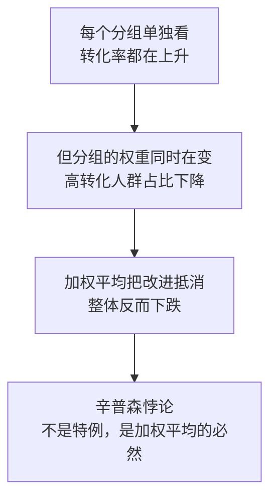

# 比率指标归因：组间组内拆解与辛普森悖论


<!--more-->

转化率是电商最常被盯的指标，也是最难说清的指标——因为它是比率，不是数量。

这个月「好物优选」整体支付转化率从 21.00% 涨到 21.80%，涨了 0.8 个百分点。周会上产品经理问："是新客变好了，还是老客变好了？" 分群数据拉出来，新客 25% → 26%，老客 15% → 16%，两个都在涨，各涨 1 个百分点。可 1 + 1 ≠ 0.8。差的那 0.2 个百分点藏在第三个数里：新客占比从 60% 掉到 58%，老客从 40% 升到 42%。整体转化率是**按人数加权的平均**，权重一动，平均值就跟着动。

**比率指标的变化，从来不是"一个数在动"，而是"若干个比率在动"加"若干个权重在动"。** 组间组内拆解把这两部分分开算：各自贡献多少个百分点，加起来精确等于 ΔY，一个残差都不留。辛普森悖论不是另一个故事，它就是这套公式的日常形态。

本文讲清三件事：公式怎么推出来的（第三节）、怎么在真实数据上跑（第四节）、以及什么时候它会骗你（第六、七节）。

| 章节 | 回答什么问题 | 核心产出 |
|---|---|---|
| 一 | 比率型指标为什么不能直接拆 | 加法失效的原因 |
| 二 | 比率变化的两个来源 | 自身性 + 结构性 |
| 三 | 两个贡献怎么定义、怎么算 | 组内 + 组间 = ΔY |
| 四 | 拿本期数据实算 | 1.0pp 与 −0.2pp |
| 五 | 辛普森悖论从哪来 | 反向变体 |
| 六 | 四个坑 | 口径 · 半可加 · 假异动 · 分母塌方 |
| 七 | 什么时候别用 | 三条红线 |
| 八 | 工程实现 | 可运行的 Python 函数 |

## 一、比率型指标为什么不能直接拆

[第一篇](/posts/2026/11/cba63f94/) 按可加性把指标分成三类，转化率属于"不可加"：各分区的转化率加起来不等于整体转化率。这不是精度问题，是量纲问题。

拿本期的数直接看：

| 口径 | 上月 | 本月 | 说明 |
|---|---|---|---|
| 各人群转化率直接相加 | 40% | 42% | 量纲都变了，没有业务含义 |
| 各人群转化率简单平均 | 20.0% | 21.0% | 抹掉了人群大小 |
| 整体转化率（按人数加权） | 21.00% | 21.80% | 真实值 |

三种算法给出三个数。直接相加最离谱：它把两个互不相干的比率堆成了一个 40% 的"转化率"。简单平均也不算错——如果新老客人数一样，它是对的；可实际不是，新客是老客的 1.5 倍，多出来的人不该和少的人平起平坐。

所以第一篇给的结论是"比率指标要先换表示再拆"。换什么表示？换成加权平均：

$$
\text{整体转化率} = \sum\_i \left( \text{人群 } i \text{ 的转化率} \times \text{人群 } i \text{ 的占比} \right)
$$

这一步换完，问题就从"各分区转化率怎么加起来"变成了"整体这个加权平均里，哪些因子在动"。

## 二、关键洞察：比率是加权平均

展开上面那个式子，等号右边有两个东西会动。

**人群自身的比率**（记作 Yᵢ）：新客从 25% 涨到 26%，老客从 15% 涨到 16%。这是转化率自己的故事，改版、定价、货品、客服都可能驱动它。

**人群的占比**（记作 Rᵢ）：新客从 60% 掉到 58%，老客从 40% 升到 42%。这是"谁来了"的故事，由投放预算分配、获客策略、渠道结构、老客自然复购比重共同决定。

这两件事的性质完全不同。Yᵢ 变了，说明产品或运营动作生效了；Rᵢ 变了，说明流量结构变了。**结构变化本身也是结果的成因之一，不是噪音。** 占比 Rᵢ 背后站着真实的业务动作——预算从哪条渠道挪到哪条、是不是在把新客往老客导、老客复购的自然比重是不是在上升。这些动作会直接改写整体转化率，量级不小。

本期就是活例子：新客转化率是 26%，老客只有 16%。新客占比每掉 1 个百分点，整体就被往下拽一点。新客占比这个月掉了 2 个百分点，正好抵消掉一部分产品改进的成果。

这就引出了本文的核心洞察：**只要各人群的转化率不相等，"谁来了"和"来的人表现如何"就会互相拉扯。** 当两个方向的力度接近时，整体的变化方向可以和每个分群都不一样——这就是辛普森悖论。它不是一个需要额外解释的特例，而是加权平均这个结构的必然产物。

$$
\text{组内} = \sum\_i \left( Y\_i^{(1)} - Y\_i^{(0)} \right) \times R\_i^{(0)}
$$

## 三、组间组内拆解法

### 3.1 两个贡献的定义与公式

先把本期数据摆平，后面所有推导都基于它：

| 人群 | 上月转化率 | 上月占比 | 本月转化率 | 本月占比 |
|---|---|---|---|---|
| 新客 | 25% | 60% | 26% | 58% |
| 老客 | 15% | 40% | 16% | 42% |

记号约定：Yᵢ⁰ / Yᵢ¹ 是人群 i 的基期 / 当期转化率，Rᵢ⁰ / Rᵢ¹ 是人群 i 的基期 / 当期占比，Y⁰ / Y¹ 是基期 / 当期的**整体**转化率。

**组内贡献（自身性）**：假设人群结构一动不动，只让各人群自己的转化率走到当期值。

$$
\text{组间} = \sum\_i \left( Y\_i^{(1)} - Y^{(0)} \right) \times \left( R\_i^{(1)} - R\_i^{(0)} \right)
$$

**组间贡献（结构性）**：假设各人群的转化率保持不变，只让人群占比重新分配。

$$
\begin{aligned}Y^{(1)} - Y^{(0)} &= \sum\_i R\_i^{(1)} Y\_i^{(1)} - \sum\_i R\_i^{(0)} Y\_i^{(0)} \\\\&= \underbrace{\sum\_i R\_i^{(0)} \left( Y\_i^{(1)} - Y\_i^{(0)} \right)}\_{\text{组内}} {}+ \underbrace{\sum\_i \left( Y\_i^{(1)} - Y^{(0)} \right) \left( R\_i^{(1)} - R\_i^{(0)} \right)}\_{\text{组间}}\end{aligned}
$$

组内项的读法很直白："各人群自己变好或变坏了多少，按基期份额加权"。组间项的读法稍绕。**它是"偏离大盘多少"乘以"份额变了多少"。** 一个人群如果比大盘水平高（Yᵢ¹ > Y⁰）而份额又在涨，它就把整体往上拉；反过来就把整体往下拽。

### 3.2 恒等式推导

为什么这两个数加起来正好是 ΔY？推导只有三行，核心是占比之和恒为 1（ΣRᵢ¹ = ΣRᵢ⁰ = 1）：

$$
\begin{aligned}Y^{(0)} &= 0.60 \times 25\\% + 0.40 \times 15\\% = 21.00\\% \\\\Y^{(1)} &= 0.58 \times 26\\% + 0.42 \times 16\\% = 21.80\\% \\\\\Delta Y &= +0.80 \text{ pp}\end{aligned}
$$

第二行怎么来的？把 Y¹ 拆成"基期占比配当期比率"和"当期占比配当期比率"两段之差，再用 ΣRᵢ¹ = ΣRᵢ⁰ = 1 把 Y⁰ 从第二段里换出来。具体说，重分配份额带来的变化是 Σ(Rᵢ¹ − Rᵢ⁰)Yᵢ¹；由于份额变化之和为 0，这个和里的 Yᵢ¹ 可以任意减去一个常数不减，取 Y⁰ 最合用——它正好把"这个人群比大盘高还是低"这层含义写进了公式。

**这正是"固定一个基准就能把两个效应分开"的含义。** 组内固定住 Rᵢ⁰ 让 Yᵢ 动，组间固定住 Yᵢ¹ 让 Rᵢ 动，两个扰动正交，切口干净。

$$
\begin{aligned}\text{新客} &= (26\\% - 25\\%) \times 0.60 = +0.60 \text{ pp} \\\\\text{老客} &= (16\\% - 15\\%) \times 0.40 = +0.40 \text{ pp} \\\\\text{组内合计} &= +1.00 \text{ pp}\end{aligned}
$$

组间项和第一篇讲的定基代替、泰勒展开不同：它不是近似展开，是恒等变形，所以**没有残差**。这和[第二篇](/posts/2026/11/c35540ac/) 里 LMDI 的性质一致。

### 3.3 一个必须说清的澄清

组内和组间都是**加法型**的，单位是百分点（pp），可以直接相加还原 ΔY。

这一点和第一篇的三种贡献度口径不一样，值得单独说：

| | 第一篇的贡献度 Cᵢ | 本文组内 / 组间 |
|---|---|---|
| 单位 | 无量纲比值 | 百分点（pp） |
| 依赖 ΔY | Cᵢ = Vᵢ / ΔY，ΔY 为 0 时无定义 | 不依赖，可独立解读 |
| 符号 | 与 ΔY 同向 | 可正可负，与 ΔY 无关 |

关键差别在第三行。第一篇的 Cᵢ 是"某因子占了这次变化的百分之多少"，除以 ΔY 之后符号被 ΔY 统一带走。本文的组间项**符号不由 ΔY 决定**——本期 ΔY 是正的，组间却是 −0.2pp，意思是"结构变化在拖累整体"，而不是"结构贡献了 −25%"。这两种说法在 ΔY 很小时会差得很远：ΔY = +0.1pp 时，组间 −0.2pp 意味着结构变化的负面影响是整体变化的两倍，除以 ΔY 得到的"贡献度"读起来会非常费解。

所以本文不引入贡献度口径，组内、组间各自以 pp 报出，需要占比时再自行换算。

## 四、实算

第一步，算两期整体比率。

$$
\begin{aligned}\text{新客} &= (26\\% - 21.00\\%) \times (0.58 - 0.60) = +4.50\\% \times (-0.02) = -0.10 \text{ pp} \\\\\text{老客} &= (16\\% - 21.00\\%) \times (0.42 - 0.40) = -5.00\\% \times (+0.02) = -0.10 \text{ pp} \\\\\text{组间合计} &= -0.20 \text{ pp}\end{aligned}
$$

第二步，算组内贡献。

```text
新客：(26% − 25%) × 0.60 = +0.60 pp
老客：(16% − 15%) × 0.40 = +0.40 pp
组内合计 = +1.00 pp
```

第三步，算组间贡献。Y⁰ 取 21.00%。

```text
新客：(26% − 21.00%) × (0.58 − 0.60) = +4.50% × (−0.02) = −0.10 pp
老客：(16% − 21.00%) × (0.42 − 0.40) = −5.00% × (+0.02) = −0.10 pp
组间合计 = −0.20 pp
```

第四步，汇总并校验。

| 人群 | 组内（自身性） | 组间（结构性） | 小计 |
|---|---|---|---|
| 新客 | +0.60 pp | −0.10 pp | +0.50 pp |
| 老客 | +0.40 pp | −0.10 pp | +0.30 pp |
| **合计** | **+1.00 pp** | **−0.20 pp** | **+0.80 pp** |

+1.00 + (−0.20) = +0.80 = ΔY ✓

读出结论：两群转化率各涨 1 个百分点，组内合计 +1.0pp，这是产品/体验改进的成果。结构变化贡献 −0.2pp：新客转化率比大盘高 5 个百分点，它份额掉了 2 个百分点，把整体往下拽；老客转化率比大盘低 5 个百分点，份额却涨了 2 个百分点，同样往下拽。两个方向一致，合计 −0.2pp。

**这才是能落地的结论：产品改进赚到的 1.0 个百分点，被流量结构变化吃掉了 0.2 个百分点，净剩 0.8 个百分点。** 只看整体，会以为改进只值 0.8pp，低估了产品侧的成绩；只看分群，会以为"两个群都涨 1pp，一切都好"，完全看不见那个一直在漏的结构漏洞。而且那 0.2pp 的责任方根本不在产品团队——它属于投放和流量策略。

## 五、辛普森悖论只是它的日常形态

第四节的结果已经站在辛普森悖论的门口了：每个群体都在变好，整体却只涨了 0.8pp 而不是 2.0pp。把结构变化的权重再推大一点，方向就会彻底反过来。

三种情形放在一起看：

| 情形 | 组内（自身性） | 组间（结构性） | ΔY | 现象 |
|---|---|---|---|---|
| 本期：新老客各涨 1pp | +1.00 pp | −0.20 pp | +0.80 pp | 结构抵消了一部分改进 |
| 反例一：占比反转 | +1.00 pp | −2.00 pp | −1.00 pp | 每群都在涨，整体在跌 |
| 反例二：新客自身下滑 | −0.20 pp | +0.80 pp | +0.60 pp | 整体在涨，新客在跌 |

反例一把两群的占比对调（新客 60% → 40%，老客 40% → 60%），转化率仍是各涨 1 个百分点，整体从 21.00% 掉到 20.00%。**每群都在变好，整体在变差。** 这就是辛普森悖论的教科书形态：每个分组单独看都是好消息，合起来是坏消息。



反例二换个方向：新客转化率从 25% 掉到 24%，但新客占比从 60% 涨到 70%，老客转化率从 15% 涨到 16%、占比从 40% 掉到 30%。整体反而从 21.00% 涨到 21.60%——**整体在涨，但新客在跌**。

这两个反例不是编出来的极端值，是把本期数据换个权重就得到的结果。这就是"整体指标"和"分群体感"经常打架的根源：

- 老板看整体转化率，说"这个月涨了 0.8pp，还行"。
- 新客的运营看自己的盘，说"我涨了 1pp，做得不错"。
- 投放看结构，说"流量结构变差了"。

三个人都没说错，他们看的是三个不同的数。组间组内拆解的价值就在于把这三个数摆到同一张表上，让"到底该找谁"变成一个可讨论的问题，而不是各说各话。

顺带把辛普森悖论的谱系说清楚：**辛普森悖论是现象，组间组内拆解是量它的工具。** E. H. Simpson 1951 年那篇论文讨论的是列联表里分层与合并后结论反转的统计解释；Kitagawa 1955 年的工作则给出了把两个率之差拆成"组内"和"组间"的标准做法。本文用的公式就是这一路，落到转化率上而已。

## 六、四个坑

### 6.1 坑一：分子分母必须是同期口径

转化率 = 支付用户数 / 访客数。两期必须是同一批用户的同一条漏斗。

最常见的翻车是分子分母来自不同时间窗：分子用"7 日内支付用户"，分母用"当日去重 UV"（跨天不累计）。这时比率根本不代表任何真实人群，ΔY 变成两个不同指标之差。

更麻烦的是这种不一致对不同人群的伤害不一样。高复购人群的支付行为天然跨天更多，改了时间窗之后他们的比率被压低、新客的比率几乎不动，于是 Rᵢ 也跟着变——最后冒出来一个看起来很专业的"结构性变化"，**而它整个是口径造出来的**。所以口径必须先排除，这正是[第一篇](/posts/2026/11/cba63f94/) 五步 SOP 里第 ② 步排在归因之前的原因。

### 6.2 坑二：去重指标的半可加性

第一篇 3.2 节讲过半可加：跨渠道 UV 加起来大于总 UV。在比率归因里后果更具体——Rᵢ 本该满足 ΣRᵢ = 1，一旦人群之间有重叠（"浏览过商详"和"加购过"），ΣRᵢ > 1，加权平均这个等式直接失效，恒等式不成立。

两个解法：

1. **唯一化**：保证一个人在同一期只落进一个人群，比如首次触点归因。
2. **换权重口径**：把人数换成人次，占比之和自然等于 1。

前提是先验证 ΣRᵢ = 1。这是第八节那段代码做的第一件事。

### 6.3 坑三：口径变更造成的假异动

埋点改了、去重规则改了、"支付用户"从"支付订单去重"换成"支付用户去重"——都会造出一次结构性跳变。

组间项是这类假异动最容易藏身的地方，因为口径变更改的是"谁被算进哪个人群"（Rᵢ），而各人群自身表现没变。**信号特征很明确：组间项异常大，组内项异常小。** 正常业务波动会让两个项一起动；只有 Rᵢ 被系统性改动时，才会出现组间独大。

处置还是第一篇的 SOP 第 ② 步：回溯口径生效时间，两期都按新口径重算。

### 6.4 坑四：分母本身在剧烈异动时

这一条最容易被忽略，也最容易把分析带偏。

设想搜索渠道的 UV 从 10 万掉到 5 万，转化率纹丝不动（还是 25%），其他渠道从 90 万掉到 85 万（还是 20%）。整体转化率从 20.50% 掉到 20.28%，只有 **−0.22pp**，看上去是"小波动"。但实际上 10 万访客没了。

这时候组间项算出 −0.22pp，其中搜索贡献 −0.20pp。运营读到会以为"搜索人群的结构性表现拖累了转化率"，于是去优化搜索落地页——而真相是投放侧砍掉了搜索一半的量，该做的是查预算。**比率把一个 10 万量级的量级损失，压缩成了一个 0.22pp 的"小数字"。**

所以顺序要反过来：分母在剧烈异动时，先用第一篇的 Delta 法归因访客数这个绝对量，确认是量的问题还是率的问题，再回头解释剩下的比率变化。

## 七、什么时候不该用比率归因

有三条红线，任意一条踩中都应该停下来：

| 场景 | 典型信号 | 该先做什么 |
|---|---|---|
| 分母剧烈异动 | 访客数环比 ±10% 以上，或某人群量腰斩 | 先用 Delta 法归因访客数，再谈比率 |
| 口径无法对齐 | 两期分子分母时间窗/去重规则不一致 | 先修口径，或放弃这两期对比 |
| 样本量太小 | 某人群占比 < 1%，或其转化率 95% 置信半宽 > 2pp | 合并人群，或对占比做收缩后再拆 |

第三条值得展开，因为它不直观。组间项里有一项 (Yᵢ¹ − Y⁰)，它直接乘在份额变化上，而低占比人群的转化率恰恰是抽样噪声最大的那个数。举例：某个占比 1% 的人群，转化率估计的标准误是 3.54pp（n=200、p=0.5 时），如果它的份额从 1% 涨到 5%，光是这 1 个标准误的噪声就会传导成 0.14pp 的组间项抖动——相当于本期整体变化 0.8pp 的 17.7%。排名靠前的人群结论看着最稳，排在后面的小人群反而最可能是噪声。

要判断某个小人群的比率估计够不够稳，可以直接看置信区间：转化率在 50% 附近时，95% 置信半宽要小于 2pp，需要样本量约 2400。达不到就把人群合并，或者对它的比率做贝叶斯收缩（shrinkage）后再参与加权。

## 八、Python 实现

拆解逻辑很短，但有三个地方容易写错：占比之和的校验、用基期权重算组内、以及把 pp 和比率混着输出。下面这段是可以直接用的版本。

```python
from dataclasses import dataclass


@dataclass
class Segment:
    """一个人群的转化率与占比"""
    name: str
    rate_base: float      # 基期转化率 Y_i^0
    share_base: float     # 基期占比 R_i^0
    rate_curr: float      # 当期转化率 Y_i^1
    share_curr: float     # 当期占比 R_i^1
```

拆解函数只有十几行，但有三个地方容易写错：占比之和的校验、用基期权重算组内、以及把 pp 和比率混着输出。

```python
def decompose_rate(segs: list[Segment]) -> dict:
    """组间组内拆解：把整体比率的变化拆成自身性变化与结构性变化"""
    # 前提校验：人群必须互斥完备，否则加权平均不成立（坑二）
    for label, key in (("基期", "share_base"), ("当期", "share_curr")):
        total = sum(getattr(s, key) for s in segs)
        if abs(total - 1.0) > 1e-9:
            raise ValueError(f"{label}占比之和为 {total:.6f}，不等于 1")

    y0 = sum(s.rate_base * s.share_base for s in segs)   # 基期整体比率
    y1 = sum(s.rate_curr * s.share_curr for s in segs)   # 当期整体比率

    rows = []
    for s in segs:
        within = (s.rate_curr - s.rate_base) * s.share_base            # 组内
        between = (s.rate_curr - y0) * (s.share_curr - s.share_base)   # 组间
        rows.append({"人群": s.name, "组内 pp": within * 100,
                     "组间 pp": between * 100, "小计 pp": (within + between) * 100})

    within_total = sum(r["组内 pp"] for r in rows)
    between_total = sum(r["组间 pp"] for r in rows)
    return {"基期 %": y0 * 100, "当期 %": y1 * 100, "ΔY pp": (y1 - y0) * 100,
            "明细": rows, "组内合计 pp": within_total, "组间合计 pp": between_total}
```

用本期数据跑一遍：

```python
segs = [
    Segment("新客", 0.25, 0.60, 0.26, 0.58),
    Segment("老客", 0.15, 0.40, 0.16, 0.42),
]

r = decompose_rate(segs)
print(f"整体 CVR {r['基期 %']:.2f}% -> {r['当期 %']:.2f}%   ΔY = {r['ΔY pp']:+.2f} pp")
for row in r["明细"]:
    print(f"{row['人群']}: 组内 {row['组内 pp']:+.2f} pp | "
          f"组间 {row['组间 pp']:+.2f} pp | 小计 {row['小计 pp']:+.2f} pp")
print(f"合计: 组内 {r['组内合计 pp']:+.2f} pp | 组间 {r['组间合计 pp']:+.2f} pp")

# 恒等式校验：两项相加必须还原 ΔY（无残差）
assert abs(r["组内合计 pp"] + r["组间合计 pp"] - r["ΔY pp"]) < 1e-9
```

输出：

```plaintext
整体 CVR 21.00% -> 21.80%   ΔY = +0.80 pp
新客: 组内 +0.60 pp | 组间 -0.10 pp | 小计 +0.50 pp
老客: 组内 +0.40 pp | 组间 -0.10 pp | 小计 +0.30 pp
合计: 组内 +1.00 pp | 组间 -0.20 pp
```

换成别的维度只要改 `Segment` 列表，人群顺序不影响结果。工程上建议保留那句 `assert`：它是把 ΣRᵢ = 1 这个前提钉死的护栏，等价于对"人群划分互斥完备"做了一次在线体检——一旦上游把人群标签改成了可重叠的写法，这里会立刻抛错，而不是安静地算出一个看起来合理的错数。

> **比率指标的变化，等于各人群自身变化的加权，加上人群结构变化的加权。**拆开这两项，你才知道该找产品还是找投放。

如果只能带走五句话：

1. **比率型指标不能直接拆。**整体是加权平均而非各分区之和，换表示才能拆：整体比率 = Σ(人群比率 × 人群占比)。
2. **加权平均里有两样东西在动。**各人群自身的比率（Yᵢ）和各人群的占比（Rᵢ），后者是结果的成因之一，不是噪音。
3. **组内 + 组间 = ΔY 是恒等式，没有残差。**两个数以 pp 报出，不要再除以 ΔY 变成贡献度。
4. **辛普森悖论是加权平均的必然产物。**只要各人群转化率不相等，"谁来了"和"来的人表现如何"就会拉扯，整体的方向可以和各分群完全相反。
5. **比率归因前先排掉三件事。**分子分母同期口径、人群互斥完备（ΣRᵢ = 1）、分母没有剧烈异动；分母塌方时先把访客数这个绝对量归因清楚。

## 九、参考资料

- [1] [Simpson's paradox - 辛普森悖论的直观解释与常见形态](https://en.wikipedia.org/wiki/Simpson%27s_paradox).
- [2] [E. H. Simpson. The Interpretation of Interaction in Contingency Tables. Journal of the Royal Statistical Society Series B, 13(2), 1951](https://www.jstor.org/stable/2984065).
- [3] [E. M. Kitagawa. Components of a Difference Between Two Rates. Journal of the American Statistical Association, 50(272), 1955](https://doi.org/10.2307/2281213).
- [4] [J. M. Wooldridge. Introductory Econometrics: A Modern Approach - 组间 / 组内拆解在面板数据计量中的对应讨论：pooled OLS 与 fixed effects 的差异](https://www.cengage.com/c/introductory-econometrics-a-modern-approach-7e-wooldridge/9781337558860/).

