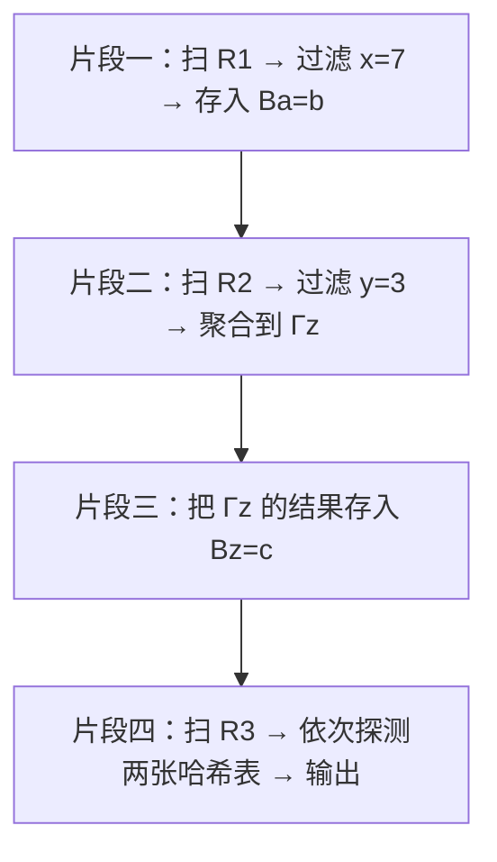
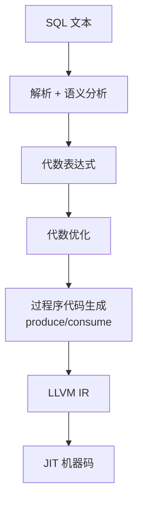
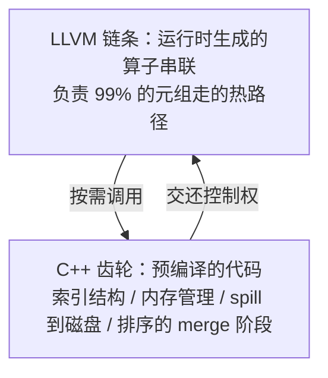
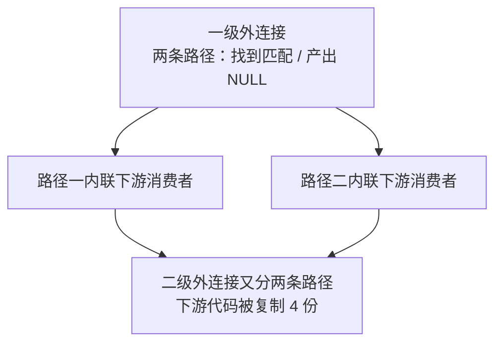

# Neumann 的查询编译：让数据留在寄存器里


本篇是论文 [Efficiently Compiling Efficient Query Plans for Modern Hardware](https://www.vldb.org/pvldb/vol4/p539-neumann.pdf)（Thomas Neumann，*Proceedings of the VLDB Endowment* 4(9):539-550，2011）的中文解读。它是 HyPer——慕尼黑工大的主存数据库系统——查询编译器的工作，也是"把 SQL 编译成机器码"这条路线最早、最完整的一次工业级实践。

<!--more-->

| 层次 | 回答的问题 | 本文对应章节 |
|---|---|---|
| 动机 | 迭代器模型在内存时代为什么过时 | 第一章 |
| 核心主张 | 数据中心、推送式、寄存器级 pipeline breaker | 第二章 |
| 数据流 | 推模型下数据到底怎么流 | 第三章 |
| 编译机制 | produce/consume 怎么变成机器码 | 第四章 |
| 工程细节 | 分支布局、代码膨胀、跨语言边界 | 第五章 |
| 实验 | 论文里的数字能说明什么 | 第六章 |
| 评价 | 贡献、局限，以及后来被验证的部分 | 第七章 |

## 一、迭代器模型的原罪

写过查询执行器的人，多半都干过同一件事：给每个算子加一个虚函数 `next()`，让它吐出下一个元组。上层算子循环调用下层的 `next()`，数据就这么一级一级往上爬。

优雅、灵活、教科书范式。**在内存数据库时代，它是纯粹的负担。**

### 1.1 一条简单查询的微观代价

设想最朴素的执行模型：每个物理算子都是一个虚函数 `next()`，吐一个元组就返回，吐不出就返回"没有了"。查询跑的时候，扫描算子吐一个元组，过滤算子看一眼决定放不放行，哈希聚合算子更新一下计数。

问题在于：**这些 `next()` 调用，不是每个查询调一次，是每个元组调一次。**

很多人读数据库论文时，"数据库查询处理"这几个字指的是"怎么让查询少扫点数据"。但这篇论文讲的完全是另一回事——它要解决的是更底层的问题：

> 一条 20 万行的表扫过去，到底有多少条指令是花在"干活"上的，有多少条是花在"调用"上的？

### 1.2 三个硬伤

论文把迭代器模型的代价拆成三条，每条都有现代 CPU 上的具体机理：

| 硬伤 | 机理 | 后果 |
|---|---|---|
| 每个元组一次虚调用 | `next()` 通常是虚函数或函数指针调用 | 比普通调用更贵，且**寄存器要 spill** |
| 分支预测被毁 | 元组级的 `if` 走向几乎不可预测 | 分支误预测，流水线频繁重置 |
| 局部性差 | 元组跨函数边界传递 | 指令 cache miss、data cache miss |

这里有个容易被忽略的细节：虚函数调用不只是"多几个指令"的问题。**一次跨函数边界的调用意味着所有寄存器都要保存到栈上**——包括那些本来打算一路带着走的元组属性。论文后面反复强调"元组要尽量待在寄存器里"，根子就在这里。

### 1.3 前人的两条路，都不够

在 Neumann 之前，人们已经知道迭代器模型在内存时代吃亏，于是有两条改良路线：

**第一条：块式与向量化处理。** 传统块式处理（Block-oriented processing）让 `next()` 一次返回一整块元组，摊薄了调用开销。但它**破坏了 pipeline**——批量产生的元组必须先落到某个地方，下游才能访问。对分析型查询来说，这意味着中间结果物化，吃的是内存带宽。

**第二条：代码生成。** 早期工作把查询编译成 Java 字节码，HIQUE 则编译成 C，都去掉了迭代器。HIQUE 尤其值得注意：它用"把结果物化内联到算子执行里"的方式消除了迭代器，但**算子边界依然清晰可见**，而且**编译生成的 C 代码代价很高**。

Neumann 的判断很直接：这两条路都只解决了一半。要同时拿到"无虚调用"和"无物化"，得换个执行模型本身。

## 二、三条主张

论文列出了三条核心主张，它们是互相咬合的——**只有把"推"和"寄存器优先"结合起来，编译器才能生成真正紧的循环**。

### 2.1 数据中心，不是算子中心

传统的执行计划以算子为中心：计划长什么样，执行就长什么样。

论文的主张是**以数据为中心**：处理数据的动作被组织成"能让数据在 CPU 寄存器里待多久就待多久"的形式，**算子边界因此被刻意模糊掉**。

这不是把抽象层拿掉，而是**换一个更有物理意义的抽象层**。寄存器是现代 CPU 上最宝贵的资源——它是唯一快到不用担心的存储。一个把元组反复塞进内存再取出来的执行模型，无论它的算子接口多优雅，都是在跟硬件的物理事实对抗。

### 2.2 数据被推，而不是被拉

第二个主张是数据流方向的翻转：**数据被推向算子，而不是算子从上游拉。**

拉模型（迭代器模型）的结构是：上层问下层要元组。这导致元组必须经过函数边界，也就必须离开寄存器。

推模型的结构是：数据源一口气往前推，中间那些纯过滤、纯投影的操作**在寄存器里就地完成**。

论文还额外指出一个推模型的好处：**复杂控制流被推到紧循环之外，寄存器压力反而下降**。这一点后面会看到——代码膨胀、分支布局那些问题，都和"控制流放在哪儿"直接相关。

### 2.3 最锋利的定义：寄存器级 pipeline breaker

这是全文最有价值、也最容易被二手解读漏掉的概念。论文给了一个**寄存器级**的定义，比教科书里的严格得多：

> 一个算子对于某个输入侧是 **pipeline breaker**，如果它把传入的元组从 CPU 寄存器里取了出来。
> 如果它把这个输入侧**所有**元组都物化完之后才继续处理，则是 **full pipeline breaker**。

关键推论只有一句，但很重：**spill 到内存等于破坏 pipeline**。

于是"元组是否还在寄存器里"成了贯穿全文的唯一标尺。所有优化建议都指向同一个方向——**把元组尽可能久地留在寄存器里**，实在留不下（哈希表放不下、要做连接）才物化。

这个定义的价值在于它把一个模糊的执行模型问题，转化成了可度量的工程目标。传统讲义里的"pipeline breaker"是个定性概念（"这个算子会阻断流水线"），Neumann 的版本能直接拿来指导代码生成。

## 三、推模型下，数据到底怎么流

论文用一个例子贯穿全文，我们跟着走一遍。

### 3.1 把例子摊开

SQL 长这样：

```sql
select *
from   R1, R3,
       (select R2.z, count(*)
        from   R2
        where  R2.y = 3
        group by R2.z) R2
where  R1.x = 7 and R1.a = R3.b and R2.z = R3.c
```

翻译成代数：`R1` 过滤 `x=7` 后与 `R2` 的分组聚合结果（按 `z`）连接，再与 `R3` 连接，连接条件是 `a=b` 和 `z=c`。

### 3.2 两种视角

**迭代器视角**：最上层的 join 先向左输入要元组，把它们塞进自己的哈希表；再向右输入要元组，逐个探测哈希表。左右输入自己又是同样的递归。

**编译视角**：Neumann 换了个问法——**别问算子怎么互相调用，问元组实际上从哪流到哪**。

数一遍就会发现：元组本质上**总是在两个物化点之间流动**。`a=b` 这个连接把左输入物化进哈希表，`z=c` 那个连接把右输入物化进哈希表，中间的过滤根本不物化。

于是整条链路被切成若干**片段**（fragment），每个片段负责：从上一个物化点取数据 → 在寄存器里做完能做的活 → 交给下一个物化点。



### 3.3 编译后长什么样

按上面的思路，论文给出的编译结果（Figure 4）长这样：

```plaintext
initialize memory of Ba=b, Bc=z, and Γz
for each tuple t in R1
    if t.x = 7
        materialize t in hash table of Ba=b
for each tuple t in R2
    if t.y = 3
        aggregate t in hash table of Γz
for each tuple t in Γz
    materialize t in hash table of Bz=c
for each tuple t3 in R3
    for each match t2 in Bz=c [t3.c]
        for each match t1 in Ba=b [t3.b]
            output t1 ∘ t2 ∘ t3
```

注意这段代码里**没有"算子"这回事**。它就是一段普通的命令式程序：几个循环，几个 `if`，几个哈希表操作。

再回头看原始的执行计划图，**能看出算子边界在哪儿吗**？看不出了。第一段把"扫 R1""过滤 x=7""连接的 build 侧"三件事熔进了同一个片段，第二段同理。

这就是"数据中心而非算子中心"的实际含义。

## 四、编译是怎么发生的

### 4.1 produce/consume：编译期的思维模型

论文给每个算子定义了两个"概念上"的方法：

- `produce()` —— 产出自己的结果元组
- `consume(attributes, source)` —— 接收上游推来的元组

论文特别强调：**这两个函数在运行时并不存在**。它们只是代码生成阶段的一组翻译规则。

规则简单到可以手写验证：

```plaintext
B.produce    →  B.left.produce; B.right.produce;
B.consume(a,s) → if (s == B.left)  物化进哈希表
                  else  遍历 hashtable[a.joinattr] 的每个匹配
                  然后 B.parent.consume(a + 新属性)

σ.produce    →  σ.input.produce
σ.consume(a,s) → if σ.condition;  σ.parent.consume(attr, σ)

scan.produce →  for each tuple in relation:  scan.parent.consume(attrs, scan)
```

把 3.2 节那个执行计划按这套规则展开，得到的正是 3.3 节那段程序。**这就是编译器的全部魔法**。

真实实现复杂得多——要跟踪哪些属性当前可用、算子的内部状态、相关子查询的属性依赖——但骨架就是这样。

论文在这里补了一句很清醒的话：**暴露算子结构不是限制，是优势**。因为算子结构直接映射成指令序列，只有知道"这里是个连接的 build 侧、那里是个 probe 侧"，才能生成最优的代码。

顺带一提，整个 SQL 处理流程里，只有最后一步是新的：



前面几步和传统数据库完全一样。**变化的是"最终代数计划不再翻译成可执行的物理代数，而是编译成命令式程序"。**

### 4.2 为什么是 LLVM，而不是 C++

作者最初的实现路线是"生成 C++ 代码 → 运行时调用编译器 → 加载成动态库"。这条路失败在两点：

1. **太慢**。优化过的 C++ 编译器编译一条复杂查询要好几秒，交互式场景没法接受；
2. **控制力不够**。C++ 编译器不给你对生成代码的完全控制——论文点名的是**溢出标志拿不到**。

换成 LLVM 之后，作者拿到了四样东西，每一样都直接对应一个痛点：

| LLVM 的能力 | 为什么看重 |
|---|---|
| 无限寄存器（SSA 形式） | "可以假装每个属性都有一份 CPU 寄存器" |
| 可移植汇编 | 架构相关的机器码交给 LLVM JIT 翻译，跨架构免费 |
| 强类型 | "抓到了我们原始文本版 C++ 代码生成里隐藏的很多 bug" |
| 完整的优化编译器 | 每条查询只需**几毫秒** |

第一条尤其关键——它和 2.3 节那个寄存器级定义是配套的：**LLVM 的无限寄存器，让"假装元组能一直待在寄存器里"这件事在编译期变得自然**。

### 4.3 C++ 齿轮加 LLVM 链条

作者没有把数据库系统全部重写成 LLVM，而是做了一个混合模型：复杂的数据结构管理和 I/O 留在 C++，算子之间的数据通路用 LLVM 生成。



论文原文的比喻很好：C++ 齿轮是**预先编译好**的，LLVM 链条是**运行时生成**的，把齿轮串起来。

两条设计原则从这张图里读出来：

- **热路径必须纯 LLVM**。LLVM 调外部 C++ 函数时，所有寄存器要 spill 到内存。单次很便宜（通常还在 cache 里），但执行百万次就明显了；
- **复杂算子允许把控制权交出去**。比如外部排序，LLVM 负责生成初始 run，merge 阶段由 C++ 主导，需要时再回调 LLVM 函数。

### 4.4 热路径原则

论文反复强调的判据可以概括成一句话：**99% 的元组走的那段代码，必须是纯 LLVM。**

偶尔回到 C++ 没关系——比如换页时申请内存、比如排序的 merge 阶段。这些是罕见路径，代价可以忽略。但**如果每次处理元组都要跨一次语言边界，前面说的寄存器 spill 就会乘上元组数**。

这个判据很朴素，但它是把"混合模型"做成的关键：很多混合设计做不好，不是因为分工不对，而是因为**没守住热路径这条线**，结果每次跨边界都把寄存器吐一遍。

## 五、工程细节里的魔鬼

这一章是全文最有含金量的部分，全是"只有真做过才知道"的坑。

### 5.1 分支布局：20% 是怎么来的

论文提到一个反直觉的现象：代码生成出来之后，**哈希成了瓶颈**。TPC-H Query 1 本质上就是一次扫描加一次哈希聚合，结果超过 50% 的时间花在哈希上——而它哈希的只是两个简单值。

追下去发现问题出在分支结构。作者原本生成的是这样的代码：

```c
Entry* iter = hashTable[hash];
while (iter) {          // 混合了两个判断
    ...                  // 检查 entry
    iter = iter->next;   // 是否走到碰撞链末尾
}
```

这个循环把**两个概率完全不同的判断**塞在了一起：

- "这个 hash 值到底有没有对应的 entry"——哈希表填满了之后，**几乎总是真**；
- "是不是走到碰撞链末尾了"——碰撞链很短，**几乎总是假**。

而 CPU 的分支预测器在 50/50 的分支上会崩盘。哪怕两个判断的概率只是"偏一点"，混在一个分支里都会让预测器的历史失效。

改法是把它拆开：

```c
Entry* iter = hashTable[hash];
if (iter) do {          // 两个判断拆成两个各自可预测的分支
    ...
    iter = iter->next;
} while (iter);
```

论文的结论：**仅仅调整分支结构，就让哈希表查找快了 20% 以上。**

这不是微优化，这是把"每个分支的偏斜度"当成一等公民来设计。**同样的道理可以套用到任何条件过滤上**——条件越接近 50/50，越要单独成一个分支，而不是和别的判断合并。

### 5.2 代码膨胀：为什么不能"整个查询编成一个函数"

一个很自然的想法是：既然要追求极致，就把整条查询编成一个函数，LLVM 自己去优化。

论文给了两个不能这么做的理由：

**第一个是控制权归属。** LLVM 代码大概率会在某个点把控制权交给 C++（外部排序的 merge 阶段），这时候整个查询塞在一个函数里就不合适了。

**第二个更硬：内联会导致代码规模指数增长。**

外连接有两条路径——找到匹配时输出一行，没找到时输出一个带 NULL 的行。如果两条路径都直接内联下游的消费者代码，那么：



**级联的外连接会让代码规模指数增长。** 对策是：在 LLVM 内部定义函数，由 LLVM 代码调用；同时保证**热路径不跨函数边界**。

这个坑很典型：你以为"让编译器内联一切"总是对的，但函数体的大小会指数传播。

### 5.3 属性什么时候加载

论文给出的规则分两种情况：

- **一般情况：尽量晚加载。** 用到某个属性时才 load 它，或者反正要访问那块内存时顺手 load 进来；
- **关键路径：提前算。** 典型例子是哈希值——它紧接着就要用来查哈希表，晚算就把内存延迟暴露在关键路径上；提前一点计算可以**掩盖延迟**。

字符串的表示方式也值得一提：寄存器里放**长度加指针**，不拷贝内容。

### 5.4 代码生成器有多大

论文给出的数字是：**约 11,000 行代码**，覆盖 SQL-92 所需的全部代数算子。

作者认为"不算多"，理由是"在代码生成器上花一次功夫，之后每条查询都受益"。这个判断放到今天看也基本站得住——一万多行代码换来的东西是：**新算子加一次，全站查询都受益**。

## 六、实验说了什么

环境：双路 Intel X5570 四核、64GB 内存、RHEL 5.4；C++ 用 gcc 4.5.2，机器码用 LLVM 2.8 生成。OLTP 跑 TPC-C，OLAP 跑 TPC-H 的 22 条查询（适配到 TPC-C 的 schema），**12 个 warehouse，单线程、无并发更新**。

### 6.1 OLTP：编译时间差 20 倍

| 指标 | HyPer + C++ | HyPer + LLVM |
|---|---|---|
| TPC-C 吞吐 [tps] | 161,794 | 169,491 |
| 全部脚本编译时间 [s] | 16.53 | **0.81** |

吞吐差距不大，作者的解释是合理的：TPC-C 的事务很简单，触碰的元组不到 30 个，迭代器的开销被摊薄了。

**真正拉开差距的是编译时间：差 20 倍。** 这不是优化项，这是能不能做交互式系统的分水岭——C++ 路线每次运行都要等几秒编译，而论文里 LLVM 路线是毫秒级。

### 6.2 OLAP：Q1 说明了一切

下表是 TPC-H 前五条查询的预热执行时间（毫秒）。为方便窄屏阅读，把系统放在列上：

| 查询 | HyPer+LLVM | HyPer+C++ | VectorWise | MonetDB |
|---|---|---|---|---|
| Q1 | **35** | 142 | 98 | 72 |
| Q2 | **125** | 374 | – | 218 |
| Q3 | **80** | 141 | 257 | 112 |
| Q4 | **117** | 203 | 436 | 8168 |
| Q5 | **1105** | 1416 | 1107 | 12028 |

（VectorWise 的 Q2 触发了 bug；论文还对比了一个匿名的商业磁盘系统 DB X，最慢达到 16410 ms，因为它是为磁盘设计的通用系统，而这里测的是全内存的预热执行。）

**Q1 最有说服力**：这条查询原则上只有"一次扫描加一次哈希聚合"，只有一种合理的执行方式。C++ 版本写出来已经很自然、很高效，**但依然打不过 LLVM 版——快 4 倍**。

为什么？因为 C++ 版本没法做到"所有东西都待在寄存器里"。数据在 C++ 的对象模型里要经过构造函数、成员访问、栈上的临时变量，每一步都可能离开寄存器。

另一个容易被忽略的对比是**编译时间**：Q1 的 C++ 路线要 1556 ms，LLVM 路线 16 ms。Q4 更夸张：2214 ms vs 16 ms。

### 6.3 代码质量：分支与 cache

作者用 callgrind 统计了执行细节。以 Q1 为例：

| 指标 | HyPer+LLVM | MonetDB |
|---|---|---|
| 分支数 | 19,765,048 | 144,557,672 |
| 分支误预测 | 188,260 | 456,078 |
| I1 misses | 2,793 | 187,471 |
| D1 misses | 1,764,937 | 7,545,432 |
| L2d misses | 1,689,163 | 7,341,140 |
| 指令数 | 132 mil | 1,184 mil |

LLVM 版的**分支数只有 MonetDB 的七分之一**，指令数只有九分之一，cache miss 少一个数量级。

原因很直接：MonetDB 走的是向量化的路子，数据要在 BAT（二进制关联表）结构里来回搬；LLVM 版则是一段紧凑的直线代码。

Q5 的对比更夸张：分支误预测 **639 对 6,726,700**。

论文也诚实地指出了一个反例：**Q2 上 LLVM 版的误预测比 MonetDB 多**（6,581,223 对 3,891,827）。作者的解释是这锅不在 LLVM——HyPer 对 spool 到磁盘过于悲观，而且到处拷贝字符串，导致超过 60% 的误预测来自这些拷贝；MonetDB 避开了这些拷贝。**这个例外的价值在于它说明：代码生成解决的是"结构"问题，解决不了"数据结构设计"问题。**

### 6.4 撞到内存带宽墙

微基准给出了两个数字，是全文最有冲击力的部分。

**级联选择**：三个都不具选择性的过滤条件叠加，读取速率达到 **4.2 GB/s**——已经接近机器的内存总线带宽。

**聚合**：三个聚合列，速率 **6.5 GB/s**——**等于内存总线带宽**。

论文的原话是：*"我们的查询处理已经快到基本上是 I/O bound 了——这里的 I/O 指的是 RAM 访问。"*

这句话值得反复咀嚼：**优化到一定程度后，瓶颈就从"数据库怎么做"变成了"内存有多宽"**。任何执行引擎的优化，最后都会撞到这条物理墙。

## 七、我的评价

### 7.1 贡献

**第一，"寄存器级 pipeline breaker"这个定义。** 它把一个模糊的执行模型问题变成了可度量的工程目标。我认为这一点的长期价值高于论文里的 LLVM 部分——LLVM 会被换掉，但这个标尺不会。

**第二，把推模型和数据中心化组合起来。** 这两件事单独都有前人做过（批式处理、代码生成），但**只有同时具备，才能既消除虚调用又不物化中间结果**。论文的价值在于这个组合。

**第三，把控制流布局当作一等公民。** 分支偏斜度、代码膨胀、跨语言边界的寄存器 spill——这些经验是从"只有真做过才知道"里长出来的。

**第四，证明编译型引擎可以做到交互式可用。** 毫秒级编译。这一点决定了整条路线能不能落地，比快 20% 重要得多。

### 7.2 局限

论文自陈的和可以补上的：

| 局限 | 说明 |
|---|---|
| 评测是单线程、无并发 | 12 warehouse 单线程跑，今天的主机早就是多核加 NUMA 的世界 |
| 查询内并行只给了展望 | 论文明确说"超出本文范围"——而这在今天恰恰是核心问题 |
| Q2 的反常是系统自身问题 | HyPer 对 spool 太悲观、字符串拷贝多，作者自己承认 |
| 强耦合当时的工具链 | LLVM 2.8、gcc 4.5.2、X5570；IR 里直接写着 `llvm.x86.sse42.crc64` |
| 索引和数据结构仍在 C++ | 跨语言边界的寄存器 spill 只被论证为"可接受"，没有量化 |
| 编译期开销 | 毫秒级虽好，高频小查询场景下仍有摊销问题 |

论文在附录 C 里还记录了一个有意思的细节：给 C++ 加上 `-funroll-loops` 会让 Q4 性能**下降 23%**，而且这个开关会隐式打开 `-fweb`，进而影响寄存器分配器的行为。**优化开关之间的相互作用极难预测**——这大概是"让编译器管这件事"最实在的理由之一。

### 7.3 后来的人

这篇论文提出的路线后来被反复验证，而且越走越远：

- **HyPer 自己**沿着这个方向继续做，把"整个系统都用 LLVM 编译"当成主线（Neumann 后来在 TUM 主导的 HyPer 与 Umbra 系列）；
- **Kersten 等人 2018 年在 PVLDB 上做了件有意思的事**：把"向量化"和"数据中心代码生成"两种范式**放进同一个系统里各实现一遍**，实测对比——结论是向量化更善于隐藏 cache miss 延迟，而数据中心编译需要更少的 CPU 指令、适合 cache 驻留的工作负载。**两种范式不是替代关系，而是各有优势的场景取舍**；
- **Peloton**（CMU）把编译、向量化、多核三者结合，用 LLVM 做代码生成，是这篇论文思路的一次完整复现与扩展；
- **Velox**（Meta 发起的开源引擎）把编译型执行引擎做成了跨引擎的公共组件，Presto/Trino 生态后来都接了进来；
- **Substrait** 则试图把"跨系统的执行算子协议"标准化，让不同引擎共享同一套算子实现。

工业界则是**两条路都用**：Databricks Photon 用向量化的 C++ 引擎替换掉了 JVM 上的 Spark SQL，Snowflake 也重写了 SQL 编译与执行层，把执行从解释一步步推向编译。**两条范式各有优势的场景取舍**——这正是 Kersten 那篇综述给出的结论。

论文里没做的那些事——查询内并行、多核 NUMA 感知——后来都被补上了。**这篇论文更像是给出了一条路线图，而不是完成品。**

## 八、能带走什么

给做存储引擎、执行引擎、高性能计算的人，这篇最实用的几条：

1. **现代 CPU 上，"每个元组一次虚函数调用"是要按指令数和分支误预测来计价的。** 抽象的干净程度和运行时的干净程度，是两件事。
2. **中间结果物化等于内存带宽成本。** 能不能不物化，比用什么算法更影响性能。
3. **优化目标不是复杂度，是指令数、分支预测命中率、cache miss。** 论文的实验方法本身就是模板。
4. **每个分支都要有偏斜度。** 把"几乎总是真"和"几乎总是假"的判断混在一个分支里，等于亲手拆掉分支预测器。
5. **编译器不是免费的。** 毫秒级和秒级之间，决定了这条路能不能做交互式系统。
6. **别把"算子"当最终形态。** 算子是思考查询的好工具，但不必是执行时的形状。

> 一句话总结：把查询编译成机器码的价值不在于"少一次函数调用"，而在于**重新定义了执行模型的目标**——让数据在寄存器里待到最后。而这个目标一旦成立，LLVM 只是当时最顺手的实现手段。

如果只能带走三句话：

1. **pipeline breaker 应该有精确的定义**：算子是否把元组从 CPU 寄存器里取出来。有了这条标尺，中间结果物化就成了可量化的、可以逐个消除的东西。
2. **热路径必须待在一种语言里。** 混用 C++ 和 LLVM 没问题，但 99% 的元组走的那个路径必须纯 LLVM，否则每次跨边界都要 spill 一次寄存器。
3. **执行引擎的终点是内存带宽。** 这篇论文最值得记住的实验数据是 6.5 GB/s——当查询处理快到这个程度，剩下的优化就不在数据库里了。

## 参考资料

- [Efficiently Compiling Efficient Query Plans for Modern Hardware（本文原文，PVLDB 4(9):539-550, 2011）](https://www.vldb.org/pvldb/vol4/p539-neumann.pdf)
- [Everything You Always Wanted to Know About Compiled and Vectorized Queries But Were Afraid to Ask（PVLDB 11(13):2209-2222, 2018）](https://www.vldb.org/pvldb/vol11/p2209-kersten.pdf)
- [LLVM 官方项目](https://llvm.org/)
- [SIMD-scan: Ultra Fast In-Memory Table Scan Using On-Chip Vector Processing Units（PVLDB 2009）](https://www.vldb.org/pvldb/vol2/p117-willhalm.pdf)
- [Peloton：CMU 的编译型执行引擎](https://github.com/cmu-db/peloton)
- [Velox：Meta 发起的统一执行引擎](https://facebookincubator.github.io/velox/)
- [Substrait：跨系统执行算子协议](https://substrait.io/)

