# MPP 数据库中的 CTE 优化（全文翻译）


本文翻译自 [Optimization of Common Table Expressions in MPP Database Systems](https://www.vldb.org/pvldb/vol8/p1704-elhelw.pdf)（Amr El-Helw、Venkatesh Raghavan、Mohamed A. Soliman、George Caragea、Zhongxian Gu、Michalis Petropoulos，*Proceedings of the VLDB Endowment* 8(12):1704-1713, 2014；VLDB 2015 特邀论文）。作者单位为 Pivotal、Datometry 与 AWS。

<!--more-->

CTE（公共表表达式）大概是 SQL 里最不起眼、也最容易被误解的语法之一。

一条 `WITH v AS (...) SELECT ... FROM v` 看上去只是"给一段子查询起个名字"，可到了 MPP 数据库里，这个名字要背的东西多得吓人：它可能被执行一次也可能被执行五次，可能被物化到磁盘也可能在寄存器里飘着，还可能让两个进程在分布式执行中互相等待——**死锁**。

2014 年 Pivotal 的论文系统回答了这些问题：CTE 在 MPP 里到底怎么表示、怎么枚举备选计划、怎么估成本、怎么在分布式执行里避免死锁。这篇是 Orca 优化器的核心工作之一，也是我读过的、把"CTE 优化"讲得最完整的一篇。

下面按原文结构逐节翻译。图表均取自原论文。

| 层次 | 回答的问题 | 本文对应章节 |
|---|---|---|
| 动机 | CTE 到底该内联还是物化？ | 第一章 |
| 表示 | 四个新算子怎么把 CTE 装进逻辑计划 | 第四章 |
| 死锁 | 分布式执行里 CTE 为什么会互相等死 | 第五章 |
| 计划枚举 | 怎么把"内联/不内联"变成可枚举、可估价的备选 | 第六章 |
| 上下文优化 | 消费者的过滤条件怎么传给生产者 | 第七章 |
| 反向使用 | 没有 CTE 的查询，怎么用 CTE 优化 | 第八章 |
| 执行 | TupleStore、内存与磁盘、同步协议 | 第九章 |
| 实验 | TPC-DS 上的实测结果 | 第十章 |

整篇论文的骨架是一个五步流水线：

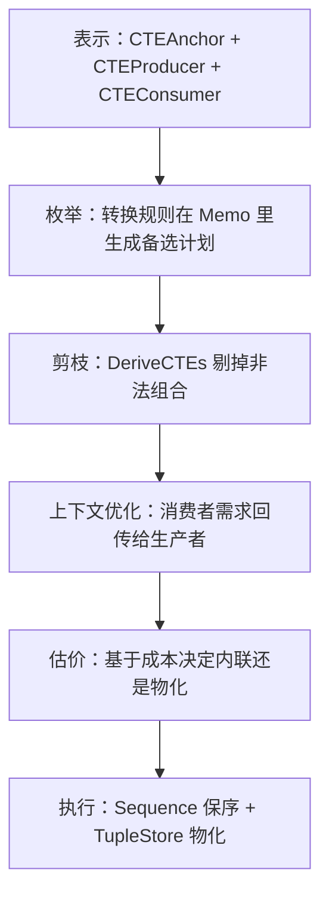

## 一、引言

这一章交代背景：CTE 是什么、为什么 MPP 环境下它比在单机数据库里难得多。

大数据分析在越来越多的业务领域里变得普遍，包括金融公司、政府机构、保险公司。大数据的用途从生成简单报表到执行复杂分析工作负载，不一而足。这些领域里存储与处理的数据量增长，把"如何可扩展地执行分析查询"这个问题推到了台前。

**大规模并行处理（MPP）数据库**通过把存储和查询处理分布到多个节点与进程上来应对这个挑战。

公共表表达式（CTE）常出现在包含大量重复计算 的复杂分析查询里。**CTE 可以看作一张只活在单条查询内的临时表**。它的存在意义是：避免重复执行在一条查询中被引用多次的表达式。CTE 既可以由用户显式定义，也可以由查询优化器隐式生成（见第八章）。下面这个例子展示了用 `WITH` 子句显式定义 CTE 的用法：

```sql
WITH v as (SELECT i_brand, i_current_price, max(i_units) m
           FROM item
           WHERE i_color = 'red'
           GROUP BY i_brand, i_current_price)
SELECT * FROM v WHERE m < 100
      AND v.i_current_price IN (SELECT min(i_current_price)
                                FROM v WHERE m > 5);
```

**例 1.** 上面的查询包含一个 CTE（`v`），带过滤和分组操作，`v` 在主查询里被引用了两次。这是不必把定义 `v` 的整段表达式重复写两遍的替代写法。

实践中，`v` 的定义可能复杂得多，包含连接、子查询、用户自定义函数等等；而且它被引用的次数可能不止两次。因此把它定义成 CTE 有两个目的：**一是简化查询，让它更易读**；**二是如果处理得当，性能上可以只计算一次这个复杂表达式**。

CTE 遵循**生产者/消费者**模型：数据由 CTE 定义生产，在所有引用该 CTE 的位置被消费。

执行 CTE 有一种做法是把所有 CTE 消费者**展开（内联）**，本质上就是在内部重写查询，把每处对 CTE 的引用替换成完整表达式。这种做法简化了查询执行逻辑，但**可能因为多次执行同一表达式而带来性能开销**；而且如果展开后的查询很复杂，查询优化时间也会增加。

另一种做法是**以真正的生产者/消费者方式执行 CTE**：CTE 表达式被单独优化、只执行一次，结果保存在内存里，如果数据放不进内存或者需要在进程之间传输（MPP 系统中就是这种情况），就写到磁盘上。之后每次引用 CTE 时再把数据读出来。这种做法避免了重复执行同一表达式的代价，但**可能引入磁盘 I/O 的开销**。它对查询优化时间的影响相当有限，因为优化器只需选一个计划供所有消费者共享。**不过，固定一个执行计划意味着可能错过重要的优化机会。**

### 1.1 挑战

这一节列出论文要解决的主要挑战。

#### 1.1.1 死锁风险

MPP 系统利用并行查询执行：查询计划的不同部分作为独立进程同时执行，可能跑在不同机器上。随着计划里的算子被执行，数据在这些进程之间流动。

在某些情况下，一个进程必须等待另一个进程产出它需要的数据。例如，**如果 CTE 定义在一个进程里、而 CTE 消费者在另一个进程里，后者就必须等前者**。

对于涉及多个 CTE 的复杂查询，优化器必须保证**执行期间不会出现两个或更多进程互相等待**。CTE 结构需要在查询优化框架中被干净地抽象出来，才能保证生成无死锁的计划。论文在第四、第五章说明其设计如何大幅简化死锁处理。

#### 1.1.2 枚举内联替代方案

"总是内联 CTE"和"从不内联 CTE"这两种做法都可以被证明是次优的。

**例 2.** 给定 TPC-DS 的 `item` 表，并假设在 `item.i_color` 上建有索引，考虑下面的查询：

```sql
WITH v as (SELECT i_brand, i_color FROM item
            WHERE i_current_price < 1000)
SELECT v1.*
FROM v v1, v v2, v v3
WHERE v1.i_brand = v2.i_brand AND v2.i_brand = v3.i_brand
      AND v3.i_color = 'red';
```

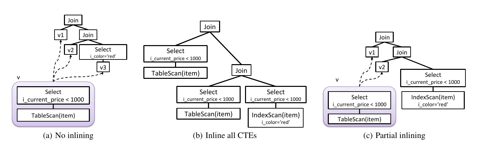

图 1(a) 展示了**从不内联**时产生的计划：CTE 只执行一次，结果被复用三次。这避免了重复计算，但**没有利用 `i_color` 上的索引**。

相反的做法见图 1(b)，**所有 CTE 出现位置都被替换成 CTE 表达式的展开**。这让优化器可以在其中一处展开里利用 `i_color` 上的索引，但**另外两处展开要重复计算同一个表达式**。

图 1(c) 展示了另一种可能的计划：**展开其中一处 CTE**，从而用上索引，而另外两处不内联，以避免重复计算公共表达式。**如果孤立地采用"内联"或"不内联"的思路，这种计划根本不会被考虑。**

查询优化器需要高效地枚举并估算那些**能结合两种做法优点**的计划备选。论文在第六章说明其计划枚举方法如何应对这个挑战。

#### 1.1.3 上下文相关的优化

**CTE 不应该脱离它所处的上下文被孤立地优化。** 孤立优化很容易错过若干优化机会。

例如，如果查询在所有 CTE 消费者上都有过滤条件，这些过滤条件可能被推进 CTE 计划内部，以减少元组数量。类似地，多个消费者可能要求 CTE 结果以相同方式分区或排序；考虑那些把这些要求推进 CTE 计划的备选方案，可以避免对同一份数据反复排序/重新分区。

但是，**每次在查询里引用 CTE 时都重新优化一遍是不可扩展的**，而且会让搜索空间指数增长。CTE 优化需要**由优化器有机地处理**，以便考虑它们与其他优化的相互影响，并允许提前剪掉较差的计划备选。论文第七章说明如何应对这个挑战。

### 1.2 贡献

论文提出了一套用于表示、优化和执行**非递归 CTE** 查询的新方法，已在 Orca（Pivotal 的查询优化器）中实现并投入生产。贡献如下：

- **一个用于 MPP 数据库系统中 CTE 优化的新框架。** 该框架扩展并建立在作者既有的优化器基础设施之上，允许 CTE 在其被使用的查询上下文中被优化。
- **一种新技法：CTE 不会为查询中的每一次引用都被重新优化**，而只在存在优化机会时才重新优化，例如推进过滤条件或排序操作。这保证了优化时间不会随 CTE 消费者数量指数增长。
- **一种基于成本的方法**，用来决定在给定查询中是否展开（内联）CTE。代价模型同时考虑磁盘 I/O 以及 CTE 重复执行的代价。
- **若干能缩减计划搜索空间、加快查询执行的优化**，包括把谓词推进 CTE、在只被引用一次时总是内联 CTE，以及消除从未被引用的 CTE。
- **一种查询执行模型，保证 CTE 生产者总是在 CTE 消费者之前执行。** 在 MPP 环境下，这对无死锁执行至关重要。

作者同时用 TPC-DS 基准做了实验评估，以展示这些技术的效率。

## 二、相关工作

公共子表达式的优化在查询处理与优化领域已有充分研究。这里聚焦两个与本文提案密切相关的方向。

### CTE 优化

Silva 等人提出了对 SCOPE 查询优化器的扩展，用**两阶段优化技术**处理前面提到的上下文相关优化挑战：第一阶段用原始 SCOPE 优化器，外加一步把所有 CTE 消费者所需的物理属性（如数据分区与排序）记录到链表里；随后一个**重新优化阶段**用来找出所有 CTE 消费者的最近公共祖先，并依据消费者的局部需求重新优化 CTE 生产者，目标是找出全局最优计划。

与 [11] 相比，本文的提案**把 CTE 优化有机地整合到查询优化器的核心**，从而免去了重新优化。我们的表示框架还允许直接识别 CTE 的优化入口点，无需搜索最近公共祖先。而且由于在一个阶段内完成优化，我们的方法天然有利于**提前剪枝计划空间**，避免不必要的优化。

PostgreSQL 把 CTE 视为在复杂查询中隔离子查询的手段。生成的计划在一个独立的子计划里评估 CTE，与主查询隔离地优化。这种做法可能导致错失重要的优化机会，例如：**内联 CTE**、**当所有消费者需要相同属性时在 CTE 输出上强制物理属性（如排序序）**、以及**把谓词推进 CTE 子计划**。

Oracle 优化器可以把子查询的结果存进临时表，临时表可以被引用任意多次。优化器可以内联每一次对重构后子查询的引用，`MATERIALIZE` 和 `INLINE` 优化器提示可以用来影响这个决策。HP Vertica 与 PDW 同样在查询执行期间把 CTE 结果保存在临时表里。

### 利用物化视图做优化

在传统数据库系统中，用物化视图参与查询优化与执行是一个研究得很透彻的问题。本文的"探索内联替代方案"的做法，与"决定是否用物化视图来回答某个查询"所用的成本驱动方法有相似之处。但两者处理的问题是正交的，可以这样区分：

第一，**使用物化视图主要依赖视图匹配技术**来决定某个物化视图能否用来优化特定查询；而**显式 CTE 通常不需要视图匹配**，因为它们就在查询里定义并被引用。视图匹配技术可以用于检测查询中隐式定义的公共子表达式，本文的框架可以建立在这些技术之上，以捕获并优化框架内的子表达式。

第二，如第一节所述，CTE 可以借助上下文优化获益——消费者的局部需求可能给生产者强加新的计划，例如把谓词和/或排序序从消费者推进到生产者。**这对物化视图不适用**，因为物化视图的创建与可能使用它的查询是分开的。而且与物化视图不同，**CTE 是作为查询的一部分定义的，并不会被存储**，因此不存在物化视图的维护与设计问题。

## 三、背景

### 3.1 大规模并行处理

现代横向扩展（scale-out）数据库引擎通常基于两种设计原则之一：**分片**（sharded）与**大规模并行处理**（MPP）。两者都是无共享（shared-nothing）架构，每个节点管理自己的存储和内存，通常基于水平分区。

分片的常见用例包括"西部"与"东部"客户，或者按姓名首字母范围划分用户。**分片系统优化的是在分片子集上执行查询**，分片之间的通信相对有限。分片可以放在不同的数据中心，甚至不同的地理区域。

**MPP 数据库优化的是单条查询的并行执行。** 节点通常集中在同一个数据中心内，每条查询可以访问所有节点的数据。查询优化器生成的执行计划包含**显式的数据移动指令**，且移动数据的代价会在优化过程中被计入。一条在 MPP 数据库中执行的查询可以包含若干流水化的执行阶段，阶段之间有显式的节点间通信。例如，一次多阶段聚合可以用所有节点计算整个数据集上的聚合。

Pivotal 的 Greenplum Database（GPDB）是一个 MPP 分析数据库。GPDB 采用无共享架构，由多个协作的处理器组成（典型部署包含几十到几百个节点）。大量数据的存储与处理通过把负载分布到若干服务器或主机、形成一组独立数据库协同呈现为单一数据库镜像来完成。**master 是入口点**，客户端连接到这里提交 SQL 语句；master 与其他称为 **segment** 的数据库实例协同工作。

查询执行期间，数据可以有多种分布方式：**哈希分布**（按某个哈希函数把元组分发到各 segment）、**复制分布**（每个 segment 存一份完整副本）、**单点分布**（把整张分布式表从多个 segment 汇聚到单个主机，通常是 master）。

特殊的算子称为 **Motion 算子**，用于完成 segment 之间的数据通信。**Motion 算子是发送/接收数据的两个活动进程之间的边界**，它们可能运行在不同节点上。Motion 算子的目标是建立某种数据分布。

例如，要建立列 `x` 上的哈希分布，运行在 segment S 上的一个 `Redistribute(x)` Motion 算子实例，会根据 `x` 的哈希值把 S 上的元组发送到其他 segment，同时并行地接收其他 segment 上并行运行的 `Redistribute(x)` 实例发来的元组。类似地，**Broadcast Motion 算子**用于建立复制分布，**Gather Motion 算子**用于建立单点分布。第七章会说明优化期间是如何用 Motion 算子来强制所需的数据分布的。

### 3.2 Orca 中的查询优化

Orca 是 Pivotal 数据管理产品（包括 GPDB 与 HAWQ）的查询优化器。Orca 是一个基于 Cascades 框架的现代自顶向下查询优化器。

在 Orca 中，计划空间被编码在一个紧凑的数据结构 **Memo** 里，由一组称为 **group** 的容器构成。每个 group 包含逻辑等价的表达式，称为 **group expression**。每个 group expression 是一个算子，它的孩子是其他的 group。**Memo 这种递归结构允许用紧凑的方式编码大量可能的计划**。包含查询顶层算子的那个 Memo group 称为 "root" group。

**计划备选由转换规则（transformation rule）生成**，规则要么产生逻辑等价的表达式，要么产生已有表达式的物理实现。应用转换规则的结果被加入 Memo，这可能导致创建新的 group 和/或在已有 group 中加入新的表达式。

优化期间，一个算子可以向它的孩子**请求满足特定的物理属性**（如排序序和数据分布）。子计划要么自己就能满足这些属性（例如 IndexScan 直接给出有序数据），要么需要插入一个 **enforcer 算子**（例如 Sort）来交付所需属性。

## 四、CTE 的表示

这一章给出论文的核心：在 Orca 里怎么把 CTE 表达成逻辑计划。

用下面这个简单例子来说明：

```sql
WITH v AS (SELECT i_brand FROM item WHERE i_color = 'red')
SELECT * FROM v as v1, v as v2
WHERE v1.i_brand = v2.i_brand;
```

**例 3.**

该查询的初始逻辑表示见图 2。作者引入了以下新的 CTE 算子：

- **CTEProducer**：这个算子最初被设置为一棵独立逻辑树的根，对应 CTE 的定义。查询中定义的每个 CTE 都有一棵这样的树、一个这样的 CTEProducer 算子。**这些树最初并不与主逻辑查询树相连**。每个 CTEProducer 有唯一的 id。
- **CTEConsumer**：这个算子表示查询中引用 CTE 的位置。CTEConsumer 节点的数量等于查询中 CTE 引用的次数。CTEConsumer 算子里的 id 对应它所指向的 CTEProducer。**多个 CTEConsumer 可以指向同一个 CTEProducer。**
- **CTEAnchor**：这个算子表示某个特定 CTE 在查询中定义的位置，**它定义了该 CTE 的作用域**。一个 CTE 只能在以对应 CTEAnchor 算子为根的子树中被引用。
- **Sequence**：这是一个二元算子，按顺序（从左到右）执行它的孩子，并返回右孩子的结果。**Orca 也用 Sequence 算子来优化分区表上的查询。**

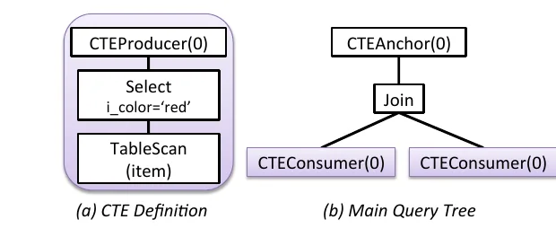

图 3 展示了例 3 查询的两种可能执行计划。

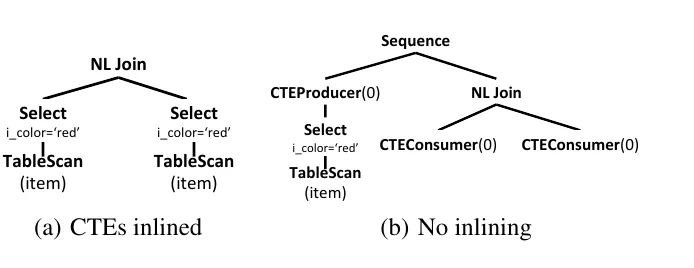

在第一个计划中，**所有 CTE 都被内联**。此时 CTEAnchor 被移除，每个 CTEConsumer 被替换为表示 CTE 定义的整棵树。

在第二个计划中，**没有 CTE 内联**。CTEAnchor 被替换成一个 Sequence 算子，它的第一个孩子是 CTEProducer，第二个孩子是 CTEAnchor 原来的孩子。

**Sequence 算子保证了一种特定的执行顺序：CTEProducer 之下的子树先执行，然后对应的 CTEConsumer 才开始执行。** 于是当执行到达 CTEConsumer 时，数据已经可以读取了。这保证了生成的计划没有死锁，对包含多个 CTE 的计划尤其如此。第五章会详述这一点。

前面这些算子同样可以用于表示**嵌套 CTE**：

```sql
WITH v as (SELECT i_current_price p FROM item
           WHERE i_color = 'red'),
     w as (SELECT v1.p FROM v as v1, v as v2
           WHERE v1.p < v2.p)
SELECT * FROM v as v3, w as w1, w as w2
WHERE v3.p < w1.p + w2.p;
```

**例 4.**

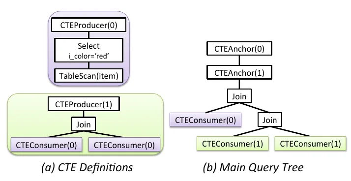

图 4 展示了例 4 的逻辑表示。每个 CTEProducer 节点都位于对应 CTE 的逻辑树之上。主查询有两个 CTEAnchor 节点，顺序与 `WITH` 子句中 CTE 出现的顺序一致。

注意有些 CTEConsumer 节点在主查询里，有些在 CTEProducer 之下的树里——**后者对应"CTE 被其他 CTE 内部引用"的情况**。

## 五、CTE 的执行与死锁

这一章是全文最实用的部分：分布式执行里 CTE 为什么会死锁，以及怎么用 `Sequence` 算子从根上避免。

执行带 CTE 的计划会在计划的不同部分之间创建依赖关系，这些依赖必须在运行时被满足。**优化器必须把这些依赖考虑进来，并保证生成的计划对任何可能的输入都是无死锁的。**

一种可能的做法是把 CTEProducer 作为某个 CTEConsumer 节点的孩子。考虑例 3 的查询，其逻辑表示见图 2。一种可能的执行计划可以用嵌套循环连接（NLJoin），并把 CTEProducer 直接挂在内侧（右）CTEConsumer 之下，见图 5(a)。

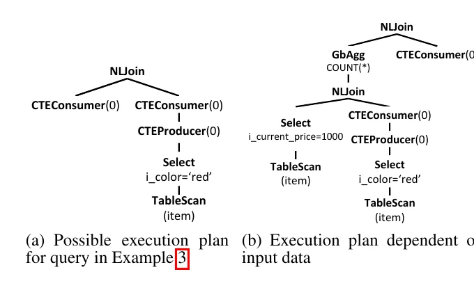

在这个计划里，NLJoin 节点触发其外侧（左）孩子的执行，进而触发左侧 CTEConsumer 的执行。**这个 CTEConsumer 会被阻塞**，因为它试图读取的元组还没有被生产出来。由于 NLJoin 的外侧孩子被阻塞，执行永远到不了本该执行 CTEProducer 的内侧孩子。**因此这个计划会导致死锁。**

这个死锁本可以避免：**只要把 CTEProducer 放在最先执行的消费者之下**——在本例中就是 NLJoin 的外侧（左）孩子。避免死锁的朴素方法可以概括为以下几步：

1. 不考虑 CTE 表达式地优化查询；
2. 分别优化这些 CTE 表达式；
3. 对查询中的每个 CTE（按依赖顺序）：(a) 按执行顺序遍历主查询的执行计划；(b) 在遍历中遇到的**第一个**对应消费者之下，插入该 CTEProducer 对应的树。

这个做法有一个明显的缺点：**第一步没有考虑执行 CTEProducer 的代价**，这意味着插入更小的 CTE 子计划之后，为主查询选出的计划可能不再是最优的。

这个做法还有一个额外的复杂度来源：**执行计划中的某些部分对某些输入可能整体被跳过。** 考虑图 5(b) 的计划：CTEProducer 按上述算法被放在按执行顺序遇到的第一个 CTEConsumer 之下。**假设现在 `i_current_price` 上的过滤条件不返回任何元组。** 大多数引擎随后会优化执行，直接跳过连接的内侧，因为连接算子不会产出任何元组。这种情况下，**放在顶层连接算子之下的 CTEConsumer 会试图从一个从未执行过的 CTEProducer 读取元组，结果就是死锁。**

理论上，这些情况可以在查询优化或执行阶段避免。但这会让处理逻辑越来越复杂，把优化器和执行引擎的设计紧耦合，带来可维护性和可扩展性的挑战。在 MPP 系统的语境下这个问题更严重，因为还需要处理**不同节点上进程之间的通信**。

**Sequence 算子大大简化了"CTEProducer 放在计划哪里"的决策**，并让优化器可以透明地做若干优化，而不必担心死锁。

## 六、计划枚举

这一章说明如何为带 CTE 的查询生成计划备选。用图 2 的逻辑查询来说明。初始逻辑查询表达式先被插入 Memo，按需要创建若干 Memo group。

### 6.1 转换规则

**转换规则以一个 group 中的表达式为输入，产生另一个表达式并加入同一个 group。** 对每个 CTE，作者生成"内联"与"不内联"两类备选。图 7 展示了应用下列 CTE 相关转换之后的 Memo：

- **第一条规则**作用于 CTEAnchor 算子。它在 CTEAnchor 所在的 group（group 0）中生成一个 Sequence 算子，使 **Sequence 的左孩子是表示 CTE 定义的整棵树**（按需创建新的 group：group 4、5、6），**右孩子是 CTEAnchor 原来的孩子**（group 1）。
- **第二条规则**同样作用于 CTEAnchor，在同一 group 中生成一个 **NoOp** 算子，它唯一的孩子就是 CTEAnchor 的孩子（group 1）。
- **第三条规则**作用于 **CTEConsumer** 算子，生成 CTE 定义的一份副本，并把该表达式加入 CTEConsumer 所在的同一个 group。例如，对 group 2 里的 CTEConsumer，CTE 定义被加入进来，于是 Select 算子也在 group 2 中，而它的孩子（TableScan 算子）被加入一个新的 group（group 7）。

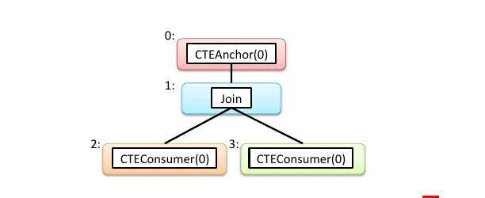

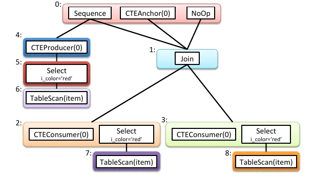

估计出不同备选的代价之后（见第七章），优化器从每个 group 中选择代价最低的备选。**例如，若优化器选择 group 0 中以 NoOp 算子为根的计划，配合 group 2、3 中内联的表达式，就得到图 3(a) 的计划**；若选择 group 0 中以 Sequence 算子为根的计划，配合 group 2、3 中的 CTEConsumers，就得到图 3(b) 的计划。

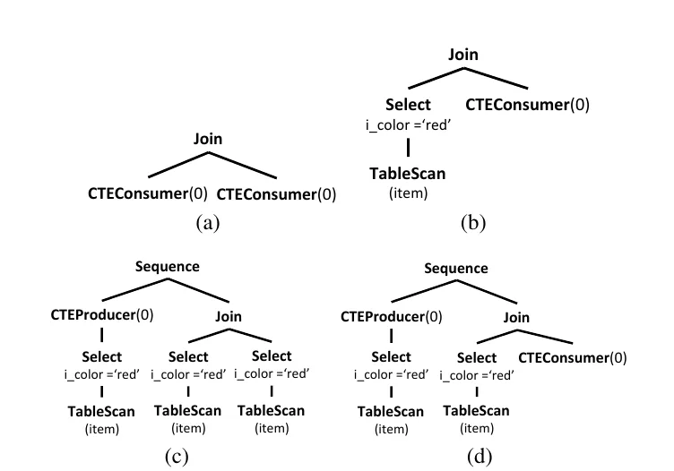

图 8 展示了选择其他算子可能得到的其他计划。但**并非图 8 中所有计划都是有效的**：

- 图 8(a) 与 8(b) **包含 CTEConsumer 却没有对应的 CTEProducer**。这些计划无法执行，因为 CTEConsumers 需要读取从未被生产的数据；
- 图 8(c) **有 CTEProducer 却没有任何对应的 CTEConsumers**，意味着 CTE 表达式会被白白多执行一次并缓存起来。6.2 节的算法可以避免生成这类计划；
- 图 8(d) **不是非法计划**，但也不是最高效的：它只包含一个与内联 CTEProducer 对应的 CTEConsumer。除去缓存 CTE 输出的额外开销，它在成本上几乎等价于图 3(a) 的计划。作者在 6.3.2 节说明如何避免生成这类计划。

**用 Memo 表示不同的备选，使"是否内联 CTE"这个决策完全变成基于成本的决策。** 同一条查询中，有些 CTE 可以内联，有些则不内联。

内联还带来了执行其他优化的可能，例如推进谓词、分布、排序等。例如图 9(a) 的 CTEProducer，图 9(b) 的部分逻辑表达式显示 CTEConsumer 之上有一个谓词。

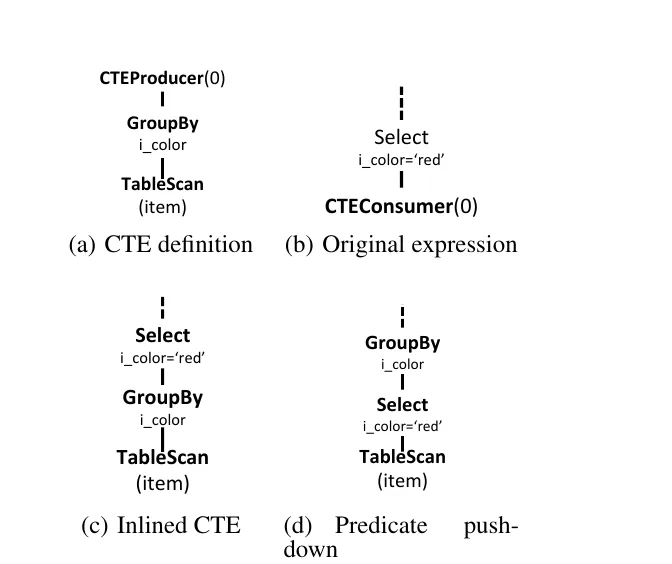

使用内联 CTEConsumer 的转换规则会得到图 9(c) 的表达式。但 **Orca 默认会尽可能把谓词往下推**，这意味着图 9(c) 的表达式最终会被变换成图 9(d) 的表达式，后者可以显著减少中间行数。

### 6.2 避免非法计划

本节描述检查计划与子计划在 CTEProducer/CTEConsumer 配置上是否合法的算法。**该算法契合 Orca"向下传递查询请求、推导计划属性"的框架**，作用在 Memo 所编码的不同备选计划上。为了便于说明，论文给出一个作用在完整计划上的递归实现。

主函数是算法 1：输入是一个计划（或子计划），以其根节点表示；以及一份 CTE 请求列表，每一项是一个 **CTESpec** 对象。输出同样是一份 CTESpec 列表，表示给定子计划中的 CTE 配置。**每个 CTESpec 是对某个未解析的 CTEProducer 或 CTEConsumer 的紧凑描述**，由两部分组成：(i) CTE 的 id；(ii) spec 类型——`'p'` 表示生产者，`'c'` 表示消费者。为简单起见，用二元组 `(id, type)` 表示，例如 `(1, c)` 表示 id=1、类型为 consumer 的 CTESpec。

该函数最初在整个计划的顶层节点上被调用，并传入一份空的请求列表。函数先计算当前节点的 CTESpec 列表（第 1–2 行），然后处理子节点（第 3–7 行）。对每个子节点，根据来自父节点的请求以及此前子节点返回的 CTESpecs，计算一份新的 CTE 请求（第 4 行），然后带上这份新请求递归调用同一函数（第 5 行），并把返回的 CTESpecs 与此前子节点的返回值合并（第 6 行）。最后，函数检查当前节点及其子节点的合并 CTESpecs 是否满足来自父节点的请求；**如果不满足，则当前计划非法**（第 8–10 行）；否则把合并后的 CTESpec 列表返回给父节点（第 11 行）。

```plaintext
Algorithm 1: DeriveCTEs
Input : Node node, List reqParent
Output: List of CTESpecs
 1 List specList;
 2 specList.Add(node.ComputeCTESpec());
 3 foreach child in node.children do
 4   List reqChild = Request(specList, reqParent);
 5   List specChild = DeriveCTEs(child, reqChild);
     Combine(specList, specChild);
 6 end
 7 if !Satisfies(specList, reqParent) then
 8   SignalInvalidPlan();
 9 end
10 return specList;
```

算法用到了若干辅助函数：

- **ComputeCTESpec()** 是算子相关的，为每个不同的算子计算局部的 CTESpec 表示。对大多数算子来说，它的实现返回一个空列表。**例外只有 CTEProducer 和 CTEConsumer**：它们各自返回一个只含一个 CTESpec 对象的列表，该对象的 CTEid 就是该算子的 id。
- **Request()** 为给定子节点计算一份新的请求列表，同时考虑父节点的请求与此前子节点返回的 CTESpecs。新的请求包含：**(a)** 父节点不要求、但由此前某个子节点引入的任何 CTESpec；**(b)** 父节点要求、但尚未被此前子节点解决的任何 CTESpec。
- **Combine()** 把当前节点及其子节点得到的 CTESpec 列表合并成整棵子树的 CTESpec 列表。**合并规则是：如果存在 id 相同但类型不同的 CTESpecs，它们互相抵消，不进入合并后的列表**；其余 CTESpecs 全部被复制进合并列表。
- **Satisfies()** 通过比较两个列表中的 CTESpecs 并检查是否匹配，判断整棵子树的 CTE 表示是否满足向下传递的请求。
- **SignalInvalidPlan()** 标记当前处理的计划非法，因为它不满足请求，因此不能作为该查询的一个可能执行计划。

正如本节开头所述，作者的实现**直接作用于 Memo group，而不是抽取出来的计划**：请求与推导出的属性在 Memo group 之间向下和向上传递。**标记一个非法子计划，只意味着该子计划被从计划空间中移除，不作为任何计划的一部分。** 也就是说，作者不是等所有备选计划都产生出来之后再应用这个算法，而是把它作为**属性推导的一部分来应用**，从而避免非法的算子组合。

### 6.3 跨消费者的优化

带 CTE 的执行计划还可以从多个方面进一步优化以提升执行性能。

#### 6.3.1 谓词下推

如 6.1 节所述，内联 CTE 使得推进谓词成为可能，这能减少中间行数。不过在 Orca 中，作者引入了一种**即使不内联 CTE 也能推进谓词**的方法。

**例 5.** 考虑下面的查询：

```sql
WITH v as (SELECT i_brand, i_color FROM item
            WHERE i_current_price < 50)
SELECT * FROM v v1, v v2
WHERE v1.i_brand = v2.i_brand
      AND v1.i_color = 'red'
      AND v2.i_color = 'blue';
```

这个查询有两个 CTEConsumer，每个上面各有一个谓词。图 10(a) 展示了原查询在不内联 CTE 时的一个可能执行计划。但在这个计划里，**CTEProducer 产出了没有任何 CTEConsumer 需要的元组**。

作者的做法是：**把 CTEConsumer 之上的所有谓词析取（disjunction）组成一个新谓词，并把这个新谓词推进 CTEProducer。** 这减少了需要物化的数据量。**原有的谓词仍要保留在 CTEConsumer 之上**，以便只产出真正需要的元组。优化后的计划见图 10(b)。

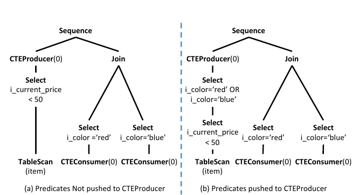

#### 6.3.2 单消费者 CTE 一律内联

在 Orca 中，作者使用一个启发式规则：**任何只有一个消费者的 CTE 自动内联。**

**例 6.**

```sql
WITH v as (SELECT i_color FROM item
            WHERE i_current_price < 50)
SELECT * FROM v
WHERE v.i_color = 'red';
```

这个查询中 `v` 只有一个消费者。**无论内联与否，CTE 表达式都只会执行一次。** 但是不内联时，还要额外付出物化与读回物化元组的代价。因此，**只被引用一次的 CTE 总是内联更好**。

#### 6.3.3 消除未被引用的 CTE

作为上一条优化的延伸，**在查询中从未被引用的 CTE 可以被整个删除掉。**

**例 7.**

```sql
WITH v as (SELECT i_color FROM item
            WHERE i_current_price < 50)
SELECT * FROM item
WHERE item.i_color = 'red';
```

例 7 中，`v` 被定义了却从未被引用。**无论 `v` 的定义多复杂，都可以完全删除它而不影响查询结果。** 这个做法还可以迭代地应用于含多个 CTE 的查询。

**例 8.**

```sql
WITH v as (SELECT i_current_price p FROM item
            WHERE i_current_price < 50),
     w as (SELECT v1.p FROM v as v1, v as v2
           WHERE v1.p < v2.p)
SELECT * FROM item
WHERE item.i_color = 'red';
```

这个查询里 `v` 被引用了两次，而 `w` 从未被引用。因此可以删掉 `w` 的定义。但这样一来，**对 `v` 的唯一引用也被移除了，于是 `v` 的定义同样可以删掉。**

## 七、上下文相关的优化

这一章讲本文最"有野心"的部分：把 CTE 优化整合进优化器核心，从而做到**同一个 CTE 在不同上下文中被以不同方式优化**。

早前的工作（如 Silva 等人）通过一个 CTE 重新优化阶段来处理这个问题，利用此前常规优化阶段中发现的 CTE 属性。

**据作者所知，本文的框架是第一个把 CTE 优化整合到优化器核心、从而避免完整重新优化的提案。** 把 CTE 与其他优化统一在一个框架里，会带来高效而系统的过程，消除冗余工作。**高效优化往往意味着更好的计划质量**，因为可以把更多资源投入到 join 排序这类昂贵操作上。

### 7.1 强制物理属性

Orca 通过处理 Memo group 中的优化请求来优化候选计划。**一个优化请求是一组需要由物理 group 表达式满足的物理属性。** 所需的物理属性包括排序序、数据分布、可回溯性、CTE 本身与数据分区。为清晰起见，这里只聚焦数据分布，其他属性处理方式类似。

收到一个优化请求时，每个物理 group 表达式会向它的子 Memo group 传递相应的请求。这些子请求取决于传入的需求以及算子自身的局部需求。

**优化期间，同一个 group 可能收到许多相同的请求。** Orca 用一个 group 哈希表缓存已计算的请求；只有当请求不存在于哈希表中时才会被计算。

CTE 优化要求在不同上下文中满足不同的物理属性，这可能导致彼此竞争的备选计划。下面用例 3 的查询说明这个过程。

#### 7.1.1 生产者上下文

**CTEProducer 的计划可以在不考虑 CTEConsumers 出现在哪里的情况下生成。**

图 11(a) 中，Sequence 算子向 group 4（CTEProducer 所在处）请求 ANY 分布。这个请求可以被 group 4 生成的任何计划满足。这种情况下，最便宜计划的派生分布是 `Hashed(i_sk)`，也就是 `item` 表自身的分布。接着，这个计划的物理属性被附加到发往 group 1 的请求上，CTEConsumers 从那里向下派生。

group 1 中 HashJoin 算子的局部需求意味着要根据连接条件（`v1.i_brand = v2.i_brand`）对齐孩子的分布。**目标是让将要连接起来的元组落在同一个节点上**，做法是向 group 2 和 group 3 同时请求 `Hashed(i_brand)` 分布。注意，**CTE 计划的属性仍然会附加在这些请求上**。

接下来，group 2 和 group 3 中的 CTEConsumers 检查 CTE 计划的分布（`Hashed(i_sk)`）是否满足请求的分布（`Hashed(i_brand)`）。**这里不满足**，于是 group 2 和 group 3 中被插入 `Redistribute(i_brand)` enforcer 来满足所需分布。

图 11(a) 展示了经过上述步骤后的候选计划，**其中 CTE 结果在同一个哈希表达式上被冗余地分发两次**。由于这个计划不知道 CTEConsumer 的上下文，这种冗余无法避免。**这可能不是最好的备选，因为它浪费了网络与 CPU 资源。**

#### 7.1.2 消费者上下文

**在 CTEConsumer 出现的上下文中，可能要求相同的属性。** 这些属性可以在 CTEProducer 表达式中被强制，从而避免重复劳动。

图 11(b) 中，CTEConsumer 算子**额外**把一个 `(Hashed(i_brand))` 请求（用虚线标注）回传给存在 Sequence 算子的 group 0。

**与其他优化请求不同，这个请求并非源自 Memo 中的父子关系，而是用来把 CTEConsumer 的需求推进 CTEProducer 计划。** 本框架之所以能这样做，是因为**每个 Sequence 都为其 CTE 在 Memo 中提供了优化入口点**。这种优化可以避免在 CTEConsumer 一侧做属性强制。

与前面的讨论类似，`(Hashed(i_brand))` 请求会触发新一轮跨 Memo group 的优化请求传播，结果是在 group 5 中加入一个 `Redistribute(i_brand)` 算子以强制所需的分布。当优化到达 group 2 和 group 3 时，**CTEConsumers 识别出所附着的 CTE 计划属性已经满足 `Hashed(i_brand)` 分布，因此 CTEConsumer 一侧不再需要属性强制。** 图 11(b) 展示了一个候选计划，**其中 CTE 结果在被 CTEConsumers 共享之前，被最优地分发了一次**。

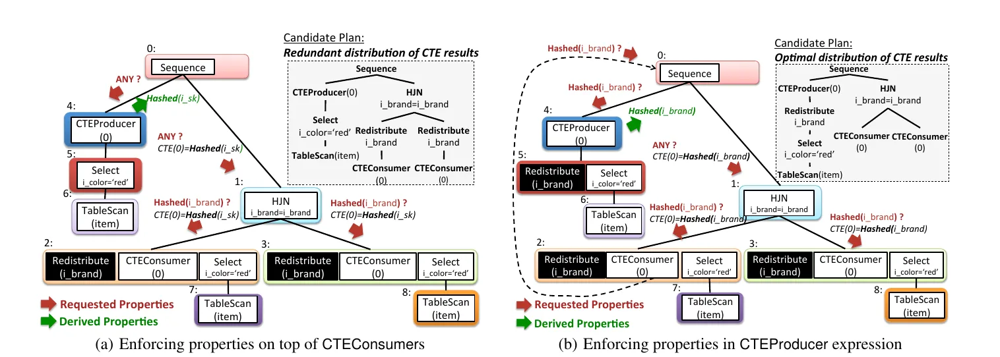

本例中 CTEConsumers 被部分或完全内联的备选计划仍然有效。优化器会估算所有这些不同备选的代价，从而挑出最好的可能计划。

还必须强调的是：**把 CTE 优化整合进 Orca 核心，意味着不再需要多阶段优化**（即把 CTE 放在常规优化完成之后再考虑）。此外，通过把 CTE 与其他优化放在同一个框架里，可以对搜索空间做全面的剪枝——做法是**在完整计算一个优化请求之前，先计算其代价的下界**，若已知存在代价更小的完整计划，就淘汰这个请求。这让更多的 CTE 优化得以提前截断。

### 7.2 代价估计

**正确地为 CTE 估代价对优化至关重要。**

- **CTEProducer 的代价**是执行其下整棵子树的代价，加上把结果物化到磁盘的代价；
- **CTEConsumer 的代价**是从磁盘读取这些行的代价，因此它的代价与一次表扫描相近；
- **另一方面，内联的 CTE 表达式**的代价是执行该表达式的完整代价。

对每个 CTEConsumer，优化器有两种备选计划：

1. CTE 表达式被内联，因而要付出执行该表达式的完整代价；
2. CTE 表达式不被内联，因而只付出读取 CTE 输出的代价。

**然而，在局部比较这两种备选是不正确的**，因为第二种备选隐含地假设了在别处有某个 CTEProducer 执行该表达式并写出结果。**CTEProducer 的代价不能直接加到 CTEConsumer 的读取代价上**，因为 CTEProducer 计算并写出的数据可以被多个消费者读取，**它的开销在这些消费者之间被摊销了**。

如 [14] 指出的，决定最佳计划**不能对每个 CTEConsumer 局部进行**，而必须把同一个 CTE 的所有消费者以及对应的 CTEProducer 一并考虑。

**与 [14] 的做法不同，本文的方法不需要额外计算所有消费者的最近公共祖先**——因为这已经是已知的：**它就是包含对应 CTEAnchor 的那个 Memo group。**

由于 **CTEProducer 通过 Sequence 附着到查询的其余部分**，任何包含 CTEProducer 的计划备选（例如图 3(b)）其代价都会被计入，**无论有多少个 CTEConsumers**。而不包含 CTEProducer 的计划（例如图 3(a)）则不承担这部分额外代价。于是，**代价的计算与计划比较随着不同备选被枚举而自然完成。**

## 八、基于 CTE 的优化

这一章说明 CTE 如何被**隐式**生成，用来优化那些可能根本没有显式 CTE 的查询。作者展示了 CTE 如何用于优化某些关系构造，例如 DISTINCT 聚合（8.1 节），以及公共子表达式消除（8.2 节）。

### 8.1 生成 CTE 的转换

在若干场景下，Orca 会在查询优化过程中使用隐式生成 CTE 的转换规则。例如，在优化窗口函数、全外连接和 DISTINCT 聚合时，Orca 会考虑使用 CTE 的计划备选。

**例 9.**

```sql
SELECT COUNT(DISTINCT cs_item_sk), AVG(DISTINCT cs_qty)
FROM catalog_sales WHERE cs_net_profit > 1000
```

例 9 中的查询对 `catalog_sales` 计算两个不同的 DISTINCT 聚合。**单个 DISTINCT 聚合的一种可行 MPP 执行策略**是要求输入按聚合列做哈希分布。这样可以把相同的值送到同一个节点，用多级聚合完成去重。

**然而，当需要两个或更多不同的 DISTINCT 聚合时**（例如 `COUNT(DISTINCT cs_item_sk)` 与 `AVG(DISTINCT cs_qty)`），这一策略就变得低效了，**因为每个聚合都要求在不同列上的分布。**

在 Orca 中，使用了一条**把不同 DISTINCT 聚合转换为 CTEConsumer 之间连接**的规则，这样只计算一次不同聚合的输入。这个连接的作用是把两个聚合值拼接进同一个结果元组中。图 12 展示了这条转换规则的输入与输出。

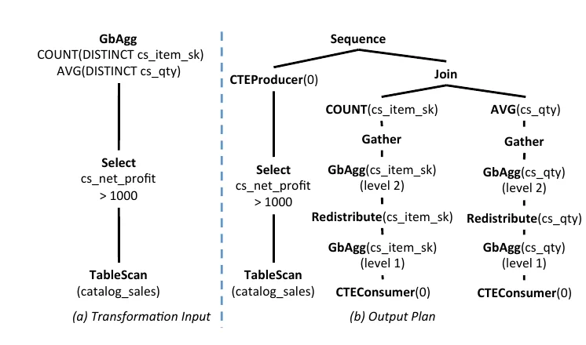

**每个 CTEConsumer 都经过一个基于某个聚合列的 Redistribute 算子。** 这让 MPP 系统的节点能够并行地执行 DISTINCT 聚合的计算。对于两个以上的 DISTINCT 聚合，这些连接可以级联。

### 8.2 公共子表达式消除

除了优化带显式 CTE 的查询，本文的框架还可以用来优化**没有被显式定义为 CTE 的公共子表达式**，也就是**公共子表达式消除**。

**例 10.** 考虑下面的查询：

```sql
SELECT *
FROM (SELECT i_brand, count(*) as b
      FROM item GROUP BY i_brand HAVING count(*) > 10) t1,
     (SELECT i_brand, count(*) as b
      FROM item GROUP BY i_brand HAVING count(*) > 20) t2
WHERE t1.i_brand <> t2.i_brand;
```

图 13(a) 展示了这条查询的逻辑表达式树。查询中存在一个重复出现的公共子表达式，用两个虚线框标出。

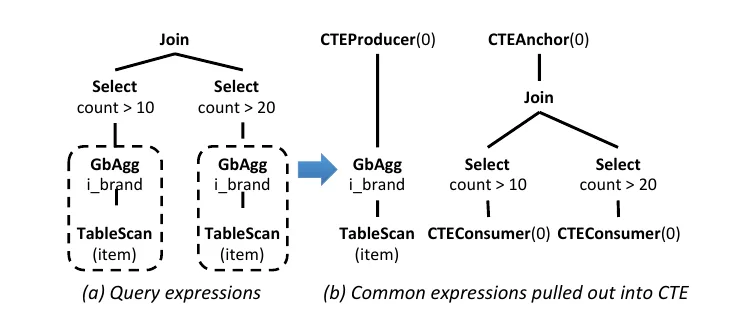

算法 2 把输入逻辑表达式 `expr_in` 变换为一个等价表达式 `expr_out`，其中公共子表达式被替换为 CTEConsumers。算法用 `DetectMatches()` 函数检测相同的子表达式（第 2 行），这个函数可以有多种实现方式，一种例子是使用 [11, 14] 中的**表签名**（table signatures）方法。`DetectMatches()` 的输出是一个集合 `M`，由 `expr_in` 中相互匹配的子表达式分组构成。

算出 `M` 之后，算法访问 `M` 中成员数大于 1 的每一个分组 `m`。对每个这样的分组，创建一个 CTEProducer，并把新建 CTE 的 id 赋给 `m.id`（第 3–6 行）。然后算法调用 `InsertCTEConsumers()`，它递归遍历子表达式，把每个公共子表达式替换为对应的 CTEConsumer。最后，**在每组公共子表达式的最近公共祖先（LCA）之上插入一个 CTEAnchor**（第 9–12 行）。图 13(b) 展示了处理完例 10 查询后的输出表达式。

作者指出这只是**一种可能的算法**，其他方法也可以用来识别相似（但不完全相同）的子表达式。在那个语境下，本框架可以借助若干视图匹配技术（第二章讨论过）。

## 九、执行

在 MPP 数据库中，查询计划的不同部分可以在不同进程中执行——既可以同在一台主机内，也可以跨不同主机。在 GPDB 这样的无共享 MPP 架构中，**同一主机内的进程共享同一个文件系统**，不同主机之间的进程通过网络通信。

Orca 生成的计划要求 CTEConsumers 从**同一主机内**的 CTEProducers 读取元组（既可以来自同一进程，也可以来自不同进程），**但绝不会要求从另一台主机上的 CTEProducer 读取。**

查询执行开始之前，**CTEConsumers 被实例化为 SharedScan 算子**，**CTEProducers 被实例化为 Materialize（Spool）或 Sort 算子**（如果该 CTE 产出的是有序结果）。

例 3 查询的一种可能执行计划见图 14。**Broadcast 算子管理图中两个活动进程之间的数据交换**。

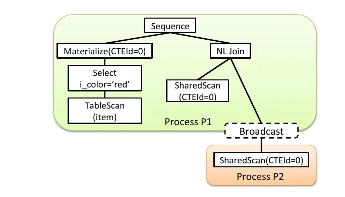

通常，一个 CTEProducer 有多个 CTEConsumers 在同一进程中执行，也有在其他进程中执行的。**执行引擎允许 CTEConsumers 在这两种情形下都从 CTEProducers 读取元组。** 此外，当涉及多个进程时，执行引擎提供一个**同步机制**，确保消费者可以等待生产者产出元组。**CTEProducer 与 CTEConsumers 通过共同的 CTEId 相互识别。** 另外，每个 CTEProducer 都标注了**同进程内的消费者数量与不同进程内的消费者数量**，这些信息用于消费者与生产者之间的同步协议。

在 GPDB 中，**一个包含 CTEConsumer 的进程，在开始执行分配给它的任何算子之前，会先执行一次依赖检查**。借助同步协议，它等待来自生产者的确认——所有元组都已产出、可以读取。**一个不包含任何消费者的进程则正常执行。** 如果某个进程中存在生产者，该生产者在所有元组可用之后通知所有消费者。**同步协议保证不会丢失通知，无论生产者和消费者以什么顺序到达同步点。**

生产者算子的结果被**显式物化到一个 TupleStore** 中——这是一个实现了"对一组元组迭代"接口的数据结构。**CTEProducer 的 TupleStore 可以存在内存中，也可以存在磁盘上**，取决于数据量、可用内存量以及 CTEProducer 上的计划要求。

- **当某个特定 CTEProducer 的所有消费者都位于同一进程时，消费者可以直接读取生产者 TupleStore 的内容。** 如果数据量能放进算子内存，TupleStore 就存在内存中，这会带来额外的性能收益。
- **如果至少有一个消费者位于不同进程中，TupleStore 就存在磁盘上。** CTEConsumer 收到文件名与"元组已在磁盘上"的通知，然后从磁盘读取元组。

**还有一个额外的优化适用于 CTEProducer 产出有序元组的情况：如果生产者之上的算子是 Sort 算子，就避免显式物化结果。** 因为 Sort 算子本身已经把自己的结果物化在一个 TupleStore 里，这个 TupleStore 可以直接与消费者共享。

带 CTE 的计划执行还可以通过**惰性执行 CTEProducer**来进一步改进：**只有当第一个 CTEConsumer 请求数据时，才真正执行 CTEProducer。**

- 如果 CTEProducer 与 CTEConsumers 在同一进程中，需要一种能在计划的不同部分之间跳转的机制；
- 如果它们位于不同进程中，则需要进程之间更多的协调，既包括流控，也包括在同一主机上的进程之间高效地发送元组。

**CTEProducer 还必须能在消费者以不同速率索取数据时溢写到磁盘。**

这类计划的代价**在优化期无法估计**，因为它完全取决于执行流程：代价估算会随 CTEProducer 是在内存中执行、溢写到磁盘，还是根本不执行而变化。作者把这类改进列为未来开发计划。

## 十、实验

### 10.1 实验环境

实验在一个由 8 个节点组成、以 10Gbps 以太网互联的集群上进行。每个节点配备双路 Intel Xeon 处理器（3.33GHz）、48GB 内存，以及 12 块 600GB SAS 磁盘（分为两组 RAID-5）。操作系统为 Red Hat Enterprise Linux 5.5。

使用 [TPC-DS 基准](https://www.tpc.org/tpcds)，数据规模 5TB。工作负载由 **48 条查询**构成——它们是 TPC-DS 中所有包含 CTE 的查询。

### 10.2 Orca 与 Planner 的对比

作者把 Orca 生成的计划与 GPDB 传统查询优化器（称为 **Planner**）生成的计划做对比，**Planner 总是内联 CTE**。

| 设置 | 执行时间 |
|---|---|
| Orca | 32,951.82 秒 |
| Planner | 57,176.04 秒 |

表 1 展示了用 Orca 与 Planner 跑完整个工作负载的总执行时间。**Orca 把总执行时间减少了 43%。**

图 15 展示了换成 Orca 后每条查询的相对性能提升。提升以使用 Planner 时执行时间的百分比计算，因此 10% 的提升意味着该查询用 Orca 时只需 Planner 90% 的时间。**横轴是用 Planner 的执行时间（对数刻度）。**

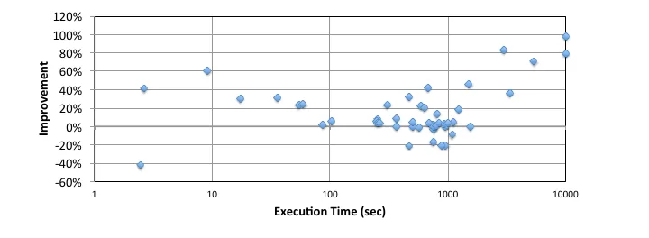

**可以看到，Orca 在整体上都加快了执行速度，短查询和长查询皆然。80% 的查询出现了性能提升。** 这一提升来自**避免不必要的 CTE 内联**（从而避免重复执行公共表达式），以及前面讨论的那些有效的 CTE 优化。

不过也存在一些实例，Orca 的计划与 Planner 的计划**一样好**。这通常发生在**物化与读回 CTE 输出的开销，大致等于 Planner 计划中多次执行 CTE 表达式所节省的时间**时。

**最后，还有少数查询在 Orca 下性能反而退化了。** 作者研究了这些案例，发现**主要原因是 Orca 选出了次优计划——这归咎于代价模型参数调校不完美，以及基数估算偏差**。

### 10.3 基于成本的内联

接下来，作者评估自己**基于成本的 CTE 内联方法**的效果，对比三种设置：

1. **基本 CTE 优化**——禁用 CTE 内联，也禁用向 CTEProducer 推进谓词；
2. **对所有 CTE 强制内联**；
3. **基于成本的内联，开启全部优化**——这是 Orca 的默认设置。

这个实验的目的是证明：**基于成本的内联通过以成本驱动的方式同时应用两个原则（纯内联与基本 CTE 优化），而不是把其中一个原则作为启发式选择，能生成更好的计划。**

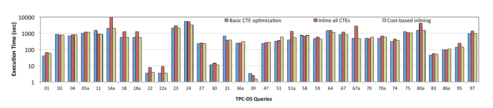

纵轴是执行时间（对数刻度）。作者观察到：**在 48 条 TPC-DS 查询中，有 14 条在三种设置下的执行时间差异小于 10%，因此在图 16 中被忽略。**

**在剩下的 34 条查询中，作者观察到：如果把内联当作启发式规则来用，会导致平均 44% 的性能回退，最坏情况下有 4 倍回退——query 14a 就是这种情况。**

**纯内联策略只在"被内联的 CTE 高度具选择性"的场景下才带来显著收益**，也就是 query 11 和 31——那里被内联的子查询基数只有几百行。**在这两个案例中，只使用基本 CTE 优化反而会造成 2 倍回退。**

**基于成本的内联方法兼取了两种做法的优点：**

- **只有一个消费者时，倾向于内联**（见图 17(a)）；
- **或者 CTE 足够便宜、可以重新执行时，倾向于内联**；
- **此外，当反复执行 CTE 表达式代价高昂时，基于成本的方法倾向于不内联。**

**这种混合方法，加上把谓词推进 CTEProducer 带来的收益**（见图 17(b)），**在优化开销可忽略的前提下，最多节省了 55% 的执行时间。**

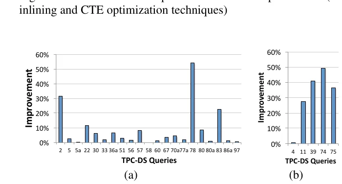

## 十一、总结

本文提出了一套用于表示、优化和执行 CTE 的完整框架。我们的工作显著扩展了优化器的基础设施，并解决了 MPP 系统中与分布式查询处理密切相关的多个挑战。我们使用标准决策支持基准展示了这些技术的效率。

## 译者注

**一、这篇论文的时间坐标。** 论文写于 2014 年，收录在 PVLDB 第 8 卷第 12 期，作为 VLDB 2015（夏威夷）的特邀论文发表。此时 Pivotal 仍是独立公司，两年后被 IBM 收购，Greenplum 与 Orca 随之进入 IBM 的数据平台产品线。今天读它，需要意识到它描述的系统与今天的 Greenplum 已经有相当距离。

**二、"十年前没人做 CTE 物化"是个误会。** 这篇论文恰恰说明 CTE 优化不是新问题：SQLite、SQL Server、Oracle、PostgreSQL、Vertica 都有各自的处理方式（Oracle 干脆给出 `MATERIALIZE` / `INLINE` 提示让用户手选）。**这篇论文的新意在于"在一个 MPP 优化器里把这件事做成一等公民，并且由优化器基于成本来决定"**——而不是"让 CTE 能物化"本身。

**三、十年后的对照。** Presto/Trino 生态长期只有内联一条路，直到 2026 年初，Trino 仓库里关于"是否支持 CTE 物化"的 issue（[#28085](https://github.com/trinodb/trino/issues/28085)）仍在讨论中；商业发行版 Starburst 则直接把"CTE 复用"做成了产品特性（[CTE reuse 文档](https://docs.starburst.io/latest/admin/cte-reuse.html)）。**换句话说，本文十年前在 MPP 优化器内部解决好的问题，在开源 MPP 生态里至今仍不算普及。**

**四、"上下文相关优化"是本文最容易被忽略、也最值得学的部分。** 第七章讲的技巧现在有个更时髦的名字：**把消费者的需求（过滤条件、分布要求、排序序）主动回传给生产者**。这在现代系统里对应动态过滤下推（dynamic filter pushdown）和属性传播（property propagation）——比如 Velox、Presto/Trino 都会把连接另一侧的选择性估计推给扫描算子。**思路是相通的：执行计划的物理属性不只往下传，还要能"横向"和"向上"流动。**

## 参考资料

- [Optimization of Common Table Expressions in MPP Database Systems（本文原文，PVLDB 8(12):1704-1713, 2014）](https://www.vldb.org/pvldb/vol8/p1704-elhelw.pdf)
- [Enhanced Subquery Optimizations in Oracle（PVLDB 2(2):1366-1377, 2009）](https://www.vldb.org/pvldb/vol2/vldb09-1366.pdf)
- [TPC-DS 基准](https://www.tpc.org/tpcds)
- [Trino issue #28085：Trino 是否支持 CTE 物化](https://github.com/trinodb/trino/issues/28085)
- [Starburst 文档：CTE reuse](https://docs.starburst.io/latest/admin/cte-reuse.html)

原文中还引用了以下工作，按原文参考文献编号列出：

- [2] Antova et al. *Optimizing Queries over Partitioned Tables in MPP Systems.* SIGMOD 2014.
- [6] Goldstein, Larson. *Optimizing Queries using Materialized Views: A Practical, Scalable Solution.* SIGMOD 2001.
- [7] Graefe. *The Cascades Framework for Query Optimization.* IEEE Data Eng. Bull. 18(3), 1995.
- [11] Silva, Larson, Zhou. *Exploiting Common Subexpressions for Cloud Query Processing.* ICDE 2012.
- [12] Soliman et al. *Orca: A Modular Query Optimizer Architecture for Big Data.* SIGMOD 2014.
- [14] Zhou, Larson, Freytag, Lehner. *Efficient Exploitation of Similar Subexpressions for Query Processing.* SIGMOD 2007.
- [15] Zhou, Larson, Chaiken. *Incorporating Partitioning and Parallel Plans into the SCOPE Optimizer.* ICDE 2010.

