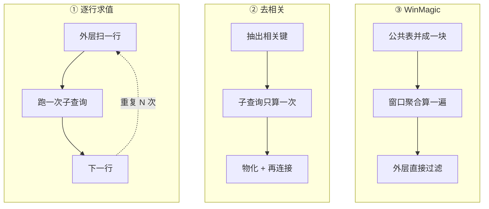
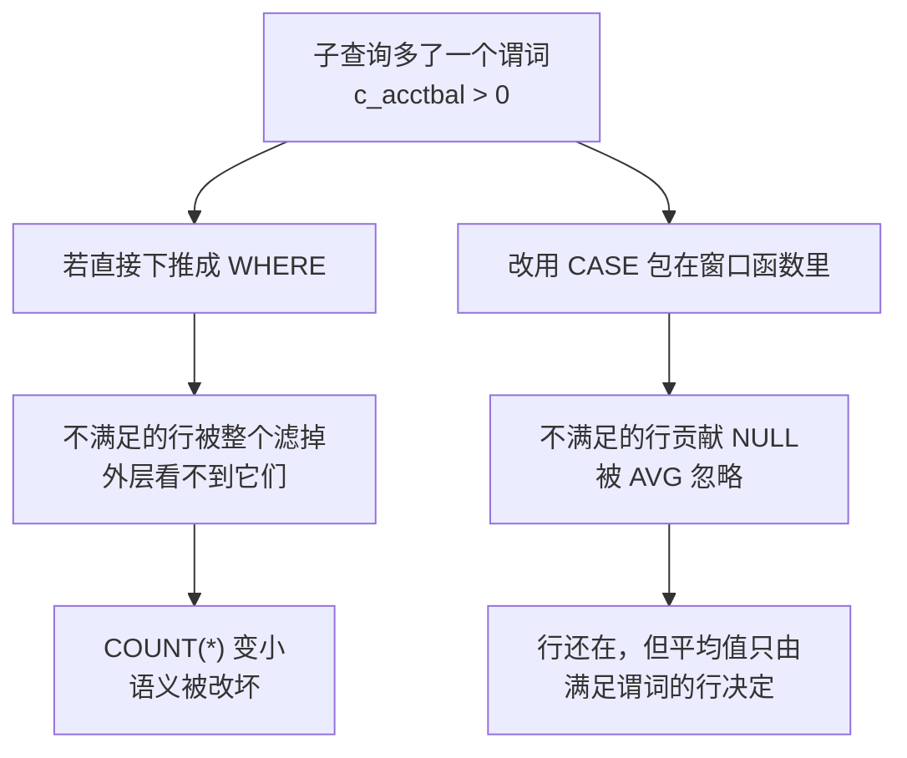

# WinMagic：用窗口聚合消灭相关子查询


<!--more-->

> 原文：Calisto Zuzarte, Hamid Pirahesh, Wenbin Ma, Qi Cheng, Linqi Liu, Kwai Wong. **WinMagic: Subquery Elimination Using Window Aggregation.** *Proceedings of the 29th ACM SIGMOD International Conference on Management of Data (SIGMOD 2003)*, June 9–12, 2003, San Diego, CA, pp. 652–656. DOI: 10.1145/872757.872840. IBM.

写 SQL 的人几乎都写过这样的东西：

```sql
SELECT emp_id, emp_name, dept_name
FROM employee E, department D
WHERE E.dept_num = D.dept_num
  AND E.state = 'CALIFORNIA'
  AND E.salary > (SELECT AVG(salary)
                  FROM employee E1
                  WHERE E1.dept_num = D.dept_num);
```

语法上没问题，跑出来也对。问题在**它怎么跑**。

外层每扫过一行 `employee`，就得回 `employee` 表算一次该部门的平均工资——扫十万行员工，就是十万次子查询执行。教科书管这叫嵌套循环连接（nested-loop join），字面上就是逐行求值。在共享无关（shared-nothing）的并行数据库里更糟：分区数据要一轮轮往协调节点传，代价被网络放大。

这类内层引用了外层值的子查询叫**相关子查询**（correlated subquery）。二十多年来，数据库研究者一直在想办法让它跑得更快。这篇讲 2003 年 IBM 的一个方案，它的角度很特别：**不去优化子查询，而是把子查询消灭掉。**

核心思路一句话说得清：**如果子查询里做的是聚合，而聚合的分组键恰好就是相关键，那这个聚合根本不需要逐行算——它可以用窗口函数一次算完。**

论文的价值不在这个想法本身（窗口函数是 SQL 标准里的东西），而在**一套自动改写规则**：什么样的查询能被改写、怎么改写、以及什么情况下会悄悄算错。这套规则今天已经很少被自动触发，但它描述的那类查询，你今天还会遇到。

| 层次 | 回答的问题 | 核心标识 | 本文对应章节 |
|---|---|---|---|
| 问题 | 相关子查询到底贵在哪？ | 逐行求值 | 第一章 |
| 谱系 | 二十年来人们怎么救它？ | decorrelation | 第二章 |
| 武器 | 窗口聚合凭什么能替代子查询？ | `OVER (PARTITION BY ...)` | 第三章 |
| 准入 | 什么样的查询能被自动改写？ | 四条检查规则 | 第四章 |
| 转换 | 具体怎么改？ | 拉下 + 窗口化 + 改道 | 第五章 |
| 变体 | 子查询带额外谓词怎么办？ | `CASE` 兜底 | 第六章 |
| 外延 | 非相关子查询与时序表 | `max() over (partition by ...)` | 第七章 |
| 效果 | 到底快多少？ | TPCH Q17 +50% | 第八章 |
| 回响 | 今天还成立吗？ | 窗口函数、`QUALIFY` | 第九章 |

## 一、问题：相关子查询的代价

### 1.1 一个典型查询

先看上面那条查询。它要做的事很朴素：列出加州员工中，工资高于本部门平均工资的人。

困难在于 `AVG(salary)` 这个子查询引用了外层的 `D.dept_num`。对每一个具体的部门，答案都不同，所以子查询没法提前算一次了事——至少按 SQL 的字面语义不行。

传统的执行方式是嵌套循环：

1. 扫 `employee`，取出第一行，`E.dept_num = 17`，`E.salary = 82000`；
2. 为了判断 `82000 > ?`，执行一次子查询：扫 `employee`，算出部门 17 的平均工资，得到 `73500`；
3. 保留这一行；
4. 取下一行，回到第 2 步。

**同一个 `employee` 表被扫了 N 遍**（N 是外层结果行数）。而且第二次扫的时候只需要部门 17 的行，数据库却得先把整个表过一遍才能确定它要哪些行。

### 1.2 时序表上的更糟版本

论文接着给了一个更狠的例子，来自时序数据库：

```sql
SELECT * FROM empl E1
WHERE eff_date = (SELECT MAX(eff_date) FROM empl E2 WHERE E1.emplid = E2.emplid)
  AND seq      = (SELECT MAX(seq)      FROM empl E3
                  WHERE E1.emplid = E3.emplid AND E1.eff_date = E3.eff_date);
```

这是"取每个员工的最新一条记录"的经典写法，语义完全正确。但它有两个子查询、两次额外扫描，而且第二个子查询还嵌套在第一个的判据里。论文的判断很直接：这样写不会得到高效的执行计划。

### 1.3 三种求值思路

到这里可以摆出三种思路的对比。传统做法与去相关是文献里的老路，WinMagic 是这篇论文的第三条路。



三条路的差别在于**同一份数据被读了几次**：

- ①最坏，N 次；
- ②好一些，子查询只算一次，但代价是物化 + 去重 + 再连接，多了两轮数据搬运；
- ③只有一次，而且没有物化表，也没有额外的连接——代价换成了"必须能把子查询表达成窗口聚合"这个约束。

WinMagic 的赌注是：对于一大类查询，这个约束能满足，而且满足时的收益远大于约束带来的麻烦。

## 二、去相关：二十年的努力

WinMagic 不是凭空冒出来的。论文第二章把前人的工作捋了一遍，这段谱系值得完整读，因为它解释了"为什么还需要 WinMagic"。

| 年份 | 工作 | 做法 | 留下的代价 |
|---|---|---|---|
| 1982 | Kim | 识别出若干固定形状的嵌套查询模式并直接改写 | 只能改写事先认识的形状 |
| 1987 | Dayal | 改进"用外连接消解相关"的方案，解决子查询结果为空时引入错误行的问题 | 覆盖的形状仍然有限 |
| 1987 | Ganski & Wong | 把相关值收集进临时表，投影出去重后的集合，再与子查询连接 | 仍要额外做一次连接 |
| 1990 | Mumick / Pirahesh / Ramakrishnan | **Magic decorrelation**：抽出相关键的不同值，物化子查询结果，再连接回外层 | 引入额外视图、连接与去重 |
| 1996 | Seshadri / Pirahesh / Leung | 把 Magic 扩展到复杂查询 | 改写规则更复杂，收益递减 |
| 1998 | Rao & Ross | 缓存不随外层值变化的那部分子查询结果 | 复用率完全取决于谓词选择性 |
| 1996–97 | Chatziantoniou & Ross | 提出 SQL 语法扩展，让分组能按组逐组处理 | 需要用户改写自己的 SQL |
| 2001 | GalindoLegaria / Joshi（SQL Server） | **SegmentApply**：抽出公共子表达式，一组一组地算 | 仍然是"一次算一组" |

两条主线值得展开。

**Magic decorrelation** 是分水岭。它的做法是：先扫一遍外层，收集相关键的**不同取值**（`DISTINCT`），用这些值把子查询**物化**成一张临时关系，再把临时关系和外层连接起来。

这比逐行求值好得多——子查询确实只算一次了。但论文对它的评价很直白：

> Although the rewritten query introduces extra views, joins and duplicate removal, we can expect better performance since the subquery is evaluated once with a consolidated temporary relation and avoids a tuple-at-a-time communication overhead.

多出来的视图、连接、去重，在数据量大的时候会把收益吃回去。

**SegmentApply** 是论文承认的"最接近的一步"（Microsoft SQL Server 的实现）。当一个连接的两侧共享某个公共子表达式时，把它提出来，算完之后再连接回去。它和 WinMagic 的关键差别，论文一句话点破：

> the major difference being that with window aggregation, we go a step further and do not require a CSE and the join.

**窗口聚合不需要公共子表达式，也不需要那次连接。** 这就是 WinMagic 相对前人的增量。

## 三、窗口聚合：把相关键变成分区键

### 3.1 OVER 子句的三段式

论文先补了一段窗口函数的基础。SQL 标准的写法是：

```
Function(arg) OVER ( partition-clause, order-clause, window-agg-group )
```

三段都是可选的：

| 子句 | 类比 | 作用域 |
|---|---|---|
| `partition-clause` | 像 `GROUP BY` | 只在函数内部有效 |
| `order-clause` | 像语句的 `ORDER BY` | 只在函数内部有效 |
| `window-agg-group` | 指定聚合作用的行窗口 | 只在函数内部有效 |

论文只展开了 `partition-clause`，因为它就是 WinMagic 唯一用到的那一段。

### 3.2 窗口聚合最关键的性质

论文用了一个精确的说法：窗口聚合函数**既是聚合函数，又在某种意义上是标量函数**（this is both an aggregation function and in some sense a scalar function）。

关键在于它**不折叠行**（does not collapse the rows involved when computing the aggregation）。`GROUP BY` 会把 N 行压成 1 行，窗口聚合不会——它照旧输出每一行，只是在每一行上额外挂一个"我所属分组的聚合结果"。

论文给了一个直观的例子：

```sql
SELECT empnum, dept, salary,
       SUM(salary) OVER (partition by dept) AS deptsum,
       DECIMAL(salary,17,0) * 100 /
           SUM(salary) OVER (partition by dept) AS salratio
FROM employee;
```

输出的 `deptsum` 在同一个部门的所有行上重复出现：

| EMPNUM | DEPT | SALARY | DEPTSUM | SALRATIO |
|---|---|---|---|---|
| 1 | 1 | 78000 | 383000 | 20.365 |
| 2 | 1 | 75000 | 383000 | 19.582 |
| 5 | 1 | 75000 | 383000 | 19.582 |
| 9 | 2 | 51000 | 51000 | 100.000 |
| 8 | 3 | 79000 | 209000 | 37.799 |
| 3 | - | 84000 | 84000 | 100.000 |

这一列重复的信息，正是子查询每行都要重新算一遍的东西。**相关键 = 分区键**，子查询就变成了窗口聚合。

## 四、四条准入规则

这是论文最实用的部分。改写不是万能的，论文在 §3.2 列了一整套**前置检查**，任何一条不满足就不能改写。

### 4.1 规则一：外层块

外层查询块必须同时满足两个条件：

- **(a)** 含有一个带聚合的子查询——没有聚合就没有可窗口化的对象；
- **(b)** 不存在阻止主查询块拆分的东西，比如**有副作用的函数**。带副作用的函数不能随意搬来搬去。

### 4.2 规则二：子查询块

子查询块必须同时满足三个条件：

- **(a)** 没有"奇怪的函数"（odd functions）——论文指的是那些结果依赖求值时机、无法安全重放的函数；
- **(b)** 没有 `ORDER BY`，也没有 `FETCH FIRST n ROWS ONLY`；
- **(c)** 这个子查询**没有被当作公共子表达式复用**（not used as a common sub-expression）。

第二条和第三条各有道理：`ORDER BY` + `FETCH FIRST n` 意味着子查询有"取前 n 行"的语义，窗口聚合表达不了；子查询被多处复用时，改写它会牵动其他引用。

### 4.3 规则三：聚合函数

聚合函数本身要满足：

- **(a)** 存在等价的窗口聚合函数；
- **(b)** 聚合内部**没有 `DISTINCT`**。

`DISTINCT` 被单独排除，是因为 `SUM(DISTINCT x)` 和 `SUM(x) OVER (PARTITION BY ...)` 语义不同——后者会把重复值算多次。

### 4.4 规则四：匹配

前三条都是局部的，这条是整体的。做法是：

> 把外层块里的候选表（包括公共表和参与相关的表）拼成一个**临时补充查询块**，然后调用**物化视图匹配**用的那套例程去做匹配。

这一步是整个方案在工程上最讨巧的地方——DB2 已经有成熟的物化视图匹配逻辑（论文引用了 Zaharioudakis 等人的 SIGMOD 2000 工作），WinMagic 直接复用，不用另造一套匹配器。

### 4.5 通用结构

论文用两张结构图概括了输入形态。翻译过来大致是这样：

- **T1**：只在子查询里出现的表；
- **T3**：外层和子查询**共用**的表，也就是相关的载体；
- **T4**：只在主查询块里、且与 T3 相连的表；
- **T2**：出现在主查询里、但不与 T4 相连的表。

关键约束是论文那句：

> T1 in the subquery is a lossless join.

子查询侧那部分的连接必须**无损**——不能把行数放大，否则聚合的分母就变了。

## 五、三步转换

准入检查通过后，改写分三步。论文的表述很精确，我逐条拆开。

### 5.1 第一步：把聚合换成窗口聚合

聚合函数被替换成窗口聚合函数，作为**子查询里的额外一列**。`partition-clause` 就用来定义分组——分组键是相关键。

这是唯一真正改变查询结构的一步，另两步都是围绕它做的搬运。

### 5.2 第二步：把相关涉及的表"拉下"到子查询

外层块里参与相关的表，被拉下来并进子查询。这一步有两个分支，论文写得很清楚：

> No costing is required if the tables being joined in the outer query block are primary key or unique column joins. If this is the case, then we do not multiply the number of rows that go into the aggregation. If this is not the case, then we need to cost the transformation and compensate within the aggregation by adding a key.

翻译成规则：

- 如果外层块里的连接是**主键或唯一键连接**，连接不会放大进入聚合的行数，**不需要估价**，改写安全；
- 否则，必须**估价**这次改写的代价，并在聚合里**补一个键**（即在 `PARTITION BY` 里加上额外的列）来补偿，让聚合在正确的粒度上进行。

### 5.3 第三步：把列改道

外层查询需要的列，全部改为从子查询流上来的列；外层块里那些没人再引用的表，删掉。

这一步是纯清理——改写后的查询里，外层和子查询不再是两块，而是一块。

### 5.4 完整例子

论文用 TPC-H Q17 做例子。原始查询：

```sql
SELECT SUM(l_extendedprice) / 7.0 AS avg_yearly
FROM   tpch.lineitem, tpch.part
WHERE p_partkey = l_partkey AND
      p_brand = 'Brand#23' AND
      p_container = 'MED BOX' AND
      l_quantity < (SELECT 0.2 * avg(l_quantity)
                    FROM tpch.lineitem
                    WHERE l_partkey = p_partkey);
```

改写后：

```sql
WITH WinMagic AS
  (SELECT l_extendedprice, l_quantity,
          avg(l_quantity) OVER (partition by p_partkey) AS avg_l_quantity
   FROM tpch.lineitem, tpch.part
   WHERE p_partkey = l_partkey and
         p_brand = 'Brand#23' and
         p_container = 'MED BOX')
SELECT SUM(l_extendedprice) / 7.0 AS avg_yearly
FROM WinMagic
WHERE l_quantity < 0.2 * avg_l_quantity;
```

变化列成一张表：

| 维度 | 改写前 | 改写后 |
|---|---|---|
| `lineitem` 访问次数 | 2 次（外层 + 子查询） | 1 次 |
| 子查询 | 有，相关 | 没有 |
| 分组方式 | `GROUP BY` 语义上的隐式分组 | 显式 `PARTITION BY p_partkey` |
| 中间结果 | 无 | 一个内联视图 `WinMagic` |

`lineitem` 是 TPC-H 里最大的表，少扫一遍就是全部收益的来源。

这里有个细节值得说清楚：**改写后 `p_brand = 'Brand#23'` 这个谓词留在了 WinMagic 块里，为什么不会改变平均值？**

因为 `p_brand` 是 `p_partkey` 的函数依赖——一个 part 要么品牌是 `Brand#23` 要么不是。这条谓词作用在 part 上，而聚合的分区键是 `p_partkey`。对任何一个具体的 part，它的全部 lineitem 要么一起留下、要么一起被滤掉。**被整组丢弃的分区，外层根本不会去读它；被整组留下的分区，聚合的输入集合和原来完全一致。** 所以每个 part 的平均值没变，结果也就没变。

这正是论文那句"无损连接"的含义。

## 六、子查询带额外谓词时：CASE 兜底

前面是最顺的情况：子查询里只有一个相关谓词。现实里子查询常常还有别的限制条件。

### 6.1 Query 6

```sql
SELECT cntrycode, COUNT(*) AS numcust, SUM(c_acctbal) AS totacctbal
FROM (SELECT SUBSTR(c_phone, 1, 2) AS cntrycode, c_acctbal
      FROM tpch.customer
      WHERE SUBSTR(c_phone,1,2) IN ('13','31','23')
        AND c_acctbal > (SELECT avg(c_acctbal)
                         FROM tpch.customer
                         WHERE c_acctbal > 0.00 AND
                               SUBSTR(c_phone,1,2) IN ('13','31','23'))
     ) AS cstsale
GROUP BY cntrycode ORDER BY cntrycode;
```

子查询比外层多了一个 `c_acctbal > 0.00`。

### 6.2 问题在哪

论文的提醒很精准：

> The extra subquery predicate must not be applied to the rows of the outer query block (although in this specific case it would be OK).

子查询的额外谓词**不能作用到外层的行上**。如果直接把它下推，整个结果集的形状就变了——那些 `c_acctbal <= 0` 的客户会从外层消失，`COUNT(*)` 也就跟着变了。

但这个谓词又**必须**影响聚合值：原来的子查询算的是"正余额客户的平均余额"，不是"全部客户的平均余额"。

两个要求看起来打架。论文给的解法是用 `CASE` 表达式的**判别式聚合**：

### 6.3 Query 7 的解法

```sql
SELECT cntrycode, COUNT(*) AS numcust,
       SUM(c_acctbal) AS totacctbal
FROM (SELECT SUBSTR(c_phone, 1, 2) AS cntrycode,
             c_acctbal,
             AVG(CASE WHEN (c_acctbal > 0) THEN c_acctbal
                      ELSE NULL END) OVER () AS AVGACCTBAL
      FROM tpch.customer
      WHERE SUBSTR(c_phone,1,2) IN ('13', '31', '23')
     ) AS cstsale
WHERE c_acctbal > AVGACCTBAL
GROUP BY cntrycode ORDER BY cntrycode;
```

机制是这样的：



关键在 `AVG` 对 `NULL` 的处理：`AVG` 会跳过 `NULL`，但**行本身没有被删掉**。所以：

- 外层仍然能看到所有 `c_acctbal > 0` 的行（`WHERE` 里只有 `SUBSTR(c_phone,1,2) IN (...)`）；
- 而 `AVGACCTBAL` 这个窗口聚合值只由 `c_acctbal > 0` 的行决定，和原来子查询算出来的值一致。

`OVER ()` 后面是空的——这个聚合没有分区，是全局聚合。但它依然能一次性算完，因为算完之后每一行都带上了这个值。

**这是整篇论文里最值得记住的一个技巧**：当子查询的过滤条件不能安全下推时，不要下推，而是把它折进聚合函数内部。

### 6.4 边界

这个技巧不是万能的。`CASE` 兜底只适用于**标量聚合**（`AVG`、`MAX`、`MIN`、`SUM`、`COUNT`）。如果子查询返回的是多行、或者带了 `DISTINCT`、或者有 `GROUP BY`（即聚合结果是分组的多行），`CASE` 就表达不了。

论文的规则三（聚合不能有 `DISTINCT`）在这里再次生效。

## 七、外延：非相关子查询与时序表

### 7.1 非相关子查询也适用

论文明确指出：

> WinMagic is not only applicable to correlated subqueries. Evaluate-at-open subqueries could also be handled.

"求值一次型"（evaluate-at-open）的子查询——也就是不引用外层、整个查询只算一次的子查询——同样可以受益。这类子查询在传统做法里会被物化成临时表，然后和外层连接。WinMagic 把它变成一个窗口聚合，省掉物化与连接。

论文还顺带说了一句：WinMagic **也可以扩展到不含聚合的子查询**。

### 7.2 时序表：取最新一行

回到 §1.2 那个时序查询。论文给的改写是：

```sql
SELECT … FROM
  (SELECT E1.*,
          max(eff_date) OVER (partition by emplid) AS ME,
          max(seq)      OVER (partition by emplid, eff_date) AS MS
   FROM empl E1) AS E
WHERE eff_date = ME AND seq = MS;
```

这个改写把**两个层级的"取最新"**编码成了两个分区：

- 第一个窗口 `partition by emplid`：在这个员工的全部历史记录里取最大的 `eff_date`；
- 第二个窗口 `partition by emplid, eff_date`：在"这个员工的这一天"的所有记录里取最大的 `seq`。

改写之后，`empl` 表只扫一次，两个 `MAX` 都在一次扫描里算完，而且没有任何 join。

对比一下原始查询的结构：两个子查询、两层嵌套、两次额外扫描。改写后：一个派生表、两个窗口函数、零次额外扫描。

顺带一提，这个"取每个分组的最新一行"的模式，今天已经有更省事的写法：Snowflake、BigQuery、DuckDB 的 `QUALIFY`，或者通用的 `ROW_NUMBER() OVER (PARTITION BY ... ORDER BY ...) = 1`。

## 八、性能实测

### 8.1 测试环境

论文的实验条件：

- 100GB 规模的 TPC-H 数据库；
- IBM p660 服务器，AIX 操作系统；
- 5 节点分区数据库；
- 分区内并行度设为 4。

### 8.2 Q17：约 50% 的提升

论文里对应 Query 4 的 TPC-H Q17，成绩提升约 **50%**。论文把大部分功劳归给消除 `lineitem` 的重复访问。

### 8.3 Q2：只有 10%–15%

对应 Query 9 的 TPC-H Q2，提升只有 **10%–15%**。论文给出的解释很实在：

> Even though multiple table accesses and joins were eliminated using WinMagic in Query 9, the performance gain was not as significant since the tables involved were small and the pages for the redundant table access were most likely in the bufferpool for the magic decorrelation version.

涉及的表本来就小，而且 magic decorrelation 版本重复访问的那些页**大概率已经在缓冲池里**了。扫一遍小表本来就不贵，省下来的也就那么点。

这个观察比 50% 那个数字更有价值：**WinMagic 的收益正比于"被省掉的那次访问有多贵"。** 表大、冷缓存、扫描代价高，收益就大；反之几乎白干。

### 8.4 10TB 规模：50%–60%

在 10TB 的 TPC-H 上，两个查询的提升都在 **50%–60%**。数据越大，重复扫描越痛，收益越明显。

## 九、今天怎么看这套规则

### 9.1 窗口函数已经普及

论文发表时，窗口函数刚刚进入 SQL 标准。之后的落地节奏大致是：Oracle 1999 年第一个实现，IBM DB2 LUW 2000 年跟进（也就是这篇论文的同一个团队），PostgreSQL 直到 8.4（2009）才加上，SQL Server 2012、MySQL 8.0（2018）、Oracle 12c 陆续补齐。

论文里的实现就落在 **IBM DB2 Universal Database V7 与 V8** 上——DB2 V7 正是 2000 年那一版。**论文写作的前提条件，今天已经全部满足了。**

### 9.2 但自动改写没普及

有意思的是：**窗口函数普及了，WinMagic 这条自动改写路线却没有跟着普及。**

原因是规则的适用范围太窄。把第四章的四条规则摊开看：

- 子查询必须只有一层聚合、且聚合能用窗口函数表达；
- 子查询不能有 `ORDER BY` / `FETCH FIRST`；
- 聚合不能有 `DISTINCT`；
- 连接必须无损，否则要补键并估价。

真实业务里的子查询远比这复杂：**多表关联的 `NOT EXISTS`、带 `OR` 的相关条件、多层嵌套、返回多行的子查询**——这些一条都不满足。

而且论文的规则里漏掉了一个现代优化器绕不开的问题：**子查询结果为 `NULL` 时的语义**。`salary > (SELECT AVG(...))` 在子查询无行时结果是 `UNKNOWN`，行会被滤掉；改写成窗口聚合后，如果没有匹配的行，窗口值也是 `NULL`，行为一致——但这需要优化器显式保证，而不是碰巧对上。

论文其实点到过这个问题，只是放在了前人的工作里：Dayal 的工作"改进的正是外连接在子查询结果为空时引入的错误行"。WinMagic 继承了前人的处理，但它没有把这一点写成一条独立的规则。

### 9.3 今天手写该写什么

如果今天的你要手写这类查询，标准解法不是等优化器，而是直接换写法：

| 场景 | 今天的写法 |
|---|---|
| 取每个分组的最新一行 | `QUALIFY ROW_NUMBER() OVER (PARTITION BY k ORDER BY ts DESC) = 1` |
| 标量聚合子查询 | `LEFT JOIN` + `GROUP BY`（手工去相关） |
| 需要引用外层每一行 | `LATERAL`（子查询可引用左侧列） |
| 分组内的累计值 | 窗口函数 `OVER (PARTITION BY ... ORDER BY ...)` |

`LATERAL` 值得单独提一句：它把"逐行求值"变成了**显式**的东西。相关子查询本来就是 LATERAL 的语法糖，只不过过去大家默认它会被优化成 join，而现代引擎（如 Trino）明确表示自己只能去相关有限形式的嵌套 join——遇到去不掉的就老老实实按 LATERAL 跑。

**WinMagic 的判断在这里依然成立**：能批量算的，就别逐行算。只是今天的批量算不一定靠窗口聚合，也可能靠 join、LATERAL 或物化视图。

### 9.4 活下来的洞察

抛开自动改写，这篇论文有三个判断在二十三年后依然成立：

**第一，优化的本质是"少读数据"。** 论文的 50% 和 10% 之间的差别，全部来自"被省掉的那次扫描有多贵"。这条到今天依然是调优的第一原则。

**第二，"能不能改写"和"改写划不划算"是两个问题。** 论文用四个准入检查回答了前者，用 costing 和补键回答了后者。这个二分法是通用的——物化视图、索引、分区裁剪，全都在回答这两个问题。

**第三，把语义约束显式化。** 第六章的 `CASE` 兜底是全文最实用的技巧：当你发现"下推会改变结果集"时，别下推，把约束折进计算内部，让它只影响该影响的那部分。

## 结尾

> 相关子查询慢，不是因为它算得多，而是因为它被**重复地算了**。当聚合的分组键恰好就是相关键时，这一次重复可以彻底消除——用窗口聚合一次算完，让子查询从查询里消失。

如果只能带走四句话：

1. **WinMagic 不是去相关，是消灭子查询。** 前人（Magic decorrelation、SegmentApply）都要付出"物化 + 去重 + 再连接"的代价，窗口聚合不需要公共子表达式，也不需要那次连接。
2. **准入规则是全文的骨架。** 外层无副作用函数、子查询无 `ORDER BY`/`FETCH FIRST`/非 CSE、聚合有窗口等价物且无 `DISTINCT`、连接无损——四条全过才动手。
3. **子查询的额外谓词不能下推，要折进聚合里。** 用 `CASE WHEN 条件 THEN 值 ELSE NULL END` 包住聚合函数，让 `AVG` 跳过 `NULL`，既保住外层的行，又保住聚合的值。
4. **收益正比于省掉的扫描有多贵。** 论文里 TPC-H Q17 提升 50%，Q2 只有 10%–15%——因为后者的表小、页还在缓冲池里。数据量越大、越冷，收益越明显。

### 参考资料

- Calisto Zuzarte, Hamid Pirahesh, Wenbin Ma, Qi Cheng, Linqi Liu, Kwai Wong. [WinMagic: Subquery Elimination Using Window Aggregation](https://dl.acm.org/doi/10.1145/872757.872840). *SIGMOD 2003*, pp. 652–656.
- I. S. Mumick, H. Pirahesh, R. Ramakrishnan. *The Magic of Duplicates and Aggregates*. VLDB 1990.
- P. Seshadri, H. Pirahesh, T. Y. C. Leung. *Complex Query Decorrelation*. ICDE 1996.
- Jun Rao, Kenneth A. Ross. *A New Strategy for Correlated Queries*. *ACM SIGMOD*, 1998, pp. 37–48.
- C. A. GalindoLegaria, M. Joshi. *Orthogonal Optimization of Subqueries and Aggregation*. *ACM SIGMOD*, 2001.
- M. Zaharioudakis, R. Cochrane, G. Lapis, H. Pirahesh, M. Urata. *Answering Complex SQL Queries Using Automatic Summary Tables*. *ACM SIGMOD*, 2000, pp. 105–116.
- Viktor Leis et al. *Efficient Processing of Window Functions in Analytical SQL*. ICDE 2015.（窗口函数实现史的权威综述）

