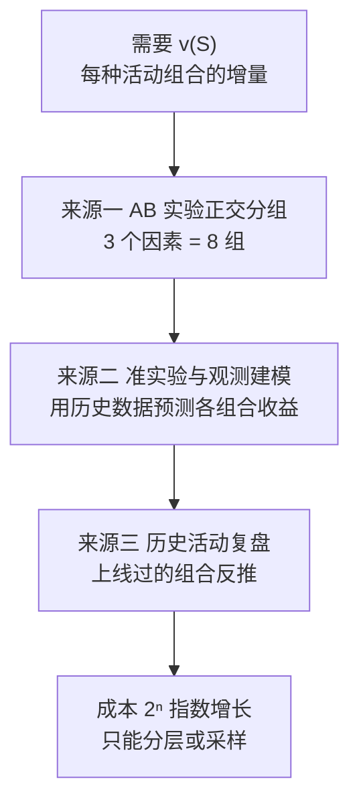
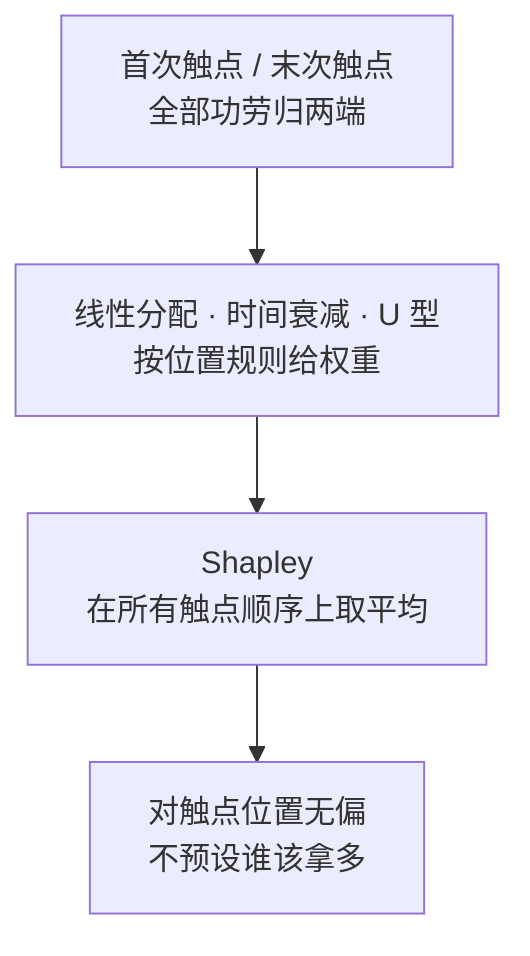
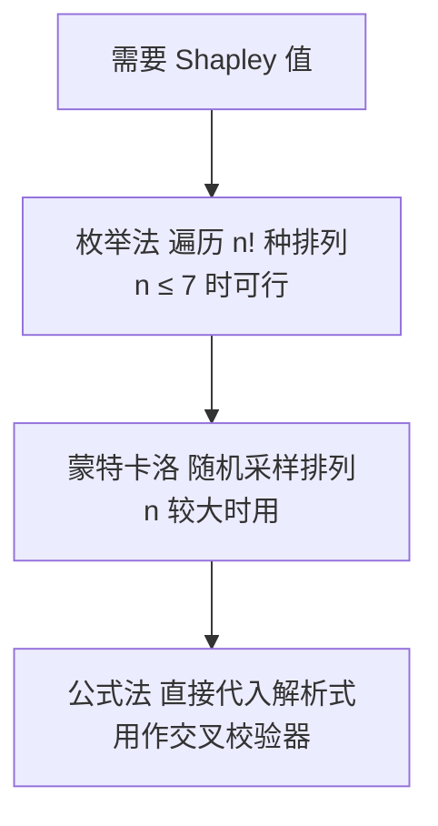

# 多因素叠加归因：Shapley 值与多触点权重


<!--more-->

大促复盘会上，市场部把三个活动的成绩单摊开：满减带来 1 万新增，折扣 2 万，直播 3 万。

老板问了一个更难的问题："三个活动是同时上的，这周总共新增 10 万。满减、折扣、直播各贡献了多少？"

财务当场算了一笔账：三个活动单独做的增量加起来是 6 万，实际是 10 万。多出来的那 4 万，是活动之间的交互——满减和直播一起做的效果，远超过各自单做之和。可这 4 万究竟该记在谁头上？更要紧的是那个 7 万：AB 实验里"满减 + 直播"这一组的新增量是 7 万，可这 7 万里，直播自己的 3 万之外，还有多少是满减激发出来的？

**Shapley 值回答的就是这类问题：多个因素同时作用、彼此有交互、又写不出显式函数时，怎么把功劳分得既闭合又公平。**它的全部做法可以压成一句话——每个因素的分配额，等于它的边际贡献在所有可能加入顺序下的平均值。

本系列前四篇的方法在这里全部失效：Delta 法要求指标可加，LMDI 要求能写成乘积，组间组内拆解处理的是比率型指标，链式拆解处理的是串联漏斗。本篇给出 Shapley 值的完整推导、可运行实现，以及它和多触点权重分配的关系。

| 章节 | 回答什么问题 | 核心产出 |
|---|---|---|
| 一 | 前四篇的方法为什么在这里失效 | Shapley 的适用边界 |
| 二 | 合作博弈怎么建模 | 玩家集合 · 特征函数 · 四条公理 |
| 三 | 公式和权重从哪来 | 组合计数推导 · 交叉校验器 |
| 四 | 满减、折扣、直播实算 | φ = 16/6 · 16/6 · 28/6 |
| 五 | v(S) 从哪来 | AB 正交分组等三个来源 |
| 六 | 多触点权重怎么分 | 规则法的偏差 + Shapley 的位置 |
| 七 | 哪里会出错 | 随机顺序假设 + 加权 Shapley |
| 八 | 工程实现 | 枚举法 · 蒙特卡洛 · 公式校验 |

## 一、什么时候轮到 Shapley

### 1.1 前四篇的刀，在这一刀面前都卷了刃

[第一篇](/posts/2026/11/cba63f94/) 按指标形态把方法分了族。回到本例逐个试一遍：

| 方法 | 它要的前提 | 本例为什么用不了 |
|---|---|---|
| **Delta 法** | 指标可加，各部分相加等于整体 | 三个活动的增量加起来是 6 万，不是 10 万 |
| **LMDI** | 指标能写成乘积 | 这里没有可拆的连乘结构 |
| **组间组内拆解** | 指标是比率型 | 新增用户数是绝对量，不是比率 |
| **链式拆解** | 环节串联，前一环是后一环的分母 | 三个活动是并行的，不是漏斗上下游 |

四种方法都不适用，不是因为它们算得不准，而是因为它们各自要求一个**本例不满足的前提**。这是选型时最值得记住的一层：**方法失效往往不是精度问题，是输入形态不匹配。**

### 1.2 新问题的三个特征

Shapley 接手的问题有三个特征，缺一个都不该用它：

- **多因素同时作用**,不是"哪个维度掉了"，而是"几个因素各占几成"，最后要凑出一组加起来等于总增量的分配。
- **彼此存在交互**, $v(A∪B) ≠ v(A) + v(B)$。本例里满减与直播的交互高达 3 万，这部分增量本身就需要被分配出去——它是分配的对象，而不是分配的残渣。
- **写不出显式函数**, $Y=f(X₁, X₂, X₃)$写不出来，[第二篇](/posts/2026/11/c35540ac/) 里的定基代替和泰勒展开都要求有函数表达式，这里直接出局。

第三条是 Shapley 相对同门方法真正的优势。**它只需要知道"每种组合能带来多少"，不需要知道"组合是怎么算出结果的"。**这是个更弱的输入要求，也是一个更通用的问题形式。

### 1.3 一句话判据

上手前先问自己一句：**"你能为每种因素组合都测出一个数吗？"**

能，Shapley 就能上，而且不用管这些数之间是不是有函数关系。不能，就得先解决 5.1 节的测量问题。

$$
v\left(S \cup \\{i\\}\right) - v(S)
$$

## 二、从合作博弈说起

### 2.1 问题设定：把活动当成玩家

Shapley 值来自博弈论里的**合作博弈**问题。搬到归因场景，需要三样东西：

**玩家集合 N。**本例 N = {满减, 折扣, 直播}。每个玩家是一个"能够被开启的因素"，而不是一个渠道、不是一个维度。

**特征函数 v(S)。**对每个子集 S ⊆ N，v(S) 表示这批玩家**合作**能获得的收益。本例里 v(S) 就是"同时开 S 中这些活动能带来多少新增用户"。特别地，v(∅) = 0——什么都不开，交互增量无从谈起。

**目标：把 v(N) 公平分配。**三个活动全开能带来 10 万新增，问题是怎么把这 10 万拆成三份，每份都要有依据。

$$
\varphi\_i = \text{所有 } n! \text{ 种顺序下，} i \text{ 的边际贡献的平均值}
$$

注意这里的建模选择：**玩家是"活动"，不是"渠道"。**渠道是并列的拆解维度，活动是可以同时开启的开关。这个区别决定了 v(S) 的定义方式，也决定了后面能问什么问题。

### 2.2 核心思想：边际贡献在所有顺序上的平均

玩家 i 的**边际贡献**，指的是它加入一个已有联盟 S 时多出来的收益：

$$
\varphi\_i = \sum\_{S \subseteq N \setminus \\{i\\}} \frac{|S|! \\, (n - |S| - 1)!}{n!} \times \left[ v\left(S \cup \\{i\\}\right) - v(S) \right]
$$

这个量依赖 S。同一个满减，排在第一个时边际是 1，排在最后时边际是 4。**"满减值多少"这个问题本身是不完整的，必须追问"在什么基础上算"。**

Shapley 的做法是：把所有可能的加入顺序都走一遍，每个顺序下算一次边际贡献，然后取平均。

$$
\Pr\left(i \text{ 前面恰好是 } S\right) = \frac{|S|! \\, (n - |S| - 1)!}{n!}
$$

这就是全部。剩下的推导都是"这个平均值怎么写成能算的形式"。

### 2.3 四条公理：凭什么说它"公平"

Shapley 值不是随便挑的一个平均法，它由四条公理唯一确定。理解这四条，就理解了它凭什么能被拿来做分账依据。

| 公理 | 数学表述 | 一句人话 |
|---|---|---|
| **效率性** | $\sum\_i \varphi\_i = v(N) - v(\varnothing)$ | 分完加起来必须正好等于总收益，一分不多一分不少 |
| **对称性** | 若 i、j 在任何联盟里边际贡献相同，则 φᵢ = φⱼ | 谁的表现一样，谁就分得一样多 |
| **冗员性** | 若 v(S∪{i}) = v(S) 对所有 S 成立，则 φᵢ = 0 | 谁对任何组合都没贡献，谁就分不到东西 |
| **可加性** | φᵢ(v + w) = φᵢ(v) + φᵢ(w) | 两个独立的问题叠在一起，各人的分配正好是原来两次分配之和 |

第一条对本篇最要紧：**效率性保证了分配是闭合的，不留残差。**这正是[第一篇](/posts/2026/11/cba63f94/) 反复强调的那条底线——拆完之后必须能加回去。

最后一条也值得多看一眼：可加性意味着**如果"满减 + 直播"的增量能被独立测出来，就可以把它当成一个整体玩家，和"折扣"一起做两方博弈**。这是 Shapley 唯一"用得比别的方法多"的地方，也是下面第五章里"因素降维"的理论依据。

## 三、公式与权重直觉

### 3.1 公式

枚举 n! 种排列当然能算，但组合数爆炸得太快。Shapley 把它整理成了一个求和式：

$$
\varphi\_i = \frac{1}{n!} \sum\_R \left[ v\left(P\_i^R \cup \\{i\\}\right) - v\left(P\_i^R\right) \right]
$$

前半段是权重，后半段是边际贡献。整个求和遍历了 i 之外所有可能的前置联盟 S。

### 3.2 权重为什么是这个形式

这是全篇最值得慢下来读的一段。权重看起来像个凭空冒出来的组合数，其实它是一个**概率**。

想象把 n 个玩家随机排成一列。盯住玩家 i，问一个问题：**排在 i 前面的，恰好是集合 S 的概率是多少？**

算一算：

- i 前面那 |S| 个玩家，内部的排法有 |S|! 种；
- i 后面那 n − |S| − 1 个玩家，内部的排法有 (n − |S| − 1)! 种；
- i 自己固定在中间这个位置；
- 合起来共有 n! 种全排列。

所以：

$$
w(S) = \sum\_{R \subseteq S} (-1)^{(|S| - |R|)} \cdot v(R)
$$

**这就是公式里的权重。**公式读作："枚举 i 之前的联盟 S，按'这种前置组合在随机排列里出现的概率'加权，把 i 的边际贡献平均下来。"

再把 n = 3 代进去看看权重长什么样：

| \|S\| | 权重 | 含义 |
|---|---|---|
| 0 | 0! × 2! / 3! = 1/3 | i 排第一 |
| 1 | 1! × 1! / 3! = 1/6 | i 排第二，前面恰好那一个特定玩家 |
| 2 | 2! × 0! / 3! = 1/3 | i 排最后 |

对 |S| = 1 这一行再说明一句：i 排第二时，前面那个玩家可以是折扣也可以是直播，各占 1/6，所以合计 1/3。权重对"前面是谁"一视同仁，这正是对称性的来源。

$$
\begin{aligned}\varphi\_{\text{满减}} &= \frac{1}{1} + \frac{1}{2} + \frac{3}{2} + \frac{(-1)}{3} = 2.6667 \\\\\varphi\_{\text{折扣}} &= \frac{2}{1} + \frac{1}{2} + \frac{1}{2} + \frac{(-1)}{3} = 2.6667 \\\\\varphi\_{\text{直播}} &= \frac{3}{1} + \frac{3}{2} + \frac{1}{2} + \frac{(-1)}{3} = 4.6667\end{aligned}
$$

### 3.3 公式的实用价值：它是一个交叉校验器

公式在理论上还有个漂亮的等价形式——直接对 n! 种排列求和：

$$
\begin{aligned}\varphi\_{\text{满减}} &= \frac{1}{3} \times (1 - 0) + \frac{1}{6} \times (4 - 2) + \frac{1}{6} \times (7 - 3) + \frac{1}{3} \times (10 - 6) \\\\&= 0.3333 + 0.3333 + 0.6667 + 1.3333 = 2.6667\end{aligned}
$$

其中 Pᵢ^R 是排列 R 中排在 i 前面的玩家集合。

这意味着**枚举法和公式法算的是同一个东西**，只是路径不同：枚举法按排列走，公式法按联盟走。

工程上这条性质极其有用。枚举法要手写 6 行表格、每行算 3 个减法，**极易出错**；而公式法只依赖价值函数表本身，没有中间步骤。把价值函数代进公式，算出的结果必须和枚举手算一致——**这是一条独立于计算过程的校验线**。

第四章会演示一个真实的案例：一份流传较广的枚举表，算出来的 13/6、19/6、28/6 同样满足效率性（加起来是 10），看上去没问题，但用公式回代立刻就能发现它错了。

**所以：能枚举就枚举一份，再用公式回代验一遍。这一步花不了两分钟，能省掉一次错误复盘。**

### 3.4 交互怎么分：synergy 视角

开头那个问题还悬着：那 4 万交互增量，到底该记在谁头上？

Shapley 有一个更精细的回答。先做容斥分解，把 v(S) 拆成各个联盟的**协同项**（synergy，也叫 Harsanyi 股息）：

$$
\varphi\_i = \sum\_{S \subseteq N \setminus \\{i\\}} w(S) \times \left[ v\left(S \cup \\{i\\}\right) - v(S) \right]
$$

直觉是：w(S) 是"这个联盟**独有**的交互"，扣掉所有子联盟已有的部分。

| 联盟 S | v(S) | synergy w(S) | 这份协同怎么分 |
|---|---|---|---|
| {满减} | 1 | 1 | 全给满减 |
| {满减, 折扣} | 4 | 1 | 两人平分，各 0.5 |
| {满减, 直播} | 7 | 3 | 两人平分，各 1.5 |
| {折扣, 直播} | 6 | 1 | 两人平分，各 0.5 |
| {满减, 折扣, 直播} | 10 | **−1** | 三人平分，各 −0.333 |

分配规则极简：**每一份协同，由产生它的联盟成员平分。**于是

```text
φ_满减 = 1/1 + 1/2 + 3/2 + (−1)/3 = 2.6667
φ_折扣 = 2/1 + 1/2 + 1/2 + (−1)/3 = 2.6667
φ_直播 = 3/1 + 3/2 + 1/2 + (−1)/3 = 4.6667
```

和第三章的公式、第四章的枚举，三条路径给出同一个答案。

这张表还纠正了一个朴素的直觉。**"实际值 10 减去单做之和 6，等于 4 万交互"——这个数本身就不准确。**容斥之后，两两交互合计 5 万，三方交互却是 **−1 万**：三个活动凑在一起，除了两两之间的互动，还额外产生了一笔反向的拖累。**交互不是一个数，是一层一层的。**

## 四、实算：满减、折扣、直播

### 4.1 价值函数表

Shapley 的一切都建立在 v(S) 上。先把这张表摆平——它是第四章全部计算的输入：

| 联盟 S | v(S)（万新增用户） | 比各自单做之和多 |
|---|---|---|
| ∅ 空集 | 0 | — |
| 满减 | 1 | — |
| 折扣 | 2 | — |
| 直播 | 3 | — |
| 满减 + 折扣 | 4 | +1 |
| 满减 + 直播 | 7 | **+3** |
| 折扣 + 直播 | 6 | +1 |
| 满减 + 折扣 + 直播 | 10 | +4 |

第三列就是交互的朴素度量。满减与直播的交互最大（+3），这也解释了为什么老板会盯着那个 7 万问个不停。

### 4.2 手算枚举：把 6 种顺序全走一遍

三个玩家有 3! = 6 种加入顺序。每种顺序下，算出每个玩家的边际贡献，再对 6 种顺序取平均。

| 加入顺序 | 满减的边际 | 折扣的边际 | 直播的边际 | 三者之和 |
|---|---|---|---|---|
| 满减 → 折扣 → 直播 | 1 − 0 = 1 | 4 − 1 = 3 | 10 − 4 = 6 | 10 |
| 满减 → 直播 → 折扣 | 1 − 0 = 1 | 10 − 7 = 3 | 7 − 1 = 6 | 10 |
| 折扣 → 满减 → 直播 | 4 − 2 = 2 | 2 − 0 = 2 | 10 − 4 = 6 | 10 |
| 折扣 → 直播 → 满减 | 10 − 6 = 4 | 2 − 0 = 2 | 6 − 2 = 4 | 10 |
| 直播 → 满减 → 折扣 | 7 − 3 = 4 | 10 − 7 = 3 | 3 − 0 = 3 | 10 |
| 直播 → 折扣 → 满减 | 10 − 6 = 4 | 6 − 3 = 3 | 3 − 0 = 3 | 10 |
| **均值** | **16/6 ≈ 2.667** | **16/6 ≈ 2.667** | **28/6 ≈ 4.667** | **10** |

以第一行为例读一遍：满减第一个加入，边际 = v(满减) − v(∅) = 1 − 0 = 1；折扣第二个加入，前面已有满减，边际 = v(满减+折扣) − v(满减) = 4 − 1 = 3；直播最后加入，边际 = v(全体) − v(满减+折扣) = 10 − 4 = 6。

**每一行的三者之和都等于 10**，因为边际贡献在这条路径上是首尾相接的：v(∅) → v(S₁) → v(S₂) → v(N)，相邻两项作差再求和，必然回到 v(N) − v(∅)。这是 Shapley 的效率性在单条路径上的体现。

### 4.3 一处必须校对的坑

这里要停下来讲一件事，因为它是实践中最容易出错、也最难自查的一步。

网上流传的版本里，这个算例的枚举表会被写成这样：把 v(满减 + 直播) 记成 **6**、v(折扣 + 直播) 记成 **7**。按那张表重算一遍：

| 枚举依据 | 满减 | 折扣 | 直播 | 合计 |
|---|---|---|---|---|
| 标签错位的读数表 | 13/6 ≈ 2.167 | 19/6 ≈ 3.167 | 28/6 ≈ 4.667 | 60/6 = 10 |
| 核对后的价值函数表 | 16/6 ≈ 2.667 | 16/6 ≈ 2.667 | 28/6 ≈ 4.667 | 60/6 = 10 |

两个结果的**合计都是 10**，效率性都成立。差异出在分配：满减从 2.167 变成 2.667，折扣从 3.167 变成 2.667。

错在哪？错在**枚举表和它自己的价值函数表自相矛盾**。按价值函数表，v(满减 + 直播) = 7，那么在"直播 → 满减 → 折扣"这一行里，满减的边际就必须是 7 − 3 = 4，而错位版本写成了 6 − 3 = 3。同理，在"折扣 → 直播 → 满减"一行，满减的边际必须是 10 − 6 = 4，错位版本写成 10 − 7 = 3。满减少算了 1，折扣多算了 1，直播那两处一增一减刚好抵消——**所以合计看不出来。**

这一节要教的是一件很朴素的事：**枚举手算极易出错，而"加起来等于 10"这条校验发现不了这类错误。**

唯一可靠的防线是 3.3 节说的**公式回代**：把价值函数表直接代进 φᵢ 的求和式，算一遍。

```text
φ_满减 = 1/3 × (1 − 0) + 1/6 × (4 − 2) + 1/6 × (7 − 3) + 1/3 × (10 − 6)
       = 0.3333 + 0.3333 + 0.6667 + 1.3333 = 2.6667 ✓
```

对着枚举表的 13/6 回代，会立刻对不上。**这条校验线不依赖任何中间步骤，是唯一不会被手误污染的检查。**

### 4.4 结果：三种口径一次给齐

回到[第一篇](/posts/2026/11/cba63f94/) 的公共词汇。Shapley 值 φᵢ 就是绝对贡献 Vᵢ，基期 Y⁰ 取 30 万（空白组的自然新增，见 5.1 节），当期 Y¹ = 40 万，ΔY = 10 万。

| 因素 | 绝对贡献 Vᵢ（万新增） | 贡献度 Cᵢ | 相对贡献 Rᵢ |
|---|---|---|---|
| 满减 | 16/6 ≈ 2.6667 | 26.67% | 8.89% |
| 折扣 | 16/6 ≈ 2.6667 | 26.67% | 8.89% |
| 直播 | 28/6 ≈ 4.6667 | 46.67% | 15.56% |
| **合计** | **10** | **100%** | **33.33%** |

三行校验：

- **效率性**：V 加起来 = 2.6667 + 2.6667 + 4.6667 = 10 = v(N) − v(∅) ✓
- **贡献度**：26.67% + 26.67% + 46.67% = 100% ✓（表内按两位小数显示，精确值为 26.6667% / 26.6667% / 46.6667%）
- **相对贡献**：8.89% + 8.89% + 15.56% = 33.33% = ΔY / Y⁰ = 10 / 30 ✓

结论可以直接拿去汇报：**直播贡献了近一半的新增，满减和折扣打平，各占约四分之一强。**

但别急着把它当成预算分配依据——[第一篇](/posts/2026/11/cba63f94/) 那条"贡献度排序 ≠ 优化优先级"在这里同样成立。直播的 Shapley 值高，有一部分原因是它和满减的交互大——满减和直播单独做分别带来 1 万和 3 万，一起做带来 7 万，**协同 3 万由两人平分，直播拿走 1.5 万**——**而不是因为"再给直播投一笔钱，就能拿到 4.67 万"。**这两件事在第七章还会再碰一次。

## 五、v(S) 从哪来

Shapley 的公式再漂亮，没有 v(S) 也是空谈。这一章讲输入从哪来。

### 5.1 来源一：AB 实验正交分组

最干净的来源是**正交实验**。n 个因素要做全覆盖，需要 2ⁿ 个分组；3 个因素就是 8 组。

| AB 实验正交分组 | 转化率 | 相对空白组的增量（万新增） |
|---|---|---|
| 空白组 | 30% | 0 |
| 满减组 | 31% | 1 |
| 折扣组 | 32% | 2 |
| 直播组 | 33% | 3 |
| 满减 + 折扣组 | 34% | 4 |
| 折扣 + 直播组 | 37% | 7 |
| 直播 + 满减组 | 36% | 6 |
| 满减 + 折扣 + 直播组 | 40% | 10 |

换算口径是：**增量 = （本组转化率 − 空白组转化率）× 本组曝光量。**表里假设每组曝光 100 万用户，于是 37% − 30% = 7pp 对应 7 万新增。

空白组转化率 30% × 100 万 = 30 万，就是 4.4 节用的基期 Y⁰。

请留意表里那两行——"折扣 + 直播组"和"直播 + 满减组"，**同一个联盟用了两种写法**。这在实验读数表里是**标签对调的温床**，下面 5.2 节会看到它确实出事了。

### 5.2 换算之后必须做的对账

把读数表和第四章的价值函数表逐行对一遍：

| 分组 | 读数换算出的增量 | 价值函数表里的 v(S) | 是否一致 |
|---|---|---|---|
| 满减组 | 1 | 1 | ✓ |
| 折扣组 | 2 | 2 | ✓ |
| 直播组 | 3 | 3 | ✓ |
| 满减 + 折扣组 | 4 | 4 | ✓ |
| 满减 + 折扣 + 直播组 | 10 | 10 | ✓ |
| 折扣 + 直播组 | **7** | **6** | ✗ 差 1 |
| 满减 + 直播组 | **6** | **7** | ✗ 差 1 |

两个双因子组合**互换了位置**。这不是舍入误差，是读数表里分组标签与数据错位——同一张表里"折扣 + 直播"和"直播 + 满减"这两个名字，指向了反过来的两组数据。

处理方式只有一条：**回数据源核对分组定义，以分组定义为准，不要改数字凑一致。**第四章的价值函数表就是核对之后的版本。

这个坑和 4.3 节的枚举错误**是同一张表的两副面孔**。把错位后的读数直接代进 4.2 节的枚举流程，算出来的恰好就是 13/6、19/6、28/6。**同一个输入错误，在枚举里表现为算错，在校验里表现为对不上。**

顺带记住一条以后还会反复用到的常识：**读数表里的"本组转化率 − 空白组转化率"只是差值，不是价值函数。**v(S) 说的是"这组活动开起来能带来多少增量"，它的口径必须和空白组一致——空白组是"什么都不开"，所以 v(∅) = 0。

### 5.3 来源二：准实验与观测数据建模

当 2ⁿ 分组跑不动时（因素多、周期长、流量不足），退一步：用历史观测数据建模，反事实预测各组合的收益。

流程是三步：

1. 用历史数据拟合一个预测模型，把"这个用户被哪些活动触达"映射到"是否转化"。GBDT、回归、uplift 模型都行。
2. 用模型对全部 2ⁿ 种组合做反事实预测，得到 v(S) 的估计值。
3. 把估计出来的 v(S) 喂给 Shapley。

代价是模型偏差会**原样传导**成归因偏差：模型认定直播的触达人群"看起来"更容易转化，Shapley 就会把功劳多分给直播。这不是 Shapley 的问题，是上游模型的问题，但锅往往背在归因环节。

另外两条约束也要说清楚：反事实永远没有真值（同一批用户不可能既被满减触达又不被触达），以及**所有组合都得有数据覆盖**——缺一组就只能靠模型外推，外推的部分最不可信。

### 5.4 来源三：历史活动复盘

还有一条路：把历史上每次活动的组合、周期、力度都记下来，用准实验方法（合成控制、双重差分、倾向得分匹配）估计各组合的增量，凑出一张近似的 v(S) 表。

优点是不需要新的实验流量，适合活动已经下线、无法复跑的场景。但坑不少：

- **力度必须拆开。**"满减 20 元"和"满减 50 元"如果都记成"满减"，v(S) 表直接废了。同一因素的不同力度应当拆成不同玩家——这也正好用得上 2.3 节的**可加性**公理。
- **时间不可比。**上半年的流量结构和下半年不同，跨期拼出来的 v(S) 带着系统性偏差。
- **上线不是随机的。**大促期间通常全开，这会让估计量严重有偏。

### 5.5 成本：2ⁿ 是指数级的

这是 Shapley 最实际的约束，值得单独拎出来算一笔账：

| 因素个数 | 分组数 2ⁿ | 每组可用流量（总量固定） |
|---|---|---|
| 3 | 8 | 全部 |
| 5 | 32 | 约 1/4 |
| 8 | 256 | 约 1/32 |
| 10 | 1024 | 约 1/128 |

分组数指数增长，每组流量指数缩水，两头夹击。**组数一多，每组的新增估计的置信区间就宽到没法用。**

三个常见的降本手段：

- **部分析因设计**：从 2ⁿ 里挑一组子集（通常 n + 1 组就够估主效应），再补关键交互项。
- **因素分层**：把不可能同时发生的因素放进同一层（互斥层），层内全因子、层间只取代表组合，把 2ⁿ 压到几倍 n。
- **只对主要因素做完整 Shapley**，其余合并成"其他"当作一个玩家。

**这句话值得再说一遍：Shapley 把"写不出函数表达式"的问题，换成了"测得出所有组合"的问题。**后者往往比前者更贵、更慢、更需要跨团队协作。



## 六、多触点权重分配：Shapley 的朴素亲戚

### 6.1 多触点问题：半可加的另一半解法

[第一篇](/posts/2026/11/cba63f94/) 3.2 节讲过半可加：跨渠道 UV 加起来远大于总 UV。当时给了两条路——唯一化（首次触点 / 末次触点归因），或者用 Shapley 这类方法处理重叠部分。这一节把第二条路走完。

多触点问题具体长什么样：一个用户在下单前依次经过搜索 → 商品详情 → 查看评价 → 咨询客服 → 下单。这条路径上每个触点都影响了转化，于是：

- 只算末次触点，客服答疑的价值被抹掉；
- 只算首次触点，搜索拉新的价值被抹掉；
- 所有触点的 UV 加起来，远大于实际转化用户数。

这就是行业里说的**多触点归因**。规则法是它的朴素亲戚，Shapley 是规则法家族里最讲究的那个。

### 6.2 规则法与它们的系统性偏差

| 规则 | 做法 | 系统性偏差 |
|---|---|---|
| **首次触点** | 全部功劳给路径上的第一个触点 | 天然高估拉新渠道，中间环节全部归零 |
| **末次触点** | 全部功劳给最后一个触点 | 天然高估收口渠道，制造需求的环节被压平 |
| **线性分配** | 路径上每个触点平分 1/k | 把"路过"和"认真看了五分钟"当成一样 |
| **时间衰减** | 越靠近转化的触点权重越高 | 只认最近时间窗，几天前的种草完全不计 |
| **U 型** | 两端高、中间低 | 同时继承前两种偏差，中间环节系统性归零 |

逐条说清楚偏差的方向，比记住规则本身更重要：

**首次触点**把功劳全给能把用户拉进来的渠道——通常是投放和品牌广告。中间的种草、答疑、对比环节全部记零。用它做预算分配，等于永远给最上游加钱，而最上游的钱一旦饱和，加得再多也拉不来新的人。

**末次触点**反过来，把功劳全给促成最后一步的渠道——通常是品牌词搜索、购物车提醒、临门一脚的 push。真正创造需求的上游被压成零，用户心智里的"我本来就想要"就没地方记账了。

**线性分配**看似最公平，但它丢掉了触点的**强度信息**。一个用户在商详页停留 5 分钟、还翻了 30 条评价，和他在推荐流里 0.5 秒划过去，在线性规则下拿到的权重一样。

**时间衰减**假设决策是短程的，权重常按 $w\_i = 2^{-(T - t\_i)/T\_{half}}$ 衰减。但电商的决策周期常常长达两周，一周前的内容种草在衰减模型里几乎不计分。

**U 型**是前两种的组合，同时高估拉新和高估收口，中间环节归零。

### 6.3 Shapley 与规则法的关系

把这件事讲透，只需要一句话：**所有规则法都可以写成"给触点 i 在不同顺序下赋不同权重，再按权重加权"。**

末次触点就是"i 排在最后时权重 1，其余为 0"；首次触点就是"i 排第一时权重 1"。Shapley 和它们的区别只有一个：它用**均匀随机排列**这个唯一对称的选择来定权重。

由此得到两个性质：

**权重只看"前面排了几个"，不看"前面是谁"。**这让 Shapley 对触点的位置完全无偏——它不预设靠后更重要，也不预设靠前更重要。

**在任何固定的顺序下，最后加入的触点拿到的边际贡献总是更大。**因为前面的人已经把容易拿的增量拿走了，剩下的都归最后一个。这正是末次触点规则"看起来准"的根本原因：**它并没有捕捉到真实价值，它只是系统性地押注了那个位置。**Shapley 把这份位置红利在所有顺序上摊平掉了。

两个推论都很好用：

- **只有两个触点时，Shapley 恰好等于首末触点各 50%。**两个触点的路径上，末次触点拿 100% 显然离谱，50/50 是唯一对称的选择。
- **路径越长，规则法之间的差异越大，Shapley 越稳。**短路径上几种规则本来差不多，长路径上"中间环节到底值多少"的问题才真正暴露出来。

### 6.4 方法对比

| 方法 | 核心假设 | 系统性偏差 | 适合回答 |
|---|---|---|---|
| **首次触点** | 第一个触点创造需求 | 高估拉新渠道 | 新客是从哪来的 |
| **末次触点** | 最后一个触点促成转化 | 高估收口渠道 | 临门一脚是谁 |
| **线性分配** | 路径上各触点等权 | 忽略触点强度差异 | 快速看个全貌 |
| **时间衰减** | 越近转化权重越高 | 忽略长决策周期 | 短周期投放 |
| **Shapley** | 所有顺序等可能 | 依赖 v(S) 的质量 | 长期预算分配 |



### 6.5 和马尔科夫链的关系

[第六篇](/posts/2026/11/e12f7524/) 讲的马尔科夫链是路径型归因的另一条路线，它不猜权重，而是算"移除某个渠道后整体转化率掉多少"。两者并不冲突，但适用条件不同：

| 对比维度 | Shapley | 马尔科夫链 |
|---|---|---|
| **需要什么输入** | 每个触点组合的价值 v(S) | 完整的用户转化路径 |
| **衡量什么** | 组合价值上的边际贡献 | 移除某渠道后的转化率下降 |
| **核心假设** | 加入顺序等可能 | 无记忆性（只依赖最近一次触点） |
| **触点很多时** | 组合数爆炸，难测 | 路径矩阵照样能建 |

**触点少、且能跑正交实验，用 Shapley；触点多、路径数据齐全，用马尔科夫链。**本章讲的 Shapley 视角，本质上是给多触点归因提供了一个"不预设位置价值"的公允基线——它未必是最优选择，但它至少不含系统性的位置偏见。

## 七、局限与改进

### 7.1 核心假设：加入顺序随机

Shapley 的基石是：**每个玩家加入联盟的顺序是随机的，且全部 n! 种顺序等可能。**

这里要分清两种场景，因为它们的分量完全不同。

**多因素叠加场景（本篇主线）**：这里的"顺序"是一个**计算装置**，不是用户行为顺序。"满减先加入联盟"只是枚举时的假想步骤，不对应任何真实世界的事件。所以"顺序随机"这个假设在这里争议很小——它只是给 n! 种假想顺序**等权重**的一个记账约定。

**多触点场景**：这里的"顺序"是**真实的行为顺序**。用户先看到弹窗还是先看到 banner，是有确定答案的。这时候"随机"就直接对应"触点出现的先后是等可能的"，这个假设经常不成立：

- 弹窗一定先于 banner 被看到（页面加载顺序决定的）；
- 开屏广告一定先于所有站内触点；
- 搜索结果页的触点一定先于商品详情页的触点。

### 7.2 加权 Shapley

假设不成立时的解法很直接：**把"均匀随机排列"换成"真实观测到的顺序分布"。**

记 `w(S)` 为"玩家 i 前面恰好是集合 S"的概率，满足 Σ_{S⊆N\{i}} w(S) = 1。Shapley 的权重 `|S|!(n−|S|−1)!/n!` 就是均匀分布下的 w(S)。加权版本：

```text
φᵢ = Σ_{S ⊆ N\{i}} w(S) × [ v(S ∪ {i}) − v(S) ]
```

举一个具体的例子。两个触点 P（弹窗）和 Q（banner），价值函数与顺序无关：

| 顺序 | 概率 | P 的边际贡献 | Q 的边际贡献 |
|---|---|---|---|
| P → Q | 0.8 | 5 − 0 = 5 | 12 − 5 = 7 |
| Q → P | 0.2 | 12 − 3 = 9 | 3 − 0 = 3 |

均匀权重下：$\varphi\_P = (5 + 9)/2 = 7$，$\varphi\_Q = (7 + 3)/2 = 5$。

真实权重下：`φ_P = 0.8 × 5 + 0.2 × 9 = 5.8`，`φ_Q = 0.8 × 7 + 0.2 × 3 = 6.2`。

两者的合计都等于 12 = v({P,Q})。**效率性与权重无关**——只要权重加起来是 1，闭合性就自动成立。

有意思的是，P 明明更常先出现，它的 Shapley 值反而从 7 掉到 5.8。原因 6.3 节讲过：**在任何固定顺序里，先出现的触点吃亏，后出现的触点拿走剩余增量。**让 P 更常先出现，就等于让 P 更常吃亏。

### 7.3 其他局限

**v(S) 难测。**2ⁿ 分组的成本在 5.5 节算过了。更麻烦的是，即使分组跑出来了，每组的增量估计本身带置信区间，而 Shapley 值是这些估计的线性组合，**误差会沿着一整条路径累加**。

**强相关因素难解释。**满减和折扣通常一起上（高度正相关），Shapley 会把两者交互产生的大部分平分给这两个，直播被压低。这不是 bug，是"分蛋糕"机制本身的结果——但业务方未必接受："凭什么直播只拿 46.67%？它一个人单做就值 3 万。"**遇到这种质疑，正确回应是把 3.4 节的 synergy 分解摆出来，而不是硬扛。**

**Shapley 只回答"分成多少"，不回答"该优化谁"。**和[第一篇](/posts/2026/11/cba63f94/) 那条"贡献度排序 ≠ 优化优先级"是同一回事：一个活动的 Shapley 值高，可能只是因为它和别的活动重叠度高、增益被摊薄，不等于"再投一笔钱能拿到同样多"。

**Shapley 值可以是负的。**当一个因素在大多数加入顺序下都是净损害时，它的分配额就是负数。这在互动拍卖、竞价场景里是常事，在活动复盘里则需要提前准备好解释——尤其当某个因素的 Shapley 值明显低于它的 v({i}) 时。

## 八、Python 实现

### 8.1 枚举实现

先写最朴素也最可靠的版本：遍历全部 n! 种顺序。它慢，但每一步都看得懂，而且可以直接和手算表格对照。

```python
import math
from itertools import permutations

# 价值函数 v(S)：S 为活动组合的 frozenset，值为新增用户数（万）
V = {frozenset(): 0, frozenset({"满减"}): 1, frozenset({"折扣"}): 2, frozenset({"直播"}): 3,
     frozenset({"满减", "折扣"}): 4, frozenset({"满减", "直播"}): 7,
     frozenset({"折扣", "直播"}): 6, frozenset({"满减", "折扣", "直播"}): 10}
PLAYERS = ["满减", "折扣", "直播"]

def shapley_enumerate(v, players):
    """枚举法：遍历 n! 种加入顺序，取每个玩家边际贡献的均值"""
    n = len(players)
    acc = {p: 0.0 for p in players}
    for order in permutations(players):        # 每种顺序等概率 1/n!
        coalition = set()                     # 当前已加入的联盟 S
        for p in order:
            gain = v[frozenset(coalition | {p})] - v[frozenset(coalition)]  # 边际贡献
            acc[p] += gain
            coalition.add(p)
    return {p: c / math.factorial(n) for p, c in acc.items()}
```

跑起来，并顺手把效率性钉成一条断言：

```python
phi = shapley_enumerate(V, PLAYERS)
delta_y = V[frozenset(PLAYERS)] - V[frozenset()]   # 效率性校验基准：v(N) − v(∅)
for p in PLAYERS:
    print(f"{p}: φ = {phi[p]:.4f} 万   贡献度 {phi[p] / delta_y:.2%}")
print(f"合计 {sum(phi.values()):.4f} 万   目标 {delta_y} 万")
assert abs(sum(phi.values()) - delta_y) < 1e-9   # 效率性：不留残差
```

输出：

```plaintext
满减: φ = 2.6667 万   贡献度 26.67%
折扣: φ = 2.6667 万   贡献度 26.67%
直播: φ = 4.6667 万   贡献度 46.67%
合计 10.0000 万   目标 10 万
```

那句 `assert` 值得在生产代码里留着。它等价于对"效率性"做了一次在线体检——**万一哪天有人改了 v(S) 的定义导致不再闭合，这里会立刻炸掉，而不是安静地算出一个看起来合理的错数。**

### 8.2 蒙特卡洛近似

n! 是指数增长的，因素一多就枚举不动了。这时改用蒙特卡洛：随机采样一批排列，用样本均值代替全排列均值。

```python
import random

def shapley_monte_carlo(v, players, n_samples=20000, seed=42):
    """蒙特卡洛近似：随机采样加入顺序，用样本均值代替全排列均值"""
    rng = random.Random(seed)
    acc = {p: 0.0 for p in players}
    for _ in range(n_samples):
        order = players[:]
        rng.shuffle(order)                      # 均匀随机排列，等价于均匀权重
        coalition = set()
        for p in order:
            acc[p] += v[frozenset(coalition | {p})] - v[frozenset(coalition)]
            coalition.add(p)
    return {p: c / n_samples for p, c in acc.items()}

phi = shapley_enumerate(V, PLAYERS)           # 拿精确值做对照
phi_mc = shapley_monte_carlo(V, PLAYERS)
for p in PLAYERS:
    print(f"{p}: φ ≈ {phi_mc[p]:.4f} 万   与精确值之差 {abs(phi_mc[p] - phi[p]):.4f}")
```

输出：

```plaintext
满减: φ ≈ 2.6691 万   与精确值之差 0.0024
折扣: φ ≈ 2.6665 万   与精确值之差 0.0002
直播: φ ≈ 4.6645 万   与精确值之差 0.0022
```

差异在 0.002 万（20 人）量级，完全在采样噪声内。采样量翻一倍，误差按 1/√n 缩小——**蒙特卡洛是拿精度换速度的近似，不是精确解**，所以它的输出只适合做排序，不适合写进需要精确到个位的报告。

### 8.3 公式回代校验

最后是 3.3 节说的那条校验线：把价值函数表直接代进解析式。它不依赖任何中间步骤，是唯一不会被手误污染的检查。

```python
from itertools import combinations

def shapley_formula(v, players):
    """公式法：φ_i = Σ_S [|S|!(n−|S|−1)!/n!] · [v(S∪{i}) − v(S)]"""
    n = len(players)
    out = {}
    for i in players:
        others = [x for x in players if x != i]
        total = 0.0
        for k in range(len(others) + 1):
            weight = math.factorial(k) * math.factorial(n - k - 1) / math.factorial(n)
            for subset in combinations(others, k):
                s = frozenset(subset)
                total += weight * (v[s | {i}] - v[s])
        out[i] = total
    return out

phi = shapley_enumerate(V, PLAYERS)           # 拿枚举法结果做对照
phi_f = shapley_formula(V, PLAYERS)
for p in PLAYERS:
    print(f"{p}: 枚举 {phi[p]:.6f}   公式 {phi_f[p]:.6f}   差 {abs(phi[p] - phi_f[p]):.2e}")
```

输出：

```plaintext
满减: 枚举 2.666667   公式 2.666667   差 0.00e+00
折扣: 枚举 2.666667   公式 2.666667   差 0.00e+00
直播: 枚举 4.666667   公式 4.666667   差 8.88e-16
```

三个数跟第四章手算的 16/6、16/6、28/6 完全吻合。

**把这段代码接到你的分析流程里，顺序应该是：枚举出结果 → 公式回代 → 两者一致才算数。** 4.3 节那个 13/6 的错误，在这条流水线上会在第二步被当场拦下。



> **多因素叠加归因的本质，是把交互产生的增量在所有加入顺序上摊平，再按摊平后的边际贡献分账。**

如果只能带走五句话：

1. **前四篇的方法在这里失效，是前提不匹配而非精度不够**：Delta 要可加、LMDI 要乘积、组间组内要比率、链式拆解要串联；Shapley 只要"每种组合能带来多少"这个更弱的输入。
2. **Shapley 值的定义只有一句**：每个因素的分配额 = 它的边际贡献在所有 n! 种加入顺序下的平均值；权重 `|S|!(n−|S|−1)!/n!` 就是"i 前面恰好是 S"在随机排列下的概率。
3. **枚举手算极易出错，而"加起来等于 10"发现不了。**必须用公式回代做交叉校验——4.3 节那个 13/6 的答案同样满足效率性，只有公式能把它揪出来。
4. **Shapley 是多触点规则法家族里唯一对触点位置无偏的一个。**末次触点之所以"看起来准"，是因为它系统性地押注了那个位置；Shapley 把这份红利在所有顺序上摊平了。
5. **Shapley 把"写不出函数"换成了"测得出所有组合"，2ⁿ 是指数级的。**跑不动就分层、采样，或只对少数主要因素做完整 Shapley。

## 九、参考资料

- [1] [L. S. Shapley. A Value for n-Person Games. Contributions to the Theory of Games, II (Annals of Mathematics Studies, Vol. 28), 1953, pp. 307-317](https://www.rand.org/pubs/papers/P295.html).
- [2] [Shapley value - 四条公理、公式的排列均值解读、synergy / Harsanyi dividend 视角](https://en.wikipedia.org/wiki/Shapley_value).
- [3] [Attribution (marketing) - 多触点归因模型的行业实践：首次触点、末次触点、线性分配、时间衰减等](https://en.wikipedia.org/wiki/Attribution_(marketing)).

