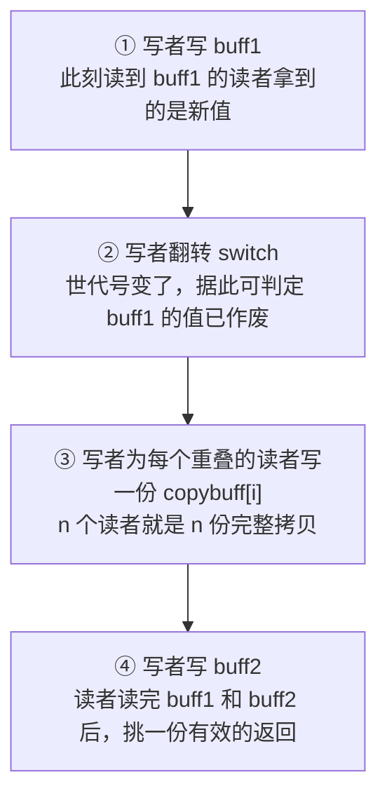

# Peterson 的 CRWW：等待与副本数的下界


<!--more-->

> 原文：Gary L. Peterson. **Concurrent Reading While Writing.** *ACM Transactions on Programming Languages and Systems*, 5(1):46–55, January 1983. University of Rochester. 收稿 1980 年 7 月，1982 年 6 月录用。

经典 readers/writers 问题的标准解法是互斥锁：一把读锁加一把写锁，读读共享、读写互斥。

1983 年，Gary Peterson 问了一个更狠的问题：**如果读和写可以同时发生呢？**

他没有直接给算法，而是先问清楚一件事——**你要多少份数据副本，才能撑住你想要的并发保证？**

答案是：想要多强的保证，就得付多少份副本。而且这些数字**全是紧的**——不多不少，正好这么多。允许读者互相等等，一份副本就够；谁都不许等，就要 n+2 份。

四十二年后，Left-Right 论文的开篇就引了这篇，并指出 Peterson 最优解的一个致命代价：为了做到"谁都不等"，每个读者都得有一份私有拷贝，于是不得不引入垃圾回收。

这篇讲 Peterson 的 CRWW 问题、六个方案、五个定理，以及一个连他本人都说不清楚的阶跃。最后回到 Left-Right，看它填上了这张表里空着的那一格。

| 层次 | 回答的问题 | 核心标识 | 本文对应章节 |
|---|---|---|---|
| **问题** | CRWW 比经典问题难在哪？ | 正确 + 最新 | 第一章 |
| **方案** | 六个方案分别要几份副本？ | Solution 1–6 | 第二章 |
| **代价** | 主解法为什么必须配 GC？ | `copybuff[i]` | 第三章 |
| **下界** | 这些数字是紧的吗？ | Theorem 1–5 | 第四章 |
| **反直觉** | 允许一点等待能省多少副本？ | 阶跃，不是连续 | 第五章 |
| **推论** | 大变量系统能被二元变量系统模拟吗？ | 强模拟 | 第六章 |
| **回响** | 四十二年后 Left-Right 填上了哪一格？ | 2 份副本 | 第七章 |

## 一、CRWW：一个比 readers/writers 更难的问题

### 1.1 经典问题的前提

经典的 readers/writers 问题里，读和写是**互斥**的——写者改数据的时候，读者不能碰。解法是互斥锁，代价是**串行化**。

Peterson 指出这有点浪费：如果读和写能同时进行，读者不就完全不受写者影响了吗？他把这称为 **Concurrent Reading While Writing（CRWW）** 问题。

模型很简单：`n` 个读者 + 1 个写者，共享一份数据。写者改数据，读者读出当前值。

### 1.2 读操作的两条硬要求

难点在于，读出来的值必须同时满足两条：

**正确**。如果读的瞬间写者正在改某个缓冲区，读到的值就得当作可能是错的、丢弃掉。也就是说，读者只能返回**写者当时没在改**的那份缓冲区里的内容。

**最新**。这条更微妙。表面上，读者必须返回"最近一次写"的值。但读和写可以重叠，所以还得管住这件事：**读新值的读者，不能在之后的一次读里读到旧值**——哪怕是同一个进程自己的后一次读。

> **一句话总结**：正确性说的是"这次读到的不是撕裂的"，时效性说的是"这次读到的不是过期的"。后者在读写可重叠的世界里要难得多。

### 1.3 模型的两条硬约束

Peterson 给自己加了两条相当苛刻的限制，这两条决定了后面所有结论的形状。

**第一条：共享变量必须是"分布式"的。** 每个共享变量最多只有一个进程能写，其他人只能读，而且读写都是**不可分割**的原子操作。

**第二条：只能用二元分布式变量。** 变量只有 0 和 1，没有更宽的字。Peterson 给了理由：如果连这么大的变量都能用小变量模拟，那大变量的系统就没有额外威力——这个推论后面会单开一章。

还有第三个隐含前提：**数据可以复制**。共享数据的各个副本放在一组**缓冲区**（buffer）里。写者往其中一部分写，读者从其中之一取一份正确且最新的值。

这个"可以复制"的假设，正是后面所有代价的来源。

### 1.4 第一张价格表

Peterson 先给了两个基础方案，把问题拆成两半：

**Solution 1**：直接用互斥锁（Peterson 自己那篇同期的两比特互斥算法）。一份副本，所有进程都可能等。好处是公平性取决于互斥算法的性质，坏处是**读写全被串行化**，等于白搭了并行的好处。

**Solution 2**：解 Lamport 1977 的读写问题，**写者优先**——写者永不等待。读者在读前后各查一次写者的标志位，判断自己有没有和一次写重叠；重叠了就重读。写者靠一个 `switch` 变量（每写一次翻转）来检测"读期间是否发生了两次以上的写"。

代价是：只有一份副本时，如果写者连续快速地写，读者**可能永远拿不到正确值**——读者会被锁在外面。

于是有了第一个定理：

> **THEOREM 1.** 在下列任一条件下，1 份缓冲是解决 CRWW 问题的**充要**条件：(1) 允许任意进程等待；或 (2) 写者 wait-free，而读者可以被锁在外面。

## 二、六个方案，一张价格表

Peterson 接着给出了一整套方案，它们构成了一张完整的**价格表**。表里的每一个数字都是下界。

| 方案 | 副本数 | 谁会等待 | 核心手法 |
|---|---|---|---|
| **Solution 1** | 1 | 所有人都可能等 | 互斥锁 |
| **Solution 2** | 1 | 写者从不等，读者可被锁在外面 | 标志位 + `switch` 翻转 |
| **Solution 3（主解法）** | **n+2** | **谁都不等** | 三类缓冲区 + 私有拷贝 |
| **Solution 4** | n+1 | 写者从不等，读者只等写者 | 主解法去掉 buff2 |
| **Solution 5** | 3 | 写者从不等，读者只等别的读者 | 读者之间互斥 + 主解法 |
| **Solution 6** | 2 | 写者从不等，读者可以随便等 | 读者之间互斥 + Solution 4 |

注意这张表的走向：**允许等待的粒度越粗，副本数越少**。从最贵的 n+2 一路降到最便宜的 1。

而最贵的那个方案，恰恰是唯一做到"谁都不等"的。

### Solution 3：主解法

这是全文最重要的方案，也是 Left-Right 登场时对标的靶子。它用了三类缓冲区：

- **`buff1`**——主缓冲区。写者不在改它的时候，读者都从这儿读。
- **`buff2`**——备份缓冲区。
- **`copybuff[i]`**——第 i 个读者的**私有拷贝**。当写者和某个读者重叠时，写者为那个读者单独准备一份。

写者的一次完整写入：



对应的伪代码。读者那一半：

```text
// 第 i 个读者
reading[i] := not writing[i];        // 与写者配对的握手位
sflag := wflag;                       // 快照写者状态
sswitch := switch;                    // 快照写者世代
read buff1;                           // 先读主缓冲
sflag2 := wflag;                      // 再快照一次
sswitch2 := switch;
read buff2;                           // 再读备份缓冲
bad1 := (sswitch ≠ sswitch2) or sflag or sflag2;   // buff1 这次的值作废了吗
if reading[i] = writing[i] then
    return copybuff[i] 的值;          // 写者给我留了私有拷贝
else if bad1 then
    return buff2 的值;
else
    return buff1 的值;
```

写者那一半：

```text
// 唯一的写者
wflag := true;                        // 我要开始写了
write buff1;                          // 第一份：新值
switch := not switch;                 // 翻世代号
wflag := false;
for j := 1 step 1 until n do
    if reading[j] ≠ writing[j] then begin
        write copybuff[j];            // 给重叠的读者各留一份
        writing[j] := reading[j];
    end;
write buff2;                          // 第二份：新值
```

正确性的核心只有一句话：**如果写者要和一个"既读了 buff1 又读了 buff2"的读者重叠，它就必须在写 buff1 和写 buff2 之间给这个读者做一份拷贝。** 读者据此能判断自己手里哪一份是有效的。

时新性也一并成立：读者返回拷贝值，说明写者正在并发改数据，那必然是最新的；读者返回 buff1 的值，那 buff1 是最先被改的那份，自然也是新的。

## 三、主解法的代价：每人一份私有拷贝

现在来看账。

Solution 3 是唯一做到"谁都不等"的方案，代价是 **n+2 份缓冲区**。而每一份缓冲区，装的是**完整的一份共享数据**。

n 个读者，就意味着 n 份完整拷贝。数据大一点，这笔账立刻变得荒谬——一份 1 GB 的索引，100 个读者就是 100 GB。

Peterson 自己也点出了这个毛病：

> 最显著的缺陷是，写者在一次写入过程中，可能要给读者做 **n 份拷贝**。如果缓冲区很大，这可能是笔昂贵的开销。

他给了一个改进方向：只给所有并发读者做**一份**拷贝，用二元标志位告诉读者哪一份是最新的。但这引出了新问题——

> **一份拷贝方案必须配套一套垃圾回收机制**，让写者能判断哪些拷贝已经被读过了、可以复用。

**这就是 Left-Right 论文点名批评的那句"compromises memory reclamation"。**

在 Java 里，GC 可以顺手把拷贝收掉。但在没有 GC 的语言里，在内核里，在实时系统里，这套回收机制本身就是一整套需要证明正确的并发代码。

> **一句话总结**：Peterson 的最优解把"等待"消除了，但把成本转移到了"每个读者一份私有拷贝 + 一套垃圾回收"上。

## 四、副本数下界：五个定理

Peterson 真正的贡献不是这六个方案，而是证明了**每一个方案的副本数都是下界**——换句话说，这些数字一个都不能再优化。

| 定理 | 允许的等待方式 | 最少副本数 |
|---|---|---|
| **Thm 1** | 任意进程可等；或写者 wait-free、读者可被锁在外面 | 1 |
| **Thm 2** | 谁都不等 | **n+2** |
| **Thm 3** | 写者 wait-free，读者只等写者 | n+1 |
| **Thm 4** | 写者 wait-free，读者只等别的读者 | 3 |
| **Thm 5** | 写者 wait-free，读者可以随便等 | 2 |

注意从 Thm 2 到 Thm 5，副本数是 n+2、n+1、3、2。**看起来像是在逐步下降，其实不是**——真正的跳变藏在 n+1 到 3 之间。

### Theorem 2 的证明思路

这个定理的证明是全文最漂亮的一段，它用的是归纳法。

**一个读者需要 3 份缓冲。** 反证：假设 2 份就够。

让读者开始读，一直读到它**正在读第一个缓冲**的时候把它挂起。现在让写者动手：

- 写者必须能改动这个缓冲——否则它连第一步都做不了。假设它能改，改完再把读者放回来。读者会发现刚读到的值作废了，只能丢弃重来。
- 写者接下来必须把新值放进**第二个**缓冲。否则，读者可能在两次写之间恢复过来，在后续的读里拿不到最新的值。
- 现在把写者**挂起在改第二个缓冲的过程中**，把读者放回来，让它读完。读者接下来会发现：第一个缓冲里的值已经过期，第二个缓冲正在被改、值无效。
- 它只能等写者把第二个缓冲改完。

三个缓冲，一个读者，跑不掉。

**推广到 n 个读者。** 归纳假设 n-1 个读者需要 n+1 份。现在挑一个读者，把它挂起在"读着一个写者改不动的缓冲"上。然后让写者把那个缓冲的值弄过期。剩下的 n-1 个读者此时只有 n 份缓冲可用（被挂起那个占着一份且内容过期），按归纳假设不够用。矛盾。

所以 **n 个读者需要 n+2 份缓冲**。

其余三个定理的证明都是同一个思路的简化版本。Thm 4 的下界是 Thm 2 在"少一个读者"时的特例——因为读者之间互斥了，同时活动的读者只剩一个，等于 Thm 2 的 n=1 情形；Thm 5 同理，是 Thm 3 在只有一个读者时的特例。

## 五、一个 Peterson 自己也没解释清楚的现象

论文最后有一段总结，值得完整引用：

> 即使只允许**少量**的等待，缓冲区的数量也必须与读者数成比例。只有当允许**大量**等待时，所需缓冲区的数量才能降到一个很小的常数。**这种复杂度上的跳跃，似乎没有一个简单的解释。**

这句话信息量很大。

第一，**副本数和等待量不是连续函数，是阶梯函数**。允许读者等写者，只省下 1 份（n+2 → n+1）。允许读者互相等，直接从 n+1 塌到 3。再往下才是 2 和 1。

第二，**跳变点找得很准**：从"读者只等写者"到"读者可以互等"。这一步省下的不是 1 份，而是 n-2 份。

第三，Peterson 说"似乎没有简单的解释"——一个能把这种下界证明得这么干净的人，坦承自己的结果里有一块没想明白，这比假装什么都解释清楚了诚实得多。

> **一句话总结**：等待不是可以"赊账"的资源。要么读者完全不等（付 n+2 份副本），要么读者开始互等（副本数塌到常数）。中间地带最贵。

## 六、附带结论：大变量系统能被二元变量系统模拟

论文还有一个不那么显眼但影响深远的推论。

Peterson 的模型限制"只能用二元分布式变量"，看起来是个包袱。但主解法（Solution 3）说明：**任何使用大分布式变量的系统，都可以被一个只用二元分布式变量的系统强模拟（strongly simulate）。**

"强模拟"的意思是：把一个大变量换成它的一串比特位之后，**原来 wait-free 的代码段依然 wait-free**，而且 lockout（读者被锁在外面）和 deadlock 的性质也被保留下来。

反过来，如果用 Solution 1（互斥锁）来做这个替换，等待会被引入到原本没有等待的地方——那只能算**弱模拟（weakly simulate）**。

论文把这条推论列为核心结果之一：

> 本文的推论之一是：任何使用大分布式变量的系统，都可以被一个等价的、只使用二元分布式变量的系统强模拟。

这条结论的分量在于：**你用什么宽度的变量，在并发语义上没有你以为的那么重要。** 复杂的是协调，不是存储。

## 七、四十二年后：Left-Right 填上了哪一格

现在把 Peterson 的表格按"谁在等"重新摆一次：

| | 写者从不等 | 写者可以等 |
|---|---|---|
| **读者从不等** | n+2 份（Sol 3） | **← 空着的一格** |
| **读者只等写者** | n+1 份（Sol 4） | — |
| **读者可以互等** | 3 份（Sol 5） | — |
| **读者随便等** | 2 份（Sol 6） | 1 份（Sol 1） |

Peterson 填满了这张表的绝大部分格子，唯独留了一个空：**读者从不等，而写者可以等。**

2015 年，Ramalhete 和 Correia 的 Left-Right 正好落在这个空格里。让我把两篇的核心对照一下：

| | Peterson Solution 3 | Left-Right |
|---|---|---|
| 副本数 | n+2 份 | **2 份** |
| 读操作 | wait-free | wait-free |
| 写操作 | wait-free | **阻塞**（等旧读者退场） |
| 私有拷贝 | 每个读者一份 | **无** |
| 需要 GC | **是** | **否** |

**为什么 2 份就够？** 关键在于允许写者等待。

写者先写**读者当前不在的那一份**，然后翻转一个方向开关让新读者立刻过来读改好的那份，接着**等旧读者全部退场**，再去改另一份。全程没有哪个读者需要为写者停下脚步，所以读操作依然是 wait-free。而写者牺牲掉了自己的无等待属性，换来的是不用给任何读者准备私有拷贝。

**为什么不能更少？** 一份副本做不到。写者要写，就得让读者全部退场；而写者正在写的那段时间里到来的读者，要么读到撕裂的值（不正确），要么等（就不是 wait-free 了）。两条都违约。所以 2 份是下界。

于是 Peterson 那张表上那个空格子，被填上了：**2 份副本，读 wait-free，写阻塞，不需要 GC。**

有意思的是，同样是 2 份副本，Peterson 的 Solution 6 把强保证给了**写者**（写者从不等，读者随便等），Left-Right 把强保证给了**读者**。选哪边，取决于你系统里多的是读者还是写者。

Peterson 在 1983 年那句"互斥不总是并发控制的必要条件"，到 Left-Right 这里长成了更具体的东西：**等待可以不对称地分配。**

想看 Left-Right 那套反向握手协议、四个变体和实测数据，请看[系列第二篇](/posts/2026/11/0f82f46c/)。

## 写在最后

> **一句话总结**：Peterson 1983 用五个定理给出了一张"并发保证 ↔ 数据副本"的定价表——想要谁都不等，就得付 n+2 份完整拷贝和一套垃圾回收；而 Left-Right 用一个反向握手协议，只花 2 份副本就换来了读操作的 wait-free。

如果只能带走三句话：

1. **并发保证是可以定价的。** 想要多强的进度保证，就得付多少份数据副本，而且这些数字全是下界——不是"实现得不够好"，是"不可能更少"。
2. **消除等待的代价会转移，不会消失。** Peterson 把等待换成了每人一份私有拷贝加一套 GC；Left-Right 把等待转给了写者，于是谁也不用配 GC。
3. **副本数和等待量之间是阶梯，不是斜坡。** 允许读者只等写者只省 1 份，允许读者互等直接塌到 3 份——中间地带最贵。

## 参考资料

1. Gary L. Peterson. "Concurrent Reading While Writing." *ACM Transactions on Programming Languages and Systems*, 5(1):46–55, January 1983.
2. ——. "A New Solution to Lamport's Concurrent Programming Problem Using Small Shared Variables." *ACM Trans. Program. Lang. Syst.*, 5(1):56–65, January 1983. （Solution 1 用的两比特互斥算法，与上一篇同卷同期）
3. Leslie Lamport. "Concurrent Reading and Writing." *Communications of the ACM*, 20(11):806–811, November 1977. （Solution 2 依据的读写问题）
4. Pedro Ramalhete, Andreia Correia. "Left-Right: A Concurrency Control Technique with Wait-Free Population Oblivious Reads." *DISC 2015*, Tokyo, Japan, Oct. 2015. <https://hal.science/hal-01207881>
5. ——. 完整版预印本. <https://github.com/pramalhe/ConcurrencyFreaks/blob/master/papers/left-right-2014.pdf>
6. ——. "Left-Right: A Concurrency Control Technique with Wait-Free Population Oblivious Reads." Concurrency Freaks 博客, 2013-12-05. <https://concurrencyfreaks.blogspot.com/2013/12/left-right-concurrency-control.html>
7. ——. "Double Instance Locking." Concurrency Freaks 博客, 2013-11. <https://concurrencyfreaks.blogspot.com/2013/11/double-instance-locking.html>
8. P. G. Sorenson, V. C. Hamacher. "A Real-Time System Design Methodology." *INFOR*, 13(1):Feb. 1975, pp. 1–18.
9. Peter J. Courtois, F. Heymans, D. L. Parnas. "Concurrent Control with 'Readers' and 'Writers'." *Communications of the ACM*, 14(10):667–668, October 1971.

