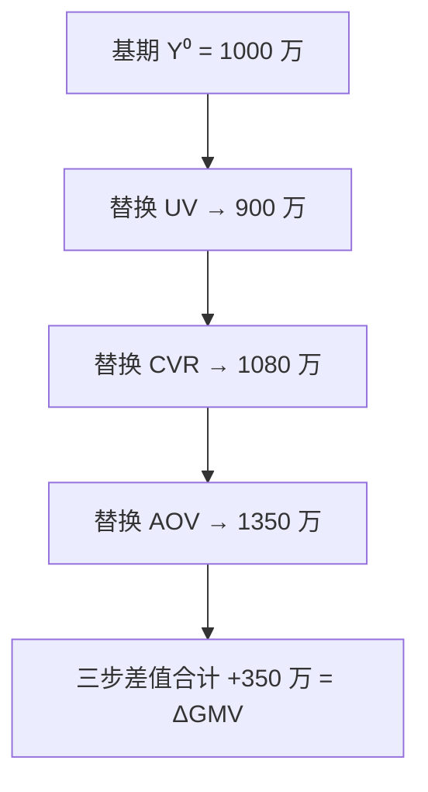
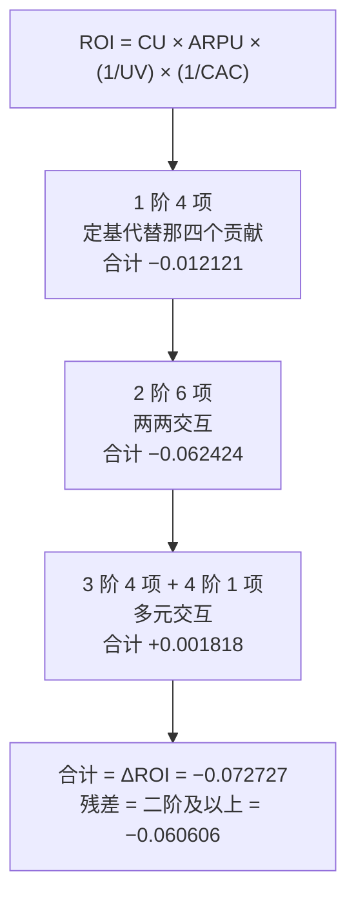

# 指标分解模型：加法、乘法与残差


<!--more-->

周会上，老板问了一个看起来很简单的问题：好物优选这个月 GMV 环比涨了 35%，这 35% 里，有多少是访客数 UV 的功劳？

三位分析师给了三张表。

| 分析师 | 用的方法 | UV 的贡献 | CVR 贡献 | AOV 贡献 |
|---|---|---|---|---|
| A | LMDI | **−35.11%** | +60.75% | +74.36% |
| B | 链式替代，UV→CVR→AOV | **−100 万** | +180 万 | +270 万 |
| C | 链式替代，CVR→UV→AOV | **−120 万** | +200 万 | +270 万 |

三张表内部都自洽，都能加回同一个 +350 万，谁也没算错。但业务只想知道一个数：UV 到底该背多少？

B 和 C 用的是同一个方法、同一批数据，只因为替换顺序不同，UV 的贡献就从 −100 万变成了 −120 万；A 换了个方法，又是第三个数字。

问题的根子在于：**归因的答案不由数据决定，由你选的分解模型决定。**同一批数据，分解模型不同，拆出来的贡献就不同；模型选错，答案连方向都可能反过来。

本文是系列的第 02 篇，把"分解模型"这件事讲透：三类模型各自的前提、算法和适用边界，以及最容易被一笔带过的那个数——残差。它从哪来、能有多大、怎么处理。这三类方法在能源与环境指标领域已有几十年的综述脉络，[Ang 与 Zhang 的调查](https://doi.org/10.1016/S0360-5442(00)00039-6) 梳理了 IDA 方法的谱系，本文只取其中与业务归因最相关的三条线。

| 章节 | 回答的问题 | 核心结论 |
|---|---|---|
| 一 | 加法型指标怎么拆 | Delta 法：Vᵢ = ΔXᵢ，零残差，但只对"边际贡献恒为 1"的模型成立 |
| 二 | 乘法型指标怎么拆 | LMDI：取对数把乘法变加法，贡献度恒为 100%，无残差 |
| 三 | 乘法模型还能怎么拆 | 链式替代：总和精确，但单项依赖替代顺序 |
| 四 | 模型写不出来怎么办 | 泰勒展开、定基代替：只能用近似，必然留残差 |
| 五 | 残差从哪来 | ROI 四因子算例：残差占 83.3%，全部来自交互项 |
| 六 | 残差怎么办 | 单列其它 / 权重分摊 / Shapley 修正，三选一 |
| 七 | 怎么落地 | 三个可直接运行的 Python 函数 |

## 一、加法型指标：Delta 法

### 1.1 从 Y = ΣXᵢ 开始

最简单的模型是加法型：好物优选的 GMV 按渠道拆开，就是各个渠道 GMV 之和。

$$
Y = X\_1 + X\_2 + \dots + X\_n
$$

[第一篇](/posts/2026/11/cba63f94/) 里那张渠道表，其实就是一次 Delta 分解。Delta 法的全部内容只有一行：

$$
V\_i = X\_i^{(1)} - X\_i^{(0)}
$$

因子 i 的绝对贡献，就是它自己的变化量。不需要任何参数、权重或假设。

**为什么这件事在加法模型上成立、换个模型就不成立？**因为加法模型里 Y 对每个 Xᵢ 的偏导恒等于 1：多一块钱就是多一块钱。少一个渠道的 GMV 就是少这么多，没有第二种可能。

### 1.2 三个口径在 Delta 下的公式与恒等

第一篇定义了全系列通用的三个口径。把 Delta 的公式代进去，恒等式是**结构给的，不是凑出来的**：

| 概念 | 记号 | Delta 下的公式 | 恒等式 | 一句话读法 |
|---|---|---|---|---|
| 绝对贡献 | Vᵢ | Xᵢ¹ − Xᵢ⁰ | ΣVᵢ = ΔY | 因子 i 自己变了多少 |
| 贡献度 | Cᵢ | Vᵢ / ΔY | ΣCᵢ = 100% | 这次变化里因子 i 占几成 |
| 相对贡献 | Rᵢ | Vᵢ / Y⁰ | ΣRᵢ = ΔY / Y⁰ | 相当于基期大盘的多少 |

三条恒等式互相锁死：Vᵢ = Cᵢ × ΔY，Rᵢ = Vᵢ / Y⁰。第一篇说"相对贡献加起来正好是环比涨幅"，在加法模型下不是巧合——ΣRᵢ = ΔY / Y⁰ 就是环比增速的定义式。

两个用惯了容易忽略的点：

**Cᵢ 可以为负，也可以超过 100%。**渠道表里搜索是 −11.43%（拖后腿），直播是 +51.43%。如果某个渠道涨得比大盘还多，它的 Cᵢ 就会超过 100%，同时别的渠道必然是负数——加起来才是 100%。这不是算法出错，是"份额"这个口径在有正有负时必然出现的样子。

**三个恒等式只在"各部分可加"时成立。**比率型指标（转化率、ROI）拆开加不回去，所以这几个恒等式在它身上全部失效。换模型不是"换个更好看的算法"，是换一套前提。

### 1.3 一般线性式 Y = ΣaᵢXᵢ 的推广

现实里很少有系数全是 1 的加法。更常见的是加权求和：会员分层的加权客单价，Y = Σ aᵢXᵢ，aᵢ 是各层级的占比，Xᵢ 是各层级的客单价。

若 aᵢ 固定（各层级占比没变），Delta 直接推广：

$$
\Delta Y = \sum\_i a\_i \\, \Delta X\_i
$$

**这里有个高频错误：很多资料写成 ΔY = Σ ΔaᵢXᵢ。**两项一换，被求和的对象就变了——ΔaᵢXᵢ 量的是"权重本身变了"，不是"权重乘的那个量变了"。一个最直观的反证：权重固定时 Δaᵢ 全为零，这个式子给出 ΔY = 0，而指标明明动了。

权重也在变的时候，完整展开是三项：

$$
\Delta Y = \sum\_i \left(\underbrace{a\_i^{(0)} \Delta X\_i}\_{\text{规模效应}} {}+ \underbrace{\Delta a\_i X\_i^{(0)}}\_{\text{结构效应}} {}+ \underbrace{\Delta a\_i \Delta X\_i}\_{\text{交互项}}\right)
$$

拿会员分层加权客单价算一遍。基期金卡占比 20%、客单价 800 元，银卡 50%、400 元，普通 30%、150 元；当期变为 25% / 900 元、50% / 400 元、25% / 140 元。

| 层级 | 基期占比 a⁰ | 当期占比 a¹ | 基期客单价 X⁰ | 当期客单价 X¹ |
|---|---|---|---|---|
| 金卡 | 20% | 25% | 800 元 | 900 元 |
| 银卡 | 50% | 50% | 400 元 | 400 元 |
| 普通 | 30% | 25% | 150 元 | 140 元 |

加权客单价从 405 元涨到 460 元，ΔY = +55 元。三项拆开：

| 分项 | 含义 | 金额 |
|---|---|---|
| 规模效应 Σa⁰ΔXᵢ | 各层级客单价自身变动 | +17.00 |
| 结构效应 ΣΔaᵢXᵢ⁰ | 占比变化（高客单层级占比上升） | +32.50 |
| 交互项 ΣΔaᵢΔXᵢ | 占比与客单价同时变动 | +5.50 |
| 合计 | | **+55.00** |

误写的 ΣΔaᵢXᵢ 算出来是 +32.50（X 换成当期值则为 +38.00），既不是 ΔY = +55，也不是三项里的任何一项——它只是碰巧等于结构效应那一行。

结构效应这一项，正是很多归因报告里"**高价值用户占比提升带动了大盘**"那句话的出处。它和 Delta 的 Vᵢ 不是一回事：Vᵢ 说的是"这个维度自己动了多少"，结构效应说的是"结构变了、由此带来多少"。

这三个分项在第五章会原样再出现一次——交互项换个名字，叫**残差**。

## 二、乘法型指标：LMDI

### 2.1 为什么乘法指标不能直接加

好物优选的 GMV 换个维度拆，是乘法：

$$
\mathrm{GMV} = \mathrm{UV} \times \mathrm{CVR} \times \mathrm{AOV}
$$

三个原因让 Delta 法在这里彻底用不上。

**第一，量纲不一致。**UV 的单位是"万"，CVR 是"%"，AOV 是"元"。Delta 法的 ΔXᵢ 只有在同量纲下才能相加，"−10 万 + 1 个百分点 + 50 元"不是一个数。

**第二，也是更本质的一条：边际贡献不恒定。**Delta 法成立的前提是 dY/dXᵢ ≡ 1。乘法模型里：

$$
\frac{\partial \mathrm{GMV}}{\partial \mathrm{UV}} = \mathrm{CVR} \times \mathrm{AOV}
$$

UV 少了 10 万访客，损失多少 GMV，取决于当时的 CVR 和 AOV 分别是多少——是个变量，不是常数。乘法模型天生带交互，Delta 那套"一个因子一个固定贡献"的记账法接不住。

**第三，乘法模型不能写成加法。**(1 + u₁)(1 + u₂)(1 + u₃) ≠ 1 + u₁ + u₂ + u₃，交叉项无法摊回到加法账上。

### 2.2 取对数把乘法变加法

LMDI（Logarithmic Mean Divisia Index，对数平均狄氏指数）的全部招数是一行取对数：

$$
\ln Y = \sum\_i \ln X\_i \quad \Longrightarrow \quad \Delta \ln Y = \sum\_i \Delta \ln X\_i
$$

乘法变成了加法，而且**是恒等式，不是近似**。既然 ΔlnY 严格等于各项之和，贡献度就只能是这么定义：

$$
C\_i = \frac{\Delta \ln X\_i}{\Delta \ln Y}
$$

于是 ΣCᵢ ≡ 100%。这个 100% 是除出来的，不是调出来的——**无残差是 LMDI 最大的优点，而且它是结构性的保证。**

要拿到绝对贡献，再乘一个对数均值权重：

$$
\begin{aligned}L\left(Y^{(0)}, Y^{(1)}\right) &= \frac{Y^{(1)} - Y^{(0)}}{\ln Y^{(1)} - \ln Y^{(0)}} \\\\V\_i &= L\left(Y^{(0)}, Y^{(1)}\right) \cdot \Delta \ln X\_i\end{aligned}
$$

因为 L(Y⁰,Y¹) · ΔlnY = ΔY，所以 ΣVᵢ = ΔY 严格成立。相对贡献 Rᵢ = Vᵢ / Y⁰ 照样加回环比增速，和 Delta 下的情形一模一样。

符号上要注意：**Cᵢ > 0 表示因子的变化方向与指标一致**（ΔlnXᵢ 与 ΔlnY 同号）。指标整体在跌时，"同向"的因子读作跟着一起跌。

还有一个容易误读的地方：**Cᵢ 是"对数变化的份额"，不是"绝对金额的份额"。**UV 自身只跌了 10%，C 却是 −35.11%。别把它读成"UV 拖垮了 35% 的 GMV"——它说的是"在 GMV 的对数变化里，UV 的对数变化占了 −35.11%"。要谈金额，得看 Vᵢ。

### 2.3 用 GMV 算例实算

| 因子 | 上月 | 本月 | Δln X | 贡献度 Cᵢ |
|---|---|---|---|---|
| UV（访客，万） | 100 | 90 | −0.105361 | **−35.11%** |
| CVR（支付转化率） | 5% | 6% | +0.182322 | **+60.75%** |
| AOV（客单价，元） | 200 | 250 | +0.223144 | **+74.36%** |
| GMV（万元） | 1000 | 1350 | +0.300105 | **100%** |

折算成金额和相对贡献：

| 因子 | 绝对贡献 Vᵢ（万元） | 相对贡献 Rᵢ |
|---|---|---|
| UV | −122.88 | −12.29% |
| CVR | +212.63 | +21.26% |
| AOV | +260.24 | +26.02% |
| 合计 | **+350.00** | **+35.00%** |

ΔGMV = +350 万，ΣVᵢ = +350 万，ΣCᵢ = 100%，ΣRᵢ = +35.00%——和 GMV 的环比涨幅一致。

三列数字要分开读。**Cᵢ 是"对数变化的份额"**，UV 的 −35.11% 意思是"UV 的对数变化占 GMV 对数变化的 −35.11%"，不是"UV 拖走了 35% 的 GMV"。**Vᵢ 才是金额**：CVR 和 AOV 合计把 GMV 推上去 472.87 万，UV 拉回来 122.88 万，净额 +350 万。UV 是唯一的拖累项，但它的绝对量比任何一个正向因子都小。

和第一篇对照一下会发现一个有意思的地方：同一个 +350 万，按渠道拆是"直播贡献 51.43%"，按经营因子拆是"AOV 贡献 74.36%"。两句话都成立，因为它们回答的不是同一个问题——渠道维度回答"哪个渠道"，因子维度回答"哪个经营杠杆"。**汇报之前先说清楚你拆的是哪个维度，否则两个数字会在同一场会上打架。**

### 2.4 LMDI 的适用边界

三个必须写进文档的前提。

**因子必须为正。**取对数的定义域不允许零或负数。UV 为 0、CVR 为 0 时 LMDI 直接失效，得换方法或做 log 修正。

**LMDI 是记账口径，不是因果。**Cᵢ 度量的是"这个因子在对数尺度上动了多少"，它不告诉你"如果 UV 不动，GMV 会怎样"。UV 和 CVR 本身相关时（比如流量涨、转化率跌），Cᵢ 的解读要格外小心。

**模型必须是纯乘积。**Y = ΠXᵢ 才行。有加减结构的指标（比如收入减成本）得先改写成乘积形式，或者用别的方法。
## 三、链式替代：乘法模型上的另一种拆法

### 3.1 逐个替换因子的做法

链式替代（chain substitution，也叫连环替代法）的规则只有一条：**定一个替换顺序，每次只把一个因子换成当期值，每一步 Y 的变化算作这一步因子的贡献。**



以 UV → CVR → AOV 的顺序为例：

| 步骤 | 中间值 | 本步贡献 |
|---|---|---|
| 基期 | 100 × 5% × 200 = 1000 | — |
| 换 UV = 90 | 90 × 5% × 200 = 900 | −100 |
| 换 CVR = 6% | 90 × 6% × 200 = 1080 | +180 |
| 换 AOV = 250 | 90 × 6% × 250 = 1350 | +270 |
| 合计 | | **+350** |

### 3.2 核心洞见：总和精确，但单项依赖顺序

链式替代的一个漂亮性质是：**不管用什么顺序，每一步的贡献加起来必然等于 ΔY。**

这不需要推导就能看出来——每一步贡献是相邻两个中间值之差，三个差值求和时中间值两两抵消，最后剩下 Y³ − Y⁰ = ΔY。这是个望远镜求和，对**任何**函数形式都成立，链式替代从来不留残差。

但单项贡献依赖顺序，这一点在乘法模型上可以精确写出来。设 Y = X₁X₂X₃，替换顺序为 1 → 2 → 3：

$$
\begin{aligned}V\_1 &= X\_2^{(0)} X\_3^{(0)} \left(X\_1^{(1)} - X\_1^{(0)}\right) \\\\V\_2 &= X\_1^{(1)} X\_3^{(0)} \left(X\_2^{(1)} - X\_2^{(0)}\right) \\\\V\_3 &= X\_1^{(1)} X\_2^{(1)} \left(X\_3^{(1)} - X\_3^{(0)}\right)\end{aligned}
$$

规律很清楚：**因子 i 的贡献 = ΔXᵢ × 已替换因子的当期值 × 未替换因子的基期值。**换句话说，一个因子被折算成金额时，用的是"哪一期的价格"，取决于它在替换序列里的位置。

### 3.3 同一个 UV，三种顺序三个答案

| 替换顺序 | UV 贡献 | CVR 贡献 | AOV 贡献 | 合计 |
|---|---|---|---|---|
| UV → CVR → AOV | −100 | +180 | +270 | +350 |
| CVR → UV → AOV | −120 | +200 | +270 | +350 |
| AOV → UV → CVR | −125 | +225 | +250 | +350 |

拿 UV 的三次数值验一下上面那条规律。UV 掉了 10 万访客，损失多少 GMV 取决于按哪期的转化率和客单价折算：

| 替换顺序 | UV 前面已换了谁 | 折算方式 | 计算 | 结果 |
|---|---|---|---|---|
| UV→CVR→AOV | 无 | 另两因子都在基期 | −10 × 5% × 200 | −100 |
| CVR→UV→AOV | CVR | 用当期 CVR、基期 AOV | −10 × 6% × 200 | −120 |
| AOV→UV→CVR | AOV | 用当期 AOV、基期 CVR | −10 × 250 × 5% | −125 |

同一个 UV 掉 10 万访客，在三种顺序下被折算成 −100、−120、−125 万，差 25%。**这不是计算错误，是"这 10 万访客按什么价折算"这个隐含假设不同。**

实践上有两条建议。**顺序要按业务因果链定，并且写进报告。**UV → CVR → AOV 符合"先有流量、再有转化、最后才有客单价"的业务顺序，反过来读会别扭。**跨期对比时顺序必须固定**，否则这个月的 −100 和上个月的 −125 放在一起没有意义。

不过更省心的做法是：如果指标本身是纯乘积形式，直接用 LMDI——它的贡献度与顺序无关，从根上绕开这个问题。

## 四、非线性指标：泰勒展开与定基代替

### 4.1 泰勒展开：一阶偏导近似

指标既不是加法也不是纯乘积时（比如 ROI 这种比率），可以用一阶泰勒展开近似。原理是"其它因子不动时，这个因子动一点，指标动多少"：

$$
\Delta Y \approx \sum\_i \left. \frac{\partial f}{\partial X\_i} \right|\_{X^{(0)}} \Delta X\_i
$$

拿 ROI = (CU × ARPU) / (UV × CAC) 算，在基期点求偏导：

| 因子 | 偏导 ∂f/∂Xᵢ | ΔXᵢ | 一阶贡献 |
|---|---|---|---|
| CU | ARPU/(UV·CAC) = +0.00127273 | +200 | +0.254545 |
| ARPU | CU/(UV·CAC) = +0.01818182 | −10 | −0.181818 |
| UV | −CU·ARPU/(UV²·CAC) = −0.00011570 | −1000 | +0.115703 |
| CAC | −CU·ARPU/(UV·CAC²) = −0.25454545 | +1 | −0.254545 |
| 合计 | | | **−0.066115** |

ΔROI = −0.072727，泰勒合计 −0.066115，残差 −0.006612，占 9.1%。

三个必须知道的局限。

**第一，只在因子小幅变化时成立。**其它三个因子照旧，只把 UV 的目标值从 10000 换成 5000（UV 自身的变化幅度从 −9.1% 变成 −54.5%），泰勒残差从 9.1% 涨到 66.5%。用泰勒拆一个剧烈变化的指标，等于用直线去拟合曲线。

**第二，在哪个点展开会影响结果。**同一组数据，改在当期点求偏导，合计变成 −0.080000，残差 +0.007273——残差不但从 −0.0066 变成 +0.0073，连符号都反了（前者与 ΔROI 同号，后者反号）。

**第三，高阶项被整体丢掉，全部进了残差。**泰勒不是"更精确的 Delta"，它是"带残差的近似"。

这套思路在工业界有真实应用。广告系统的收入调试工具 Adtributor 面对的正是这类问题——CPC 这种派生指标不是各元素的加总，没法直接拆。它的做法是用有限差分偏导近似每个元素的贡献，再归一化到 100%，见 [NSDI 2014 原文](https://www.usenix.org/system/files/conference/nsdi14/nsdi14-paper-bhagwan.pdf)。第 07 篇会专门讲这个算法。

还有一个细节值得留意：**在这个 ROI 上，泰勒和定基代替对 CU、ARPU 给出的贡献完全相同**（+0.254545 和 −0.181818），只有 UV 和 CAC 不同。因为 ROI 对 CU、ARPU 是线性的（一阶展开对这个因子是精确的），对分母上的 UV、CAC 是非线性的（一阶展开必然漏掉曲率）。这提示了下一节：选方法前，先看指标对哪个因子线性。

### 4.2 定基代替：换一个因子，其余不动

定基代替（base substitution）的规则更朴素：**把其它所有因子冻结在基期，只把一个因子换成当期值，看指标变成多少。**

$$
V\_i = f\left(\text{其它因子取基期},\\, X\_i \text{ 取当期}\right) - f\left(\text{全部取基期}\right)
$$

它的优点很实在：**不需要偏导，对任意函数都成立**（含分段函数、含 max 的模型也能用），而且含义直白——"如果只有 UV 变了，ROI 会变成多少"。

代价也很实在：各因子的贡献是各自"孤立"算出来的，加起来通常不等于 ΔY，差额就是残差。

## 五、残差从哪来：ROI 四因子的算例

### 5.1 实算定基代替

ROI = (CU × ARPU) / (UV × CAC)，四个因子：

| 项 | 基期 | 当期 |
|---|---|---|
| CU 转化用户数 | 1000 | 1200 |
| ARPU 单用户收入（元） | 70 | 60 |
| UV 流量数 | 11000 | 10000 |
| CAC 单流量用户成本（元） | 5 | 6 |
| 收入 I = CU × ARPU | 70000 | 72000 |
| 成本 C = UV × CAC | 55000 | 60000 |
| ROI = I / C | 1.272727 | 1.200000 |

定基代替，四个因子逐个替换：

| 只替换的因子 | 算出的 ROI | 贡献 Vᵢ |
|---|---|---|
| CU = 1200 | 1200×70/55000 = 1.527273 | +0.254545 |
| ARPU = 60 | 1000×60/55000 = 1.090909 | −0.181818 |
| UV = 10000 | 1000×70/50000 = 1.400000 | +0.127273 |
| CAC = 6 | 1000×70/66000 = 1.060606 | −0.212121 |
| 合计 | | **−0.012121** |

### 5.2 核心洞见：残差占了 83.3%

ΔROI = 1.200000 − 1.272727 = **−0.072727**。四个因子的贡献合计只有 −0.012121。

$$
\begin{aligned}\text{残差} &= \Delta \mathrm{ROI} - \sum\_i V\_i = -0.072727 - (-0.012121) = -0.060606 \\\\\text{残差占比} &= \frac{0.060606}{0.072727} = 83.3\\%\end{aligned}
$$

很多资料在表格末尾加一行"残差：舍入误差，可忽略"，一笔带过。**这个说法在这里是错的。**残差占了 83.3%，意味着这四个因子各自单独的影响加起来，只解释了 ROI 变化的 16.7%。

这个数字有直接的业务后果。CU 单独把 ROI 抬高了 0.254545，是 ΔROI 绝对值的 3.5 倍——**用单因子的贡献除以总变化，会得到 350% 这种荒谬的百分比**，因为分母太小。根本原因是：真实变化里八成来自"几个因子一起动"，而单因子视角按定义看不见这种联合效应。**在残差占八成的模型上，"某因子贡献了总变化的百分之多少"这个问法本身就不成立**，能说的只有"如果只有这个因子动了，指标会变成多少"。

### 5.3 残差的来源：交互项

残差不是算错的零头，它有精确的定义。把 ROI 改写成纯乘积形式：

$$
\mathrm{ROI} = \mathrm{CU} \times \mathrm{ARPU} \times \frac{1}{\mathrm{UV}} \times \frac{1}{\mathrm{CAC}}
$$

四个变量做完全展开（乘积展开成 16 项，减去恒定项后 15 项），ΔROI 恰好等于这 15 项之和——1 阶 4 项、2 阶 6 项、3 阶 4 项、4 阶 1 项。逐阶算下来：

| 阶数 | 含义 | 金额 |
|---|---|---|
| 1 阶（4 项） | 各因子单独变化，即定基代替那四项 | −0.012121 |
| 2 阶（6 项） | 两个因子同时变化的联合效应 | −0.062424 |
| 3 阶（4 项） | 三个因子同时变化 | +0.001212 |
| 4 阶（1 项） | 四个因子同时变化 | +0.000606 |
| 合计 | | **−0.072727** |

于是残差 = 二阶及以上各项之和 = −0.062424 + 0.001212 + 0.000606 = **−0.060606**，与 5.2 算出的残差分毫不差。这不是巧合，是恒等式：**残差恰好等于所有交互项之和。**



交互项不是抽象概念，换成业务语言就能看见。下面两个例子在收入和成本的尺度上展示它的形态——注意这是元，不是 ROI，ROI 上的交互项还要再经过比值关系的放大。

**收入端：**转化用户数 +200 和 ARPU −10 是同时发生的。单独看 CU，收入贡献 +200 × 70 = +14000；单独看 ARPU，收入贡献 1000 × (−10) = −10000。两者加起来 +4000。但实际收入只从 70000 涨到 72000，即 +2000。差额 **−2000 = ΔCU × ΔARPU**，就是这两个因子互相对冲掉的部分。

**成本端：**流量 −1000 和 CAC +1 也是同时发生的。单独看 UV，成本贡献 −1000 × 5 = −5000；单独看 CAC，成本贡献 11000 × 1 = +11000。加起来 +6000，但实际成本只从 55000 涨到 60000，即 +5000。差额 **−1000 = ΔUV × ΔCAC**。

所以残差的来源可以一句话说完：**残差是"多个因子一起动"产生的联合效应，它天然无法归给任何单一因子。**任何只看单因子的方法都会有残差，残差的大小则取决于单因子效应在总变化里占多少。

## 六、残差怎么处理

先说一个反直觉的结论：**残差是分解模型的属性，不是指标的固有属性。**同一个 ROI，换成 LMDI 拆（因为 ROI = CU × ARPU × (1/UV) × (1/CAC) 是纯乘积），残差直接归零：

| 因子 | LMDI 贡献 | 定基代替贡献 |
|---|---|---|
| CU | +0.225351 | +0.254545 |
| ARPU | −0.190531 | −0.181818 |
| UV | +0.117804 | +0.127273 |
| CAC | −0.225351 | −0.212121 |
| 合计 | **−0.072727** | **−0.012121** |

选对模型，残差可以为零。选错了，就得处理。下面三种处置按"诚实程度"递增。

### 6.1 处置一：单列「其它」项

做法：把残差作为单独一行写进归因表，标签叫"其它/未解释项"。

| 因子 | 绝对贡献 |
|---|---|
| CU | +0.254545 |
| ARPU | −0.181818 |
| UV | +0.127273 |
| CAC | −0.212121 |
| **其它（交互项）** | **−0.060606** |
| 合计 | −0.072727 |

优点是诚实：表格加总对得上，而且明确告诉读者"这 83.3% 不是我拆出来的"。

缺点是它在这个例子里几乎没用：83.3% 的变化落在"其它"这一行里，这一行比 CU、ARPU、UV、CAC 中的任何一项都大，读者拿到的信息量约等于零。而且"其它"是个垃圾桶标签，下游一定会问"其它里面到底是什么"。

**残差确实小的时候（经验上低于 10%），单列其它是完全合理的做法。**它保留了全部信息，只是把未解释的部分摆在明面上。

### 6.2 处置二：按权重把残差分摊给各因子

做法：定一套权重，把残差按权重摊回各因子，让贡献加总刚好等于 ΔY。最常见的权重是按 |Vᵢ| 的占比：

| 因子 | 定基代替 Vᵢ | 权重 | 分摊残差 | 分摊后 |
|---|---|---|---|---|
| CU | +0.254545 | 32.81% | −0.019886 | +0.234659 |
| ARPU | −0.181818 | 23.44% | −0.014205 | −0.196023 |
| UV | +0.127273 | 16.41% | −0.009943 | +0.117330 |
| CAC | −0.212121 | 27.34% | −0.016572 | −0.228693 |
| 合计 | −0.012121 | 100% | −0.060606 | **−0.072727** |

加总对上了，饼图也能画了。问题是**权重是人定的**：换成按业务重要性定权重、或者按因子的绝对变化量定权重，结论就跟着变。更要命的是，"把交互项摊给单个因子"在数学上是把一件本质上属于多方的效应，硬塞给某一方，抹掉的恰恰是最重要的信息——ROI 这八成的变化是"转化数涨但 ARPU 跌、流量跌但 CAC 涨"两两对冲出来的，任何单因子视角都无法表达它。

这一招的正当用途只有一个：**残差很小、且你需要的只是一张能对账的饼图。**那时分摊带来的信息损失可以忽略。

### 6.3 处置三：Shapley 值修正

第三条路是换一把更严格的刀。Shapley 值来自合作博弈论：把每个因子当成一个玩家，在**所有可能的加入顺序**上取平均边际贡献。

它的四条公理正好命中我们的痛点：有效性（各因子贡献之和恰好等于 ΔY）、对称性（两个贡献相同的因子拿到相同的份额）、虚拟性（毫无作用的因子分到零）、可加性（可加性的游戏可以拆开分）。其中"与顺序无关"是"对所有顺序取平均"的直接后果——链式替代最严重的那个毛病，被结构性地消掉了。

四个因子的 ROI，精确枚举全部加入顺序得到：

| 因子 | Shapley 值 φᵢ | 占比 |
|---|---|---|
| CU | +0.227424 | −312.7% |
| ARPU | −0.191970 | +264.0% |
| UV | +0.118838 | −163.4% |
| CAC | −0.227020 | +312.2% |
| 合计 | **−0.072727** | 100% |

和定基代替的数字接近但不相同——Shapley 把交互项按"每个因子在所有顺序中的平均参与度"重新分摊回各因子，而不是简单按权重摊。完整的推导、公理证明和实现见[第五篇](/posts/2026/11/961422de/)。

代价是计算量：n 个因子要枚举 n! 个顺序（或者用 2ⁿ 个子集的等价形式）。四个因子毫无压力，几十个因子就得采样近似。

## 七、Python 实现

三个函数分别对应本文的三种分解模型，跑的是上面两组数据。

```python
from math import log, prod


def delta(base: dict, cur: dict) -> dict:
    """加法型指标 Y = ΣXᵢ：Delta 法，残差恒为零。"""
    y0, y1 = sum(base.values()), sum(cur.values())
    dy = y1 - y0
    out = {}
    for k in base:
        v = cur[k] - base[k]                       # 绝对贡献 Vᵢ = ΔXᵢ
        out[k] = {"V": v, "C": v / dy, "R": v / y0}
    return {"dY": dy, "factors": out}


def lmdi(base: dict, cur: dict) -> dict:
    """乘法型指标 Y = ΠXᵢ：LMDI，ΣV = ΔY，无残差。"""
    y0, y1 = prod(base.values()), prod(cur.values())
    lmean = (y1 - y0) / (log(y1) - log(y0))       # 对数均值 L(Y⁰, Y¹)
    dln_y = log(y1) - log(y0)
    out = {}
    for k in base:
        dln_x = log(cur[k]) - log(base[k])         # 该因子的对数变化
        v = lmean * dln_x                          # 绝对贡献 Vᵢ
        out[k] = {"dln": dln_x, "V": v, "C": dln_x / dln_y, "R": v / y0}
    return {"dY": y1 - y0, "factors": out}
```

定基代替要处理任意函数，所以把模型本身当参数传进去：

```python
def base_substitution(f, base: dict, cur: dict) -> dict:
    """定基代替：其它因子固定在基期，只替换当前这一个因子。"""
    y0 = f(**base)
    out = {k: f(**{**base, k: cur[k]}) - y0 for k in base}
    residual = f(**cur) - y0 - sum(out.values())   # 残差：交互项
    return {"contrib": out, "residual": residual}


def roi(CU, ARPU, UV, CAC):
    return CU * ARPU / (UV * CAC)
```

跑三组数据。Delta 法用在第一篇那张渠道表上——UV、CVR、AOV 三个因子量纲不同，本来就不能相加，Delta 在它们身上是失效的：

```python
# ① 加法型：GMV 按渠道拆（Delta 法）
chan0 = {"搜索": 400, "推荐": 300, "直播": 200, "私域": 100}
chan1 = {"搜索": 360, "推荐": 420, "直播": 380, "私域": 190}
d = delta(chan0, chan1)
print(f"Delta  ΔGMV={d['dY']:+.0f} 万")
for k, v in d["factors"].items():
    print(f"  {k:4s} V={v['V']:+.0f} 万  C={v['C']:+.2%}  R={v['R']:+.2%}")

# ② 乘法型：GMV = UV × CVR × AOV（LMDI）
gmv0 = {"UV": 100, "CVR": 0.05, "AOV": 200}
gmv1 = {"UV": 90, "CVR": 0.06, "AOV": 250}
m = lmdi(gmv0, gmv1)
print(f"LMDI   ΔGMV={m['dY']:+.0f} 万  ΣC={sum(v['C'] for v in m['factors'].values()):.2%}")
for k, v in m["factors"].items():
    print(f"  {k:4s} Δln={v['dln']:+.6f}  V={v['V']:+.2f} 万  C={v['C']:+.2%}  R={v['R']:+.2%}")

# ③ 非线性：ROI = (CU × ARPU) / (UV × CAC)（定基代替 + 残差）
r0 = dict(CU=1000, ARPU=70, UV=11000, CAC=5)
r1 = dict(CU=1200, ARPU=60, UV=10000, CAC=6)
b = base_substitution(roi, r0, r1)
dy = roi(**r1) - roi(**r0)
for k, v in b["contrib"].items():
    print(f"  {k:5s} V={v:+.6f}")
print(f"  ΣV={sum(b['contrib'].values()):+.6f}  ΔROI={dy:+.6f}  "
      f"残差={b['residual']:+.6f}（占 {abs(b['residual']) / abs(dy):.1%}）")
```

输出：

```plaintext
Delta  ΔGMV=+350 万
  搜索   V=-40 万  C=-11.43%  R=-4.00%
  推荐   V=+120 万  C=+34.29%  R=+12.00%
  直播   V=+180 万  C=+51.43%  R=+18.00%
  私域   V=+90 万  C=+25.71%  R=+9.00%
LMDI   ΔGMV=+350 万  ΣC=100.00%
  UV   Δln=-0.105361  V=-122.88 万  C=-35.11%  R=-12.29%
  CVR  Δln=+0.182322  V=+212.63 万  C=+60.75%  R=+21.26%
  AOV  Δln=+0.223144  V=+260.24 万  C=+74.36%  R=+26.02%
  CU    V=+0.254545
  ARPU  V=-0.181818
  UV    V=+0.127273
  CAC   V=-0.212121
  ΣV=-0.012121  ΔROI=-0.072727  残差=-0.060606（占 83.3%）
```

上线前有三条自检规则，对应本文的三种模型：

| 方法 | 加起来等于 ΔY | 贡献度合计 | 顺序无关 | 残差量级 |
|---|---|---|---|---|
| Delta | 是 | 100% | 是 | 0 |
| LMDI | 是 | 100% | 是 | 0 |
| 链式替代 | 是 | 不适用 | 否 | 0 |
| 定基代替 | 否 | 不适用 | 是 | 视模型而定，本例 83.3% |

**先确认指标形态，再选方法，最后检查残差。**顺序反了，报出去的数字就是错的——而且越复杂的模型越有说服力，越容易把错误结论包装成深刻洞察。

> **归因的答案由分解模型决定，不由数据决定。**加法用 Delta、乘法用 LMDI、其余用泰勒或定基代替；而凡是单因子视角算出来的贡献，都会有一个残差，它的大小就是"因子之间互相影响"的量级。

如果只能带走五句话：

1. **Delta 法只对加法型模型成立。**推广到 Y = ΣaᵢXᵢ 时是 ΔY = ΣaᵢΔXᵢ，不是 ΣΔaᵢXᵢ——两项一换，被求和的对象就变了。
2. **乘法型指标先取对数。**LMDI 的贡献度恒为 100%、残差恒为零，而且与替换顺序无关，是乘法模型的首选。
3. **链式替代的总和精确等于 ΔY，但单项依赖顺序。**因子贡献 = ΔXᵢ × 已替换因子的当期值 × 未替换因子的基期值，顺序就是隐含假设，必须写进报告。
4. **残差不是误差，是交互项。**ROI 四因子例子里残差占 83.3%，意味着八成的变化来自"几个因子一起动"，单因子视角按定义看不见这部分。
5. **残差是分解模型的属性，不是指标的固有属性。**同一个 ROI 用 LMDI 拆残差为零；真要处理残差，按权重分摊只是把联合效应硬塞给某一方，Shapley 值才是有公理保证的分配规则。

## 八、参考资料

- [1] [B. W. Ang. LMDI decomposition approach: A guide for implementation. Energy Policy, 2015](https://doi.org/10.1016/j.enpol.2015.07.007).
- [2] [B. W. Ang, F. Q. Zhang. A survey of index decomposition analysis in energy and environmental studies. Energy, 2000](https://doi.org/10.1016/S0360-5442(00)00039-6).
- [3] [B. W. Ang, F. L. Liu, E. P. Chew. Perfect decomposition techniques in energy and environmental analysis. Energy Policy, 2003](https://doi.org/10.1016/S0301-4215(02)00206-9).
- [4] [J. Albrecht, D. François, K. Schoors. A Shapley decomposition of carbon emissions without residuals. Energy Policy, 2002](https://doi.org/10.1016/S0301-4215(01)00131-8).
- [5] [R. Bhagwan, V. Karamcheti, N. McSherry, V. Sivaraman. Adtributor: Revenue Debugging in Advertising Systems. USENIX NSDI 2014](https://www.usenix.org/system/files/conference/nsdi14/nsdi14-paper-bhagwan.pdf).

