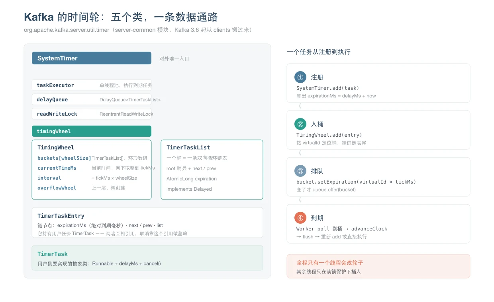
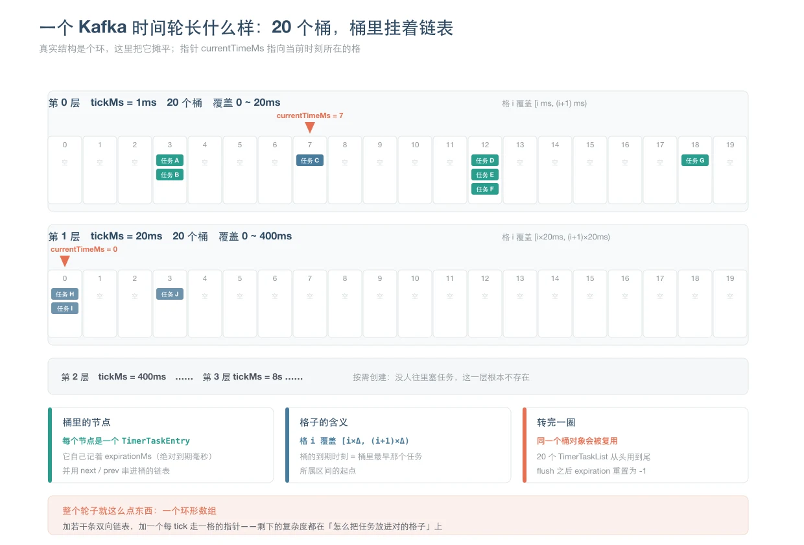
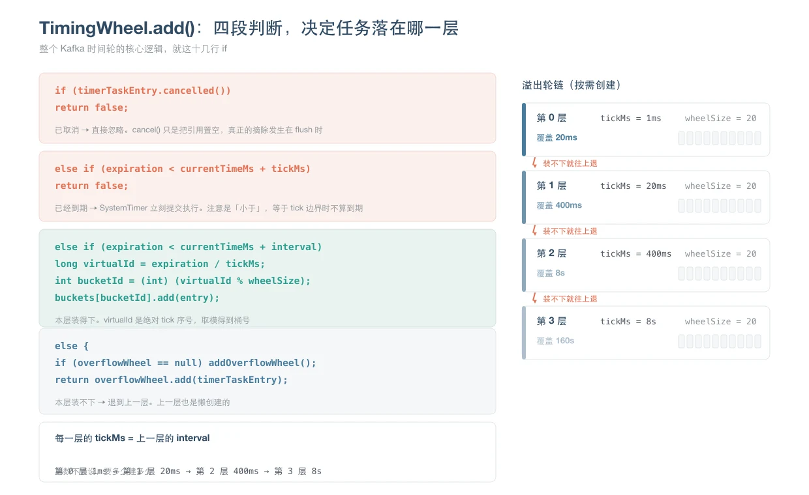
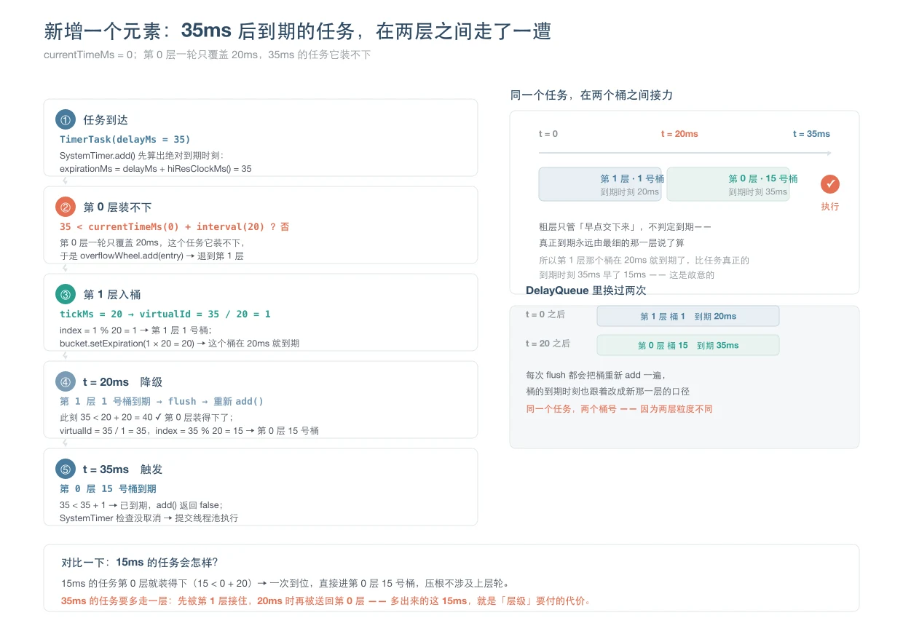
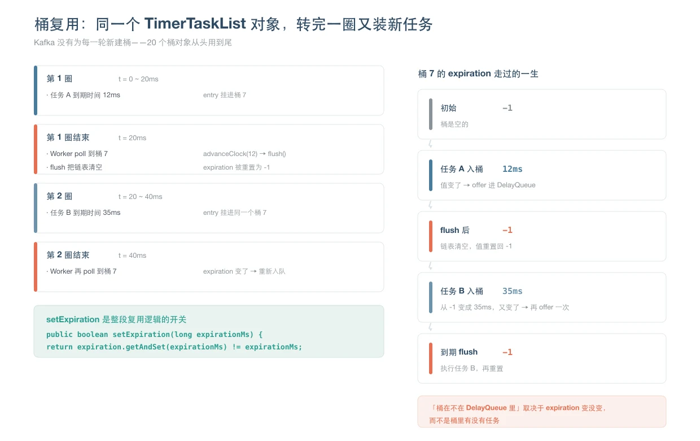
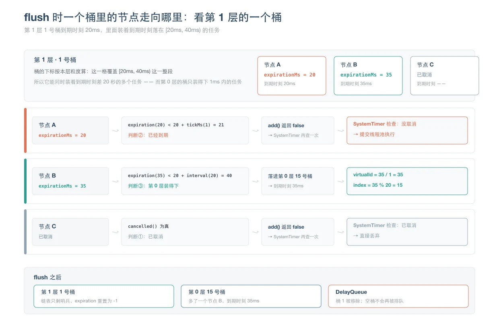
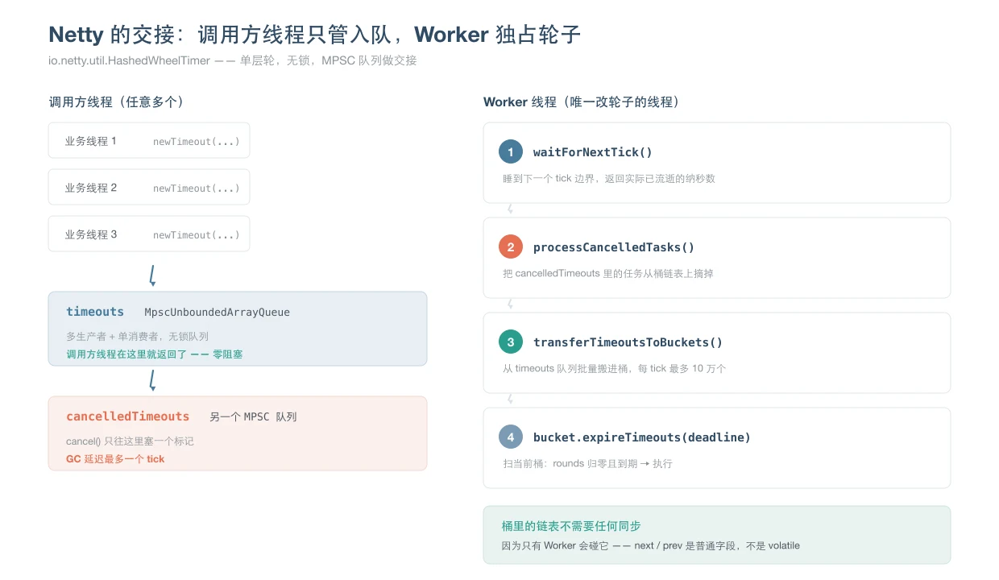
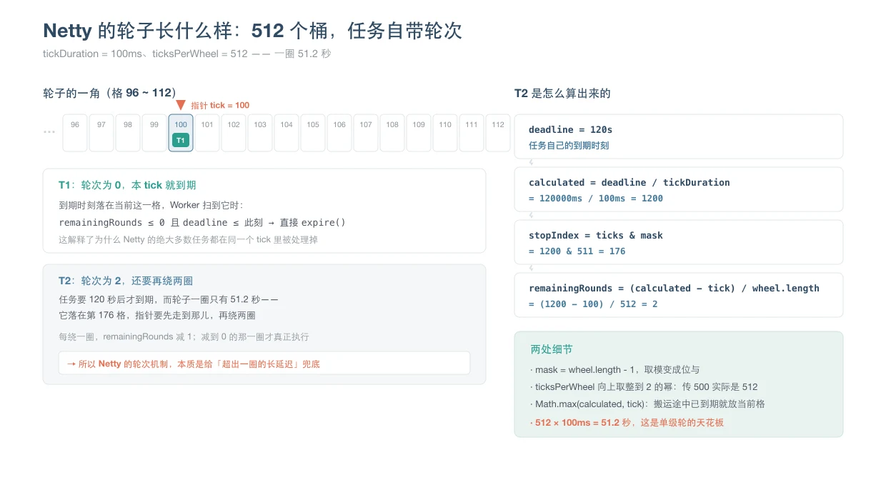
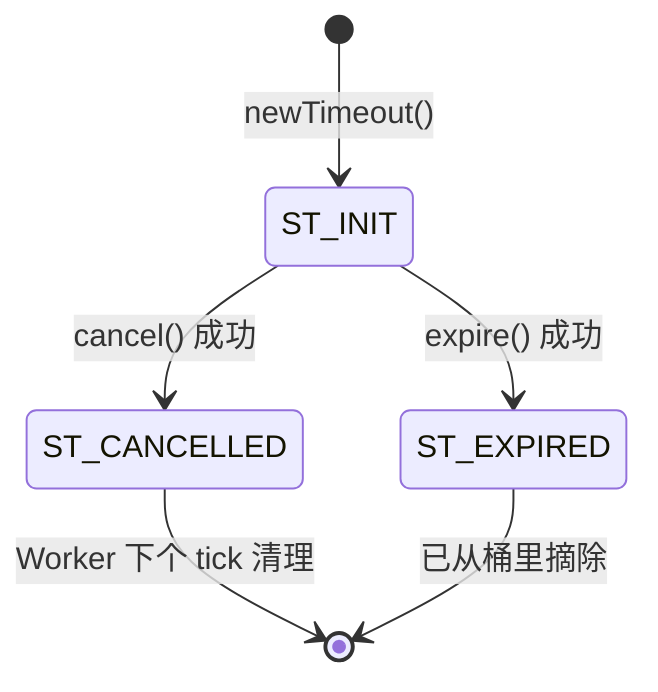
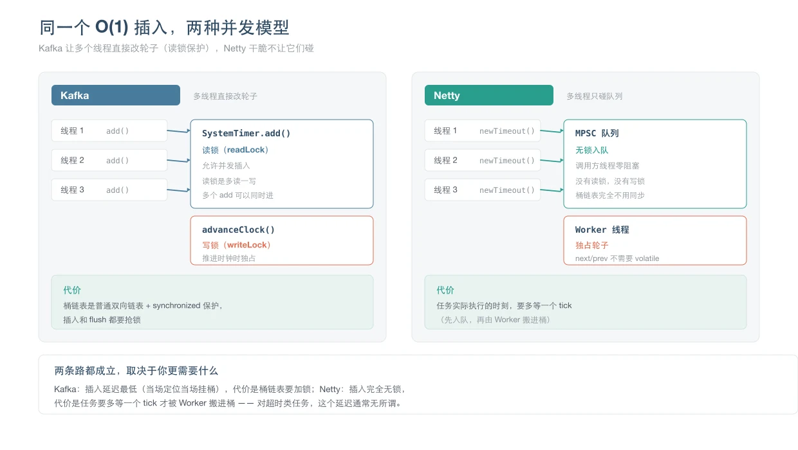

# 时间轮实现剖析：Kafka 的 TimingWheel 与 Netty 的 HashedWheelTimer


<!--more-->

上一篇把时间轮的**算法**讲清楚了：环形数组、桶、轮次、层级降级。但算法是 1987 年那篇论文给的，实现是各家一点点打磨出来的。

同样一件事——「O(1) 插入 + O(1) 取消 + O(1) 触发」——Kafka 和 Netty 给出了两套几乎相反的答案：

- **Kafka**：层级轮，溢出轮按需创建，桶对象跨轮复用，用 `DelayQueue` 驱动，**多个线程直接改轮子**（读写锁保护）；
- **Netty**：单级轮，调用方只往 MPSC 队列里塞，**Worker 线程独占轮子**，桶里的链表一根锁都不用。

这一篇逐行读这两套实现。读完你应该能回答这几个问题：

- 为什么 Kafka 要用 `DelayQueue`，而不是固定频率的 ticker？
- 为什么 Netty 的「取消」不是立刻生效，而是要延迟一个 tick？
- 为什么 Kafka 的桶能跨轮复用，而它需要一个 `expiration` 字段来记账？
- 两个都号称 O(1) 的实现，差的那点延迟到底在哪？

| 章节 | 回答什么问题 | 核心结论 |
|---|---|---|
| 一 | 两套实现的骨架差在哪 | 十一个维度的总览对照 |
| 二 | Kafka 怎么写的 | 五个类的职责、时间轮的实际结构、四段判断、桶复用、DelayQueue 驱动、墓碑取消 |
| 三 | Netty 怎么写的 | 三件套、轮子的实际结构、2 的幂归一化、MPSC 交接、Worker 四步、CAS 取消 |
| 四 | 同一个问题的不同解法 | 七个设计选择的逐条拆解 |
| 五 | 自己写该抄哪个 | 按需求选型，以及几处千万别抄的地方 |

## 一、先看全景

在钻进细节之前，先把两套实现的骨架摆在一起：

| 维度 | Kafka | Netty |
|---|---|---|
| 代码位置 | `org.apache.kafka.server.util.timer`（server-common 模块） | `io.netty.util`（netty-common 模块） |
| 层数 | 层级，溢出轮**懒创建** | 单级 |
| 默认参数 | `tickMs = 1`、`wheelSize = 20` | `tickDuration = 100ms`、`ticksPerWheel = 512` |
| 覆盖范围 | 每层 ×20，层数不设上限 | 512 × 100ms ≈ 51 秒 |
| 跨越一圈的办法 | **层级降级**（换更细的一层重定位） | `remainingRounds`（轮次计数） |
| 驱动方式 | `DelayQueue<TimerTaskList>`，阻塞等待下一个桶 | 固定频率 ticker + 单一 Worker 线程 |
| 桶的结构 | 双向**循环**链表 + 哨兵 `root` | 双向链表（`head` / `tail`） |
| 桶会不会复用 | 会，靠 `AtomicLong expiration` 记账 | 会，指针绕回来自然重新武装 |
| 并发模型 | 读锁（多线程插入）+ 写锁（推进时钟） | MPSC 队列 + Worker 独占轮子 |
| 取消语义 | 墓碑：置空引用，flush 时物理摘除 | CAS 标记 `ST_CANCELLED`，下一个 tick 清理 |
| 精度 | 1 ms | tickDuration（默认 100 ms） |

只看这张表，最反直觉的是「并发模型」那一行：**Kafka 让多个线程直接改轮子，Netty 恰恰不让**。这两个决定牵动了后面所有细节。

## 二、Kafka 怎么写的

### 2.1 五个类，各管一段

Kafka 的实现拆成了五个类，职责切得很干净：



| 类 | 是什么 | 关键字段 |
|---|---|---|
| `SystemTimer` | 对外唯一入口，驱动整个轮子 | `delayQueue`、`timingWheel`、`taskExecutor`、`readWriteLock` |
| `TimingWheel` | **一层**轮 | `buckets[]`、`currentTimeMs`、`overflowWheel` |
| `TimerTaskList` | **一个桶** = 一条双向循环链表 | `root`（哨兵）、`expiration`（`AtomicLong`） |
| `TimerTaskEntry` | 桶里的**链节点** | `expirationMs`、`next` / `prev`、`list` |
| `TimerTask` | 用户侧要实现的**抽象任务** | `delayMs`、`timerTaskEntry` |

注意 `TimingWheel` 是**一层**——层级这件事是靠 `TimingWheel` 里面挂一个 `overflowWheel` 递归实现的，而不是一个 `List<TimingWheel>`。

### 2.2 一个 Kafka 时间轮长什么样

前面讲的是「五个类各管一段」，但真正让人直观感受到结构的，还是那个环形数组本身。把它摊平看：



三点值得留意：

- **格子里挂的是链表，不是一个任务。** 一个 1ms 的格子里完全可能挂着几十个任务——它们的到期时刻都在这一毫秒之内。
- **指针 `currentTimeMs` 指向「当前时刻所在的格」。** 第 0 层每格 1ms，指针每毫秒走一格；第 1 层每格 20ms，指针要等第 0 层走完 20 格才前进一格——这就是「上一层的一格 = 下一层的一圈」。
- **两层的格数一样（都是 20 个），但一格代表的时间差 20 倍。** 所以任务从第 0 层退到第 1 层，等价于「把精确的时刻换成了粗粒度的位置」。

### 2.3 add()：四段判断决定任务落在哪

整个 Kafka 时间轮的核心逻辑，就是 `TimingWheel.add()` 里的四段判断：



```java
public boolean add(TimerTaskEntry timerTaskEntry) {
    long expiration = timerTaskEntry.expirationMs;

    if (timerTaskEntry.cancelled()) {
        // Cancelled
        return false;
    } else if (expiration < currentTimeMs + tickMs) {
        // Already expired
        return false;
    } else if (expiration < currentTimeMs + interval) {
        // Put in its own bucket
        long virtualId = expiration / tickMs;
        int bucketId = (int) (virtualId % (long) wheelSize);
        TimerTaskList bucket = buckets[bucketId];
        bucket.add(timerTaskEntry);

        // Set the bucket expiration time
        if (bucket.setExpiration(virtualId * tickMs)) {
            queue.offer(bucket);
        }

        return true;
    } else {
        // Out of the interval. Put it into the parent timer
        if (overflowWheel == null) addOverflowWheel();
        return overflowWheel.add(timerTaskEntry);
    }
}
```

逐段拆：

**第一段，`cancelled()`。** 已经取消的任务直接拒收，返回 `false`。`SystemTimer` 拿到 `false` 后会再检查一次 `cancelled()`——确认已取消就不提交执行。取消的实现方式很特别，后面 2.7 节细说。

**第二段，「已经到期」。** 同样返回 `false`，但这次任务没被取消，所以 `SystemTimer` 会把它直接丢进线程池执行。判断是 `expiration < currentTimeMs + tickMs`——注意是**小于**，不是小于等于。`currentTimeMs` 是向下取整到本层 `tickMs` 的当前时间，所以 `expiration == currentTimeMs + tickMs` 时任务还没到期，要等下一格。

**第三段，「本层装得下」。** 两行核心代码：

- `virtualId = expiration / tickMs`：**按本层粒度算出的绝对 tick 序号**——除的是本层自己的 `tickMs`（第 0 层是 1ms，第 1 层是 20ms），所以在同一层内它是个稳定的、与当前时间无关的量；
- `bucketId = virtualId % wheelSize`：取模得到桶号。

**注意 `virtualId` 的单位逐层不同**：第 0 层算出的是「第几个毫秒」，第 1 层算出的是「第几个 20ms」。所以同一个到期时刻，在第 0 层是 35、在第 1 层是 1——**桶号会不一样，这是对的**。

真正让降级能工作的，不是 `virtualId` 跨层可比，而是 **`expirationMs`（绝对到期毫秒）从头到尾没变过**：每一层都拿这个绝对值算自己的 `virtualId`，所以无论任务被送到哪一层，落点都是对的。

**第四段，「本层装不下」。** 退到 `overflowWheel`。而 `overflowWheel` 是**懒创建**的：

```java
private void addOverflowWheel() {
    if (overflowWheel == null) {
        synchronized (this) {
            if (overflowWheel == null) {
                overflowWheel = new TimingWheel(
                    interval, wheelSize, currentTimeMs, taskCounter, queue
                );
            }
        }
    }
}
```

注意传进去的 `interval`——**上一层的整圈时长，正好是下一层的一个 tick**。所以层级是这么长出来的：

| 层 | tickMs | wheelSize | 覆盖范围 |
|---|---|---|---|
| 第 0 层 | 1 ms | 20 | 20 ms |
| 第 1 层 | 20 ms | 20 | 400 ms |
| 第 2 层 | 400 ms | 20 | 8 s |
| 第 3 层 | 8 s | 20 | 160 s |

`overflowWheel` 声明成 `volatile` 是因为它可能被两个线程同时通过 `add()` 读到（双检锁），而 `add()` 是允许并发调用的。


上面四段判断是「规则」，下面这个例子是「算术」——一个 35ms 后到期的任务，怎么在两层之间走一遭：



这个例子值得多看两眼，因为它是 Kafka 层级时间轮的核心机制一次完整的展开：

- **第 0 层只覆盖 20ms**（`interval = tickMs × wheelSize = 1 × 20`），所以 35ms 的任务第 0 层根本装不下；
- **它先被第 1 层接住**，落在第 1 层的 1 号桶。而那个桶的到期时刻是 `virtualId × tickMs = 1 × 20 = 20ms`——**比任务真正的到期时刻 35ms 早了 15ms**；
- **20ms 时这个桶到期，被 flush，任务被重新 `add()` 一遍**。此时第 0 层装得下了（`35 < 20 + 20`），任务落到第 0 层的 15 号桶，到期时刻 35ms；
- **35ms 时第 0 层的桶到期**，这次是真的到期了，任务被执行。

**「粗层提前把任务交下来，最细的层负责精确命中」——这句话在代码里就是这条链路。** 粗层交得早一点不要紧，反正离真正的到期时间还早；只要最细的那一层能精确命中就行。

### 2.4 TimerTaskList：一个桶 = 一条带哨兵的双向循环链表

Kafka 的桶不是 `java.util.LinkedList`，而是自己手写的**双向循环链表**：

```java
// TimerTaskList forms a doubly linked cyclic list using a dummy root entry
// root.next points to the head
// root.prev points to the tail
private final TimerTaskEntry root;
```

构造时哨兵自己指向自己：

```java
this.root = new TimerTaskEntry(null, -1L);
this.root.next = root;
this.root.prev = root;
```

**为什么要哨兵？** 为了让「插入到尾部」和「删除任意节点」都不需要判断边界。普通链表里插到尾部要一路走到最后一个节点，而有了 `root`，`root.prev` 永远就是最后一个：

```java
public void add(TimerTaskEntry timerTaskEntry) {
    boolean done = false;
    while (!done) {
        // Remove the timer task entry if it is already in any other list
        // We do this outside of the sync block below to avoid deadlocking.
        timerTaskEntry.remove();

        synchronized (this) {
            synchronized (timerTaskEntry) {
                if (timerTaskEntry.list == null) {
                    // put the timer task entry to the end of the list. (root.prev points to the tail entry)
                    TimerTaskEntry tail = root.prev;
                    timerTaskEntry.next = root;
                    timerTaskEntry.prev = tail;
                    timerTaskEntry.list = this;
                    tail.next = timerTaskEntry;
                    root.prev = timerTaskEntry;
                    taskCounter.incrementAndGet();
                    done = true;
                }
            }
        }
    }
}
```

这段代码里有个容易看漏的设计：**`while (!done)` 循环 + 先 `remove()` 再加锁**。

`timerTaskEntry.remove()` 的作用是把节点从它当前所在的桶里摘掉——因为一个 entry 可能正在被另一个线程从 A 桶搬到 B 桶。所以流程是「先摘干净，再挂新的」，中间有竞争就重试。

`synchronized (this)` 锁的是桶（链表），`synchronized (timerTaskEntry)` 锁的是节点本身。**两把锁的顺序是固定的（桶 → 节点）**，避免死锁。

### 2.5 桶复用：同一个对象，转完一圈又装新任务

这是 Kafka 实现里最巧的一块。

Kafka 不会为每一轮新建桶——**20 个 `TimerTaskList` 对象从头用到尾**。指针转过一圈后，桶 7 又可以装新的任务。



那怎么知道「桶 7 现在该在什么时候到期」？靠 `TimerTaskList` 里的这个字段：

```java
private final AtomicLong expiration;
```

以及这个方法：

```java
public boolean setExpiration(long expirationMs) {
    return expiration.getAndSet(expirationMs) != expirationMs;
}
```

**返回值是整段复用逻辑的开关**：只有当到期时刻**变了**，才需要把桶重新塞进 `DelayQueue`。

看一遍桶 7 的一生：

| 时刻 | 发生了什么 | `expiration` |
|---|---|---|
| 初始 | 桶是空的 | `-1` |
| 任务 A 入桶 | `setExpiration(12)`，值变了 | `12` → **offer 进 DelayQueue** |
| Worker flush | 链表清空，方法末尾重置 | `-1` |
| 任务 B 入桶 | `setExpiration(35)`，从 `-1` 变成 `35`，又变了 | `35` → **再 offer 一次** |
| 到期 flush | 执行任务 B，再重置 | `-1` |

所以 `flush()` 的最后一行是：

```java
expiration.set(-1L);
```

**一句话总结：「桶在不在 `DelayQueue` 里」取决于 `expiration` 变没变，而不是桶里有没有任务。** 这正是「避免空推进」的机制——空桶根本不会被排队，Worker 自然不会为了空桶醒过来。

### 2.6 SystemTimer：DelayQueue 驱动

有了上面那套，`SystemTimer` 就变得非常简单：

```java
public class SystemTimer implements Timer {
    private final ExecutorService taskExecutor;
    private final DelayQueue<TimerTaskList> delayQueue;
    private final AtomicInteger taskCounter;
    private final TimingWheel timingWheel;
    private final ReentrantReadWriteLock readWriteLock = new ReentrantReadWriteLock();
```

推进时钟：

```java
public boolean advanceClock(long timeoutMs) throws InterruptedException {
    TimerTaskList bucket = delayQueue.poll(timeoutMs, TimeUnit.MILLISECONDS);
    if (bucket != null) {
        writeLock.lock();
        try {
            while (bucket != null) {
                timingWheel.advanceClock(bucket.getExpiration());
                bucket.flush(this::addTimerTaskEntry);
                bucket = delayQueue.poll();
            }
        } finally {
            writeLock.unlock();
        }
        return true;
    } else {
        return false;
    }
}
```

三步：

1. `delayQueue.poll(timeoutMs)` —— **阻塞**，直到有桶到期。有超时兜底，防止线程永远卡住。
2. `timingWheel.advanceClock(bucket.getExpiration())` —— 把本层（以及递归地，所有溢出层）的 `currentTimeMs` 推到桶的到期时刻。
3. `bucket.flush(this::addTimerTaskEntry)` —— 把桶里的每个 entry 重新 `add()` 一遍。

**第 3 步是整个 Kafka 时间轮的枢纽。** 重新 `add()` 时，任务会带着原来的 `expirationMs`（绝对到期时间）**从最细的第 0 层开始**，往上找第一个装得下它的层：

- 已经到期 → `add()` 返回 `false`，任务被立即提交执行；
- 还没到期，但第 0 层装得下（`expiration < currentTimeMs + 20ms`）→ 落回**更细的第 0 层**，那才是精确命中的地方；
- 连第 0 层都装不下 → 才继续往粗的层退（正常情况下不会发生，除非 flush 迟到、指针已经跑过了一段）。

**所以「层级降级」在代码里的样子是：从粗层被交下来的任务，重新 offer 给根轮后，通常会落回更细的一层。** 它不是显式的 cascade 函数，而是「重新 add 一遍」的副作用。

谁在调 `advanceClock`？Kafka 的 `DelayedOperationPurgatory` 里有一个专门的 purgatory 线程：

```java
try {
    advanceClock(200L);
} catch (InterruptedException ie) {
    throw new RuntimeException(ie);
}
```

那个 `200L` 只是 `DelayQueue.poll` 的超时兜底——真正的节奏由桶的到期时刻决定。**没有任务时，线程就阻塞在 poll 上，一次唤醒都不浪费。** 这也是 Kafka 敢把底层粒度定成 1ms 的底气：换成固定频率的 ticker，1ms 意味着每秒醒 1000 次。


`flush()` 把桶里的节点逐个交给 `add()`，而 `add()` 的那四段判断会把它们分到三个不同的去向：



**这张图是整篇最值得反复看的一张**，它同时解释了三件事：

- **为什么 Kafka 的「降级」不需要专门的 cascade 函数**——节点 B 被交下来后重新走一遍 `add()`，这次第 0 层装得下（`35 < 20 + 20`），它就自己落回更细的第 0 层。降级只是判断的副产品；
- **为什么取消的任务不会误执行**——节点 C 被第一段拦下，`SystemTimer` 再查一次 `cancelled()` 确认丢弃；
- **为什么桶能被复用**——flush 之后桶 1 的链表空了、`expiration` 归零，它可以马上接下一轮的任务。

顺带注意一个容易忽略的细节：**第 0 层的桶只装得下到期时刻完全相同的任务**（一格 1ms），而**第 1 层的桶能装下 20ms 跨度内的所有任务**。因为桶下标是按**本层粒度**算的——层级越粗，一格覆盖的时间段越长，桶里能装的到期时刻就越分散。所以「粗层装得多、细层装得精」，这也是粗层负责「批量交下来」的前提。

### 2.7 取消：一个「墓碑」

Kafka 的取消不是「从链表里摘掉节点」，而是**把引用置空**：

```java
public void cancel() {
    synchronized (this) {
        if (timerTaskEntry != null) timerTaskEntry.remove();
        timerTaskEntry = null;
    }
}
```

而 `TimerTaskEntry.cancelled()` 的判断是：

```java
public boolean cancelled() {
    return timerTask.getTimerTaskEntry() != this;
}
```

翻译过来：**「我不再指向这个 entry 了」就等于「这个 entry 已被取消」**。

这里有个漂亮的地方——`TimerTask` 和 `TimerTaskEntry` 互相持有引用：

- `TimerTask.timerTaskEntry`：指向自己当前所在的 entry；
- `TimerTaskEntry.timerTask`：指向任务本身。

取消的动作只是**单向断开** `TimerTask → TimerTaskEntry`。entry 还留在桶的链表里，但已经是个「墓碑」——`flush()` 把它交给 `add()`，而 `add()` 的第一段 `cancelled()` 判断会直接把它拒掉，`SystemTimer` 再检查一次 `cancelled()`，确认已取消就不提交执行。

**代价**：墓碑要等到桶被 flush 才被物理摘除，占着内存。但**取消操作本身是 O(1) 且不需要抢桶的锁**——它只锁 `TimerTask`。

### 2.8 并发模型：读写锁

`SystemTimer` 用一把 `ReentrantReadWriteLock`：

| 操作 | 锁 |
|---|---|
| `add(TimerTask)` | **读锁**（多线程可以同时插） |
| `advanceClock(timeoutMs)` | **写锁**（推进时钟时独占） |

`TimingWheel` 自己的注释也写明了约束：

> This class is not thread-safe. There should not be any add calls while advanceClock is executing. It is caller's responsibility to enforce it. Simultaneous add calls are thread-safe.

注意最后一句：**同时的 `add` 是安全的，`add` 和 `advanceClock` 并发则不行**——这正是读写锁要覆盖的边界。

## 三、Netty 怎么写的

### 3.1 三个类，比 Kafka 少两个

| 类 | 是什么 |
|---|---|
| `HashedWheelTimer` | 定时器本体：轮子 + Worker 线程 |
| `HashedWheelBucket` | 一个桶 = 一条双向链表（`head` / `tail`） |
| `HashedWheelTimeout` | 桶里的任务节点，也是 `Runnable`（自己就是回调体） |

`HashedWheelTimeout` 有点特别：它同时实现了 `Timeout` 和 `Runnable`，到期后由 `taskExecutor` 线程池执行它的 `run()`：

```java
public void expire() {
    if (!compareAndSetState(ST_INIT, ST_EXPIRED)) {
        return;
    }
    try {
        remove();
        timer.taskExecutor.execute(this);
    } catch (Throwable t) {
        ...
    }
}

@Override
public void run() {
    try {
        task.run(this);
    } catch (Throwable t) {
        ...
    }
}
```

**CAS 保证只执行一次**——`ST_INIT → ST_EXPIRED` 这一步是原子的。

### 3.2 轮子大小归一化到 2 的幂

```java
private static HashedWheelBucket[] createWheel(int ticksPerWheel) {
    ticksPerWheel = MathUtil.findNextPositivePowerOfTwo(ticksPerWheel);

    HashedWheelBucket[] wheel = new HashedWheelBucket[ticksPerWheel];
    for (int i = 0; i < wheel.length; i ++) {
        wheel[i] = new HashedWheelBucket();
    }
    return wheel;
}
```

用户传 `ticksPerWheel = 500`，实际会被**向上取整到 512**。为什么要 2 的幂？为了取模能变成一次位与：

```java
mask = wheel.length - 1;
...
int stopIndex = (int) (ticks & mask);
```

`& mask` 比 `% wheel.length` 快，而且分支预测友好。这是个纯粹的 CPU 层优化——但它也意味着**你传的 500 实际变成 512，覆盖范围悄悄多了 2.4%**。

另外还有两个边界检查值得注意：

```java
// Prevent overflow.
if (duration >= Long.MAX_VALUE / wheel.length) {
    throw new IllegalArgumentException(...);
}

if (duration < MILLISECOND_NANOS) {
    logger.warn("Configured tickDuration {} smaller than {}, using 1ms.", tickDuration, MILLISECOND_NANOS);
    this.tickDuration = MILLISECOND_NANOS;
}
```

**tick 最小 1ms**，小于这个值直接被抬到 1ms（只是 warn，不会抛异常）。

### 3.3 newTimeout：只入队，不碰轮子

这是 Netty 和 Kafka 最本质的差别。看 `newTimeout` 的后半段：

```java
// Add the timeout to the timeout queue which will be processed on the next tick.
// During processing all the queued HashedWheelTimeouts will be added to the correct HashedWheelBucket.
long deadline = System.nanoTime() + unit.toNanos(delay) - startTime;

// Guard against overflow.
if (delay > 0 && deadline < 0) {
    deadline = Long.MAX_VALUE;
}
HashedWheelTimeout timeout = new HashedWheelTimeout(this, task, deadline);
timeouts.add(timeout);
```

**它只是把任务丢进一个队列就返回了。** 没有算槽位，没有算轮次，没有碰任何桶。

为什么能这么做？因为 `deadline` 是**绝对**的（相对于 Worker 的 `startTime`），定位工作可以推迟到 Worker 线程里做：

```java
long calculated = timeout.deadline / tickDuration;
timeout.remainingRounds = (calculated - tick) / wheel.length;

final long ticks = Math.max(calculated, tick); // Ensure we don't schedule for past.
int stopIndex = (int) (ticks & mask);

HashedWheelBucket bucket = wheel[stopIndex];
bucket.addTimeout(timeout);
```

这四行就是 Netty 版的「定位」。三件事一次做完：

| 代码 | 干什么 |
|---|---|
| `calculated = deadline / tickDuration` | 绝对到期时刻换算成 tick 序号 |
| `remainingRounds = (calculated - tick) / wheel.length` | 还要绕几圈 |
| `stopIndex = ticks & mask` | 落在哪个桶 |

注意 `Math.max(calculated, tick)` 那行注释——**Ensure we don't schedule for past**：如果任务在搬运过程中已经到期（`calculated < tick`），就把它放进当前这一格，下一次扫描就能处理掉。

### 3.4 Worker：一个线程，四个步骤



```java
do {
    final long deadline = waitForNextTick();
    if (deadline > 0) {
        int idx = (int) (tick & mask);
        processCancelledTasks();
        HashedWheelBucket bucket = wheel[idx];
        transferTimeoutsToBuckets();
        bucket.expireTimeouts(deadline);
        tick++;
    }
} while (WORKER_STATE_UPDATER.get(HashedWheelTimer.this) == WORKER_STATE_STARTED);
```

四步的顺序有讲究：

**① `waitForNextTick()`** —— 睡到下一个 tick 边界。返回的是**实际已流逝的纳秒数**，不是理论边界值。

**② `processCancelledTasks()`** —— 清理上一轮标记为取消的任务。

**③ `transferTimeoutsToBuckets()`** —— 把队列里的任务批量搬进桶。每 tick 最多搬 10 万个：

```java
private void transferTimeoutsToBuckets() {
    // transfer only max. 100000 timeouts per tick to prevent a thread to stale the workerThread when it just
    // adds new timeouts in a loop.
    for (int i = 0; i < 100000; i++) {
        HashedWheelTimeout timeout = timeouts.poll();
        if (timeout == null) {
            // all processed
            break;
        }
        ...
    }
}
```

这个上限是防饿死用的——否则某个线程疯狂提交任务，Worker 会被拖死在这里。

**④ `bucket.expireTimeouts(deadline)`** —— 扫当前这一格：

```java
public void expireTimeouts(long deadline) {
    HashedWheelTimeout timeout = head;
    while (timeout != null) {
        HashedWheelTimeout next = timeout.next;
        if (timeout.remainingRounds <= 0) {
            if (timeout.deadline <= deadline) {
                timeout.expire();
            } else {
                // The timeout was placed into a wrong slot. This should never happen.
                throw new IllegalStateException(...);
            }
        } else if (!timeout.isCancelled()) {
            timeout.remainingRounds--;
        }
        timeout = next;
    }
}
```

三个分支：**轮次归零且到期 → 执行；轮次没归零 → 减一继续等；已经取消 → 跳过。**

那个 `IllegalStateException` 很能说明问题：**Netty 用「不可能发生」的断言来保证不会提前触发。** 如果 `timeout.deadline <= deadline` 不成立，意思是任务被放进了错误的槽位——下标算错了。这是 Netty 对「只会晚不会早」这条不变量的自证。


Kafka 那个轮子画出来是「一圈格子 + 每格一条链」，Netty 的轮子形状完全一样，只是多了一个字段：每个任务自带圈数。



### 3.5 取消：CAS 状态机 + 延迟清理

Netty 的取消分两步：

```java
public boolean cancel() {
    // only update the state it will be removed from HashedWheelBucket on next tick.
    if (!compareAndSetState(ST_INIT, ST_CANCELLED)) {
        return false;
    }
    // If a task should be canceled we put this to another queue which will be processed on each tick.
    // So this means that we will have a GC latency of max. 1 tick duration which is good enough. This way
    // we can make again use of our MpscLinkedQueue and so minimize the locking / overhead as much as possible.
    timer.cancelledTimeouts.add(this);
    return true;
}
```

**第一步**：CAS 把状态从 `ST_INIT` 改成 `ST_CANCELLED`。这一步保证「一个任务只会被取消一次」，也保证「已到期（`ST_EXPIRED`）的任务取消不掉」——CAS 会失败并返回 `false`。

**第二步**：把任务丢进 `cancelledTimeouts` 队列。

**为什么不立刻从桶里摘掉？** 注释说得很明白：摘节点要动 Worker 独占的链表，而 `cancel()` 可能发生在任意线程上。**改成「只标记，入队，由 Worker 下个 tick 清理」，调用方就完全不用碰桶了。**

代价是注释里那句 **GC latency of max. 1 tick duration**——被取消的任务最多要等一个 tick 才被回收。对于 100ms 的 tick，就是最多 100ms 的内存滞留。**这个取舍是划算的**：换来的是取消操作零阻塞、零锁。

状态机一共三个状态：



`ST_CANCELLED` 和 `ST_EXPIRED` 都是终态——**一个任务要么被取消，要么被执行，不会既取消又执行。** 这正是 CAS 状态机的作用。

### 3.6 精度：为什么 Netty 不会提前触发

Netty 的 `tickDuration` 默认 100ms。那一个 105ms 的超时会在什么时候触发？

- `calculated = deadline / tickDuration` = 105ms / 100ms = **1**（整除）；
- 任务落在槽 1；
- Worker 的指针转到槽 1 时，实际已流逝时间 ≈ `(1+1) × 100ms = 200ms`；
- `timeout.deadline (105ms) <= deadline_param (200ms)` ✓ → 执行。

**所以 105ms 的超时在 200ms 触发，晚了 95ms。** Netty 把到期时刻**向上取整到下一个 tick 边界**，绝不会提前。

这跟 Kafka 的 1ms 底层粒度形成了有趣的对照：**Kafka 的时间轮精确到毫秒，Netty 的时间轮精确到百毫秒**——但两者都遵守同一条底线：只往后推，不往前挪。

## 四、同一个问题的不同解法

把两套实现并排看，会发现它们在七个地方做了不同选择。每一个都不是随意的。

### 4.1 层级还是单级

Kafka 用层级，Netty 用单级。

Kafka 需要层级，是因为它的延迟跨度大：延迟消息可能是 5 秒，也可能是 5 分钟，还可能是几小时。单级轮覆盖不了，得靠层级往下退。

Netty 不用层级，是因为它的时间轮只服务于**连接超时**——跨度通常在秒级，512 个槽 × 100ms = 51 秒已经够用。**跨度决定层数**，这是选型的第一原则。

### 4.2 DelayQueue 还是 ticker

Kafka 用 `DelayQueue` 驱动，Netty 用固定频率的 ticker。

Kafka 的底层粒度是 **1ms**。如果用 ticker，就是每秒醒 1000 次去检查「有没有到期的桶」——哪怕一个桶都是空的。`DelayQueue` 把它变成「阻塞到下一个桶到期」，**唤醒次数等于任务批次数，而不是时间片数**。

Netty 用 ticker 是因为它的粒度本来就粗（100ms），每秒 10 次唤醒完全无所谓。

**规律：粒度越细，越需要事件驱动而不是轮询。**

### 4.3 谁来改轮子

Kafka 允许多个线程直接 `add()`，用读锁保护；Netty 只允许 Worker 线程改。

Kafka 的场景是 **broker 上百万个延迟请求**，来自网络线程、控制器线程、协调器线程——多线程插入是刚需，所以只能上锁。读锁的选择也很合理：**插入是读操作（改数据但不改结构），推进时钟才是写操作**。

Netty 的场景是**一条连接上的几十个超时**，虽然也可能多线程提交，但它选择了另一条路：**让调用方只碰队列**。



Netty 这条路的代价是**任务实际执行的时刻要多等一个 tick**：提交 → 进队列 → Worker 在某个 tick 把它搬进桶 → 指针转到那个桶时才执行。而 Kafka 是提交即定位、当场入桶。对超时类任务，这点延迟通常无所谓。

### 4.4 取消：墓碑还是 CAS 状态机

Kafka 用**互相引用 + 单向断开**做墓碑，Netty 用 **CAS 状态机 + 延迟队列**。

两者有一个共同点：**取消操作都不去动桶里的链表**。Kafka 锁 `TimerTask`，Netty 走 MPSC 队列。**取消路径和桶解耦**，这是两套实现共同的设计。

区别在回收时机：Kafka 的墓碑在 `flush()` 时被物理摘除，Netty 的在下一个 tick 被清理。**Kafka 的墓碑滞留时间取决于桶的周期，Netty 的固定是一个 tick。**

### 4.5 桶怎么复用

两边都复用桶对象，但记账方式不同。

Kafka 需要 `expiration` 字段，是因为它的桶**是 `DelayQueue` 的元素**——`DelayQueue` 按到期时刻排序，所以桶必须知道自己的到期时刻，而且要能判断「我是不是已经排过队了」。

Netty 不需要这个字段，因为**指针的位置本身就是记账**——桶在数组里的下标就决定了它什么时候被再次访问。

**规律：谁承担「排序」这个职责，谁就得记账。**

### 4.6 链表的同步

Kafka 的桶链表是 `synchronized` 保护的普通双向循环链表；Netty 的桶链表**一根锁都不用**：

```java
// This will be used to chain timeouts in HashedWheelTimerBucket via a double-linked-list.
// As only the workerThread will act on it there is no need for synchronization / volatile.
HashedWheelTimeout next;
HashedWheelTimeout prev;
```

注意那个注释：**只有 Worker 线程会动它，所以不需要同步，也不需要 volatile。** 这是「把并发消灭在设计里」而不是「用锁管理并发」的典型例子。

Kafka 做不到这一点，因为它的插入路径是公开的、多线程的。

### 4.7 精度：1ms 还是 100ms

Kafka 的 `SystemTimer` 默认 `tickMs = 1`、`wheelSize = 20`：

```java
public SystemTimer(String executorName) {
    this(executorName, 1, 20, Time.SYSTEM.hiResClockMs());
}
```

为什么是 1ms？因为到期时间 `expirationMs` 也是毫秒整数，`floor(expiration / 1) × 1 = expiration`，**误差为零**。如果底层粒度是 10ms，一个 105ms 的任务会被定位到 `floor(105/10) = 10` 号桶，在 100ms 就被取出来——**提前 5ms**。

Netty 的 100ms 则意味着所有到期时刻都被向上取整到 100ms 的整数倍。

**规律：底层粒度就是精度上限，而毫秒级的到期时间配毫秒级的粒度，才不会丢精度。**

## 五、自己写该抄哪个

### 5.1 想要层级轮，抄 Kafka 这几处

| 抄什么 | 为什么 |
|---|---|
| 每层都从同一个 `expirationMs` 推导落点 | 绝对到期时刻不变，降级才不会跑偏 |
| 溢出轮**懒创建**，且 `tickMs = 上一层的 interval` | 层数按需增长，不用预设 |
| 桶**跨轮复用** + `expiration` 字段记账 | 避免每轮新建对象，也避免空桶被反复扫描 |
| `DelayQueue` 驱动 | 粒度细的时候，轮询是烧 CPU 的 |
| 取消走**墓碑**，别去动链表 | 取消路径和桶解耦，才敢在任意线程上取消 |

### 5.2 想要单级轮，抄 Netty 这几处

| 抄什么 | 为什么 |
|---|---|
| 轮子大小**归一化到 2 的幂**，用 `& mask` | 取模变位与，CPU 层的小便宜 |
| 调用方**只入队**，Worker 独占轮子 | 能把桶里的同步成本降到零 |
| `calculated` + `remainingRounds` + `stopIndex` 三件套 | 定位逻辑集中在一处，且天然防提前 |
| 取消用 **CAS 状态机** + 延迟清理队列 | 只标记不动链表，零锁 |
| `expireTimeouts` 里的**断言** | 把「不会提前触发」这条不变量写进代码 |

### 5.3 三处千万别抄

**第一，别抄 Kafka 的「桶链表加锁」而忘了想清楚并发模型。** Kafka 能承受是因为 broker 的插入压力本来就大，而且它的插入路径是公开 API。**如果你能设计成单线程独占轮子，就不要加锁**——Netty 的做法在延迟和吞吐上都更好。

**第二，别抄 Netty 的「延迟一个 tick 取消」，如果你的任务量很大。** Netty 的取消延迟是固定的 100ms（一个 tick），它的使用场景是「一条连接上几十个超时」。**如果你有几百万个定时任务，每秒产生几十万个取消，这笔滞留内存要算一算。** Kafka 的墓碑在桶 flush 时清掉，滞留时间与桶的周期同阶，反而更可控。

**第三，别把 tick 取得比你的到期精度还细。** Netty 强制 tick 最小 1ms，Kafka 直接用 1ms 做底层粒度——都是因为再细下去收益极小、代价（唤醒频率、内存）陡增。

还有一条**无论抄谁都要守住**的底线：**到期时刻要向上取整，绝不提前触发。** Linux 内核把这条写进了注释：

> The timer wheel has to guarantee that a timer does not fire early.

提前触发在重试退避、超时判定这类场景里是**逻辑错误**，而晚一点最多是体验问题。

## 六、总结

> **Kafka 的时间轮是「一个线程说了算，多线程排队进」；Netty 的时间轮是「一个线程说了算，多线程只管递纸条」。** 同样的 O(1)，差别全在并发模型和驱动方式上。

如果只能带走五句话：

1. **Kafka 的层级不是「数组套数组」，而是一个 `TimingWheel` 挂一个 `overflowWheel`，靠 `add()` 里的四段判断递归下去。** 每一层的 `tickMs` 正好是上一层的整圈时长。
2. **Kafka 的桶跨轮复用，靠 `AtomicLong expiration` 记账**：值变了才重新进 `DelayQueue`。**「桶在不在队列里」取决于 `expiration` 变没变，不取决于桶里有没有任务**——这就是它避免空推进的机制。
3. **Kafka 的「降级」不是显式的 cascade 函数，而是「重新 `add()` 一遍」的副作用**——任务带着原来的绝对到期时刻，从最细的第 0 层开始重新找落点，刚交下来的通常会落回第 0 层。
4. **Netty 的取消是「只标记，不摘节点」**：CAS 改成 `ST_CANCELLED`，丢进另一个 MPSC 队列，由 Worker 下个 tick 清理。代价是 GC 延迟最多一个 tick，换来的是调用方零阻塞。
5. **两套实现都守住了同一条底线：绝不提前触发。** Kafka 靠 1ms 的底层粒度做到零误差，Netty 靠「在区间末尾触发」把提前量压成 0——实现路径完全不同，约束却一样。这是时间轮唯一不能商量的性质。

## 参考资料

- Apache Kafka. [`TimingWheel`](https://github.com/apache/kafka/blob/trunk/server-common/src/main/java/org/apache/kafka/server/util/timer/TimingWheel.java) / [`SystemTimer`](https://github.com/apache/kafka/blob/trunk/server-common/src/main/java/org/apache/kafka/server/util/timer/SystemTimer.java) / [`TimerTaskList`](https://github.com/apache/kafka/blob/trunk/server-common/src/main/java/org/apache/kafka/server/util/timer/TimerTaskList.java) / [`TimerTaskEntry`](https://github.com/apache/kafka/blob/trunk/server-common/src/main/java/org/apache/kafka/server/util/timer/TimerTaskEntry.java) / [`TimerTask`](https://github.com/apache/kafka/blob/trunk/server-common/src/main/java/org/apache/kafka/server/util/timer/TimerTask.java)（`org.apache.kafka.server.util.timer` 包）。
- Apache Kafka. [`DelayedOperationPurgatory`](https://github.com/apache/kafka/blob/trunk/server-common/src/main/java/org/apache/kafka/server/purgatory/DelayedOperationPurgatory.java)（驱动时间轮的 purgatory 线程）。
- Netty. [`HashedWheelTimer`](https://github.com/netty/netty/blob/4.1/common/src/main/java/io/netty/util/HashedWheelTimer.java)（`HashedWheelBucket` / `HashedWheelTimeout` 是它的内部类）。
- George Varghese, Tony Lauck. *Hashed and Hierarchical Timing Wheels*. ACM SOSP 1987。Netty 的类注释里直接引了这篇论文。 <https://www.cs.cmu.edu/~dunlop/cs588/papers/varghese-timing.pdf>
- 上一篇：[时间轮算法：把定时任务塞进一个环形数组](/posts/2026/11/48758207/)

