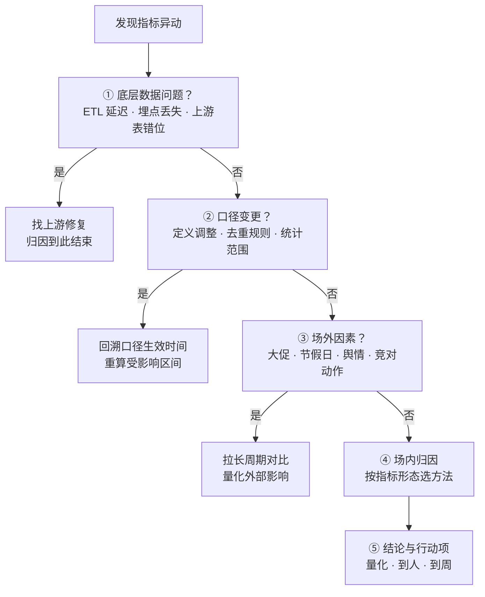
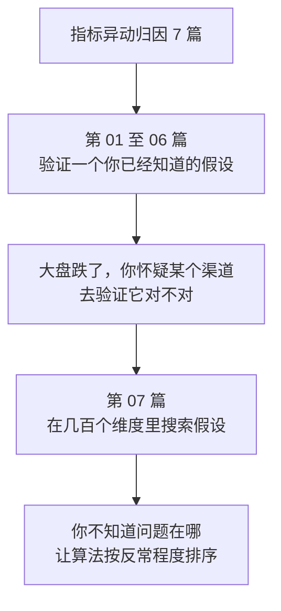

# 指标异动归因全景：从指标波动到可执行结论

周会上，运营问了一句："这周 GMV 环比涨了 5%，为什么？"

三种回答摆在桌上：

- "大促上线了。"——结论可能对，但没法回答"大促贡献了几成"。
- "搜索和直播涨得比较多。"——方向可能对，但"比较多"是多少？涨的部分又被谁抵消了？
- "直播贡献 51.4%，推荐 34.3%，私域 25.7%，搜索 −11.4%，四个渠道加起来正好 100%。"——这个能直接拿去排优先级。

第三种回答就是**归因分析**。它的本质不是"找原因"这种模糊的事，而是**把 ΔY 拆成一组加起来等于 ΔY 的数**，然后按大小排序。本系列 7 篇要讲的就是这件事怎么算对：每种方法的适用边界、残差从哪来、以及在几百个维度里怎么找到真正反常的那一个。

本文是总纲。后面每一篇对应一种方法族，单独展开。

<!--more-->

## 一、归因到底在算什么

### 1.1 四个词，四个层次

"指标异动归因分析"这六个字，拆开是四个独立的概念：

| 概念 | 含义 | 容易混淆的点 |
|---|---|---|
| **指标** | 对业务过程的度量（GMV、转化率、留存率） | 指标口径必须先钉死，否则后面全是空谈 |
| **异动** | 指标发生了偏离预期的变动 | 异动隐含"比较"——跟谁比？ |
| **归因** | 透过现象看本质，定位是哪些因素导致了变动 | 要量化，不是定性推测 |
| **分析** | 解读归因结果，给出可落地的建议 | 到人、到周、到动作 |

"异动"这个词里藏着最容易被跳过的一步：**异动永远是相对某个基准的**。常见有两类基准——同一主体的本期 vs 基期（本月 GMV 比上月），或者不同主体的同期对比（新算法版 vs 老算法版）。基准选错，后面全错：拿日环比当基线，会把"周末效应"当成异动。

### 1.2 用数学语言说清楚

把目标指标写成若干因子的函数：

$$
Y = f(X\_1, X\_2, \dots, X\_n)
$$

其中 `X₁⁰`、`X₂⁰`…`Xₙ⁰` 是各因子的基期值，`X₁¹`…`Xₙ¹` 是当期值。指标的变化是：

$$
\Delta Y = f\left(X\_1^{(1)}, \dots, X\_n^{(1)}\right) - f\left(X\_1^{(0)}, \dots, X\_n^{(0)}\right)
$$

归因要做的，是找到一个映射 `g`，把"每个因子的变化"翻译成"对 ΔY 的贡献"：

$$
g\left(\Delta X\_1, \Delta X\_2, \dots, \Delta X\_n\right) = \Delta Y
$$

这个式子看着抽象，其实就是一句话：**把一个数的变化，翻译成"谁贡献了多少"**。翻译出来的结果必须能加回去——加回去等于原变化量，才叫"解释"了这次异动。

### 1.3 定性和定量的差别有多大

假设本月 GMV 涨了 5%，两种答法：

> 答法一：GMV 涨 5%，主要是服装品类销量和客单价上升导致。
>
> 答法二：GMV 涨 5%，其中服装品类贡献 4pp（销量 2.5pp、客单价 1.5pp），其余因素贡献 1pp。

答法一的问题不在于结论可能不对，而在于**它无法被验证，也无法被排优先级**。"主要是"是多少？另外 1pp 是什么？如果排查资源有限，该先看服装还是先看那 1pp？答法一回答不了。

答法二把"主要原因"变成了一个带数字的清单，每一项都能追责、能下单、能验收。**定量归因的价值不在于结论更对，而在于结论可执行。**

## 二、三种贡献度：全系列的公共词汇

后面每一篇都会用到同一套记号，先在这里定死。

以「好物优选」这个电商 App 为例（后面 6 篇都用它），本月 GMV 从 1000 万涨到 1350 万，按渠道拆开：

| 渠道 | 上月 GMV | 本月 GMV | ΔX | 绝对贡献 V |
|---|---|---|---|---|
| 搜索 | 400 | 360 | −40 | −40 |
| 推荐 | 300 | 420 | +120 | +120 |
| 直播 | 200 | 380 | +180 | +180 |
| 私域 | 100 | 190 | +90 | +90 |
| **合计** | **1000** | **1350** | **+350** | **+350** |

同一张表的两个比例口径：

| 渠道 | 贡献度 C | 相对贡献 R |
|---|---|---|
| 搜索 | −11.43% | −4.00% |
| 推荐 | +34.29% | +12.00% |
| 直播 | +51.43% | +18.00% |
| 私域 | +25.71% | +9.00% |
| **合计** | **100%** | **+35.00%** |

三个概念的定义和它们各自满足的恒等式：

| 概念 | 记号 | 定义 | 恒等约束 |
|---|---|---|---|
| **绝对贡献** | `Vᵢ` | 因子 i 造成的绝对变化量 | $\sum\_i V\_i = \Delta Y$ |
| **贡献度** | `Cᵢ` | 因子 i 占这次变化的份额 | $\sum\_i C\_i = 100\\%$ |
| **相对贡献** | `Rᵢ` | 因子 i 的变化相当于基期大盘的多少 | $\sum\_i R\_i = \Delta Y / Y^{(0)}$ |

三者的关系是 $V\_i = C\_i \times \Delta Y$，$R\_i = V\_i / Y^{(0)}$。对着上表验一遍：绝对贡献加起来 +350 = ΔGMV ✓；贡献度加起来 100% ✓；相对贡献加起来 35%，正好等于 GMV 的环比涨幅 350/1000 = 35% ✓。

**方向约定**：`Cᵢ > 0` 表示因子 i 与指标同向变动，`Cᵢ < 0` 表示反向。上表里搜索的 `−11.43%` 意思是"搜索拖了后腿"，它贡献的绝对贡献是 −40 万。

### 2.1 为什么需要三个口径

只看一个会误判。

`Cᵢ`（贡献度）回答的是"这次变化里，直播占多大份额"——适合回答"该盯谁"。但 `Cᵢ` 是**无量纲**的，一个占比 50% 的因子，可能对应的绝对变化只有几十块。

`Vᵢ`（绝对贡献）回答的是"直播到底带来了多少钱"——适合回答"值不值得投人投钱修"。

`Rᵢ`（相对贡献）回答的是"直播的变化相当于大盘多大比例"——适合跨期、跨业务线比较，因为它是相对于基期规模归一的。

实际汇报里最常见的错误，是拿贡献度去排资源优先级。搜索贡献度 −11.43%、私域 +25.71%，看起来私域是正向主力；但如果私域的绝对贡献只有 +90 万，而它对应的运营人力是直播的三分之一，那么"该投谁"的答案可能完全不同。**三个口径要用，但不混用。**

## 三、指标能不能加：可加性决定方法族

同样是"按维度拆开"，能不能直接把各维度的值加起来，取决于指标在这个维度上的性质。这一节是选型的真正依据。

### 3.1 可加：拆开能加回去

GMV 按省份拆开、订单量按渠道拆开，各部分互不重叠（MECE），加起来等于整体。这类指标用**Delta 法**直接拆，干净利落。上一节的表格就是。

### 3.2 半可加：拆开会重复计算

活跃用户数按渠道拆开就不行——一个用户可能今天来过搜索、也来过推荐，各渠道 UV 加起来远大于总 UV。

处理半可加指标有两条路：

**路线一：唯一化。** 让每个用户只属于一个维度值。常见做法是**首次触点归因**（用户第一次来算搜索的）或**末次触点归因**（最后一次来算推荐的）。做法简单，但会把功劳全压在漏斗两端——第一次和最后之间发生了什么，全部被抹平了。

**路线二：允许重叠，但用数学修正。** 让各维度的影响相互耦合地参与分解，用 Shapley 值这类方法处理重叠部分。这条路在 [第五篇](/posts/2026/11/961422de/) 展开。

判断口径：**如果各维度值加起来明显超过总量，就是半可加。**

### 3.3 不可加：拆开相加没有意义

转化率、ROI、ARPU 这类比率型指标，在任何维度上直接相加都是错的——各分区的转化率加起来不等于整体转化率。

比率指标不能直接拆，但**可以换表示**。整体转化率其实是各人群转化率按人数加权的平均：

$$
\text{整体转化率} = \sum\_i \left( \text{人群 } i \text{ 的转化率} \times \text{人群 } i \text{ 的占比} \right)
$$

这个式子里有两样东西会动：人群自己的转化率（自身性变化），人群占比（结构性变化）。把这两者分开量化，就是**组间组内拆解法**，[第三篇](/posts/2026/11/7282130e/) 专门讲。

### 3.4 三类可加性速查

| 性质 | 判断方法 | 典型指标 | 处理方式 |
|---|---|---|---|
| **可加** | 各部分相加 = 整体 | GMV、订单量 | Delta 法直接拆 |
| **半可加** | 各部分相加 > 整体 | 跨渠道 UV | 唯一化，或 Shapley 修正 |
| **不可加** | 各部分相加 ≠ 整体，且无意义 | 转化率、ROI | 先换表示，再拆 |

**这一步做错，后面全白干。** 拿转化率套 Delta 法，会算出一个自相矛盾的结果——各人群转化率的贡献加起来，居然不等于整体转化率的变化。很多"归因结果对不上"的工单，根因就在这里。

## 四、排查顺序：为什么必须先排除非场内因素

拿到一个异动，第一反应不该是"开始拆"，而是"先确认这确实是个需要解释的异动"。标准动作是五步，**顺序不能换**：

**①和②是最容易被跳过、也最致命的两步。** 一次埋点字段改名，能让某渠道的 UV 凭空少 30%；一次"订单"改成"支付订单"的口径切换，能让 GMV 环比多出 8%。如果直接进入第 ④ 步，你会为一个不存在的问题做出一份看起来非常专业的归因报告——而且归因方法越高级，这份报告越有说服力，危害越大。

**③场外因素**要靠拉长周期来判断。如果把对比周期从"环比"换成"同比"，异动消失了，那大概率是大促、节假日这类外部因素，不是场内出了问题。

**⑤要给到人和动作。** "推荐渠道转化率下降"不是结论，"推荐渠道的详情页加载 P95 从 800ms 涨到 2.3s，定位到移动端首屏资源包未分包，建议 X 团队本周内出方案"才是结论。归因的价值在第 ⑤ 步兑现，前四步只是路径。

### 4.1 指标没变，也要归因

有一种情况容易被漏掉：**指标持平，但底下的因子已经天翻地覆**。

GMV 这月和上月都是 1000 万，看起来一切正常。但拆开看：客单价从 200 涨到 250（涨了 25%），销量从 5000 掉到 4000（跌了 20%）。两个一正一负刚好抵消。

这种"对冲型异动"更危险——因为大盘看起来正常，监控不会告警，但客单价涨 25% 通常意味着促销力度加大，销量跌 20% 说明需求透支了。**指标异动的监控只盯着总量，会系统性地漏掉这一类。**

所以归因不只在告警之后做，**定期做**。哪怕总量没动，拆解结果的剧烈变化本身也是信号。

## 五、方法选型地图

到这里，框架已经齐了。落地时的问题是：**手上这个指标，该用哪把刀？**

| 方法 | 适用指标形态 | 可加性前提 | 主要输出 | 详见 |
|---|---|---|---|---|
| **Delta 法** | 加法型 | 可加 | 各维度贡献度 | [第二篇](/posts/2026/11/c35540ac/) |
| **LMDI 法** | 乘法型 | 可写成乘积 | 各因子贡献度，无残差 | [第二篇](/posts/2026/11/c35540ac/) |
| **定基代替 / 泰勒展开** | 非线性 | 有显式表达式 | 边际贡献，含残差 | [第二篇](/posts/2026/11/c35540ac/) |
| **组间组内拆解** | 比率型 | 不可加，需换表示 | 自身性变化 + 结构性变化 | [第三篇](/posts/2026/11/7282130e/) |
| **链式拆解** | 漏斗型 | 乘法型特例 | 各环节贡献度 | [第四篇](/posts/2026/11/2b005e8c/) |
| **Shapley 值** | 多因素叠加 | 允许重叠/交互 | 各因素边际贡献 | [第五篇](/posts/2026/11/961422de/) |
| **多触点权重** | 路径型 | 需唯一化 | 渠道权重分配 | [第五篇](/posts/2026/11/961422de/) |
| **马尔科夫链** | 路径型 | 需完整路径 | 环节移除效应 | [第六篇](/posts/2026/11/e12f7524/) |
| **Adtributor** | 维度型（异常搜索） | 可加 | 意外性排序 + 解释力 | [第七篇](/posts/2026/11/6f5fd77c/) |

还有一张更快的速查表，按手上问题的形态查：

| 你手上的问题 | 用什么 |
|---|---|
| 一个绝对量（GMV、订单量）掉了，想知道是哪个维度掉的 | Delta 法 |
| 一个乘积型指标（UV × 转化率 × 客单价）掉了 | LMDI |
| 一个比率（转化率、ROI）掉了 | 组间组内拆解 |
| 一个漏斗整体掉了，想知道哪一环 | 链式拆解 |
| 几个活动同时在跑，想知道各自贡献 | Shapley 值 |
| 一个用户先搜后看评价再问客服，想知道各环节价值 | 马尔科夫链 |
| 有几百个维度，想找出**反常**的那个（而不是贡献最大的） | Adtributor |

## 六、这个系列怎么读

| # | 篇目 | 这一篇讲什么 |
|---|---|---|
| 01 | [指标异动归因全景](/posts/2026/11/cba63f94/) | 就是本文。框架、词汇、选型地图 |
| 02 | [指标分解模型：加法、乘法与残差](/posts/2026/11/c35540ac/) | Delta、LMDI、定基代替，以及残差从哪来 |
| 03 | [比率指标归因：组间组内拆解与辛普森悖论](/posts/2026/11/7282130e/) | 转化率、ROI 这类指标怎么拆 |
| 04 | [漏斗拆解：定位是哪一环坏了](/posts/2026/11/2b005e8c/) | 贡献度和优化优先级不是一回事 |
| 05 | [多因素叠加归因：Shapley 值与多触点权重](/posts/2026/11/961422de/) | 多个因素同时作用，怎么分功劳 |
| 06 | [路径归因：从首触末触到马尔科夫链](/posts/2026/11/e12f7524/) | 用户走过的路，每一步值多少钱 |
| 07 | [异常维度定位：Adtributor 的意外性与解释力](/posts/2026/11/6f5fd77c/) | 在几百个维度里找到真正反常的那个 |

建议按顺序读一遍。**第 02 篇是全系列的地基**——贡献度怎么算、残差怎么处理，后面几篇都要用。

### 6.1 七篇的分工

[第一篇](/posts/2026/11/cba63f94/) 到[第三篇](/posts/2026/11/7282130e/) 讲的都是**验证一个你已经知道的假设**：大盘跌了，你怀疑是某个渠道，去验证它对不对。前提是方向已经有了，方法提供的是"这个结论有多可信"和"它解释了多大比例"。[第四篇](/posts/2026/11/2b005e8c/) 到[第六篇](/posts/2026/11/e12f7524/) 把同一套思路分别用到漏斗、多因素叠加和用户路径上，性质一样。

第七篇讲的是**在几百个维度里搜索假设**：你不知道问题在哪，让算法按反常程度把候选排出来。

这个区别对应两种不同的工程形态：

| | 第 01 – 06 篇 | 第 07 篇 |
|---|---|---|
| 出发点 | 已经有怀疑对象 | 不知道问题在哪 |
| 输入 | 两期实际值 | 预期值 + 实际值 |
| 输出 | 贡献度分解 | 意外性排序 + 解释力 |
| 前提 | 指标可加性已判定 | 已有异动检测 + 预期值 |
| 成本 | 低 | 中（多维枚举 + 预测） |

### 6.2 方法对照表

| 方法 | 输入 | 回答的问题 | 成本 |
|---|---|---|---|
| Delta 法 | 两期各因子值 | 谁造成的变化大 | 最低 |
| LMDI | 两期 + 乘积式模型 | 各因子的对数变化份额 | 低 |
| 组间组内拆解 | 比率型指标 + 分群权重 | 自身性变化还是结构性变化 | 低 |
| 链式替代 | 漏斗各环节 | 哪一环坏了 | 低 |
| Shapley 值 | 多因素 + 交互关系 | 各因素的边际贡献 | 中（指数级，需采样） |
| 马尔科夫链 | 完整路径序列 | 去掉某个环节损失多少 | 中 |
| Adtributor | 预期值 + 实际值 + 多维枚举 | 谁反常 | 中（依赖异动检测） |

> **归因分析的本质，是把 ΔY 拆成一组加起来等于 ΔY 的数**。拆完还要记得换算成"该找谁、该做什么"。

如果只能带走四句话：

1. **先排除数据问题和口径变更，再谈归因**。顺序反了，你就是在给一个 bug 写一份很专业的分析报告。
2. **指标能不能加，决定了用哪套方法**。比率指标套 Delta 法，结果必然对不上。
3. **贡献度排序 ≠ 优化优先级**。前者回答"谁造成的变化大"，后者回答"该往哪投人"，两者经常给出相反的答案——第四篇会用一个漏斗算例把这个差别量化出来。
4. **前六篇是"验证你知道的事"，第七篇是"搜索你不知道的事"**。大盘跌了、你怀疑某个渠道，去验证它（第一至六篇）；问题究竟在哪你也不知道，让算法按反常程度排序（第七篇）。

## 七、参考资料

- [1] [B. W. Ang. The LMDI approach to decomposition analysis: a practical guide. Energy Policy, 2005](https://doi.org/10.1016/j.enpol.2003.10.010).
- [2] [E. M. Kitagawa. Components of a Difference Between Two Rates. Journal of the American Statistical Association, 50(272), 1955](https://doi.org/10.2307/2281213).
- [3] [L. S. Shapley. A Value for n-Person Games. Contributions to the Theory of Games, II (Annals of Mathematics Studies, Vol. 28), 1953, pp. 307-317](https://www.rand.org/pubs/papers/P295.html).
- [4] [R. Bhagwan, V. Karamcheti, N. McSherry, V. Sivaraman. Adtributor: Revenue Debugging in Advertising Systems. USENIX NSDI 2014](https://www.usenix.org/system/files/conference/nsdi14/nsdi14-paper-bhagwan.pdf).

