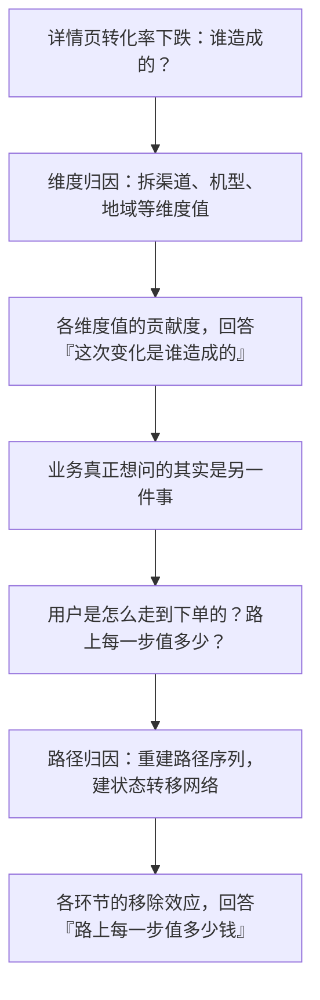
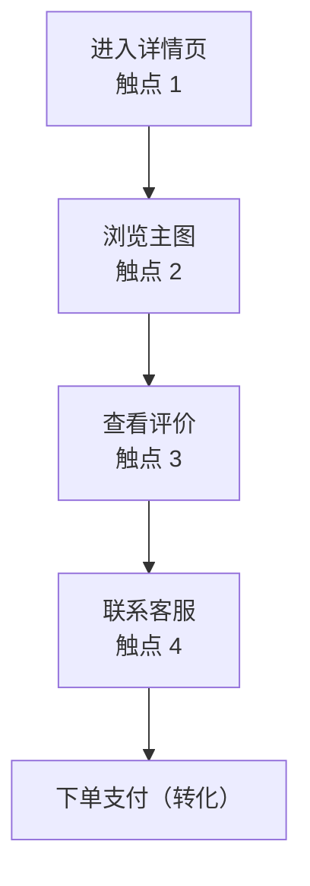
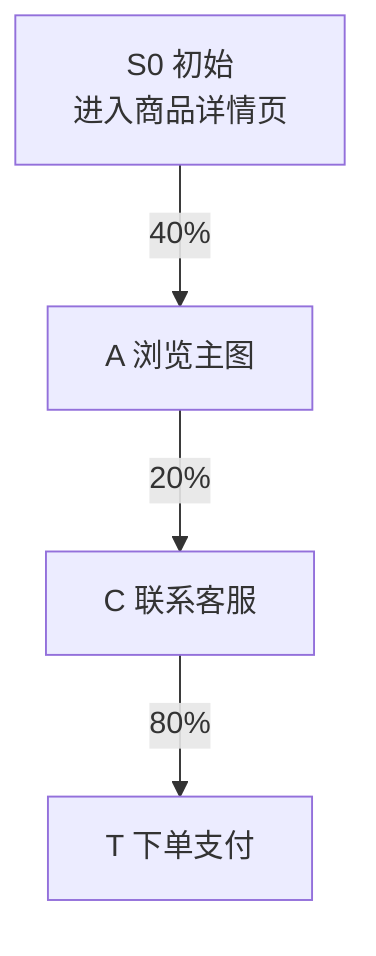
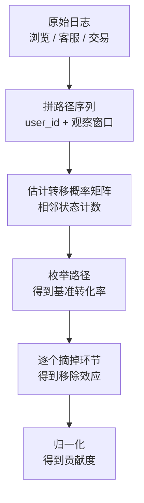

# 路径归因：从首触末触到马尔科夫链


<!--more-->

周会上，「好物优选」的增长分析师给出一个数字：**支付转化率的 43.55%，归功于"联系客服"这一环。**

会议室安静了两秒。客服是用户旅程中间的一步——用户先看主图，再看评价，问完客服才下单。它既不是第一次点击，也不是最后一次点击，凭什么拿走最大的一份功劳？

问题问得对，但问的方向错了。**43.55%** 不是"客服带来了 43.55% 的转化"，而是"把客服这一步从用户路径上摘掉，整条链的转化率会掉掉这么多"。它衡量的是这一步的**不可替代性**，不是它的加法贡献。这两种口径天差地别，而首触、末触这类规则法恰恰只能给出后者。

更关键的是，**维度归因算不出这个数**——[第一篇](/posts/2026/11/cba63f94/) 讲的维度归因看的是"某个维度值上的量变没变"，路径归因看的是"用户怎么走过来的"。本文用马尔科夫链加移除效应把后者做出来，再把每个环节的价值换算成能加总、能排优先级的贡献度。

| 层次 | 回答的问题 | 核心标识 | 本文对应章节 |
|---|---|---|---|
| **规则法** | 功劳给谁？ | 首触 / 末触 / 线性 | 第二章 |
| **状态转移** | 用户到底怎么走的？ | 转移概率矩阵 | 第三章 |
| **移除效应** | 每一步值多少钱？ | 1 − 剩余转化率 / 基准转化率 | 第四章 |
| **归一化** | 贡献度怎么加总成 100%？ | 移除效应 / Σ移除效应 | 第五章 |

## 一、路径问题和维度问题不是一回事

先说清楚一件事：**路径归因不是维度归因的变体**，它问的是完全不同的问题。混用这两个概念，是路径类分析最常见的翻车点。

### 1.1 维度归因把路径压扁了

维度归因的输入是「维度值 × 指标」。对「好物优选」的商品详情页，它能拆出这样的表：

| 维度 | 维度值 | 转化率 | 结论 |
|---|---|---|---|
| 是否咨询过客服 | 咨询过 | 71.2% | 咨询过的用户转化率明显更高 |
| 是否咨询过客服 | 未咨询 | 47.9% | 差 23.3pp |

这个结论真实且有用，它说明客服和转化强相关。但它回答不了任何关于路径的问题：那 52.1% 没有咨询客服的用户里，有多少人其实是**没看懂主图就没敢问**？又有多少人问了客服、但客服没接上？

原因在于，**维度归因把每个用户压成了他的一组维度值**，路径本身被丢弃了。一个"先看主图 → 再看评价 → 问客服 → 下单"的用户，和一个"直接下单"的用户，在这张表里分别只是"咨询过"和"未咨询"两个格子。

### 1.2 两个问题，两套输入

| | 维度归因 | 路径归因 |
|---|---|---|
| **输入** | 维度值 × 指标 | 每个用户的完整路径序列 |
| **问的问题** | 某个维度值上的量变没变 | 用户怎么走过来的，每一步值多少 |
| **输出** | 各维度值的贡献度 | 各环节的移除效应（归一化后即贡献度） |
| **典型场景** | 这次异动是哪个渠道、哪个省份造成的 | 这条转化路径上哪一环最不可替代 |



### 1.3 中间环节拿到高贡献，不是异常

回到开头那个疑问：为什么一个中间环节能拿到 43.55%？

因为客服这类环节的**价值恰恰体现在"中间"**——"如果不问客服，用户根本不敢下单"——这句话描述的就是中间环节的不可替代性。首触规则把功劳全压在第一步，末触规则把功劳全压在最后一步，这两种规则在结构上就没有位置安放这种价值。

所以这个数不是异常，是路径归因要揭示的东西本身。

## 二、规则法：首次触点、末次触点，以及它们的系统性偏差

这一章讲清楚一件事：**规则法是怎么做路径归因的**，以及它们为什么会系统性地说错话。

### 2.1 两条最简单的规则

先看「好物优选」里一个典型用户在商品详情页上的路径：



- **首次触点归因**：把每一笔转化 100% 归给触点 1。于是"搜索"（假设用户是搜商品名进来的）拿走全部功劳，客服和评价页拿 0。
- **末次触点归因**：100% 归给触点 4。于是客服拿走全部功劳，进详情页的渠道拿 0。

两种算法的落地成本几乎为零——这也是它们至今仍是各家广告平台默认口径的原因。

### 2.2 三条改进规则，以及它们各自在赌什么

| 规则 | 一句话做法 | 它在赌什么 |
|---|---|---|
| 首次触点 | 全部给第一个触点 | 第一个触点决定了用户会不会开始 |
| 末次触点 | 全部给最后一个触点 | 离转化最近的那步决定了用户买不买 |
| 线性分配 | 路径上每个触点平分 | 每一步同等重要 |
| 时间衰减 | 越靠近转化权重越高 | 近期触点影响更大 |
| 位置型（U 型） | 首尾权重高、中间低 | 开头引入、结尾收口 |

五条规则只是把权重分配方案换了一种。共同点更关键：**规则是人定的**，权重与数据无关。

### 2.3 它们的共同问题：系统性地偏向某些渠道

规则与数据脱钩，会产生两个方向的偏差。

**首次触点规则下，拉新渠道系统性受益。** 信息流广告、新人券、种草内容天生排在用户路径的第一位——不是因为它们带来了更多转化，而是因为它们来得早。

**末次触点规则下，收口渠道系统性受益。** 品牌词搜索、购物车提醒、短信召回天生排在最后一步——不是因为它们更值钱，而是因为它们离转化近。

而中间环节的权重**不是 0，就是拍脑袋的固定份额**（线性分配给 25%，时间衰减给一个衰减系数，U 型给一个中间的低谷）。客服这一步的真实价值——用户问不问客服，决定了他敢不敢下单——在所有这些规则里都没有对应的位置。

还有个更隐蔽的问题。末次触点规则下，客服在本例里拿到的是 100%，比马尔科夫链算出来的 43.55% 还高。同一个"联系客服"环节，在某些用户路径里它是最后一步、在另一些路径里它是中间一步，规则法会给出 0 和 100% 两个极端值——**权重取决于路径的形状，而不是取决于这一步值多少钱**。

## 三、马尔科夫链建模

规则法的病根是：一条路径有几个触点、每个触点分多少权重，全靠人定。马尔科夫链换了个思路——**把权重问题变成概率问题。**

### 3.1 为什么是马尔科夫链

马尔科夫链的核心性质是**无记忆性**（memorylessness）：给定当前状态，下一步转移到哪个状态，只与当前状态有关，与更早的历史无关（[Wikipedia: Markov chain](https://en.wikipedia.org/wiki/Markov_chain)）。

放在归因场景里，这个性质带来一个非常实用的效果：**路径被压缩成"当前在哪个状态"这一个信息**。用户走了 3 步还是 5 步，不影响转移概率的估计——转移矩阵的每个格子只需要"从状态 i 走到状态 j 的人次"这一个计数，路径长度不会让模型变复杂。

对「好物优选」的详情页，我们把用户所处的状态定义为 6 个。

### 3.2 状态定义

| 状态 | 含义 | 是否终止 |
|---|---|---|
| `S0` | 初始：进入商品详情页 | 否 |
| `A` | 浏览主图 | 否 |
| `B` | 查看评价 | 否 |
| `C` | 联系客服 | 否 |
| `T` | 下单支付（转化） | 是，成功终点 |
| `X` | 跳出（流失） | 是，失败终点 |

`T` 和 `X` 是两个吸收态：到达 `T` 就成功记账，到达 `X` 就此打住。

注意，**这套状态定义是业务假设**，不是数据事实。把"联系客服"当一个状态合不合理，取决于业务怎么划分客服类型。第七章会回到这一点。

### 3.3 转移概率矩阵

矩阵的行是当前状态，列是下一状态，每行加起来等于 1：

$$
\begin{array}{c|ccccc} & A & B & C & T & X \\\\ \hline S\_0 & 0.40 & 0.20 & 0.25 & 0.05 & 0.10 \\\\ A   & 0 & 0 & 0.20 & 0.45 & 0.35 \\\\ B   & 0 & 0 & 0.25 & 0.55 & 0.20 \\\\ C   & 0 & 0 & 0 & 0.80 & 0.20 \\\\ T   & 0 & 0 & 0 & 1.00 & 0 \\\\ X   & 0 & 0 & 0 & 0 & 1.00\end{array}
$$

读法：从 `S0` 出发，40% 的人去看主图，20% 去看评价，25% 直接去问客服，5% 当场下单，10% 跳出。到 `A` 之后，45% 直接下单，20% 去问客服，35% 跳出。

这就是马尔科夫链的一整张网。**所有路径信息被压缩进了这 15 个数字。**



链上的一条真实路径。矩阵里的其它分支同样存在，只是没画出来——正是这些分支的组合，构成了后面要枚举的 6 条转化路径。

### 3.4 路径数据怎么来

马尔科夫链的输入不是转化数据，是**路径序列**。这一步的工程量通常被低估。

数据要从三处来：

| 来源 | 提供的信息 |
|---|---|
| 商品行为日志 | 进入详情页、浏览主图、查看评价 |
| 客服会话表 | 发起咨询 |
| 交易表 | 下单、支付 |

按 `user_id` 关联、按时间排序，拼出每个用户的动作序列，逻辑大致是这样：

```sql
-- 把三类事件按 user_id 拼成一条路径（示意表名）
WITH events AS (
    SELECT user_id, ts, dt, 'BROWSE_IMAGE'    AS state FROM product_event_log
    UNION ALL
    SELECT user_id, ts, dt, 'CUSTOMER_SERVICE'        FROM cs_session_log
    UNION ALL
    SELECT user_id, ts, dt, 'ORDER_PAID'              FROM trade_order_log
)
SELECT user_id,
       LISTAGG(state, ' -> ') WITHIN GROUP (ORDER BY ts) AS path
FROM events
WHERE dt BETWEEN '2026-10-01' AND '2026-10-31'  -- 观察窗口，决定矩阵边界
GROUP BY user_id;
```

拼好之后，每个用户变成一串状态，比如 `S0 → A → B → C → T`。把这些路径里相邻的状态计数，就得到转移矩阵的每个格子：

$$
P(i \to j) = \frac{\text{从 } i \text{ 走到 } j \text{ 的人次}}{\text{从 } i \text{ 出发的总人次}}
$$

两个参数必须先钉死：**观察窗口**多长（跨越一个购买决策周期，一般 7–30 天）、**口径**是否唯一化（一个用户同一分钟在两个页面的行为算不算两个状态）。它们决定了整张矩阵，事后改参数等于重做一遍。

还有个统计上的坑：**低频状态估不准**，转移概率的噪声会很大。如果「查看评价」的用户只占 2%，那 20% 和 25% 这两个概率的置信区间会宽得没法用来做决策。真实场景要给低频状态做平滑，或者干脆合并状态。

### 3.5 一个重要简化：路径不反复横跳

本例有个关键假设：**不反复横跳**——看了主图就往前走，不会回头再点一次主图。

这意味着转移图是**有向无环图**，从初始到终点的路径可以直接枚举，不必处理环。

真实场景里回跳很常见（看评价 → 回去看主图 → 再联系客服）。这时矩阵不再是有向无环图，路径枚举会遇到环，三种常见处理方式：给路径长度设上限、只保留首次到达某状态的访问、或者改用矩阵幂求吸收概率。本例不做这些处理，但真实落地时必须处理，否则枚举会死循环、路径数还会指数爆炸。

## 四、移除效应

转移矩阵建好之后，怎么从里面读出「每个环节值多少钱」？

### 4.1 核心思想：把环节摘掉，再算一遍

答案是做一个反事实实验：把某个环节从链上摘掉，**看整条链的转化率掉多少**。

具体做法沿用[第二篇](/posts/2026/11/c35540ac/) 讲过的**定基代替**思想：其它环节的概率全部不动，只把被摘掉的那个状态整个置 0——它的入边和出边一起断掉，流走的流量就此消失，不会被重新分配到别处——然后重新计算从 `S0` 到 `T` 的整体转化率。

这个设计之所以聪明，是因为它问了个因果味更浓的问题：**路径上没有"联系客服"，还能转化吗**？转化率掉了多少，客服这一步就值多少。

### 4.2 公式

$$
\text{移除效应}(i) = 1 - \frac{\text{移除 } i \text{ 后的转化率}}{\text{基准转化率}}
$$

分子分母都是转化率，所以移除效应是个无量纲的比值。`0.472050` 的含义是：摘掉客服后，转化率只剩基准的 52.7950%。

### 4.3 实算结果

| 摘掉的环节 | 剩余转化率 | 剩余 / 基准 | 移除效应 |
|---|---|---|---|
| `A` 浏览主图 | 40.00% | 62.1118% | 0.378882 |
| `B` 查看评价 | 49.40% | 76.7081% | 0.232919 |
| `C` 联系客服 | 34.00% | 52.7950% | 0.472050 |

客服这一环最关键：摘掉它，转化率从 64.40% 直接腰斩到 34.00%。

但先别急着下结论——三个移除效应加起来是 **1.083851**，比 1 还大。这不是算错，下一章解释。

## 五、归一化，以及一个必须解释的现象

### 5.1 为什么加起来会超过 1

移除效应本该是"每个人占自己那一份"，加起来应该等于 1。但本例算出来是 1.083851，多了 8.3851%。

这不是算错，**是环节之间存在交互**——摘掉一个环节，流失掉的用户并没有消失，他们只是被挤到了别的路上。

举个具体的例子。摘掉 `A`（浏览主图）之后，原本走 `S0 → A → T` 的那 40% 用户回到 `S0` 重新选路。这批人里有一部分本来会走 `S0 → B → T` 或 `S0 → C → T`——他们并不是"没有 A 就完全不转化"，而是"没有 A 就换了条路"。这些被**释放**到 B、C 上的用户，会让 B、C 各自的移除效应被重复计入。

一句话：**移除效应衡量的是不可替代性**，而各环节的不可替代性之间天然有重叠——用户走了 A 就不会走 B，A 和 B 的作用是互斥的；把 A 摘掉，B 的作用才会被部分释放出来。

所以结论是：**移除效应不可加，必须归一化后才能当贡献度用。**

### 5.2 归一化

$$
\text{归一化贡献度}(i) = \frac{\text{移除效应}(i)}{\sum \text{移除效应}}
$$

### 5.3 归一化结果

| 环节 | 归一化贡献度 |
|---|---|
| `A` 浏览主图 | 34.96% |
| `B` 查看评价 | 21.49% |
| `C` 联系客服 | 43.55% |
| **合计** | **100%** |

**联系客服以 43.55% 排在第一**——它不是用户首次触达的环节，也不是最后一次点击，却是整条路径上对转化最关键的环节：如果路径上不能问客服，转化率会从 64.40% 掉到 34.00%。

这个数字回答了开头那个问题：中间环节能拿到这么高的贡献，恰恰因为**它的价值恰恰体现在中间**——它是把"犹豫"转成"下单"的那一步，首触和末触规则在结构上就没有位置安放这种价值。

## 六、实算全流程

这一章把第四章和第五章的结论，用路径枚举一步步算出来。第六章的每个数字都可以用第九章的代码复现。

### 6.1 枚举所有转化路径

因为转移图是有向无环的，从 `S0` 到 `T` 的路径可以直接枚举，路径概率等于沿途各步概率之积。本例一共 6 条：

| 路径 | 概率 | 算式 |
|---|---|---|
| `S0 → T` | 5.00% | 0.05 |
| `S0 → A → T` | 18.00% | 0.40 × 0.45 |
| `S0 → B → T` | 11.00% | 0.20 × 0.55 |
| `S0 → C → T` | 20.00% | 0.25 × 0.80 |
| `S0 → A → C → T` | 6.40% | 0.40 × 0.20 × 0.80 |
| `S0 → B → C → T` | 4.00% | 0.20 × 0.25 × 0.80 |

### 6.2 基准转化率

$$
\text{基准转化率} = 5.00\\% + 18.00\\% + 11.00\\% + 20.00\\% + 6.40\\% + 4.00\\% = 64.40\\%
$$

剩下的 35.60% 是跳出到 `X` 或在别处流失的用户。

（等价的算法是矩阵幂：`转化率 = lim Pⁿ[S0][T]`。本例只有 6 条路径，直接枚举更直观，也更容易跟业务核对。）

### 6.3 逐步算三个移除效应

**摘掉 A**（浏览主图）：`S0 → A` 这条边断掉，原本走 `S0 → A → T` 和 `S0 → A → C → T` 的用户全部流失。

$$
\begin{aligned}\text{剩余转化率} &= 5.00\\% + 11.00\\% + 20.00\\% + 4.00\\% = 40.00\\% \\\\\text{移除效应}(A) &= 1 - \frac{40.00\\%}{64.40\\%} = 0.378882\end{aligned}
$$

**摘掉 B**（查看评价）：同理，`S0 → B` 断掉。

$$
\begin{aligned}\text{剩余转化率} &= 5.00\\% + 18.00\\% + 20.00\\% + 6.40\\% = 49.40\\% \\\\\text{移除效应}(B) &= 1 - \frac{49.40\\%}{64.40\\%} = 0.232919\end{aligned}
$$

**摘掉 C**（联系客服）：`S0 → C`、`A → C`、`B → C` 三条边全断。

$$
\begin{aligned}\text{剩余转化率} &= 5.00\\% + 18.00\\% + 11.00\\% = 34.00\\% \\\\\text{移除效应}(C) &= 1 - \frac{34.00\\%}{64.40\\%} = 0.472050\end{aligned}
$$

汇总并归一化：

| 摘掉的环节 | 剩余转化率 | 移除效应 | 归一化贡献度 |
|---|---|---|---|
| `A` 浏览主图 | 40.00% | 0.378882 | 34.96% |
| `B` 查看评价 | 49.40% | 0.232919 | 21.49% |
| `C` 联系客服 | 34.00% | 0.472050 | 43.55% |
| **合计** | | **1.083851** | **100%** |

## 七、局限

这一章是五个必须知道的边界。前两个能直接毁掉一个模型，后三个会让结论站不住脚。

### 7.1 无记忆性假设

马尔科夫链只依赖当前状态，忽略了更长的历史。用户是第 3 次看这个商品还是第 1 次看，影响是不同的——老用户的行为和新人完全不一样，但模型里"处于 A 状态"这一条信息把两者混在了一起。

缓解办法是加状态：把 `A 浏览主图` 拆成 `A1 首次浏览主图` 和 `A2 复访浏览主图`。代价是状态数上升、矩阵变稀疏、数据要求更高。**状态划分的粒度**，就是模型精细度和数据成本之间的取舍点，没有免费的方案。

### 7.2 数据成本高

马尔科夫链需要完整、干净的用户路径序列，这是它最大的工程门槛。三类坑：

- **埋点不全**：某个页面漏打点，用户路径就断了一截，矩阵里凭空多出一条不该有的转移。
- **日志缺失**：设备重启、App 被杀、跨天会话切分，都会把一条路径切成两条。
- **ID 不通**：登录态切换导致同一用户前后半段 ID 不一致。

这三类问题不会让程序报错，只会让矩阵悄悄算错——**这是最危险的一类数据问题**，因为它不会触发任何告警。

### 7.3 状态定义是业务假设

把"联系客服"当一个状态是否合理，取决于业务。如果客服分售前咨询和售后返修，两者的转化率天差地别，合并成一个状态会把两者平均掉，得到的移除效应既不是售前的也不是售后的。

**状态定义是业务假设，不是数据事实**。换一套业务口径就要重建整个模型，改状态之前先确认口径。

### 7.4 移除效应的重复计数

第五章已经解释：各环节的移除效应互相重叠，加起来大于 1，必须归一化。归一化解决了"加起来等于 100%"的形式要求，但**它没有消除重叠本身**——归一化只是把重叠部分按比例摊掉。

### 7.5 相关性强的渠道

两个渠道几乎总是同时出现时（比如"看评价"和"看商品参数"），摘掉其中一个，另一个的转移概率几乎不变，于是**两个移除效应都接近 0**——明明它们组成了必经之路。

这时需要把高度相关的渠道合并成一个状态，或者改用 Shapley 值（[第五篇](/posts/2026/11/961422de/)）来分配贡献。

## 八、什么时候用哪个方法

路径归因不是维度归因的替代品，是补位。四个方法的分工：

| 方法 | 输入 | 回答的问题 | 适用场景 | 成本 |
|---|---|---|---|---|
| **维度归因** | 维度值 × 指标 | 这次变化是哪个维度值造成的 | 渠道 / 省份 / 机型下钻 | 低 |
| **Shapley 值** | 一组因子 + 可计算的收益函数 | 多个因素同时作用时各分多少 | 活动同时投放、因子能独立开关 | 中 |
| **马尔科夫链** | 每个用户的完整路径序列 | 路径上每一环值多少钱 | 漏斗式多触点旅程，要看中间环节 | 高 |
| **规则法多触点** | 路径序列（不要求完整） | 功劳怎么分，要快、要能对外解释 | 快速看板、统一对外口径 | 极低 |

三条选择原则：

1. **手上只有维度值** → 没有路径序列，只能做维度归因，别硬凑。
2. **有路径序列但不完整** → 或埋点不可信，就用规则法。口径统一、可复现、可对外解释，这三件事规则法做得到。
3. **有干净完整的路径序列**，且问题涉及中间环节 → 上马尔科夫链。

另外别忘了[第七篇](/posts/2026/11/6f5fd77c/) 的 Adtributor：它解决的是"几百个维度里找出反常的那个"，和本文的"路径上哪一环最关键"是两个不同的问题。维度多的时候，先用 Adtributor 缩到几个可疑维度，再对这几个维度做路径归因，是常见且有效的组合。

## 九、Python 实现

下面是完整实现，数据是本系列统一案例「好物优选」的商品详情页路径。

第一步，定义转移矩阵和路径枚举：

```python
# 状态转移矩阵：键 = 当前状态，值 = {下一状态: 转移概率}
P = {
    "S0": {"A": .40, "B": .20, "C": .25, "T": .05, "X": .10},
    "A":  {"C": .20, "T": .45, "X": .35},
    "B":  {"C": .25, "T": .55, "X": .20},
    "C":  {"T": .80, "X": .20},
    "T":  {"T": 1.0},                 # 转化终态，吸收态
    "X":  {"X": 1.0},                 # 流失终态，吸收态
}

def enumerate_paths(P, removed=None):
    """枚举 S0 → T 的全部路径，返回 [(路径, 概率)]；removed 里的状态整条摘掉"""
    removed = removed or set()
    paths = []

    def walk(state, prob, path, seen):
        if state == "T":
            paths.append((path, prob))          # 到达转化，记账
            return
        for nxt, p in P[state].items():
            if nxt in removed or nxt in seen or p <= 0:
                continue                        # 被摘掉的状态不回跳；seen 防环
            walk(nxt, prob * p, path + [nxt], seen | {nxt})

    walk("S0", 1.0, ["S0"], {"S0"})
    return paths
```

第二步，算基准转化率并列出全部路径：

```python
# 1) 基准转化率 = 所有 S0 → T 路径的概率之和
paths = enumerate_paths(P)
base = sum(p for _, p in paths)
print(f"基准转化率 = {base:.2%}")
for path, p in sorted(paths, key=lambda x: (len(x[0]) - 1, x[0])):
    arrow = " -> ".join(path)
    print(f"{arrow:<22} {p:.2%}")
```

输出：

```plaintext
基准转化率 = 64.40%
S0 -> T                5.00%
S0 -> A -> T           18.00%
S0 -> B -> T           11.00%
S0 -> C -> T           20.00%
S0 -> A -> C -> T      6.40%
S0 -> B -> C -> T      4.00%
```

第三步，移除效应与归一化：

```python
# 2) 移除效应：把某个环节整条摘掉，重算转化率
effects = {}
for s in ["A", "B", "C"]:
    rem = sum(p for _, p in enumerate_paths(P, removed={s}))  # 进出边都断
    effects[s] = 1 - rem / base
    print(f"摘掉 {s}: 剩余转化率 {rem:.2%}  移除效应 {effects[s]:.6f}")

# 3) 归一化：移除效应相加 > 1，必须摊平
total = sum(effects.values())
print(f"移除效应合计 {total:.6f}")
for s in ["A", "B", "C"]:
    print(f"{s} 归一化贡献度 {effects[s] / total:.2%}")
```

输出：

```plaintext
摘掉 A: 剩余转化率 40.00%  移除效应 0.378882
摘掉 B: 剩余转化率 49.40%  移除效应 0.232919
摘掉 C: 剩余转化率 34.00%  移除效应 0.472050
移除效应合计 1.083851
A 归一化贡献度 34.96%
B 归一化贡献度 21.49%
C 归一化贡献度 43.55%
```

真实场景里还要补两步：`enumerate_paths` 换成矩阵幂（状态多时路径会爆炸），以及从原始日志估计转移矩阵时加平滑。整体流程是这样的：



> **路径归因回答的是「用户怎么走过来的，每一步值多少钱」；维度归因回答的是「这次变化是哪个维度值造成的」。前者用移除效应量化中间环节的不可替代性，后者永远看不到中间环节。**

如果只能带走五句话：

1. **维度归因把用户压成了维度值，路径被丢弃了**。同一个"咨询过客服"格子，掩盖了"没看懂主图就没敢问"和"问了但客服没接上"这两种完全不同的流失。
2. **首触和末触规则的问题不是看不见中间环节，而是权重与数据无关**。权重是人拍的，所以必然系统性偏向拉新渠道或收口渠道。
3. **移除效应的做法是：把某个环节整条摘掉，重算转化率，掉多少就是它值多少**。这是定基代替思想在路径场景的变体。
4. **移除效应加起来大于 1 不是算错，是环节之间有交互**。摘掉一个环节会把用户"释放"到别的路上，所以必须归一化才能当贡献度用。
5. **马尔科夫链的硬门槛是数据，不是算法**。路径序列不完整、埋点有缺口，模型不会报错，只会悄悄算错。

## 十、参考资料

- [1] [Markov chain - 状态定义、无记忆性与转移矩阵](https://en.wikipedia.org/wiki/Markov_chain).
- [2] [Attribution (marketing) - 首次触点、末次触点、线性分配、时间衰减等规则，以及它们只归因单个事件的缺陷](https://en.wikipedia.org/wiki/Attribution_(marketing)).
- [3] [Google Analytics 帮助中心 - 主流分析工具内置的归因模型清单：首次点击、线性、时间衰减、位置型](https://support.google.com/analytics/answer/10596866).
- [4] [D. Shender, A. N. Amini, X. Bao, M. Dikmen, A. Richardson, J. Wang. A Time To Event Framework For Multi-touch Attribution. Google Research, 2023](https://research.google/pubs/pub49505).

